# Sets, Relations and Functions — JEE Main revision guide

*Understand what the symbols say. Draw the idea. Then choose the calculation.*

> **For Kanna | Chapter 1 | 28 October 2026**  
> Goal: from about $120/300$ towards $200/300$ — Physics $60$, Maths $60$, Chemistry $80$.  
> Read the notes and small examples first. Then attempt the $30$ supplied questions in their original order. Every alternative explanation is visible and will belong in the printed booklet.

## Recent chapter weightage

**This combined chapter averaged about $1.84$ questions per Paper 1 in the checked 2024–2026 archive.**

The archive separates **Sets and Relations** from **Functions**. We combined those two lists to match this PDF chapter.

| Year | Papers | Sets and Relations | Functions | Combined questions | Questions per paper |
|---|---:|---:|---:|---:|---:|
| $2024$ | $20$ | $16$ | $22$ | $38$ | $1.90$ |
| $2025$ | $19$ | $21$ | $16$ | $37$ | $1.95$ |
| $2026$ | $19$ | $13$ | $19$ | $32$ | $1.68$ |
| Together | $58$ | $50$ | $57$ | $107$ | $1.84$ |

We counted the $107$ distinct recent question IDs in the ExamSIDE / ExamGOAL lists and found no repeated ID between the two categories. The mean is $107/58\approx1.84$. The latest two-year mean is $69/38\approx1.82$.

**What this number means:** it is an archive-based chapter count, not an independent classification of every original NTA paper. One shift can differ. Other archives split Class 11 and Class 12 functions differently, so adding their headings can mix scopes or repeat questions.

**How to use it:** make definitions, relation properties, counting, domain/range, and composition dependable. These are also foundations for calculus. Treat the chapter as a useful part of the Maths plan; the average does not guarantee marks in a particular shift.

The $2024$ papers offered optional numerical questions; the later papers used a different offered-question total. These are averages of questions offered, not guaranteed marks or percentages to compare without that qualification.

## Scope and reading plan

The official $2027$ syllabus places sets, relations, function types, and composition in Unit 1. Real functions, inverse functions, and simple graphs also appear in its calculus foundation; trigonometric functions appear elsewhere. This supplied chapter brings these ideas together, so we teach the prerequisites here.

**First learn:** sets → ordered pairs → relations → functions → domain/range → composition/inverse → special graphs and identities.

**Important for JEE Main** means the idea is useful for exam-level problem solving. It is a teaching priority, not an invented formula-frequency statistic.

One source wording issue is preserved: **Q15 says “the period.”** Both $24$ and $48$ are periods. Its key intends the **fundamental period**, the smallest positive period, $24$. The solution explains this instead of treating $48$ as a non-period.

The questions are the supplied PDF's original JEE Main-style practice, not a bank of actual PYQs. Their text, options, and MCQ/numerical formats are retained.

## Formula and concept bank

### Concept C01 — Sets, members, and intervals

**Important for JEE Main.** First understand what the notation contains. A set is a collection of clearly identified objects, called **elements** or **members**.

For example,

$$
A=\{1,2,3\},\qquad 2\in A,\qquad 5\notin A.
$$

The symbol $\in$ means “is a member of.” Repetition and order do not change a set:

$$
\{1,2,2,3\}=\{3,1,2\}.
$$

**Two ways to write the same set.**

- List its members: $\{-2,-1,0,1,2\}$.
- Give a rule: $\{x\in\mathbb Z:-2\le x<3\}$. The colon means **such that**; $\mathbb Z$ tells us to choose integers only.

Useful number sets:

| Symbol | Meaning | Examples |
|---|---|---|
| $\mathbb N$ | Natural numbers; here we use $1,2,3,\ldots$ | $1,5,100$ |
| $\mathbb Z$ | All integers | $-2,0,7$ |
| $\mathbb Q$ | Numbers expressible as $p/q$, with integers $p,q$ and $q\ne0$ | $-3,1/2,0$ |
| $\mathbb R$ | All real numbers | Rational numbers and numbers such as $\sqrt2,\pi$ |

An **irrational** number is real but not rational. A square-root sign alone does not make a number irrational: $\sqrt4=2$.

**Finite** means having a limited number of members. The **cardinality** $n(A)$ or $|A|$ is that number. Here $n(\{1,2,3\})=3$. This $|A|$ means set size; $|x|$ for a real number means distance from zero.

**Empty set:** $\varnothing$ has no members. Be careful:

$$
n(\varnothing)=0,\qquad n(\{\varnothing\})=1.
$$

The second set contains one object: the empty set itself. A bag with an empty box inside is different from a bag with nothing inside.

**Subset:** $A\subseteq B$ means every member of $A$ is also in $B$. It allows $A=B$. A **proper subset**, written here $A\subsetneq B$, also requires $A\ne B$.

$$
\varnothing\subseteq A,\qquad A\subseteq A.
$$

**Member and subset are different questions.** For $A=\{1,2\}$, we have $1\in A$ and $\{1\}\subseteq A$. The object $\{1\}$ is not a listed member of $A$.

**Intervals describe real inputs.**

| Notation | What it says |
|---|---|
| $(a,b)$ | $a<x<b$ |
| $[a,b]$ | $a\le x\le b$ |
| $[a,b)$ | $a\le x<b$ |
| $(a,b]$ | $a<x\le b$ |

A square bracket includes an endpoint. A round bracket excludes it. Infinity is not a real endpoint, so use a round bracket beside $\infty$ or $-\infty$.

For example, $[-2,3)$ includes fractions such as $1/2$. The earlier integer set does not contain those fractions. **Read the number-set restriction before listing values.**

### Concept C02 — Union, intersection, difference, and complement

**Important for JEE Main.** Think of two groups of people, $A$ and $B$. A person may belong to neither, one group, or both.

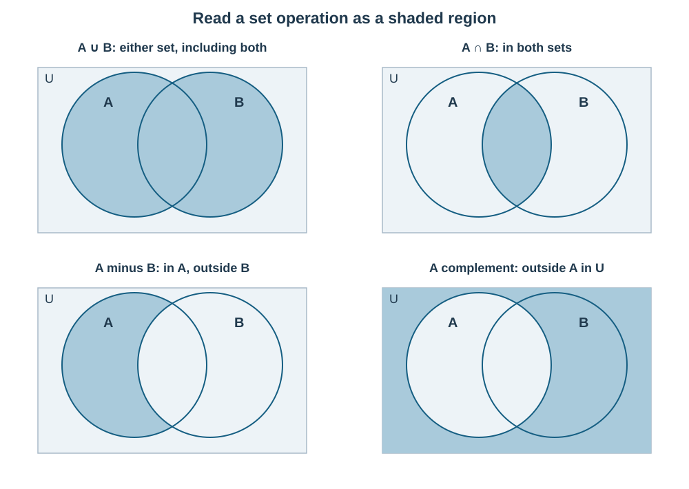

**Read the four pictures.**

- $A\cup B$, the **union**, contains anyone in $A$ **or** $B$, including those in both.
- $A\cap B$, the **intersection**, contains only those in both.
- $A\setminus B$, the **difference**, contains those in $A$ but outside $B$.
- $A^c$, the **complement**, contains those outside $A$ but inside the chosen universal set $U$.

The **universal set** says which people or objects we are considering. Complement depends on it.

The **symmetric difference** keeps the two side regions and removes the overlap:

$$
\boxed{A\triangle B=(A\setminus B)\cup(B\setminus A)
=(A\cup B)\setminus(A\cap B)}.
$$

**Recognition clue:** “exactly one,” “either but not both,” and “in one group only” point to this same region.

Example: if $A=\{1,2,3\}$ and $B=\{3,4\}$, then

$$
A\cup B=\{1,2,3,4\},\quad A\cap B=\{3\},
$$

$$
A\setminus B=\{1,2\},\quad A\triangle B=\{1,2,4\}.
$$

**Disjoint** sets have no common member: $A\cap B=\varnothing$. Empty intersection does not mean the sets themselves are empty.

**Set algebra — use meanings rather than isolated rules.**

| Rule | Formula |
|---|---|
| Order can be swapped | $A\cup B=B\cup A$, $A\cap B=B\cap A$ |
| Grouping can be changed | $(A\cup B)\cup C=A\cup(B\cup C)$; similarly for $\cap$ |
| Distribution | $A\cap(B\cup C)=(A\cap B)\cup(A\cap C)$ |
| Other distribution | $A\cup(B\cap C)=(A\cup B)\cap(A\cup C)$ |
| Repeating a set adds nothing | $A\cup A=A$, $A\cap A=A$ |
| Empty and universal sets | $A\cup\varnothing=A$, $A\cap U=A$, $A\cap\varnothing=\varnothing$, $A\cup U=U$ |
| Complement | $A\cup A^c=U$, $A\cap A^c=\varnothing$, $(A^c)^c=A$ |
| Absorption | $A\cup(A\cap B)=A$, $A\cap(A\cup B)=A$ |
| Difference using complement | $A\setminus B=A\cap B^c$ |

**De Morgan's laws — Important for JEE Main.**

$$
\boxed{(A\cup B)^c=A^c\cap B^c},\qquad
\boxed{(A\cap B)^c=A^c\cup B^c}.
$$

Why does the first one work? To be outside the union, a person must be outside $A$ **and** outside $B$. “Not in either group” becomes “outside both.” For the second, a person fails to belong to both if at least one membership fails.

**Trap:** $A\setminus B$ and $B\setminus A$ usually differ. Difference cannot generally be reversed.

### Formula F01 — Count separate regions, then combine them

**Important for JEE Main.** Use this for surveys, divisibility, and “exactly one” questions.

When we add $n(A)+n(B)$, the shared group is counted twice. Keep it once by subtracting one copy:

$$
\boxed{n(A\cup B)=n(A)+n(B)-n(A\cap B)}.
$$

For finite sets inside $U$,

$$
\begin{aligned}
n(A\setminus B)&=n(A)-n(A\cap B),\\
n(A\triangle B)&=n(A)+n(B)-2n(A\cap B),\\
&=n(A\cup B)-n(A\cap B),\\
n(\text{neither})&=n(U)-n(A\cup B),\\
n(A^c)&=n(U)-n(A).
\end{aligned}
$$

**Why subtract twice for exactly one?** In $n(A)+n(B)$, a person in both is counted twice. We want that person counted **zero** times, so remove both copies.

**Three sets: understand the seven regions.**

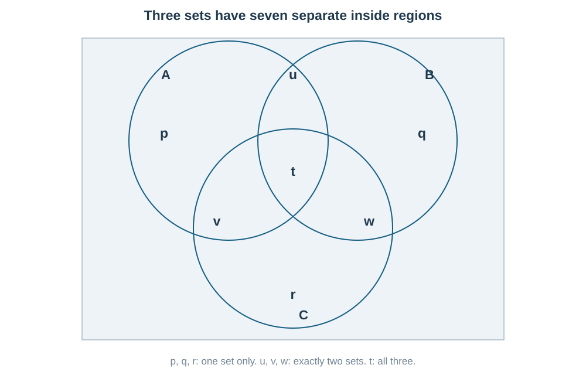

Read $p,q,r$ as the single-set parts; $u,v,w$ as the exactly-two parts; $t$ as the triple part. For example,

$$
n(A\cap B)=u+t.
$$

The ordinary pairwise intersection already includes the triple group. Do not confuse it with “$A$ and $B$ only.”

$$
\boxed{\begin{aligned}
n(A\cup B\cup C)
={}&n(A)+n(B)+n(C)\\
&-n(A\cap B)-n(B\cap C)-n(C\cap A)\\
&+n(A\cap B\cap C).
\end{aligned}}
$$

An object in all three was counted $3$ times, then removed $3$ times. Add it once to keep one copy.

Let $S_1=n(A)+n(B)+n(C)$, $S_2=n(A\cap B)+n(B\cap C)+n(C\cap A)$, and $t=n(A\cap B\cap C)$. Then

$$
\begin{aligned}
n(\text{exactly one})&=S_1-2S_2+3t,\\
n(\text{exactly two})&=S_2-3t,\\
n(\text{at least two})&=S_2-2t.
\end{aligned}
$$

**Quick check:** count one sample object from each region in your formula. It should receive weight $1$ if wanted and $0$ if unwanted.

### Concept C03 — A subset is made by deciding what to include

**Important for JEE Main.** For each member, make a yes-or-no choice: include it or leave it out.

For $A=\{1,2\}$, the choices give

$$
\mathcal P(A)=\{\varnothing,\{1\},\{2\},\{1,2\}\}.
$$

This is the **power set**: the set of **all subsets** of $A$. Its members are sets.

For a finite set with $n$ members,

$$
\boxed{n(\mathcal P(A))=2^n}.
$$

**Why?** There are two choices for the first member, two for the second, and so on. Multiply: $2\cdot2\cdots2=2^n$.

| What is required? | Number |
|---|---|
| All subsets | $2^n$ |
| Proper subsets | $2^n-1$ |
| Nonempty subsets | $2^n-1$ |
| Nonempty proper subsets, $n\ge1$ | $2^n-2$ |
| Containing $k$ specified members | $2^{n-k}$ |
| Excluding $k$ specified members | $2^{n-k}$ |
| Including all of $r$ specified members and excluding $s$ other specified members | $2^{n-r-s}$ |

In the last row the required-in and required-out groups must be disjoint. If one member is demanded both in and out, there are no such subsets.

**At least one — think of the opposite.** If a group of $k$ members is special, subsets containing none of them number $2^{n-k}$. Therefore

$$
\boxed{\text{subsets containing at least one special member}
=2^n-2^{n-k}}.
$$

Another view: choose a nonempty subset of the special group, then any subset of the rest:

$$
(2^k-1)2^{n-k}=2^n-2^{n-k}.
$$

**Exactly $r$ members.** Order does not matter in a subset. The count is

$$
\boxed{\binom nr=\frac{n!}{r!(n-r)!}},\qquad 0\le r\le n.
$$

Here $n!=n(n-1)\cdots1$ and $0!=1$. For instance, choosing an unordered pair gives $n(n-1)/2$: choosing its two members in order counts each pair twice.

Useful cases:

$$
\binom n2=\frac{n(n-1)}2,\qquad
\binom n3=\frac{n(n-1)(n-2)}6.
$$

**Parity clue:** a sum of integers is even when it contains an even number of odd terms. For a $3$-member subset, use either $0$ odd members or $2$ odd members. Q28 uses this case split.

**Small empty-set check:** $\mathcal P(\varnothing)=\{\varnothing\}$ has one member, matching $2^0=1$.

### Concept C04 — Ordered pairs make a relation

**Important for JEE Main.** An ordered pair remembers which member comes first:

$$
(a,b)=(c,d)\iff a=c\text{ and }b=d.
$$

Usually $(a,b)\ne(b,a)$. Think “first input, second output,” or “arrow from the first member to the second.”

The **Cartesian product** $A\times B$ is the set of every possible ordered pair with first member in $A$ and second member in $B$.

For $A=\{1,2\}$ and $B=\{p,q\}$,

$$
A\times B=\{(1,p),(1,q),(2,p),(2,q)\}.
$$

If $|A|=m$, $|B|=n$, then $|A\times B|=mn$.

A **relation from $A$ to $B$** is any subset of $A\times B$. We choose which possible pairs belong. A relation **on $A$** uses $A\times A$.

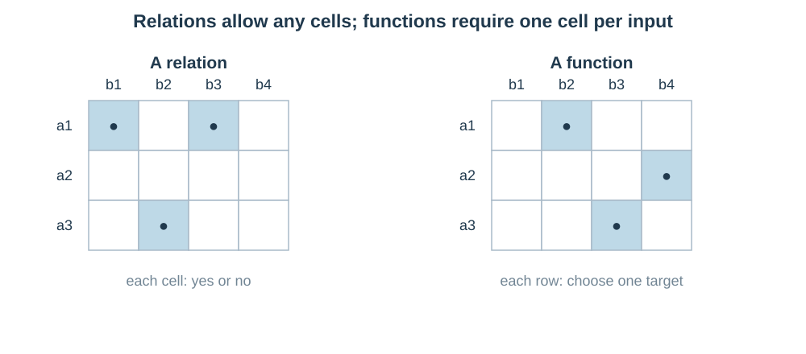

**Read the relation grid:** a selected cell in row $a_1$, column $b_3$ means $(a_1,b_3)$ belongs to the relation. A row may have no selected cell or several. A function, introduced shortly, has the extra rule shown in the other grid.

For a relation $R$, its **domain** is the set of first entries that actually occur; its **range** is the set of second entries that actually occur.

Example: $R=\{(1,p),(1,q)\}$ has domain $\{1\}$ and range $\{p,q\}$, even though the containing set $A$ may also contain $2$.

The **inverse relation** reverses every pair:

$$
R^{-1}=\{(b,a):(a,b)\in R\}.
$$

**Trap:** reversing a relation always gives a relation. It need not give a function. Several arrows can arrive at one output and become several arrows leaving the same input when reversed.

### Concept C05 — Read relation properties as arrow rules

**Important for JEE Main.** Test each property separately. One true property does not automatically give the others.

**Reflexive:** every member is related to itself:

$$
\boxed{(a,a)\in R\quad\text{for every }a\in A}.
$$

In an arrow picture, every point has a loop. In a grid, every diagonal cell must be selected. Check every member of the declared set, including a member that appears nowhere else in $R$.

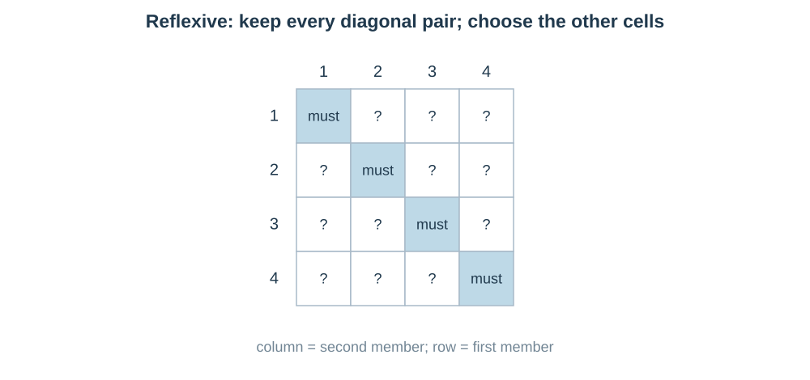

**Symmetric:** every arrow has its reverse:

$$
\boxed{(a,b)\in R\Longrightarrow(b,a)\in R}.
$$

This is an “if” rule. If neither arrow is present, symmetry is still satisfied. A loop reverses to itself.

**Transitive:** two connected steps require the direct step:

$$
\boxed{(a,b)\in R,\ (b,c)\in R\Longrightarrow(a,c)\in R}.
$$

Read it as: if $a$ is linked to $b$, and $b$ to $c$, then $a$ must be linked directly to $c$. Test all such chains, not just one.

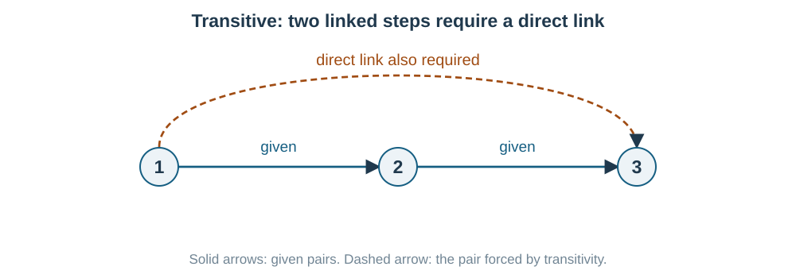

**Read the drawing:** follow the two solid arrows. The dashed arrow is the extra pair that must exist. This condition does not by itself demand reverse arrows; that is the separate symmetry condition.

**Antisymmetric** is different from “not symmetric”:

$$
\boxed{(a,b)\in R,\ (b,a)\in R\Longrightarrow a=b}.
$$

Different members cannot have arrows both ways. Loops are allowed. The relation $\le$ on real numbers is antisymmetric: $a\le b$ and $b\le a$ force $a=b$.

**Irreflexive:** no loop $(a,a)$ is allowed. **Asymmetric:** an arrow forbids its reverse; this also forbids loops. A strict comparison such as $<$ is asymmetric.

These words are not logical opposites in every case. A relation can be neither symmetric nor antisymmetric. An empty relation on a nonempty set is symmetric and transitive because there is no arrow or chain breaking their “if” rules, but it is not reflexive.

**Equivalence relation:** reflexive **and** symmetric **and** transitive.

The useful meaning is **same-group membership**. Split the set into nonempty groups, with no overlap and no member left out. Declare two members related exactly when they belong to the same group. That creates an equivalence relation.

For example, the split $\{1,2\},\{3\}$ gives

$$
R=\{(1,1),(1,2),(2,1),(2,2),(3,3)\}.
$$

Inside $\{1,2\}$ every ordered pair is included. Between the groups there is no pair.

The group containing $a$ is its **equivalence class**, written $[a]$. Classes are either identical or disjoint; together they cover the whole set.

**Recognition clue:** questions about “equivalence” and a small finite set often become questions about splitting that set into groups. This split is called a **partition**.

### Formula F02 — Count independent choices in a relation

**Important for JEE Main.** First decide what choices are genuinely independent.

With $m$ members in $A$ and $n$ in $B$, there are $mn$ possible pairs. Each pair can be included or excluded:

$$
\boxed{\text{relations from }A\text{ to }B=2^{mn}}.
$$

On an $n$-member set there are $n^2$ possible pairs. For reflexivity, $n$ diagonal pairs are forced, leaving $n^2-n$ free:

$$
\boxed{\text{reflexive relations}=2^{n^2-n}}.
$$

**Symmetry changes the unit of choice.** For distinct $a,b$, choose the pair of cells $(a,b),(b,a)$ together. There are $\binom n2=n(n-1)/2$ such groups, plus $n$ independent loops:

$$
\boxed{\text{symmetric relations}=2^{\,n+\binom n2}
=2^{n(n+1)/2}}.
$$

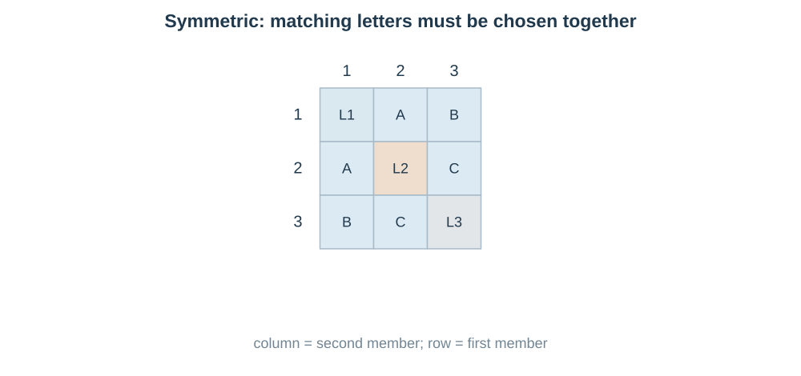

Read the matching letters as one switch each: choose both cells or neither. The three loop switches are separate.

| Required properties on $n$ members | Count | Reason |
|---|---|---|
| Any relation | $2^{n^2}$ | Every cell is free. |
| Reflexive | $2^{n(n-1)}$ | Force all loops. |
| Irreflexive | $2^{n(n-1)}$ | Forbid all loops. |
| Symmetric | $2^{n(n+1)/2}$ | Choose reverse-pairs together; loops are free. |
| Reflexive and symmetric | $2^{n(n-1)/2}$ | Loops are forced; reverse-pairs remain free. |
| Antisymmetric | $2^n3^{n(n-1)/2}$ | Each distinct reverse-pair allows neither, forward only, or backward only; loops are free. |
| Asymmetric | $3^{n(n-1)/2}$ | The same three choices, but no loops. |

The first four rows are the main starting tools. The last rows follow from the same switch idea. **Transitivity couples chains of choices**, so do not invent a similar power-of-two formula for it.

**Equivalence relations count partitions.** For $n=0,1,2,3,4$, the counts are

$$
1,\ 1,\ 2,\ 5,\ 15.
$$

These are small **Bell numbers**. Understand the grouping instead of trying to use $2^{n^2}$, which counts many relations that are not equivalence relations. Q3 shows all block-size cases for four members.

The identity relation $\{(a,a):a\in A\}$ is the partition into singleton groups. The universal relation $A\times A$ is one group containing everyone.

**Adding the fewest pairs to make equivalence:** join members forced to be in the same group, then include every ordered pair within each resulting group. If the class sizes are $s_1,\ldots,s_k$, the completed relation has

$$
\boxed{s_1^2+\cdots+s_k^2}
$$

pairs. Subtract the number already present. Q22 explains why adding just loops and reverse arrows may still miss transitive links.

### Concept C06 — A function gives each input one output

**Important for JEE Main.** Write $f:A\to B$. The set $A$ contains the allowed **inputs**. The set $B$ is the declared **codomain**, or target set.

For every input in $A$, a function must give **exactly one** output in $B$. It can send two different inputs to the same output. It can leave some targets unused.

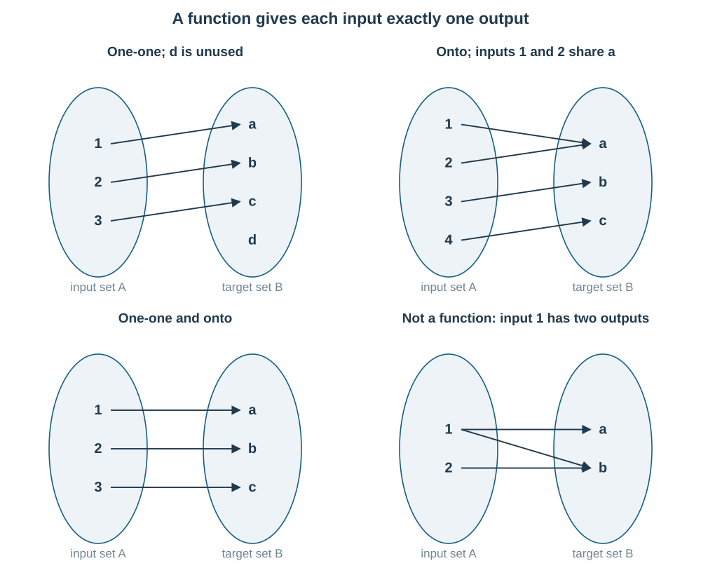

**Read the arrows:** look at each member in the left oval. Exactly one arrow must leave it. Several arrows may arrive at the same right-hand member. An unused right-hand member does not stop the rule being a function.

For $f:A\to B$:

- **Domain:** $A$, the allowed inputs.
- **Codomain:** $B$, the declared targets.
- **Range:** $f(A)=\{f(x):x\in A\}$, the outputs actually reached.

Always $f(A)\subseteq B$.

**One-one**, also called **injective**, means different inputs give different outputs:

$$
\boxed{f(x_1)=f(x_2)\Longrightarrow x_1=x_2}.
$$

No target receives arrows from two different inputs.

**Onto**, also called **surjective**, means every target is reached:

$$
\boxed{f(A)=B}.
$$

To prove onto, take any target $y\in B$ and find an allowed input $x\in A$ with $f(x)=y$.

**Bijective** means both one-one and onto. Every target receives exactly one arrow.

**Many-one** means the function is not one-one. In this guide, **into** means not onto: some declared target is unused. These are different checks.

**The same formula can change type when its sets change.**

$$
f:\mathbb R\to\mathbb R,\quad f(x)=x^2
$$

is not one-one because $f(1)=f(-1)$, and not onto because negative targets are missed.

Restrict it to $f:[0,\infty)\to[0,\infty)$ and the same formula becomes bijective. The nonnegative restriction removes the duplicate inputs, and the new codomain contains only reached values.

Two functions are equal when they have the same domain and codomain and agree at every allowed input. Matching only the written expression may miss different restrictions.

### Formula F03 — Count functions by assigning outputs

**Important for JEE Main.** Let $|A|=m$, $|B|=n$, initially with $m,n\ge1$.

**All functions:** each of the $m$ inputs independently chooses one of $n$ outputs:

$$
\boxed{n^m}.
$$

The exponent counts inputs. This differs from $2^{mn}$ for arbitrary relations.

**One-one functions:** no repeated output is allowed. The choices shrink:

$$
\boxed{{}^nP_m=n(n-1)\cdots(n-m+1)=\frac{n!}{(n-m)!}},
\qquad m\le n.
$$

If $m>n$, an injective function is impossible: too many inputs for distinct targets.

**Bijections:** the finite sets must have equal size. When $m=n$, there are $n!$ bijections; otherwise there are none.

**Onto functions:** first count all assignments, then remove assignments that miss targets. For $m\ge1$,

$$
\boxed{N_{\text{onto}}
=\sum_{j=0}^{n}(-1)^j\binom nj(n-j)^m}.
$$

The alternating signs correct repeated subtraction: subtract maps missing one chosen target, add back those missing two, and continue.

For three targets this becomes

$$
\boxed{3^m-3\cdot2^m+3\cdot1^m},\qquad m\ge1.
$$

There are no maps missing all three targets when the input set is nonempty. Q7 explains every term with $m=5$.

An onto function is impossible if $m<n$. If $m=n$, onto and one-one are equivalent for these **finite equal-sized sets**, so the count is $n!$.

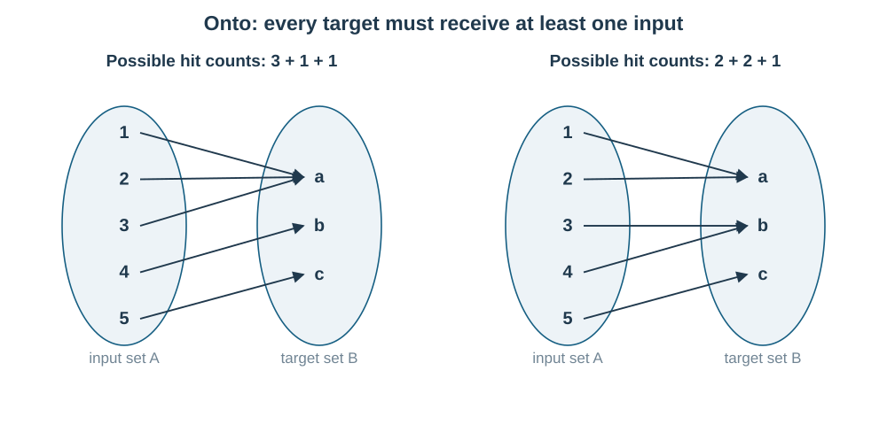

**Read the target ovals:** none is unused. A repeated output is allowed. Onto does not require one-one.

**Strictly increasing functions on ordered finite sets.** If the $m$ inputs and $n$ outputs are in numerical order, choose $m$ distinct outputs; their assignment in increasing order is then forced:

$$
\boxed{\text{strictly increasing maps}=\binom nm},\qquad m\le n.
$$

The strictly decreasing count is the same. This is smaller than the unrestricted one-one count because output order is fixed.

**Empty-set cases:** there is one function from $\varnothing$ to any set, the empty function. It is onto only when the target is also empty. There is no function from a nonempty set to $\varnothing$. Handle these cases directly instead of blindly using powers containing $0^0$.

### Concept C07 — Read a function graph and test its arrows

**Important for JEE Main.** A graph places the input on the horizontal $x$-axis and output on the vertical $y$-axis. A point $(a,b)$ on it means $f(a)=b$.

**Vertical-line test:** at an allowed input $x=a$, there must be exactly one output. If a vertical line cuts a proposed graph at two points, it is not one function of $x$.

**Horizontal-line test:** for a function, a horizontal line $y=b$ checks how many inputs reach that output. Two or more intersections mean it is not one-one.

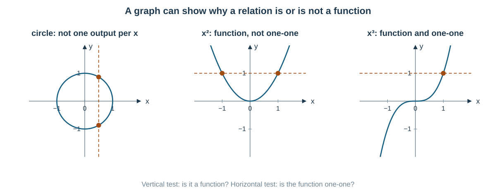

**Read the three views:** a full circle gives two outputs for many inputs. The parabola gives one output per input but two inputs for many positive outputs. The cubic gives one input for each real output.

**Onto is a different question:** does the graph reach every height in the declared codomain? The drawing alone does not state that codomain; read it in the question.

A strictly increasing function keeps rising as $x$ increases; a strictly decreasing function keeps falling. Either is one-one:

$$
x_1<x_2\Longrightarrow f(x_1)<f(x_2)
$$

is the strictly increasing condition. “Nondecreasing” allows equality and is not enough by itself to guarantee one-one.

To disprove one-one, find two **different allowed** inputs with the same output. To disprove onto, find one declared target that no input can reach.

### Concept C08 — Domain: which inputs keep every operation meaningful?

**Important for JEE Main.** The natural real domain is the set of inputs for which the entire expression is defined. When a question declares a narrower domain, use that restriction too.

| Operation | Required condition |
|---|---|
| A denominator $g(x)$ | $g(x)\ne0$ |
| An even root $\sqrt[2k]{g(x)}$ | $g(x)\ge0$ |
| An even root in a denominator | $g(x)>0$ |
| An odd root | Every real value inside the root is allowed. |
| $\log_a g(x)$ | $g(x)>0$, with fixed $a>0$, $a\ne1$ |
| $a^{g(x)}$ with fixed positive base $a$ | The exponent $g(x)$ must be defined. |
| $\sin^{-1}g(x)$ or $\cos^{-1}g(x)$ | $-1\le g(x)\le1$ |
| $\tan x$ or $\sec x$ | $\cos x\ne0$ |
| $\cot x$ or $\csc x$ | $\sin x\ne0$ |

**Why do roots and logs need these conditions?** The square root $\sqrt u$ asks for a nonnegative number whose square is $u$. Real squares cannot be negative, so $u\ge0$. An odd root can accept a negative inside: $\sqrt[3]{-8}=-2$ because $(-2)^3=-8$.

A logarithm asks for an **exponent**:

$$
\log_a u=v\quad\Longleftrightarrow\quad a^v=u,
\qquad a>0,\quad a\ne1,\quad u>0.
$$

For example, $\log_2 8=3$ because $2^3=8$. A positive base raised to a real exponent gives a positive output; that explains the positive-argument rule. The symbol $\ln u$ means logarithm to base $e$, where $e\approx2.718$. It has the same argument condition $u>0$.

For a sum, product, or difference, **all constituent expressions must be defined at the same input**. Intersect their allowed sets. For a quotient also exclude zeros of its denominator.

**Example of combined restrictions.** A square root may allow two outer intervals, while a logarithm allows only $x<4$. Keep their common part:

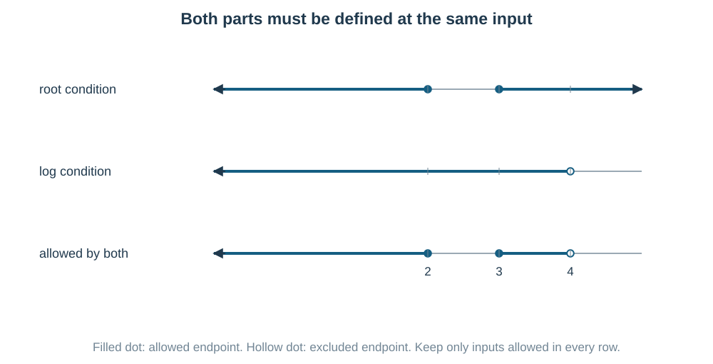

Read a filled endpoint as included and a hollow endpoint as excluded. This difference matters: $\sqrt0$ exists but $\ln0$ does not.

**Negative logarithms are allowed.** $\ln(1/2)$ is negative, but it is defined. An ordinary logarithm needs a **positive argument**, not a positive logarithm value.

If the logarithm is itself under a square root, then its value must also be nonnegative. Now the base matters:

$$
\begin{array}{ll}
a>1:& \log_a u\ge0\iff u\ge1,\\[2pt]
0<a<1:& \log_a u\ge0\iff 0<u\le1.
\end{array}
$$

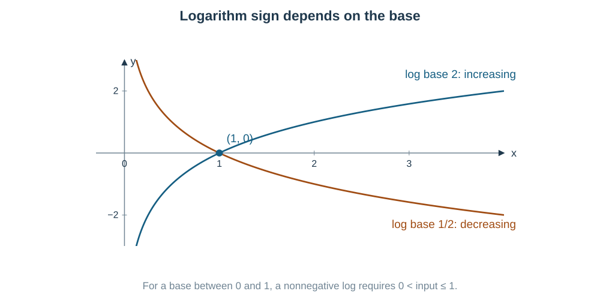

**Read the graph:** for a base below $1$, inputs between $0$ and $1$ give nonnegative outputs. This is why a root-of-log question can reverse the inequality you expected.

**Keep restrictions when simplifying.**

$$
\frac{x^2-1}{x-1}=x+1\quad\text{only for }x\ne1.
$$

The simplified expression does not repair the original missing input. Its original graph is the line $y=x+1$ with the point $(1,2)$ removed.

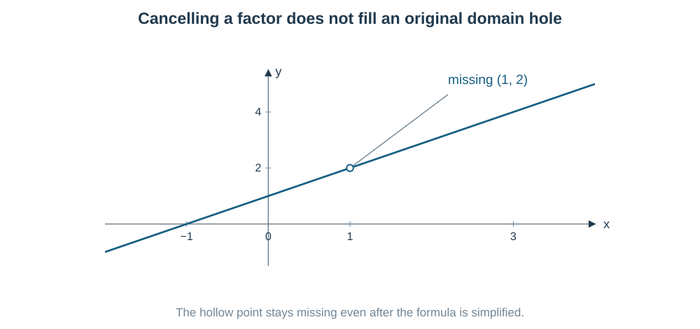

**Question clue:** a domain asks for allowed **inputs**. Finding output bounds instead would answer a range question.

### Concept C09 — Range: which outputs can actually occur?

**Important for JEE Main.** Domain asks **which inputs are allowed**. Range asks **which outputs those inputs produce**.

For $f(x)=x^2$ on $\mathbb R$, all real inputs are allowed, but the output cannot be negative. The range is $[0,\infty)$.

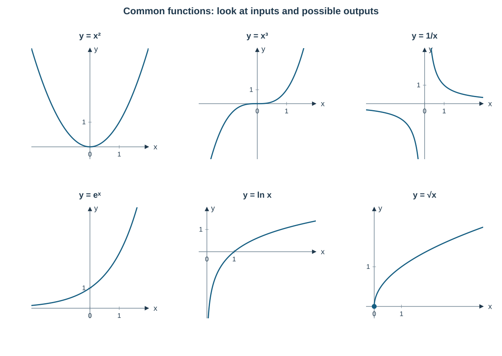

**Read a graph in two directions:** look horizontally for allowed inputs and vertically for reached output heights. A gap, a missing endpoint, or a restriction can change the answer.

| Function, on the stated domain | Range |
|---|---|
| $x^2$ or $|x|$, $x\in\mathbb R$ | $[0,\infty)$ |
| $x^3$, $x\in\mathbb R$ | $\mathbb R$ |
| $1/x$, $x\ne0$ | $\mathbb R\setminus\{0\}$ |
| $\sqrt x$, $x\ge0$ | $[0,\infty)$ |
| $e^x$, $x\in\mathbb R$ | $(0,\infty)$ |
| $\ln x$, $x>0$ | $\mathbb R$ |
| $\sin x,\cos x$, $x\in\mathbb R$ | $[-1,1]$ |
| $\tan x$, on its natural domain | $\mathbb R$ |
| $\lfloor x\rfloor$, $x\in\mathbb R$ | $\mathbb Z$ |
| $x-\lfloor x\rfloor$, $x\in\mathbb R$ | $[0,1)$ |

Here $e$ is the fixed positive number approximately $2.718$, not an unknown variable. More generally, $a^x$ has range $(0,\infty)$ for $a>0$, $a\ne1$. If $a=1$, the range is just $\{1\}$.

**A basic picture behind sine and cosine.** On a circle of radius $1$ centred at the origin, a point at angle $\theta$ has coordinates $(\cos\theta,\sin\theta)$.

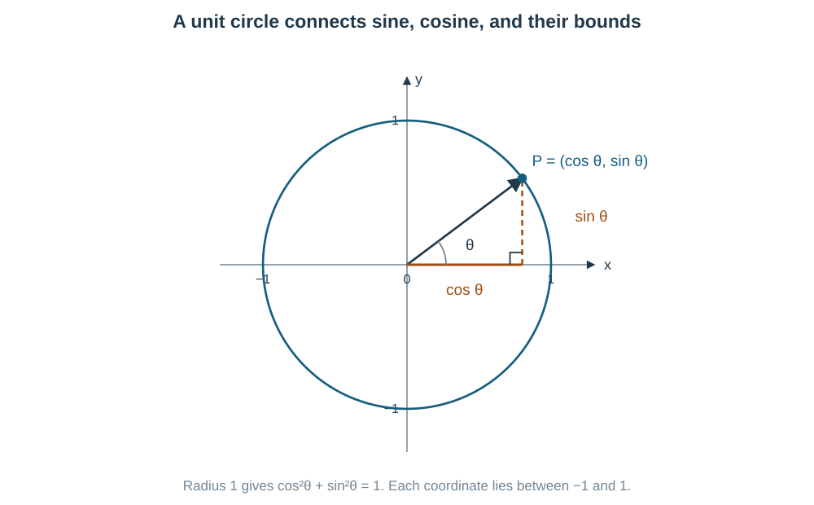

As the point goes around the circle, each coordinate reaches every value from $-1$ to $1$. The right triangle in the picture also gives $\cos^2\theta+\sin^2\theta=1$ by Pythagoras. This connects the range table to the amplitude calculation in F04.

**Do not copy this table after changing the domain.** On $x\in[-1,2]$, the square function has range $[0,4]$, not $[0,\infty)$.

**Three useful ways to find a range.**

1. **Understand the expression.** Can it be written as a square, a positive reciprocal, a shifted standard function, or a familiar bounded expression?
2. **Solve backwards.** Set $y=f(x)$. Find which $y$ values give at least one **real, allowed** input.
3. **Use a graph to find the relevant features.** Look for peaks, holes, endpoint inclusion, and heights approached at large inputs. Then confirm the exact claims mathematically.

**An approached value is not necessarily reached.** For example,

$$
\frac{x^2}{1+x^2}=1-\frac1{1+x^2}.
$$

The reciprocal is positive for every real $x$, so this expression never equals $1$. At $x=0$ it equals $0$.

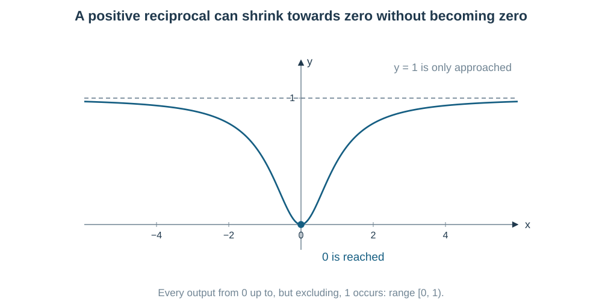

The dashed line is an **asymptote**: the graph can get arbitrarily close to it as $|x|$ grows. That alone does not put the height in the range. Q10 also checks that every intermediate output occurs.

**Linear-fractional range — a useful shortcut.** This is a fraction of two expressions of the form $p x+q$. For

$$
f(x)=\frac{ax+b}{cx+d},\qquad c\ne0,\quad ad-bc\ne0,
$$

$$
\boxed{D_f=\mathbb R\setminus\{-d/c\},\qquad
\text{range}(f)=\mathbb R\setminus\{a/c\}}.
$$

Why is $a/c$ missed? Equating the fraction to $a/c$ would require $bc=ad$, contrary to the condition. Every other output can be solved for using

$$
x=\frac{b-dy}{cy-a}.
$$

The condition $ad-bc\ne0$ also stops the fraction collapsing to a constant. If it does collapse, recheck the range and retain any original forbidden input.

**Moving or scaling a known output interval.** If the range is $[m,M]$:

- Adding $k$ gives $[m+k,M+k]$.
- Multiplying by $a>0$ gives $[am,aM]$.
- Multiplying by $a<0$ reverses the endpoint order: $[aM,am]$.
- Taking absolute values reflects negative outputs upward. The maximum is $\max(|m|,|M|)$; the minimum is $0$ if the interval contains $0$, otherwise $\min(|m|,|M|)$.

Keep track of open endpoints too. These interval statements assume every value in the original interval occurs.

### Concept C10 — Algebra of functions and composition

**Important for JEE Main.** Function notation tells us where to substitute.

For example, $f(x)=x^2+1$ gives

$$
f(3)=3^2+1,\qquad f(t)=t^2+1,\qquad
f(g(x))=(g(x))^2+1.
$$

The symbol inside the brackets replaces **every input slot**. It is not an extra factor.

For pointwise operations,

$$
(f+g)(x)=f(x)+g(x),\quad
(fg)(x)=f(x)g(x),\quad
\left(\frac fg\right)(x)=\frac{f(x)}{g(x)}.
$$

The first two need both functions defined. The quotient also needs $g(x)\ne0$.

**Composition means one function after another:**

$$
\boxed{(f\circ g)(x)=f(g(x))}.
$$

Start with $x$, apply the **inside** function $g$, then apply $f$ to that output.

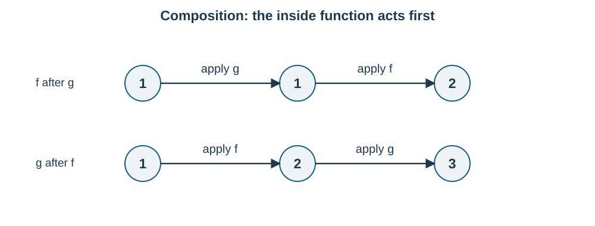

Here $f(x)=x^2+1$ and $g(x)=2x-1$. The top route is $f\circ g$, while the bottom is $g\circ f$. Reversing the order can change the answer:

$$
(f\circ g)(x)=(2x-1)^2+1,\qquad
(g\circ f)(x)=2(x^2+1)-1.
$$

**Composition domain.** The first function must accept the original input, and the second must accept its output:

$$
\boxed{D_{f\circ g}=\{x\in D_g:g(x)\in D_f\}}.
$$

For a composition on the entire declared domain of $g$, its range must lie inside $D_f$.

Example: if $f(t)=\sqrt t$ and $g(x)=x-2$, then

$$
f(g(x))=\sqrt{x-2}\quad\text{needs }x\ge2,
$$

whereas

$$
g(f(x))=\sqrt x-2\quad\text{needs }x\ge0.
$$

Same functions, different order, different expressions and domains.

Composition is associative when the maps fit:

$$
f\circ(g\circ h)=(f\circ g)\circ h.
$$

It is generally not commutative: $f\circ g$ need not equal $g\circ f$.

**Useful connections.** If $f\circ g$ is one-one, then $g$ must be one-one: duplicate outputs from $g$ could not be separated later by $f$. If $f\circ g$ is onto its target, the outer $f$ must be onto that target. The other function need not automatically have the same property.

### Concept C11 — Inverse functions undo a function

**Important for JEE Main.** If $f$ takes input $a$ to output $b$, an inverse takes $b$ back to $a$:

$$
\boxed{f(a)=b\iff f^{-1}(b)=a}.
$$

A genuine inverse function from the full codomain back to the domain exists when $f$ is **bijective**. One-one makes the original input unique; onto ensures every declared target has an original input.

**Do not confuse two meanings:**

$$
f^{-1}(x)\ \text{means inverse-function value},\qquad
\frac1{f(x)}\ \text{means reciprocal}.
$$

**How to find an inverse formula.** Write $y=f(x)$, solve for $x$ in terms of $y$, and then name the inverse input $x$. Keep the old range as the inverse domain, and the old domain as the inverse range.

Example:

$$
y=2x+3
\quad\Longrightarrow\quad
x=\frac{y-3}{2}
\quad\Longrightarrow\quad
f^{-1}(x)=\frac{x-3}{2}.
$$

For $x^2$ on all real inputs, output $4$ comes from both $2$ and $-2$, so an inverse cannot choose a unique input. Restrict to nonnegative inputs, and the inverse is $\sqrt x$.

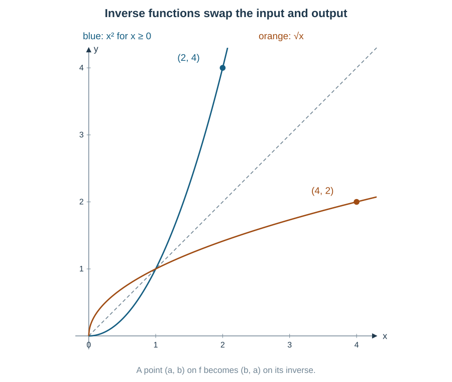

**Read the picture:** $(2,4)$ changes to $(4,2)$. Input and output swap, so the mirror line is $y=x$. Equal axis scales are essential to show that reflection correctly.

For bijections $f:A\to B$ and $g:C\to A$,

$$
f^{-1}\circ f=I_A,\qquad
f\circ f^{-1}=I_B,\qquad
\boxed{(f\circ g)^{-1}=g^{-1}\circ f^{-1}}.
$$

The **identity function** $I_A$ leaves every input unchanged: $I_A(x)=x$. To undo “first $g$, then $f$,” undo $f$ first and $g$ second.

**A value question may not need a formula.** To find $f^{-1}(10)$, look for an input producing $10$. Q24 shows why solving a general cubic inverse would be unnecessary work.

**Self-inverse:** a function that undoes itself satisfies

$$
\boxed{f(f(x))=x}
$$

where both applications are defined. Examples are $f(x)=c-x$ on $\mathbb R$, and $f(x)=a/x$ on $\mathbb R\setminus\{0\}$ for $a\ne0$.

A useful fractional-form check is that a nonconstant function

$$
f(x)=\frac{px+q}{rx+s},\qquad ps-qr\ne0,
$$

is self-inverse if $p+s=0$, on its appropriate domain. The identity function is another self-inverse case and need not satisfy that coefficient condition. Q12 can be solved more easily by a good input substitution, so the condition is a check rather than a required memory trick.

**Repeated composition:** if the question defines $f^n$ as $n$-fold composition, apply $f$ repeatedly. It does not mean $[f(x)]^n$.

Look for a short cycle of actual values. If a starting value returns after $k$ steps, divide the requested step number by $k$ and use the remainder. Check that every step stays in the domain. Q25 uses a three-step cycle.

### Concept C12 — Modulus, floor, and fractional part

**Important for JEE Main.** Similar-looking symbols can ask for different operations.

**Modulus** $|x|$ is distance from zero:

$$
|x|=\begin{cases}x,&x\ge0,\\-x,&x<0.\end{cases}
$$

Thus $|x-h|$ is distance from $h$. A distance is never negative. For $a\ge0$,

$$
|x-h|\le a\iff h-a\le x\le h+a.
$$

For $a>0$,

$$
|x-h|\ge a\iff x\le h-a\text{ or }x\ge h+a.
$$

At $a=0$, the latter condition allows all real $x$. An equation $|x-h|=a$ has two solutions when $a>0$, one when $a=0$, and none when $a<0$.

**Greatest integer or floor:** $\lfloor x\rfloor$ is the greatest integer not exceeding $x$. The supplied PDF writes it as $[x]$.

$$
\lfloor2.7\rfloor=2,\qquad
\lfloor-0.2\rfloor=-1,\qquad
\lfloor-2\rfloor=-2.
$$

Do not just remove decimal digits from a negative input. Use the definition:

$$
\boxed{\lfloor x\rfloor=n\iff n\le x<n+1,\qquad n\in\mathbb Z}.
$$

**Fractional part:**

$$
\boxed{\{x\}=x-\lfloor x\rfloor,\qquad 0\le\{x\}<1}.
$$

For $x=-0.2$, this is $-0.2-(-1)=0.8$. It is still nonnegative.

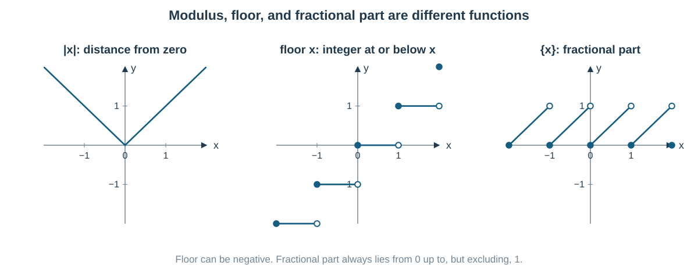

**Read the endpoint marks:** at a step's starting integer, the filled point gives the actual value. The hollow point at the other end is not included in that piece.

For integer $n$,

$$
\lfloor x+n\rfloor=\lfloor x\rfloor+n.
$$

An important negative-input connection is

$$
\boxed{\lfloor x\rfloor+\lfloor-x\rfloor
=\begin{cases}0,&x\in\mathbb Z,\\-1,&x\notin\mathbb Z.\end{cases}}
$$

Why? Write a noninteger as $x=n+r$, with $0<r<1$. Then $-x=-n-r$ lies between $-n-1$ and $-n$, so its floor is $-n-1$. The floors add to $-1$.

For $N,d$ positive integers, the number of positive multiples of $d$ up to $N$ is

$$
\boxed{\left\lfloor\frac Nd\right\rfloor}.
$$

Those multiples are $d,2d,\ldots,kd$, where the largest possible integer $k$ is $\lfloor N/d\rfloor$. Q29 combines this with a Venn diagram.

### Concept C13 — Even and odd functions are symmetry rules

**Important for JEE Main.** The domain must contain $-x$ whenever it contains $x$. Then compare the whole expression after replacing $x$ by $-x$:

$$
\boxed{\text{even: }f(-x)=f(x)},\qquad
\boxed{\text{odd: }f(-x)=-f(x)}.
$$

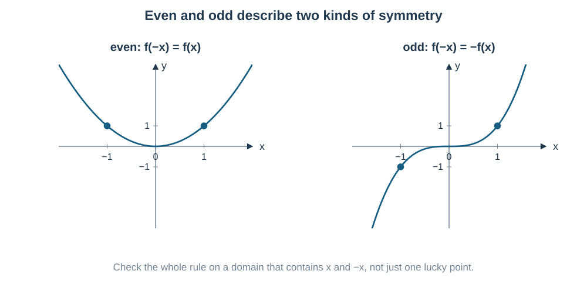

**Read the points:** an even graph sends $(x,y)$ to $(-x,y)$. An odd graph sends it to $(-x,-y)$.

“Odd” here describes a function rule, not whether an output happens to be an odd integer.

| Building blocks | Examples |
|---|---|
| Even | $x^2$, $|x|$, $\cos x$, nonzero constant functions |
| Odd | $x$, $x^3$, $\sin x$ |
| Both | The zero function on a symmetric domain |

If an odd function is defined at $0$, then $f(0)=-f(0)$, so $f(0)=0$. The converse is false: passing through the origin does not prove oddness.

Useful combinations, on a common symmetric domain:

| Operation | Result |
|---|---|
| Even + even | Even |
| Odd + odd | Odd |
| Even × even | Even |
| Odd × odd | Even |
| Even × odd | Odd |

An even part plus an odd part is generally neither; special zero parts can change that. For quotients, use the corresponding sign rule and retain nonzero denominators.

**Why even times odd is odd.** Replace $x$ by $-x$:

$$
u(-x)v(-x)=u(x)(-v(x))=-u(x)v(x).
$$

The rule follows from the definitions; it is not a separate fact to memorize.

If the inner function $g$ is even, $f(g(-x))=f(g(x))$, so the composition is even wherever its domain is symmetric. If $g$ is odd, an even outer $f$ gives an even composition, while an odd outer $f$ gives an odd composition.

**Every function on a symmetric domain can be split into its even and odd parts:**

$$
\boxed{f(x)=\underbrace{\frac{f(x)+f(-x)}2}_{\text{even part}}
+\underbrace{\frac{f(x)-f(-x)}2}_{\text{odd part}}}.
$$

This also explains why equations linking $f(x)$ and $f(-x)$ can reveal different parts of the function.

**A graph is a check, not an all-input proof.** Prove the required equality with $f(-x)$. To disprove a claim, one valid counterexample is enough.

### Concept C14 — A period repeats the entire rule

**Important for JEE Main.** A positive number $T$ is a period when

$$
\boxed{f(x+T)=f(x)}
$$

for every input in the repeating domain. The domain itself must repeat under the shift. One repeated output is not enough.

The **fundamental period** is the smallest positive period, when such a smallest one exists. If $T$ is a period, $2T,3T,\ldots$ are also periods. A constant function has every positive period and no smallest positive one.

Angles in these trigonometric formulas are in **radians**: $\pi$ radians is $180^\circ$, and $2\pi$ is a full turn.

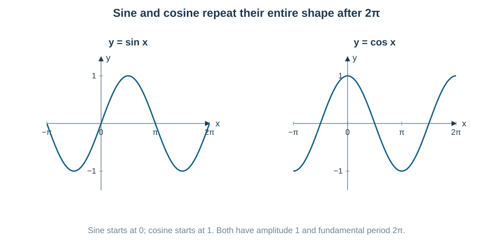

**Read the waves:** moving from $x$ to $x+2\pi$ brings back the same height and the same whole pattern. The zero crossings and peaks help distinguish the two functions.

For $a\ne0$:

| Function | Fundamental period |
|---|---|
| $\sin(ax+b)$, $\cos(ax+b)$ | $2\pi/|a|$ |
| $\tan(ax+b)$, $\cot(ax+b)$ | $\pi/|a|$ |
| $|\sin(ax+b)|$, $|\cos(ax+b)|$ | $\pi/|a|$ |
| $\sin^2(ax+b)$, $\cos^2(ax+b)$ | $\pi/|a|$ |

A nonzero output multiplier or an added constant keeps the period. A zero multiplier can turn the function into a constant, so handle that separately.

**Understand the input scale.** For $\sin(\pi x/3)$, the angle must increase by $2\pi$:

$$
\frac{\pi(x+T)}3-\frac{\pi x}3=2\pi
\quad\Longrightarrow\quad T=6.
$$

It is $6$ input units, not $6\pi$.

**Sums and products need thought.** A common period of the component functions gives a period of their sum or product. It need not be the smallest one.

For example,

$$
\sin x\cos x=\frac12\sin2x
$$

has period $\pi$, although each original factor has period $2\pi$.

**Look for swapping or cancellation.** For $|\sin x|+|\cos x|$, shifting by $\pi/2$ swaps the two terms:

$$
f(x+\pi/2)=|\cos x|+|-\sin x|=f(x).
$$

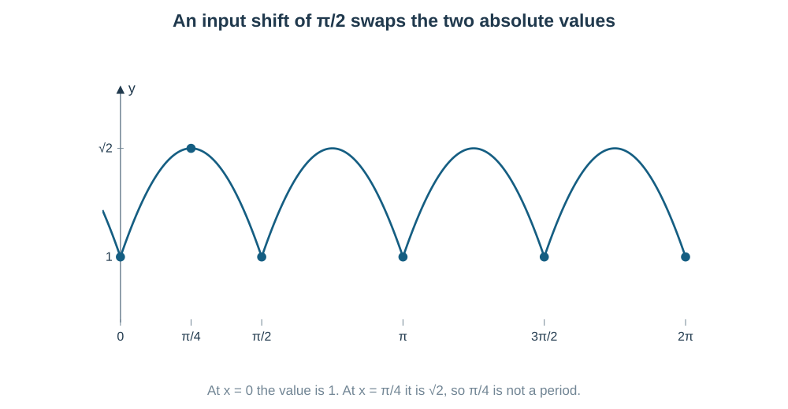

The two terms individually have period $\pi$, but their sum has a smaller one. This is why a blind “take the LCM” rule can fail. Q16 checks that $\pi/2$ really is the smallest.

When periods are rational multiples of a common unit, solve $T=kT_1=\ell T_2$ using positive integers. If the periods are $6$ and $8$, the shortest common shift is $24$. Check whether an extra symmetry makes the sum repeat sooner.

The floor function itself is not periodic: $\lfloor x+1\rfloor=\lfloor x\rfloor+1$. Fractional part is periodic with fundamental period $1$, because the added integer is removed.

### Formula F04 — Range of a sine–cosine combination

**Important for JEE Main — Cauchy–Schwarz and amplitude.** Use this when sine and cosine of the **same angle** appear with fixed coefficients.

Do not maximize them separately. $\sin x=1$ and $\cos x=1$ cannot happen at the same input.

For real constants $a,b$, put $R=\sqrt{a^2+b^2}$. Then, for all real $x$,

$$
\boxed{-R\le a\sin x+b\cos x\le R}.
$$

Every value in that interval occurs. Adding $c$ gives

$$
\boxed{\text{range}(a\sin x+b\cos x+c)=[c-R,c+R]}.
$$

**Why does the square root appear?** Cauchy–Schwarz says

$$
(pu+qv)^2\le(p^2+q^2)(u^2+v^2).
$$

Choose $(p,q)=(a,b)$ and $(u,v)=(\sin x,\cos x)$. Since $\sin^2x+\cos^2x=1$,

$$
(a\sin x+b\cos x)^2\le a^2+b^2.
$$

If $R>0$, the upper value is reached when $\sin x=a/R$ and $\cos x=b/R$. These two numbers have squares summing to $1$, so they describe an allowed point on the unit circle. Reverse both signs for the lower value.

**Another possible approach — combine into one shifted wave.** Choose an angle $\phi$ with $\cos\phi=a/R$ and $\sin\phi=b/R$. Then

$$
a\sin x+b\cos x=R\sin(x+\phi).
$$

The multiplier $R$ is its **amplitude**: how far the output rises above or falls below its middle line.

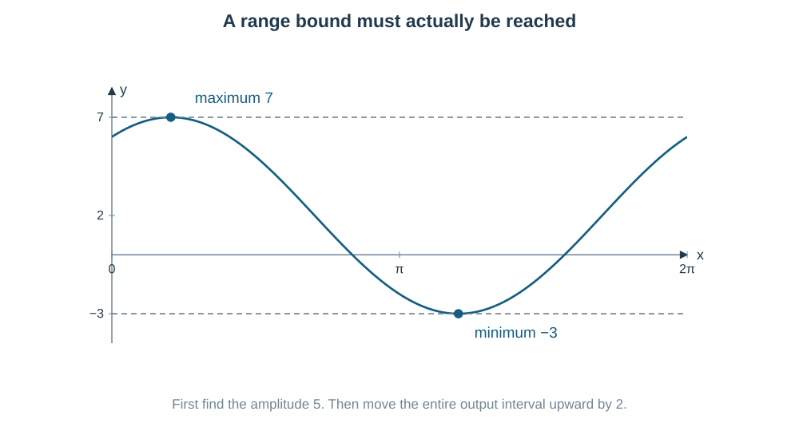

The picture uses $R=5$ and middle line $2$. When $a=b=0$, the expression is simply the constant $c$; do not divide by $R=0$.

**Condition:** the full interval formula assumes all real angles are allowed. On a restricted input interval, an extreme angle may be unavailable. Check the actual domain.

### Concept C15 — A function equation is a rule you can feed chosen inputs

**Important for JEE Main.** “For all $x$” means we may substitute useful allowed values. We do not always need a full formula for the function.

**First ask what substitution will connect the same unknown values.**

| Given shape | Useful move |
|---|---|
| $f(x)$ and $f(-x)$ | Replace $x$ by $-x$. |
| $f(x)$ and $f(1/x)$ | Replace $x$ by $1/x$, with $x\ne0$. |
| $f(x)$ and $f(c-x)$ | Replace $x$ by $c-x$. |
| A value such as $f(2)$ is asked | Try the target input and its paired input first. |
| A rule contains $x+y$ | Try $0$, $1$, negatives, or repeated integer steps as appropriate. |
| A nested $f(f(x))$ | Try an input whose first output is easy. |

For example, suppose $f(x)+2f(1/x)=h(x)$. Replacing $x$ by $1/x$ gives

$$
f(1/x)+2f(x)=h(1/x).
$$

Now there are two equations in the same two unknowns. Call them $u=f(x)$ and $v=f(1/x)$ if the notation feels heavy. Q26 does this for $x=2$.

**General two-step pairing.** If an input change $T$ returns to the start after two applications, $T(T(x))=x$, and

$$
f(x)+k f(T(x))=h(x),
$$

the paired equation gives, for $k\ne\pm1$,

$$
\boxed{f(x)=\frac{h(x)-k h(T(x))}{1-k^2}}.
$$

This comes from eliminating the second unknown, not a new mysterious formula. When $k=\pm1$, that division is invalid and the equations need separate analysis.

**A sum-to-product rule on integer inputs.** If

$$
f(x+y)=f(x)f(y),\qquad f(1)=c\ne0,
$$

then putting $y=0$ gives $f(0)=1$, and putting $y=1$ gives

$$
f(n+1)=c f(n).
$$

Therefore

$$
\boxed{f(n)=c^n\quad\text{for integers }n}.
$$

For negative integers use $f(n)f(-n)=f(0)=1$. Do not automatically claim the same formula for **every real input** without extra assumptions. Q27 only asks for positive integer values, so the recurrence is enough.

### Formula F05 — Rational ranges: use structure before long calculation

**Important for JEE Main.** When numerator and denominator have a shared pattern, try to expose a simpler bounded quantity.

For example,

$$
\frac{x^2+x+1}{x^2-x+1}
=\frac{(x^2+1)+x}{(x^2+1)-x}.
$$

Did you notice the repeated $x^2+1$ and the opposite $x$ signs? Divide by the positive quantity $x^2+1$ and put

$$
u=\frac{x}{x^2+1}.
$$

The two square inequalities $(x-1)^2\ge0$ and $(x+1)^2\ge0$ give

$$
-\frac12\le u\le\frac12.
$$

Now the original function is $(1+u)/(1-u)$. Q30 uses this simpler interval and checks the equality inputs.

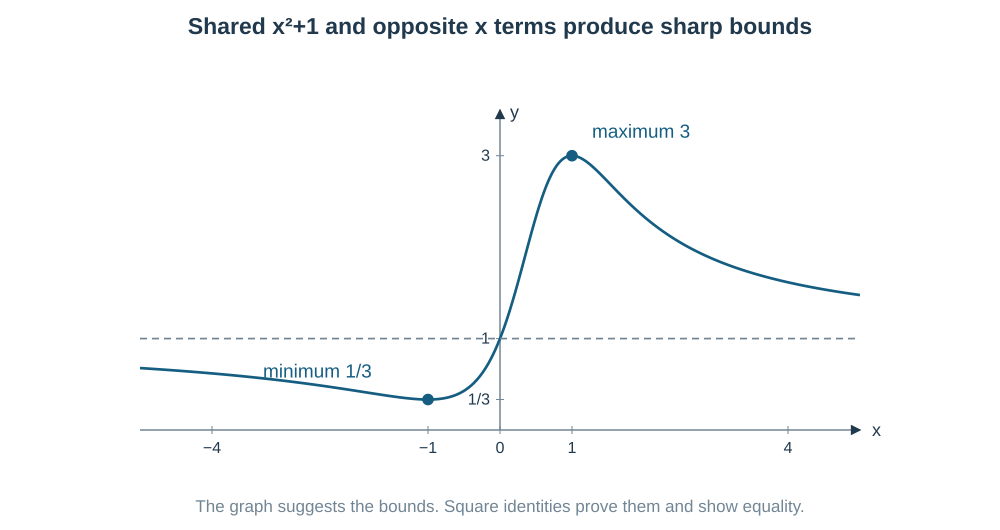

**Read the graph:** it suggests where the extrema occur. The algebra must prove that no unseen input produces a value outside the bounds.

**Another possible approach — solve backwards and require a real input.** For

$$
y=\frac{ax^2+bx+c}{px^2+qx+r},
$$

cross-multiplying gives

$$
(py-a)x^2+(qy-b)x+(ry-c)=0.
$$

When $py-a\ne0$, the quadratic has real roots only if

$$
\boxed{(qy-b)^2-4(py-a)(ry-c)\ge0}.
$$

The expression on the left is the **discriminant**. A positive discriminant gives two distinct real roots, zero gives a repeated real root, and a negative value gives no real root.

This gives **candidate outputs**. Check that a resulting input is in the original domain, particularly that its denominator is nonzero.

If $py-a=0$, the equation is no longer quadratic: solve the remaining linear or constant equation separately. Ignoring that case can lose an output.

This is a useful method when the range is not easy to see directly. A tidy square identity or known bound can be shorter; a complicated expansion is not automatically the best first route.

### Concept C16 — Change viewpoint when it makes the problem easier

**Important for JEE Main.** A good method is connected to a visible clue.

- **“Exactly one”** suggests the two non-overlap Venn regions.
- **“At least one”** suggests counting the opposite case first.
- **A square root plus a log** suggests intersecting domain conditions.
- **A numerator that is one less than its denominator** suggests rewriting as $1$ minus a reciprocal.
- **$f^{-1}(k)$** suggests finding the input giving $k$, before solving a whole inverse formula.
- **Repeated composition** suggests looking for a cycle.
- **A paired input such as $x,1/x$** suggests substituting the partner.
- **A target that asks only a sum or product** suggests avoiding unnecessary individual values.

**Graphs and transformations.** Once the base graph is known:

$$
f(x-h)+k
$$

moves it right by $h$ and up by $k$. The input slot explains the sign: the old input $0$ is now reached when $x-h=0$, that is $x=h$.

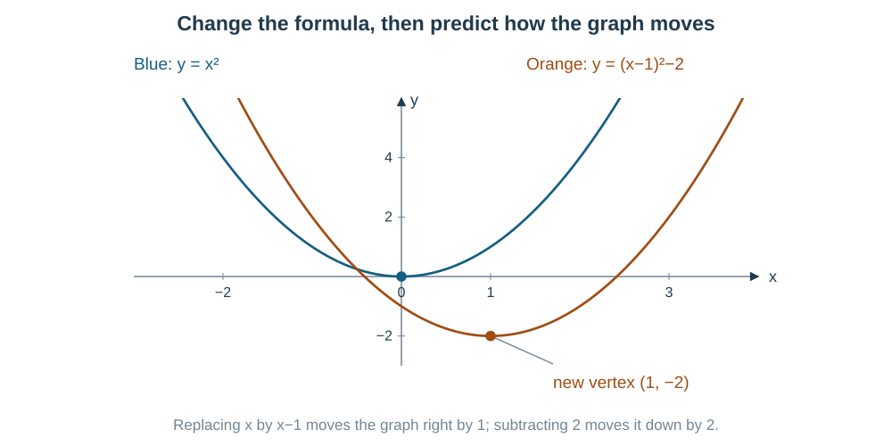

The general form $a f(b(x-h))+k$, with $a,b\ne0$, scales vertical distances by $|a|$ and horizontal distances by $1/|b|$ before the shifts. Negative $a$ reflects vertically; negative $b$ reflects horizontally.

For $|f(x)|$, reflect only the below-axis pieces upward. For $f(|x|)$, keep the right-half graph and mirror it to the left. These two operations are different.

**When to expand.** Expand if it exposes the required equation, cancellation, or root product, as in Q13. Preserve a useful repeated pattern when expansion would hide it, as in Q30.

**When to use a graph.** Use it to understand a domain gap, endpoint, symmetry, repetition, intersection, or bound. State the exact algebra or reasoning that confirms the picture.

**Compare routes honestly.** “This works but finds more than we need” is different from “this is invalid.” A short formula with unchecked conditions is not a reliable shortcut.

## Recognize the question model

These models organize **how to think**, not measured PYQ-frequency ranks. Follow the source order in the worked questions.

### Model M01 — Count switches or assignments

Look for a finite set and “number of relations/functions.” Identify the unit of choice: an individual cell, a reverse-pair of cells, or one output for an input. Constraints decide which choices remain free. Use C04–C06 and F02–F03.

### Model M02 — Count wanted and unwanted groups

“Exactly one,” “both,” “neither,” “at least one,” and parity conditions suggest separate regions or complementary cases. Draw the memberships or classify the choices before using arithmetic. Use C02–C03 and F01.

### Model M03 — Translate a relation property

Use loops for reflexive, reverse arrows for symmetric, chains for transitive, and partitions for equivalence. To disprove a property, find one missing required pair; to prove it, cover every possible case. Use C05 and F02.

### Model M04 — Intersect domain restrictions

Roots, logs, and denominators each impose a condition. Solve each one first, then keep only their common part. Check whether endpoints are strict. Use C01 and C08.

### Model M05 — Find reached outputs

Start with a rewrite, a standard range, or a useful bound. Check inclusion and attainability. If needed, solve $y=f(x)$ for an allowed real input. Use C09, F04, and F05.

### Model M06 — Read the input/output route

Composition follows the inside function first. Inverse swaps the route. Repeated composition may cycle. Check domains as well as formulas. Use C10–C11.

### Model M07 — Test symmetry or repetition

For symmetry, replace $x$ by $-x$. For a period, shift by a candidate $T$ and check the complete rule. Look for term swapping before assuming an LCM is fundamental. Use C12–C14.

### Model M08 — Choose substitutions that close a system

In a function identity, choose inputs that bring back the same unknown function values. Start with the target, its partner, or small integers. Find only what is asked and verify the original identity. Use C15.

## Last-minute formula recap

Read this after understanding the explanations. Symbols $m,n$ below refer to finite set sizes.

| Need | Recall | Condition or trap |
|---|---|---|
| Union | $n(A\cup B)=n(A)+n(B)-n(A\cap B)$ | Shared members were counted twice. |
| Exactly one | $n(A\triangle B)=n(A)+n(B)-2n(A\cap B)$ | Remove both copies of the overlap. |
| Neither | $n(U)-n(A\cup B)$ | Read the universal set. |
| Complement | $A^c=U\setminus A$ | Depends on $U$. |
| De Morgan | $(A\cup B)^c=A^c\cap B^c$; $(A\cap B)^c=A^c\cup B^c$ | Switch union and intersection while complementing. |
| Three-set union | $S_1-S_2+t$ | Pairwise intersections include the triple group. |
| Three-set exactly one / exactly two / at least two | $S_1-2S_2+3t$ / $S_2-3t$ / $S_2-2t$ | $S_1$: single-set totals; $S_2$: pairwise totals; $t$: triple total. |
| Subsets / nonempty / proper | $2^n$ / $2^n-1$ / $2^n-1$ | Power-set members are subsets. |
| Include specified $k$ members | $2^{n-k}$ | Remaining memberships are free. |
| At least one of specified $k$ | $2^n-2^{n-k}$ | Subtract the no-special-member case. |
| Exactly $r$ selected members | $\binom nr=n!/[r!(n-r)!]$ | Subset order does not matter. |
| Cartesian-product size | $|A\times B|=mn$ | Ordered pairs. |
| Arbitrary relations | $2^{mn}$ | Each possible pair: in or out. |
| Reflexive / irreflexive on $n$ members | $2^{n(n-1)}$ | Diagonal forced in / forced out. |
| Symmetric | $2^{n(n+1)/2}$ | Reverse-pairs are one choice each. |
| Reflexive and symmetric | $2^{n(n-1)/2}$ | Loops already forced. |
| Antisymmetric / asymmetric | $2^n3^{n(n-1)/2}$ / $3^{n(n-1)/2}$ | Antisymmetric permits loops; asymmetric does not. |
| Equivalence | Reflexive + symmetric + transitive | Partitions, not arbitrary cell choices. |
| Small equivalence counts for $n=0,1,2,3,4$ | $1,1,2,5,15$ | Count groups when in doubt. |
| Complete equivalence classes | $\sum s_i^2$ pairs | Add all within-class pairs; subtract existing pairs. |
| All functions $A\to B$ | $n^m$ | $m$ inputs, $n$ targets; handle empty sets separately. |
| One-one functions | $n!/(n-m)!$ if $m\le n$, otherwise $0$ | Distinct targets. |
| Bijections | $n!$ if $m=n$, otherwise $0$ | Finite sets. |
| Onto functions | $\sum_{j=0}^{n}(-1)^j\binom nj(n-j)^m$ | $m\ge1$; count is $0$ if $m<n$. |
| Onto three targets | $3^m-3\cdot2^m+3$ | Positive number of inputs. |
| Strictly increasing or decreasing finite maps | $\binom nm$ | Ordered sets; $m\le n$. |
| One-one test | $f(u)=f(v)\Rightarrow u=v$ | Use allowed inputs. |
| Onto test | Range = declared codomain | The formula alone does not specify onto. |
| Composition | $(f\circ g)(x)=f(g(x))$ | Inside first; its output must enter the outer domain. |
| Inverse value | $f(a)=b\iff f^{-1}(b)=a$ | Inverse is not reciprocal. |
| Inverse of composition | $(f\circ g)^{-1}=g^{-1}\circ f^{-1}$ | Appropriate bijections. |
| Self-inverse | $f(f(x))=x$ | Both applications must exist. |
| Nonconstant fractional self-inverse shortcut | $p+s=0$ for $(px+q)/(rx+s)$ | $ps-qr\ne0$; identity is a separate self-inverse case. |
| Linear-fractional domain/range | Miss input $-d/c$, output $a/c$ | $c\ne0$, $ad-bc\ne0$. |
| Root / log / denominator | Inside even root $\ge0$; log argument $>0$; denominator $\ne0$ | Intersect every restriction. |
| Root of $\log_a u$ | $u\ge1$ if $a>1$; $0<u\le1$ if $0<a<1$ | Check the base. |
| Floor | $\lfloor x\rfloor=n\iff n\le x<n+1$ | Negative inputs round down, not towards zero. |
| Floor plus negative floor | $0$ at integers, $-1$ otherwise | Separate the cases. |
| Fractional part | $\{x\}=x-\lfloor x\rfloor\in[0,1)$ | Nonnegative even when $x<0$. |
| Multiples up to $N$ | $\lfloor N/d\rfloor$ | Positive integers. |
| Even / odd | $f(-x)=f(x)$ / $f(-x)=-f(x)$ | Symmetric domain. |
| Even/odd decomposition | $[f(x)+f(-x)]/2$ / $[f(x)-f(-x)]/2$ | Their sum returns $f$. |
| Period | $f(x+T)=f(x)$ | Whole rule and domain; fundamental means smallest positive. |
| Sine/cosine / tangent periods | $2\pi/|a|$ / $\pi/|a|$ for input $ax+b$ | $a\ne0$; radian angles. |
| Absolute sine/cosine or their squares | $\pi/|a|$ | A sum can repeat even sooner by swapping terms. |
| Sine–cosine range | $c\pm\sqrt{a^2+b^2}$ are the endpoints | Same angle, all real inputs available. |
| Cauchy–Schwarz | $(pu+qv)^2\le(p^2+q^2)(u^2+v^2)$ | Check that equality can be reached. |
| Input pairing | Substitute the partner to obtain a second equation | Check domains and avoid zero elimination denominators. |
| Sum-to-product identity on integers | $f(n)=f(1)^n$ | From $f(x+y)=f(x)f(y)$ with $f(1)\ne0$; no unjustified claim for all reals. |

**Final three checks:** Did the question ask for a set, a count, a value, or a property? Are any endpoints missing? Did I use the stated domain and codomain?

## Worked solutions to the 30 PDF questions

Read the picture and reasoning before the calculation. The later approaches are fully included; read them after the main idea is clear.

### Question 1 — Count reflexive relations

**PDF page 3 | MCQ | Notes: C04–C05, F02**

The number of reflexive relations on a set containing $4$ elements is

- (a) $2^{12}$
- (b) $2^{16}$
- (c) $2^{10}$
- (d) $2^4$

**Understand the choice.** A relation on this set is a selection of ordered pairs. With $4$ first entries and $4$ second entries, there are $4\times4=16$ possible pairs.

Reflexive means every member must be linked to itself. Those four pairs are compulsory:

$$
(1,1),\ (2,2),\ (3,3),\ (4,4).
$$

We used labels $1,2,3,4$ only to see the positions; the actual names of the four members do not affect the count.

**Read the grid:** every “must” cell is already chosen. Each “?” cell gives two choices, in or out. We must count the **free choices**, not all $16$ cells.

**Solution.** There are $16-4=12$ free pairs:

$$
\boxed{2^{12}=4096}\qquad\text{option (a).}
$$

**Check.** $2^{16}$ would count all relations, including those missing required loops.

**Another useful view — work row by row.** Each row has one forced diagonal and three free cells, giving $2^3$ choices. The four rows together give $(2^3)^4=2^{12}$.

### Question 2 — Count symmetric relations

**PDF page 3 | MCQ | Notes: C05, F02**

The number of symmetric relations on a set having $3$ elements is

- (a) $512$
- (b) $8$
- (c) $32$
- (d) $64$

**Understand symmetry.** If $(a,b)$ is chosen, its reverse $(b,a)$ must also be chosen. The two off-diagonal cells cannot be treated as independent choices.

**Read the matching letters:** A is one decision for both A-cells; similarly B and C. Each loop reverses to itself, so each diagonal is a separate yes-or-no decision.

**Solution.**

$$
\text{independent choices}
=3\text{ loops}+\binom32\text{ reverse-pairs}=3+3=6.
$$

Each decision has two possibilities:

$$
\boxed{2^6=64}\qquad\text{option (d).}
$$

**Why $2^9$ does not work.** It permits one arrow without its reverse and therefore includes nonsymmetric relations.

**Check.** The general exponent is $n(n+1)/2$. For $n=3$ it gives $6$, matching the six switches in the picture.

### Question 3 — Equivalence means splitting into groups

**PDF page 3 | MCQ | Notes: C05, F02**

The number of equivalence relations on the set $\{1,2,3,4\}$ is

- (a) $16$
- (b) $15$
- (c) $24$
- (d) $14$

**Understand equivalence first.** An equivalence relation groups members that belong together. Every member of one group is related to every member of that group; no member is related across different groups.

So we need to count **partitions** of $\{1,2,3,4\}$: ways to split it into nonempty groups.

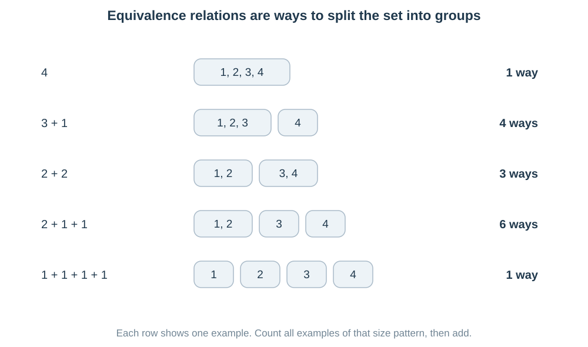

**Choose the route.** The reflexive and symmetric power formulas do not enforce transitivity. Counting groups builds all three equivalence properties together.

**Solution.** Classify by group sizes:

| Group sizes | Why this many? | Count |
|---|---|---:|
| $4$ | Everyone in one group. | $1$ |
| $3+1$ | Choose the singleton member. | $4$ |
| $2+2$ | Choose the partner of $1$; the other pair is then forced. | $3$ |
| $2+1+1$ | Choose the two-member group. | $\binom42=6$ |
| $1+1+1+1$ | Everyone alone. | $1$ |

$$
\boxed{1+4+3+6+1=15}\qquad\text{option (b).}
$$

**Check.** $\{1,2\},\{3,4\}$ and $\{3,4\},\{1,2\}$ are the same partition. Ordering the groups would overcount.

**Another possible approach — choose the group containing $1$.** If that group has size $1$, partition the other three in $5$ ways. If it has size $2$, choose its partner in $3$ ways and partition the remaining two in $2$ ways. Sizes $3$ and $4$ contribute $3$ and $1$ ways:

$$
5+3\cdot2+3+1=15.
$$

This uses the small partition counts from F02. The group-size table is the clearer first route if those counts are new.

### Question 4 — Exactly one excludes the overlap

**PDF page 3 | MCQ | Notes: C02, F01**

If $n(A)=40$, $n(B)=35$ and $n(A\cup B)=60$, then the number of elements belonging to exactly one of $A$ and $B$ is

- (a) $25$
- (b) $60$
- (c) $45$
- (d) $30$

**Understand “exactly one.”** Count the members in $A$ only and $B$ only. Do not include members in both.

First find the overlap. Adding the two set sizes counts it twice:

$$
n(A\cap B)=40+35-60=15.
$$

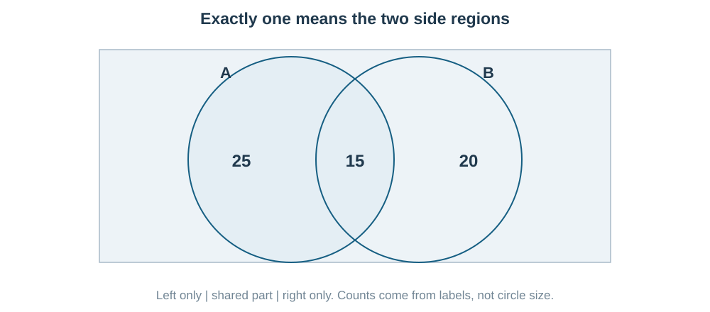

**Read the picture:** $A$ only has $40-15=25$ members. $B$ only has $35-15=20$. The middle $15$ is unwanted.

**Solution.**

$$
\boxed{25+20=45}\qquad\text{option (c).}
$$

**Short exam route after understanding the regions:**

$$
n(\text{exactly one})=n(A\cup B)-n(A\cap B)=60-15=45.
$$

**Check.** The union splits as $25+15+20=60$. Keeping all $60$ would include the “both” group.

### Question 5 — A survey with neither

**PDF page 3 | MCQ | Notes: C02, F01**

In a survey of $100$ persons, $60$ drink tea, $50$ drink coffee and $20$ drink neither. The number of persons who drink both tea and coffee is

- (a) $30$
- (b) $20$
- (c) $40$
- (d) $10$

**Use “neither” to find the people inside the circles.** Out of $100$, the $20$ who drink neither are outside both groups. Therefore

$$
n(T\cup C)=100-20=80.
$$

The tea total and coffee total together give $60+50=110$. Why is this bigger than $80$? A person drinking both was counted once in each total.

**Solution.**

$$
n(T\cap C)=60+50-80=\boxed{30},
\qquad\text{option (a).}
$$

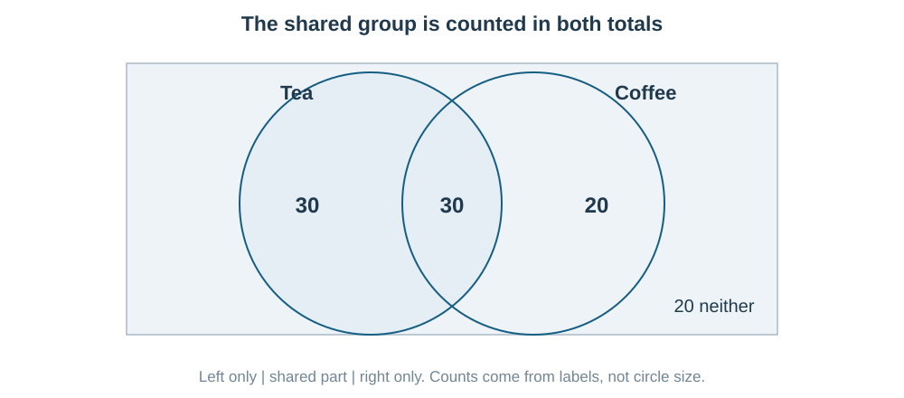

**Check all people.** The four separate regions add to $30+30+20+20=100$.

**Another possible approach — write those four regions before calculating.** If $x$ drink both, tea-only is $60-x$ and coffee-only is $50-x$:

$$
(60-x)+x+(50-x)+20=100.
$$

Thus $130-x=100$, so $x=30$. This route makes the double-count correction visible.

### Question 6 — At least one: count the opposite first

**PDF page 3 | MCQ | Notes: C03**

The number of subsets of $\{1,2,3,4,5,6\}$ that contain at least one odd number is

- (a) $63$
- (b) $60$
- (c) $56$
- (d) $48$

**Notice “at least one.”** Directly listing subsets with one odd number, two odd numbers, and three odd numbers works, but needs several cases. The opposite case is easier: **no odd number**.

The original set has six members, so it has $2^6=64$ subsets.

A subset with no odd member can choose only from $\{2,4,6\}$. Each of these three even members is still free to be included or excluded.

**Solution.**

$$
\text{wanted}=2^6-2^3=64-8=\boxed{56},
\qquad\text{option (c).}
$$

**Check.** The empty subset is among the eight unwanted subsets, because it contains no odd number. Do not subtract it a second time.

**Another possible approach — make the two choices separately.** Choose a nonempty subset of the three odd members in $2^3-1=7$ ways. Choose any subset of the three even members in $2^3=8$ ways:

$$
7\cdot8=56.
$$

The subtraction route uses the shorter description of the unwanted case; the product route shows how every wanted subset is built.

### Question 7 — Onto functions must hit every target

**PDF page 3 | Numerical value | Notes: C06, F03**

The number of onto functions from a set of $5$ elements to a set of $3$ elements is ____.

**Understand onto.** All three targets must receive at least one arrow. Several inputs may use the same target.

**Start with all assignments.** Each of five inputs has three choices, so there are $3^5$ functions.

**Remove maps missing a target.** Choose the missing target in $3$ ways. The inputs then choose from only $2$ targets, giving $3\cdot2^5$.

But a function using only one target misses **two** targets. We subtracted it twice and must add one copy back. Choose those two missing targets in $\binom32=3$ ways; only $1^5=1$ map remains each time.

**Solution.**

$$
N_{\text{onto}}=3^5-3\cdot2^5+3\cdot1^5
=243-96+3=\boxed{150}.
$$

**Check.** It is less than all $243$ functions. Onto does not mean exactly one arrow per target; that would be impossible with five inputs and only three targets.

**Another possible approach — count the two hit patterns in the drawing.**

- For $3+1+1$: choose the triple-hit target in $3$ ways, its three inputs in $\binom53=10$ ways, and assign the last two inputs to the last two targets in $2$ ways. Count $3\cdot10\cdot2=60$.
- For $2+2+1$: choose the single-hit target in $3$ ways and its input in $5$ ways. Of the four remaining inputs, choose the two going to the first remaining named target in $\binom42=6$ ways. The last two are forced. Count $3\cdot5\cdot6=90$.

Total $60+90=150$. This alternative explains the possible distributions; the inclusion–exclusion route is shorter here.

### Question 8 — One-one means no repeated output

**PDF page 3 | MCQ | Notes: C06, F03**

The number of one-one functions from $\{1,2,3\}$ to $\{1,2,3,4,5,6\}$ is

- (a) $216$
- (b) $20$
- (c) $120$
- (d) $729$

**Read the direction.** There are three inputs and six targets. One-one means that after an output is used, another input cannot reuse it.

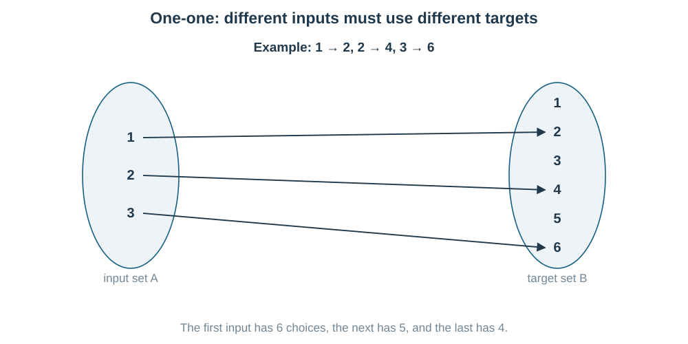

**Solution.**

$$
\begin{array}{c|c}
\text{input being assigned}&\text{available targets}\\ \hline
1&6\\2&5\\3&4
\end{array}
$$

Multiply the choices:

$$
\boxed{6\cdot5\cdot4=120}\qquad\text{option (c).}
$$

**Check the distractors.** $6^3=216$ counts all functions, including repeated outputs. $3^6=729$ reverses which set supplies the inputs.

**Another possible approach — choose the outputs, then assign them.**

$$
\binom63\cdot3!=20\cdot6=120.
$$

The value $20$ alone only chooses a target set; it forgets which input gets which target. This explains why option (b) is too small.

### Question 9 — A domain is the overlap of all restrictions

**PDF page 3 | MCQ | Notes: C01, C08**

The domain of $f(x)=\sqrt{x^2-5x+6}+\ln(4-x)$ is

- (a) $(-\infty,2]\cup[3,4)$
- (b) $(-\infty,2)\cup(3,4)$
- (c) $[2,3]$
- (d) $(-\infty,4)$

**Two operations impose two conditions.** The root needs a nonnegative inside. The log needs a strictly positive argument.

$$
x^2-5x+6\ge0,\qquad 4-x>0.
$$

**Understand the quadratic sign.** Factor it:

$$
(x-2)(x-3)\ge0.
$$

For $x<2$, both factors are negative and their product is positive. Between $2$ and $3$, one is positive and the other negative. For $x>3$, both are positive. The roots themselves give zero and are allowed under a square root.

Thus the root allows $x\le2$ or $x\ge3$. The log allows $x<4$.

**Solution.** Keep only inputs that pass both tests:

$$
\boxed{(-\infty,2]\cup[3,4)}
\qquad\text{option (a).}
$$

**Check the boundaries.** $2$ and $3$ make the root zero, which is allowed. At $4$, the logarithm would be $\ln0$, which is not defined.

**Another possible approach — see the quadratic sign on its graph.**

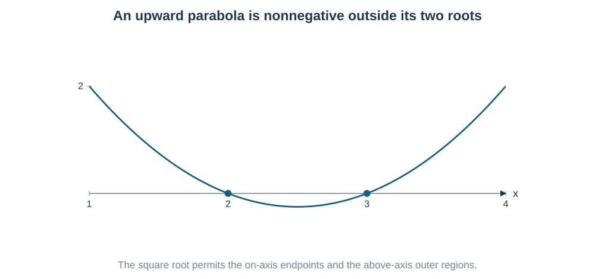

An upward parabola with roots $2,3$ is nonnegative outside the roots. This gives the same root restriction. We still need to intersect it with $x<4$; the quadratic graph alone does not include the log condition.

### Question 10 — A range endpoint may be approached but never reached

**PDF page 4 | MCQ | Notes: C09**

The range of $f(x)=\dfrac{x^2}{1+x^2}$, $x\in\mathbb R$, is

- (a) $[0,1]$
- (b) $(0,1)$
- (c) $[0,1)$
- (d) $[0,\infty)$

**Look at the numerator and denominator together.** The denominator is the numerator plus $1$. That suggests a useful rewrite:

$$
f(x)=\frac{x^2}{1+x^2}=1-\frac1{1+x^2}.
$$

**Solution.** Since $x^2$ takes every value in $[0,\infty)$, $1+x^2$ takes every value in $[1,\infty)$. Therefore

$$
\frac1{1+x^2}\in(0,1].
$$

Subtract from $1$:

$$
\boxed{f(x)\in[0,1)}\qquad\text{option (c).}
$$

**Check inclusion.** $f(0)=0$, so the left endpoint is included. The reciprocal never equals $0$ at a finite input, so $f$ never equals $1$. Getting close to $1$ is not the same as reaching it.

**Another possible approach — solve backwards.** Let $y=x^2/(1+x^2)$. Then, for $y\ne1$,

$$
x^2=\frac{y}{1-y}.
$$

A real input exists exactly when the right side is nonnegative, giving $0\le y<1$. For each such $y$, choose $x=\sqrt{y/(1-y)}$. If $y=1$, the original equation would say $1+x^2=x^2$, which is impossible.

### Question 11 — Sine and cosine together have an amplitude

**PDF page 4 | MCQ | Notes: C09, F04**

Statement I: The range of $f(x)=3\sin x+4\cos x+2$ is $[-3,7]$.

Statement II: The range of $a\sin x+b\cos x$ is $\left[-\sqrt{a^2+b^2},\,\sqrt{a^2+b^2}\right]$.

- (a) Both Statement I and Statement II are true and II explains I.
- (b) Both Statement I and Statement II are true but II does not explain I.
- (c) Statement I is true but Statement II is false.
- (d) Statement I is false but Statement II is true.

**Do not add two unattainable separate maxima.** To get $3+4$ from $3\sin x+4\cos x$, we would need $\sin x=\cos x=1$ at the same angle. That cannot happen.

Statement II gives the correct combined amplitude:

$$
R=\sqrt{3^2+4^2}=5.
$$

**Solution.** Thus $3\sin x+4\cos x$ ranges over $[-5,5]$. Adding $2$ moves every output upward by $2$:

$$
[-5+2,5+2]=[-3,7].
$$

Both statements are true. II provides the amplitude rule needed to obtain I, with the added $2$ shifting the interval.

$$
\boxed{\text{option (a)}}.
$$

**Another possible approach — Cauchy–Schwarz, Important for JEE Main.**

$$
(3\sin x+4\cos x)^2
\le(3^2+4^2)(\sin^2x+\cos^2x)=25.
$$

The upper bound $5$ occurs at $\sin x=3/5,\cos x=4/5$; the opposite signs give $-5$. These are valid angle pairs because their squares add to $1$.

**Check.** We proved the bounds and that both can be reached. A bound without an equality check would not establish the full range.

### Question 12 — Use a simple input in a function identity

**PDF page 4 | Numerical value | Notes: C10–C11, C15**

If $f(x)=\dfrac{ax+1}{x-3}$ satisfies $f(f(x))=x$ for all admissible $x$, then $a=$ ____.

**Notice the all-input identity.** We are allowed to choose a convenient input. At $x=0$, the inner value is especially simple and does not contain $a$:

$$
f(0)=\frac1{-3}=-\frac13.
$$

So the given identity says $f(-1/3)=0$.

**Solution.**

$$
f(-1/3)
=\frac{-a/3+1}{-1/3-3}
=\frac{a-3}{10}.
$$

$$
\frac{a-3}{10}=0
\quad\Longrightarrow\quad
\boxed{a=3}.
$$

**Why this route?** Expanding the general $f(f(x))$ before choosing an input is valid, but creates a larger fraction. The input $0$ isolates the one unknown quickly.

**Check the entire identity, not just our chosen input.** With $a=3$,

$$
f(f(x))
=\frac{3(3x+1)+(x-3)}
{(3x+1)-3(x-3)}
=\frac{10x}{10}=x.
$$

Here $x\ne3$. Also $f(x)$ can never equal $3$, because $3x+1=3(x-3)$ would give $1=-9$. Thus the second application exists for every original allowed input.

**Another possible approach — use the established fractional-form check.** In $(px+q)/(rx+s)$, the nonidentity self-inverse condition is $p+s=0$. Here $p=a,s=-3$, giving $a=3$; its determinant is $-10\ne0$. The input-substitution method explains the result without needing that shortcut.

### Question 13 — Composition order matters

**PDF page 4 | Numerical value | Notes: C10**

Let $f(x)=x^2+1$ and $g(x)=2x-1$. The product of all real values of $x$ satisfying $(f\circ g)(x)=(g\circ f)(x)$ is ____ (round off to $2$ decimal places if needed).

**Understand the order before expanding.** $f\circ g$ means apply $g$ first; $g\circ f$ means apply $f$ first. The equation asks where the two routes give the same output.

**Solution.**

$$
(f\circ g)(x)=(2x-1)^2+1=4x^2-4x+2,
$$

$$
(g\circ f)(x)=2(x^2+1)-1=2x^2+1.
$$

Equate them:

$$
2x^2-4x+1=0.
$$

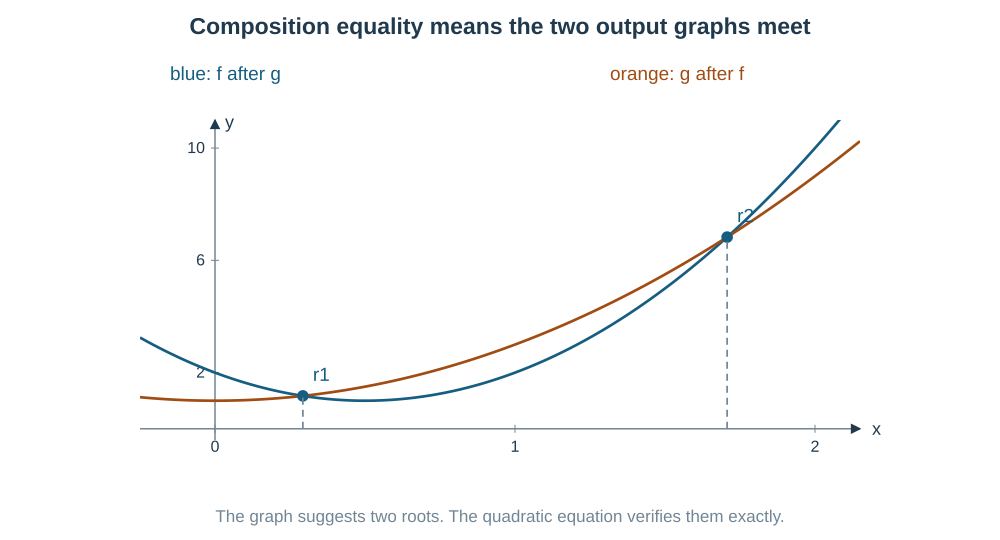

**Notice the target: the product, not the roots separately.** For a quadratic $Ax^2+Bx+C=A(x-r_1)(x-r_2)$, the constant term is $Ar_1r_2$. Therefore $r_1r_2=C/A$.

Here the discriminant is $(-4)^2-4(2)(1)=8>0$, so there really are two real roots. Their product is

$$
\boxed{\frac12=0.50}.
$$

**Check.** Both compositions are polynomials, so no original input is excluded.

**Another possible approach — find the roots.** They are $1\pm1/\sqrt2$, whose product is $1-1/2=1/2$. It works, but finds extra information when only the product is needed.

### Question 14 — Test symmetry by replacing x with minus x

**PDF page 4 | MCQ | Notes: C13**

Consider the following statements:

$$
\begin{aligned}
\text{(i)}\quad&f(x)=\ln\!\left(x+\sqrt{x^2+1}\right)\text{ is an odd function.}\\
\text{(ii)}\quad&f(x)=x^2+\sin x\text{ is an even function.}\\
\text{(iii)}\quad&f(x)=\frac{2^x-1}{2^x+1}\text{ is an odd function.}\\
\text{(iv)}\quad&f(x)=x^2\sin x\text{ is an even function.}
\end{aligned}
$$

The correct statements are

- (a) (i), (ii) and (iii) only
- (b) (ii) and (iv) only
- (c) (i) and (iii) only
- (d) (i), (iii) and (iv) only

**Use the definition, not the appearance of the expression.** Replace $x$ by $-x$ and compare with $f(x)$ and $-f(x)$.

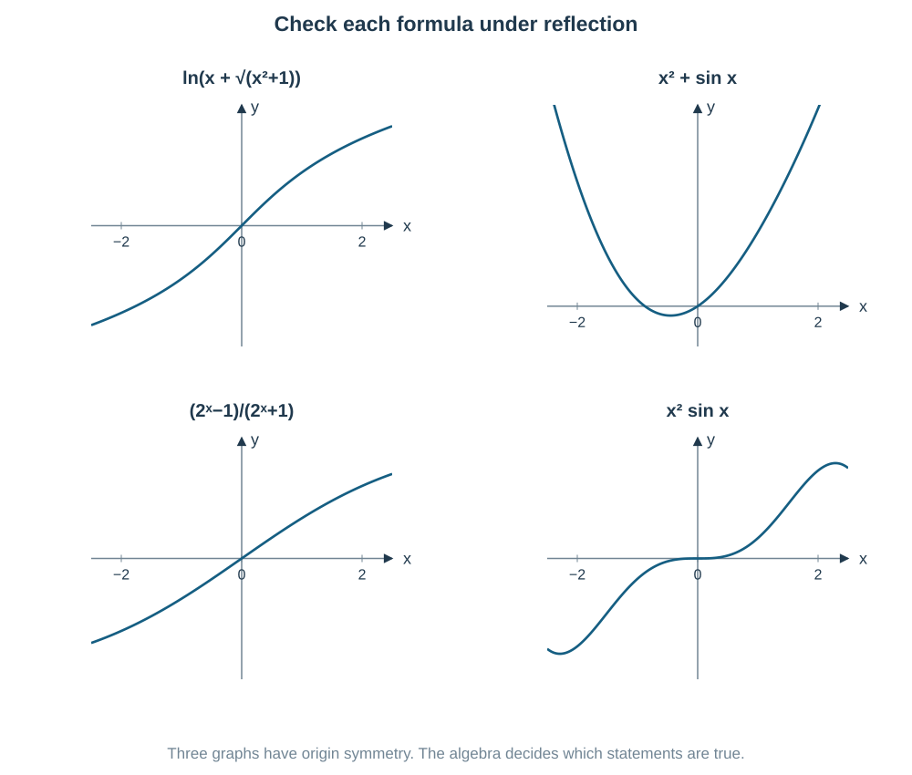

The graphs help us see the shapes. Now verify the identities for all inputs.

**(i) The logarithm.** Put $s=\sqrt{x^2+1}$. Since $s>|x|$, both $s+x$ and $s-x$ are positive, so the logs exist. Notice the conjugate pattern:

$$
(s+x)(s-x)=s^2-x^2=1.
$$

Thus $s-x=1/(s+x)$ and

$$
f(-x)=\ln(s-x)=\ln\frac1{s+x}=-\ln(s+x)=-f(x).
$$

So (i) is true: the function is odd.

**(ii) Square plus sine.**

$$
f(-x)=x^2-\sin x.
$$

This is not identically $x^2+\sin x$. For example, at $x=\pi/2$ the two values differ by $2$. So (ii) is false. An even part plus an odd part is not automatically even.

**(iii) The exponential fraction.** Multiply numerator and denominator by $2^x$:

$$
f(-x)=\frac{2^{-x}-1}{2^{-x}+1}
=\frac{1-2^x}{1+2^x}=-f(x).
$$

So (iii) is true.

**(iv) Square times sine.**

$$
(-x)^2\sin(-x)=-x^2\sin x.
$$

The function is odd and is not identically zero, so it is not also even. Statement (iv) is false.

$$
\boxed{\text{(i) and (iii) only — option (c)}}.
$$

**Check the pattern.** In (i), a conjugate gives a reciprocal and the log turns it into a minus sign. In (iii), reversing the exponent gives a reciprocal before simplification. Both routes explain the origin symmetry.

### Question 15 — Common period and smallest period

**PDF page 4 | MCQ | Notes: C14**

The period of $f(x)=\sin\!\left(\dfrac{\pi x}{3}\right)+\cos\!\left(\dfrac{\pi x}{4}\right)$ is

- (a) $12$
- (b) $24$
- (c) $48$
- (d) $14$

**First make the wording precise.** A period repeats a function; the fundamental period is the **smallest positive** repeating shift. This question's key intends the fundamental period.

For the sine term,

$$
\frac{\pi T_1}{3}=2\pi\quad\Longrightarrow\quad T_1=6.
$$

For the cosine term,

$$
\frac{\pi T_2}{4}=2\pi\quad\Longrightarrow\quad T_2=8.
$$

The smallest common positive shift is $\operatorname{lcm}(6,8)=24$.

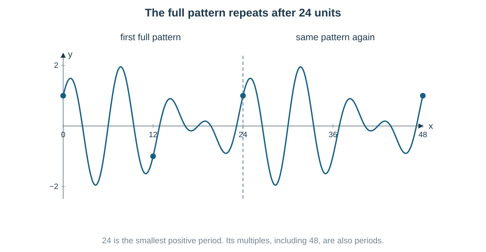

**Check that $24$ works for every input.**

$$
\begin{aligned}
f(x+24)
&=\sin(\pi x/3+8\pi)+\cos(\pi x/4+6\pi)\\
&=f(x).
\end{aligned}
$$

**Why no smaller hidden period?** An extra shift by $12$ keeps the sine term and reverses the cosine term:

$$
f(x+12)=\sin(\pi x/3)-\cos(\pi x/4).
$$

So

$$
f(x)+f(x+12)=2\sin(\pi x/3),\qquad
f(x)-f(x+12)=2\cos(\pi x/4).
$$

If $T$ repeats $f$ at every input, it repeats both $f(x)$ and $f(x+12)$. Adding or subtracting these repeated heights still gives a repeated height. So $T$ must repeat both combinations above: the sine with fundamental period $6$ and the cosine with fundamental period $8$. It must be a common multiple of both. The smallest is $24$.

**Intended answer:** $\boxed{24}$, **option (b)**.

**Source wording issue:** $48$ in option (c) is also a period, since it is twice $24$. As literally printed, “the period” does not distinguish those two valid periods. It should say **fundamental period** for a unique choice.

**Fast option check.** $f(0)=1$ but $f(12)=-1$, so $12$ fails. Also $f(14)=\sqrt3/2\ne1$, so $14$ fails. Among the offered periods, $24$ is the smallest. Q16 shows why taking a common period without looking for extra symmetry can sometimes miss a smaller one.

### Question 16 — A shift can swap the terms

**PDF page 4 | MCQ | Notes: C14**

The fundamental period of $f(x)=|\sin x|+|\cos x|$ is

- (a) $\pi$
- (b) $2\pi$
- (c) $\pi/4$
- (d) $\pi/2$

**Look for a swap before taking an LCM.** Each absolute trig term has period $\pi$, but the sum can return sooner by exchanging the two terms.

$$
\sin(x+\pi/2)=\cos x,\qquad
\cos(x+\pi/2)=-\sin x.
$$

Absolute value removes the minus sign:

$$
f(x+\pi/2)=|\cos x|+|\sin x|=f(x).
$$

So $\pi/2$ is a period. **Now check that it is the smallest.**

Since both terms are nonnegative,

$$
f(x)^2=1+2|\sin x\cos x|\ge1.
$$

The value $1$ occurs exactly when $\sin x\cos x=0$, that is at $x=k\pi/2$ for integers $k$.

Any positive period $T$ must give $f(T)=f(0)=1$. Therefore $T$ must be a positive multiple of $\pi/2$. The smallest possible one already works:

$$
\boxed{T=\pi/2}\qquad\text{option (d).}
$$

**Check.** $f(\pi/4)=\sqrt2\ne1=f(0)$, so $\pi/4$ does not work.

**Another useful view — expose a double angle.**

$$
f(x)=\sqrt{1+|\sin2x|}.
$$

The inside absolute sine repeats after $\pi/2$. This is a compact recognition route once the identity is familiar.

### Question 17 — Floor values at integers are special

**PDF page 4 | MCQ | Notes: C12**

The range of the function $f(x)=[x]+[-x]$, where $[\cdot]$ denotes the greatest integer function, is

- (a) $\{0\}$
- (b) $\{-1\}$
- (c) $\{0,1\}$
- (d) $\{-1,0\}$

**A negative input must be floored properly.** For example, $\lfloor-2.3\rfloor=-3$, not $-2$. That is why the two terms do not always cancel.

Split the inputs into two cases.

**Solution.**

- If $x=n$ is an integer, the floors are $n$ and $-n$, so the sum is $0$.
- If $x=n+r$ with $n\in\mathbb Z$ and $0<r<1$, then $\lfloor x\rfloor=n$ and $\lfloor-x\rfloor=-n-1$. Their sum is $-1$.

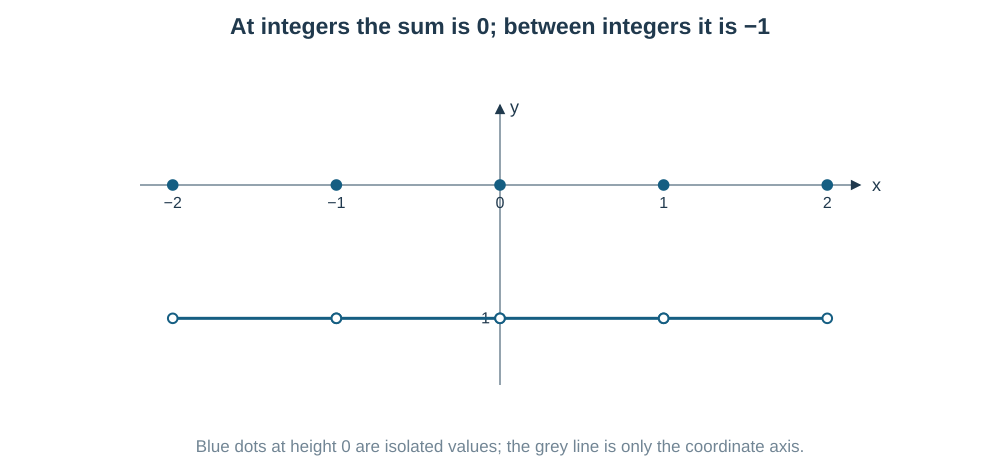

Both cases actually occur. Thus

$$
\boxed{\text{range}=\{-1,0\}}\qquad\text{option (d).}
$$

**Check with numbers.** At $x=2$, the value is $0$. At $x=2.3$, it is $2+(-3)=-1$.

**Useful connection.** The result repeats after a shift of $1$, even though $\lfloor x\rfloor$ itself is not periodic. Its isolated zero points are exactly the integers.

### Question 18 — The codomain changes the answer

**PDF page 5 | MCQ | Notes: C06–C09**

Match List-I (functions) with List-II (nature).

| List-I | Function |
|---|---|
| A | $f:\mathbb R\to\mathbb R,\quad f(x)=x^3$ |
| B | $f:\mathbb R\to\mathbb R,\quad f(x)=x^2$ |
| C | $f:\mathbb R\to\mathbb R,\quad f(x)=e^x$ |
| D | $f:\mathbb R\to[-1,1],\quad f(x)=\sin x$ |

List-II: I. one-one but not onto; II. neither one-one nor onto; III. one-one and onto; IV. onto but not one-one.

- (a) A-I, B-II, C-III, D-IV
- (b) A-III, B-II, C-I, D-IV
- (c) A-I, B-IV, C-III, D-II
- (d) A-IV, B-II, C-I, D-III

**Do two separate checks for each row.** One-one asks whether two inputs can collide. Onto asks whether the actual range fills the **stated codomain**.

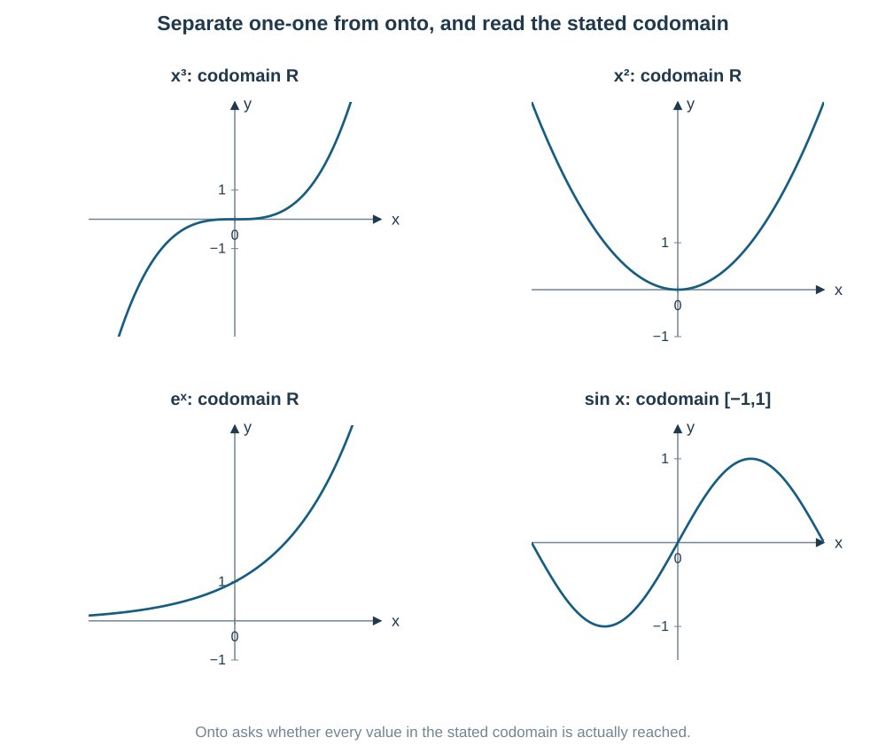

**Solution.**

| Row | One-one? | Onto its stated codomain? | Match |
|---|---|---|---|
| A: $x^3:\mathbb R\to\mathbb R$ | Yes; strictly increasing. | Yes; every real number has a real cube root. | III |
| B: $x^2:\mathbb R\to\mathbb R$ | No; $1,-1$ both give $1$. | No; negative targets are missed. | II |
| C: $e^x:\mathbb R\to\mathbb R$ | Yes; strictly increasing. | No; range $(0,\infty)$ misses zero and negatives. | I |
| D: $\sin x:\mathbb R\to[-1,1]$ | No; $0,\pi$ both give $0$. | Yes; every height from $-1$ to $1$ is reached. | IV |

$$
\boxed{\text{A–III,\ B–II,\ C–I,\ D–IV}}
\qquad\text{option (b).}
$$

**Check the key distinction.** Sine would not be onto if its codomain were all of $\mathbb R$. This question deliberately gives $[-1,1]$.

**Another possible approach — options first.** A is III, and only option (b) contains A–III. That selects the answer quickly; the table verifies the remaining matches and teaches the four different situations.

### Question 19 — Count integers only after finding the full domain

**PDF page 5 | Numerical value | Notes: C08**

The number of integers in the domain of $f(x)=\sqrt{9-x^2}+\ln(x^2-1)$ is ____.

**Find the allowed inputs before counting integers.**

The square root needs

$$
9-x^2\ge0\quad\Longrightarrow\quad |x|\le3.
$$

The logarithm needs

$$
x^2-1>0\quad\Longrightarrow\quad |x|>1.
$$

**Solution.** Both conditions together give

$$
1<|x|\le3,
\qquad
D_f=[-3,-1)\cup(1,3].
$$

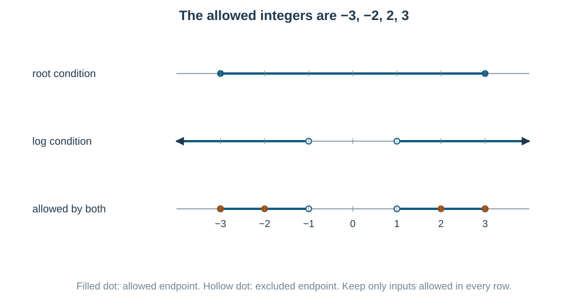

The allowed integers are

$$
-3,\ -2,\ 2,\ 3.
$$

$$
\boxed{4}.
$$

**Check.** At $x=\pm3$, the root is zero and the log argument is $8$, so both endpoints are allowed. At $x=\pm1$, the log argument is zero, so those endpoints are excluded.

**Another possible approach — filter a short list.** The root first leaves the seven integer candidates $-3,-2,-1,0,1,2,3$. The log removes $-1,0,1$. This is short because only integers, rather than the full domain, are requested.

### Question 20 — A power set contains subsets, not numbers

**PDF page 5 | MCQ | Notes: C02–C03**

Let $A=\{x:x^2-5x+6=0\}$ and $B=\{x:x^2-3x+2=0\}$. The number of elements in the power set of $A\triangle B$ (symmetric difference) is

- (a) $8$
- (b) $4$
- (c) $2$
- (d) $16$

**There are three layers here.** First find $A,B$. Then find their symmetric difference. Then count its subsets.

**Solution.** Factor the equations:

$$
(x-2)(x-3)=0\Longrightarrow A=\{2,3\},
$$

$$
(x-1)(x-2)=0\Longrightarrow B=\{1,2\}.
$$

The shared member $2$ is removed in a symmetric difference:

$$
A\triangle B=\{1,3\}.
$$

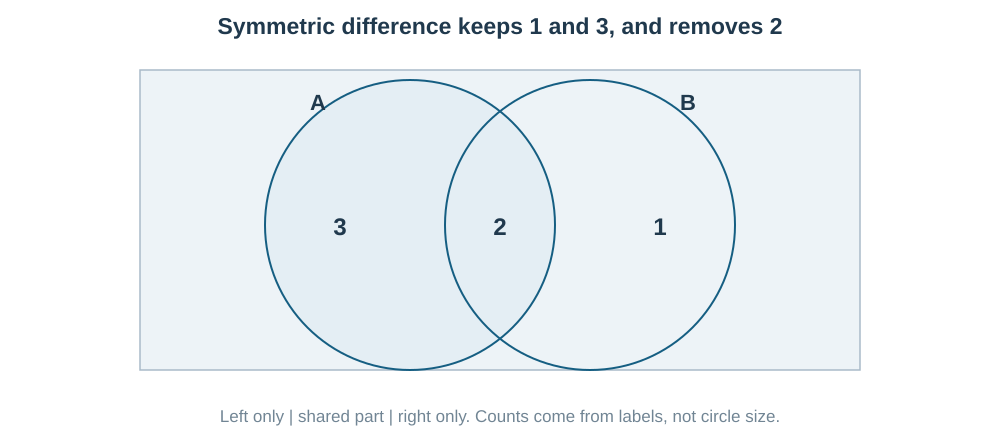

This new set has $2$ members, so its power set has

$$
\boxed{2^2=4}\qquad\text{option (b).}
$$

**Check by listing.**

$$
\mathcal P(\{1,3\})=\{\varnothing,\{1\},\{3\},\{1,3\}\}.
$$

The answer $2$ would count the members of the symmetric difference itself, not the members of its power set.

### Question 21 — Divisibility is not symmetric

**PDF page 5 | MCQ | Notes: C05**

Let $R$ be the relation on $\mathbb N$ defined by $aRb$ if and only if $a$ divides $b$. Then $R$ is

- (a) reflexive and symmetric but not transitive
- (b) symmetric and transitive but not reflexive
- (c) an equivalence relation
- (d) reflexive and transitive but not symmetric

**Translate “divides.”** $a$ divides $b$ means $b=ak$ for some integer $k$. Here the natural numbers are positive.

**Reflexive:** $a=a\cdot1$, so every $a$ divides itself.

**Transitive:** if $b=ak$ and $c=b\ell$, then

$$
c=(ak)\ell=a(k\ell).
$$

The product $k\ell$ is an integer, so $a$ divides $c$.

**Not symmetric:** $2$ divides $4$, but $4$ does not divide $2$. An arrow can go one way without its reverse.

**Answer and check:**

$$
\boxed{\text{reflexive and transitive, but not symmetric — (d)}}.
$$

It is not an equivalence relation because symmetry fails.

**Another possible approach — eliminate options first.** The counterexample $2\mid4$ but $4\nmid2$ rules out (a), (b), and (c), all of which require symmetry. The general arguments above verify the two positive properties in (d).

### Question 22 — Complete the whole equivalence group

**PDF page 5 | Numerical value | Notes: C05, F02**

Let $R=\{(1,2),(2,3)\}$ be a relation on $\{1,2,3\}$. The minimum number of ordered pairs that must be added to $R$ so that it becomes an equivalence relation is ____.

**Equivalence means complete groups, not just extra loops.** The given pair $(1,2)$ puts $1,2$ in the same group. The pair $(2,3)$ puts $2,3$ in the same group. Transitivity therefore puts **all three** in one group.

Every member must then be related to every member of this group.

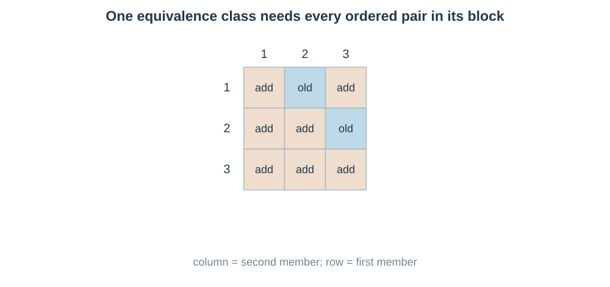

**Solution.** A group of three needs $3^2=9$ ordered pairs. Two already exist:

$$
\boxed{9-2=7}.
$$

**Why adding only loops and reverses is not enough.** That would still miss the link from $1$ to $3$ and its reverse.

**Another possible approach — list the forced additions.**

$$
\begin{gathered}
(1,1),(2,2),(3,3),\\
(2,1),(3,2),\\
(1,3),(3,1).
\end{gathered}
$$

The first row supplies loops, the second reverses the original arrows, and the last completes the chain between $1,3$.

**Check minimality.** Every listed pair is forced by an equivalence property. The completed universal relation has all nine pairs and satisfies all three properties. Thus seven additions are both necessary and sufficient.

### Question 23 — Each ordered pair is a yes-or-no choice

**PDF page 5 | Numerical value | Notes: C04, F02**

Let $A$ have $3$ elements and $B$ have $n$ elements. If the number of relations from $A$ to $B$ is $4096$, then $n=$ ____.

**Count possible pairs before counting relations.** A relation from $A$ to $B$ is any subset of $A\times B$. There are $3n$ possible pairs, each independently included or excluded.

**Solution.**

$$
2^{3n}=4096=2^{12}.
$$

Equal powers of $2$ have equal exponents:

$$
3n=12\quad\Longrightarrow\quad\boxed{n=4}.
$$

**Check.** With $3$ inputs and $4$ targets there are $12$ possible pairs, giving $2^{12}=4096$ relations. The formula $4^3=64$ would count functions, which require exactly one output per input. That extra rule is not imposed on an arbitrary relation.

### Question 24 — An inverse asks for the original input

**PDF page 5 | MCQ | Notes: C11**

Let $f:\mathbb R\to\mathbb R$, $f(x)=x^3+x$. Then $f^{-1}(10)$ equals

- (a) $3$
- (b) $2$
- (c) $10/3$
- (d) $1$

**Read the inverse question in words.** Which input gives output $10$ under $f$?

Try a small input:

$$
f(2)=2^3+2=8+2=10.
$$

Therefore

$$
\boxed{f^{-1}(10)=2}\qquad\text{option (b).}
$$

**Why this route?** The question asks for one inverse value. Finding a complete formula for the inverse of a cubic is unnecessary.

**Check uniqueness.** Solve the one target equation:

$$
x^3+x-10=(x-2)(x^2+2x+5)=0.
$$

The second factor is $(x+1)^2+4>0$ for every real $x$. Thus $2$ is the only real input giving $10$.

**See the same idea from the graph.**

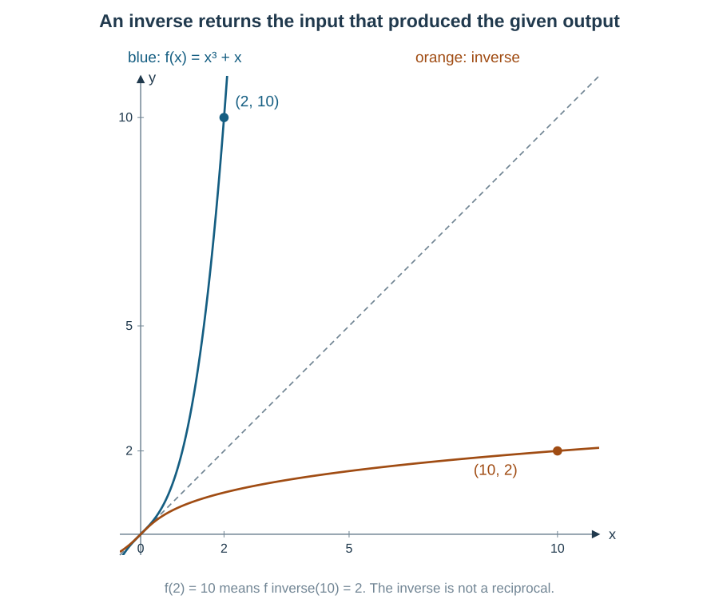

The input/output pair $(2,10)$ becomes $(10,2)$. This is why an inverse returns $2$, rather than the reciprocal $1/f(10)$.

### Question 25 — A long composition can have a short cycle

**PDF page 5 | MCQ | Notes: C11**

Let $f(x)=\dfrac1{1-x}$ and let $f^n$ denote the $n$-fold composition of $f$. Then $f^{2023}(5)$ equals

- (a) $5$
- (b) $-1/4$
- (c) $4/5$
- (d) $-4$

**Do not start applying the rule $2023$ times.** The first few values may reveal a repeating cycle. Here the superscript means composition, not an ordinary power.

**Solution.**

$$
f(5)=\frac1{1-5}=-\frac14,
$$

$$
f(-1/4)=\frac1{1+1/4}=\frac45,
\qquad
f(4/5)=\frac1{1-4/5}=5.
$$

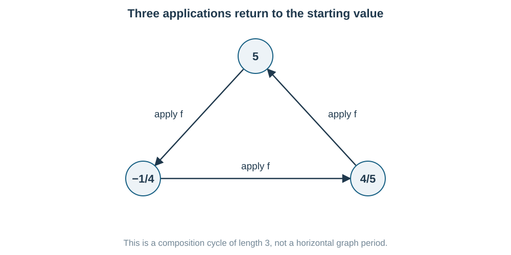

Every three applications return to $5$. Now divide the step count:

$$
2023=3\cdot674+1.
$$

After $674$ complete cycles, one extra application remains:

$$
\boxed{f^{2023}(5)=f(5)=-\frac14}
\qquad\text{option (b).}
$$

**Check the domain.** None of $5,-1/4,4/5$ is the forbidden input $1$, so every step exists.

**Another possible approach — find the general composition cycle.**

$$
f^2(x)=\frac1{1-\frac1{1-x}}=\frac{x-1}{x},
$$

$$
f^3(x)=\frac1{1-\frac{x-1}{x}}=x,
$$

where these steps exist, in particular $x\ne0,1$. The numerical orbit is easier when only the starting value $5$ matters; the general identity explains why other allowed starting values also cycle.

### Question 26 — Pair a reciprocal input with its partner

**PDF page 6 | MCQ | Notes: C15**

If $f(x)+2f\!\left(\dfrac1x\right)=3x$ for all $x\ne0$, then $f(2)$ equals

- (a) $1$
- (b) $2$
- (c) $-1$
- (d) $-2$

**Notice the paired inputs $x$ and $1/x$.** To find $f(2)$, first put $x=2$:

$$
f(2)+2f(1/2)=6.
$$

We now have two unknown values. Which replacement brings back these **same** values? Choose $x=1/2$, because its reciprocal is $2$:

$$
f(1/2)+2f(2)=\frac32.
$$

Putting $x=3$ instead would introduce different unknown values and would not close this pair.

**Solution.** Write $u=f(2)$ and $v=f(1/2)$:

$$
u+2v=6,\qquad 2u+v=\frac32.
$$

Double the second equation and subtract the first:

$$
(4u+2v)-(u+2v)=3-6
\quad\Longrightarrow\quad
3u=-3.
$$

$$
\boxed{f(2)=-1}\qquad\text{option (c).}
$$

**Check.** The first equation gives $v=7/2$. Then $2(-1)+7/2=3/2$, satisfying the second equation.

**Another possible approach — find the function formula.** Pair the identity with its $1/x$ version and eliminate $f(1/x)$:

$$
f(x)=\frac2x-x.
$$

It gives $f(2)=1-2=-1$. Substituting $f(1/x)=2x-1/x$ into the original identity returns $3x$. The target-value route avoids finding more than the question requests.

### Question 27 — Build the integer values by repeated addition

**PDF page 6 | Numerical value | Notes: C15**

Let $f:\mathbb R\to\mathbb R$ satisfy $f(x+y)=f(x)f(y)$ with $f(1)=2$. Then $\displaystyle\sum_{k=1}^{5}f(k)=$ ____.

**Read the given operation carefully.** Adding inputs multiplies outputs. To reach the positive integers, keep adding the input $1$.

Put $x=n,y=1$:

$$
f(n+1)=f(n)f(1)=2f(n).
$$

**Solution.** Starting from $f(1)=2$, the successive values are

$$
f(2)=4,\quad f(3)=8,\quad f(4)=16,\quad f(5)=32.
$$

Therefore

$$
\boxed{\sum_{k=1}^{5}f(k)=2+4+8+16+32=62}.
$$

**Check the scope.** We established the needed integer values directly. No assumption about a full formula on all real inputs was needed.

**Another possible approach — subtract a doubled sum.** Let $S=2+4+8+16+32$. Then

$$
2S=4+8+16+32+64.
$$

Subtract the first sum from the second. The middle terms cancel and $S=64-2=62$. This is the geometric-series pattern behind the total.

### Question 28 — An even sum depends on how many odd numbers were chosen

**PDF page 6 | Numerical value | Notes: C03**

The number of $3$-element subsets of $\{1,2,\ldots,10\}$ whose elements have an even sum is ____.

**Choose cases by parity, not by listing triples.** There are five odd numbers and five even numbers. An even sum contains an even number of odd terms.

For a three-member subset, that means either **zero odd members** or **two odd members**.

**Solution.**

| Case | Choices | Count |
|---|---|---:|
| Three evens | Choose $3$ of the $5$ evens. | $\binom53=10$ |
| Two odds and one even | Choose the odd pair and then the even member. | $\binom52\binom51=10\cdot5=50$ |

The cases do not overlap:

$$
\boxed{10+50=60}.
$$

**Check.** One odd plus two evens gives an odd sum, as do three odds. Those are the two excluded cases. Use combinations because subset order does not matter.

**Another possible approach — pair each even-sum subset with an odd-sum subset.**

Pair the original numbers as

$$
1\leftrightarrow2,\quad3\leftrightarrow4,\quad
5\leftrightarrow6,\quad7\leftrightarrow8,\quad9\leftrightarrow10.
$$

In any chosen triple, replace every number by its partner. The three outputs stay distinct, and all three parities flip, so the sum changes parity. Doing this again returns the original triple.

Thus the triples come in pairs, one even-sum and one odd-sum:

$$
\frac12\binom{10}{3}=\frac{120}{2}=60.
$$

This half-count shortcut works because we have complete opposite-parity pairs and choose an odd number of members. It is not a rule that all subset sums split equally in every problem.

### Question 29 — Exactly one appears again in divisibility

**PDF page 6 | MCQ | Notes: F01, C12**

The number of integers from $1$ to $100$ that are divisible by exactly one of $3$ and $5$ is

- (a) $47$
- (b) $41$
- (c) $53$
- (d) $35$

**Did you notice the same phrase as Q4?** “Exactly one” still means the two side regions of a Venn diagram. The members are numbers now, rather than people.

Let $A$ contain multiples of $3$ and $B$ contain multiples of $5$, within $1$ to $100$.

**Solution.**

$$
n(A)=\left\lfloor\frac{100}{3}\right\rfloor=33,\qquad
n(B)=\frac{100}{5}=20.
$$

Their shared members are multiples of $\operatorname{lcm}(3,5)=15$:

$$
n(A\cap B)=\left\lfloor\frac{100}{15}\right\rfloor=6.
$$

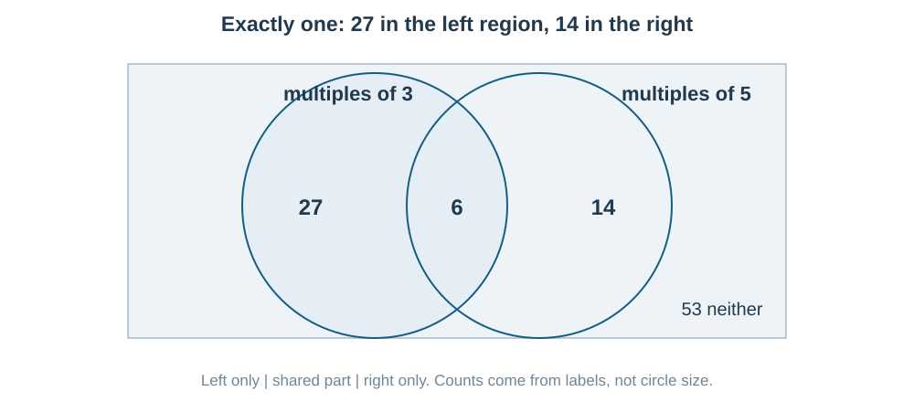

Remove both copies of the shared group from the sum of totals:

$$
\boxed{33+20-2(6)=41}\qquad\text{option (b).}
$$

**Region check.** The side counts are $33-6=27$ and $20-6=14$, giving $27+14=41$. Subtracting the overlap only once would count “at least one,” not “exactly one.”

### Question 30 — A repeated quadratic pattern gives sharp bounds

**PDF page 6 | Numerical value | Notes: C09, F05**

For $x\in\mathbb R$, let $f(x)=\dfrac{x^2+x+1}{x^2-x+1}$. The sum of the maximum and minimum values of $f$ is ____ (round off to $2$ decimal places).

**Inspect the structure before expanding.** The same $x^2+1$ appears on top and bottom, while the $x$ term changes sign:

$$
f(x)=\frac{(x^2+1)+x}{(x^2+1)-x}.
$$

Treating the numerator and denominator as unrelated positive numbers would lose this connection and give weak bounds.

First check that the denominator never vanishes:

$$
D=x^2-x+1=(x-1/2)^2+\frac34>0.
$$

The drawing suggests the extreme values. Now prove them for **all** real inputs.

**Solution — reduce to one bounded quantity.** Divide by $x^2+1>0$ and put $u=x/(x^2+1)$. From the nonnegative squares,

$$
(x-1)^2\ge0\Longrightarrow 2x\le x^2+1
\Longrightarrow u\le\frac12,
$$

$$
(x+1)^2\ge0\Longrightarrow -2x\le x^2+1
\Longrightarrow u\ge-\frac12.
$$

Now

$$
f(x)=\frac{1+u}{1-u}=-1+\frac2{1-u}.
$$

Since $u\in[-1/2,1/2]$,

$$
1-u\in[1/2,3/2],
\qquad
\frac2{1-u}\in[4/3,4].
$$

Thus $1/3\le f(x)\le3$. The lower bound occurs at $x=-1$, and the upper bound at $x=1$:

$$
f(-1)=\frac13,\qquad f(1)=3.
$$

The requested sum is

$$
\boxed{3+\frac13=\frac{10}{3}\approx3.33}.
$$

**Check.** The bounds are attained at allowed inputs, so they really are the minimum and maximum.

**Another possible approach — verify the two bounds directly with squares.**

$$
f(x)-\frac13=\frac{2(x+1)^2}{3D}\ge0,\qquad
3-f(x)=\frac{2(x-1)^2}{D}\ge0.
$$

These identities give the same bounds and equality inputs in two lines. They are the shortest check once the candidate bounds have been found. The $u$ route explains how to discover them from the shared pattern.

**Another possible approach — solve backwards using the discriminant.**

$$
y=\frac{x^2+x+1}{x^2-x+1}
\Longrightarrow
(y-1)x^2-(y+1)x+(y-1)=0.
$$

For $y\ne1$, real inputs need

$$
\Delta=(y+1)^2-4(y-1)^2
=-(3y-1)(y-3)\ge0.
$$

This gives $1/3\le y\le3$. The special case $y=1$ is linear, giving $-2x=0$ and allowed input $x=0$, so that output is included too. The denominator is always positive, so no real roots found here are forbidden. This method also finds the entire range, but it takes more algebra.

## Answer check

Use this after attempting the questions. Letter labels use the original PDF order.

| Question | Verified answer | Question | Verified answer |
|---|---|---|---|
| 1 | (a) $2^{12}=4096$ | 16 | (d) $\pi/2$ |
| 2 | (d) $64$ | 17 | (d) $\{-1,0\}$ |
| 3 | (b) $15$ | 18 | (b) A–III, B–II, C–I, D–IV |
| 4 | (c) $45$ | 19 | $4$ |
| 5 | (a) $30$ | 20 | (b) $4$ |
| 6 | (c) $56$ | 21 | (d) Reflexive and transitive, not symmetric |
| 7 | $150$ | 22 | $7$ |
| 8 | (c) $120$ | 23 | $4$ |
| 9 | (a) $(-\infty,2]\cup[3,4)$ | 24 | (b) $2$ |
| 10 | (c) $[0,1)$ | 25 | (b) $-1/4$ |
| 11 | (a) Both true; II explains I | 26 | (c) $-1$ |
| 12 | $3$ | 27 | $62$ |
| 13 | $0.50$ | 28 | $60$ |
| 14 | (c) (i) and (iii) | 29 | (b) $41$ |
| 15 | Intended (b) $24$; $48$ is also a period | 30 | $3.33$ |

## Coverage and source notes

All $30$ supplied questions are included, with their original $21$ MCQ and $9$ numerical-value formats. The notes also cover the current syllabus foundations and useful connections not directly tested by every source question.

The recent-weightage audit recounts the accessible archive cards, not every original official paper. It contains $107$ unique entries from the two named categories in $2024$–$2026$. It is not an exhaustive $2020$–$2026$ official-paper or formula-frequency audit.

A representative official-paper check examined the nested-domain structure in Mathematics Q21, question ID 69112121, of the NTA paper dated 2 April 2026, Shift 1. It combines a square root, a logarithm with base below one, an absolute value, and a rational expression. This supports teaching the conditions together rather than memorizing one domain rule. Its question text is not reproduced here, and no final-key match is claimed.

Q15's wording is qualified beside the solution and in the answer check. The other supplied keyed results agree with the independently checked results.

## Offline research record

- Supplied Maths Predicted V1.pdf, Chapter 1: questions on PDF pages 3–6, key on page 6, and source working through page 7. Mathematical notation and options were read from the rendered pages.
- NTA, Syllabus for JEE (Main) 2027, Mathematics Units 1, 7, and 14: checked on 28 October 2026 for core sets/functions and the supporting real-function and trigonometric scope.
- ExamSIDE / ExamGOAL, Sets and Relations and Functions chapter archives: recent question-card IDs and year counts checked on 28 October 2026; duplicates checked between the two categories. The classification remains the archive's.
- NTA, B Tech 2nd Apr 2026 Shift 1, Mathematics Q21, question ID 69112121: official page image examined for the combined-domain pattern.
- PYQSide chapter pages were used as a classification cross-check. Its Class 11 and Class 12 headings have different coverage, so their totals were not added to the chosen dataset.

**Review copy:** all teaching, checks, and alternative views are plain visible content. HTML is the parent's review format; the same complete source is retained for the later printed booklet.
