# Complex Numbers — JEE Main revision guide

*A complex number is a point, a movement, and a number. Choose the view that makes the question easier.*

> **For Kanna | Chapter 2**  
> Goal: about $120/300$ towards $200/300$ — Physics $60$, Maths $60$, Chemistry $80$.  
> Learn the meaning first. Use the recap later. All $35$ source questions and every useful second approach are fully included.

## Recent chapter weightage

**The checked 2024–2026 archive gives about $1.07$ Complex Numbers questions per Paper 1.**

| Year | Papers | Chapter questions | Questions per paper |
|---|---:|---:|---:|
| $2024$ | $20$ | $24$ | $1.20$ |
| $2025$ | $19$ | $19$ | $1.00$ |
| $2026$ | $19$ | $19$ | $1.00$ |
| Together | $58$ | $62$ | $1.07$ |

The mean is $62/58\approx1.07$, using the ExamSIDE Complex Numbers category. The $62$ recent question-card IDs were recounted. This is an **archive-based classification**, not an independent reclassification of every official NTA paper. Other archives sometimes combine Complex Numbers with Quadratics; do not add that combined count to this one. The $2024$ paper offered optional numerical questions, so these are counts of offered questions, not a guaranteed marks comparison.

**Revision priority:** become dependable with conjugates, modulus, argument, simple loci, roots of unity, and rotation. Complex-number geometry also connects to vectors and coordinate geometry. One question can combine several of these ideas. An average is not a promise about your shift.

## Scope and reading plan

The current official syllabus combines Complex Numbers and Quadratic Equations in Mathematics Unit 2. This chapter teaches the complex-number part; Chapter 3 develops quadratics further. The source also asks a few supporting geometry and complex-power questions, so the needed ideas are explained here.

**Our route:** number meaning → plane and distance → algebra → angle and rotation → powers and roots → loci → source problems.

**Important for JEE Main** is a teaching priority label. It is not a measured formula-frequency claim.

**Source convention to know before Q33:** the source treats “purely imaginary” as having real part zero, including the value zero. Some books reserve the words for a nonzero imaginary number. Q33(i) gives zero when $z=-1$; the solution states this corner case. The principal value convention for $i^i$ is also explained there. Do not hide either convention.

## Formula and concept bank

### Concept C01 — Why do we need a complex number?

**Important for JEE Main.** No real number has square $-1$: squaring a real number gives a nonnegative answer. We introduce a new number $i$ with

$$
\boxed{i^2=-1}.
$$

A **complex number** has the form

$$
\boxed{z=x+iy,\qquad x,y\in\mathbb R}.
$$

The letters $x,y$ are real numbers. The symbol $i$ is fixed, just as $\pi$ is fixed. The letter $z$ stands for the whole complex number.

- $\operatorname{Re}z=x$ is the **real part**.
- $\operatorname{Im}z=y$ is the **imaginary part**. It is the real coefficient $y$, **not** $iy$.

For $z=3-4i$, $\operatorname{Re}z=3$ and $\operatorname{Im}z=-4$. For the real number $5=5+0i$, the imaginary part is zero. Every real number is also a complex number.

Two complex numbers are equal exactly when both parts match:

$$
x+iy=u+iv\iff x=u\text{ and }y=v.
$$

Why? A change along one coordinate cannot be repaired by a change along the other. For example, $2+3i$ and $3+2i$ are different.

**Do not order complex numbers with $>$ or $<$.** A question can compare their real parts, imaginary parts, or lengths. It cannot use the ordinary real-number order on arbitrary complex numbers.

### Concept C02 — The Argand plane: turn the number into a point

**Important for JEE Main.** Draw a horizontal real axis and a vertical imaginary axis. The number $x+iy$ is the point $P(x,y)$. This picture is the **Argand plane**.

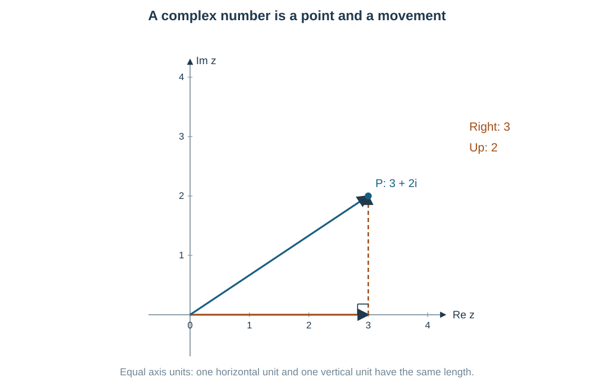

**Read the picture:** $3+2i$ means move $3$ units right and $2$ units up from the origin $O$. The arrow $OP$ has the same two components.

If $z_1$ represents $P$ and $z_2$ represents $Q$, then

$$
\boxed{z_2-z_1\text{ represents the movement from }P\text{ to }Q}.
$$

It is **destination minus start**. For example,

$$
(4+3i)-(1+i)=3+2i.
$$

Adding complex numbers adds their two components:

$$
(x+iy)+(u+iv)=(x+u)+i(y+v).
$$

This is also arrow addition. Notice that the point $Q$ and the movement $PQ$ need not be the same complex number. This distinction matters when rotating about a point other than the origin.

The distance between the points is the length of the difference:

$$
\boxed{PQ=|z_2-z_1|}.
$$

For $P(1,1)$ and $Q(4,3)$, this distance is $\sqrt{3^2+2^2}=\sqrt{13}$.

### Concept C03 — Powers of $i$ repeat after four steps

**Important for JEE Main.** Start from $i^2=-1$ and multiply by $i$ each time:

$$
i^0=1,\quad i^1=i,\quad i^2=-1,\quad i^3=-i,\quad i^4=1.
$$

The next power is $i$ again. Thus

$$
\boxed{i^{4k}=1,\quad i^{4k+1}=i,\quad
i^{4k+2}=-1,\quad i^{4k+3}=-i}.
$$

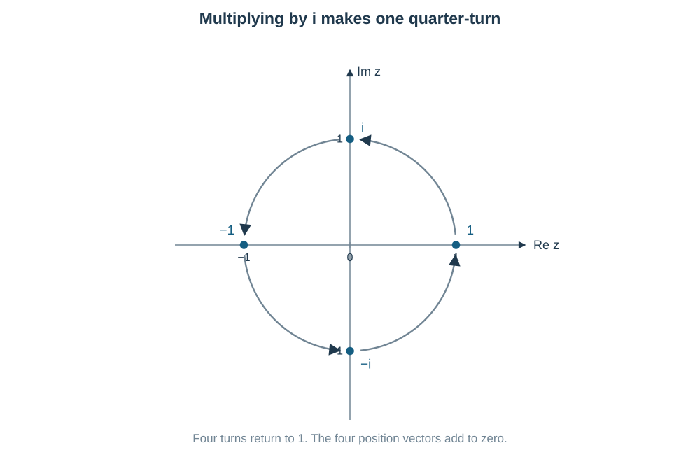

**Read the cycle:** multiplying by $i$ makes a $90^\circ$ anticlockwise turn. Four such turns bring us back.

**Question clue:** a huge integer power of $i$ only needs the remainder after division by $4$. For example, $101=4(25)+1$, so $i^{101}=i$.

For a sum, also notice

$$
\boxed{1+i-1-i=0}.
$$

Any four consecutive integer powers sum to zero. Q1 therefore needs only the terms left after complete groups of four.

Negative integer powers follow the same cycle because $1/i=-i$. For example, $i^{-1}=-i$ and $i^{-2}=-1$. The rule is for integer powers; fractional or complex powers need extra conventions.

### Concept C04 — Arithmetic and the conjugate

**Important for JEE Main.** Multiply using ordinary brackets, then replace $i^2$ by $-1$:

$$
(x+iy)(u+iv)=(xu-yv)+i(xv+yu).
$$

For example,

$$
(2+i)(3-i)=6-2i+3i-i^2=7+i.
$$

The **conjugate** changes the sign of the imaginary part:

$$
\boxed{\overline z=x-iy}.
$$

It reflects the point across the real axis.

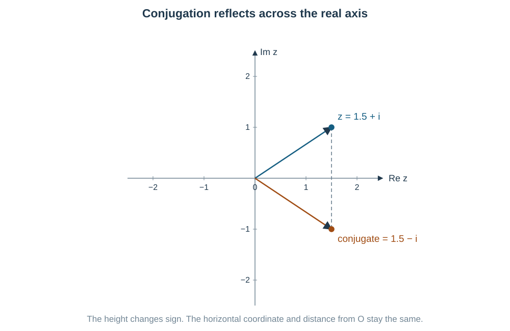

Adding or subtracting the reflected pair gives

$$
\boxed{z+\overline z=2\operatorname{Re}z},\qquad
\boxed{z-\overline z=2i\operatorname{Im}z}.
$$

Multiplying gives

$$
\boxed{z\overline z=x^2+y^2=|z|^2}.
$$

This number is real and nonnegative. It is zero only when $z=0$.

**Division: make the denominator real.** For $w\ne0$,

$$
\boxed{\frac zw=\frac{z\overline w}{|w|^2}},\qquad
\boxed{\frac1z=\frac{\overline z}{|z|^2}\quad(z\ne0)}.
$$

Example:

$$
\frac{1+i}{1-i}
=\frac{(1+i)^2}{(1-i)(1+i)}
=\frac{2i}{2}=i.
$$

We used the conjugate of the **denominator**, not an arbitrary extra factor.

Useful rules:

$$
\overline{z+w}=\overline z+\overline w,\quad
\overline{zw}=\overline z\,\overline w,\quad
\overline{\frac zw}=\frac{\overline z}{\overline w}\ (w\ne0).
$$

**Tests, with the zero convention stated:** $z$ is real iff $z=\overline z$. Its real part is zero iff $z=-\overline z$. Some texts call only the nonzero members of the second group “purely imaginary”; the algebraic test itself includes zero.

### Concept C05 — Modulus means length, not the whole number

**Important for JEE Main.** For $z=x+iy$,

$$
\boxed{|z|=\sqrt{x^2+y^2}}.
$$

This is the distance from $O$ to $P(x,y)$, by Pythagoras. It is always a nonnegative **real number**. Thus $|3+4i|=5$.

The vertical bars here mean complex-number length. In Chapter 1, bars around a set meant its number of members. Read the object inside.

$$
\boxed{|z|^2=z\overline z},\qquad
|\overline z|=|-z|=|z|,
$$

$$
\boxed{|zw|=|z||w|},\qquad
\boxed{\left|\frac zw\right|=\frac{|z|}{|w|}\quad(w\ne0)}.
$$

If only a modulus is asked, these often avoid a long complex division.

**Lengths of a sum and difference.** Expanding with conjugates gives

$$
|z+w|^2=|z|^2+|w|^2+2\operatorname{Re}(z\overline w),
$$

$$
|z-w|^2=|z|^2+|w|^2-2\operatorname{Re}(z\overline w).
$$

Add them and the mixed parts cancel:

$$
\boxed{|z+w|^2+|z-w|^2=2(|z|^2+|w|^2)}.
$$

This is the **parallelogram identity**. Think of the sum and difference as its two diagonals. Q17 asks for exactly this missing partner.

**Triangle inequalities — Important for JEE Main.**

$$
\boxed{\big||z|-|w|\big|\le|z-w|\le|z|+|w|}.
$$

The corresponding bound for $|z+w|$ is the same. A direct route cannot be longer than a two-step route; the difference of two lengths cannot exceed the distance between their endpoints.

Equality needs a suitable direction, not just suitable lengths. For the upper sum bound $|z+w|=|z|+|w|$, two nonzero arrows must point the same way. For the lower sum bound they point opposite ways. Zero arrows are separate equality cases.

**Cauchy–Schwarz — Important for JEE Main.** For real $x,y,u,v$,

$$
(xu+yv)^2\le(x^2+y^2)(u^2+v^2).
$$

Here $xu+yv=\operatorname{Re}((x+iy)(u-iv))$. Therefore

$$
\boxed{|\operatorname{Re}(z\overline w)|\le|z||w|}.
$$

The expression inside the real part measures how much two arrows point along each other. If the arrows are perpendicular, that real part is zero. This is the complex-number version of the dot-product connection. Use it for length bounds, but check whether an equality direction can actually occur.

### Concept C06 — Argument is direction; principal argument selects one angle

**Important for JEE Main.** For $z\ne0$, an **argument** is an angle of the arrow $OP$ from the positive real axis. Anticlockwise angles are positive; clockwise angles are negative.

Adding a full turn changes the angle but not the point:

$$
\arg z=\theta+2k\pi,\qquad k\in\mathbb Z.
$$

Here we use the **principal argument**

$$
\boxed{\operatorname{Arg}z\in(-\pi,\pi]}.
$$

The origin has no direction: $\operatorname{Arg}0$ is undefined. The positive real axis has principal angle $0$, and the negative real axis has $\pi$ in our convention.

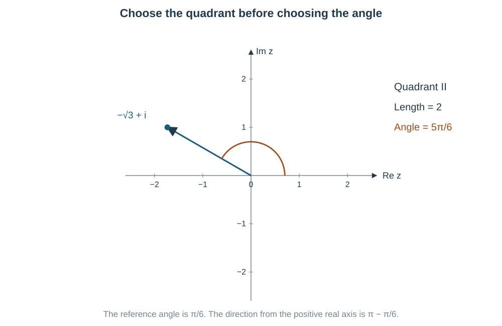

**Why not just use inverse tangent?** The ratio $y/x$ alone loses the quadrant. Both $(1,1)$ and $(-1,-1)$ have the same ratio, but their directions differ.

First locate the quadrant. Then use the small **reference angle**

$$
\alpha=\tan^{-1}|y/x|\quad(x\ne0).
$$

| Position | Principal angle |
|---|---|
| Quadrant I | $\alpha$ |
| Quadrant II | $\pi-\alpha$ |
| Quadrant III | $-\pi+\alpha$ |
| Quadrant IV | $-\alpha$ |
| Positive / negative imaginary axis | $\pi/2$ / $-\pi/2$ |

For $-\sqrt3+i$, the reference angle is $\pi/6$ but the point is in quadrant II. Its principal angle is $\pi-\pi/6=5\pi/6$.

Angles in complex polar formulas use **radians**: $\pi$ radians equals $180^\circ$.

### Concept C07 — Polar form separates length and direction

**Important for JEE Main.** A point at distance $r$ and angle $\theta$ has coordinates

$$
x=r\cos\theta,\qquad y=r\sin\theta.
$$

Thus

$$
\boxed{z=r(\cos\theta+i\sin\theta)=r\,\operatorname{cis}\theta},
\qquad r=|z|.
$$

The abbreviation $\operatorname{cis}\theta$ means exactly $\cos\theta+i\sin\theta$.

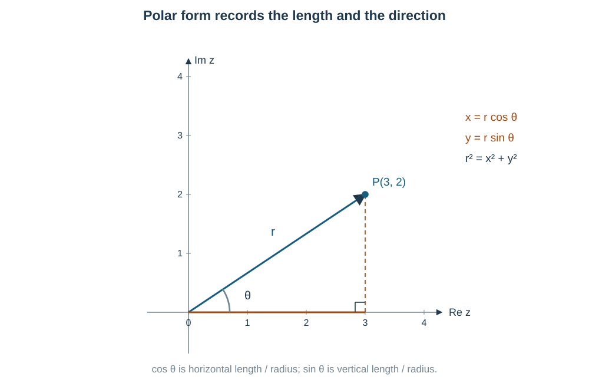

We may also write $\operatorname{cis}\theta=e^{i\theta}$ using Euler's identity. In these questions that notation is a compact way to write the same direction.

**Which form should I use?**

- Use $x+iy$ for comparing real/imaginary parts, conjugates, and simple locus equations.
- Use $r\operatorname{cis}\theta$ for large powers, roots, and rotation.
- Use the point/distance view for circles, nearest points, and triangle geometry.

For example, $1+i\sqrt3$ has $r=2$ and $\theta=\pi/3$, so its polar form is $2\operatorname{cis}(\pi/3)$. Expanding its twelfth power would create many terms; the polar form keeps just a length and an angle.

For $z=0$, the length is zero and the polar direction is not unique. Do not assign it an argument just because the expression $0\operatorname{cis}\theta$ can be written.

### Concept C08 — Multiplication scales and turns an arrow

**Important for JEE Main.** The angle-addition identities give

$$
(r\operatorname{cis}\alpha)(s\operatorname{cis}\beta)
=rs\operatorname{cis}(\alpha+\beta).
$$

So multiplication **multiplies lengths and adds directions**. Division, for a nonzero divisor, divides lengths and subtracts directions:

$$
\frac{r\operatorname{cis}\alpha}{s\operatorname{cis}\beta}
=\frac rs\operatorname{cis}(\alpha-\beta).
$$

Multiplication by $i=\operatorname{cis}(\pi/2)$ turns an arrow $90^\circ$ anticlockwise without changing its length. In components,

$$
\boxed{i(x+iy)=-y+ix:\quad(x,y)\longmapsto(-y,x)}.
$$

Multiplication by $-i$ turns clockwise; by $-1$ makes a half-turn.

**Rotation about a point $c$:** first work with the movement from $c$:

$$
\boxed{z_{\text{new}}=c+(z-c)\operatorname{cis}\theta}.
$$

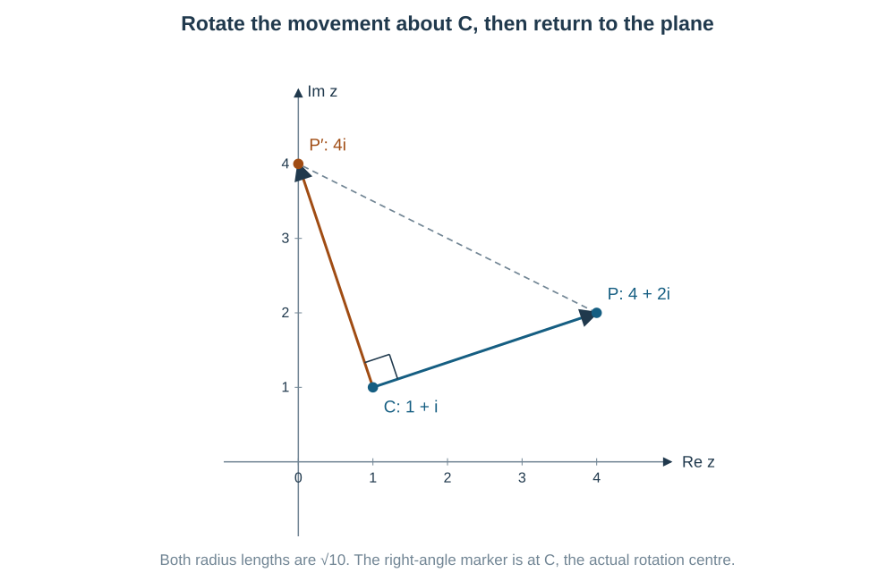

Read the three actions: subtract $c$ → turn the displacement → add $c$ back. Multiplying $z$ directly would rotate about the origin, which is a different centre.

**Principal angles must be brought back into the chosen interval.**

$$
\operatorname{Arg}(zw)\equiv
\operatorname{Arg}z+\operatorname{Arg}w\pmod{2\pi}.
$$

The symbol $\equiv\pmod{2\pi}$ means the two angles may differ by whole turns. It is not always an ordinary equality. For example, $z=w=-1$ gives angle sum $2\pi$, but $zw=1$ has principal angle $0$.

For division use the same whole-turn adjustment. For conjugation, the direction changes sign; if this gives $-\pi$, write $\pi$ in our principal interval.

### Concept C09 — Powers and all the roots

**Important for JEE Main.** Repeated multiplication repeats the length-and-turn rule:

$$
\boxed{(r\operatorname{cis}\theta)^n=r^n\operatorname{cis}(n\theta)}
$$

for integers $n$; for negative $n$, require $r>0$. This is **de Moivre's formula**.

Now solve $z^n=w$, where $n$ is a positive integer and $w=R\operatorname{cis}\phi\ne0$. The length must be $R^{1/n}$. The angle after multiplication by $n$ can be $\phi$ or $\phi+2\pi$ or another whole-turn version:

$$
\boxed{z_k=R^{1/n}\operatorname{cis}\!\left(\frac{\phi+2k\pi}{n}\right),
\quad k=0,1,\ldots,n-1}.
$$

**Why all $n$ answers?** Adding $2\pi$ before dividing by $n$ creates an angle gap $2\pi/n$. Stopping after the first angle loses the other roots. After $n$ steps the directions repeat.

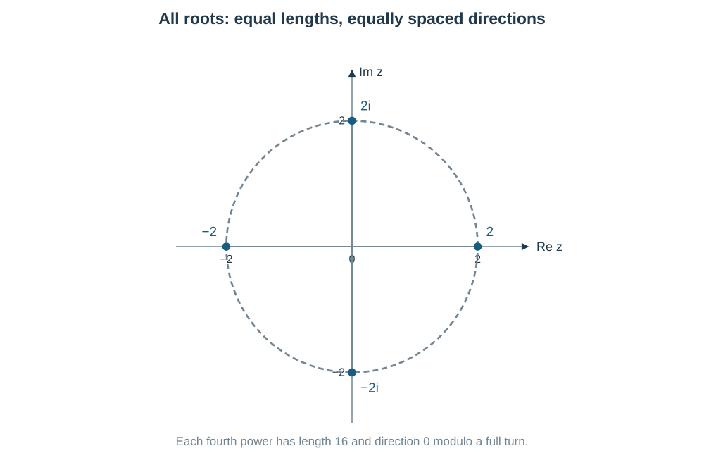

All roots lie on one circle, equally spaced in angle: a regular polygon when $n\ge3$. For $w=0$, the only distinct solution is $z=0$; do not claim $n$ distinct points.

**Root product:** the product of all $n$ roots of $z^n=w$ is $(-1)^{n-1}w$. This follows by comparing the constant term of $z^n-w$ with the product form.

### Concept C10 — Roots of unity and the useful cube-root identities

**Important for JEE Main.** A root of **unity** means a solution of $z^n=1$:

$$
\boxed{z_k=\operatorname{cis}\frac{2k\pi}{n},\quad k=0,\ldots,n-1}.
$$

All have modulus $1$. One root is $1$ itself. Their product is $(-1)^{n-1}$. For $n>1$, their sum is zero: equally spaced arrows balance at the origin.

The non-real cube roots are usually called $\omega,\omega^2$. We may choose

$$
\omega=-\frac12+\frac{\sqrt3}{2}i,\qquad
\omega^2=-\frac12-\frac{\sqrt3}{2}i.
$$

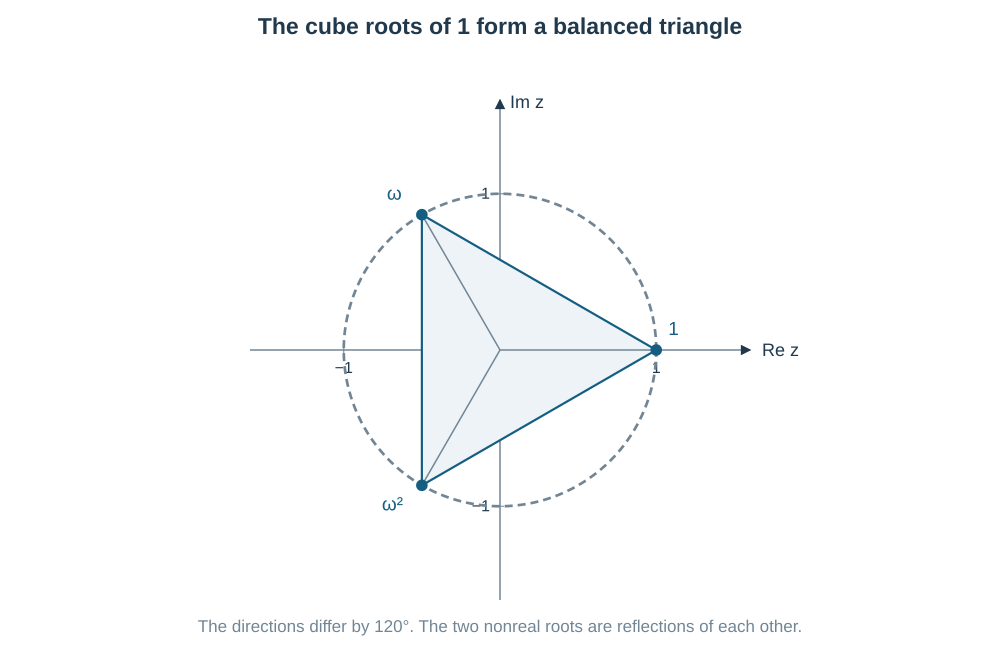

From $(z^3-1)=(z-1)(z^2+z+1)$,

$$
\boxed{\omega^3=1,\quad1+\omega+\omega^2=0,\quad
\omega\omega^2=1,\quad\overline\omega=\omega^2}.
$$

Therefore

$$
\omega+\omega^2=-1,\quad
\frac1\omega=\omega^2,\quad\frac1{\omega^2}=\omega,
$$

$$
\boxed{(1-\omega)(1-\omega^2)=3},\qquad |1-\omega|=\sqrt3.
$$

To get the last product, expand only this short pair:

$$
1-(\omega+\omega^2)+\omega^3=1-(-1)+1=3.
$$

**Recognition clue:** large powers of $\omega$ need only their remainder modulo $3$. Reduce the exponents **before** a long expansion.

More generally, for $z^n=1$ and $z\ne1$,

$$
\boxed{1+z+z^2+\cdots+z^{n-1}=0}.
$$

Multiply the sum by $1-z$ to get $1-z^n=0$. The condition $z\ne1$ is needed for division by $1-z$. If $z=1$, the sum is $n$ instead.

For a primitive root $\zeta=\operatorname{cis}(2\pi/n)$,

$$
\sum_{k=0}^{n-1}\zeta^{mk}
=\begin{cases}n,&n\mid m,\\0,&n\nmid m.\end{cases}
$$

Here $n\mid m$ means $m$ is a multiple of $n$. This is the same geometric-sum argument. Do not assume an arbitrary $n$th root is primitive; “primitive” means its powers visit all $n$ roots before returning to $1$.

### Concept C11 — A locus is the set of every allowed position

**Important for JEE Main.** A **locus** is not one point. It is all points satisfying a rule. First translate the rule into distances or directions.

| Complex statement | Picture |
|---|---|
| $|z-c|=r$, $r>0$ | Circle, centre $c$, radius $r$. |
| $|z-c|\le r$ | Circle together with its inside: a closed disk. |
| $|z-c|<r$ | Inside only; boundary excluded. |
| $|z-a|=|z-b|$, $a\ne b$ | Perpendicular bisector of the segment joining $a,b$. |
| $\operatorname{Re}z=h$ | Vertical line $x=h$. |
| $\operatorname{Im}z=k$ | Horizontal line $y=k$. |
| $\operatorname{Arg}(z-c)=\theta$ | Ray from $c$ in direction $\theta$, with $c$ excluded. |

For $r=0$, $|z-c|=0$ is just the point $c$. A negative proposed radius gives no points.

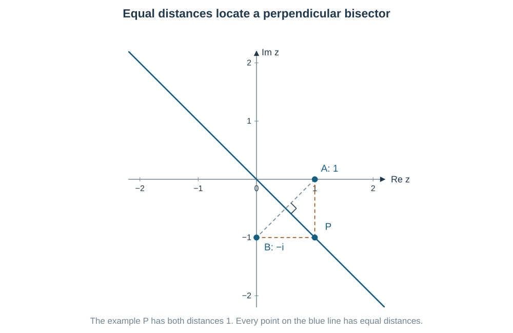

**Read the fixed points correctly:** $|z+i|=|z-(-i)|$ is distance from $-i$, not from $i$.

If $z=x+iy$ and $c=a+ib$,

$$
|z-c|^2=(x-a)^2+(y-b)^2.
$$

Both distances are nonnegative, so squaring an equality of distances is safe. It often cancels the $x^2+y^2$ terms and leaves a line.

**Fixed ratio of distances — Important for JEE Main.** Suppose $a,b$ are two distinct fixed points and

$$
|z-a|=k|z-b|,\qquad k>0.
$$

For $k=1$, this is the perpendicular bisector already explained. For $k\ne1$, it is a circle with

$$
\boxed{\text{centre }c=\frac{a-k^2b}{1-k^2},\qquad
\text{radius }r=\frac{k|a-b|}{|1-k^2|}}.
$$

The letters $a,b,c$ here represent complex points; $k,r$ are real lengths or ratios. The result comes from squaring the two distances and completing squares. It is often called an **Apollonius circle**; its meaning is simply a fixed distance ratio.

For example, $|z|=2|z-2|$ gives

$$
x^2+y^2=4\big((x-2)^2+y^2\big)
\quad\Longrightarrow\quad
(x-8/3)^2+y^2=(4/3)^2.
$$

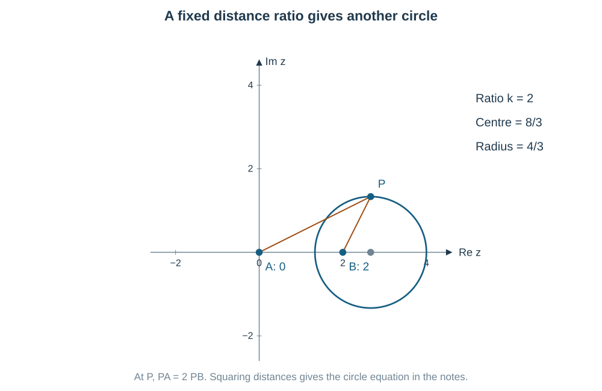

Read the example: distance to $A=0$ is twice distance to $B=2$ at every point of the circle. If the original statement is written as a quotient, retain its denominator restriction. Here $z=2$ is not on the circle anyway.

**Distance from the origin to a circle.** If $|z-c|=r$,

$$
\boxed{\min|z|=\big||c|-r\big|,\qquad\max|z|=|c|+r}.
$$

For distance from another fixed point $a$, shift the origin to $a$:

$$
\boxed{\min|z-a|=\big||c-a|-r\big|,\qquad
\max|z-a|=|c-a|+r}.
$$

If the target is $|Az+B|$ with $A\ne0$, factor it as $|A|\,|z+B/A|$: it is a scaled distance from $-B/A$. This connects a seemingly algebraic target to the same circle picture.

The centre, origin, and extreme points lie on the same straight line. If the origin lies inside the circle, the nearest boundary point is still at distance $r-|c|$.

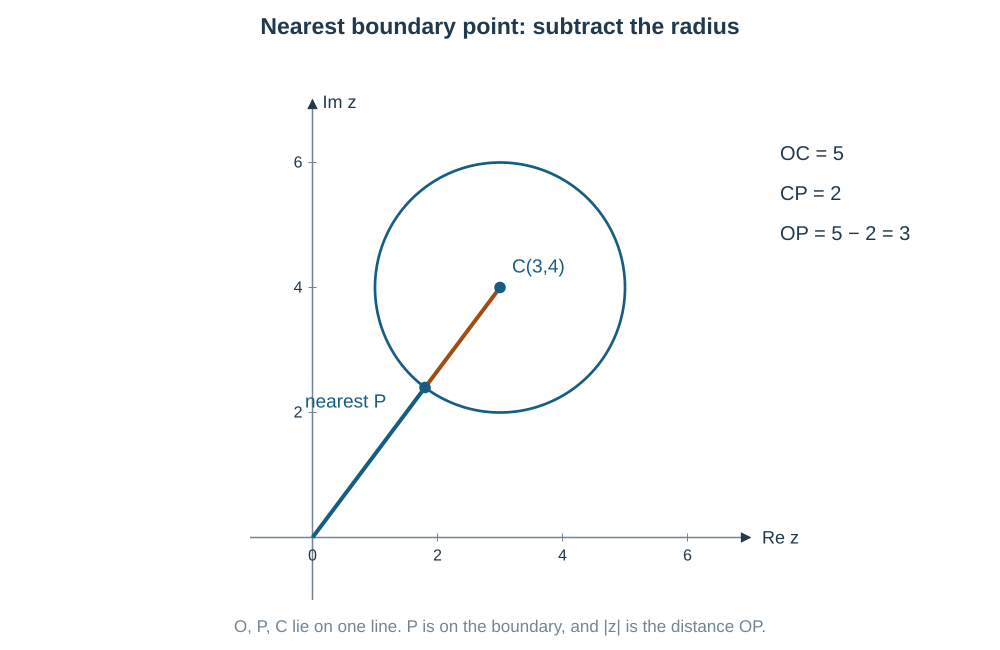

**Circle and disk are different.** For a **disk** $|z-c|\le r$, the minimum is $\max(0,|c|-r)$, because the origin itself is allowed when it lies inside. For the boundary circle, it may not be allowed.

### Concept C12 — An angle condition needs both the line and its direction

**Important for JEE Main.** For $z\ne a,b$, the quotient

$$
\frac{z-a}{z-b}
$$

compares the directions of the two arrows from the fixed points $a,b$ to $z$. Its argument is the direction of $z-a$ minus the direction of $z-b$, with whole-turn adjustment.

If the principal argument of a nonzero number $w$ is $\pi/2$, then

$$
\boxed{\operatorname{Re}w=0,\qquad\operatorname{Im}w>0}.
$$

The condition is not merely “real part zero”: the negative imaginary axis has angle $-\pi/2$, and zero has no argument.

For the source example, let $z=x+iy$. Multiply by the conjugate of $z+1$:

$$
\frac{z-1}{z+1}
=\frac{(x-1+iy)(x+1-iy)}{(x+1)^2+y^2}
=\frac{x^2+y^2-1+2iy}{(x+1)^2+y^2}.
$$

The denominator is positive away from $z=-1$. Therefore angle $\pi/2$ requires

$$
x^2+y^2=1,\qquad y>0.
$$

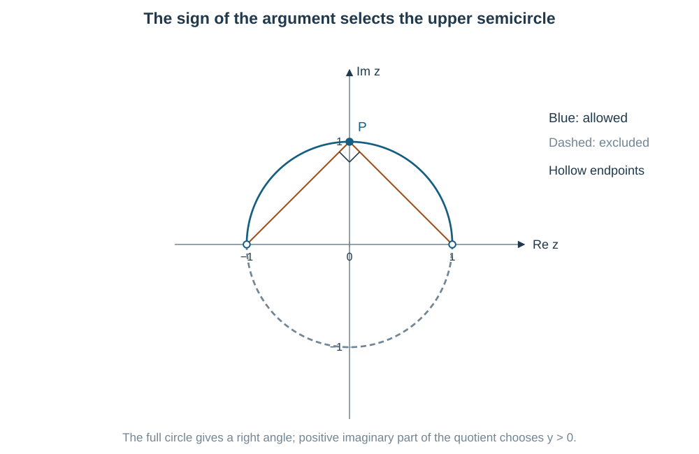

**Read the picture:** the circle gives the right angle; the sign chooses the upper half. At $z=1$ the quotient is zero, and at $z=-1$ it is undefined. Neither endpoint belongs.

An argument condition can select an arc or a ray rather than a full circle or full line. Always keep the direction condition.

### Concept C13 — A sum of two distances: ellipse, segment, or no points

**Important for JEE Main as a geometry connection.** Let $A,B$ be distinct fixed points a distance $2c>0$ apart. Consider

$$
PA+PB=2a.
$$

The two-step route from $A$ through $P$ to $B$ cannot be shorter than $AB$.

- If $2a<2c$, there are no points.
- If $2a=2c$, the route is straight without going past an endpoint: $P$ lies on the closed segment $AB$.
- If $2a>2c$, the points form a nondegenerate **ellipse**.

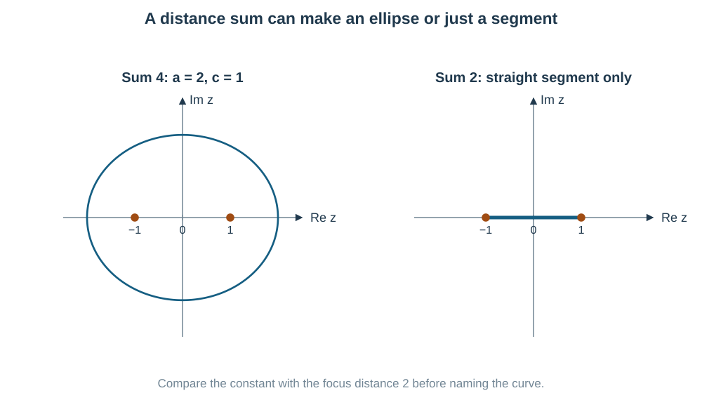

The two fixed points are the **foci**. The centre is their midpoint. The longer diameter through them is the major axis, of length $2a$. The shorter diameter is $2b$, with

$$
\boxed{b^2=a^2-c^2,\qquad e=\frac ca,\quad0<e<1}.
$$

The number $e$ is **eccentricity**. It compares the focus distance with the major semi-axis: it tells us how stretched the ellipse is.

For foci $-1,1$ and distance sum $4$, $c=1$ and $a=2$, so $e=1/2$. The equation is $x^2/4+y^2/3=1$.

**Trap:** seeing a sum of distances does not by itself prove a nondegenerate ellipse. Compare the constant with the distance between the foci. Source Q19 tests exactly this.

### Concept C14 — Equations mixing $z$, $\overline z$, and $|z|$

**Important for JEE Main.** There are two especially useful routes.

**Route 1: compare lengths first.** If $z^m=\overline z$ with integer $m\ge2$, put $r=|z|$. Taking moduli gives

$$
r^m=r\quad\Longrightarrow\quad r=0\text{ or }r^{m-1}=1.
$$

Since $r$ is nonnegative, the nonzero case has $r=1$. Then $\overline z=1/z$, so

$$
z^m=\frac1z\quad\Longrightarrow\quad z^{m+1}=1.
$$

Hence there are $m+1$ unit-circle solutions and the separate solution zero:

$$
\boxed{\text{number of distinct solutions of }z^m=\overline z=m+2}.
$$

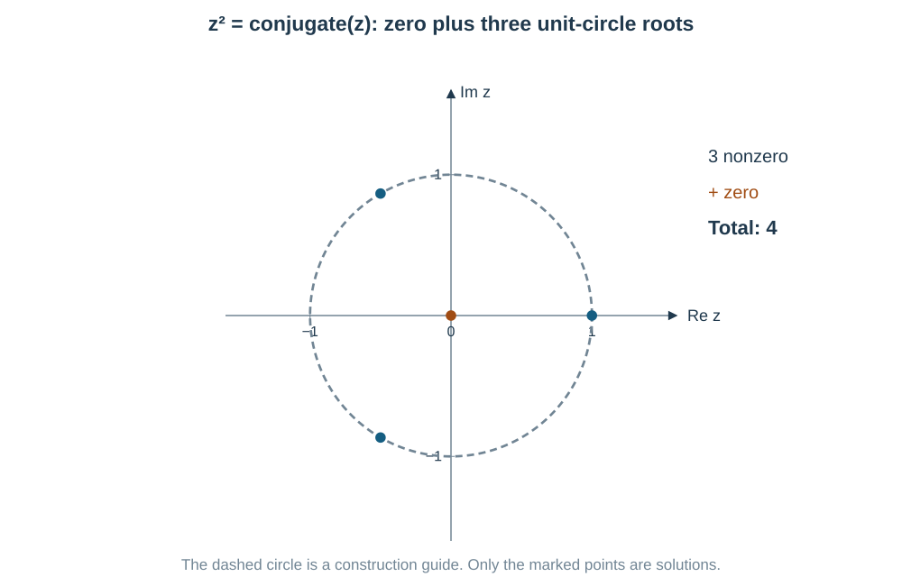

This shortcut assumes exactly the stated equation and $m\ge2$. If you divide by $z$ at the start, you lose the zero solution. If $m=1$, all real numbers solve the equation; the formula does not apply.

**Route 2: compare real and imaginary parts.** For an equation such as $|z|-z=1+2i$, the modulus has no imaginary part. Put $z=x+iy$:

$$
\sqrt{x^2+y^2}-x-iy=1+2i.
$$

Read the imaginary equation first: $-y=2$. This reduces the rest to one real unknown. Before squaring a root equation, keep its sign condition and substitute the final candidate back.

### Concept C15 — Square roots of a complex number

**Important for JEE Main.** Suppose

$$
(a+ib)^2=u+iv,\qquad a,b,u,v\in\mathbb R.
$$

Expanding gives

$$
\boxed{a^2-b^2=u,\qquad2ab=v}.
$$

Also, lengths give

$$
a^2+b^2=|u+iv|=\sqrt{u^2+v^2}=R.
$$

Adding and subtracting,

$$
\boxed{a^2=\frac{R+u}{2},\qquad b^2=\frac{R-u}{2}}.
$$

The sign of $2ab=v$ decides which signs go together. The two square roots are opposites, not four independent sign choices.

Example: for $-7+24i$, $R=25$, so $a^2=9,b^2=16$. If $a>0$, then $a=3$, and $2ab=24$ gives $b=4$. The roots are $\pm(3+4i)$.

For a negative real input, the roots are purely imaginary and $a=0$. For a positive real input, the roots are real. For zero, there is only one distinct root. These cases are why a general shortcut must not blindly divide by $a$.

**Square-root warning:** for arbitrary complex inputs, principal square roots do not always satisfy $\sqrt{uv}=\sqrt u\sqrt v$. For instance, the principal values give $\sqrt{-1}\sqrt{-1}=-1$, whereas $\sqrt{(-1)(-1)}=1$.

### Concept C16 — Quadratic roots: conjugates and symmetric expressions

**Important for JEE Main.** For

$$
ax^2+bx+c=0,\qquad a\ne0,
$$

with roots $\alpha,\beta$,

$$
\boxed{\alpha+\beta=-\frac ba,\qquad\alpha\beta=\frac ca}.
$$

These follow by expanding $a(x-\alpha)(x-\beta)$ and comparing coefficients. They work even when the roots are nonreal.

If the coefficients are **real**, a nonreal root comes with its conjugate. Conjugating the entire equation proves that if $u+iv$ is a root, $u-iv$ is also a root. This need not hold for a polynomial with arbitrary complex coefficients.

For a monic quadratic with roots $u\pm iv$,

$$
\boxed{x^2-2ux+(u^2+v^2)=0}.
$$

The product is $|u+iv|^2$, a positive real number for a nonreal pair.

**Recognize a target containing powers of both roots.** Set $s=\alpha+\beta$, $p=\alpha\beta$. Then

$$
\alpha^2+\beta^2=s^2-2p,\qquad
\alpha^3+\beta^3=s^3-3ps,
$$

$$
\boxed{\alpha^4+\beta^4=(s^2-2p)^2-2p^2}.
$$

Why the last subtraction? Squaring $\alpha^2+\beta^2$ includes the extra $2\alpha^2\beta^2=2p^2$.

More generally, $U_n=\alpha^n+\beta^n$ satisfies

$$
\boxed{U_0=2,\quad U_1=s,\quad U_n=sU_{n-1}-pU_{n-2}}.
$$

Each root satisfies $t^2=st-p$. Multiply by $t^{n-2}$ and add the two equations.

**A shorter cycle may exist.** For $t^2-t+1=0$,

$$
(t+1)(t^2-t+1)=t^3+1=0.
$$

Thus $t^3=-1$ and $t^6=1$. Q35 asks for a huge power, so this cycle is shorter than a long recurrence.

### Concept C17 — Triangle geometry on the complex plane

**Important for JEE Main.** Always identify which complex numbers represent vertices and which represent side movements.

For vertices $z_1,z_2,z_3$, the side lengths are

$$
|z_2-z_1|,\quad|z_3-z_2|,\quad|z_1-z_3|.
$$

The midpoint of two vertices is $(z_1+z_2)/2$, and the triangle's centroid is

$$
\boxed{g=\frac{z_1+z_2+z_3}{3}}.
$$

This averages the horizontal and vertical coordinates separately.

An equilateral triangle with side $s$ has height $\sqrt3\,s/2$ and area

$$
\boxed{A=\frac{\sqrt3}{4}s^2}.
$$

Draw the altitude: it halves the base and makes a right triangle. Pythagoras gives the height, then $A=\tfrac12(\text{base})(\text{height})$.

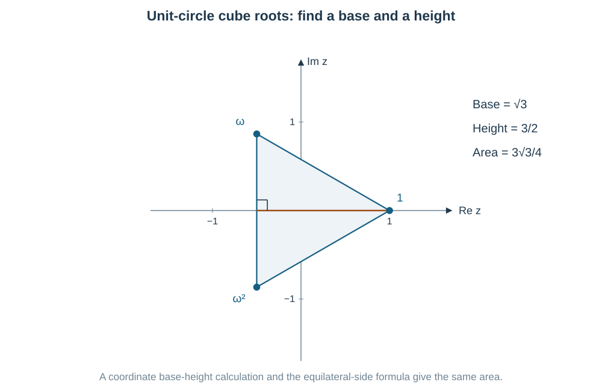

If two vertices are $a,b$, the two possible third vertices of an equilateral triangle are

$$
\boxed{c=\frac{a+b}{2}\ \pm\ \frac{\sqrt3}{2}i(b-a)}.
$$

Why? Start at the midpoint, turn the side movement through $90^\circ$ using $i$, and scale it to the altitude. The two signs put the vertex on opposite sides.

For arbitrary triangles, put $u=z_2-z_1$ and $v=z_3-z_1$. Then

$$
\boxed{A=\frac12|\operatorname{Im}(\overline u\,v)|}.
$$

Indeed, if $u=p+iq$ and $v=r+is$, the imaginary part is $ps-qr$, the signed parallelogram area. The absolute value removes orientation; the factor $1/2$ gives triangle area.

For nonzero $v$, $u/v$ real means parallel side movements, so the three points are collinear. If $\operatorname{Re}(u\overline v)=0$ and both movements are nonzero, they are perpendicular.

For three **distinct** vertices, the equilateral condition can also be written

$$
z_1^2+z_2^2+z_3^2=z_1z_2+z_2z_3+z_3z_1.
$$

Use side lengths or the midpoint construction first if this identity is unfamiliar. Distinctness matters: three identical points also satisfy the equation but do not make a triangle.

### Concept C18 — Short cycles and weighted sums

**Important for JEE Main.** Look for what stays unchanged after a fixed number of powers.

If $z+1/z=1$, then $z\ne0$ and

$$
z^2-z+1=0\quad\Longrightarrow\quad z^3=-1,\quad z^6=1.
$$

A large exponent can now be reduced modulo $6$. This often avoids finding the two individual values of $z$.

For a reciprocal-power sum, $V_n=z^n+z^{-n}$,

$$
\boxed{V_0=2,\quad V_1=z+z^{-1},\quad
V_n=V_1V_{n-1}-V_{n-2}}.
$$

Multiply the two sums to see the neighbouring powers. Use a visible short cycle before computing many recurrence steps.

**Weighted geometric sums.** A sum such as

$$
S=1+2\omega+3\omega^2+\cdots+30\omega^{29}
$$

has coefficients increasing by one while powers increase by one. Multiplying by $\omega$ shifts the terms so neighbouring coefficients can subtract:

$$
(1-\omega)S=(1+\omega+\cdots+\omega^{29})-30\omega^{30}.
$$

For a nonreal cube root, the bracket is ten complete zero-sum groups, and $\omega^{30}=1$. Thus $(1-\omega)S=-30$.

Another useful view is to group three terms at a time. Q34 shows both routes and explains the cancellation explicitly. Do not expand thirty complex terms one by one.

### Concept C19 — Two source-question extensions with conventions

**Useful supporting connection for Q33.** If $|z|=1$ and $z\ne1$, set

$$
w=\frac{1+z}{1-z}.
$$

Since $\overline z=1/z$,

$$
\overline w=\frac{1+1/z}{1-1/z}
=\frac{z+1}{z-1}=-w.
$$

Therefore $\operatorname{Re}w=0$. At $z=-1$, $w=0$. The real-part statement is always true; calling zero “purely imaginary” depends on the convention being used.

**Principal complex power in Q33(iv).** This is a source-question extension, not a new core formula to memorize without its meaning. For a nonzero complex base, the principal logarithm records its length and chosen principal angle:

$$
\operatorname{Log}z=\ln|z|+i\operatorname{Arg}z.
$$

The principal value of $z^w$ is defined as $e^{w\operatorname{Log}z}$. For $i$, length $1$ and angle $\pi/2$ give

$$
\operatorname{Log}i=i\pi/2,\qquad
\boxed{i^i=e^{i(i\pi/2)}=e^{-\pi/2}}.
$$

This is a positive real number. If all angle branches are considered, the values become $e^{-\pi/2-2k\pi}$ for integers $k$; they are still real. Keep the chosen convention explicit. Do not extend ordinary real exponent laws blindly to arbitrary complex powers.

## Recognize the question model

These are thinking routes, not measured PYQ-frequency ranks.

| Visible clue | Useful first move | Where |
|---|---|---|
| Huge integer power | Simplify the base; find a short angular cycle. | C03, C07–C10 |
| Conjugate in a denominator | Multiply by the denominator's conjugate. | C04 |
| Only length is asked | Take moduli before a full division or expansion. | C05 |
| Angle or direction | Draw the quadrant; retain principal-angle adjustment. | C06–C08 |
| Difference inside modulus | Read it as distance between two points. | C02, C11 |
| Argument of a quotient | Identify both directions; keep the sign choosing the arc. | C12 |
| $z^m=\overline z$ | Separate zero, then use lengths and roots of unity. | C14 |
| Symmetric root powers | Use sum/product or a root cycle before solving roots. | C16 |
| Increasing coefficients times powers | Shift and subtract, or group a complete cycle. | C18 |

## Last-minute formula recap

Read this after the pictures and explanations.

| Need | Recall | Condition or trap |
|---|---|---|
| Number and parts | $z=x+iy$, $\operatorname{Re}z=x$, $\operatorname{Im}z=y$ | Imaginary part is $y$, not $iy$. |
| Equality | Real parts match and imaginary parts match. | Compare both. |
| Powers of $i$ | $1,i,-1,-i$ repeat. | Reduce integer exponent modulo $4$. |
| Conjugate | $\overline z=x-iy$ | Reflection in real axis. |
| Parts from conjugate | $\operatorname{Re}z=(z+\overline z)/2$, $\operatorname{Im}z=(z-\overline z)/(2i)$ | $z=-\overline z$ includes zero. |
| Modulus | $|z|=\sqrt{x^2+y^2}$, $z\overline z=|z|^2$ | Nonnegative real length. |
| Reciprocal | $1/z=\overline z/|z|^2$ | $z\ne0$. |
| Products / quotients | $|zw|=|z||w|$, $|z/w|=|z|/|w|$ | Divisor nonzero. |
| Unit circle | $\overline z=1/z$ | $|z|=1$. |
| Difference | $|z_2-z_1|$ is point distance. | Destination minus start for movement. |
| Sum/difference square | $|z\pm w|^2=|z|^2+|w|^2\pm2\operatorname{Re}(z\overline w)$ | The mixed term explains directions. |
| Parallelogram | $|z+w|^2+|z-w|^2=2(|z|^2+|w|^2)$ | Match a missing sum/difference. |
| Triangle bounds | $\big||z|-|w|\big|\le|z\pm w|\le|z|+|w|$ | Exhibit equality for an actual extreme. |
| Cauchy–Schwarz | $|\operatorname{Re}(z\overline w)|\le|z||w|$ | Equality needs aligned directions. |
| Polar form | $z=r\operatorname{cis}\theta$ | $r\ge0$; zero has no argument. |
| Principal argument | $-\pi<\operatorname{Arg}z\le\pi$ | Use quadrant and whole-turn adjustment. |
| Product / quotient angles | Add / subtract modulo $2\pi$. | Not always ordinary principal equality. |
| Rotation about $c$ | $z'=c+(z-c)\operatorname{cis}\theta$ | Subtract centre before rotating. |
| Integer power | $(r\operatorname{cis}\theta)^n=r^n\operatorname{cis}(n\theta)$ | Negative powers require nonzero base. |
| All $n$th roots | $R^{1/n}\operatorname{cis}((\phi+2k\pi)/n)$ | $k=0,\ldots,n-1$; $R>0$. |
| Unity roots | $\operatorname{cis}(2k\pi/n)$ | Sum $0$ for $n>1$; product $(-1)^{n-1}$. |
| Cube roots | $1+\omega+\omega^2=0$, $\omega^3=1$ | $\omega\ne1$. |
| Useful pair | $(1-\omega)(1-\omega^2)=3$ | Hence $|1-\omega|=\sqrt3$. |
| Circle | $|z-c|=r$ | Centre $c$, boundary only. |
| Circle distances from $O$ | Minimum $\big||c|-r\big|$, maximum $|c|+r$ | Disk minimum may instead be zero. |
| Equal distances | Perpendicular bisector. | Two distinct fixed points. |
| Fixed ratio $|z-a|=k|z-b|$ | Centre $(a-k^2b)/(1-k^2)$; radius $k|a-b|/|1-k^2|$ | $k>0$, $k\ne1$, $a\ne b$; $k=1$ gives the bisector. |
| Distance sum $2a$, foci gap $2c$ | Ellipse if $a>c$; segment if $a=c$. | No points if $a<c$. |
| Ellipse | $e=c/a$, $b^2=a^2-c^2$ | Nondegenerate case $a>c>0$. |
| $z^m=\overline z$ | Zero plus $(m+1)$th unity roots. | $m\ge2$; total $m+2$. |
| Complex square root | $a^2-b^2=u$, $2ab=v$, $a^2+b^2=|u+iv|$ | Choose linked signs; check by squaring. |
| Root sum and product | $s=-b/a$, $p=c/a$ | $a\ne0$. |
| Conjugate roots | Real coefficients pair $u+iv$ with $u-iv$. | Complex coefficients need not. |
| Root powers | $U_n=sU_{n-1}-pU_{n-2}$ | $U_0=2$, $U_1=s$; a cycle can be faster. |
| Equilateral area | $\sqrt3\,s^2/4$ | $s$ is a side length. |
| General triangle area | $\tfrac12|\operatorname{Im}(\overline{z_2-z_1}(z_3-z_1))|$ | Common starting vertex. |
| Midpoint / centroid | $(a+b)/2$ / $(a+b+c)/3$ | Average both coordinates. |

**Before answering:** Did I lose $z=0$? Did I keep the correct angle interval and quadrant? Is a modulus being treated as a real length? Does a claimed maximum actually occur?

## Worked solutions to the 35 PDF questions

Try each question before reading the working. Read the picture and reason for the route, then follow the calculation. The second approaches remain fully included.

### Question 1 — Four powers make one complete cycle

**PDF page 8 | MCQ | Notes: C03**

The value of $i+i^2+i^3+\cdots+i^{2023}$ is

- (a) $-1$
- (b) $0$
- (c) $i$
- (d) $-i$

**Notice the repeating group, not the large number $2023$.**

$$
i+i^2+i^3+i^4=i-1-i+1=0.
$$

There are $2020=4(505)$ terms in complete groups. The remaining exponents have remainders $1,2,3$:

$$
i^{2021}+i^{2022}+i^{2023}=i-1-i=\boxed{-1}.
$$

**Answer: (a). Check:** the imaginary terms cancel, leaving a real answer. Do not confuse the sum with just its last term $i^{2023}$.

### Question 2 — Simplify before taking a large power

**PDF page 8 | MCQ | Notes: C03–C04**

The value of $\left(\dfrac{1+i}{1-i}\right)^{101}$ is

- (a) $-i$
- (b) $1$
- (c) $-1$
- (d) $i$

**Simplify the base first.** Expanding a fraction to power $101$ would hide its simple value. Multiply top and bottom by $1+i$, the conjugate of the denominator:

$$
\frac{1+i}{1-i}=\frac{(1+i)^2}{(1-i)(1+i)}
=\frac{2i}{2}=i.
$$

Now the large power is only a cycle question:

$$
i^{101}=i^{4(25)+1}=\boxed{i}\qquad\text{(d)}.
$$

**Check:** the original numerator and denominator have equal lengths, so the quotient must have length $1$; the answer does.

**Another possible approach — angle difference.** Both lengths are $\sqrt2$. Their directions are $\pi/4$ and $-\pi/4$, so division gives a unit arrow at $\pi/2$, namely $i$. This is useful when polar form is already clear.

### Question 3 — Only the length is asked

**PDF page 8 | MCQ | Notes: C05**

The modulus of $\dfrac{3+4i}{1-2i}$ is

- (a) $\sqrt5$
- (b) $5\sqrt5$
- (c) $5$
- (d) $\dfrac1{\sqrt5}$

**What is asked: the length, not the full quotient.** A full rationalization works, but it calculates a real part and an imaginary part that we do not need.

$$
\left|\frac{3+4i}{1-2i}\right|
=\frac{|3+4i|}{|1-2i|}
=\frac{\sqrt{9+16}}{\sqrt{1+4}}
=\boxed{\sqrt5}\qquad\text{(a)}.
$$

The denominator is nonzero, so the quotient rule is allowed.

**Another possible approach — calculate and check.**

$$
\frac{(3+4i)(1+2i)}5=\frac{-5+10i}{5}=-1+2i.
$$

Its modulus is $\sqrt{1+4}=\sqrt5$. This verifies the shorter length route.

### Question 4 — A tangent does not choose the quadrant

**PDF page 8 | MCQ | Notes: C06**

The principal argument of $-\sqrt3+i$ is

- (a) $\dfrac\pi6$
- (b) $-\dfrac{5\pi}6$
- (c) $\dfrac{2\pi}3$
- (d) $\dfrac{5\pi}6$

**Place the point before using a tangent.** The real part is negative and the imaginary part positive, so the arrow lies in quadrant II.

The small reference angle is

$$
\alpha=\tan^{-1}\frac1{\sqrt3}=\frac\pi6.
$$

Hence

$$
\operatorname{Arg}(-\sqrt3+i)=\pi-\frac\pi6
=\boxed{\frac{5\pi}6}\qquad\text{(d)}.
$$

**Check:** the angle is between $\pi/2$ and $\pi$, as quadrant II requires. The value $\pi/6$ would point into quadrant I. The value $-5\pi/6$ would point below the real axis.

### Question 5 — A power multiplies the angle

**PDF page 8 | MCQ | Notes: C07–C09**

The value of $(1+i\sqrt3)^{12}$ is

- (a) $-4096$
- (b) $4096i$
- (c) $4096$
- (d) $2048$

**The large power suggests length-and-angle form.**

$$
|1+i\sqrt3|=2,\qquad
1+i\sqrt3=2\operatorname{cis}\frac\pi3.
$$

Use de Moivre's formula:

$$
(1+i\sqrt3)^{12}
=2^{12}\operatorname{cis}(4\pi)
=\boxed{4096}\qquad\text{(c)}.
$$

**Check:** $4\pi$ is two full turns, so the output lies on the positive real axis.

**Another possible approach — cube once, then use a real power.**

$$
(1+i\sqrt3)^2=-2+2i\sqrt3,\quad
(1+i\sqrt3)^3=-8.
$$

Thus the twelfth power is $(-8)^4=4096$. This is a short algebraic alternative because the cube becomes real.

### Question 6 — Use the cube-root identity before expanding

**PDF page 8 | MCQ | Notes: C10**

If $\omega$ is a non-real cube root of unity, then $(1-\omega+\omega^2)^6+(1+\omega-\omega^2)^6$ equals

- (a) $64$
- (b) $128$
- (c) $0$
- (d) $256$

**Did you notice the three cube-root terms?** Use $1+\omega+\omega^2=0$ before taking sixth powers:

$$
1-\omega+\omega^2=(1+\omega+\omega^2)-2\omega=-2\omega,
$$

$$
1+\omega-\omega^2=(1+\omega+\omega^2)-2\omega^2=-2\omega^2.
$$

Therefore

$$
(-2\omega)^6+(-2\omega^2)^6
=64\omega^6+64\omega^{12}
=64+64=\boxed{128}\qquad\text{(b)}.
$$

**Check:** $\omega^6=(\omega^3)^2=1$ and $\omega^{12}=1$. A six-power expansion is valid, but it creates terms that the zero-sum identity removes immediately.

### Question 7 — Equal distances give a perpendicular bisector

**PDF page 8 | MCQ | Notes: C02, C11**

The locus of the point $z$ satisfying $|z-1|=|z+i|$ is

- (a) the line $x-y=0$
- (b) the line $x+y=1$
- (c) the line $x+y=0$
- (d) the circle $x^2+y^2=1$

**First translate the distances.** The fixed points are $A=1=(1,0)$ and $B=-i=(0,-1)$, because $z+i=z-(-i)$. Points equally far from $A,B$ lie on their perpendicular bisector.

**Calculation.** Put $z=x+iy$ and square the nonnegative distances:

$$
(x-1)^2+y^2=x^2+(y+1)^2.
$$

Cancel $x^2+y^2$:

$$
-2x+1=2y+1\quad\Longrightarrow\quad
\boxed{x+y=0}\qquad\text{(c)}.
$$

**Check:** $z=0$ is distance $1$ from both fixed points and lies on the line.

**Another possible approach — midpoint and direction.** The midpoint is $(1/2,-1/2)$. The joining line has slope $1$, so its perpendicular bisector has slope $-1$. Through the midpoint it is $y+1/2=-(x-1/2)$, the same answer.

### Question 8 — The nearest point of a circle

**PDF page 8 | Numerical value | Notes: C05, C11**

If $|z-3-4i|=2$, then the minimum value of $|z|$ is ____.

**Read the circle before calculating.**

$$
|z-(3+4i)|=2
$$

means a boundary circle with centre $C(3,4)$ and radius $2$. The centre is $OC=5$ units from the origin.

The nearest point is reached by moving $2$ units from $C$ towards $O$:

$$
\boxed{\min|z|=5-2=3}.
$$

**Check attainment.** That point is $z=\frac35(3+4i)=\frac95+\frac{12}5i$. It has modulus $3$ and centre-distance $2$.

**Another possible approach — triangle inequality.**

$$
5=|3+4i|\le|z|+|3+4i-z|=|z|+2,
$$

so $|z|\ge3$. The displayed point makes equality possible. The bound and its equality example together prove the minimum.

### Question 9 — Conjugation reflects; a minus sign turns

**PDF page 8 | MCQ | Notes: C06–C08**

If $z_1,z_2$ are non-zero complex numbers with $|z_1|=|z_2|$ and $\arg z_1+\arg z_2=\pi$, then

- (a) $z_1=\overline{z_2}$
- (b) $z_1=z_2$
- (c) $z_1=-z_2$
- (d) $z_1=-\overline{z_2}$

**Separate length and direction.** Let the common nonzero length be $r$, and choose the stated argument of $z_1$ as $\theta$. Then

$$
z_1=r\operatorname{cis}\theta,\qquad
z_2=r\operatorname{cis}(\pi-\theta).
$$

Conjugation reverses the second direction:

$$
\overline{z_2}
=r\operatorname{cis}(\theta-\pi)
=-r\operatorname{cis}\theta=-z_1.
$$

Thus $\boxed{z_1=-\overline{z_2}}$, **option (d)**.

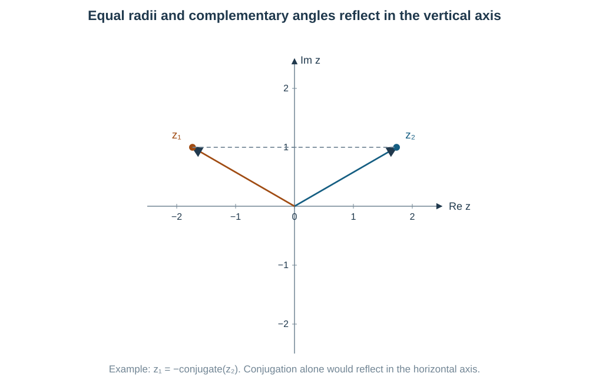

**Another useful view — coordinates.** The cosine identity $\cos(\pi-\theta)=-\cos\theta$ and sine identity $\sin(\pi-\theta)=\sin\theta$ give opposite real parts and equal imaginary parts. That is reflection in the vertical axis. Conjugation alone reflects in the horizontal axis.

### Question 10 — Check zero before dividing by a modulus

**PDF page 9 | MCQ | Notes: C14**

The number of complex numbers $z$ satisfying $z^2+|z|=0$ is

- (a) $1$
- (b) $2$
- (c) $4$
- (d) $3$

**Do not divide by $|z|$ yet: zero may solve the equation.** Put $r=|z|\ge0$. The equation is $z^2=-r$. Taking moduli,

$$
r^2=r\quad\Longrightarrow\quad r(r-1)=0.
$$

If $r=0$, then $z=0$, which works. If $r=1$, the original equation becomes $z^2=-1$, giving $z=i,-i$.

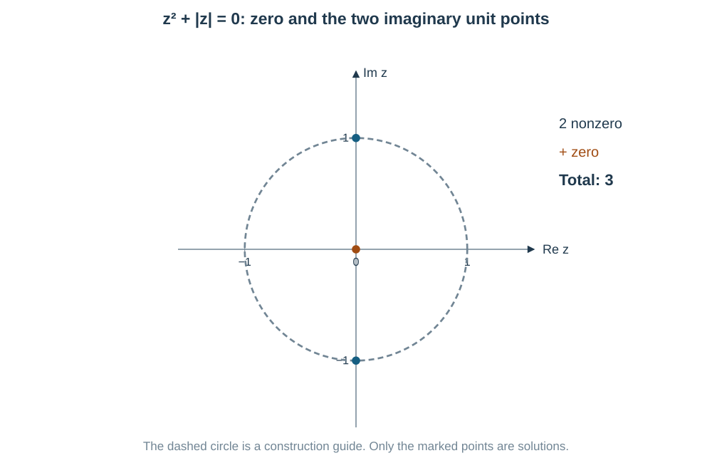

There are $\boxed{3}$ distinct solutions, **option (d)**.

**Check:** $0^2+0=0$ and $(\pm i)^2+1=-1+1=0$. A length condition is only a first filter: not every unit-circle point satisfies $z^2=-1$.

### Question 11 — A conjugate equation becomes roots of unity

**PDF page 9 | MCQ | Notes: C10, C14**

The number of complex numbers $z$ satisfying $z^2=\overline z$ is

- (a) $4$
- (b) $2$
- (c) $3$
- (d) $5$

**Use lengths to reduce the possibilities.**

$$
z^2=\overline z\quad\Longrightarrow\quad
|z|^2=|z|.
$$

So $z=0$ is one solution, or $|z|=1$. In the nonzero unit case, $\overline z=1/z$, giving

$$
z^2=\frac1z\quad\Longrightarrow\quad z^3=1.
$$

The three cube roots and zero are distinct, so the count is $\boxed{4}$, **option (a)**.

**Check sufficiency:** each cube root has length $1$, and $z^2=1/z=\overline z$. We checked the original condition, not just its modulus.

**Another possible approach — real equations.** With $z=x+iy$, compare $x^2-y^2=x$ and $2xy=-y$. The second gives $y(2x+1)=0$. If $y=0$, $x=0,1$; otherwise $x=-1/2$ and $y=\pm\sqrt3/2$. Again four points.

### Question 12 — Build a square root using two real equations

**PDF page 9 | Numerical value | Notes: C15**

If $\sqrt{-7+24i}=\pm(a+ib)$ with $a>0$ and $a,b$ real, then $a+b=$ ____.

**A complex square root can be built from two real parts.** Squaring $a+ib$ gives

$$
a^2-b^2=-7,\qquad 2ab=24.
$$

Also $a^2+b^2=|-7+24i|=\sqrt{49+576}=25$.

Add and subtract the two squared-part equations:

$$
2a^2=18,\quad2b^2=32.
$$

Because $a>0$, $a=3$. Now $2ab=24$ gives $b=4$, so

$$
\boxed{a+b=7}.
$$

**Check by squaring:** $(3+4i)^2=9-16+24i=-7+24i$. Choosing $b=-4$ would give the wrong sign of the imaginary part; the signs cannot be chosen independently.

### Question 13 — Symmetric powers need not require both roots

**PDF page 9 | MCQ | Notes: C16**

If $\alpha,\beta$ are the roots of $x^2-2x+5=0$, then $\alpha^4+\beta^4$ equals

- (a) $14$
- (b) $2$
- (c) $-7$
- (d) $-14$

**The target uses both roots symmetrically.** We can avoid solving for them separately:

$$
\alpha+\beta=2,\qquad\alpha\beta=5.
$$

Notice the square pattern:

$$
\alpha^2+\beta^2=(\alpha+\beta)^2-2\alpha\beta=4-10=-6.
$$

Square that result and remove its extra product:

$$
\alpha^4+\beta^4
=(\alpha^2+\beta^2)^2-2(\alpha\beta)^2
=36-50=\boxed{-14}\qquad\text{(d)}.
$$

**Another possible approach — explicit conjugate roots.** They are $1\pm2i$. The fourth powers are $-7-24i$ and $-7+24i$, which add to $-14$. This checks the answer, but the sum/product route uses only the information the target needs. A fourth power of a real number is nonnegative. These roots are complex, so that real-number rule does not apply.

### Question 14 — Reduce exponents modulo three

**PDF page 9 | MCQ | Notes: C10**

If $\omega$ is a non-real cube root of unity, then $(1-\omega)(1-\omega^2)(1-\omega^4)(1-\omega^8)$ equals

- (a) $3$
- (b) $0$
- (c) $9$
- (d) $27$

**Reduce powers before multiplying.** Since $\omega^3=1$,

$$
\omega^4=\omega,\qquad\omega^8=\omega^2.
$$

The product is therefore

$$
[(1-\omega)(1-\omega^2)]^2.
$$

The short pair is

$$
1-(\omega+\omega^2)+\omega^3=1+1+1=3.
$$

So the answer is $\boxed{3^2=9}$, **option (c)**.

**Check:** the factors pair into conjugates, so the result should be nonnegative real. Reducing the exponents first is shorter than expanding four unreduced brackets.

### Question 15 — See equally spaced directions inside a trig sum

**PDF page 9 | MCQ | Notes: C07, C09–C10**

The value of $\displaystyle\sum_{k=1}^{6}\left(\sin\dfrac{2k\pi}{7}-i\cos\dfrac{2k\pi}{7}\right)$ is

- (a) $-i$
- (b) $0$
- (c) $i$
- (d) $-1$

**Look for one common direction expression.**

$$
\sin\theta-i\cos\theta=-i(\cos\theta+i\sin\theta)
=-i\operatorname{cis}\theta.
$$

Let $\eta=\operatorname{cis}(2\pi/7)$. The requested sum becomes

$$
-i(\eta+\eta^2+\cdots+\eta^6).
$$

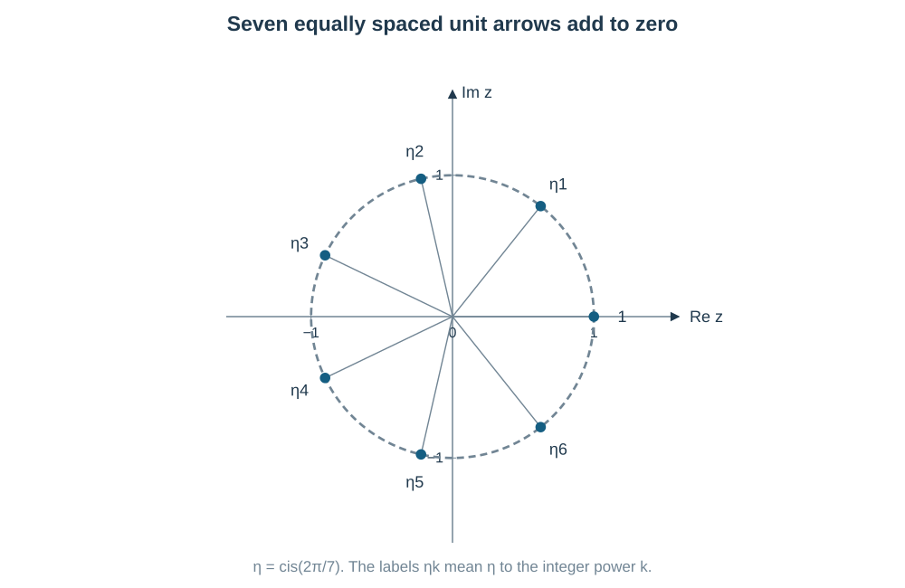

Because all seven roots sum to zero,

$$
\eta+\eta^2+\cdots+\eta^6=-1.
$$

Thus the answer is $\boxed{i}$, **option (c)**.

**Another possible approach — real and imaginary sums.** Opposite-angle sine terms cancel in the six-term sum, so its real part is zero. The cosine sum is $-1$ from the root-sum identity, so its imaginary part is $-(-1)=1$. Same answer. The compact complex rewrite keeps both cancellations together.

### Question 16 — The argument chooses one half of a circle

**PDF page 9 | MCQ | Notes: C12**

The locus of $z$ for which $\arg\!\left(\dfrac{z-1}{z+1}\right)=\dfrac\pi2$ is

- (a) the whole circle $x^2+y^2=1$
- (b) the line $x=0$
- (c) the segment joining $-1$ and $1$
- (d) the part of the circle $x^2+y^2=1$ lying above the $x$-axis

**An argument of $\pi/2$ means a positive imaginary number.** We need real part zero **and** imaginary part positive.

For $z=x+iy$,

$$
\frac{z-1}{z+1}
=\frac{x^2+y^2-1+2iy}{(x+1)^2+y^2}.
$$

Away from $z=-1$, the denominator is positive. So

$$
x^2+y^2=1,\qquad y>0.
$$

Hence the locus is the **upper semicircle**, **option (d)**.

**Check exclusions and sign:** $z=1$ gives zero with no argument, and $z=-1$ is a zero denominator. At $z=i$, the quotient is $i$, so the upper part works. At $z=-i$, it is $-i$, whose principal argument is $-\pi/2$, so the lower part fails.

**Another possible approach — geometry.** The quotient compares the arrows from $-1$ and $1$ to $P$. A right angle places $P$ on the circle with their joining segment as diameter. The positive orientation chooses the upper arc. The sign and endpoint checks are still needed.

### Question 17 — A sum and a difference share a squared-length identity

**PDF page 9 | Numerical value | Notes: C05**

If $|z_1|=3$, $|z_2|=4$ and $|z_1+z_2|=5$, then $|z_1-z_2|=$ ____.

**Did you notice the missing partner?** We know the two separate lengths and the length of the sum. The parallelogram identity contains exactly these and the requested difference:

$$
|z_1+z_2|^2+|z_1-z_2|^2
=2(|z_1|^2+|z_2|^2).
$$

Substitute:

$$
25+|z_1-z_2|^2=2(9+16)=50.
$$

Therefore $|z_1-z_2|^2=25$. A length is nonnegative:

$$
\boxed{|z_1-z_2|=5}.
$$

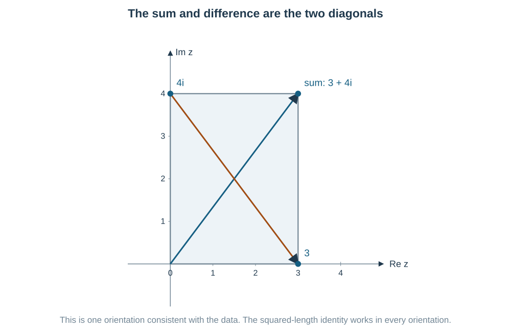

**Another useful view.** The equation $|z_1+z_2|^2=9+16=25$ tells us the mixed real part is zero, so the arrows are perpendicular. Reversing one perpendicular arrow leaves the same squared length. The identity gives the result without finding the individual arguments.

### Question 18 — A fixed distance sum makes an ellipse

**PDF page 9 | MCQ | Notes: C13**

The eccentricity of the curve represented by $|z-1|+|z+1|=4$ is

- (a) $\dfrac{\sqrt3}{2}$
- (b) $\dfrac12$
- (c) $\dfrac1{\sqrt2}$
- (d) $\dfrac14$

**Translate the two moduli into distances.** The foci are $-1$ and $1$, so their separation is $2$, and the centre-to-focus distance is $c=1$.

The constant distance sum is $4=2a$, so $a=2$. It is larger than the focus separation, so this is a nondegenerate ellipse.

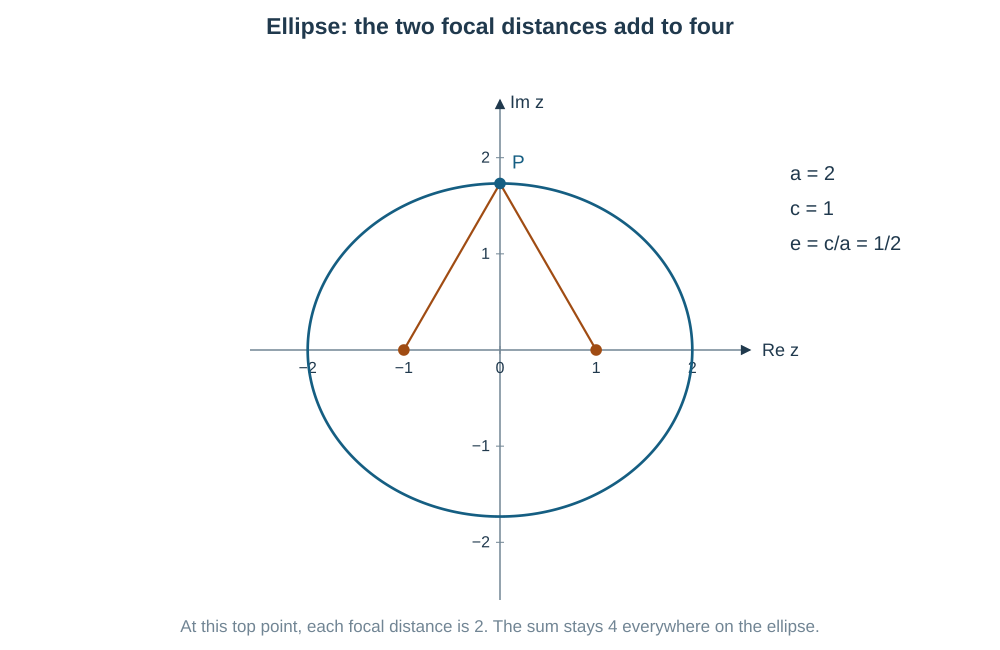

Its eccentricity is

$$
\boxed{e=\frac ca=\frac12}\qquad\text{(b)}.
$$

**Check:** $0<e<1$, as an ellipse requires. Do not use $4$ as $a$: it is the full distance sum $2a$. The other semi-axis is $b=\sqrt{4-1}=\sqrt3$, consistent with the drawing.

### Question 19 — Equality can flatten an ellipse into a segment

**PDF page 9 | MCQ | Notes: C04, C13**

Statement I: If $|z|=1$ $(z\ne0)$, then $\overline z=\dfrac1z$.

Statement II: The set $\{z:|z-1|+|z+1|=2\}$ represents an ellipse.

- (a) Both Statement I and Statement II are true
- (b) Both Statement I and Statement II are false
- (c) Statement I is true but Statement II is false
- (d) Statement I is false but Statement II is true

**Test the two statements separately.**

For I, $z\overline z=|z|^2=1$. Since $z\ne0$, divide by $z$:

$$
\overline z=\frac1z.
$$

So I is true.

For II, the fixed foci $-1,1$ are already distance $2$ apart. The proposed sum is also $2$, the shortest possible route. It is attained exactly on their connecting segment:

$$
\boxed{z=x,\quad-1\le x\le1}.
$$

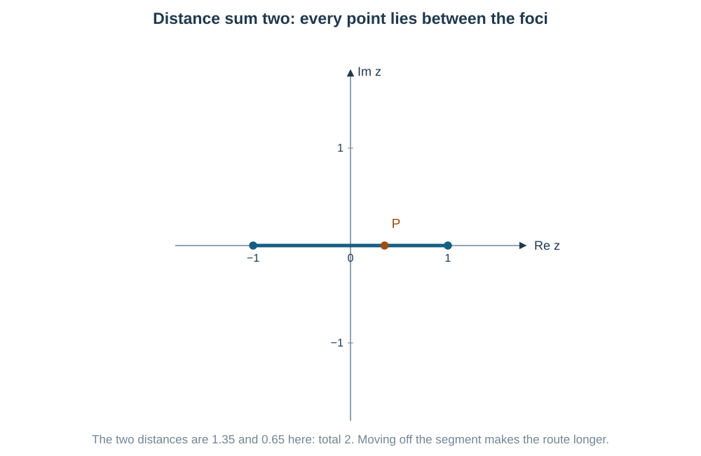

II is false in the usual nondegenerate-ellipse meaning. **Answer: (c).**

**Check:** for real $x\in[-1,1]$, the distances are $1-x$ and $x+1$, whose sum is $2$. A point above or below the segment makes a longer broken route. Sometimes this segment is called a degenerate ellipse; the source uses “ellipse” for the nondegenerate curve.

### Question 20 — Cube roots form an equilateral triangle

**PDF page 10 | Numerical value | Notes: C10, C17**

The area of the triangle whose vertices are the cube roots of unity (in the Argand plane) is ____ (round off to $2$ decimal places).

**Draw the actual three roots.** They are

$$
1,\quad-\frac12+\frac{\sqrt3}{2}i,\quad
-\frac12-\frac{\sqrt3}{2}i.
$$

They form an equilateral triangle. The distance between the last two is $\sqrt3$, so every side is $\sqrt3$.

Thus

$$
A=\frac{\sqrt3}{4}(\sqrt3)^2
=\frac{3\sqrt3}{4}\approx\boxed{1.30}.
$$

**Another possible approach — use base and height directly.** The vertical base has length $\sqrt3$, and its horizontal distance to the opposite vertex is $1-(-1/2)=3/2$:

$$
A=\frac12\cdot\sqrt3\cdot\frac32=\frac{3\sqrt3}{4}.
$$

**Check:** do not use the radius $1$ as a side length. Round only the final area.

### Question 21 — Match by the cheapest computation

**PDF page 10 | MCQ | Notes: C03–C06, C10**

Match List-I with List-II (here $\omega$ is a non-real cube root of unity).

| List-I | Expression |
|---|---|
| A | $\operatorname{Re}(1+i)^4$ |
| B | $\left|\dfrac{1+i}{1-i}\right|$ |
| C | principal $\arg(1-i)$ |
| D | $\dfrac1\omega+\dfrac1{\omega^2}$ |

List-II: I. $-1$; II. $-\pi/4$; III. $1$; IV. $-4$.

- (a) A-I, B-II, C-III, D-IV
- (b) A-IV, B-III, C-II, D-I
- (c) A-II, B-I, C-IV, D-III
- (d) A-III, B-IV, C-I, D-II

**Choose the small computation needed by each row.**

| Row | Work | Match |
|---|---|---|
| A | $(1+i)^2=2i$, so $(1+i)^4=-4$; its real part is $-4$. | IV |
| B | The quotient is $i$, whose modulus is $1$. | III |
| C | $1-i$ is in quadrant IV with angle $-\pi/4$. | II |
| D | $1/\omega+1/\omega^2=\omega^2+\omega=-1$. | I |

Therefore $\boxed{\text{A–IV, B–III, C–II, D–I}}$, **option (b)**.

**Check the target words:** A asks for a real part, B a modulus, C a principal angle. They do not ask for the same kind of quantity.

**Fast option insight:** A–IV occurs only in (b), so that row selects the answer quickly. Checking all rows also confirms that no transcription or interpretation error has slipped in.

### Question 22 — Five powers against a reflection

**PDF page 10 | Numerical value | Notes: C10, C14**

The number of complex numbers $z$ satisfying $z^5=\overline z$ is ____.

**Remember the zero case from Q11.** Moduli give

$$
|z|^5=|z|\quad\Longrightarrow\quad |z|=0\text{ or }1.
$$

Zero works. For nonzero solutions, $\overline z=1/z$, and

$$
z^5=\frac1z\quad\Longrightarrow\quad z^6=1.
$$

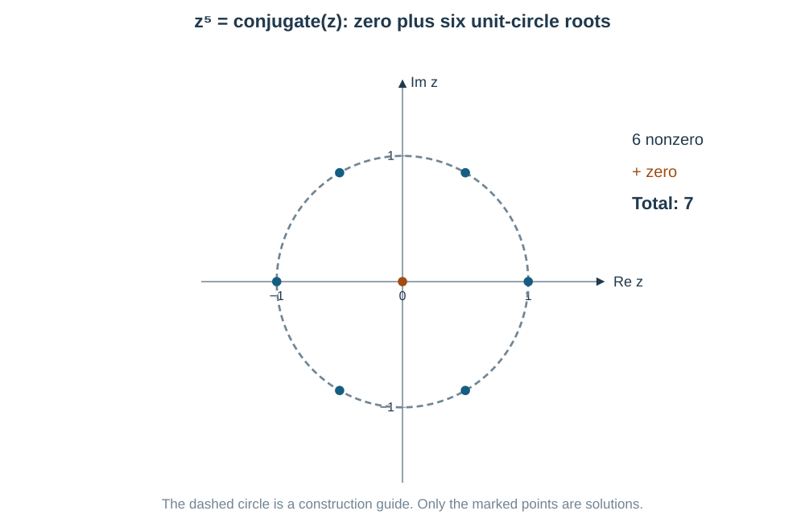

There are six different unit roots and the separate zero point:

$$
\boxed{6+1=7}.
$$

**Check:** each unit root satisfies $z^5=z^{-1}=\overline z$, so the reduction did not introduce false solutions. Dividing by $z$ before checking zero would give an answer too small by one.

### Question 23 — A reciprocal pair has a short power cycle

**PDF page 10 | MCQ | Notes: C10, C18**

If $z+\dfrac1z=1$, then $z^{100}+\dfrac1{z^{100}}$ equals

- (a) $1$
- (b) $2$
- (c) $-1$
- (d) $-2$

**A reciprocal pair suggests a short polynomial relation.** Since $1/z$ occurs, $z\ne0$. Multiply by $z$:

$$
z^2-z+1=0.
$$

Multiplying this by $z+1$ gives $z^3+1=0$. Thus $z^3=-1$ and $z^6=1$.

Because $100=6(16)+4$, $z^{100}=z^4=-z$. Also $z^{-100}=-z^{-1}$. Therefore

$$
z^{100}+z^{-100}
=-(z+z^{-1})=\boxed{-1}\qquad\text{(c)}.
$$

**Another possible approach — recurrence.** Put $V_n=z^n+z^{-n}$. Here $V_0=2,V_1=1$ and $V_n=V_{n-1}-V_{n-2}$. The values $2,1,-1,-2,-1,1$ repeat every six steps; remainder $4$ gives $-1$. The polynomial cycle is shorter for this particular question.

### Question 24 — Equal powers become a root-of-unity test

**PDF page 10 | MCQ | Notes: C03, C08–C09**

The smallest positive integer $n$ for which $(1+i)^n=(1-i)^n$ is

- (a) $2$
- (b) $8$
- (c) $4$
- (d) $1$

**The two bases are nonzero, so divide the equal powers.**

$$
\left(\frac{1+i}{1-i}\right)^n=1
\quad\Longrightarrow\quad i^n=1.
$$

The first positive return in the cycle $i,-1,-i,1$ is at $n=4$:

$$
\boxed{n=4}\qquad\text{(c)}.
$$

**Check minimality:** $n=1,2,3$ give $i,-1,-i$, not $1$. Although $8$ also works, it is not the smallest positive integer.

### Question 25 — Reduce a large angle to one turn

**PDF page 10 | MCQ | Notes: C07–C09**

If $z=\dfrac{\sqrt3+i}{2}$, then $z^{69}$ equals

- (a) $i$
- (b) $1$
- (c) $-1$
- (d) $-i$

**Recognize a familiar point on the unit circle.**

$$
z=\frac{\sqrt3}{2}+\frac12i
=\operatorname{cis}\frac\pi6.
$$

Then

$$
z^{69}=\operatorname{cis}\frac{69\pi}{6}
=\operatorname{cis}\frac{23\pi}{2}
=\operatorname{cis}\frac{3\pi}{2}
=\boxed{-i}\qquad\text{(d)}.
$$

We removed five full turns, $10\pi$.

**Fast check:** $z^3=\operatorname{cis}(\pi/2)=i$, so $z^{69}=(z^3)^{23}=i^{23}=-i$. The modulus stays $1$ in both calculations.

### Question 26 — Classify by the remainder rather than six expansions

**PDF page 10 | Numerical value | Notes: C10**

If $\omega$ is a non-real cube root of unity, then $\displaystyle\sum_{k=1}^{6}\left(\omega^k+\dfrac1{\omega^k}\right)^2=$ ____.

**Do not compute six complicated powers. Classify the exponents.** Because $\omega^3=1$:

| $k$ | $\omega^k+\omega^{-k}$ | Its square |
|---|---|---|
| $1,2,4,5$ | $\omega+\omega^2=-1$ | $1$ |
| $3,6$ | $1+1=2$ | $4$ |

There are four terms of the first kind and two of the second:

$$
\boxed{4(1)+2(4)=12}.
$$

**Check:** the square of $-1$ is $+1$. Forgetting the square or forgetting the multiple-of-three cases changes the total.

### Question 27 — Move the rotation centre to the origin first

**PDF page 10 | MCQ | Notes: C08**

The point $4+2i$ is rotated about the point $1+i$ through $90^\circ$ in the anticlockwise direction. The new position is

- (a) $-4i$
- (b) $4+4i$
- (c) $4i$
- (d) $2+3i$

**The centre is $1+i$, not the origin.** First find the movement from the centre to the old point:

$$
(4+2i)-(1+i)=3+i.
$$

Turn this movement $90^\circ$ anticlockwise by multiplying by $i$:

$$
i(3+i)=-1+3i.
$$

Return to the original plane by adding the centre:

$$
z_{\text{new}}=(1+i)+(-1+3i)=\boxed{4i}\qquad\text{(c)}.
$$

**Coordinate check:** the displacement $(3,1)$ becomes $(-1,3)$. Add $(1,1)$ to get $(0,4)$. Both centre-distances are $\sqrt{10}$.

Multiplying $4+2i$ directly by $i$ would turn about the wrong point. Subtract–turn–add is the reusable pattern.

### Question 28 — The two possible triangles have the same area

**PDF page 11 | Numerical value | Notes: C17**

Two vertices of an equilateral triangle are $1+i$ and $1-i$. The area of the triangle is ____ (round off to $2$ decimal places).

**Start with the known side.** The two points are $(1,1)$ and $(1,-1)$, so their distance is

$$
|(1+i)-(1-i)|=|2i|=2.
$$

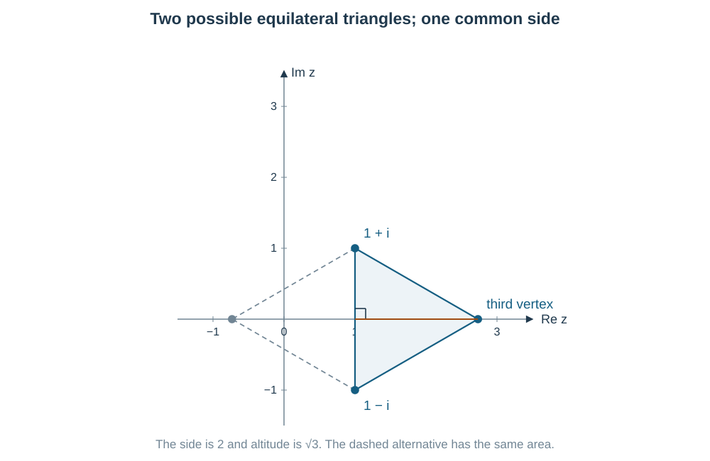

For an equilateral triangle,

$$
A=\frac{\sqrt3}{4}(2)^2=\sqrt3\approx\boxed{1.73}.
$$

**Another possible approach — height.** The midpoint is $(1,0)$. The half-side is $1$, so the height is $\sqrt{2^2-1^2}=\sqrt3$. Area $\tfrac12(2)(\sqrt3)=\sqrt3$.

**Check:** the third vertex can be $(1+\sqrt3,0)$ or $(1-\sqrt3,0)$. Both triangles have the same positive area; no extra information is needed.

### Question 29 — Lengths give the bound; equality gives the answer

**PDF page 11 | MCQ | Notes: C05**

If $\left|z-\dfrac4z\right|=2$, then the maximum value of $|z|$ is

- (a) $1+\sqrt5$
- (b) $\sqrt5-1$
- (c) $2+\sqrt5$
- (d) $1+\sqrt3$

**A tempting equality is unsafe.** In general,

$$
\left|z-\frac4z\right|\ne |z|-\frac4{|z|}.
$$

The two complex directions matter. Use a length **inequality** first, then find an input making equality possible.

Put $r=|z|>0$. Since $z=(z-4/z)+4/z$,

$$
r\le\left|z-\frac4z\right|+\left|\frac4z\right|
=2+\frac4r.
$$

Multiply by positive $r$:

$$
r^2-2r-4\le0
\quad\Longrightarrow\quad r\le1+\sqrt5.
$$

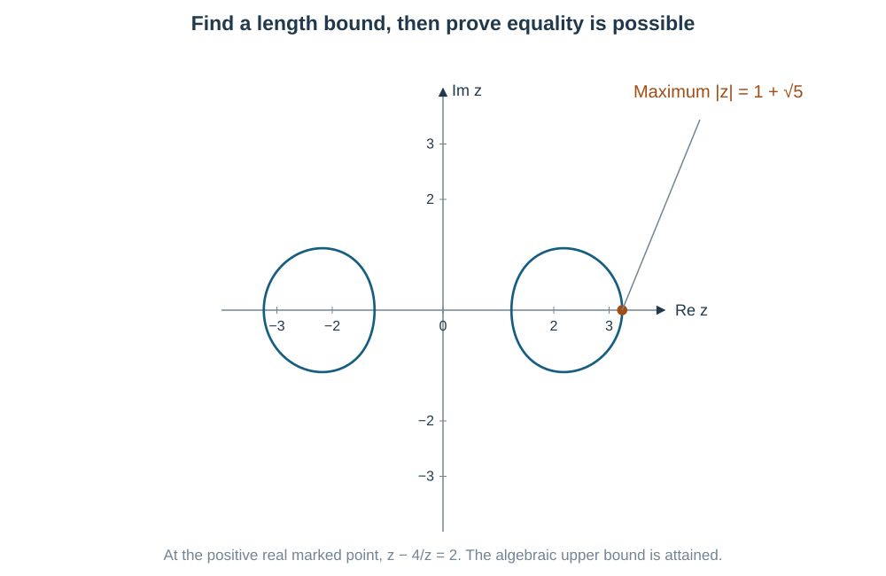

**Can we reach the bound?** Choose the real number $z=1+\sqrt5$. It satisfies $z^2-2z-4=0$, so $z-4/z=2$. Hence the original modulus is $2$.

$$
\boxed{\max|z|=1+\sqrt5}\qquad\text{(a)}.
$$

**Another possible approach — length and angle.** Write $z=r\operatorname{cis}\theta$. Squaring the given modulus gives

$$
4=r^2+\frac{16}{r^2}-8\cos2\theta
\ge r^2+\frac{16}{r^2}-8.
$$

Thus, with $t=r^2>0$, $t^2-12t+16\le0$, so $t\le6+2\sqrt5=(1+\sqrt5)^2$. Equality needs $\cos2\theta=1$, consistent with our real example. This shows the angular reason, but the triangle bound is shorter.

### Question 30 — Real coefficients force a conjugate root

**PDF page 11 | Numerical value | Notes: C16**

Let $p,q$ be real and $2+3i$ be a root of $z^2+pz+q=0$. Then $p+q=$ ____.

**Use the real-coefficient clue.** A polynomial with real coefficients has conjugate nonreal roots. The other root is $2-3i$.

The sum and product are

$$
-p=(2+3i)+(2-3i)=4,\qquad
q=(2+3i)(2-3i)=4+9=13.
$$

Therefore $p=-4$ and

$$
\boxed{p+q=-4+13=9}.
$$

**Check by constructing the polynomial:**

$$
(z-2-3i)(z-2+3i)=(z-2)^2+9=z^2-4z+13.
$$

The sign of $p$ is easy to reverse accidentally: the root sum is $-p$, not $p$.

### Question 31 — A modulus is real, so compare imaginary parts first

**PDF page 11 | MCQ | Notes: C04–C05**

If $z$ satisfies $|z|-z=1+2i$, then $z$ equals

- (a) $\dfrac32+2i$
- (b) $\dfrac32-2i$
- (c) $-\dfrac32-2i$
- (d) $\dfrac52-2i$

**A modulus has no imaginary part.** Put $z=x+iy$:

$$
\sqrt{x^2+y^2}-x-iy=1+2i.
$$

First compare imaginary parts: $-y=2$, so $y=-2$. Now compare real parts:

$$
\sqrt{x^2+4}=x+1.
$$

Keep the condition $x+1\ge0$ before squaring. Then

$$
x^2+4=(x+1)^2
\quad\Longrightarrow\quad x=\frac32.
$$

Thus $\boxed{z=\frac32-2i}$, **option (b)**.

**Check:** $|z|=5/2$, so $|z|-z=5/2-(3/2-2i)=1+2i$.

**Another possible approach — use the length as the unknown.** Let $r=|z|$. The original equation gives $z=(r-1)-2i$, so $r^2=(r-1)^2+4$. This gives $r=5/2$ and the same point, with no square-root equation to square.

### Question 32 — Products of root sums are exponent bookkeeping

**PDF page 11 | Numerical value | Notes: C09–C10**

Let $z\ne1$ be a $7$th root of unity, $\alpha=z+z^2+z^4$ and $\beta=z^3+z^5+z^6$. The value of $\alpha\beta$ is ____.

**The prime $7$ and the excluded root $1$ give**

$$
z^7=1,\qquad z+z^2+\cdots+z^6=-1.
$$

Expand the product, keeping track only of exponent sums:

$$
\begin{aligned}
\alpha\beta={}&z^4+z^6+z^7
+z^5+z^7+z^8\\
&+z^7+z^9+z^{10}.
\end{aligned}
$$

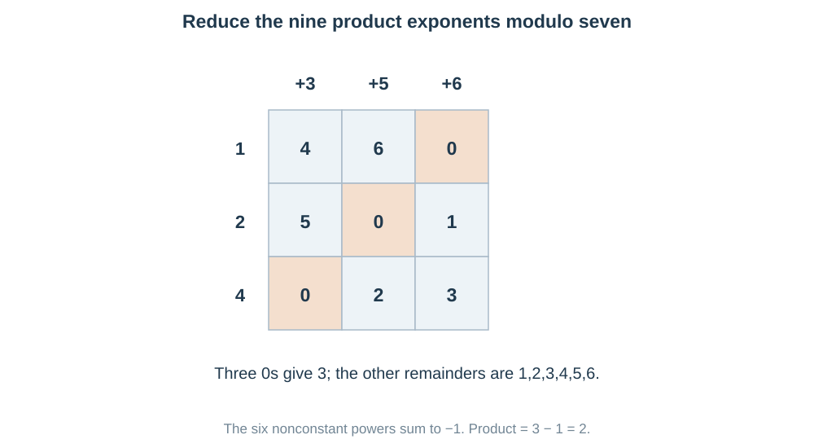

Three terms are $z^7=1$. Reducing the remaining exponents modulo $7$ gives each of $z,z^2,\ldots,z^6$ once:

$$
\alpha\beta=3+(z+z^2+\cdots+z^6)
=3-1=\boxed{2}.
$$

**Check the nature of the answer:** $\beta=\overline\alpha$, since conjugation on the unit circle negates exponents modulo $7$. Their product is $|\alpha|^2$, so a nonnegative real answer is consistent. A careful nine-cell table is safer than an untracked expansion.

### Question 33 — Check a convention and an all-input claim

**PDF page 11 | MCQ | Notes: C04, C06, C09, C19**

Consider the statements:

(i) If $|z|=1$ and $z\ne1$, then $\dfrac{1+z}{1-z}$ is purely imaginary.

(ii) The product of all $n$th roots of unity is $(-1)^{n-1}$.

(iii) For all non-zero $z_1,z_2$, $\operatorname{Arg}(z_1z_2)=\operatorname{Arg}z_1+\operatorname{Arg}z_2$ (principal arguments).

(iv) $i^i$ is a real number.

The correct statements are

- (a) (i) and (iii) only
- (b) (ii), (iii) and (iv) only
- (c) (i), (ii) and (iv) only
- (d) (i), (ii), (iii) and (iv)

**Check every statement and state the conventions.**

**(i)** With $w=(1+z)/(1-z)$ and $\overline z=1/z$,

$$
\overline w=\frac{1+\overline z}{1-\overline z}
=\frac{z+1}{z-1}=-w.
$$

So $\operatorname{Re}w=0$. The source counts this as purely imaginary, and intends (i) to be true.

**Zero corner case:** $z=-1$ is allowed and gives $w=0$. If “purely imaginary” is defined to require a nonzero imaginary part, (i) needs the additional exclusion $z\ne-1$. Under that stricter terminology, none of the printed options lists exactly the remaining true statements (ii) and (iv). The unambiguous claim is “has real part zero.”

**(ii)** The roots of $x^n-1$ have product $(-1)^n(-1)=(-1)^{n-1}$. True.

**(iii)** Try $z_1=z_2=-1$. Then

$$
\operatorname{Arg}(z_1z_2)=\operatorname{Arg}1=0,
\qquad\operatorname{Arg}z_1+\operatorname{Arg}z_2=2\pi.
$$

False as an ordinary equality of principal arguments. They agree only after whole-turn adjustment.

**(iv)** Using the principal-power definition in C19,

$$
i^i=e^{i\operatorname{Log}i}
=e^{i(i\pi/2)}=e^{-\pi/2},
$$

which is positive real. True. The other logarithm branches also give real positive values.

**Intended answer:** $\boxed{\text{(i), (ii), (iv) — option (c)}}$, with the zero convention above.

**Exam habit:** an all-input claim can be disproved by one permitted counterexample. A principal-angle identity is a good place to test the negative real axis.

### Question 34 — Shift a weighted sum to create cancellation

**PDF page 11 | Numerical value | Notes: C10, C18**

Let $\omega$ be a non-real cube root of unity and $S=1+2\omega+3\omega^2+\cdots+30\omega^{29}$. Then $|S|=$ ____ (round off to $2$ decimal places).

**Did you notice the two patterns together?** The coefficients go $1,2,3,\ldots$, while the powers go $1,\omega,\omega^2,\ldots$. A one-power shift makes neighbouring coefficients subtract.

Write

$$
\begin{aligned}
S&=1+2\omega+3\omega^2+\cdots+30\omega^{29},\\
\omega S&=\omega+2\omega^2+\cdots+29\omega^{29}+30\omega^{30}.
\end{aligned}
$$

Subtract term by term:

$$
(1-\omega)S
=1+\omega+\cdots+\omega^{29}-30\omega^{30}.
$$

The first $30$ terms make ten complete zero-sum triples; $\omega^{30}=1$. Hence

$$
(1-\omega)S=-30,\qquad
|S|=\frac{30}{|1-\omega|}
=\frac{30}{\sqrt3}=10\sqrt3\approx\boxed{17.32}.
$$

**Another possible approach — group the triples.** For $j=0,\ldots,9$, one block is

$$
(3j+1)+(3j+2)\omega+(3j+3)\omega^2
=1+2\omega+3\omega^2=-2-\omega.
$$

So $S=-20-10\omega=-10(2+\omega)$. Since $|2+\omega|^2=(2+\omega)(2+\omega^2)=3$, its length is again $10\sqrt3$. Triple grouping is especially short here; shift-and-subtract also works for many weighted geometric sums without this three-cycle.

### Question 35 — Find the root cycle instead of huge powers

**PDF page 11 | MCQ | Notes: C09, C16, C18**

If $\alpha,\beta$ are the roots of $x^2-x+1=0$, then $\alpha^{2025}+\beta^{2025}$ equals

- (a) $2$
- (b) $-2$
- (c) $1$
- (d) $-1$

**A huge exponent does not mean we should find huge powers.** Each root $t=\alpha,\beta$ satisfies $t^2-t+1=0$. Multiply by $t+1$:

$$
t^3+1=0\quad\Longrightarrow\quad t^3=-1.
$$

Because $2025=3(675)$ and $675$ is odd,

$$
\alpha^{2025}=(\alpha^3)^{675}=-1,\qquad
\beta^{2025}=-1.
$$

Thus $\boxed{-2}$, **option (b)**.

**Another possible approach — conjugate angles.** The roots are $\operatorname{cis}(\pm\pi/3)$. Their power sum is $2\cos(2025\pi/3)=2\cos675\pi=-2$. The polynomial cycle is quicker and does not require solving the roots.

## Answer check

Use after attempting the questions. The option letters retain the PDF order.

| Question | Answer | Question | Answer |
|---|---|---|---|
| 1 | (a) $-1$ | 19 | (c) I true, II false |
| 2 | (d) $i$ | 20 | $1.30$ |
| 3 | (a) $\sqrt5$ | 21 | (b) A–IV, B–III, C–II, D–I |
| 4 | (d) $5\pi/6$ | 22 | $7$ |
| 5 | (c) $4096$ | 23 | (c) $-1$ |
| 6 | (b) $128$ | 24 | (c) $4$ |
| 7 | (c) $x+y=0$ | 25 | (d) $-i$ |
| 8 | $3$ | 26 | $12$ |
| 9 | (d) $z_1=-\overline{z_2}$ | 27 | (c) $4i$ |
| 10 | (d) $3$ | 28 | $1.73$ |
| 11 | (a) $4$ | 29 | (a) $1+\sqrt5$ |
| 12 | $7$ | 30 | $9$ |
| 13 | (d) $-14$ | 31 | (b) $3/2-2i$ |
| 14 | (c) $9$ | 32 | $2$ |
| 15 | (c) $i$ | 33 | Intended (c); zero convention explained |
| 16 | (d) Upper semicircle | 34 | $17.32$ |
| 17 | $5$ | 35 | (b) $-2$ |
| 18 | (b) $1/2$ |  |  |

## Coverage and source notes

All $35$ supplied questions are included in order, retaining the original $25$ MCQ and $10$ numerical-value formats. Definitions, domain conditions, equality cases, and useful related concepts are included even where one source question does not test them directly.

Q33's terminology and power conventions are explained beside the question. Q19 uses “ellipse” in its usual nondegenerate sense. The independently calculated results agree with the source's intended key under these stated conventions.

The $2024$–$2026$ weightage is a recount of $62$ distinct cards from a named archive category. It is not an exhaustive $2020$–$2026$ official-paper or formula-frequency audit. No measured model-frequency or difficulty ranking is claimed.

## Offline research record

- Supplied Maths Predicted V1.pdf: Complex Numbers questions on PDF pages 8–11, key on page 11, source working on pages 12–13. Questions and options were read from the page images.
- NTA, Syllabus for JEE Main 2027: Mathematics Unit 2, complex-number scope and its connection to quadratic equations.
- ExamSIDE, JEE Main Mathematics, Complex Numbers: the 2024–2026 category cards were saved, recounted, and deduplicated.
- PYQSide uses a combined Complex Numbers and Quadratic Equations heading. That combined category was not added to the separate chapter count.

All second approaches are plain visible content. This complete source is retained for the later printed booklet.
