# Quadratic Equations and Inequalities — JEE Main revision guide

*One expression, several views: its factors tell us the roots; its graph tells us the signs; its completed square tells us the extreme value.*

> **For Kanna | Chapter 3**  
> Goal: about $120/300$ towards $200/300$ — Physics $60$, Maths $60$, Chemistry $80$.  
> Notes first, then all $25$ supplied questions in order. Every alternative method is visible and retained for the printed booklet.

## Recent chapter weightage

**The checked 2024–2026 archive gives about $0.84$ Quadratic Equations and Inequalities questions per Paper 1.**

| Year | Papers | Chapter questions | Questions per paper |
|---|---:|---:|---:|
| $2024$ | $20$ | $18$ | $0.90$ |
| $2025$ | $19$ | $16$ | $0.84$ |
| $2026$ | $19$ | $15$ | $0.79$ |
| Together | $58$ | $49$ | $0.84$ |

The mean is $49/58\approx0.84$. The $49$ distinct recent ExamSIDE category cards were recounted. This is an archive-based chapter classification, not an independent classification of every official paper. Quadratic tools also help in functions, sequences, coordinate geometry, and calculus; such enabling uses are not separately counted here.

Some archives combine this chapter with Complex Numbers. Do not add that combined heading to this count. The optional-question format in $2024$ also means offered-question averages should not be treated as an unqualified marks comparison.

**Revision priority:** understand the discriminant, sum/product of roots, sign charts, completing squares, and parameter conditions. These tools are useful well beyond a direct “quadratic” question.

## Scope and reading plan

The current official Mathematics Unit 2 includes quadratic equations over real and complex numbers, root nature, coefficient–root relations, and forming equations from roots. This supplied chapter also uses rational inequalities, modulus, roots, and a variable-base power equation. The necessary domain rules are included.

Read in this order: degree and roots → completed square and graph → root relations → signs and restrictions → parameter questions.

**Important for JEE Main** labels a useful exam-level idea, not an invented formula-frequency statistic.

**Convention for source Q20:** at a negative base, we include ordinary integer powers wherever defined. This is why the candidate $(-1)^{-48}$ is valid. We explain the real-power domain rather than silently assuming every real exponent is allowed at a negative base.

## Formula and concept bank

### Concept C01 — What makes an equation quadratic?

**Important for JEE Main.** A quadratic equation has the form

$$
\boxed{ax^2+bx+c=0,\qquad a\ne0}.
$$

Its highest power of the unknown $x$ is $2$. The coefficients $a,b,c$ are fixed while we solve for $x$. A letter such as $k$ may act as a **parameter**: a coefficient whose allowed values the question asks us to find.

Let $f(x)=ax^2+bx+c$. A **root** $r$ is an input making the output zero:

$$
f(r)=0.
$$

For example, $f(x)=x^2-4x+3$ has roots $1,3$, because $f(1)=f(3)=0$.

**The leading coefficient must be checked before dividing or using the quadratic formula.** If a parameter makes $a=0$, the equation changes type:

| Remaining equation | What happens? |
|---|---|
| $bx+c=0$, $b\ne0$ | One root $x=-c/b$. It is linear, not quadratic. |
| $0x+0=0$ | Every input solves it. |
| $0x+c=0$, $c\ne0$ | No input solves it. |

In Q3, $k=0$ gives $4x=0$. It has a real root, but it fails the separate requirement **“is a quadratic equation.”**

**A useful distinction:** an equation asks where $f(x)=0$; an inequality asks where its output is positive or negative. Positive output does not mean positive input.

### Concept C02 — Factor form and completed-square form show different things

**Important for JEE Main.** In factor form,

$$
f(x)=a(x-\alpha)(x-\beta).
$$

The product is zero if either factor is zero, so the roots are $\alpha,\beta$. The symbols are just names for the two roots.

For a general quadratic, complete the square:

$$
\boxed{f(x)=a\left(x+\frac b{2a}\right)^2-\frac{b^2-4ac}{4a}}.
$$

Put

$$
\Delta=b^2-4ac,\qquad
h=-\frac b{2a},\qquad v=-\frac{\Delta}{4a}.
$$

Then $f(x)=a(x-h)^2+v$. Its graph is a **parabola**, and $(h,v)$ is the **vertex**, where it turns.

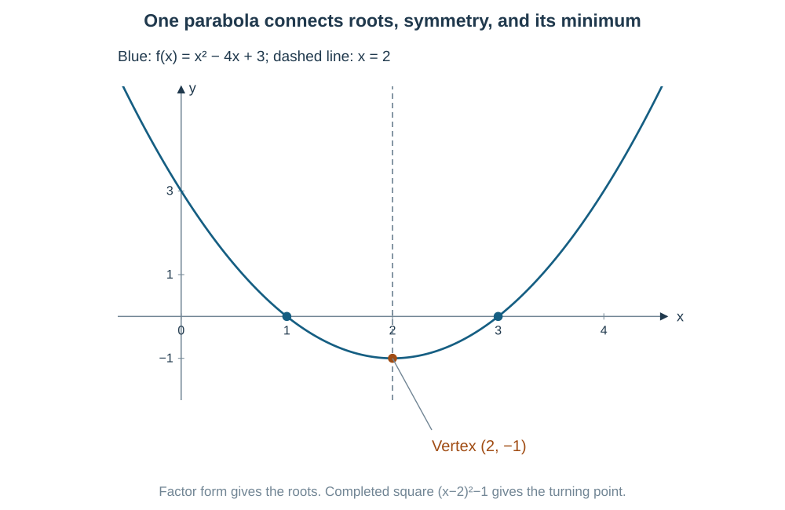

**Read the graph:** $f(x)=(x-2)^2-1$. At $x=2$, the square is zero and the output is smallest, $-1$. Equal steps left and right of $2$ give equal squares, so the line $x=2$ is its symmetry axis.

- If $a>0$, the graph opens upward.
- If $a<0$, it opens downward.
- The magnitude $|a|$ changes the vertical scale.

**Which form should I choose?** Factor form makes roots and signs visible. Completed-square form makes the vertex, range, and minimum/maximum visible. Expanding is useful only when it reveals something we need.

### Concept C03 — The discriminant tells us the nature of the roots

**Important for JEE Main.** Solving the completed-square equation gives

$$
\boxed{x=\frac{-b\pm\sqrt\Delta}{2a}},\qquad\Delta=b^2-4ac.
$$

The symbol $\pm$ gives the two sign choices. For real coefficients:

| Discriminant | Roots | Graph |
|---|---|---|
| $\Delta>0$ | Two real and distinct roots. | Crosses the horizontal axis twice. |
| $\Delta=0$ | Equal real roots; one distinct value. | Touches the axis at its vertex. |
| $\Delta<0$ | A nonreal conjugate pair. | Does not meet the real horizontal axis. |

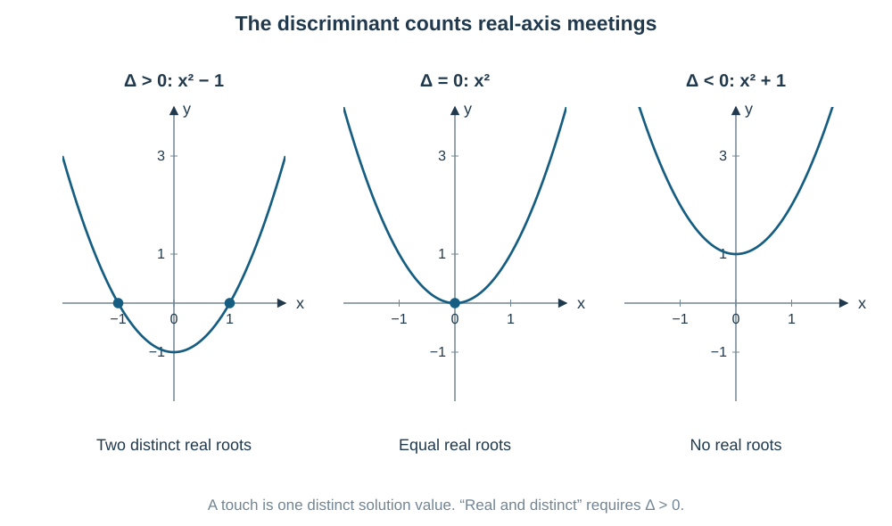

**Read the words carefully.**

$$
\boxed{\text{real roots: }\Delta\ge0},\qquad
\boxed{\text{real and distinct: }\Delta>0}.
$$

For a repeated root, there are two roots counted with repetition but only one distinct solution. This is why a question saying “distinct” changes an endpoint.

For $\Delta<0$ the roots are

$$
\frac{-b\pm i\sqrt{-\Delta}}{2a}.
$$

They are complex, not absent altogether; they are absent from the **real** $x$-axis.

**Do not forget the leading coefficient:** this classification assumes $a\ne0$. A discriminant calculation cannot turn a linear equation into a quadratic.

### Concept C04 — Always positive or negative: combine shape and crossings

**Important for JEE Main.** If a quadratic never meets the axis, its graph stays wholly above it or wholly below it. The sign of $a$ decides which.

For a genuine real quadratic:

$$
\boxed{f(x)>0\text{ for all real }x
\iff a>0,\ \Delta<0},
$$

$$
\boxed{f(x)<0\text{ for all real }x
\iff a<0,\ \Delta<0}.
$$

If equality is allowed,

$$
\boxed{f(x)\ge0\ \forall x\iff a>0,\ \Delta\le0},\qquad
\boxed{f(x)\le0\ \forall x\iff a<0,\ \Delta\le0}.
$$

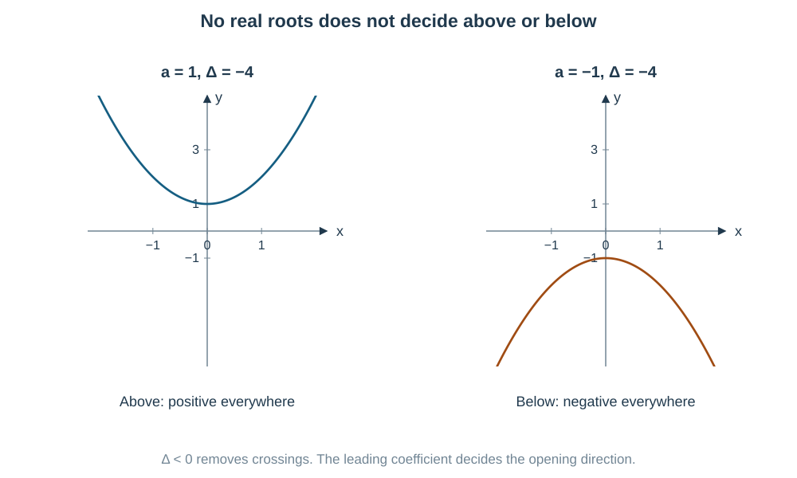

**Why are both conditions needed?** $\Delta<0$ says “no axis crossing.” It does not say “above.” An upside-down graph can have no roots and still be negative everywhere.

The strict positive condition also follows from the vertex value $-\Delta/(4a)$: with $a>0$, the minimum must be greater than zero. If $\Delta=0$, the graph touches zero and strict positivity fails.

If a parameter makes the expression constant or linear, test that case separately. A positive constant is positive everywhere; a nonconstant real line cannot be positive for every real input.

**Two useful input clues.**

- If $a+b+c=0$, then $f(1)=0$. The factors are $(x-1)(ax-c)$ and the roots are $1,c/a$.
- If $a-b+c=0$, then $f(-1)=0$. The other root is $-c/a$.

These are substitutions, not magic formulas. For the first condition, $b=-a-c$, so $\Delta=(a-c)^2\ge0$ is another direct proof that the roots are real.

### Concept C05 — Sum and product: find only the information asked

**Important for JEE Main.** Expand the factor form:

$$
a(x-\alpha)(x-\beta)
=ax^2-a(\alpha+\beta)x+a\alpha\beta.
$$

Compare coefficients:

$$
\boxed{S=\alpha+\beta=-\frac ba,\qquad
P=\alpha\beta=\frac ca}.
$$

These are **Viète's relations**. They work for real or complex roots. They often answer a symmetric target without finding two messy roots separately.

Useful identities:

$$
\alpha^2+\beta^2=S^2-2P,\qquad
\alpha^3+\beta^3=S^3-3PS,
$$

$$
\boxed{(\alpha-\beta)^2=S^2-4P=\frac{\Delta}{a^2}}.
$$

For real roots, their distance on the number line is $\sqrt\Delta/|a|$. Do not confuse this real-root distance with a complex difference.

If $P\ne0$, neither root is zero:

$$
\frac1\alpha+\frac1\beta=\frac SP,\qquad
\boxed{\frac1{\alpha^2}+\frac1{\beta^2}=\frac{S^2-2P}{P^2}}.
$$

**Signs of real roots.** A product checks same/opposite signs; the sum chooses the common sign:

| Need | Conditions |
|---|---|
| Both positive | $\Delta\ge0,\ S>0,\ P>0$ |
| Both negative | $\Delta\ge0,\ S<0,\ P>0$ |
| Opposite signs | $P<0$; this already forces $\Delta>0$. |
| Both nonnegative | $\Delta\ge0,\ S\ge0,\ P\ge0$ |
| Both nonpositive | $\Delta\ge0,\ S\le0,\ P\ge0$ |

Real coefficients and $a\ne0$ are assumed. If the roots must be distinct, replace $\Delta\ge0$ by $\Delta>0$.

**Cauchy–Schwarz — Important for JEE Main.** For real roots,

$$
(\alpha+\beta)^2\le2(\alpha^2+\beta^2).
$$

The reason is $2(\alpha^2+\beta^2)-S^2=(\alpha-\beta)^2\ge0$. Thus $\alpha^2+\beta^2\ge S^2/2$, with equality when $\alpha=\beta$. Also $(\alpha-\beta)^2\ge0$ gives $P\le S^2/4$. These are useful fixed-sum bounds. When the roots are positive, the same last inequality is the two-number AM–GM relation.

### Concept C06 — A root equation becomes a rule for higher powers

**Important for JEE Main.** For a monic equation $t^2-St+P=0$, every root obeys

$$
t^2=St-P.
$$

Multiply by $t^{n-2}$ and add the equations for both roots. For $U_n=\alpha^n+\beta^n$,

$$
\boxed{U_0=2,\quad U_1=S,\quad
U_n=SU_{n-1}-PU_{n-2}\quad(n\ge2)}.
$$

The same recurrence holds for differences $a_n=\alpha^n-\beta^n$. It follows by subtraction instead of addition, with $a_0=0$ and $a_1=\alpha-\beta$.

**Why this helps:** it replaces high powers by two previous values. For $t^2-t-1=0$, the rule is simply $U_n=U_{n-1}+U_{n-2}$.

Sometimes a square identity is even shorter:

$$
\boxed{U_{2n}=U_n^2-2P^n}.
$$

Squaring $\alpha^n+\beta^n$ adds the extra $2(\alpha\beta)^n$. Remove it to get the even-index sum.

Useful short targets include

$$
U_3=S^3-3PS,\qquad
U_4=(S^2-2P)^2-2P^2.
$$

**Question clue:** if the asked numerator looks like the root equation multiplied by a power, build that exact combination. Q25 asks for $a_{10}-2a_8$, which fits its recurrence directly; there is no need to calculate $a_{10},a_9,a_8$ separately.

Before dividing by a power sum or difference, prove its denominator is nonzero.

### Concept C07 — A quadratic inequality asks where the graph is above or below zero

**Important for JEE Main.** Suppose the real roots are $r_1<r_2$. Then

$$
f(x)=a(x-r_1)(x-r_2).
$$

Outside the two roots, the factors have the same sign. Between them, the factors have opposite signs.

For $a>0$:

$$
\boxed{f(x)\le0\iff r_1\le x\le r_2},\qquad
\boxed{f(x)\ge0\iff x\le r_1\text{ or }x\ge r_2}.
$$

Use open endpoints for strict inequalities. If $a<0$, reverse the sign regions.

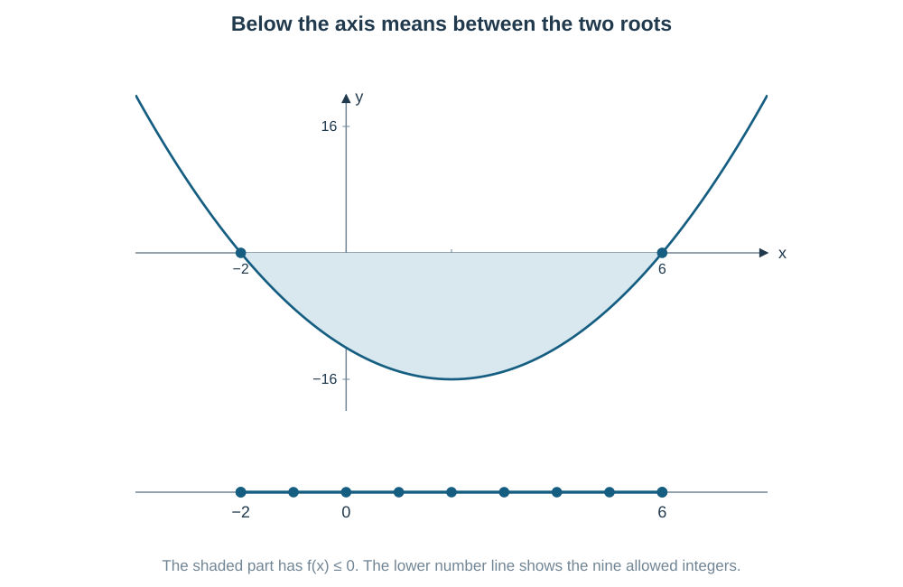

**Special cases matter.**

- If $\Delta<0$, the expression has the sign of $a$ everywhere.
- If $\Delta=0$, it is $a(x-h)^2$: it touches zero but does not change sign there.
- A strict inequality excludes roots; a non-strict one may include them.

For integers in a closed integer-ended interval $[L,U]$, count $U-L+1$. The $+1$ includes both endpoints. For noninteger boundaries, first identify the first and last allowed integers, respecting open endpoints.

### Concept C08 — Rational inequalities: signs and forbidden points

**Important for JEE Main.** A denominator cannot be zero, even in a non-strict inequality.

For

$$
\frac{(x-1)(x-2)}{x-3}\ge0,
$$

mark the numerator zeros $1,2$ and forbidden point $3$. Between neighbouring marked values, each factor keeps a fixed sign.

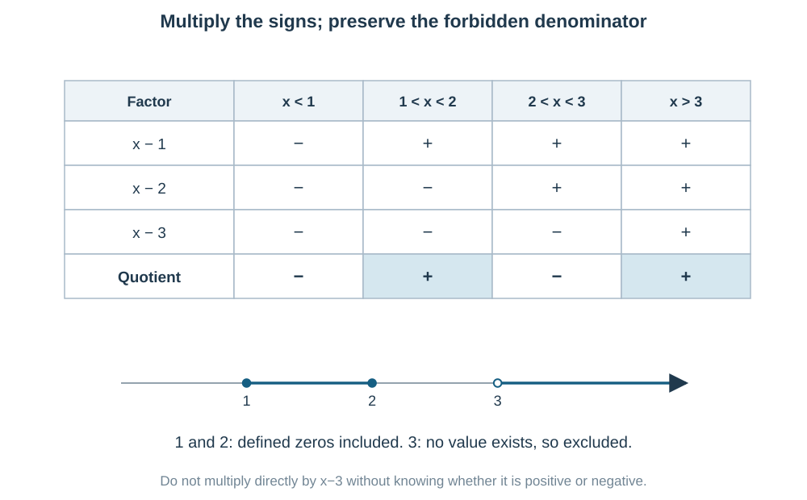

**Read the chart:** multiply or divide the factor signs. Include $1,2$ because they give a defined zero. Exclude $3$ because no value exists there.

**Why not multiply directly by $x-3$?** It may be positive or negative. Multiplying an inequality by a negative quantity reverses its direction. You would need separate cases.

An alternative is to multiply by the definitely positive square $(x-3)^2$ **on the domain $x\ne3$**:

$$
\frac{(x-1)(x-2)}{x-3}\ge0
\iff (x-1)(x-2)(x-3)\ge0,\quad x\ne3.
$$

**Odd and even multiplicity.** A simple factor changes sign when crossing its zero. A squared factor such as $(x-1)^2$ does not. Do not automatically alternate signs at every marked point without checking the powers.

**Cancellation does not fill a hole.** If you cancel an $x-3$ factor from a rational expression, the original exclusion $x\ne3$ still belongs to the answer. List the original domain before simplifying.

### Concept C09 — Form an equation with changed roots

**Important for JEE Main.** If the desired roots are $u,v$, an equation is

$$
\boxed{y^2-(u+v)y+uv=0}.
$$

Any nonzero constant multiple is the same equation. Use a new letter such as $y$ while changing the roots, so the old input and the new input do not get mixed.

Starting from roots $\alpha,\beta$ with sum $S$ and product $P$:

| New roots | New sum | New product |
|---|---|---|
| $\alpha^2,\beta^2$ | $S^2-2P$ | $P^2$ |
| $1/\alpha,1/\beta$ | $S/P$ | $1/P$ |
| $\alpha+h,\beta+h$ | $S+2h$ | $P+hS+h^2$ |
| $k\alpha,k\beta$ | $kS$ | $k^2P$ |
| $\alpha/\beta,\beta/\alpha$ | $(S^2-2P)/P$ | $1$ |

Reciprocal or ratio rows need $P\ne0$. If a scale $k=0$, both new roots are zero; handle that directly.

**Another way to see shift/scale transformations:** new root $y=\alpha+h$ means old input $\alpha=y-h$, so use $f(y-h)=0$. For nonzero scale $y=k\alpha$, use $f(y/k)=0$ and clear the constant denominator.

For reciprocal roots, substitution $x=1/y$ into $ax^2+bx+c=0$ gives $cy^2+by+a=0$, with $c\ne0$.

Do not memorize a separate long rule for every possible transformation. Find the new sum/product, then build the equation.

### Concept C10 — A common root belongs to both equations

**Important for JEE Main.** If $r$ is a common root, then both $f(r)=0$ and $g(r)=0$. Any suitable sum or difference of these two equations must also be zero.

If the leading coefficients match, subtracting often removes $r^2$. Example:

$$
r^2+pr+q=0,\qquad r^2+qr+p=0.
$$

Subtract:

$$
(p-q)r+(q-p)=0
\quad\Longrightarrow\quad(p-q)(r-1)=0.
$$

If $p\ne q$, then $r=1$. Substitute it into either **original** equation to obtain the coefficient condition.

If the leading coefficients differ, first multiply the equations by constants so their squared terms cancel. If the resulting linear coefficient also vanishes, inspect what remains: the equations may be proportional, or they may be inconsistent. Do not divide by an expression that could be zero.

**Why not solve both quadratics first?** That works, but can create four radical expressions and an unnecessary matching problem. Elimination uses the fact that the same input solves both.

### Concept C11 — Extreme values: finish the square and check the allowed input

**Important for JEE Main.** Write

$$
f(x)=a(x-h)^2+v.
$$

On all real inputs, if $a>0$, its minimum is $v$ at $x=h$ and its range is $[v,\infty)$. It has no finite maximum. If $a<0$, its maximum is $v$ at $h$ and its range is $(-\infty,v]$; it has no finite minimum.

**A restricted domain changes this.** On a closed interval, check the endpoints and the vertex if it belongs to the interval. For an upward parabola the maximum is at an endpoint; the minimum is at the vertex if allowed, otherwise at the nearer endpoint.

**A hidden quadratic needs its new domain.**

| Substitution | Allowed new values |
|---|---|
| $t=x^2$ or $t=|x|$ | $t\ge0$ |
| $t=2^x$ | $t>0$ |
| $t=x+1/x$, real $x\ne0$ | $t\le-2$ or $t\ge2$ |

Every value in the last row occurs: $x^2-tx+1=0$ has real, nonzero roots exactly when $t^2\ge4$.

For the last row, $(x-1)^2\ge0$ gives the positive-$x$ bound; applying it to $-x$ gives the negative-$x$ bound. Do not include the gap $(-2,2)$.

Example:

$$
4^x-2^{x+3}+20=(2^x)^2-8(2^x)+20.
$$

Let $t=2^x>0$. Then

$$
t^2-8t+20=(t-4)^2+4.
$$

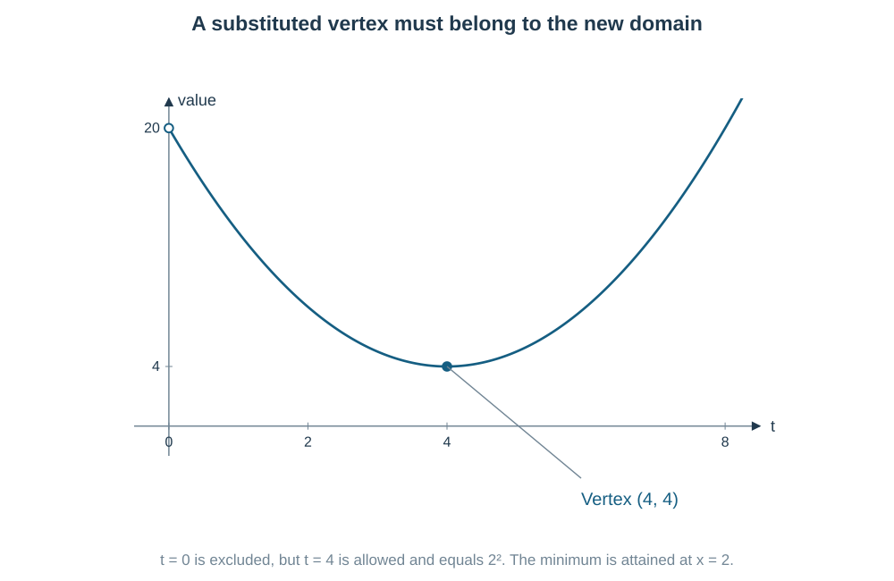

The minimum $4$ is attained because $t=4$ is allowed, with original input $x=2$.

**What if the best new value is forbidden?** For $(2^x+1)^2+4$, the new domain is still $t>0$. The expression is greater than $5$ and approaches $5$ as $t\to0^+$. It has infimum $5$ but no attained minimum. “Infimum” means the greatest lower bound; a minimum must also be reached.

**Cauchy–Schwarz connection — Important for JEE Main.** For real $x,y$, $x^2+y^2\ge(x+y)^2/2$. If a question fixes a sum, a square inequality may find an extreme more directly than solving for both numbers.

### Concept C12 — Modulus: choose a nonnegative variable or a distance picture

**Important for JEE Main.** For a real number,

$$
|x|=\begin{cases}x,&x\ge0,\\-x,&x<0.\end{cases}
$$

If the expression contains $x^2$ and $|x|$, notice that $x^2=|x|^2$. Put $t=|x|\ge0$.

For example,

$$
x^2-4|x|+3=0
\iff t^2-4t+3=0,\quad t\ge0.
$$

If $t=1$ or $3$, restore $x=\pm1,\pm3$. A positive $t$ gives two $x$ values; $t=0$ gives only one; a negative candidate $t$ gives none.

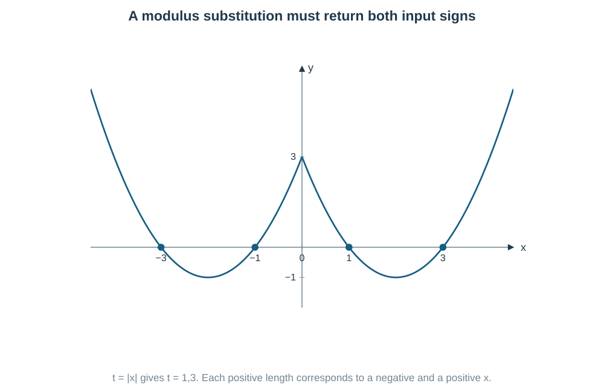

**Distance view:** $|x-a|$ is the distance of the number $x$ from $a$ on a real number line.

For $a<b$,

$$
|x-a|+|x-b|
=\begin{cases}
a+b-2x,&x\le a,\\
b-a,&a\le x\le b,\\
2x-a-b,&x\ge b.
\end{cases}
$$

Between the two fixed points, one distance increases exactly as the other decreases. The total stays $b-a$. Outside, moving further adds to both distances.

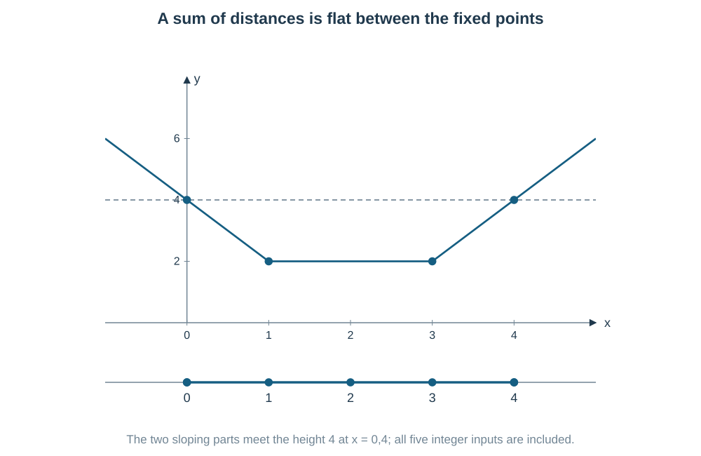

A compact equivalent identity is

$$
\boxed{|x-a|+|x-b|
=2\max\left(\left|x-\frac{a+b}{2}\right|,\frac{b-a}{2}\right)}.
$$

Use the three pieces or the picture before trying to memorize this compact version.

**Do not square a modulus equation without checking the effect.** $|g(x)|=h(x)$ first needs $h(x)\ge0$. It then gives $g(x)=h(x)$ or $g(x)=-h(x)$. Keep the sign cases and domain.

### Concept C13 — Square-root equations: squaring is a candidate-producing step

**Important for JEE Main.** A principal real square root is nonnegative. Thus

$$
\sqrt{g(x)}=h(x)
$$

requires **both**

$$
g(x)\ge0,\qquad h(x)\ge0.
$$

Only after that should we square:

$$
g(x)=h(x)^2.
$$

Squaring forgets the sign of the right side. A candidate with $h(x)<0$ can solve the squared equation and still fail the original one.

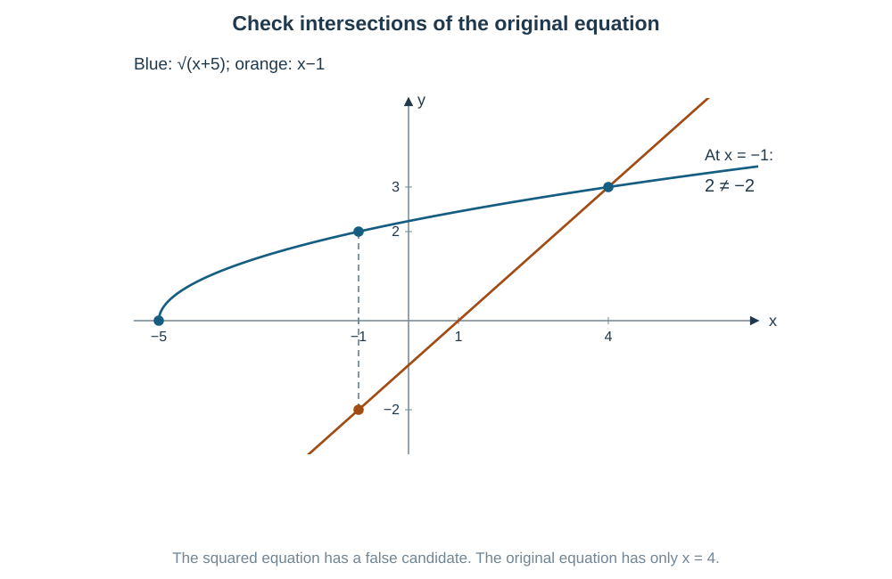

For $\sqrt{x+5}=x-1$, first get $x\ge1$. Squaring gives $x=4,-1$; only $4$ survives. This is why the sum of roots of the squared polynomial is not automatically the requested sum of original solutions.

**Graph view:** a solution is an intersection of the two original graphs. The graph helps identify the correct sign and number of solutions; substitution gives the exact check.

### Concept C14 — Real, rational, irrational, and conjugate roots

**Important for JEE Main.** The discriminant determines realness. Rationality needs an additional coefficient condition.

For **rational coefficients**, real roots are rational exactly when $\sqrt\Delta$ is rational. With integer coefficients, this means $\Delta$ is a nonnegative perfect-square integer. An integer root also needs

$$
\frac{-b\pm\sqrt\Delta}{2a}
$$

to be an integer; check the division, not only the square root.

For integer coefficients and a rational root $p/q$ in lowest terms, $p$ divides $c$ and $q$ divides $a$. This is the **rational-root test**. If $c=0$, check the root $0$ first and factor out $x$.

**Complex conjugates need real coefficients.** If $u+iv$ is a nonreal root, conjugating the whole equation with real coefficients proves that $u-iv$ is a root too.

**Surd conjugates need rational coefficients.** If $p+q\sqrt d$ is a root of a quadratic with rational coefficients, where $p,q$ are rational, $q\ne0$, and $d$ is a positive nonsquare integer, then $p-q\sqrt d$ is also a root.

Why? Substitution gives a rational part plus a rational multiple of $\sqrt d$. The two parts must vanish separately; otherwise $\sqrt d$ would be rational. Reversing the sign of $\sqrt d$ still gives zero.

For source Q12's root $2+\sqrt3$,

$$
a(2+\sqrt3)^2+b(2+\sqrt3)+c
=(7a+2b+c)+(4a+b)\sqrt3.
$$

Both rational coefficients must be zero. Replacing $+\sqrt3$ by $-\sqrt3$ then also gives zero.

**Do not weaken “rational” to “real.”** The real-coefficient equation $x^2-(2+\sqrt3)x=0$ has roots $0,2+\sqrt3$, not the surd pair. Rational and real are different requirements.

### Concept C15 — Where are the roots? Use the simplest available view

**Important for JEE Main.** If the roots are already easy, compare them with the interval directly.

For

$$
x^2-2kx+k^2-1=(x-k)^2-1,
$$

the roots are $k-1,k+1$. Both are in $(-2,4)$ exactly when

$$
-2<k-1,\qquad k+1<4
\quad\Longrightarrow\quad -1<k<3.
$$

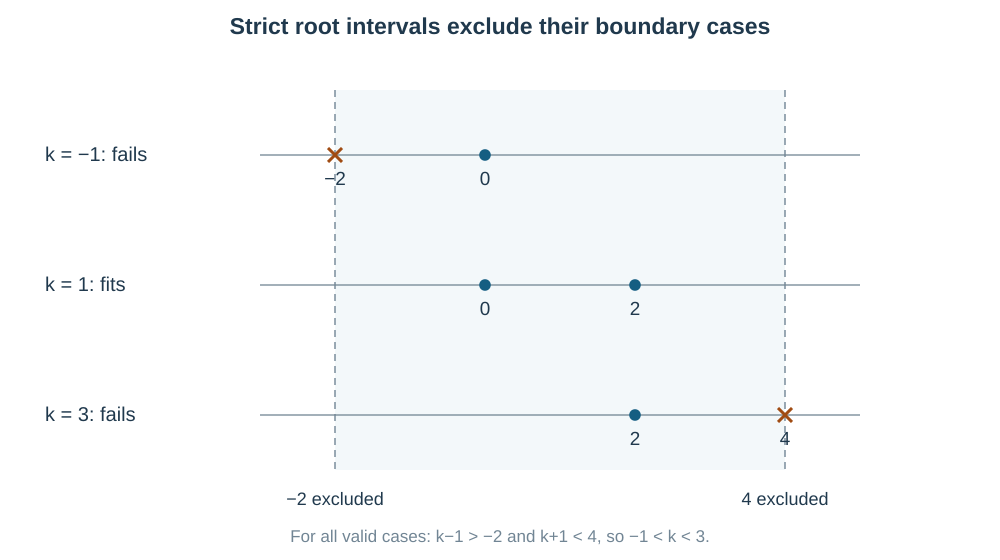

**When explicit roots are messy, use the graph.** Let $h=-b/(2a)$ and use $f(x)/a$, which always opens upward.

For example, $(x-2)^2-1$ has roots $1,3$ inside $(0,4)$. Its vertex input $2$ is between the boundaries, and both boundary outputs are $3>0$.

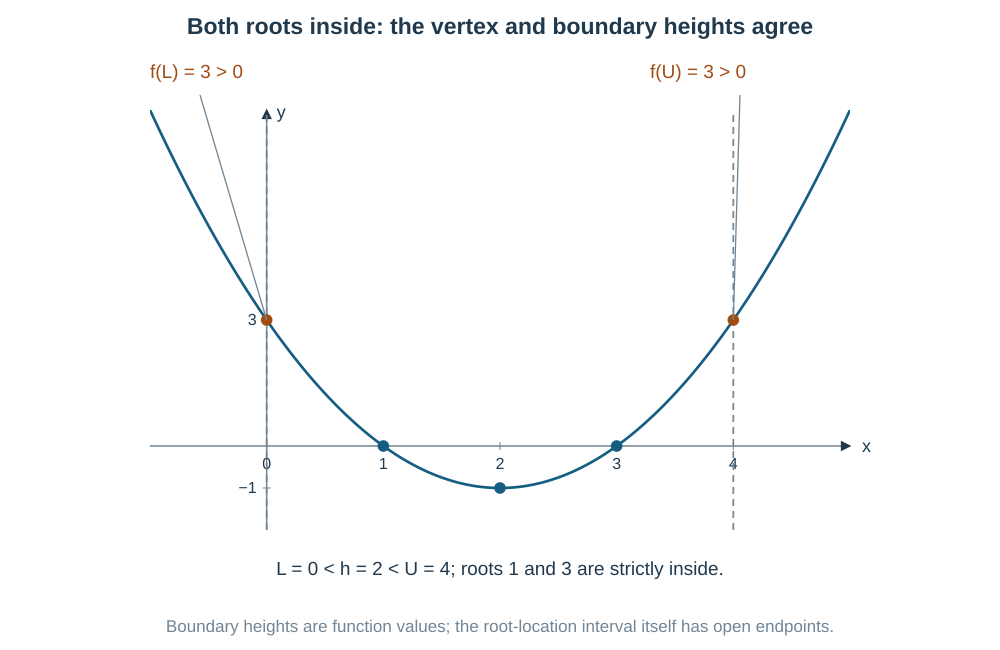

For both real roots strictly inside $(L,U)$:

$$
\boxed{\Delta\ge0,\quad L<h<U,\quad
\frac{f(L)}a>0,\quad\frac{f(U)}a>0}.
$$

The vertex lies between the boundaries, while both boundary heights lie above the axis. If roots must be distinct, use $\Delta>0$. For both roots in the closed interval $[L,U]$, replace the endpoint/vertex strict inequalities by non-strict ones.

For both roots to the right of $t$:

$$
\Delta\ge0,\quad h>t,\quad f(t)/a>0.
$$

For both to the left, use $h<t$. If one root is strictly on each side of $t$, then $f(t)/a<0$; this already gives two distinct real roots.

Opposite nonzero signs of $f(L)$ and $f(U)$ guarantee exactly one crossing in $(L,U)$ for a quadratic. Endpoint roots and a repeated touching root need separate treatment; do not use the sign-change test as a universal description of every “one root” wording.

**Parameter checklist:** real roots → requested sign/location → strict or included boundaries → degree loss. Intersect the conditions; do not choose just the easiest one.

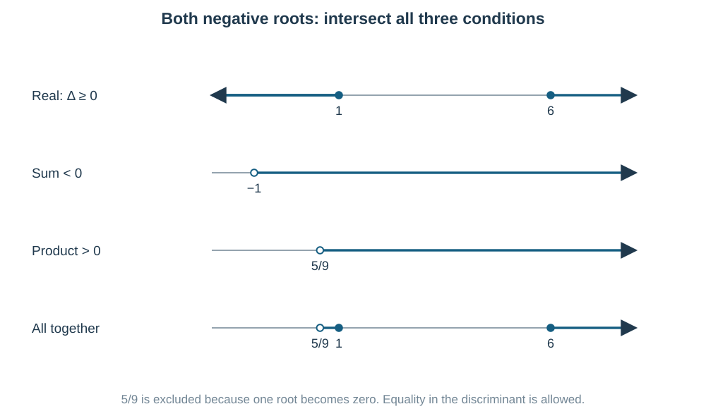

### Concept C16 — Rational ranges: numerator and denominator share the same input

**Important for JEE Main.** In

$$
f(x)=\frac{x^2-3x+4}{x^2+3x+4},
$$

the shared part is $x^2+4$, and the $3x$ sign changes. This resembles the repeated-pattern range question in Chapter 1.

First check the denominator:

$$
D=x^2+3x+4=(x+3/2)^2+7/4>0.
$$

Divide by $x^2+4>0$ and set

$$
u=\frac{3x}{x^2+4},\qquad f=\frac{1-u}{1+u}.
$$

The squares $(x-2)^2\ge0$ and $(x+2)^2\ge0$ give

$$
-\frac34\le u\le\frac34.
$$

Thus $1+u\in[1/4,7/4]$, so

$$
f=-1+\frac2{1+u}\in[1/7,7].
$$

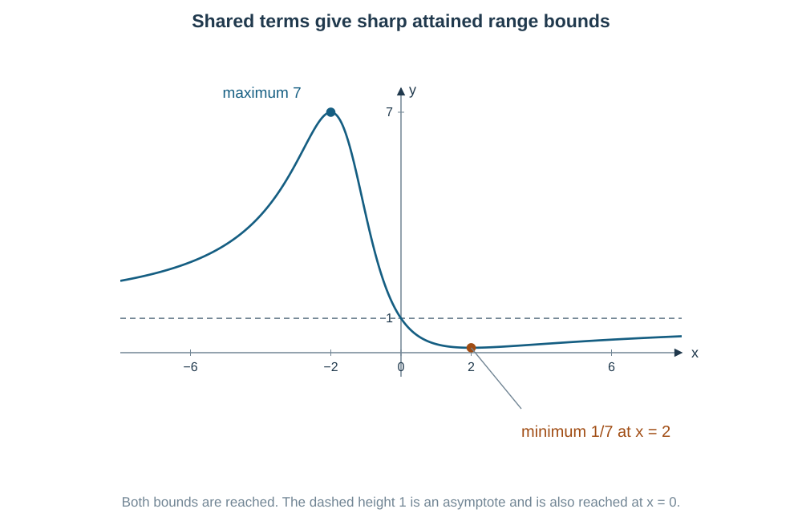

Check that the bounds occur: $f(2)=1/7$ and $f(-2)=7$.

**Another possible approach — solve backwards.** Set $y=f(x)$ and rearrange to

$$
(y-1)x^2+3(y+1)x+4(y-1)=0.
$$

For $y\ne1$, real inputs require discriminant

$$
9(y+1)^2-16(y-1)^2=(7-y)(7y-1)\ge0.
$$

The case $y=1$ becomes linear and must be checked separately. A discriminant in the output variable gives possible outputs; original denominator restrictions must still be tested. Here the denominator is always positive.

**Why not maximize numerator and minimize denominator separately?** Their best inputs may differ. The same $x$ controls both. Preserve their connection.

### Concept C17 — When does a real power equal one?

**Useful for the supplied Q20; domain checks are Important for JEE Main.** A variable-base power should not be treated as a polynomial.

For a positive base $A>0$,

$$
\boxed{A^B=1\iff A=1\text{ or }B=0}.
$$

In the exponent-zero case the base must be nonzero; $0^0$ is not accepted. A zero base never produces $1$ under ordinary real-power rules.

A negative base is not defined for every real exponent. Integer exponents are allowed; some rational exponents in lowest terms are allowed when the denominator is odd. A nonzero exponent can produce $1$ at a negative base only when that base is $-1$, with an allowed exponent giving a positive sign.

For an **integer** exponent,

$$
\boxed{(-1)^B=1\iff B\text{ is even}}.
$$

For an allowed rational exponent $B=p/q$ in lowest terms with odd $q$, the numerator $p$ must be even. Do not present “even integer” as the only possible case for every real-power problem.

In Q20, solving the base-$-1$ condition gives only $x=2,3$, whose exponents are integers $-48,-39$. Thus the ordinary even-integer check fully resolves that branch. Each candidate must be tested in its own base/exponent case. Combine the cases as a set; if one input appears twice, count it only once.

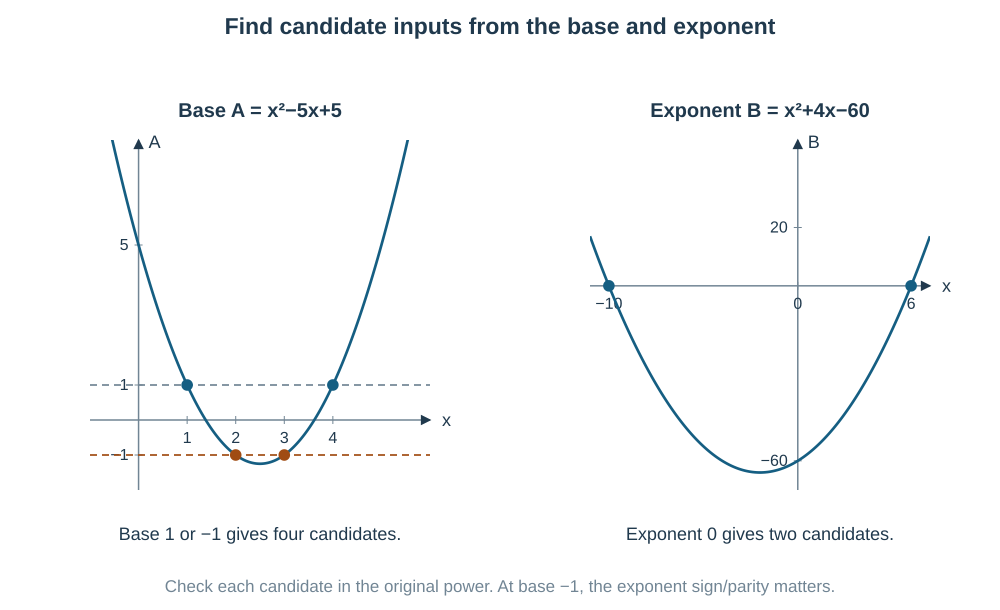

The source includes valid negative-base integer powers. If a question explicitly restricts the base to be positive, follow that narrower domain instead.

## Recognize the question model

These are method cues, not measured frequency ranks.

| Visible clue | First useful connection |
|---|---|
| Sum/product or symmetric powers of roots | Use $S,P$ before explicit radicals. |
| High powers of roots | Turn the root equation into a recurrence. |
| Coefficient sum zero | Try input $1$; alternating sum zero suggests $-1$. |
| Common root | Eliminate the squared term at that same root. |
| “Quadratic” with a parameter | Check that the leading coefficient stays nonzero. |
| “Both roots negative” | Realness, negative sum, positive product. |
| “Positive for every real input” | Opening direction and no real zeros; handle degree loss. |
| Quadratic/rational inequality | Factor signs, original denominator restrictions, endpoint inclusion. |
| $x^2$ and $|x|$ | Use $t=|x|\ge0$; restore signs. |
| A root equation | Nonnegative right side before squaring; check original equation. |
| Numerator/denominator share a pattern | One bounded quantity or a backward discriminant. |
| Variable base raised to a variable power | Separate base/exponent cases and retain real-power domain. |

## Last-minute formula recap

| Need | Recall | Condition or trap |
|---|---|---|
| Quadratic | $ax^2+bx+c=0$ | $a\ne0$. |
| Discriminant / roots | $\Delta=b^2-4ac$, $x=(-b\pm\sqrt\Delta)/(2a)$ | Real coefficients for the sign classification. |
| Real / distinct / equal | $\Delta\ge0$ / $\Delta>0$ / $\Delta=0$ | Do not replace “real” by “distinct.” |
| Vertex | $h=-b/(2a)$, $v=-\Delta/(4a)$ | $f=a(x-h)^2+v$. |
| Always positive | $a>0,\Delta<0$ | Nonnegative allows $\Delta=0$; test degeneracies separately. |
| Always negative | $a<0,\Delta<0$ | Nonpositive allows $\Delta=0$. |
| Sum/product | $S=-b/a$, $P=c/a$ | Valid for complex roots too. |
| Difference squared | $(\alpha-\beta)^2=S^2-4P=\Delta/a^2$ | Real-root distance is $\sqrt\Delta/|a|$. |
| Both positive / negative roots | $\Delta\ge0,P>0,S>0$ / $S<0$ | Distinctness needs $\Delta>0$. |
| Opposite signs | $P<0$ | Real and distinct follows. |
| Root square / cube sum | $S^2-2P$ / $S^3-3PS$ | Pattern before individual roots. |
| Reciprocal square sum | $(S^2-2P)/P^2$ | $P\ne0$. |
| Power recurrence | $U_n=SU_{n-1}-PU_{n-2}$ | $U_0=2,U_1=S$. |
| Double-index sum | $U_{2n}=U_n^2-2P^n$ | Same pair of roots. |
| New roots $u,v$ | $y^2-(u+v)y+uv=0$ | Any nonzero scalar multiple is equivalent. |
| Reciprocal equation | $cy^2+by+a=0$ | Original $c\ne0$. |
| Coefficient sum zero | Roots $1,c/a$ | $a+b+c=0$, $a\ne0$. |
| Alternating sum zero | Roots $-1,-c/a$ | $a-b+c=0$. |
| Between distinct roots, $a>0$ | $f<0$ | Outside, $f>0$; include roots only for non-strict signs. |
| Repeated root | $a(x-h)^2$ | Touches zero; sign does not flip. |
| Rational inequality | Multiply factor signs. | Original denominator zeros always excluded. |
| Modulus substitution | $t=|x|\ge0$, $x^2=t^2$ | Positive $t$ gives $\pm t$; zero counted once. |
| Radical equation | $\sqrt{g}=h$ needs $g\ge0,h\ge0$ | Squaring can introduce false candidates. |
| Exponential substitution | $t=2^x>0$ | An unavailable vertex cannot give an attained minimum. |
| Both roots in $(L,U)$ | $\Delta\ge0,L<h<U,f(L)/a>0,f(U)/a>0$ | Require $\Delta>0$ if distinct. |
| Root on each side of $t$ | $f(t)/a<0$ | Endpoint/equality cases separate. |
| Rational roots | For rational coefficients, $\sqrt\Delta$ rational. | Integer roots also need integer division. |
| Nonreal conjugate pairing | $u+iv$ pairs with $u-iv$. | Real coefficients. |
| Surd pairing | $p+q\sqrt d$ pairs with $p-q\sqrt d$. | Rational coefficients and the stated nonsquare condition. |
| Cauchy–Schwarz | $\alpha^2+\beta^2\ge S^2/2$ | Real roots; equality at equal roots. |
| Two positive-number AM–GM | $P\le S^2/4$ | Equality at equal numbers. |
| Real power equals $1$ | Positive base: base $1$ or exponent $0$. | Nonzero base for exponent zero; negative-base branch needs its own domain/sign check. |

**Final check:** Is it still quadratic? Did I impose every requested root condition? Did I keep forbidden inputs out? Did I test candidates after squaring? Is the claimed extreme actually reached?

## Worked solutions to the 25 PDF questions

Attempt each question first. Then read why the chosen route fits before following the calculation. Every second approach is included in full.

### Question 1 — The target is a symmetric sum

**PDF page 14 | MCQ | Notes: C05–C06**

If $\alpha,\beta$ are the roots of $x^2-5x+3=0$, then $\alpha^3+\beta^3$ equals

- (a) $125$
- (b) $110$
- (c) $80$
- (d) $65$

**Notice the target: both cubes are added.** The cube-of-a-sum identity contains exactly that group:

$$
(\alpha+\beta)^3
=\alpha^3+\beta^3+3\alpha\beta(\alpha+\beta).
$$

From the equation, $S=5$ and $P=3$. Rearrange only the part needed:

$$
\alpha^3+\beta^3=S^3-3PS
=125-45=\boxed{80}\qquad\text{(c)}.
$$

**Why this route?** Finding the two irrational roots separately works, but their cube expansions would later cancel. Sum/product uses the cancellation before calculating.

**Check by a second identity:** $U_2=S^2-2P=19$, so the root recurrence gives $U_3=SU_2-PU_1=5(19)-3(5)=80$.

### Question 2 — Real and distinct means a strict condition

**PDF page 14 | MCQ | Notes: C03**

The roots of $x^2+mx+9=0$ are real and distinct if and only if

- (a) $m\in(-\infty,-6)\cup(6,\infty)$
- (b) $m\in(-6,6)$
- (c) $m\in[-6,6]$
- (d) $m\in(6,\infty)$

**“Distinct” excludes a repeated root.** We need a strictly positive discriminant:

$$
\Delta=m^2-4(1)(9)=m^2-36>0.
$$

Factor:

$$
(m-6)(m+6)>0.
$$

The two factors have the same sign outside $[-6,6]$. Thus

$$
\boxed{m<-6\text{ or }m>6}\qquad\text{(a)}.
$$

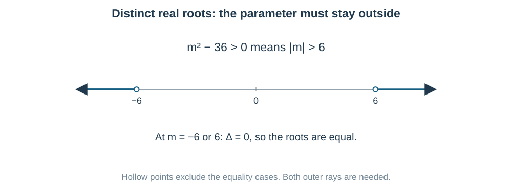

**Check:** $m=0$ gives $x^2+9=0$, nonreal roots. At $m=\pm6$, the equation is $(x\pm3)^2=0$, so there is only one distinct root value. Both boundary values must be excluded.

### Question 3 — Check the degree before the discriminant

**PDF page 14 | Numerical value | Notes: C01, C03**

The number of integral values of $k$ for which $kx^2+4x+k=0$ is a quadratic equation having real roots is ____.

**There are two requirements, not one.**

1. It must remain quadratic: $k\ne0$.
2. Its roots must be real: $\Delta\ge0$; repeated real roots are allowed.

$$
\Delta=4^2-4(k)(k)=16-4k^2\ge0
\quad\Longrightarrow\quad -2\le k\le2.
$$

The integers are initially $-2,-1,0,1,2$. Remove $0$, because it gives the linear equation $4x=0$.

$$
\boxed{4}.
$$

**Check the endpoints:** at $k=2$ the equation is $2(x+1)^2=0$; at $k=-2$ it is $-2(x-1)^2=0$. Both have real roots and remain quadratic. Replacing $\Delta\ge0$ by $\Delta>0$ would incorrectly remove them.

### Question 4 — A common root survives subtraction

**PDF page 14 | MCQ | Notes: C10**

If $x^2+px+q=0$ and $x^2+qx+p=0$ $(p\ne q)$ have a common root, then $p+q$ equals

- (a) $1$
- (b) $0$
- (c) $2$
- (d) $-1$

**Call the common root $r$.** The same $r$ solves both equations:

$$
r^2+pr+q=0,\qquad r^2+qr+p=0.
$$

Subtract to remove the squared term:

$$
(p-q)(r-1)=0.
$$

The given $p\ne q$ allows division by $p-q$, so $r=1$. Substitute into an original equation:

$$
1+p+q=0\quad\Longrightarrow\quad
\boxed{p+q=-1}\qquad\text{(d)}.
$$

**Check:** if $p+q=-1$, input $1$ makes both polynomials zero. The condition is consistent.

Solving each quadratic separately would introduce radicals and a root-matching step. Subtraction is better here because the leading terms already match.

### Question 5 — Build a new equation from a new sum and product

**PDF page 14 | MCQ | Notes: C09**

The equation whose roots are the squares of the roots of $x^2-3x+1=0$ is

- (a) $x^2-9x+1=0$
- (b) $x^2-7x-1=0$
- (c) $x^2-7x+1=0$
- (d) $x^2-3x+1=0$

**Find the new sum and product, not the new roots separately.** The old roots satisfy $S=3,P=1$. For their squares,

$$
\alpha^2+\beta^2=S^2-2P=9-2=7,\qquad
\alpha^2\beta^2=P^2=1.
$$

An equation with these new roots is

$$
y^2-7y+1=0.
$$

Renaming its unknown $y$ as $x$ matches $\boxed{x^2-7x+1=0}$, **option (c)**.

**Check:** the constant term is positive because the new root product is $(\alpha\beta)^2=1$. Option (b) has the wrong product sign.

**Another possible approach — eliminate the old input.** Each old root satisfies $\alpha^2=3\alpha-1$. If $y=\alpha^2$, then $\alpha=(y+1)/3$. Substituting $\alpha^2=y$ gives $(y+1)^2=9y$, again $y^2-7y+1=0$. The sum/product route needs less algebra.

### Question 6 — Powers obey the same quadratic rule

**PDF page 14 | Numerical value | Notes: C06**

If $\alpha,\beta$ are the roots of $x^2-x-1=0$, then $\alpha^{10}+\beta^{10}=$ ____.

**Turn the root equation into a rule.** Each root satisfies $t^2=t+1$. Multiplying by $t^{n-2}$ and adding the two root equations gives

$$
U_n=U_{n-1}+U_{n-2},\qquad U_n=\alpha^n+\beta^n.
$$

Start with $U_0=2$ and $U_1=\alpha+\beta=1$:

| $n$ | $0$ | $1$ | $2$ | $3$ | $4$ | $5$ | $6$ | $7$ | $8$ | $9$ | $10$ |
|---|---:|---:|---:|---:|---:|---:|---:|---:|---:|---:|---:|
| $U_n$ | $2$ | $1$ | $3$ | $4$ | $7$ | $11$ | $18$ | $29$ | $47$ | $76$ | $123$ |

Thus $\boxed{U_{10}=123}$.

**Another possible approach — stop the recurrence at $5$.** The product of roots is $-1$, so

$$
U_{10}=U_5^2-2(\alpha\beta)^5
=11^2-2(-1)=123.
$$

This saves several additions. Direct tenth powers of $(1\pm\sqrt5)/2$ are valid, but they hide the simple recurrence.

### Question 7 — The coefficient sum is a substitution clue

**PDF page 14 | MCQ | Notes: C04**

Assertion (A): If $a,b,c$ are real, $a\ne0$ and $a+b+c=0$, then the roots of $ax^2+bx+c=0$ are real.

Reason (R): If $a+b+c=0$ then $x=1$ is a root, and the other root is $c/a$.

- (a) Both (A) and (R) are true and (R) is the correct explanation of (A)
- (b) Both (A) and (R) are true but (R) is not the correct explanation of (A)
- (c) (A) is true but (R) is false
- (d) (A) is false but (R) is true

**The coefficient sum is exactly $f(1)$.** Since $a+b+c=0$, input $1$ is a root.

The root product is $c/a$, so if one root is $1$, the other is $c/a$. Both are real because the coefficients are real and $a\ne0$.

Thus the Assertion is true, the Reason is true, and the Reason explains the Assertion:

$$
\boxed{\text{option (a)}}.
$$

**Check by factorization:**

$$
ax^2+bx+c=(x-1)(ax-c)
$$

when $b=-a-c$. This also covers a repeated root when $c=a$.

**Another possible approach — spot a square in the discriminant.**

$$
\Delta=(-a-c)^2-4ac=(a-c)^2\ge0.
$$

This proves realness directly. It also shows why “distinct” could not be guaranteed: the square can be zero.

### Question 8 — A denominator changes sign and can never be zero

**PDF page 14 | MCQ | Notes: C08**

The solution set of $\dfrac{(x-1)(x-2)}{x-3}\ge0$ is

- (a) $[1,2]\cup(3,\infty)$
- (b) $(-\infty,1]\cup[2,3)$
- (c) $[1,2]\cup[3,\infty)$
- (d) $(1,2)\cup(3,\infty)$

**Mark zeros and forbidden inputs first.** The numerator vanishes at $1,2$; the denominator vanishes at $3$, which is never allowed.

Use one test value in each interval, or read the signs of the factors:

| Interval | $x-1$ | $x-2$ | $x-3$ | Quotient |
|---|---|---|---|---|
| $x<1$ | $-$ | $-$ | $-$ | $-$ |
| $1<x<2$ | $+$ | $-$ | $-$ | $+$ |
| $2<x<3$ | $+$ | $+$ | $-$ | $-$ |
| $x>3$ | $+$ | $+$ | $+$ | $+$ |

Keep positive intervals and defined zeros:

$$
\boxed{[1,2]\cup(3,\infty)}\qquad\text{(a)}.
$$

**Check:** $3$ stays excluded even though the inequality allows equality. At $3$, the quotient does not exist. The zeros $1,2$ do exist and give zero.

**Another possible approach — use a positive multiplier.** On $x\ne3$, multiply by $(x-3)^2>0$ to obtain $(x-1)(x-2)(x-3)\ge0$. Solve its sign chart, then remove $3$. Multiplication by $x-3$ alone would require a sign-dependent reversal.

### Question 9 — Find the interval before counting integers

**PDF page 14 | MCQ | Notes: C07**

The number of integers satisfying $x^2-4x-12\le0$ is

- (a) $9$
- (b) $8$
- (c) $7$
- (d) $10$

**First find which real inputs are allowed.**

$$
x^2-4x-12=(x-6)(x+2).
$$

The graph opens upward. It is on or below the axis between the two roots:

$$
-2\le x\le6.
$$

Now count the integers, including both ends:

$$
6-(-2)+1=\boxed{9}\qquad\text{(a)}.
$$

**Check by listing:** $-2,-1,0,1,2,3,4,5,6$.

**Another possible approach — complete the square.**

$$
(x-2)^2\le16
\iff |x-2|\le4
\iff -2\le x\le6.
$$

This views the allowed inputs as all numbers within distance $4$ of $2$.

### Question 10 — The modulus is the real hidden variable

**PDF page 15 | MCQ | Notes: C12**

The sum of squares of all real roots of $x^2-4|x|+3=0$ is

- (a) $10$
- (b) $16$
- (c) $26$
- (d) $20$

**The pattern is $|x|^2-4|x|+3$.** Put $t=|x|\ge0$:

$$
t^2-4t+3=(t-1)(t-3)=0.
$$

Both candidate values $t=1,3$ are nonnegative. Restore the two signs of $x$:

$$
x=\pm1,\ \pm3.
$$

The requested sum of squares is

$$
1+1+9+9=\boxed{20}\qquad\text{(d)}.
$$

**Why not stop at $1,3$?** Those are lengths $|x|$, not all the original inputs.

**Another possible approach — split the sign of $x$.** For $x\ge0$, solve $x^2-4x+3=0$, giving $1,3$. For $x<0$, solve $x^2+4x+3=0$, giving $-1,-3$. The substitution combines those two quadratics into one.

### Question 11 — Shared terms reveal a bounded quantity

**PDF page 15 | MCQ | Notes: C11, C16**

For real $x$, the sum of the maximum and the minimum values of $\dfrac{x^2-3x+4}{x^2+3x+4}$ is

- (a) $7$
- (b) $\dfrac{48}{7}$
- (c) $\dfrac{50}{7}$
- (d) $6$

**Look at the shared part before expanding.**

$$
f(x)=\frac{(x^2+4)-3x}{(x^2+4)+3x}.
$$

The denominator is always positive:

$$
D=(x+3/2)^2+7/4>0.
$$

Put $u=3x/(x^2+4)$. The squares $(x-2)^2\ge0$ and $(x+2)^2\ge0$ give

$$
4x\le x^2+4,\qquad -4x\le x^2+4.
$$

Since $x^2+4>0$,

$$
-\frac34\le u\le\frac34.
$$

Then

$$
f=\frac{1-u}{1+u}=-1+\frac2{1+u},\qquad
1+u\in[1/4,7/4].
$$

Thus $f\in[1/7,7]$.

**Check attainment:** $f(2)=1/7$, $f(-2)=7$. The requested sum is

$$
\boxed{7+\frac17=\frac{50}{7}}\qquad\text{(c)}.
$$

**Another possible approach — exact square checks after finding the bounds.**

$$
f-\frac17=\frac{6(x-2)^2}{7D}\ge0,\qquad
7-f=\frac{6(x+2)^2}{D}\ge0.
$$

These are the shortest proofs once the candidate bounds are known. The shared-pattern route explains how to discover them.

**Another possible approach — range discriminant.** For $y=f(x)$,

$$
(y-1)x^2+3(y+1)x+4(y-1)=0.
$$

For $y\ne1$, real inputs require $\Delta_x=(7-y)(7y-1)\ge0$, giving $1/7\le y\le7$. At $y=1$, solve the remaining linear equation $6x=0$: input $0$ works. The denominator has no real zeros, so all these candidate outputs are valid. This is systematic, but longer here.

### Question 12 — Know exactly which coefficient condition is needed

**PDF page 15 | MCQ | Notes: C03, C14**

Consider the following statements for real numbers $a,b,c$ $(a\ne0)$:

(i) If $a>0$ and $b^2-4ac<0$, then $ax^2+bx+c>0$ for all real $x$.

(ii) If $a,b,c$ are real and $2+3i$ is a root, then $2-3i$ is also a root.

(iii) If $a,b,c$ are rational and $2+\sqrt3$ is a root, then $2-\sqrt3$ is also a root.

(iv) If $ac<0$, then the roots are non-real.

The correct statements are

- (a) (i), (ii) and (iv) only
- (b) (i), (ii) and (iii) only
- (c) (ii) and (iv) only
- (d) (i), (ii), (iii) and (iv)

**Match each statement to its actual condition.**

**(i) True.** With $a>0$, the graph opens upward; $\Delta<0$ prevents any real zero. Equivalently,

$$
f(x)=a(x+b/(2a))^2-\frac{\Delta}{4a}>0.
$$

The square term is nonnegative and the last term is strictly positive.

**(ii) True.** Conjugating a zero of a real-coefficient polynomial gives another zero. The pair is $2\pm3i$.

**(iii) True.** Substitution of $2+\sqrt3$ gives

$$
(7a+2b+c)+(4a+b)\sqrt3=0.
$$

Both brackets are rational, so each must be zero; otherwise $\sqrt3$ would equal a rational quotient. Changing the surd sign still gives zero. Hence $2-\sqrt3$ is a root.

**(iv) False.** If $ac<0$, then

$$
\Delta=b^2-4ac>b^2\ge0.
$$

The roots are real and distinct, with opposite signs because $c/a<0$.

Therefore $\boxed{\text{(i), (ii), (iii) — option (b)}}$.

**Check the two different pairing rules:** real coefficients are enough for a complex conjugate pair; the surd-pair rule here needs rational coefficients.

### Question 13 — A completed square gives the two roots immediately

**PDF page 15 | MCQ | Notes: C02, C15**

If both roots of $x^2-2kx+k^2-1=0$ lie in the interval $(-2,4)$, then $k$ lies in

- (a) $(-1,3)$
- (b) $(-2,4)$
- (c) $(-1,4)$
- (d) $[-1,3]$

**Did you notice a completed square already present?**

$$
x^2-2kx+k^2-1=(x-k)^2-1.
$$

So the roots are $k-1$ and $k+1$, already in increasing order.

For both roots to lie strictly between $-2$ and $4$, the smaller must be above $-2$ and the larger below $4$:

$$
k-1>-2,\qquad k+1<4.
$$

Thus $\boxed{-1<k<3}$, **option (a)**.

**Check:** $k=1$ gives roots $0,2$, both inside. At $k=-1$, a root is $-2$; at $k=3$, a root is $4$. Both parameter endpoints are excluded.

The general vertex-and-endpoint method also works, but finding these two simple roots is shorter. Recognize an existing square before applying a larger checklist.

### Question 14 — A substitution comes with a domain

**PDF page 15 | Numerical value | Notes: C11**

The minimum value of $4^x-2^{x+3}+20$ for real $x$ is ____.

**The two powers are related:** $4^x=(2^x)^2$ and $2^{x+3}=8(2^x)$. Put $t=2^x>0$:

$$
4^x-2^{x+3}+20=t^2-8t+20=(t-4)^2+4.
$$

The square is at least zero, so the expression is at least $4$.

**Can equality occur in the original variable?** Yes: $t=4$ means $2^x=4$, so $x=2$.

$$
\boxed{\min=4}.
$$

**Check directly:** $4^2-2^5+20=16-32+20=4$. A substituted vertex is useful only if it belongs to the substituted domain.

### Question 15 — Squaring can create an extra candidate

**PDF page 15 | MCQ | Notes: C13**

The sum of all real solutions of $\sqrt{x+5}=x-1$ is

- (a) $3$
- (b) $4$
- (c) $5$
- (d) $0$

**Keep the signs before squaring.** The root needs $x+5\ge0$. The right side must also be nonnegative, so $x-1\ge0$. Together, $x\ge1$.

Now square:

$$
x+5=(x-1)^2
\quad\Longrightarrow\quad
x^2-3x-4=(x-4)(x+1)=0.
$$

The candidates are $4,-1$.

Only $4$ satisfies $x\ge1$. It also passes the original equation: $\sqrt9=3=4-1$.

Thus the sum of all real solutions is $\boxed{4}$, **option (b)**.

**Why option (a) is tempting:** the squared polynomial has root sum $3$. That includes the false candidate $-1$. We are solving the original root equation, not merely the polynomial produced by squaring.

### Question 16 — Both roots negative needs three checks

**PDF page 15 | MCQ | Notes: C05, C15**

The equation $x^2+2(k+1)x+9k-5=0$ has both roots negative for

- (a) $k\in\left(\dfrac59,1\right]\cup[6,\infty)$
- (b) $k\in(-1,1]\cup[6,\infty)$
- (c) $k\in\left(\dfrac59,\infty\right)$
- (d) $k\in(-\infty,1]\cup[6,\infty)$

**“Both negative” combines realness and signs.** Let the roots have sum $S$ and product $P$:

$$
S=-2(k+1),\qquad P=9k-5.
$$

Both roots negative requires

$$
S<0\Rightarrow k>-1,\qquad
P>0\Rightarrow k>\frac59.
$$

Also the roots must be real:

$$
\Delta=4(k+1)^2-4(9k-5)
=4(k-1)(k-6)\ge0,
$$

giving $k\le1$ or $k\ge6$.

Intersect all three:

$$
\boxed{k\in(5/9,1]\cup[6,\infty)}\qquad\text{(a)}.
$$

**Check boundaries:** $k=5/9$ gives product zero, so a root is zero, not negative. At $k=1$, the roots are both $-2$; at $k=6$, both are $-7$. Repeated negative roots are allowed because the question does not require distinct roots.

### Question 17 — Reciprocal squares still use sum and product

**PDF page 15 | Numerical value | Notes: C05–C06**

If $\alpha,\beta$ are the roots of $2x^2-3x-5=0$, then $\dfrac1{\alpha^2}+\dfrac1{\beta^2}=$ ____ (round off to $2$ decimal places).

**Combine the reciprocal fractions before solving for roots.**

$$
\frac1{\alpha^2}+\frac1{\beta^2}
=\frac{\alpha^2+\beta^2}{(\alpha\beta)^2}.
$$

From the original quadratic,

$$
S=\frac32,\qquad P=-\frac52\ne0.
$$

Hence

$$
\alpha^2+\beta^2=S^2-2P
=\frac94+5=\frac{29}{4}.
$$

The required value is

$$
\frac{29/4}{25/4}=\frac{29}{25}=\boxed{1.16}.
$$

**Another possible approach — factor the original equation.** It is $(2x-5)(x+1)=0$, so the roots are $5/2,-1$. Their reciprocal squares add to $4/25+1=29/25$. Here factorization is also short; the $S,P$ method still works when the roots are not simple.

### Question 18 — A difference of roots hides another square identity

**PDF page 15 | Numerical value | Notes: C05**

If the roots of $x^2-px+15=0$ differ by $2$ and $p>0$, then $p=$ ____.

**A difference of roots suggests the square identity.**

$$
(\alpha-\beta)^2=(\alpha+\beta)^2-4\alpha\beta.
$$

Here the difference has magnitude $2$, the sum is $p$, and the product is $15$:

$$
4=p^2-60\quad\Longrightarrow\quad p^2=64.
$$

The question gives $p>0$, so $\boxed{p=8}$.

**Check:** the equation becomes $x^2-8x+15=(x-3)(x-5)$; the roots differ by $2$.

**Another possible approach — name the smaller root $t$.** The roots are $t,t+2$, so $t(t+2)=15$. This gives $t=3$ or $-5$, whose sums are $8$ or $-8$. The positive-sum condition again selects $8$. The squared-difference route reaches $p$ directly.

### Question 19 — The roots are also the coefficients

**PDF page 15 | MCQ | Notes: C05**

If the roots of $x^2+ax+b=0$ are $a$ and $b$, where $a,b$ are non-zero, then $a^2+b^2$ equals

- (a) $1$
- (b) $2$
- (c) $4$
- (d) $5$

**The unusual clue is that the root names are also coefficient names.** Apply both Viète relations to exactly those two roots:

$$
a+b=-a,\qquad ab=b.
$$

Since $b\ne0$, divide the product equation by $b$: $a=1$. The sum relation gives $b=-2a=-2$.

Therefore

$$
\boxed{a^2+b^2=1+4=5}\qquad\text{(d)}.
$$

**Check the complete root pair:** $x^2+x-2=(x-1)(x+2)$ has exactly the claimed roots $a=1,b=-2$. The nonzero condition is what justified division by $b$.

### Question 20 — An expression to a power equals one: separate the cases

**PDF page 16 | Numerical value | Notes: C17**

The sum of all real values of $x$ satisfying $(x^2-5x+5)^{x^2+4x-60}=1$ is ____.

**A power equals one through special base/exponent cases.** Call the base $A=x^2-5x+5$ and exponent $B=x^2+4x-60$.

For a positive base, $A=1$ or $B=0$ is needed. A negative base can also work here when $A=-1$ and its candidate exponent is an even integer. A zero base never gives $1$.

**Case 1: base $1$.**

$$
x^2-5x+5=1
\iff(x-1)(x-4)=0.
$$

This gives $x=1,4$, both valid: $1$ to any real exponent is $1$.

**Case 2: exponent $0$, with nonzero base.**

$$
x^2+4x-60=(x+10)(x-6)=0.
$$

This gives $x=-10,6$. Their bases are respectively $155,11$, both nonzero, so both work.

**Case 3: base $-1$.**

$$
x^2-5x+5=-1
\iff(x-2)(x-3)=0.
$$

At $x=2$, $B=-48$, and $(-1)^{-48}=1$, so it works. At $x=3$, $B=-39$, and $(-1)^{-39}=-1$, so it fails.

The complete solution set is $\{-10,1,2,4,6\}$, whose sum is

$$
\boxed{-10+1+2+4+6=3}.
$$

**Domain check:** we used ordinary real/integer powers at these candidates. No unsupported negative-base irrational power was used. For a nonzero real exponent at any allowed negative base other than $-1$, the magnitude cannot be $1$; the only extra negative-base candidates were already in Case 3. Count the union of cases, not duplicates.

### Question 21 — Match root types using the discriminant

**PDF page 16 | MCQ | Notes: C03, C14**

Match List-I (equations) with List-II (nature of roots).

| List-I | Equation |
|---|---|
| A | $x^2-2x+5=0$ |
| B | $x^2-6x+9=0$ |
| C | $x^2-5x+6=0$ |
| D | $x^2-2x-1=0$ |

List-II: I. real, distinct and irrational; II. non-real (complex conjugates); III. real and equal; IV. real, distinct and rational.

- (a) A-II, B-III, C-IV, D-I
- (b) A-I, B-III, C-IV, D-II
- (c) A-II, B-IV, C-III, D-I
- (d) A-III, B-II, C-I, D-IV

**Use the discriminant first; then check rationality where needed.**

| Row | Calculation | Nature | Match |
|---|---|---|---|
| A | $\Delta=4-20=-16$ | $1\pm2i$, nonreal conjugates. | II |
| B | $\Delta=36-36=0$ | Equal real roots $3,3$. | III |
| C | $\Delta=25-24=1$ | Distinct rational roots $2,3$. | IV |
| D | $\Delta=4+4=8$ | Distinct irrational roots $1\pm\sqrt2$. | I |

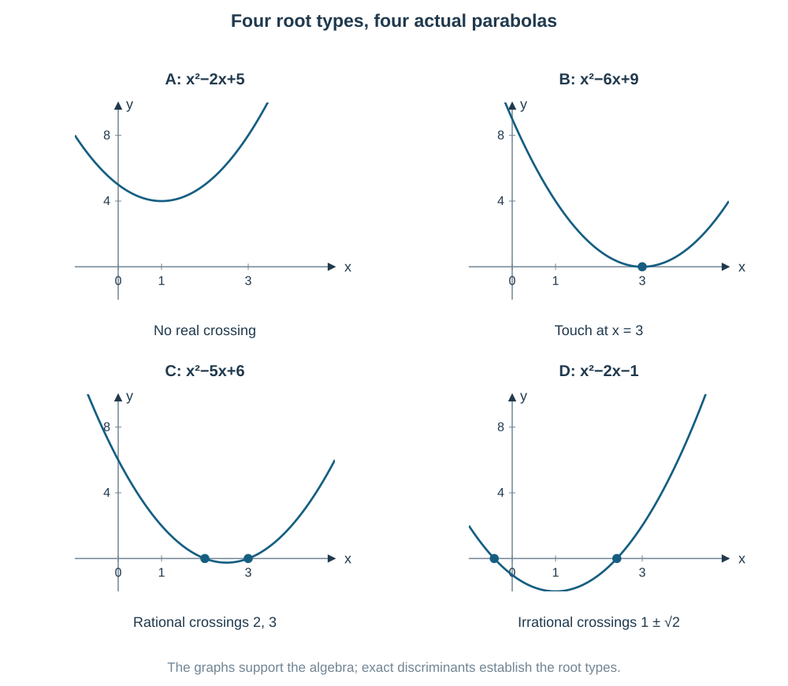

Thus $\boxed{\text{A–II, B–III, C–IV, D–I}}$, **option (a)**.

**Check:** the rational/irrational test is valid here because all coefficients are integers. A positive discriminant alone says “two distinct real roots,” not automatically “rational.”

### Question 22 — A ratio suggests writing both roots with one scale

**PDF page 16 | MCQ | Notes: C05**

If the roots of $x^2-10x+k=0$ are in the ratio $2:3$, then $k$ equals

- (a) $25$
- (b) $20$
- (c) $24$
- (d) $30$

**A ratio lets us describe both roots using one scale.** Write them as $2t,3t$.

Their sum is $10$, so $5t=10$ and $t=2$. The roots are $4,6$. Their product is the constant coefficient:

$$
\boxed{k=4\cdot6=24}\qquad\text{(c)}.
$$

**Check:** $(x-4)(x-6)=x^2-10x+24$. Finding the scale from the sum avoids solving a quadratic formula containing the unknown $k$.

### Question 23 — No real roots does not decide whether the graph is above or below

**PDF page 16 | MCQ | Notes: C03, C04**

The expression $(m+1)x^2-2(m-1)x+3(m-1)$ is positive for all real $x$ if

- (a) $m<-2$
- (b) $m>-1$
- (c) $m<-2$ or $m>1$
- (d) $m>1$

**“Positive for all real $x$” needs the whole graph above the axis.** A genuine quadratic must open upward and have no real zeros:

$$
m+1>0,\qquad\Delta<0.
$$

Compute the discriminant carefully, including the $-2$ in the linear coefficient:

$$
\begin{aligned}
\Delta
&=[-2(m-1)]^2-4(m+1)\,3(m-1)\\
&=-8(m-1)(m+2).
\end{aligned}
$$

Thus $\Delta<0$ gives $m<-2$ or $m>1$. Intersect with $m>-1$:

$$
\boxed{m>1}\qquad\text{(d)}.
$$

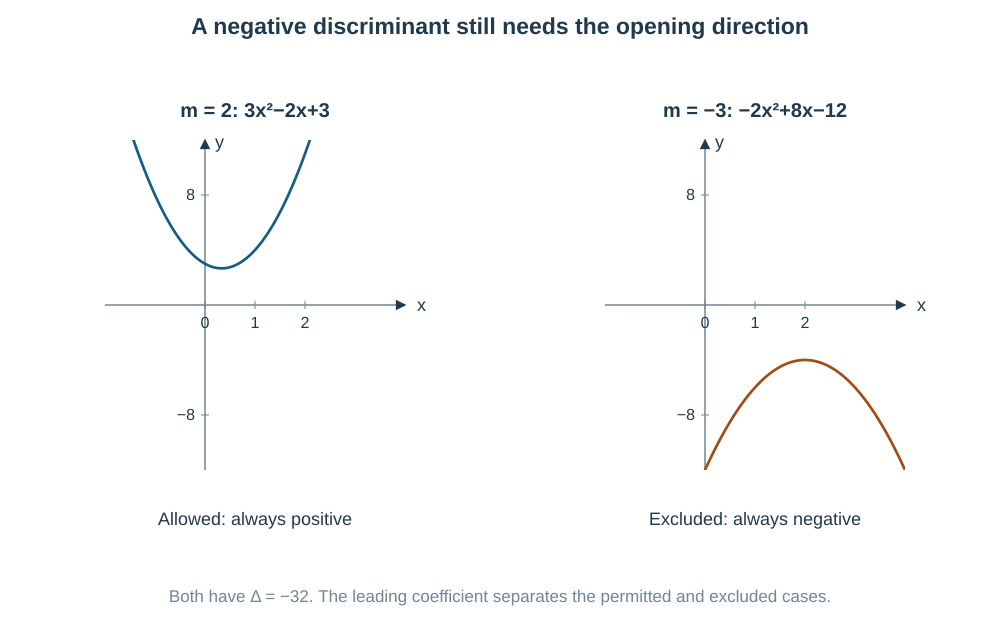

**Check degree loss and strictness:** at $m=-1$, the expression is $4x-6$, not positive everywhere. At $m=1$, it is $2x^2$, which equals zero at $x=0$, so it fails strict positivity.

**Why option (c) fails:** when $m<-2$, the graph opens downward and stays negative. A negative discriminant cannot decide the sign without the leading coefficient.

### Question 24 — Two moduli are two distances on a number line

**PDF page 16 | MCQ | Notes: C12**

The number of integers $x$ satisfying $|x-1|+|x-3|\le4$ is

- (a) $4$
- (b) $3$
- (c) $5$
- (d) $6$

**Read each modulus as a distance.** We want the sum of distances from $1$ and $3$ to be at most $4$.

Between $1$ and $3$, the distance sum is the fixed gap $2$, so that entire segment is allowed.

To the left, $x\le1$:

$$
|x-1|+|x-3|=4-2x\le4
\quad\Longrightarrow\quad x\ge0.
$$

To the right, $x\ge3$:

$$
|x-1|+|x-3|=2x-4\le4
\quad\Longrightarrow\quad x\le4.
$$

The combined allowed interval is $[0,4]$. Its integers are $0,1,2,3,4$:

$$
\boxed{5}\qquad\text{(c)}.
$$

**Another possible approach — centre the picture at $2$.** Set $u=x-2$. Then $|u+1|+|u-1|=2\max(|u|,1)\le4$, equivalent to $|u|\le2$. Hence $0\le x\le4$. Use this compact identity after understanding the flat middle and rising outer pieces.

### Question 25 — Read the requested power combination as a recurrence

**PDF page 16 | Numerical value | Notes: C06**

Let $\alpha,\beta$ be the roots of $x^2-6x-2=0$ with $\alpha>\beta$, and $a_n=\alpha^n-\beta^n$. Then $\dfrac{a_{10}-2a_8}{a_9}=$ ____.

**Look at the requested combination before finding the roots.** Each root $t$ satisfies

$$
t^2-6t-2=0\quad\Longrightarrow\quad t^2=6t+2.
$$

Multiply by $t^8$:

$$
t^{10}=6t^9+2t^8.
$$

Write this for $\alpha$ and $\beta$, then subtract:

$$
\alpha^{10}-\beta^{10}
=6(\alpha^9-\beta^9)+2(\alpha^8-\beta^8).
$$

Using the given $a_n$ notation,

$$
a_{10}=6a_9+2a_8
\quad\Longrightarrow\quad
\frac{a_{10}-2a_8}{a_9}=\boxed{6}.
$$

**Check the division:** the roots are real and have product $-2<0$. With $\alpha>\beta$, $\alpha>0>\beta$. Therefore $\alpha^9-\beta^9>0$, so $a_9$ is not zero.

The numerator was designed to match the root recurrence. Calculating the individual high powers of $3\pm\sqrt{11}$ would do much more work than the target needs.

## Answer check

Use after attempting the questions. Option letters retain the original PDF order.

| Question | Answer | Question | Answer |
|---|---|---|---|
| 1 | (c) $80$ | 14 | $4$ |
| 2 | (a) $(-\infty,-6)\cup(6,\infty)$ | 15 | (b) $4$ |
| 3 | $4$ | 16 | (a) $(5/9,1]\cup[6,\infty)$ |
| 4 | (d) $-1$ | 17 | $1.16$ |
| 5 | (c) $x^2-7x+1=0$ | 18 | $8$ |
| 6 | $123$ | 19 | (d) $5$ |
| 7 | (a) | 20 | $3$ |
| 8 | (a) $[1,2]\cup(3,\infty)$ | 21 | (a) A–II, B–III, C–IV, D–I |
| 9 | (a) $9$ | 22 | (c) $24$ |
| 10 | (d) $20$ | 23 | (d) $m>1$ |
| 11 | (c) $50/7$ | 24 | (c) $5$ |
| 12 | (b) (i), (ii), (iii) | 25 | $6$ |
| 13 | (a) $(-1,3)$ |  |  |

## Coverage and source notes

All $25$ source questions are included in order, with their original $18$ MCQ and $7$ numerical-value formats. Root formation, signs, domain checks, equality cases, parameter degeneracies, and useful prerequisites are taught before the questions.

Q20 is interpreted using ordinary real powers wherever they are defined, including the valid negative-base integer-power candidate. This convention is explicit before the solution. All independently checked results agree with the source key.

The recent-weightage audit is a recount of $49$ distinct archive-category cards for $2024$–$2026$, not an independent full-paper reclassification. It is not an exhaustive $2020$–$2026$ formula-frequency audit, and the method-cue table is not a measured model ranking.

## Offline research record

- Supplied Maths Predicted V1.pdf: questions on PDF pages 14–16, key on page 16, source working through page 17. All question text and options were read visually.
- NTA, Syllabus for JEE Main 2027, Mathematics Unit 2: real/complex quadratic solutions, nature of roots, root–coefficient relations, and formation of equations.
- ExamSIDE, Quadratic Equation and Inequalities: recent category totals and distinct question-card IDs saved and recounted.
- PYQSide uses a combined Complex Numbers and Quadratic Equations classification. Its combined totals were not added to the separate chapter count.

All alternative approaches are plain visible content and remain part of the source for the later printed booklet.
