# Sequences and Series — JEE Main revision guide

*First ask how the terms change: by adding, multiplying, reciprocating, or cancelling. Then choose the sum.*

> **For Kanna | Chapter 4**  
> Goal: about $120/300$ towards $200/300$ — Physics $60$, Maths $60$, Chemistry $80$.  
> Learn the patterns and their reasons first. All $35$ source questions, diagrams, checks, and useful second approaches follow the recap.

## Recent chapter weightage

**The checked 2024–2026 archive gives about $1.64$ Sequences and Series questions per Paper 1.**

| Year | Papers | Chapter questions | Questions per paper |
|---|---:|---:|---:|
| $2024$ | $20$ | $35$ | $1.75$ |
| $2025$ | $19$ | $27$ | $1.42$ |
| $2026$ | $19$ | $33$ | $1.74$ |
| Together | $58$ | $95$ | $1.64$ |

The mean is $95/58\approx1.64$, from the saved and recounted ExamSIDE category. The count uses $95$ distinct recent question-card IDs. This is an archive-based classification, not an independent reclassification of every original NTA paper or a formula-frequency audit. Offered-question totals and optional numerical questions differed in $2024$, so do not convert this directly into a guaranteed marks percentage.

**Revision priority:** AP/GP term and sum meanings, means and their conditions, telescoping, weighted sums, and smart three-term representations. Small indexing errors can change an otherwise correct solution.

## Scope, conventions, and reading plan

The current official Mathematics Unit 6 names AP, GP, insertion of arithmetic/geometric means, and the AM–GM relation. The supplied source also uses HP, telescoping, weighted geometric sums, and simple recurrences. Their required foundations are taught here as supporting Main-level methods.

Progressions here are real unless a different setting is explicitly discussed.

- **Q13** uses the usual **positive geometric means** convention between positive endpoints. An arbitrary signed GP is a different interpretation.
- **Q33** is missing a nonconstant-AP condition for a unique answer: the all-zero AP makes every listed term zero. Its intended answer, the $18$th term, is explained with this caveat.
- **Q35** uses the ordinary real-parameter setting, so the keyed $k=56$ is the real-GP result. The coefficient connection is derived, not assumed.

**Important for JEE Main** labels teaching priority, not a measured formula-use count.

## Formula and concept bank

### Concept C01 — A term, a sequence, and a sum are different objects

**Important for JEE Main.** A **sequence** is an ordered list:

$$
3,\ 7,\ 11,\ 15,\ldots
$$

The **index** is the position. $T_1=3$ means the first term is $3$; $T_4=15$ means the fourth term is $15$.

A **series** adds terms. A **partial sum** is the total of the first $n$ terms:

$$
\boxed{S_n=T_1+T_2+\cdots+T_n},\qquad S_0=0.
$$

For the example, $S_4=3+7+11+15=36$. It is not $T_4=15$.

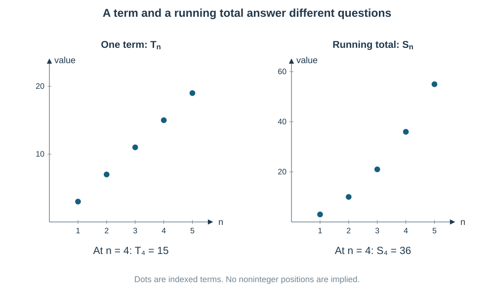

**Read the axes:** the horizontal coordinate is an integer position $n$, not the value of a term. A sequence graph consists of points at integer positions. Any faint joining line is only a visual guide.

The symbol

$$
\sum_{k=1}^{n}f(k)
$$

means substitute $k=1,2,\ldots,n$ and add. The letter $k$ is a temporary counting label. For instance, $\sum_{k=1}^3k^2=1+4+9=14$.

**First question to ask:** does the problem want one term, a total, a count of terms, or a product? Similar-looking notation can ask for different quantities.

### Concept C02 — Arithmetic progression: equal added steps

**Important for JEE Main.** In an **arithmetic progression (AP)**, each next term adds the same number $d$, the **common difference**:

$$
a,\ a+d,\ a+2d,\ldots
$$

To reach the $n$th term from the first, make $n-1$ jumps:

$$
\boxed{T_n=a+(n-1)d}.
$$

The first term has zero jumps. This explains the $n-1$.

For two positions $p,q$,

$$
\boxed{T_q-T_p=(q-p)d}.
$$

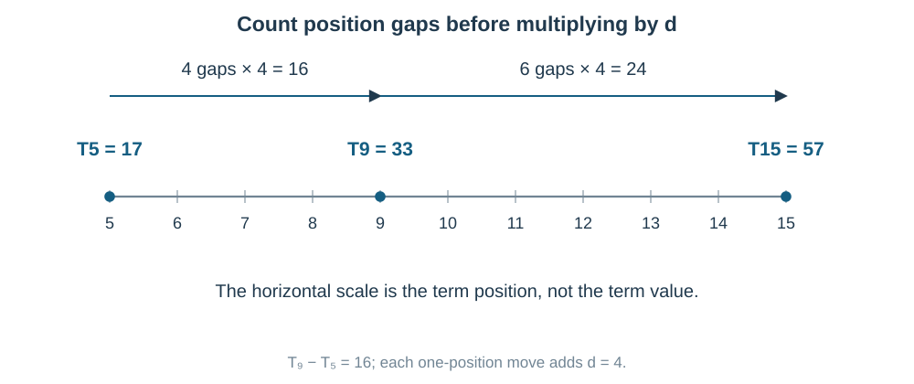

In Q2, $T_9-T_5=4d$, not $5d$. Once $d$ is known, jump directly from $T_9$ to $T_{15}$; finding $a$ is optional.

Useful symmetry:

$$
\boxed{T_p+T_q=2a+(p+q-2)d}.
$$

Pairs of indices with the same sum give the same term sum. Terms equally far from a middle position average to the middle term.

For three consecutive AP terms,

$$
\boxed{a,b,c\text{ in AP}\iff2b=a+c}.
$$

A positive $d$ gives increasing terms; a negative $d$ gives decreasing terms; $d=0$ gives a constant AP. The constant case must not be silently discarded.

If there are $n$ terms and last term $\ell$, the $k$th term from the end is $\ell-(k-1)d$.

### Concept C03 — AP sums come from pairing the ends

**Important for JEE Main.** Write the same sum forward and backward:

$$
\begin{aligned}
S_n&=a+(a+d)+\cdots+\ell,\\
S_n&=\ell+(\ell-d)+\cdots+a.
\end{aligned}
$$

Each column adds to $a+\ell$. There are $n$ columns:

$$
\boxed{S_n=\frac n2(a+\ell)
=\frac n2[2a+(n-1)d]}.
$$

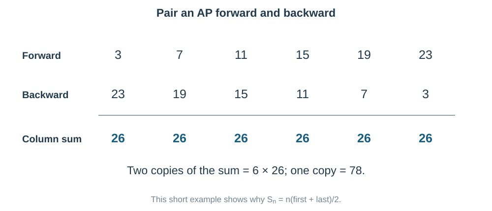

The formula means **number of terms × average of first and last**. It works for negative terms and negative differences too.

**A range of terms:** from position $p$ to $q$, both included,

$$
\boxed{T_p+\cdots+T_q
=\frac{q-p+1}{2}(T_p+T_q)
=S_q-S_{p-1}}.
$$

Why $S_{p-1}$? Remove only the terms **before** position $p$. Removing $S_p$ would also remove the first wanted term.

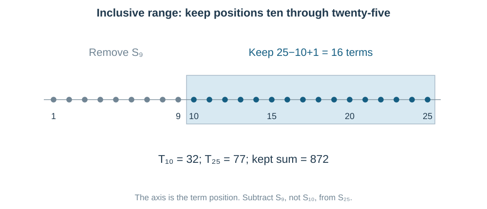

If $d\ne0$, the number of terms from first $a$ to last $\ell$ is

$$
n=\frac{\ell-a}{d}+1.
$$

For an actual finite AP ending at $\ell$, this must be a positive integer. The $+1$ includes the starting term.

### Concept C04 — Geometric progression: equal multiplications

**Important for JEE Main.** In a **geometric progression (GP)**, each next term multiplies by a fixed ratio $r$:

$$
a,\ ar,\ ar^2,\ldots,\qquad
\boxed{T_n=ar^{n-1}}.
$$

Ratios such as $T_{n+1}/T_n$ require a nonzero denominator. If $r=0$, the sequence is $a,0,0,\ldots$; handle the first term directly.

If $r<0$, the signs alternate. For positive terms, $r>1$ gives growth, $0<r<1$ gives decay, and $r=1$ gives a constant sequence.

**Derive the finite sum by shifting one place:**

$$
\begin{aligned}
S_n&=a+ar+\cdots+ar^{n-1},\\
rS_n&=ar+ar^2+\cdots+ar^n.
\end{aligned}
$$

Subtract. All middle powers cancel:

$$
\boxed{S_n=\frac{a(1-r^n)}{1-r}\quad(r\ne1)}.
$$

For $r>1$, the equivalent form $a(r^n-1)/(r-1)$ may look cleaner. For $r=1$, use $S_n=na$.

**A finite GP may have any real ratio.** The restriction $|r|<1$ belongs to a nonzero **infinite** GP sum, not to every GP question.

The product of $n$ GP terms is

$$
\boxed{a^n r^{n(n-1)/2}}.
$$

The exponent comes from $0+1+\cdots+(n-1)$. For **positive** terms it also equals $(a\ell)^{n/2}$, using symmetric pairs.

**Transforming every term:** the squared terms form a GP with first term $a^2$ and ratio $r^2$. Nonzero reciprocal terms form a GP with first term $1/a$ and ratio $1/r$.

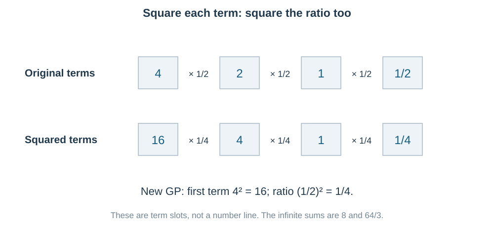

The sum of squares is not the square of the total:

$$
\left(\sum T_k\right)^2
=\sum T_k^2+2\sum_{j<k}T_jT_k.
$$

Those extra mixed products are why squaring the infinite sum $8$ does not answer Q4.

### Concept C05 — An infinite sum means a limit of partial sums

**Important for JEE Main.** We never finish adding infinitely many terms one by one. We ask whether the partial totals $S_n$ get closer to one finite number.

For a nonzero first term $a$, a GP has a finite ordinary infinite sum exactly when $|r|<1$. Then $r^n\to0$ in the finite-sum formula:

$$
\boxed{S_\infty=\frac a{1-r},\qquad |r|<1}.
$$

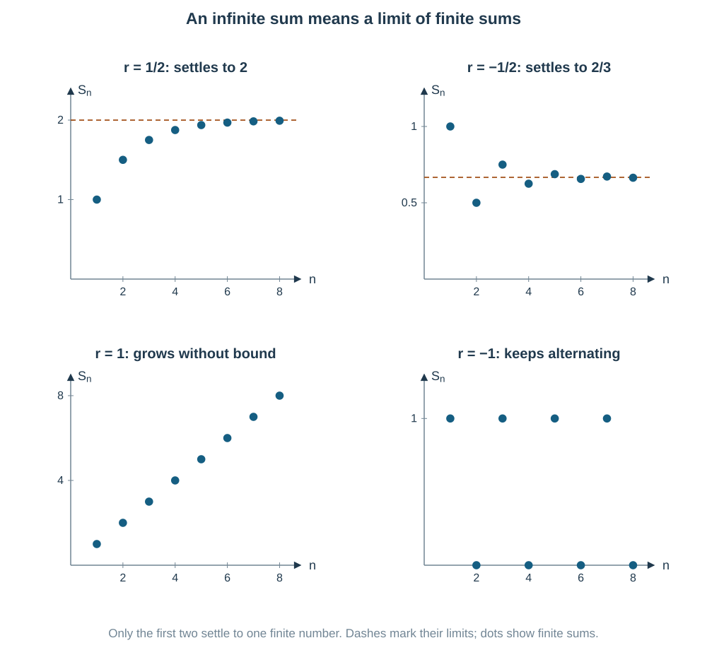

**Read the dots:** positive shrinking terms approach a limit from one side. A negative ratio with $|r|<1$ can approach it by alternating above and below. Alternating signs alone do not prove convergence.

| Example | Partial sums | Result |
|---|---|---|
| $1+1/2+1/4+\cdots$ | $1,1.5,1.75,\ldots$ | Approaches $2$. |
| $1-1/2+1/4-\cdots$ | $1,1/2,3/4,\ldots$ | Approaches $2/3$. |
| $1+1+1+\cdots$ | $1,2,3,\ldots$ | No finite sum. |
| $1-1+1-\cdots$ | $1,0,1,0,\ldots$ | No ordinary limiting sum. |

Do not insert $r=-1$ into $a/(1-r)$ and claim $a/2$. The formula was derived only after checking convergence.

An identically zero sequence is a trivial special case. The usual “iff $|r|<1$” statement is for a nonzero GP.

**A tail is another GP.** From term $m$ onward, the first tail term is $ar^{m-1}$:

$$
\boxed{\sum_{k=m}^{\infty}ar^{k-1}
=\frac{ar^{m-1}}{1-r}\quad(|r|<1)}.
$$

Terms tending to zero alone are not a universal test for every kind of infinite series. Here the GP partial-sum formula proves the limiting total.

### Concept C06 — Harmonic progression: reciprocals have equal added steps

**Important supporting idea for the source questions.** Nonzero numbers form a **harmonic progression (HP)** when their reciprocals form an AP.

If reciprocal AP terms are $a,a+d,a+2d,\ldots$, the HP terms are

$$
\boxed{\frac1a,\frac1{a+d},\frac1{a+2d},\ldots}.
$$

Every displayed denominator must be nonzero. The HP's own differences are generally not equal.

For three HP terms $u,v,w$,

$$
\frac2v=\frac1u+\frac1w
\quad\Longrightarrow\quad
\boxed{v=\frac{2uw}{u+w}}.
$$

In the positive-number setting, all divisions are safe.

**Question clue:** given positions in an HP, take reciprocals and use the same AP position gaps. Then invert the final answer. An HP is not a reason to use the AP sum formula on its original terms.

### Concept C07 — Means and inequalities: equality conditions find the optimum

**Important for JEE Main.** For two positive numbers $u,v$:

$$
\boxed{A=\frac{u+v}{2}},\qquad
\boxed{G=\sqrt{uv}},\qquad
\boxed{H=\frac2{1/u+1/v}=\frac{2uv}{u+v}}.
$$

$A$ is the ordinary arithmetic average. $G$ is the positive middle value in a GP between the two numbers. $H$ comes from averaging their reciprocals and then inverting.

$$
\boxed{A\ge G\ge H,\qquad AH=G^2}.
$$

The inequality becomes strict when the two numbers differ. Equality throughout means $u=v$. The identity $AH=G^2$ is a **two-number** identity, not a general rule for arbitrary longer lists.

**Why $A\ge G$?**

$$
(\sqrt u-\sqrt v)^2\ge0
\quad\Longrightarrow\quad u+v\ge2\sqrt{uv}.
$$

Then $H=G^2/A\le G$. This proves the order instead of asking you to memorize three unrelated means.

For $m$ positive numbers,

$$
\boxed{\frac{x_1+\cdots+x_m}{m}\ge
(x_1\cdots x_m)^{1/m}},
$$

with equality when all $m$ numbers are equal. This is **AM–GM**.

**Choose the factors from the target.** In Q27, $x^2y=x\cdot x\cdot y$ and the given sum is $x+x+y=12$. So apply three-number AM–GM to $x,x,y$:

$$
x^2y\le(12/3)^3=64.
$$

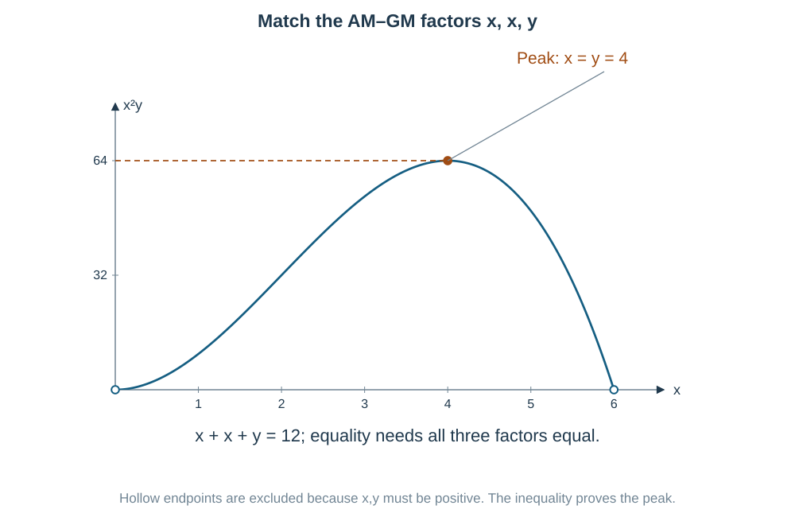

Applying two-number AM–GM to $2x,y$ would bound $2xy$, a different product. Match the copies to the powers.

If instead the constraint were $x+y=12$ with the same target $x^2y$, use $x/2,x/2,y$. Their sum is fixed, and their product is $x^2y/4$. The equality condition then becomes $x/2=y$, not $x=y$. The correct factors depend on the given constraint.

**Fixed product, minimum sum.** In Q5, the positive terms $4x$ and $9/x$ have constant product $36$:

$$
4x+\frac9x\ge2\sqrt{36}=12.
$$

Equality requires $4x=9/x$, giving allowed $x=3/2$. A bound without an allowed equality input does not prove an attained optimum.

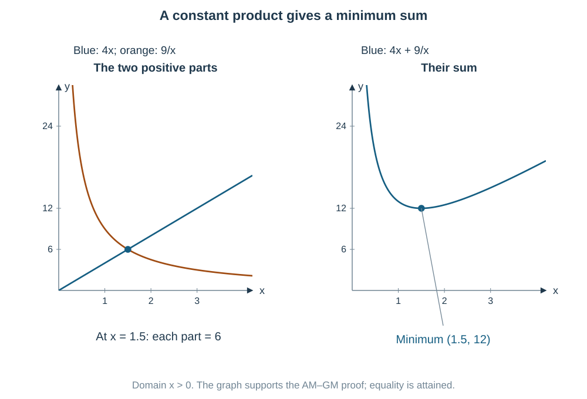

**Cauchy–Schwarz — Important for JEE Main.** For positive $x,y$ and fixed positive $p,q$,

$$
\boxed{\left(\frac{p^2}{x}+\frac{q^2}{y}\right)(x+y)
\ge(p+q)^2}.
$$

It helps when a sum of reciprocals appears and $x+y$ is fixed. The difference between the two sides is

$$
\left(p\sqrt{\frac yx}-q\sqrt{\frac xy}\right)^2\ge0.
$$

Equality requires $x:y=p:q$. For example, if $x+y=5$, then $4/x+9/y\ge25/5=5$, reached at $x=2,y=3$. Check positivity and the equality condition before calling it a minimum.

### Concept C08 — Standard power sums and what the index means

**Important for JEE Main.** For a positive integer $n$,

$$
\boxed{\sum_{k=1}^{n}k=\frac{n(n+1)}2},\qquad
\boxed{\sum_{k=1}^{n}k^2=\frac{n(n+1)(2n+1)}6},
$$

$$
\boxed{\sum_{k=1}^{n}k^3=\left[\frac{n(n+1)}2\right]^2}.
$$

The square of the sum and the sum of squares are different. The cube-sum formula happens to equal the square of the natural-number sum.

Useful related sums:

$$
\boxed{1+3+\cdots+(2n-1)=n^2},\qquad
2+4+\cdots+2n=n(n+1),
$$

$$
\boxed{\sum_{k=1}^{n}(2k-1)^2
=\frac{n(2n-1)(2n+1)}3}.
$$

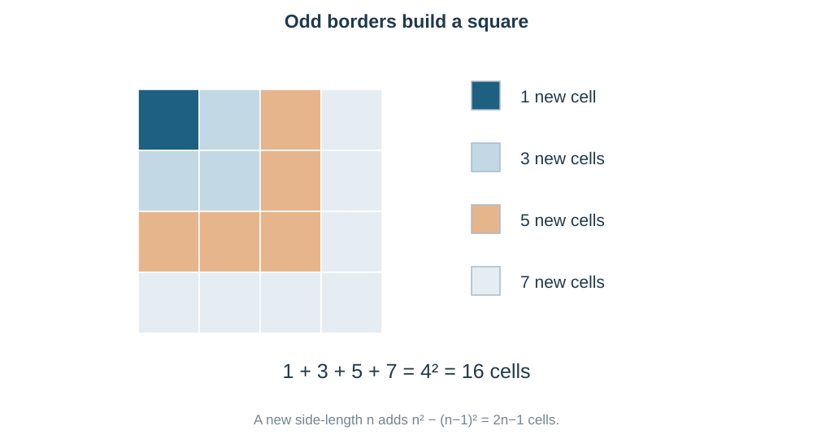

**Read the square:** enlarging a square of side $n-1$ to side $n$ adds $n^2-(n-1)^2=2n-1$ cells. This explains the odd-number sum.

For the odd-square formula, expand $(2k-1)^2=4k^2-4k+1$ and use the first two standard sums. For even powers such as $(2k)^2$, factor out $4$.

**When expansion is a good route:** if it turns a product into these known sums. Q7 has $k(k+2)=k^2+2k$. Q34 has $k(k+1)(k+2)=k^3+3k^2+2k$.

The sum sign is linear:

$$
\sum(Af(k)+Bg(k))=A\sum f(k)+B\sum g(k)
$$

for fixed constants $A,B$ and the same limits. It does not turn a sum of products into a product of sums.

**Why the square-sum formula is reasonable:** subtract consecutive cubes,

$$
(k+1)^3-k^3=3k^2+3k+1.
$$

Sum from $1$ to $n$; the left side leaves $(n+1)^3-1$. Using $\sum k=n(n+1)/2$ and $\sum1=n$ gives the stated $\sum k^2$ formula. The cube-sum formula can likewise be checked by subtracting consecutive fourth powers. You can rebuild the results from cancellation instead of relying only on memory.

### Concept C09 — Telescoping: change the form so the inside terms cancel

**Basic meaning:** a long sum can become short if one term contains the negative of a part in the next term. The first and last parts survive. This is called telescoping.

For example,

$$
\frac1{k(k+1)}=\frac1k-\frac1{k+1},
$$

because the numerator after taking a common denominator is $(k+1)-k=1$. Write a few terms before using the result:

$$
\sum_{k=1}^n\frac1{k(k+1)}
=\left(1-\frac12\right)+\left(\frac12-\frac13\right)
+\cdots+\left(\frac1n-\frac1{n+1}\right)
=\boxed{1-\frac1{n+1}}.
$$

**Pattern clue:** nearby factors in a denominator often suggest a difference of fractions. For a nonzero gap $h$,

$$
\boxed{\frac1{u(u+h)}=\frac1h\left(\frac1u-\frac1{u+h}\right)}
$$

when both denominators are nonzero. The factor $1/h$ is needed: the numerator of the difference is $h$, not $1$.

Cancellation also needs matching indices. A jump of two indices can leave two starting and two ending parts; do not automatically keep just one.

Three consecutive factors have another useful identity:

$$
\boxed{\frac1{k(k+1)(k+2)}
=\frac12\left(\frac1{k(k+1)}-\frac1{(k+1)(k+2)}\right)}.
$$

The numerator of the difference is $(k+2)-k=2$, so divide by $2$. For Q8,

$$
\sum_{k=1}^n\frac1{k(k+1)(k+2)}
=\frac14-\frac1{2(n+1)(n+2)}
\longrightarrow\frac14.
$$

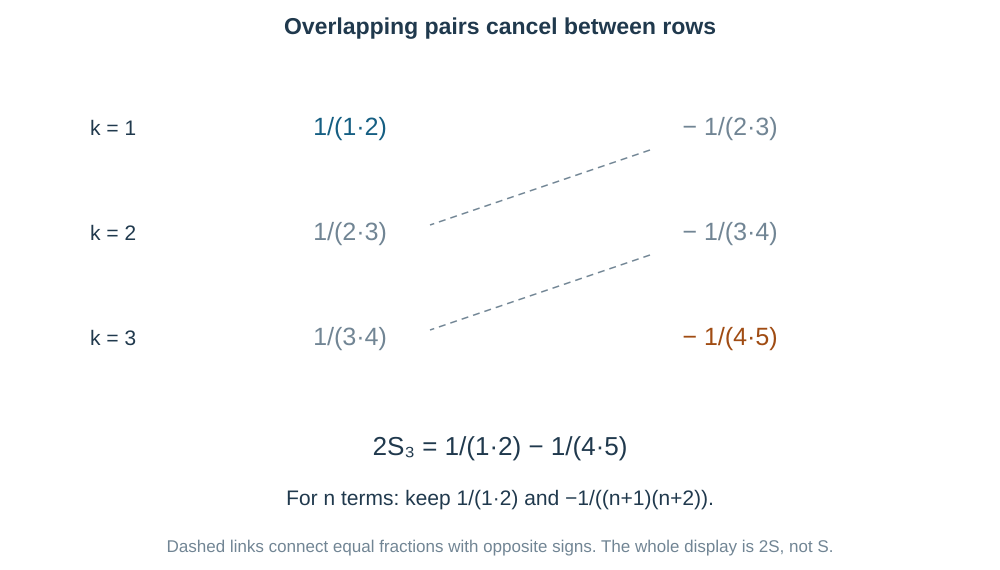

**Read the picture:** each negative pair matches the positive pair immediately below it. For an infinite sum, first keep the last pair for a finite $n$. Only then show that it tends to zero. Infinity is a limit, not a place at which we simply erase a term.

**Square-root denominators — multiply by the conjugate.** Here “conjugate” means changing the plus between two square roots into a minus:

$$
\frac1{\sqrt{k+1}+\sqrt k}
=\frac{\sqrt{k+1}-\sqrt k}{(k+1)-k}
=\boxed{\sqrt{k+1}-\sqrt k}.
$$

The difference-of-squares identity makes the denominator $1$. The next summand contains the opposite of the previous positive square root. This is why rationalization is a useful route in Q25.

**Products can telescope too — useful JEE Main second view.**

$$
\begin{aligned}
&k(k+1)(k+2)(k+3)\\
&\quad -(k-1)k(k+1)(k+2)
=4k(k+1)(k+2).
\end{aligned}
$$

Why $4$? Take out the common product $k(k+1)(k+2)$. The remaining bracket is $(k+3)-(k-1)=4$. Therefore

$$
\boxed{\sum_{k=1}^n k(k+1)(k+2)
=\frac{n(n+1)(n+2)(n+3)}4}.
$$

The same idea gives $\sum_{k=1}^n k(k+1)=n(n+1)(n+2)/3$. You do not have to memorize both extra results if you can create the neighbouring-product difference. Expansion into standard power sums is another valid route.

### Concept C10 — Arithmetic coefficients × geometric powers: shift, then subtract

**Notice the two patterns at once:** $1,4,7,10,\ldots$ has equal gaps; $1,1/5,1/25,1/125,\ldots$ has equal ratios. Their products form an arithmetico-geometric series.

A plain AP formula misses the geometric powers. A plain GP formula fails because the ratio of whole terms is not constant. Multiply the entire sum by the geometric ratio so equal powers line up.

For Q9, $S=1+4r+7r^2+10r^3+\cdots$, where $r=1/5$. Then

$$
\begin{aligned}
S&=1+4r+7r^2+10r^3+\cdots,\\
rS&=\phantom{1+{}}r+4r^2+7r^3+\cdots,\\
(1-r)S&=1+3r+3r^2+3r^3+\cdots.
\end{aligned}
$$

**What changed?** Subtracting neighbouring arithmetic coefficients leaves the constant $3$. The remaining part is a GP.

For $a+(a+d)r+(a+2d)r^2+\cdots$,

$$
\boxed{S_\infty=\frac a{1-r}+\frac{dr}{(1-r)^2}}
\qquad (|r|<1).
$$

For the first $n$ terms and $r\ne1$,

$$
\boxed{S_n=\frac{a(1-r^n)}{1-r}
+\frac{d\{r-nr^n+(n-1)r^{n+1}\}}{(1-r)^2}}.
$$

For $r=1$, use the AP sum $na+dn(n-1)/2$. The finite formula does not require $|r|<1$.

**VIMP weighted-sum results for JEE Main:**

| Sum | Result and condition |
|---|---|
| $\sum_{k=0}^{\infty}r^k$ | $1/(1-r)$, $|r|<1$ |
| $\sum_{k=1}^{\infty}r^k$ | $r/(1-r)$, $|r|<1$ |
| $\sum_{k=1}^{\infty}kr^k$ | $r/(1-r)^2$, $|r|<1$ |
| $\sum_{k=1}^{\infty}k^2r^k$ | $r(1+r)/(1-r)^3$, $|r|<1$ |
| $\sum_{k=1}^{n}kr^k$ | $\{r-(n+1)r^{n+1}+nr^{n+2}\}/(1-r)^2$, $r\ne1$ |

**How to rebuild rather than only remember:** let $L=\sum_{k=1}^{\infty}kr^k$. In $L-rL$, each coefficient after the first is $k-(k-1)=1$, so $(1-r)L=r/(1-r)$.

Next let $Q=\sum_{k=1}^{\infty}k^2r^k$. The new coefficient is

$$
k^2-(k-1)^2=2k-1.
$$

Thus $(1-r)Q=2L-r/(1-r)$, giving the square-weighted formula. One subtraction reduced a square coefficient to a linear coefficient. This is also a useful pattern-recognition skill for other finite-difference problems.

For finite sums, keep the final unmatched power. Dropping that final part is a common reason for a wrong answer in Q24.

### Concept C11 — Three terms: choose a form that builds the condition into it

**Three AP terms:** use $m-d,m,m+d$.

$$
\boxed{\text{sum}=3m},\quad
\boxed{\text{product}=m(m^2-d^2)},\quad
\boxed{\text{sum of squares}=3m^2+2d^2}.
$$

Why this form? The $d$ terms cancel in the sum. If the sum is known, the middle term is known immediately. If the product then gives $d^2$, do not find the sign of $d$ when the target only needs $d^2$.

**Three nonzero GP terms:** use $m/r,m,mr$ with $r\ne0$.

$$
\boxed{\text{product}=m^3},\qquad
\boxed{\text{product of outer terms}=m^2}.
$$

For positive increasing terms, $r>1$ in this ordered form. Reversing the order changes the ratio to $1/r$.

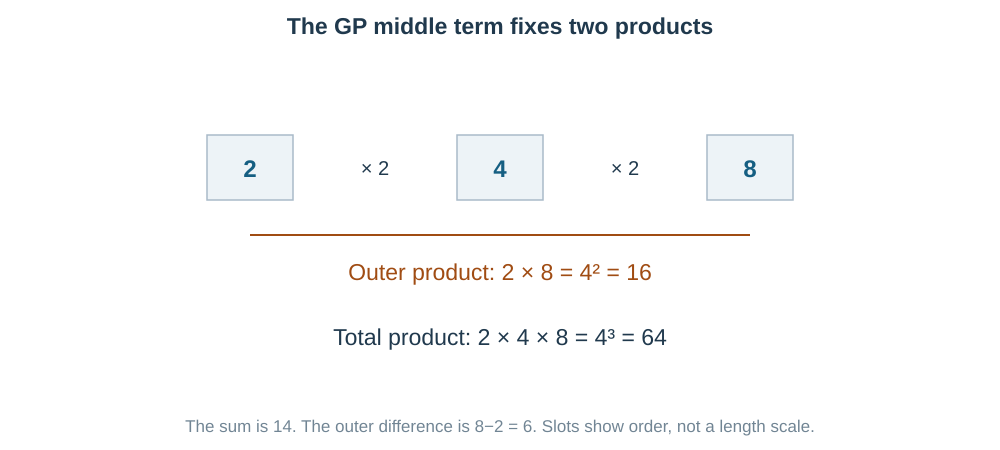

**A very useful connection — notice the middle term.** For three GP terms $x,y,z$, the defining condition is $y^2=xz$. Therefore

$$
\boxed{xy+yz+xz=y(x+y+z)}.
$$

The left side becomes $xy+yz+y^2$, so $y$ can be taken out. Also,

$$
\boxed{xy+yz+xz
=\frac{(x+y+z)^2-(x^2+y^2+z^2)}2}.
$$

**When to use the connection:** if a GP question gives both a sum and a sum of squares (Q22), the second box gives the pair products, and the first box gives the middle term. This avoids a long equation in $r$. The same connection links the coefficients of a cubic in Q35.

### Concept C12 — Inserting means: first count terms, then count gaps

If $m$ arithmetic means are inserted between $A$ and $B$, there are $m+2$ terms and **$m+1$ gaps**.

$$
\boxed{d=\frac{B-A}{m+1}},\qquad
\boxed{\text{sum of inserted AMs}=\frac{m(A+B)}2}.
$$

The inserted terms are $A+d,A+2d,\ldots,A+md$. Pairing the first and last inserted terms gives $A+B$, explaining the sum formula.

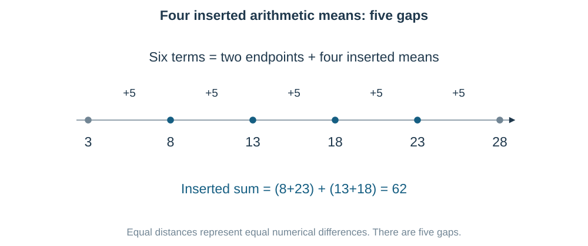

For $m$ **positive** geometric means between positive $A,B$,

$$
\boxed{r=\left(\frac BA\right)^{1/(m+1)}},\qquad
\boxed{\text{product of inserted GMs}=(AB)^{m/2}}.
$$

Why the product formula? The first and last means multiply to $AB$, as do the next inside pair. If there is an unpaired middle mean, it is $\sqrt{AB}$. Equivalently, multiply $Ar,Ar^2,\ldots,Ar^m$ and use $r^{m+1}=B/A$.

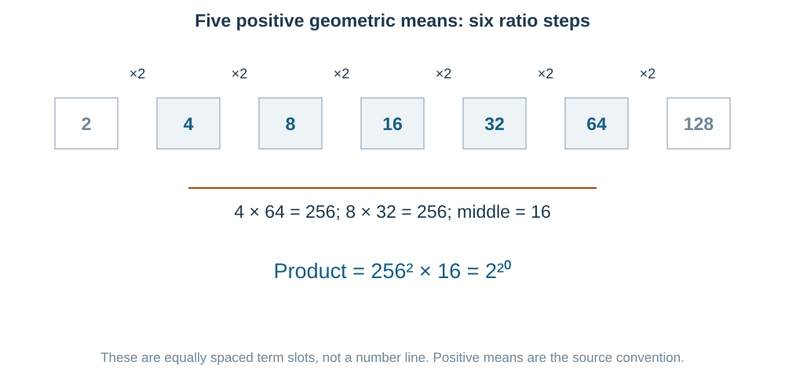

**Q13 convention:** “geometric means” between positive endpoints normally means positive inserted terms. With that convention $r=2$. If arbitrary signed GPs were allowed, $r=-2$ would also join the endpoints in six steps; the inserted product would have the opposite sign. State the convention before choosing the option.

### Concept C13 — From a sum or a recurrence back to the term

**A partial sum contains earlier terms too.** Subtract the earlier partial sum:

$$
\boxed{T_n=S_n-S_{n-1}\quad(n\ge2)},\qquad
\boxed{T_1=S_1}.
$$

We can include $n=1$ if $S_0=0$ is defined as the empty sum. A formula given only for positive $n$ must not automatically be used at $0$ without checking.

If $S_n=An^2+Bn$ for every positive integer $n$, then

$$
T_n=2An+B-A,
$$

an AP with common difference $2A$. If the given sum has an extra nonzero constant $C$, the same subtraction works for $n\ge2$, but $T_1=A+B+C$; the complete sequence need not be an AP.

**A recurrence tells how to move to the next term.** If

$$
a_{n+1}-a_n=f(n),
$$

add the updates from $n=1$ to $N-1$:

$$
\boxed{a_N=a_1+\sum_{n=1}^{N-1}f(n)}.
$$

There are $N-1$ updates from the first term to the $N$th. In Q26, $f(n)=2n$, so $a_{10}=1+2(1+\cdots+9)$.

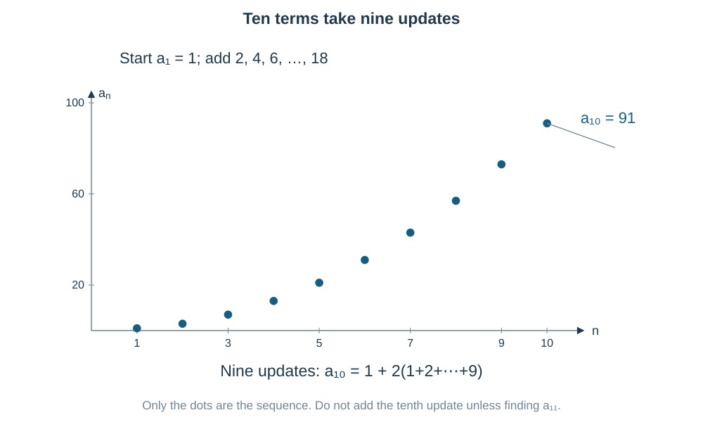

**Useful second reading — make a simpler sequence.** For $a_{n+1}=pa_n+q$, choose a constant $L$ satisfying $L=pL+q$. If $p\ne1$, $L=q/(1-p)$ and

$$
a_{n+1}-L=p(a_n-L),\qquad
\boxed{a_n=L+(a_1-L)p^{n-1}}.
$$

The shifted sequence is a GP. If $p=1$, it is directly an AP; if $p=0$, all terms from $a_2$ onward equal $q$ and there is no need to interpret $0^0$.

Sometimes reciprocals work: $a_{n+1}=a_n/(1+a_n)$ becomes $1/a_{n+1}=1/a_n+1$ when the expressions are defined and nonzero. With $a_1=1$, this gives $a_n=1/n$. **Clue:** if the same term appears in the numerator and a linear denominator, try the reciprocal.

### Concept C14 — Exponents and logarithms connect AP and GP

If $a,b,c$ are in AP, then $b-a=c-b$. For any fixed positive base $t$,

$$
\frac{t^b}{t^a}=t^{b-a}=t^{c-b}=\frac{t^c}{t^b}.
$$

Thus the powers are in GP. The ratios are defined because positive-base powers are nonzero. The base $t=1$ gives a constant GP.

For positive $a,b,c$ in GP, $b/a=c/b>0$. For a fixed logarithm base $t>0,t\ne1$,

$$
\log_t b-\log_t a=\log_t(b/a)
=\log_t(c/b)=\log_t c-\log_t b.
$$

Thus the logarithms are in AP. **Meaning:** equal multiplication steps become equal addition steps after taking logs. Example: $1,2,4$ become $0,\log 2,2\log 2$.

Check positivity before taking real logarithms. A signed GP can contain negative terms whose real logarithms do not exist.

### Concept C15 — Repeated digits: uncover the place values

The number with $k$ copies of a digit $d$, $1\le d\le9$, is

$$
R_k=d(1+10+\cdots+10^{k-1})
=\boxed{\frac{d(10^k-1)}9}.
$$

The repeated-digit numbers themselves are neither an AP nor a GP. Their place values contain a GP.

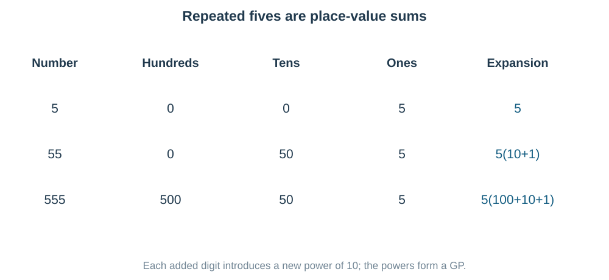

Now sum for $k=1,\ldots,n$:

$$
\boxed{R_1+\cdots+R_n
=\frac d{81}(10^{n+1}-9n-10)}.
$$

Use the $k$th-term expression to rebuild this: sum the $10^k$ terms as a GP, then subtract $1$ exactly $n$ times.

**Option skill:** a formula claimed for every positive $n$ must work at $n=1$. If only one option survives, that can settle an MCQ. If several survive, the test has not proved which one is correct. Derive the general result or test a further valid input.

### Concept C16 — Common AP terms and integer range restrictions

For the integer APs $3+4m$ and $2+7n$, $m,n\ge0$, first find one common term. Here it is $23$. To move from one common term to the next, the change must be a multiple of both $4$ and $7$:

$$
\operatorname{lcm}(4,7)=28,\qquad
\boxed{\text{common terms}=23+28j,\quad j\ge0}.
$$

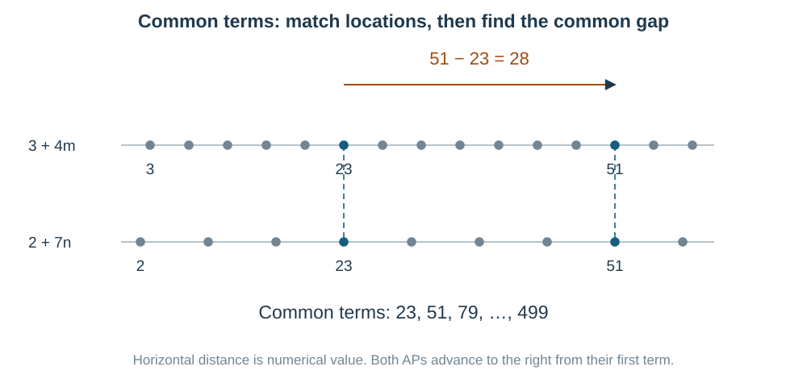

**Read the picture:** the first matching position is needed as well as the spacing. The LCM tells the gap, not the first common value.

For APs with positive integer steps $d_1,d_2$, an integer intersection exists only if $\gcd(d_1,d_2)$ divides the difference of their starting values. Also check that the chosen term is within both forward APs. This simple number-theory tool supports common-term questions.

For multiples of a positive integer $d$ in a closed integer interval $[L,U]$,

$$
k_{\min}=\left\lceil\frac Ld\right\rceil,\qquad
k_{\max}=\left\lfloor\frac Ud\right\rfloor.
$$

The terms are $dk$ for $k_{\min}\le k\le k_{\max}$. If $k_{\min}>k_{\max}$, there are none. Otherwise the count is $k_{\max}-k_{\min}+1$. **Strictly less than** an endpoint may change the final allowed index.

### Concept C17 — A useful AP index identity, with its zero-AP exception

Suppose $pT_p=qT_q$ for distinct positive indices $p,q$:

$$
p\{a+(p-1)d\}=q\{a+(q-1)d\}.
$$

After taking out $p-q$,

$$
(p-q)\{a+(p+q-1)d\}=0.
$$

Since $p\ne q$,

$$
\boxed{T_{p+q}=a+(p+q-1)d=0}.
$$

This says that term is zero. It is the **only** zero term if $d\ne0$. If $d=0$, the equation also forces $a=0$, so every term is zero. Q33 omits a nonconstant-AP condition, so its intended option is not unique for the all-zero AP.

**Pattern caution:** keep the index attached to the correct coefficient. $pT_q=qT_p$ is a different equation; do not use the box for it.

### Concept C18 — Cubic coefficients + GP structure

This is a useful connection to the quadratic chapter. If the roots of

$$
x^3-sx^2+px-q=0
$$

are $u,v,w$, expanding $(x-u)(x-v)(x-w)$ gives

$$
u+v+w=s,\quad uv+vw+wu=p,\quad uvw=q.
$$

If the three nonzero roots are in GP in this order, $uw=v^2$. Hence

$$
\boxed{v^3=q},\qquad
\boxed{p=v(u+v+w)=vs}.
$$

**Why this is efficient:** the three coefficient relations already contain the symmetric quantities needed. Finding the ratio and all three roots adds work.

In Q35 the intended real-parameter setting gives $s=14,q=64$. Since $p=14v$ is real, $v$ is real, so $v^3=64$ means $v=4$ and $p=56$. The roots $2,4,8$ then provide a direct check. Allowing unrestricted complex parameters would require additional branches; the real setting is stated here explicitly.

## Choose the method from the clue

This is a teaching map, not a measured PYQ frequency ranking. The recent archive average at the start tells the observed chapter weightage.

| What you notice | First useful move | Why it fits |
|---|---|---|
| Equal differences; distant indexed terms | Count position gaps | Each gap adds the same $d$ |
| First and last AP terms or an index range | Pair endpoints; count inclusive terms | Every pair has the same sum |
| Equal ratios and a fixed number of terms | Finite GP sum | Convergence is irrelevant for a finite sum |
| An infinite GP | Check $|r|<1$ before the formula | The ending power must tend to zero |
| Sum of squares of GP terms | New first term $a^2$, new ratio $r^2$ | Each whole term is squared |
| HP positions | Reciprocate first | Reciprocals have equal gaps |
| Nearby denominator factors or radicals | Difference of fractions or conjugate | Matching parts can cancel |
| Arithmetic coefficient × geometric power | Multiply by the ratio, subtract | Coefficients become simpler |
| Three AP terms with known sum | $m-d,m,m+d$ | The middle is the average |
| Three GP terms with sum and square-sum | Pair products, then the middle-term identity | Avoids a longer equation in $r$ |
| Fixed positive sum and target product | Match the AM–GM factors to the target powers | The equality case must be attainable |
| Formula for $S_n$ or a recurrence | Difference sums or add updates | Isolates the required term |
| Repeated digits | Expand place values | Powers of $10$ form a GP |
| Two integer APs | First common term, then LCM step | Both the starting value and spacing matter |

## Last-minute formula recap

Use after understanding the notes; this table is a recall aid.

| Need | Formula / condition |
|---|---|
| AP term | $T_n=a+(n-1)d$ |
| AP position gap | $T_q-T_p=(q-p)d$ |
| AP middle | $2b=a+c$ |
| AP sum | $S_n=n\{2a+(n-1)d\}/2=n(a+l)/2$ |
| AP range | $\sum_{k=p}^q T_k=(q-p+1)(T_p+T_q)/2=S_q-S_{p-1}$ |
| GP term | $T_n=ar^{n-1}$; handle $r=0,n=1$ directly |
| GP middle | $b^2=ac$ |
| Finite GP | $a(1-r^n)/(1-r)$, $r\ne1$; $na$ for $r=1$ |
| Infinite GP | $a/(1-r)$, $|r|<1$; all-zero series separately |
| Infinite GP tail from $m$ | $ar^{m-1}/(1-r)$, $|r|<1$ |
| GP squares, infinite | $a^2/(1-r^2)$, $|r|<1$ |
| GP first-$n$ product | $a^n r^{n(n-1)/2}$ when powers defined; direct handling for zeros |
| HP term | $1/\{a+(n-1)d\}$ with nonzero denominator |
| Three HP terms | $b=2ac/(a+c)$ when reciprocals exist |
| Two-number means | $A=(u+v)/2,\ G=\sqrt{uv},\ H=2uv/(u+v)$, $u,v>0$ |
| Mean relation | $AH=G^2$, $A\ge G\ge H$; equality iff $u=v$ |
| $n$-number AM–GM | $\sum x_i/n\ge(\prod x_i)^{1/n}$, $x_i>0$; equality all equal |
| Cauchy–Schwarz — JEE Main VIMP | $(p^2/x+q^2/y)(x+y)\ge(p+q)^2$ for positive values; equality $x:y=p:q$ |
| Natural sum | $\sum k=n(n+1)/2$ |
| Square sum | $\sum k^2=n(n+1)(2n+1)/6$ |
| Cube sum | $\sum k^3=\{n(n+1)/2\}^2$ |
| First $n$ odd terms | $\sum(2k-1)=n^2$ |
| Odd squares | $\sum(2k-1)^2=n(2n-1)(2n+1)/3$ |
| Neighbour fractions | $1/[u(u+h)]=(1/u-1/(u+h))/h$, $h\ne0$ |
| Triple denominators | $\sum_{k=1}^n1/[k(k+1)(k+2)]=1/4-1/[2(n+1)(n+2)]$ |
| Neighbour radicals | $1/(\sqrt{k+1}+\sqrt k)=\sqrt{k+1}-\sqrt k$, $k\ge0$ |
| Triple products | $\sum_{k=1}^n k(k+1)(k+2)=n(n+1)(n+2)(n+3)/4$ |
| Weighted GP, infinite | $\sum kr^k=r/(1-r)^2$, $|r|<1$ |
| Square-weighted GP, infinite | $\sum k^2r^k=r(1+r)/(1-r)^3$, $|r|<1$ |
| Weighted GP, finite | $\sum_{k=1}^n kr^k=\{r-(n+1)r^{n+1}+nr^{n+2}\}/(1-r)^2$, $r\ne1$ |
| Arithmetico-geometric, infinite | $a/(1-r)+dr/(1-r)^2$, $|r|<1$ |
| Three AP terms | $m-d,m,m+d$; squared sum $3m^2+2d^2$ |
| Three nonzero GP terms | $m/r,m,mr$; product $m^3$ |
| GP pair products | $xy+yz+xz=y(x+y+z)$ if $y^2=xz$ |
| Pair products from sums | $\{(\sum x)^2-\sum x^2\}/2$ for three terms |
| Insert $m$ AMs | $m+1$ gaps; $d=(B-A)/(m+1)$; inserted sum $m(A+B)/2$ |
| Insert $m$ positive GMs | $r=(B/A)^{1/(m+1)}$; inserted product $(AB)^{m/2}$ |
| Recover term | $T_n=S_n-S_{n-1}$; $T_1=S_1$, $S_0=0$ |
| Add recurrence increments | $a_N=a_1+\sum_{n=1}^{N-1}(a_{n+1}-a_n)$ |
| Repeated digit $d$ | $R_k=d(10^k-1)/9$; $\sum_{k=1}^nR_k=d(10^{n+1}-9n-10)/81$ |
| Common integer AP terms | Find first match; step $\operatorname{lcm}(d_1,d_2)$ |
| AP identity | $pT_p=qT_q,\ p\ne q\Rightarrow T_{p+q}=0$; uniqueness needs $d\ne0$ |
| GP cubic roots | Middle $v$: $v^3=q,\ p=vs$ for $x^3-sx^2+px-q$ |

## Worked solutions to the 35 PDF questions

Try first. Then read the noticed pattern, why the route fits, the calculation, and the check. Useful second approaches are printed in full.

### Question 1 — Pair the first and last terms

**PDF page 18 | MCQ | Notes: C02–C03**

The sum of the first $20$ terms of the arithmetic progression $3,7,11,15,\ldots$ is

- (a) $780$
- (b) $800$
- (c) $820$
- (d) $840$

**Notice the equal gaps:** each term increases by $4$, so this is an AP. Pairing the smallest and largest terms avoids adding twenty numbers.

$$
T_{20}=3+19(4)=79,\qquad
S_{20}=\frac{20}2(3+79)=\boxed{820}\quad\text{(c)}.
$$

**Read the picture:** the two rows contain the same terms in opposite orders. Each column has the same total. The two rows together count the required sum twice. For this question there are $20$ columns, each totaling $82$, so $2S=20(82)$.

**Check:** the average of the first and last terms is $41$. Twenty terms with average $41$ give $820$.

### Question 2 — Count the gaps between term positions

**PDF page 18 | MCQ | Notes: C02**

In an A.P., the $5$th term is $17$ and the $9$th term is $33$. Its $15$th term is

- (a) $57$
- (b) $53$
- (c) $61$
- (d) $49$

**Count gaps, not the number of written indices.** From the fifth position to the ninth there are $9-5=4$ gaps. Their total increase is $33-17=16$:

$$
d=\frac{16}{4}=4.
$$

From position $9$ to position $15$ there are six more gaps:

$$
T_{15}=33+(15-9)4=\boxed{57}\quad\text{(a)}.
$$

**Why this route?** Finding the first term is possible but unnecessary. The known ninth term is already a useful starting point.

**Another possible approach:** $a+4d=17$ gives $a=1$; then $a+14d=57$. This independently checks the jump method.

### Question 3 — A finite GP does not need a convergence condition

**PDF page 18 | MCQ | Notes: C04**

The sum of the first $8$ terms of the series $2+6+18+54+\cdots$ is

- (a) $6561$
- (b) $13120$
- (c) $3280$
- (d) $6560$

**This is a finite sum:** the ratio $6/2=18/6=3$ is greater than $1$, which is allowed. The $|r|<1$ condition belongs to a nonzero infinite GP.

$$
S_8=2\frac{3^8-1}{3-1}=3^8-1
=6561-1=\boxed{6560}\quad\text{(d)}.
$$

**Check the exponent:** the last term is $2\cdot3^7$, but the sum formula has $3^8$. A shift of the eight-term sum creates that next power. Using the infinite formula would produce a negative value for a sum of positive terms, an immediate warning.

### Question 4 — Squaring every term creates a different GP

**PDF page 18 | MCQ | Notes: C04–C05**

The sum of an infinite G.P. is $8$ and its second term is $2$ (the common ratio is positive). The sum of the squares of all its terms is

- (a) $16$
- (b) $\dfrac{64}{3}$
- (c) $32$
- (d) $\dfrac{32}{3}$

**First use the two given facts together.** If the first term is $a$ and the ratio is $r$, then

$$
\frac a{1-r}=8,\qquad ar=2,\qquad 0<r<1.
$$

So $a=8(1-r)$ and $8r(1-r)=2$. This is

$$
4r^2-4r+1=(2r-1)^2=0.
$$

Thus $r=1/2$ and $a=4$.

**Now read the target carefully.** We need $4^2+2^2+1^2+\cdots$, not $(4+2+1+\cdots)^2$. Squared terms form a GP with first term $16$ and ratio $(1/2)^2=1/4$:

$$
\sum T_n^2=\frac{16}{1-1/4}
=\boxed{\frac{64}{3}}\quad\text{(b)}.
$$

**Check:** the sum must exceed its first term $16$ and is about $21.33$. Squaring the total $8$ would add unwanted pair products.

### Question 5 — A term and an inverse term have constant product

**PDF page 18 | Numerical value | Notes: C07**

The minimum value of $4x+\dfrac9x$ for $x>0$ is ____.

**Did you notice a term in $x$ and a term in $1/x$?** Their product is constant:

$$
(4x)(9/x)=36.
$$

Both are positive because $x>0$. AM–GM gives

$$
4x+\frac9x\ge2\sqrt{36}=12.
$$

A bound is a minimum only if equality is possible. Here $4x=9/x$ gives $x=3/2$, which is allowed. Therefore $\boxed{12}$.

**Another possible approach — make a square:**

$$
4x+\frac9x-12
=\left(2\sqrt x-\frac3{\sqrt x}\right)^2\ge0.
$$

This also explains the same equality condition. Differentiation would work, but the constant-product pattern gives the result with less calculation.

### Question 6 — An HP becomes an AP after reciprocating

**PDF page 18 | MCQ | Notes: C06**

The $3$rd and $6$th terms of a harmonic progression are $\dfrac15$ and $\dfrac1{11}$ respectively. Its $9$th term is

- (a) $\dfrac1{15}$
- (b) $\dfrac1{19}$
- (c) $\dfrac1{17}$
- (d) $\dfrac1{13}$

**An HP becomes simple after taking reciprocals.** The reciprocal sequence is an AP whose third term is $5$ and sixth term is $11$.

$$
d=\frac{11-5}{6-3}=2.
$$

The ninth reciprocal is three more gaps after the sixth:

$$
11+3(2)=17.
$$

Now return to the original HP:

$$
\boxed{T_9=\frac1{17}}\quad\text{(c)}.
$$

**Check:** the reciprocal first term is $5-2(2)=1$, so its ninth term is $1+8(2)=17$. Taking equal differences directly between $1/5$ and $1/11$ would apply an AP rule to the wrong sequence.

### Question 7 — Expand when it exposes known power sums

**PDF page 18 | Numerical value | Notes: C08**

The value of $\displaystyle\sum_{k=1}^{10}k(k+2)$ is ____.

**Expansion helps here:** it turns a product into sums we already know.

$$
k(k+2)=k^2+2k.
$$

Therefore

$$
\begin{aligned}
\sum_{k=1}^{10}k(k+2)
&=\frac{10(11)(21)}6
+2\frac{10(11)}2\\
&=385+110=\boxed{495}.
\end{aligned}
$$

**Why not AP or GP?** The terms $3,8,15,\ldots$ have neither equal gaps nor equal ratios. Their polynomial form is the useful clue.

**Check by another expression:** $k(k+2)=(k+1)^2-1$, so the answer is $(\sum_{j=1}^{11}j^2)-1-10=506-11=495$.

### Question 8 — A difference of neighbouring fractions cancels

**PDF page 18 | MCQ | Notes: C09**

The value of $\displaystyle\sum_{k=1}^{\infty}\frac1{k(k+1)(k+2)}$ is

- (a) $\dfrac14$
- (b) $\dfrac12$
- (c) $\dfrac13$
- (d) $\dfrac16$

**Look at the three neighbouring factors.** Try splitting into fractions with overlapping pairs, so one pair can cancel the next:

$$
\frac1{k(k+1)(k+2)}
=\frac12\left[\frac1{k(k+1)}-\frac1{(k+1)(k+2)}\right].
$$

The $1/2$ is needed because the difference has numerator $2$.

For the first $n$ terms,

$$
S_n=\frac12\left[\frac1{1\cdot2}
-\frac1{(n+1)(n+2)}\right].
$$

The final fraction tends to zero, so

$$
S_\infty=\boxed{\frac14}\quad\text{(a)}.
$$

**Check:** the first term is $1/6$. The positive remaining terms increase this to $1/4$; no finite partial sum reaches $1/4$.

**Another possible decomposition:** the summand is $\tfrac12[1/k-2/(k+1)+1/(k+2)]$. It also cancels, but the paired form displays the matching parts more clearly.

### Question 9 — Arithmetic coefficients with geometric denominators

**PDF page 19 | MCQ | Notes: C10**

The sum to infinity of the series $1+\dfrac45+\dfrac7{5^2}+\dfrac{10}{5^3}+\cdots$ is

- (a) $\dfrac{25}{16}$
- (b) $\dfrac{35}{16}$
- (c) $\dfrac{45}{16}$
- (d) $\dfrac{15}{8}$

**Two different patterns are mixed:** numerator gaps are $3$; denominator powers multiply by $5$. A plain GP formula does not fit the whole terms. Shift by $1/5$ to line up the denominators.

$$
\begin{aligned}
S&=1+\frac45+\frac7{25}+\frac{10}{125}+\cdots,\\
\frac S5&=\frac15+\frac4{25}+\frac7{125}+\cdots.
\end{aligned}
$$

Subtract:

$$
\frac45S=1+\frac35+\frac3{25}+\cdots
=1+\frac{3/5}{1-1/5}
=\frac74.
$$

Thus $\boxed{S=35/16}$, **option (b)**. The infinite operations are valid because $|r|=1/5<1$ and the arithmetic coefficients times $r^n$ form a convergent series.

**Another possible approach:** apply C10 with $a=1,d=3,r=1/5$: $S=1/(1-r)+3r/(1-r)^2=5/4+15/16=35/16$. The shift explains where that formula comes from.

### Question 10 — Three AP terms: put the average in the middle

**PDF page 19 | MCQ | Notes: C11**

Three numbers in A.P. have sum $24$ and product $440$. The sum of their squares is

- (a) $200$
- (b) $218$
- (c) $190$
- (d) $210$

**The sum gives the middle term immediately.** Write the AP as $8-d,8,8+d$, since $24/3=8$.

$$
8(8-d)(8+d)=440
\quad\Longrightarrow\quad64-d^2=55
\quad\Longrightarrow\quad d^2=9.
$$

**Notice the target:** both outer squares are added. Their linear $d$ parts cancel:

$$
(8-d)^2+8^2+(8+d)^2
=3(64)+2d^2
=192+18=\boxed{210}\quad\text{(d)}.
$$

**Why not solve for all terms first?** Either sign of $d$ only reverses the same three terms. The target depends on $d^2$, already known.

**Check:** $5,8,11$ have product $440$ and squared sum $25+64+121=210$.

### Question 11 — The middle of three GP terms is fixed by the product

**PDF page 19 | MCQ | Notes: C11**

Three positive numbers in an increasing G.P. have sum $14$ and product $64$. The difference between the largest and the smallest number is

- (a) $4$
- (b) $6$
- (c) $5$
- (d) $8$

**In a GP, the outer product equals the middle square.** Call the middle term $m>0$. Then the product of all three terms is $m^3=64$, so $m=4$.

If the outer terms are $u,w$, then

$$
u+w=14-4=10,\qquad uw=4^2=16.
$$

We need the positive difference, not the two separate terms:

$$
(w-u)^2=(w+u)^2-4uw=100-64=36.
$$

Thus $\boxed{w-u=6}$, **option (b)**.

**Another possible approach:** $u,w$ solve $t^2-10t+16=0=(t-2)(t-8)$. The GP is $2,4,8$, with difference $8-2=6$. The square identity saves the root-finding step.

### Question 12 — Four inserted means make five equal gaps

**PDF page 19 | MCQ | Notes: C12**

If four arithmetic means are inserted between $3$ and $28$, then the sum of these four means is

- (a) $56$
- (b) $65$
- (c) $62$
- (d) $60$

**Four new terms do not mean four gaps.** With both endpoints, the AP has six terms and five gaps.

$$
d=\frac{28-3}{5}=5.
$$

The inserted terms are $8,13,18,23$, whose sum is $\boxed{62}$, **option (c)**.

**A shorter second approach:** symmetric inserted pairs have the same sum as the endpoints, $3+28=31$. There are two pairs, so the sum is $2(31)=62$. This also gives $m(A+B)/2$ with $m=4$.

### Question 13 — Positive geometric means and paired products

**PDF page 19 | MCQ | Notes: C12**

If five geometric means are inserted between $2$ and $128$, then their product is

- (a) $2^{16}$
- (b) $2^{25}$
- (c) $2^{18}$
- (d) $2^{20}$

**Convention before calculating:** use positive geometric means, as intended by this MCQ.

Five inserted means create seven terms and six ratio steps:

$$
2r^6=128\quad\Longrightarrow\quad r^6=64.
$$

With $r>0$, $r=2$. The means are $4,8,16,32,64$.

$$
4\cdot8\cdot16\cdot32\cdot64
=2^{2+3+4+5+6}
=\boxed{2^{20}}\quad\text{intended (d)}.
$$

**Another possible approach:** the product is $(AB)^{m/2}=(2\cdot128)^{5/2}=(2^8)^{5/2}=2^{20}$.

**Source qualification:** if signed inserted terms were permitted, $r=-2$ also joins the endpoints. The five inserted terms then have product $-2^{20}$, which is absent from the options. This is why the positive-means convention matters.

### Question 14 — A partial sum is not one term

**PDF page 19 | MCQ | Notes: C01, C13**

If the sum of the first $n$ terms of a sequence is $S_n=3n^2+2n$, then the sum of its $5$th and $10$th terms is

- (a) $88$
- (b) $86$
- (c) $90$
- (d) $92$

**Do not put $5$ and $10$ directly into the sum formula and add.** That would give $S_5+S_{10}$ and count many earlier terms. We need only $T_5+T_{10}$.

$$
\begin{aligned}
T_n&=S_n-S_{n-1}\\
&=3\{n^2-(n-1)^2\}+2\{n-(n-1)\}\\
&=3(2n-1)+2=6n-1.
\end{aligned}
$$

This also gives $T_1=5=S_1$. Hence

$$
T_5+T_{10}=29+59=\boxed{88}\quad\text{(a)}.
$$

**Another possible check:** $(S_5-S_4)+(S_{10}-S_9)=(85-56)+(320-261)=88$. The term formula is useful when several positions are requested.

### Question 15 — Use the relation between the three means

**PDF page 19 | MCQ | Notes: C07**

The arithmetic mean and geometric mean of two positive numbers are $10$ and $8$ respectively. Their harmonic mean is

- (a) $6.4$
- (b) $6$
- (c) $7.2$
- (d) $8$

**The three means are connected.** For the same two positive numbers,

$$
AH=G^2.
$$

Here $A=10,G=8$, so

$$
H=\frac{8^2}{10}=\boxed{6.4}\quad\text{(a)}.
$$

**Why this route?** The target is another mean of the same pair, so the identity already contains it. Finding both original numbers adds a quadratic equation.

**Check / another approach:** the numbers satisfy sum $20$ and product $64$, so they are $4,16$. Their HM is $2(4)(16)/(4+16)=128/20=6.4$, and $10>8>6.4$.

### Question 16 — Equal gaps become equal ratios after exponentiation

**PDF page 19 | MCQ | Notes: C14**

Statement I: If $a,b,c$ are in A.P., then $2^a,2^b,2^c$ are in G.P.

Statement II: If $a,b,c$ are positive numbers in G.P., then $\log a,\log b,\log c$ are in A.P.

- (a) Both Statement I and Statement II are true
- (b) Statement I is true but Statement II is false
- (c) Statement I is false but Statement II is true
- (d) Both Statement I and Statement II are false

**Statement I:** equal AP gaps become equal exponent ratios:

$$
\frac{2^b}{2^a}=2^{b-a}=2^{c-b}=\frac{2^c}{2^b}.
$$

Thus the powers form a GP.

**Statement II:** positivity allows real logarithms. Equal GP ratios become equal log differences:

$$
\log b-\log a=\log(b/a)
=\log(c/b)=\log c-\log b.
$$

Thus the logarithms form an AP. Both statements are true: $\boxed{\text{(a)}}$.

**Visual thought:** $0,1,2$ are equally spaced; their powers are $1,2,4$, which double each time. Taking logs of $1,2,4$ brings back equal spacing. One operation changes “add the same amount” into “multiply by the same amount.”

### Question 17 — Recognize the four standard sums

**PDF page 20 | MCQ | Notes: C08**

Match List-I with List-II.

| List-I | Sum |
|---|---|
| A | $1+2+3+\cdots+n$ |
| B | $1^2+2^2+\cdots+n^2$ |
| C | $1^3+2^3+\cdots+n^3$ |
| D | Sum of first $n$ odd natural numbers |

List-II: I. $n^2$; II. $\dfrac{n(n+1)}2$; III. $\dfrac{n(n+1)(2n+1)}6$; IV. $\left[\dfrac{n(n+1)}2\right]^2$.

- (a) A-II, B-III, C-IV, D-I
- (b) A-II, B-IV, C-III, D-I
- (c) A-I, B-III, C-IV, D-II
- (d) A-III, B-II, C-I, D-IV

**Read what is being squared.** The sum of squares is different from the square of the sum. Match each whole pattern:

$$
\begin{aligned}
\mathrm A &: \sum k=\frac{n(n+1)}2 &&\longrightarrow\mathrm{II},\\
\mathrm B &: \sum k^2=\frac{n(n+1)(2n+1)}6 &&\longrightarrow\mathrm{III},\\
\mathrm C &: \sum k^3=\left[\frac{n(n+1)}2\right]^2 &&\longrightarrow\mathrm{IV},\\
\mathrm D &: 1+3+\cdots+(2n-1)=n^2 &&\longrightarrow\mathrm I.
\end{aligned}
$$

Therefore $\boxed{\text{A–II, B–III, C–IV, D–I}}$, **option (a)**.

**Read the square:** the new border added to a side-$(n-1)$ square has $2n-1$ cells. The first $n$ odd numbers therefore build $n^2$ cells. At $n=2$, square-sum is $5$, while cube-sum is $9$; this small test can catch an accidental swap.

### Question 18 — The conditions are part of the formula

**PDF page 20 | MCQ | Notes: C05–C07**

Consider the following statements for positive real numbers.

(i) If $a,b,c$ are in H.P., then $b=\dfrac{2ac}{a+c}$.

(ii) For distinct positive numbers, $A.M.>G.M.>H.M.$

(iii) The sum to infinity of a G.P. with common ratio $|r|\ge1$ is always finite.

(iv) $A.M.\cdot H.M.=(G.M.)^2$ for two positive numbers.

The correct statements are

- (a) (i), (ii), (iv) only
- (b) (i), (ii), (iii) only
- (c) (ii), (iii), (iv) only
- (d) (i), (iii), (iv) only

**Check each condition, then each statement.**

(i) True. HP means $1/a,1/b,1/c$ are in AP:

$$
\frac2b=\frac1a+\frac1c
\quad\Longrightarrow\quad b=\frac{2ac}{a+c}.
$$

(ii) True. For two distinct positive numbers, equality cannot hold in $A\ge G\ge H$, so both inequalities are strict.

(iii) False. A counterexample is $1+1+1+\cdots$ with $r=1$: its $n$th partial sum is $n$, not finite in the limit. For a nonzero GP, a finite ordinary infinite sum requires $|r|<1$.

(iv) True:

$$
\frac{u+v}{2}\frac{2uv}{u+v}=uv=G^2.
$$

So $\boxed{\text{(i), (ii), (iv) only}}$, **option (a)**.

**Exam skill:** one valid counterexample disproves “always.” A special all-zero GP with $|r|\ge1$ does not make the statement true for every GP.

### Question 19 — Count the odd terms before squaring them

**PDF page 20 | MCQ | Notes: C08**

The sum of the squares of the first $10$ odd natural numbers $1^2+3^2+5^2+\cdots+19^2$ is

- (a) $1100$
- (b) $1330$
- (c) $1210$
- (d) $1540$

**Index the odd numbers first:** the $k$th odd number is $2k-1$. Ten terms therefore end at $19$, not $21$.

$$
\begin{aligned}
\sum_{k=1}^{10}(2k-1)^2
&=4\sum k^2-4\sum k+\sum1\\
&=4(385)-4(55)+10\\
&=\boxed{1330}\quad\text{(b)}.
\end{aligned}
$$

**Another possible approach — remove the even squares.** All squares through $20^2$ contain both odd and even squares. The even part is $4\sum_{k=1}^{10}k^2$:

$$
\frac{20(21)(41)}6-4(385)=2870-1540=1330.
$$

The first route uses expansion; the second separates the set into odd and even indices. The compact odd-square formula in C08 gives the same result.

### Question 20 — Repeated digits contain a geometric sum

**PDF page 20 | MCQ | Notes: C15**

The sum of the first $n$ terms of the series $5+55+555+\cdots$ is

- (a) $\dfrac5{81}(10^n-9n-1)$
- (b) $\dfrac59(10^{n+1}-9n-10)$
- (c) $\dfrac5{81}(10^{n+1}-9n-10)$
- (d) $\dfrac5{81}(10^{n+1}-9n-1)$

**The written numbers do not have equal gaps or equal ratios.** Look inside their place values instead:

$$
R_k=5(1+10+\cdots+10^{k-1})=\frac59(10^k-1).
$$

Now sum the expression for $k=1,\ldots,n$:

$$
\begin{aligned}
S_n&=\frac59\left(\sum_{k=1}^n10^k-n\right)\\
&=\frac59\left[\frac{10(10^n-1)}9-n\right]\\
&=\boxed{\frac5{81}(10^{n+1}-9n-10)}
\quad\text{(c)}.
\end{aligned}
$$

**Another possible exam route — test the first case.** At $n=1$, the actual sum is $5$. Options (a), (b), (c), (d) give $0,45,5,50/9$ respectively, so only (c) survives. This is decisive for these options. The derivation teaches how to rebuild the formula when options do not separate so easily.

### Question 21 — Two APs meet in another AP

**PDF page 20 | Numerical value | Notes: C16**

The number of common terms less than $500$ in the two A.P.s $3,7,11,15,\ldots$ and $2,9,16,23,\ldots$ is ____.

**Find both the first match and the gap between matches.** Terms in the first AP leave remainder $3$ upon division by $4$. Test early terms $2,9,16,23$ of the second AP: the first match is $23$.

The gap between consecutive common terms is $\operatorname{lcm}(4,7)=28$. Therefore

$$
23+28j<500,\qquad j=0,1,2,\ldots.
$$

Since $28j<477$, the last allowed integer is $j=17$.

$$
\boxed{\text{count}=17-0+1=18}.
$$

**Check:** the final included value is $23+28(17)=499$; the next is $527$, too large.

**Another possible approach:** solve $3+4m=2+7n$, giving $4m-7n=-1$. Its first nonnegative solution is $m=5,n=3$; increasing $m$ by $7$ and $n$ by $4$ adds $28$. This explains the LCM spacing algebraically.

### Question 22 — A sum and a sum of squares reveal the middle GP term

**PDF page 20 | Numerical value | Notes: C11**

The first three terms of a G.P. have sum $13$ and the sum of their squares is $91$. If the common ratio satisfies $|r|<1$, then the sum to infinity of the G.P. is ____ (rounded to $2$ decimal places).

**Notice the square-of-a-sum pattern!** A sum and a sum of squares give the missing pair products:

$$
xy+yz+xz=\frac{13^2-91}{2}=39.
$$

For three GP terms, $y^2=xz$. Therefore

$$
xy+yz+xz=y(x+y+z)=13y.
$$

So $y=3$. This short connection avoids solving a larger equation in the ratio.

The outer terms satisfy

$$
x+z=10,\qquad xz=9.
$$

They are $1$ and $9$, from $t^2-10t+9=(t-1)(t-9)$. The condition $|r|<1$ selects the decreasing order $9,3,1$, with $r=1/3$.

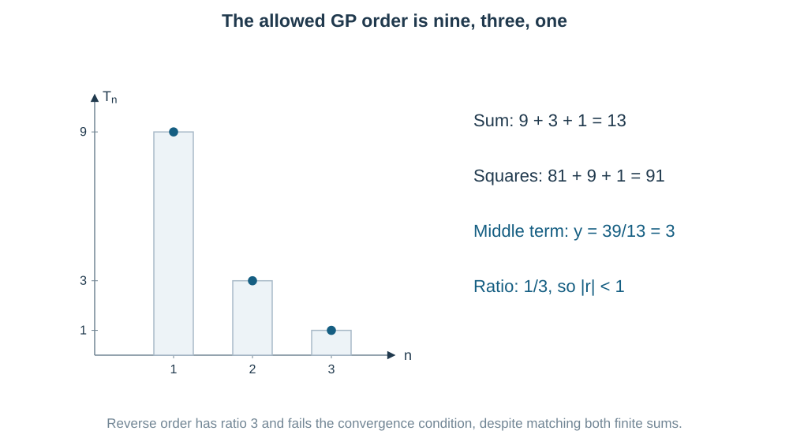

$$
S_\infty=\frac9{1-1/3}
=\frac{27}{2}=\boxed{13.50}.
$$

**Check:** $9+3+1=13$, $81+9+1=91$. The reverse order $1,3,9$ meets these two equations but has ratio $3$, so it must be rejected.

**Another possible setup:** use $a,ar,ar^2$ in both given sums and eliminate $a$. It works but creates more algebra. The sum/square-sum identity reveals the middle term directly.

### Question 23 — Use the AP shape first, then the GP condition

**PDF page 20 | Numerical value | Notes: C11**

Three positive numbers $a,b,c$ are in A.P. with $a+b+c=15$. If $a+1,b+4,c+19$ are in G.P., then $abc=$ ____.

**Build the AP condition into the variables.** Its average is $15/3=5$, so

$$
a=5-d,\quad b=5,\quad c=5+d.
$$

Positivity gives $-5<d<5$. The shifted numbers are $6-d,9,24+d$. Their GP condition is

$$
9^2=(6-d)(24+d).
$$

Hence

$$
81=144-18d-d^2
\quad\Longrightarrow\quad(d-3)(d+21)=0.
$$

$d=-21$ violates positivity; only $d=3$ remains. Thus

$$
abc=(2)(5)(8)=\boxed{80}.
$$

**Check in both original conditions:** $2,5,8$ is a positive AP with sum $15$; after shifting it becomes $3,9,27$, a GP with ratio $3$.

Using unrelated $a,b,c$ would leave three unknowns. The centered AP form reduces the problem to one unknown before we use the second condition.

### Question 24 — Shift a weighted geometric sum

**PDF page 20 | MCQ | Notes: C10**

The value of $1\cdot2+2\cdot2^2+3\cdot2^3+\cdots+6\cdot2^6$ is

- (a) $640$
- (b) $514$
- (c) $770$
- (d) $642$

**The coefficients $1,2,3,\ldots$ spoil a plain GP.** Multiplying by $2$ lines up powers; subtracting then makes their differences equal to $1$.

$$
\begin{aligned}
S&=1\cdot2+2\cdot2^2+\cdots+6\cdot2^6,\\
2S&=\phantom{1\cdot2+{}}1\cdot2^2+\cdots+5\cdot2^6+6\cdot2^7.
\end{aligned}
$$

Subtract the first line from the second:

$$
S=6\cdot2^7-(2+2^2+\cdots+2^6)
=768-(128-2)=\boxed{642}\quad\text{(d)}.
$$

**Keep the boundary term:** $6\cdot2^7$ has no partner. This is a finite sum; it cannot be discarded as an infinite tail.

**Another possible approach / check:** there are only six terms, so direct addition is reasonable: $2+8+24+64+160+384=642$. The shift method scales better when the final index is large.

### Question 25 — A conjugate creates consecutive square-root differences

**PDF page 21 | Numerical value | Notes: C09**

The value of $\displaystyle\sum_{k=1}^{48}\frac1{\sqrt k+\sqrt{k+1}}$ is ____.

**The two square roots differ by one inside the roots.** Multiplying by their difference makes a difference of squares:

$$
\frac1{\sqrt k+\sqrt{k+1}}
=\frac{\sqrt{k+1}-\sqrt k}{(k+1)-k}
=\sqrt{k+1}-\sqrt k.
$$

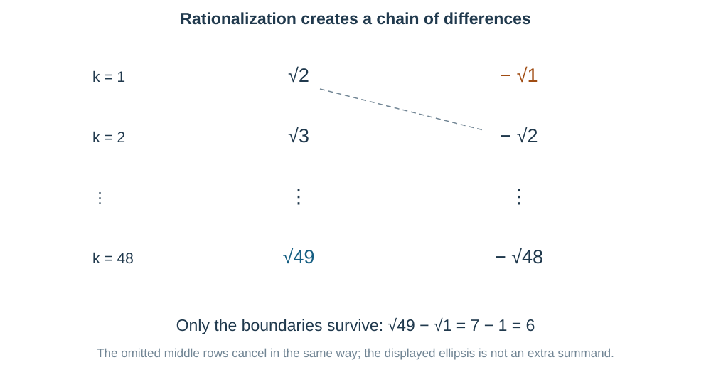

So

$$
S=(\sqrt2-\sqrt1)+(\sqrt3-\sqrt2)
+\cdots+(\sqrt{49}-\sqrt{48})
=7-1=\boxed6.
$$

**Why this route?** Decimal approximations destroy the visible exact cancellation and require forty-eight additions. Rationalization changes every term into the difference of neighbouring parts.

**Check the last index:** the summation ends at $k=48$, but the positive part is $\sqrt{k+1}$, so the surviving root is $\sqrt{49}$.

### Question 26 — Ten terms require nine updates

**PDF page 21 | MCQ | Notes: C13**

A sequence is defined by $a_1=1$ and $a_{n+1}=a_n+2n$ for $n\ge1$. Then $a_{10}$ equals

- (a) $90$
- (b) $100$
- (c) $91$
- (d) $111$

**The recurrence gives the increase, not the term itself.**

$$
a_2-a_1=2(1),\quad a_3-a_2=2(2),\ \ldots,\
a_{10}-a_9=2(9).
$$

Add all nine equations. The middle $a$ terms cancel:

$$
a_{10}-1=2(1+2+\cdots+9)=2\frac{9(10)}2=90.
$$

Thus $\boxed{a_{10}=91}$, **option (c)**.

**Another possible approach:** the same argument gives $a_n=1+n(n-1)=n^2-n+1$. It gives $a_1=1$ and $a_{n+1}-a_n=2n$, so both parts of the definition are checked. Summing through $n=10$ would instead find $a_{11}=111$.

### Question 27 — Choose the factors to match the target powers

**PDF page 21 | MCQ | Notes: C07**

If $x,y>0$ and $2x+y=12$, then the maximum value of $x^2y$ is

- (a) $32$
- (b) $64$
- (c) $48$
- (d) $54$

**Choose the factors before applying AM–GM.** The target is $x^2y$, so use three positive factors $x,x,y$. Their sum is exactly the given $2x+y=12$:

$$
\frac{x+x+y}{3}\ge(x\cdot x\cdot y)^{1/3}.
$$

Hence $x^2y\le(12/3)^3=64$.

Equality requires all three factors equal: $x=y$. The constraint then gives $3x=12$, so $x=y=4$, which is allowed.

$$
\boxed{\max x^2y=64}\quad\text{(b)}.
$$

**Why two-factor AM–GM is not the best fit:** using $2x,y$ bounds their product $2xy$. That is a different target and leaves an extra changing $x$. Choosing $x,x,y$ matches both the sum and the required powers.

**Another possible approach — reduce to one variable:** $y=12-2x$, with $0<x<6$. Instead of differentiating, factor

$$
64-x^2(12-2x)=2(x-4)^2(x+2)\ge0.
$$

The graph shows the same maximum; the inequality proves it for every allowed $x$. A sketch alone is not the proof.

### Question 28 — The mean identity avoids finding the two numbers

**PDF page 21 | MCQ | Notes: C07**

The harmonic mean of two distinct positive numbers is $4$. If their arithmetic mean $A$ and geometric mean $G$ satisfy $2A+G^2=27$, then $G^2$ equals

- (a) $9$
- (b) $24$
- (c) $\dfrac{27}{2}$
- (d) $18$

**Use the identity before solving for the original numbers.** $AH=G^2$ and $H=4$ give $G^2=4A$.

$$
2A+4A=27
\quad\Longrightarrow\quad A=\frac92.
$$

Therefore

$$
G^2=4\left(\frac92\right)=\boxed{18}\quad\text{(d)}.
$$

**Check attainability:** two numbers with sum $9$ and product $18$ are $3,6$. They are positive and distinct; their HM is $2(18)/9=4$. Thus the means are possible, not just formal equation values.

**Another possible setup:** write $u+v=s,uv=p$; HM gives $2p/s=4$ and the other condition gives $s+p=27$. Solving gives $s=9,p=18$ again.

### Question 29 — Inclusive ranges keep both end terms

**PDF page 21 | Numerical value | Notes: C03**

For the A.P. $5,8,11,14,\ldots$, the sum of the terms from the $10$th term to the $25$th term (both inclusive) is ____.

**Keep both end positions.** From the tenth through twenty-fifth term there are $25-10+1=16$ terms.

$$
T_{10}=5+9(3)=32,\qquad T_{25}=5+24(3)=77.
$$

Their sum is

$$
\frac{16}2(32+77)=8(109)=\boxed{872}.
$$

**Another possible approach:** $S_{25}-S_9=1025-153=872$. Subtract $S_9$, because the tenth term must stay. Subtracting $S_{10}$ would remove one extra term.

### Question 30 — The first and last multiples must stay three-digit

**PDF page 21 | MCQ | Notes: C03, C16**

The sum of all three-digit natural numbers which are divisible by $7$ is

- (a) $70336$
- (b) $70350$
- (c) $69888$
- (d) $70112$

**First fix the allowed range.** Three-digit numbers lie from $100$ through $999$.

$$
\left\lceil100/7\right\rceil=15,\qquad
\left\lfloor999/7\right\rfloor=142.
$$

So the first multiple is $105$, the last is $994$, and the count is $142-15+1=128$.

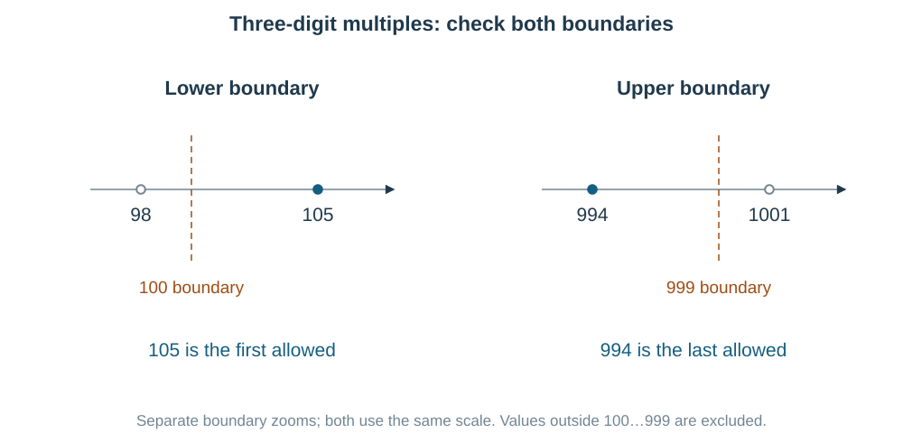

$$
S=\frac{128}2(105+994)
=64(1099)=\boxed{70336}\quad\text{(a)}.
$$

**Another possible approach:** factor out $7$ and sum the integer indices:

$$
7\sum_{k=15}^{142}k
=7\left[\frac{142(143)}2-\frac{14(15)}2\right]
=7(10048)=70336.
$$

**Check:** $98$ is only two digits and $1001$ has four digits, so neither endpoint can be extended.

### Question 31 — Keep the factor from the denominator gap

**PDF page 21 | MCQ | Notes: C09**

The sum of the first $20$ terms of $\dfrac1{1\cdot3}+\dfrac1{3\cdot5}+\dfrac1{5\cdot7}+\cdots$ is

- (a) $\dfrac{20}{39}$
- (b) $\dfrac{20}{41}$
- (c) $\dfrac{19}{39}$
- (d) $\dfrac{21}{41}$

**The denominator factors differ by $2$.** This is why the difference of reciprocals needs a factor $1/2$:

$$
\frac1{(2k-1)(2k+1)}
=\frac12\left(\frac1{2k-1}-\frac1{2k+1}\right).
$$

The first twenty terms end at $k=20$, with final denominator pair $39\cdot41$. After cancellation,

$$
S_{20}=\frac12\left(1-\frac1{41}\right)
=\boxed{\frac{20}{41}}\quad\text{(b)}.
$$

**Check:** every finite partial sum is below the infinite value $1/2$. The endpoint $41=2(20)+1$ comes from the negative part of the last summand; using $39$ would stop one boundary too early.

The cancellation is the same idea as Q8, with odd rather than consecutive integer factors.

### Question 32 — A square coefficient becomes linear after shifting

**PDF page 21 | Numerical value | Notes: C10**

The value of $\displaystyle\sum_{n=1}^{\infty}\frac{n^2}{2^n}$ is ____.

**The numerator is a square, so one shift will simplify it.** Let $S=\sum_{n=1}^{\infty}n^2/2^n$. Subtract $S/2$ with powers aligned:

$$
S-\frac S2=\sum_{n=1}^{\infty}
\frac{n^2-(n-1)^2}{2^n}
=\sum_{n=1}^{\infty}\frac{2n-1}{2^n}.
$$

This includes $n=1$, since the missing previous square is $0^2$.

From the GP and linear-weighted GP sums,

$$
\sum_{n=1}^{\infty}\frac1{2^n}=1,\qquad
\sum_{n=1}^{\infty}\frac n{2^n}=2.
$$

Thus $S/2=2(2)-1=3$, giving $\boxed{S=6}$.

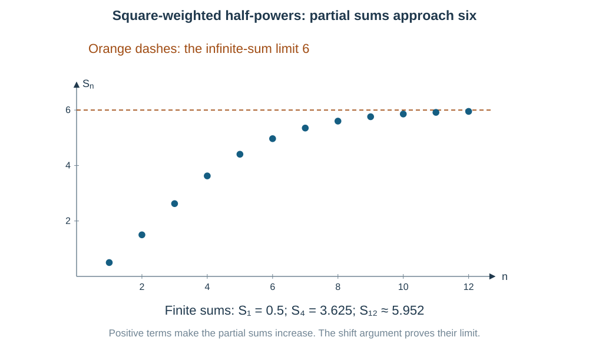

**Read the graph:** all terms are positive, so the partial sums rise. The curve of partial sums is shown as separate indexed dots; only integer indices belong to the sequence.

**Another possible approach:** use C10 directly with $r=1/2$:

$$
S=\frac{r(1+r)}{(1-r)^3}
=\frac{(1/2)(3/2)}{(1/2)^3}=6.
$$

The shift explains the formula and provides a way to recover it under exam pressure.

### Question 33 — An index identity needs its degenerate case

**PDF page 21 | MCQ | Notes: C02, C17**

In an A.P., seven times the $7$th term equals eleven times the $11$th term. Then the term of this A.P. that is equal to zero is the

- (a) $17\text{th}$
- (b) $19\text{th}$
- (c) $77\text{th}$
- (d) $18\text{th}$

**Convert each named term into $a+(n-1)d$.**

$$
7(a+6d)=11(a+10d)
\quad\Longrightarrow\quad -4a=68d
\quad\Longrightarrow\quad a=-17d.
$$

Then

$$
T_n=-17d+(n-1)d=(n-18)d,\qquad
\boxed{T_{18}=0}\quad\text{intended (d)}.
$$

**Important source qualification:** if $d\ne0$, only the eighteenth term is zero. But if $d=0$, then $a=0$ and every term is zero, so all four listed choices are zero terms. The source needs a nonconstant-AP condition for a unique MCQ answer.

**Another possible approach:** recognize C17: $pT_p=qT_q$ implies $T_{p+q}=0$ for $p\ne q$. Here $p+q=7+11=18$. Rebuilding the identity above is safer than remembering an index shortcut without its exception.

### Question 34 — A product of neighbours can telescope too

**PDF page 21 | MCQ | Notes: C08–C09**

The value of $1\cdot2\cdot3+2\cdot3\cdot4+\cdots+10\cdot11\cdot12$ is

- (a) $4290$
- (b) $4950$
- (c) $3960$
- (d) $4620$

**Expansion is useful because only three known power sums appear:**

$$
k(k+1)(k+2)=k^3+3k^2+2k.
$$

Therefore

$$
S=3025+3(385)+2(55)
=3025+1155+110=\boxed{4290}\quad\text{(a)}.
$$

**Another possible approach — see a neighbouring-product difference.** Add one factor to make a product of four neighbours. Its difference from the previous such product is

$$
\begin{aligned}
&k(k+1)(k+2)(k+3)-(k-1)k(k+1)(k+2)\\
&=k(k+1)(k+2)\{(k+3)-(k-1)\}\\
&=4k(k+1)(k+2).
\end{aligned}
$$

Summing the differences cancels all inside products:

$$
S=\frac{10\cdot11\cdot12\cdot13-0\cdot1\cdot2\cdot3}{4}
=4290.
$$

This second route is shorter once the pattern is recognized. The expansion route uses more familiar formulas and remains a reliable choice.

### Question 35 — The GP middle term links three cubic coefficients

**PDF page 22 | Numerical value | Notes: C11, C18**

If the roots of $x^3-14x^2+kx-64=0$ are in geometric progression, then $k=$ ____.

**Use the cubic coefficients and GP structure together.** Work in the intended real-parameter setting, $k\in\mathbb R$. Call the ordered roots $u,v,w$, so $uw=v^2$.

Comparing coefficients gives

$$
u+v+w=14,\quad uv+vw+wu=k,\quad uvw=64.
$$

**Notice the useful pattern:**

$$
k=uv+vw+uw=uv+vw+v^2
=v(u+v+w)=14v.
$$

Thus $v$ is real. Also $uvw=v^3=64$, so $v=4$. Therefore

$$
\boxed{k=14(4)=56}.
$$

**Why this route?** We need a symmetric coefficient, not the individual roots or ratio. The middle term connects the given sum and product directly.

**Another possible approach / check:** with middle $4$, the outers have sum $10$ and product $16$, so they are $2,8$. Then

$$
(x-2)(x-4)(x-8)=x^3-14x^2+56x-64.
$$

This verifies the original cubic and the GP ratio $2$. If unrestricted complex $k$ were allowed, additional branches would occur; the real setting is part of the intended source interpretation.

## Answer check

Read after attempting. Original option order and numerical-value formats are retained.

| Question | Answer | Question | Answer |
|---|---|---|---|
| 1 | (c) $820$ | 19 | (b) $1330$ |
| 2 | (a) $57$ | 20 | (c) |
| 3 | (d) $6560$ | 21 | $18$ |
| 4 | (b) $64/3$ | 22 | $13.50$ |
| 5 | $12$ | 23 | $80$ |
| 6 | (c) $1/17$ | 24 | (d) $642$ |
| 7 | $495$ | 25 | $6$ |
| 8 | (a) $1/4$ | 26 | (c) $91$ |
| 9 | (b) $35/16$ | 27 | (b) $64$ |
| 10 | (d) $210$ | 28 | (d) $18$ |
| 11 | (b) $6$ | 29 | $872$ |
| 12 | (c) $62$ | 30 | (a) $70336$ |
| 13 | Intended (d) $2^{20}$; positive means | 31 | (b) $20/41$ |
| 14 | (a) $88$ | 32 | $6$ |
| 15 | (a) $6.4$ | 33 | Intended (d) $18$th; nonconstant AP |
| 16 | (a) | 34 | (a) $4290$ |
| 17 | (a) | 35 | $56$ in the real setting |
| 18 | (a) |  |  |

## Coverage and source notes

All $35$ supplied questions appear in order: $26$ MCQs and $9$ numerical-value questions. Q13's positive-means convention, Q33's all-zero AP exception, and Q35's real-parameter setting are stated before calculations and beside the affected answers.

The official syllabus names AP/GP, insertion of means and AM–GM in Mathematics Unit 6. HP, finite differences, telescoping, weighted sums, simple recurrences and cubic coefficient connections are taught as useful prerequisites for the actual supplied questions. This is a Main-level guide; no unsupported promise of exhaustive Advanced coverage is made.

The recent archive-card recount has $35,27,33$ questions for $2024,2025,2026$ across $20,19,19$ full-year papers respectively. Its pooled average is $95/58\approx1.64$. This is not a seven-year official-paper audit, and the method-selection table is not a measured model ranking.

## Offline research record

- Supplied Maths Predicted V1.pdf: questions on PDF pages 18–22, answer key on page 22, working through page 23. All stems, options and key entries were read from local page images.
- NTA, Syllabus for JEE Main 2027, Mathematics Unit 6: AP, GP, insertion of means, relation between AM and GM.
- ExamSIDE, Sequences and Series: saved full category page, distinct recent question IDs and year totals independently recounted.
- PYQSide chapter-weightage classifications were used only as a scope cross-check; different category totals were not combined.

All second approaches are plain visible content. They are part of the editable source and will be included when the printed booklet is later prepared.
