# Permutations and Combinations — JEE Main revision guide

*Before counting, decide what one answer looks like. Then make sure every allowed answer is counted once.*

> **For Kanna | Chapter 5**  
> Goal: about $120/300$ towards $200/300$ — Physics $60$, Maths $60$, Chemistry $80$.  
> Learn the meaning and the picture first. Then use the formula. All $25$ PDF questions follow the notes and recap, in their original order.

## Recent chapter weightage

**The checked 2024–2026 archive gives about $1.09$ Permutations and Combinations questions per Paper 1.**

| Year | Papers | Chapter questions | Questions per paper |
|---|---:|---:|---:|
| $2024$ | $20$ | $20$ | $1.00$ |
| $2025$ | $19$ | $21$ | $1.11$ |
| $2026$ | $19$ | $22$ | $1.16$ |
| Together | $58$ | $63$ | $1.09$ |

The average is $63/58\approx1.09$, from $63$ distinct saved and recounted ExamSIDE category question IDs. This is an archive-category recount, not an independent classification of every NTA paper or a measured formula-frequency audit. Optional numerical questions and the offered-question total differed in $2024$; this average is not a guaranteed mark allocation.

**Revision priority:** order versus selection, repeated objects, restricted positions, gaps, case splitting, identical-ball distributions, and counting invalid outcomes without double subtraction. These habits also support probability.

## Scope and assumptions before starting

The official Mathematics Unit 4 names the fundamental counting principle, permutations, combinations, and simple applications. This guide teaches the Main-level applications required by the supplied questions, including gap counting, distributions, derangements, and grid geometry. It does not attempt advanced general symmetry-counting methods.

- People, cards and individually named objects are distinct. Repeated equal letters and identical balls are indistinguishable.
- For a usual unnumbered round table, rotations are the same arrangement; reverse clockwise order is different. A freely turnable necklace also identifies the reverse order.
- In Q19, “rectangles on the chessboard” means rectangles whose sides follow the grid lines. A rotated lattice-rectangle problem would be different.
- “Important for JEE Main” marks teaching priority, not a claimed measured frequency.

## Formula and concept bank

### Concept C01 — What are we counting? Add alternatives; multiply stages

**Important for JEE Main.** A count is the number of different allowed outcomes.

Suppose you have $3$ shirts and $2$ trousers. One outfit needs **a shirt and trousers**. Each shirt has two possible partners:

$$
\boxed{\text{outfits}=3\times2=6}.
$$

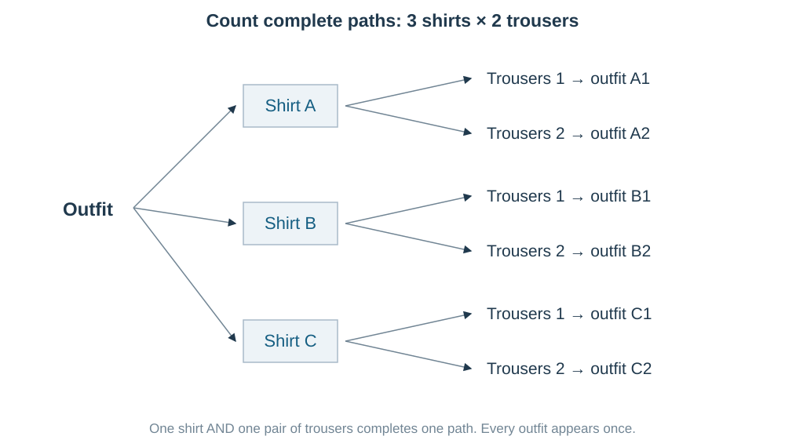

**Read the picture:** a complete path is one outfit. You multiply because every outfit needs both stages.

If a question is split into separate cases, add their counts:

$$
\boxed{\text{total}=\text{case 1 count}+\text{case 2 count}+\cdots}.
$$

The cases must cover all allowed outcomes and must not overlap. “Ends in $0$” and “ends in $5$” are separate cases; one number cannot have both last digits.

**Why a naive product can fail:** choosing the first digit can change how many final digits remain. Do not assume that every earlier choice leaves the same number of later choices. Split the earlier choices into cases with uniform counts. Q10 is a direct example.

**Four questions before any formula:**

1. Are the objects different or identical?
2. Does changing their order produce a new outcome?
3. What restrictions apply: repetition, zero, adjacency, bounds?
4. Does my counting process describe each allowed outcome exactly once?

“And” often suggests multiplication and “or” often suggests addition, but check the actual outcomes. Overlapping “or” cases require correction.

### Concept C02 — Factorials, ordered choices, and unordered selections

For $n$ distinct objects in a row, choose the first in $n$ ways, the next in $n-1$, and so on:

$$
\boxed{n!=n(n-1)\cdots2\cdot1},\qquad \boxed{0!=1}.
$$

$0!=1$ means there is one empty arrangement. It also makes the counting formulas work at boundary cases.

**Permutation — order matters.** Fill $r$ different positions from $n$ distinct objects without repetition:

$$
\boxed{{}^nP_r=\frac{n!}{(n-r)!}}\qquad(0\le r\le n).
$$

For example, a captain and a vice-captain from five people can be chosen in $5\cdot4=20$ ways. Swapping the roles gives a different result.

**Combination — order does not matter.** Choose a group of $r$ from $n$:

$$
\boxed{\binom nr={}^nC_r=\frac{n!}{r!(n-r)!}},\qquad
\boxed{{}^nP_r=r!\binom nr}.
$$

**Why divide by $r!$?** Every chosen group was listed in all $r!$ possible orders by the permutation count. A two-person committee $\{A,B\}$ is the same as $\{B,A\}$.

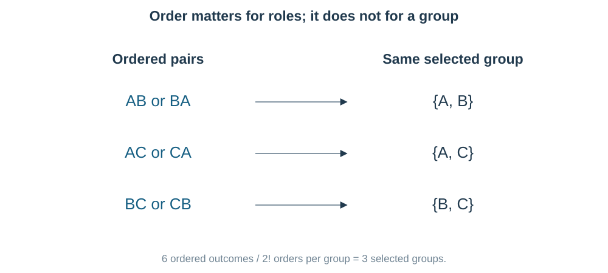

**Read the picture:** each group has exactly $2!$ ordered versions. This is an equal overcount, so division is valid.

If repetition is allowed in $r$ ordered positions, and every position independently has $n$ choices, the count is $\boxed{n^r}$. This is different from $\;{}^nP_r$.

Useful boundaries: $\binom n0=\binom nn=1$, $\binom nr=\binom n{n-r}$; use count $0$ if an integer selection size is negative or exceeds the available nonnegative population.

### Concept C03 — Repeated letters: divide only for copies that are present

If $N$ objects include identical groups of sizes $m_1,\ldots,m_t$, with $\sum m_i=N$,

$$
\boxed{\text{distinct full arrangements}=\frac{N!}{m_1!\cdots m_t!}}.
$$

**Meaning:** imagine temporarily naming equal letters $A_1,A_2$. Swapping those names changes the labelled arrangement but does not change the visible word. Every visible word has exactly $2!$ such versions.

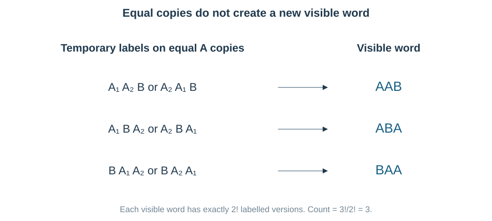

For MATHEMATICS, there are $11$ letters. $M,A,T$ occur twice each; the others occur once:

$$
\text{count}=\frac{11!}{2!2!2!}.
$$

**Partial words need more care.** If only five letters are used from ARRANGE, some words use both $A$s, some only one, and some none. The number of repeated copies actually used is not the same in every word. Therefore $\;{}^7P_5/(2!2!)$ is not justified.

Instead, classify the allowed multiplicities first. For a fixed selection using $r_i$ copies of type $i$, its arrangements are

$$
\boxed{\frac{r!}{\prod_i r_i!}},\qquad
\sum_i r_i=r,\quad 0\le r_i\le m_i.
$$

Add over distinct allowed multiplicity selections. C15 and Q25 show how to keep these cases small.

### Concept C04 — Digit problems: reserve the restricted positions

**Important for JEE Main.** A number has place values. Thus order matters, and the first digit cannot be $0$.

For unrestricted decimal $r$-digit numbers: $9\cdot10^{r-1}$. For all distinct decimal digits:

$$
\boxed{9\cdot{}^9P_{r-1}}\qquad(1\le r\le10).
$$

There are $9$ nonzero first choices; after that, the remaining $9$ digits include $0$.

**Divisibility clues:** even $\Rightarrow$ final digit even; divisible by $5\Rightarrow$ final digit $0$ or $5$; divisible by $10\Rightarrow$ final digit $0$; divisible by $3$ or $9\Rightarrow$ check digit sum. For $4$, inspect the last two digits; for $8$, the last three; for $11$, the difference of alternate-position sums is a multiple of $11$.

Fixing a restricted final digit first often avoids later correction. In Q2, last digit $0$ leaves $9$ possible first digits; last digit $5$ leaves $8$.

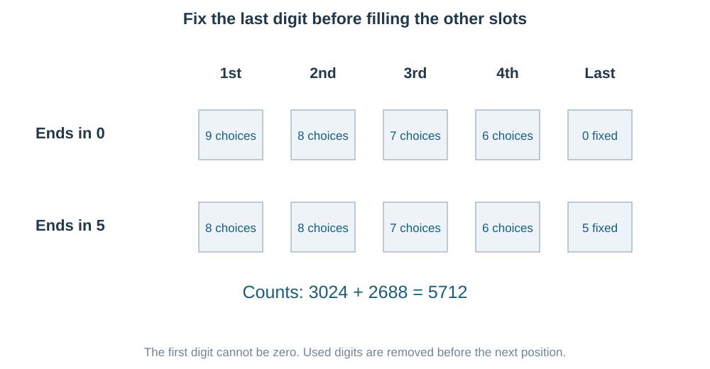

**Read the slots:** the last place is already used. Counts for the other places exclude the used digit, and the first also excludes zero.

For “greater than” questions, inspect the first digit and then any tied prefix. Equality with a threshold must be checked separately. If the first choice uses an even digit, it can reduce the choices left for an even final digit, as in Q10.

**Another useful route:** count all distinct-digit strings, then subtract strings starting with $0$. It works when that bad case is simpler. Do not automatically subtract the same percentage.

### Concept C05 — Committees, cards, “at least,” and “exactly”

A committee or a card hand is a set. Selecting the same members in another order is not a new group.

From $M$ men and $W$ women, a size-$r$ committee with exactly $j$ women has

$$
\boxed{\binom Wj\binom M{r-j}}
$$

choices. Both selections are needed, so multiply. For an allowed range of $j$, add these disjoint counts.

For at least two women in a four-person committee, use $j=2,3,4$, not just $j=2$.

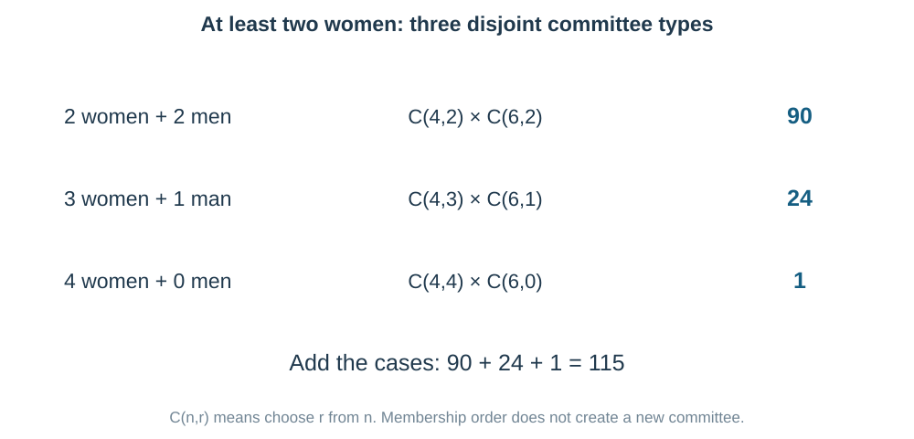

**Alternative — subtract the easier opposite:** at least one woman = all committees minus all-male committees. At least two women = all minus zero-woman and one-woman committees. Choose whichever uses fewer cases.

**Exactly means forbid extras.** A five-card hand with exactly three aces has

$$
\boxed{\binom43\binom{48}2}.
$$

The final two must be non-aces. Choosing them from the remaining $49$ cards permits a fourth ace and no longer enforces “exactly.”

For roles, order can matter even within a committee. A size-$r$ committee with one captain has $\binom nr r=n\binom{n-1}{r-1}$ outcomes. The two formulas describe the same object: choose the group then captain, or captain then other members.

### Concept C06 — Together: make a block. Apart: make gaps

**Together clue:** if $k$ specified distinct people must be consecutive in a row of $n$ distinct people, treat them as one block. There are $n-k+1$ units to arrange, and $k!$ orders inside the block:

$$
\boxed{(n-k+1)!\,k!}.
$$

For two specified people not together, subtract their together count from all rows: $n!-2(n-1)!$. These statements assume everyone is distinct. Repeated letters need the corresponding internal and external duplicate corrections.

**No two of a type together — gap picture.** Arrange the other $g$ objects first. A row has $g+1$ gaps, including both ends.

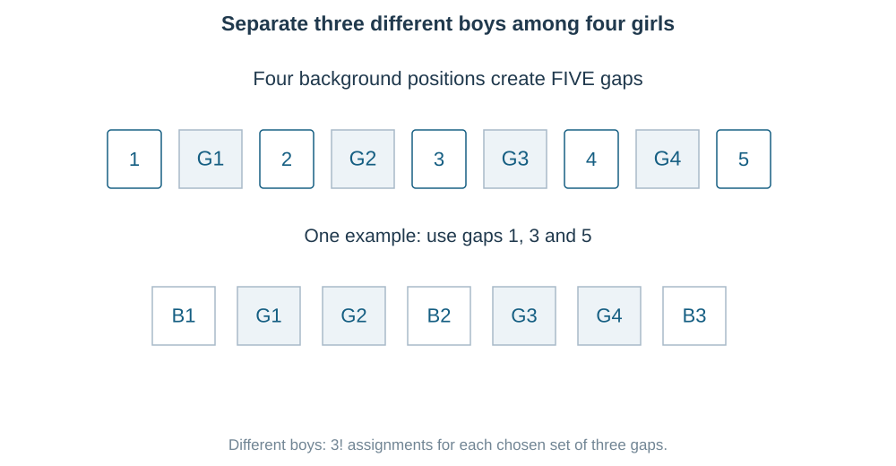

Place at most one of the $b$ separated objects in a gap:

$$
\boxed{g!\binom{g+1}{b}b!}
$$

if the $g$ background people and the $b$ inserted people are all distinct. The count is $0$ if $b>g+1$.

For identical inserted letters, omit $b!$. If background letters repeat, replace $g!$ by their distinct arrangement count.

Q3 has three identical $S$s and background $U,C,C,E$, so the count is $\frac{4!}{2!}\binom53$. Q14 has three different boys, so there is an additional $3!$.

**Related position formula:** choosing $k$ nonadjacent positions from $N$ positions in a line gives

$$
\boxed{\binom{N-k+1}{k}}.
$$

Why? If the selected indices are $i_1<\cdots<i_k$ with at least one unused position between them, subtract $0,1,\ldots,k-1$ respectively. The new indices are any $k$ distinct choices from $1,\ldots,N-k+1$. This is a one-to-one change of description.

### Concept C07 — Circular tables and necklaces: decide which views are the same

For $n$ distinct people around an unnumbered table, a rotation changes the viewer's starting place but not who sits next to whom.

Fix one person as a reference, then arrange the remaining $n-1$ clockwise:

$$
\boxed{\text{ordinary circular arrangements}=(n-1)!}.
$$

Equivalently, $n!$ linear starting-place descriptions represent each circle $n$ times. Divide by $n$.

**Numbered seats are different:** if seat numbers matter, rotations give different outcomes and the count is $n!$.

For $m$ men and $m$ women, all distinct, alternating around an ordinary unnumbered circular table:

$$
\boxed{(m-1)!\,m!}.
$$

Arrange the men in a circle. There are **$m$ circular gaps**, not $m+1$. Put the $m$ women in those gaps.

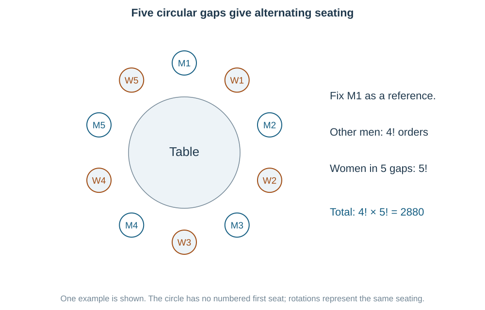

**A necklace can be turned over.** With $n\ge3$ distinct beads and a freely turnable necklace, clockwise and anticlockwise descriptions represent the same necklace:

$$
\boxed{\text{necklaces}=\frac{(n-1)!}{2}}.
$$

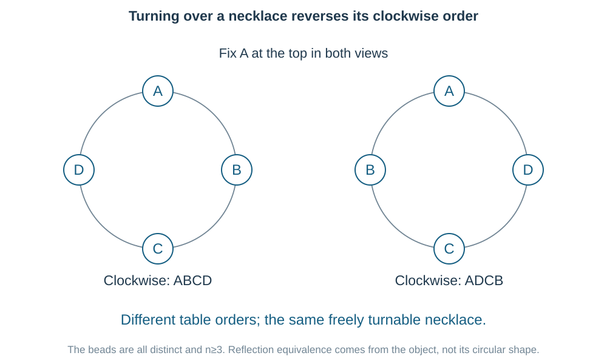

**Read the picture:** the order after a fixed bead is reversed by turning the necklace over. Around an ordinary table, that reversal changes the seating order.

Do not divide by $2$ just because a picture is circular. The physical equivalence must allow reflection. With repeated beads, some configurations can have additional symmetry; the distinct-bead formula cannot be blindly reused.

### Concept C08 — Dividing into groups: labels change the count

For $N$ distinct people placed into labelled groups of fixed sizes $s_1,\ldots,s_k$ totaling $N$,

$$
\boxed{\frac{N!}{s_1!\cdots s_k!}}.
$$

This selects membership, so internal orders of a group are removed.

If all $k$ groups have equal size $s$ and are **unlabelled**, each final partition was counted $k!$ times by temporary group labels:

$$
\boxed{\frac{(ks)!}{(s!)^k\,k!}}.
$$

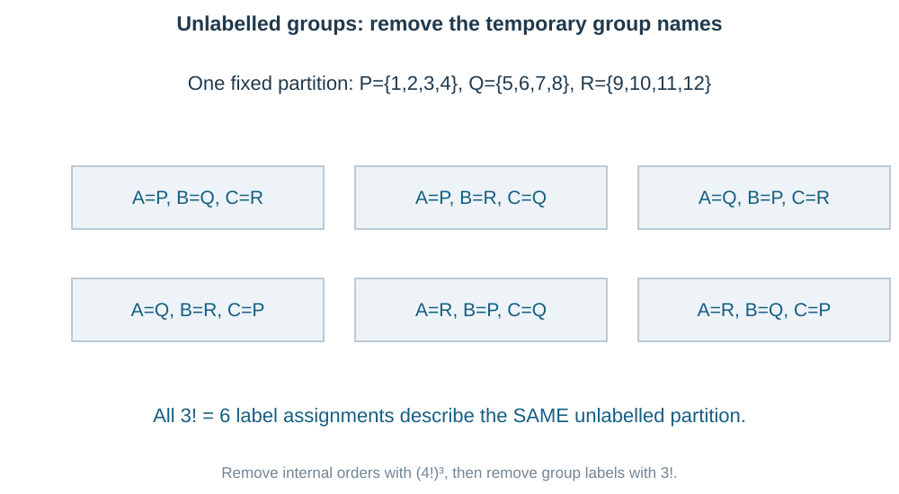

**Why not always divide by $k!$?** For unequal sizes, size already distinguishes the groups. Dividing six people into a group of two and a group of four gives $\binom62=15$, not $15/2$.

More generally, divide by $m_t!$ for each size $t$ that occurs $m_t$ times among unlabelled groups:

$$
\boxed{\frac{N!}{\left(\prod_i s_i!\right)\left(\prod_t m_t!\right)}}.
$$

Example: group sizes $2,2,3$ require one extra division by $2!$ for swapping the two equal-sized groups. Groups with different assigned jobs remain labelled even if their sizes are equal.

### Concept C09 — Stars and bars: identical items into distinct boxes

**Important for JEE Main.** Suppose $N$ identical balls go into $k$ labelled boxes. Describe one distribution by its counts $(x_1,\ldots,x_k)$. The balls have no individual names; the boxes do.

For nonnegative integer counts,

$$
x_1+\cdots+x_k=N,\qquad x_i\ge0,
$$

write $N$ stars and $k-1$ separators. A separator can touch another separator or an end; that creates an empty box.

$$
\boxed{\text{count}=\binom{N+k-1}{k-1}}
\qquad(N\ge0,\ k\ge1).
$$

Why? Choose the $k-1$ separator positions among all $N+k-1$ symbols. Reading stars between successive separators recovers exactly one distribution.

For **positive** integers, $x_i\ge1$, first put one in every box. Equivalently, put separators only in the $N-1$ internal gaps between stars:

$$
\boxed{\text{positive count}=\binom{N-1}{k-1}}
\qquad(N\ge k).
$$

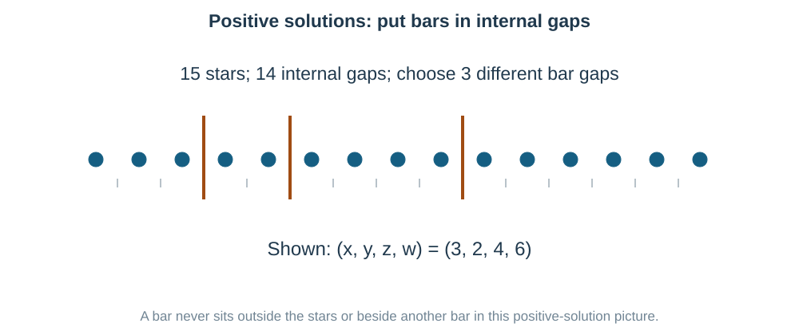

**Read the picture:** the four groups represent $x,y,z,w$ in order. Moving a separator changes the counts, so it changes the ordered solution.

For lower bounds $x_i\ge L_i$, put $y_i=x_i-L_i\ge0$. The new total is $R=N-\sum L_i$:

$$
\boxed{\text{count}=\binom{R+k-1}{k-1}}\quad(R\ge0).
$$

If $R<0$, there are no solutions. Q8 reserves two balls per box, leaving $14-8=6$.

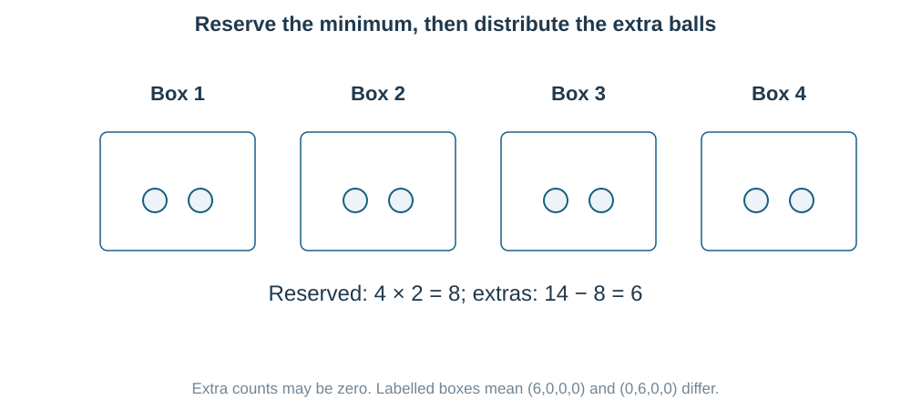

**Do not mix models:** $k^N$ distributes $N$ **distinct** objects into $k$ labelled boxes. Stars and bars distributes **identical** items. If boxes are also indistinguishable, permuting count entries can represent the same distribution; neither formula automatically applies.

**Useful second view:** $\sum x_i\le N$, $x_i\ge0$, becomes an equality after adding a slack variable $s=N-\sum x_i\ge0$. Hence the count is $\binom{N+k}{k}$. The slack is the unused amount.

### Concept C10 — Upper bounds: subtract violations with overlap correction

For $x+y+z=12$ with $1\le x,y,z\le6$, the positive-solution formula only enforces the lower bounds. It still includes $x=10,y=1,z=1$, which is not allowed.

**First count widely, then remove the forbidden part.** A violation in $x$ means $x\ge7$. Put $x=6+u$, $u\ge1$:

$$
u+y+z=6.
$$

There are $\binom52=10$ such solutions. Repeat for $y$ and $z$. Two variables cannot both be at least $7$ when their total with a positive third variable is $12$, so these bad cases do not overlap.

The answer is $\binom{11}2-3\binom52=25$.

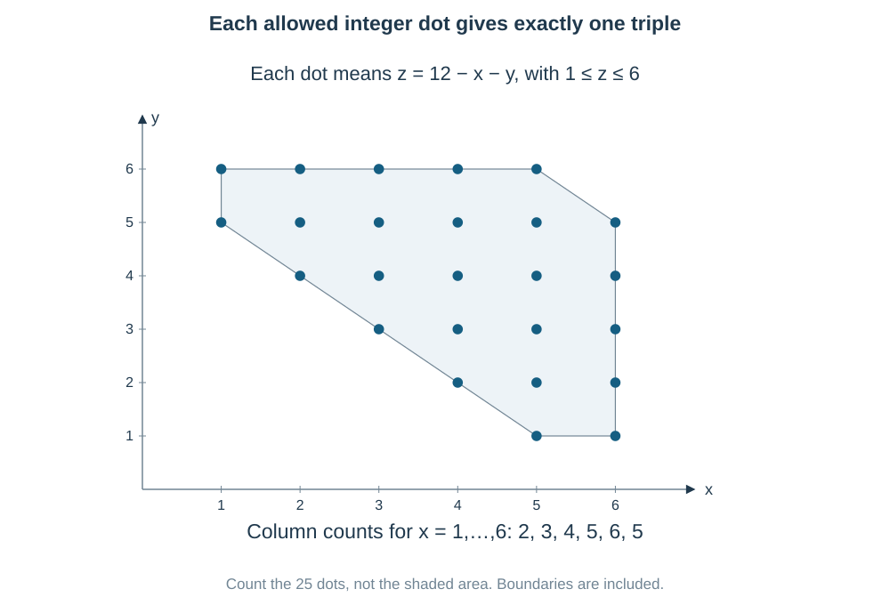

**Read the dots:** each dot represents one ordered triple, because $x,y$ determine $z$. Count only integer points, not the area of the shaded band.

**Inclusion–exclusion — Important for JEE Main.** If bad sets $A,B$ overlap,

$$
|A\cup B|=|A|+|B|-|A\cap B|.
$$

For three sets, subtract pair overlaps and add the triple overlap. Why? An outcome in both $A$ and $B$ was added twice; one copy must be removed.

For $k$ nonnegative variables with a common bound $0\le x_i\le U$ and sum $N$,

$$
\boxed{\sum_{j=0}^{k}(-1)^j\binom kj
\binom{N-j(U+1)+k-1}{k-1}}.
$$

Include only terms with $N-j(U+1)\ge0$. For each chosen $j$-set of violating variables, reserve $U+1$ in each, then count the residual nonnegative solutions. For positive bounds $1\le x_i\le U$, first set $y_i=x_i-1$, so their upper bound becomes $U-1$.

Use small explicit cases when there are only two or three variables. The general formula is a recall aid, not a replacement for understanding what is being subtracted.

### Concept C11 — Derangements: nobody gets the correct place

A **fixed point** is an object placed in its own position. A **derangement** is an arrangement with no fixed points.

For $n$ distinct objects in $n$ corresponding positions,

$$
\boxed{D_n=n!\left(1-\frac1{1!}+\frac1{2!}-\cdots+\frac{(-1)^n}{n!}\right)}.
$$

**Why alternating signs?** Start with all $n!$ arrangements. Subtract those fixing a chosen object, add back those fixing two, and continue. This is inclusion–exclusion.

$$
D_0=1,\quad D_1=0,\quad D_2=1,\quad D_3=2,\quad
\boxed{D_4=9},\quad D_5=44,\quad D_6=265.
$$

**Exactly $r$ correct places:**

$$
\boxed{\binom nr D_{n-r}}.
$$

Choose which $r$ objects are correct, then derange every remaining object. Using $(n-r)!$ would allow extra correct objects and count “at least the chosen $r$,” not “exactly $r$.”

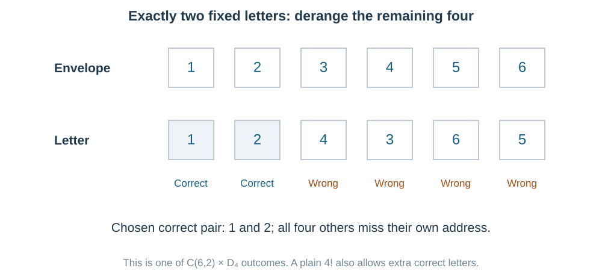

**Read the table:** the last four letters all miss their own addresses. This is one example of the $D_4$ possibilities, not all $4!$ permutations.

**Another way to rebuild small values:** $D_n=(n-1)(D_{n-1}+D_{n-2})$ for $n\ge2$. Put object $1$ into some wrong position $j$; either object $j$ returns to position $1$ (a two-object swap), or it does not. The remaining counts are $D_{n-2}$ and $D_{n-1}$ respectively. Keep the base values if using the recurrence.

### Concept C12 — Dictionary rank: skip whole blocks

Alphabetical order compares the first different letter. **Rank starts from $1$.** Count words before the target, then add one.

For distinct letters:

1. At the first place, count unused letters smaller than the target letter. Each starts a block of $(n-1)!$ words.
2. Keep the target first letter fixed; do the same at the next place.
3. Continue with the remaining unused letters.

If $c_i$ is the number of smaller unused letters at place $i$,

$$
\boxed{\text{rank}=1+\sum_{i=1}^{n}c_i(n-i)!}.
$$

For SMILE, sort the available letters: $E,I,L,M,S$. The smaller-letter counts along the target are $4,3,1,1,0$:

$$
\text{rank}=1+4(4!)+3(3!)+1(2!)+1(1!)=118.
$$

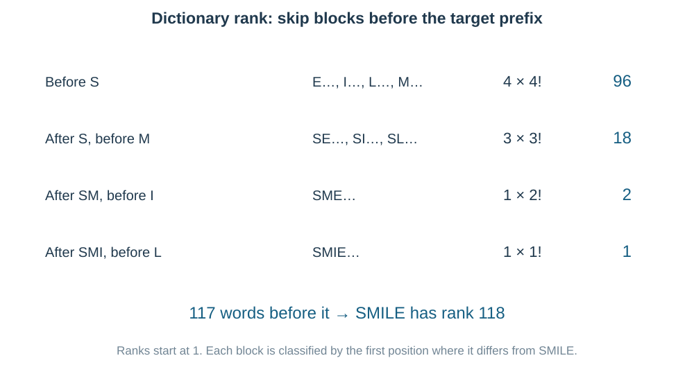

**Read the blocks:** after fixing $SM$, the remaining letters are $E,I,L$. Before the target third letter $I$, only $E$ is smaller, leaving $2!$ completions. After fixing $SMI$, $E$ is smaller than $L$, giving one more earlier word.

With repeated letters, try each smaller **letter type** once. For that trial prefix, count the remaining arrangements as $m!/\prod r_i!$. Do not count indistinguishable copies as separate smaller choices.

**Reverse task — find a word from its rank:** subtract whole blocks in alphabetical order until the desired rank lies inside the next block; then fix that first letter and repeat. This uses the same structure.

### Concept C13 — Triangles, collinear points, and polygon sides

Three distinct noncollinear points determine one triangle. If no three of $n$ points are collinear, the count is $\binom n3$.

If exactly $m$ points lie on one line and there are no other collinear triples,

$$
\boxed{\text{triangles}=\binom n3-\binom m3}.
$$

**Why subtract triples, not pairs?** Three points on the line have zero enclosed area. Two on the line and one outside still give a triangle.

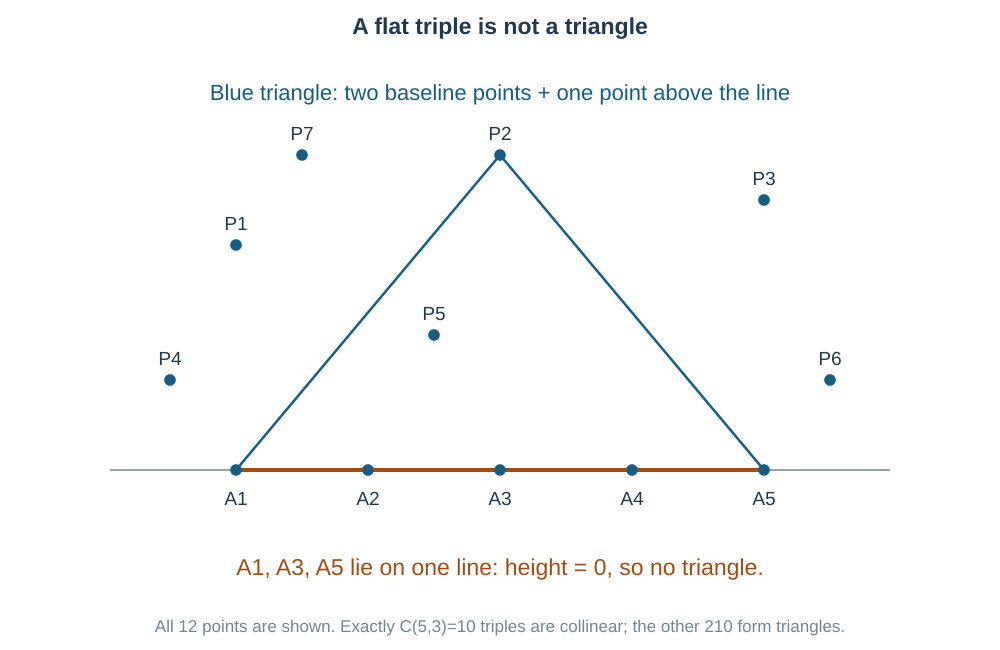

A related line-count result is $\binom n2-\binom m2+1$: all pairs from the $m$ collinear points describe one line. This requires the same no-other-collinear-triples condition.

For a convex $n$-gon, choosing three vertices gives $\binom n3$ triangles. But “no triangle side is a polygon side” forbids choosing adjacent vertices, including the first and last vertices.

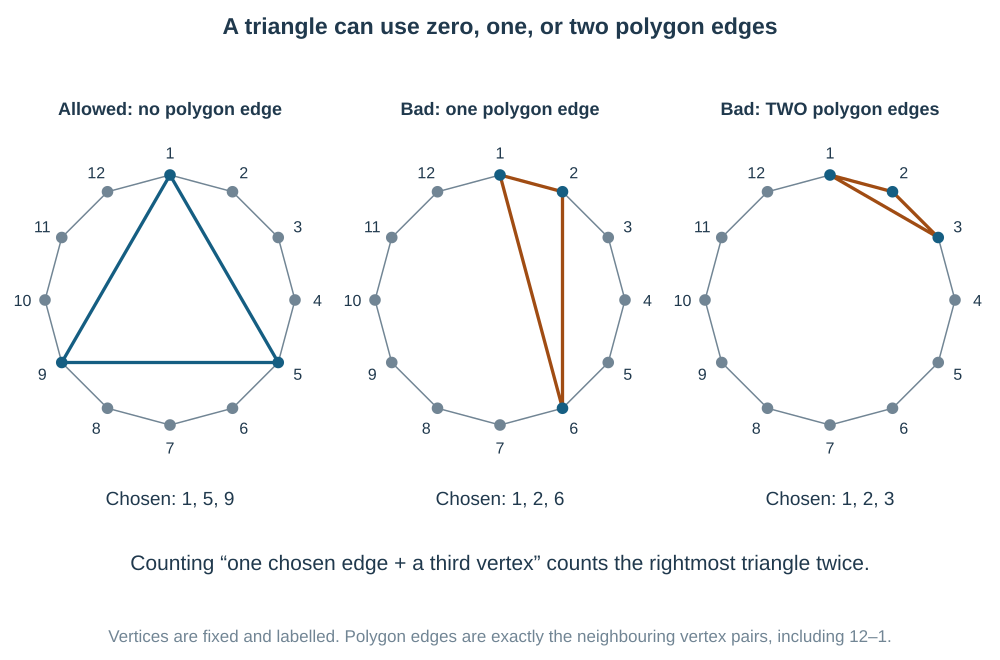

**Why naive subtraction fails in Q5:** counting $12$ edges times $10$ possible third vertices counts a triangle with two polygon edges twice. It must be corrected.

**Another clean viewpoint — separate a chosen vertex.** For selecting $k$ nonadjacent vertices of a labelled $n$-cycle:

- If vertex $n$ is absent, choose $k$ nonadjacent positions in a line of $n-1$ positions: $\binom{n-k}{k}$.
- If vertex $n$ is present, its two neighbours are absent. Choose $k-1$ nonadjacent positions in the remaining line of $n-3$: $\binom{n-k-1}{k-1}$.

Thus, for $1\le k\le\lfloor n/2\rfloor$ and $n\ge3$,

$$
\boxed{\binom{n-k}{k}+\binom{n-k-1}{k-1}
=\frac n{n-k}\binom{n-k}{k}}.
$$

The vertices are fixed and labelled; rotating a chosen subset usually gives a different triangle. This is a selection problem, not a circular seating count. For $k=1$ the same count is simply $n$.

### Concept C14 — Grid rectangles: choose lines, not cells

An $m\times n$ board of cells has $m+1$ horizontal and $n+1$ vertical grid lines. A grid-aligned rectangle is fixed by choosing two lines in each direction:

$$
\boxed{\text{rectangles}=\binom{m+1}{2}\binom{n+1}{2}}.
$$

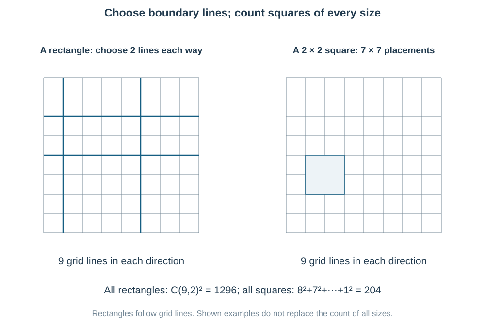

For a square of side $k$ cells, there are $(m-k+1)(n-k+1)$ placements. Hence

$$
\boxed{\text{squares}=\sum_{k=1}^{\min(m,n)}(m-k+1)(n-k+1)}.
$$

For an $n\times n$ board, this becomes

$$
\boxed{\frac{n(n+1)(2n+1)}6}.
$$

**Read the grid:** there are nine boundary lines, not eight, on each side of an eight-cell board. A $2\times2$ square can begin at seven horizontal and seven vertical positions, giving $49$ placements of that size.

Squares are rectangles with equal side lengths, so **rectangles that are not squares = all rectangles − all squares**. Subtract every square size, not just the $1\times1$ cells.

### Concept C15 — Partial repeated-letter words: sort by used pairs

For ARRANGE, the available letter types are $A,R,N,G,E$ with counts $2,2,1,1,1$.

For a five-letter word, only $A$ and $R$ can form repeated pairs. This suggests three exhaustive, disjoint cases:

| Used pairs | How the letters are selected | Arrangements per selection |
|---|---|---|
| Both pairs | $A,A,R,R$ and one of $N,G,E$ | $5!/(2!2!)$ |
| Exactly one pair | Choose pair type; choose three of the other four types | $5!/2!$ |
| No pair | One each of all five types | $5!$ |

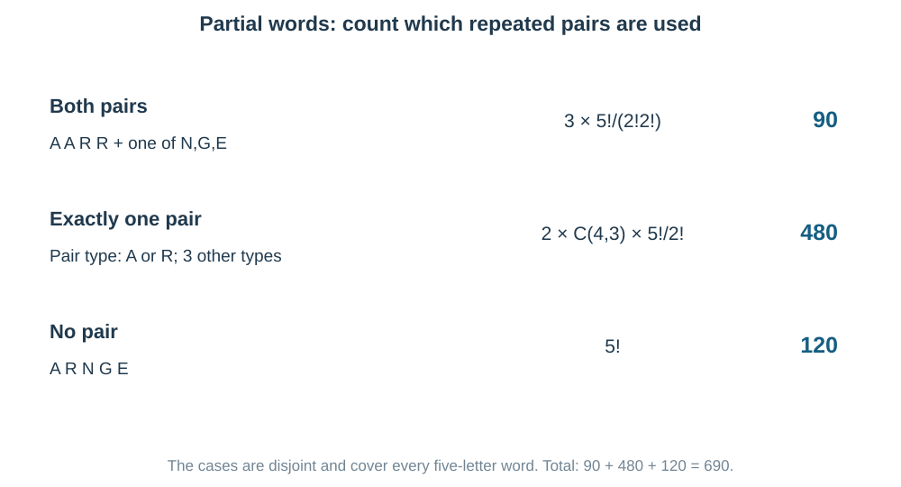

**Why this route fits:** within each case the duplicate count is fixed, so the factorial division is justified. Multiplying by a choice of physical $A$ copies would invent differences between identical letters.

**General strategy:** choose counts of each type first; arrange second. If the allowed counts are few, case splitting is usually clearer than a large algebraic generating function.

### Concept C16 — Divisors: choose prime exponents

If

$$
N=p_1^{a_1}\cdots p_t^{a_t},
$$

every positive divisor is uniquely $p_1^{b_1}\cdots p_t^{b_t}$ with $0\le b_i\le a_i$ integer. Therefore

$$
\boxed{\text{number of positive divisors}=\prod_i(a_i+1)}.
$$

**Why multiply?** For each prime choose one exponent; the choices together determine one divisor, and no two exponent lists give the same integer.

For divisors that are multiples of $M=\prod p_i^{c_i}$, require $b_i\ge c_i$. If $M\mid N$,

$$
\boxed{\text{count}=\prod_i(a_i-c_i+1)}.
$$

If $M$ has a missing prime or an exponent exceeding that in $N$, the count is $0$.

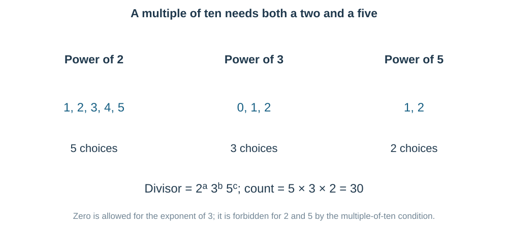

**Another possible viewpoint:** write the divisor as $d=Mq$. The condition $d\mid N$ is equivalent to $q\mid N/M$ when $M\mid N$. Thus count divisors of $N/M$.

This is the multiplication principle in a number-theory setting, not a new unrelated trick.

### Concept C17 — Sum of formed numbers: count each digit's contribution

If $n$ distinct nonzero digits are used once each in all $n!$ permutations, a fixed digit occurs $(n-1)!$ times in each place.

Why? Keep it in that place; arrange the other $n-1$ digits freely.

$$
\boxed{\text{sum}=(n-1)!(\text{sum of digits})
\frac{10^n-1}{9}}.
$$

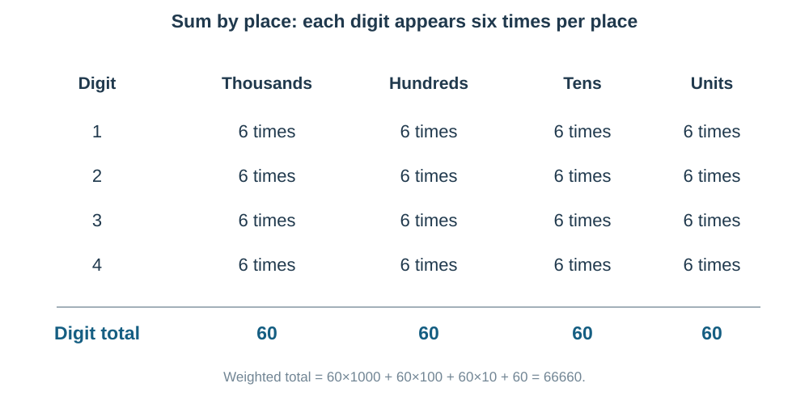

**Read the table:** the same digit total appears in thousands, hundreds, tens and units. Multiply each by its place value, then add.

For all $r$-digit arrangements from $n$ distinct **nonzero** digits, a fixed digit appears $\;{}^{n-1}P_{r-1}$ times in each place:

$$
\boxed{\text{sum}={}^{n-1}P_{r-1}(\text{digit sum})
\frac{10^r-1}{9}}.
$$

If $0$ is available, a leading-zero string is not an $r$-digit number. Count the sum of all strings and subtract the sum of those starting with zero. The place contributions are then no longer symmetric among valid numbers. State that restriction before using symmetry.

### Concept C18 — Parity and combination identities: find a small set of cases

An even sum contains an even number of odd summands. Choosing three numbers gives only two even-sum cases:

$$
\boxed{0\text{ odd}+3\text{ even}},\qquad
\boxed{2\text{ odd}+1\text{ even}}.
$$

With $O$ odd and $E$ even available numbers, the count is

$$
\boxed{\binom E3+\binom O2\binom E1}.
$$

Choosing three odd numbers gives an odd sum. Do not split into arbitrary orders such as OOE, OEO, EOO for an unordered selection: they describe the same chosen set.

**Useful combination connections — Important for JEE Main:**

$$
\binom nr=\binom n{n-r},\qquad
\binom nr=\binom{n-1}r+\binom{n-1}{r-1}.
$$

The second identity splits a selection into “one specified object absent” or “present.”

$$
\boxed{\sum_{r=0}^n\binom nr=2^n},\quad
\boxed{\sum_{r=1}^n r\binom nr=n2^{n-1}}\quad(n\ge1).
$$

The first counts every subset by include/exclude choices. The second counts a subset with one marked member: choose the marked member in $n$ ways, then freely choose among the other $n-1$.

$$
\boxed{\sum_j\binom aj\binom b{k-j}=\binom{a+b}{k}},\qquad
\boxed{\sum_{j=0}^n\binom nj^2=\binom{2n}{n}}.
$$

The first counts the same size-$k$ group by how many came from a population of size $a$. The second is the special case $a=b=n,k=n$, using symmetry. Only feasible selections contribute.

**Another connection to functions:** putting $N$ distinct objects in $k$ labelled boxes gives $k^N$. If every box must be used, inclusion–exclusion gives

$$
\boxed{\sum_{j=0}^k(-1)^j\binom kj(k-j)^N}
\qquad(N\ge1,\ k\ge1).
$$

Each selected set of $j$ empty boxes leaves $(k-j)^N$ assignments. This is the same idea as an onto function from $N$ labelled inputs to $k$ outputs. It is different from stars and bars.

## Choose the route from the clue

This is a teaching aid, not a measured model-frequency ranking.

| Clue | Useful route | What to check |
|---|---|---|
| Different roles, positions or digits | Ordered slots / permutation | Repetition and leading zero |
| Committee or card hand | Combinations | “Exactly” excludes extras |
| Equal letters | Divide repeated-copy factorials | Are those copies all actually used? |
| No two together | Arrange others, then gaps | Identical or different inserted objects |
| Must stay together | One block, internal arrangements | Count the units after grouping |
| Circle / necklace | Fix a reference, decide reflection equivalence | Numbered seats and distinctness |
| Unlabelled equal-sized groups | Temporarily label, then remove equal labelings | Divide only equal overcounts |
| Identical balls / integer sum | Stars and bars after lower-bound shifts | Positive/nonnegative, upper bounds |
| Exactly $r$ correct positions | Choose fixed positions, derange the rest | A factorial allows extra matches |
| “At least” with many cases | Subtract the simpler opposite | Bad cases may overlap |
| Geometry count | Choose defining points or lines | Exclude degenerate choices |
| Sum of many formed numbers | Count place contributions | Symmetry fails with leading-zero exclusions |

## Last-minute formula recap

| Need | Result / conditions |
|---|---|
| Factorial | $0!=1$; $n!=n(n-1)\cdots1$ |
| Ordered $r$ of $n$, no repeat | ${}^nP_r=n!/(n-r)!$ |
| Unordered $r$ of $n$ | $\binom nr=n!/[r!(n-r)!]$ |
| Ordered positions, repeat allowed | $n^r$ |
| Full multiset arrangements | $N!/\prod m_i!$ |
| Partial multiset | Sum $r!/\prod r_i!$ over allowed count selections |
| Decimal distinct-digit $r$-digit numbers | $9\,{}^9P_{r-1}$, $1\le r\le10$ |
| Exactly $j$ of one committee type | $\binom Wj\binom M{r-j}$ |
| $k$ specified distinct people together | $(n-k+1)!k!$ in a row |
| Separate $b$ distinct among $g$ distinct others | $g!\binom{g+1}b b!$ |
| Separate identical inserted objects | Omit inserted-object factorial |
| $k$ nonadjacent positions in a line of $N$ | $\binom{N-k+1}k$ |
| Ordinary unnumbered circle, all distinct | $(n-1)!$ |
| Alternating $m$ men, $m$ women | $(m-1)!m!$ |
| Freely turnable necklace, distinct $n\ge3$ | $(n-1)!/2$ |
| Labelled fixed-size groups | $N!/\prod s_i!$ |
| Equal unlabelled groups | $(ks)!/[(s!)^k k!]$ |
| Mixed unlabelled group sizes | $N!/[(\prod s_i!)(\prod_t m_t!)]$ |
| Identical balls, distinct boxes, nonnegative counts | $\binom{N+k-1}{k-1}$ |
| Positive counts | $\binom{N-1}{k-1}$, $N\ge k$ |
| Lower bounds $L_i$ | Replace total by $N-\sum L_i$; then nonnegative formula |
| Upper bounds | Subtract violations; add overlaps back |
| Two overlapping bad sets | $|A\cup B|=|A|+|B|-|A\cap B|$ |
| Derangements | $D_n=n!\sum_{j=0}^n(-1)^j/j!$; $D_0=1,D_1=0,D_4=9$ |
| Derangement recurrence | $D_n=(n-1)(D_{n-1}+D_{n-2})$ |
| Exactly $r$ fixed positions | $\binom nrD_{n-r}$ |
| Dictionary rank, distinct letters | $1+\sum c_i(n-i)!$ |
| Triangles, one $m$-point collinear set | $\binom n3-\binom m3$; no other collinear triples |
| Polygon diagonals | $\binom n2-n=n(n-3)/2$ |
| Nonadjacent $k$ vertices of an $n$-cycle | $\binom{n-k}k+\binom{n-k-1}{k-1}$; $1\le k\le\lfloor n/2\rfloor$ |
| Grid-aligned rectangles, $m\times n$ cells | $\binom{m+1}2\binom{n+1}2$ |
| Grid-aligned squares | $\sum_{k=1}^{\min(m,n)}(m-k+1)(n-k+1)$ |
| Squares, $n\times n$ | $n(n+1)(2n+1)/6$ |
| Divisors of $\prod p_i^{a_i}$ | $\prod(a_i+1)$ |
| Divisors multiple of $\prod p_i^{c_i}$ | $\prod(a_i-c_i+1)$ if required factor divides $N$; else $0$ |
| Sum of all full permutations of nonzero digits | $(n-1)!(\text{digit sum})(10^n-1)/9$ |
| Three-number even-sum selections | $\binom E3+\binom O2E$ |
| All subsets / nonempty subsets | $2^n$ / $2^n-1$ |
| Vandermonde selection sum | $\sum_j\binom aj\binom b{k-j}=\binom{a+b}k$ |

**Final habit:** after getting a formula, ask: “Can I describe one counted outcome? Is it allowed? Did my method count it once?” This catches more errors than trying to memorize a separate shortcut for every wording.

## Worked solutions to the 25 PDF questions

Attempt each question. Then read what the pattern suggests, why the route fits, the calculation and the check. Second approaches are included in full.

### Question 1 — Repeated letters are not different copies

**PDF page 24 | MCQ | Notes: C02–C03**

The number of distinct arrangements of all the letters of the word MATHEMATICS is

- (a) $4989600$
- (b) $9979200$
- (c) $19958400$
- (d) $39916800$

**First count equal letter types, not just the letters.** MATHEMATICS has $11$ letters. $M,A,T$ each occur twice.

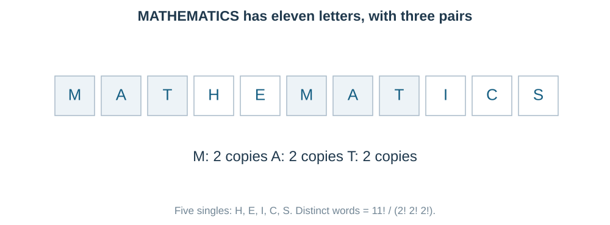

If we temporarily named every copy, there would be $11!$ rows. Swapping the two $M$s, the two $A$s or the two $T$s does not change a visible word. Each visible word has exactly $2!2!2!$ labelled versions:

$$
\text{count}=\frac{11!}{2!2!2!}
=\frac{39916800}{8}
=\boxed{4989600}\quad\text{(a)}.
$$

**Check / another approach:** choose the $M$ positions, then $A$ positions, then $T$ positions, then order the five single letters:

$$
\binom{11}2\binom92\binom72\,5!
=4989600.
$$

The two routes remove the same equal-copy overcount in different ways.

### Question 2 — Fix the divisibility digit before filling the others

**PDF page 24 | MCQ | Notes: C01, C04**

The number of five-digit numbers with all distinct digits that are divisible by $5$ is

- (a) $6048$
- (b) $5712$
- (c) $5040$
- (d) $5400$

**Divisible by $5$ tells us the final digit first:** it is $0$ or $5$. Split these cases because zero changes the first-digit restriction.

**Last digit $0$:** the first digit has $9$ choices. The next three positions have $8,7,6$ choices:

$$
9\cdot8\cdot7\cdot6=3024.
$$

**Last digit $5$:** the first digit cannot be $0$ or the used $5$, so has $8$ choices. The next three positions still have $8,7,6$ choices; zero is allowed there:

$$
8\cdot8\cdot7\cdot6=2688.
$$

The cases cannot overlap:

$$
\boxed{3024+2688=5712}\quad\text{(b)}.
$$

**Why not one product with two last choices?** The number of first choices is different in the two cases. Treating both as $9$ would include numbers starting with zero in the last-$5$ case.

**Another possible approach:** fix the final digit but initially allow a zero first digit. Last $0$ gives ${}^9P_4=3024$. Last $5$ gives ${}^9P_4-{}^8P_3=3024-336=2688$ after removing zero-leading strings.

### Question 3 — Repeated separated letters: arrange the other letters first

**PDF page 24 | MCQ | Notes: C03, C06**

The number of arrangements of the letters of the word SUCCESS in which no two S's are adjacent is

- (a) $60$
- (b) $240$
- (c) $150$
- (d) $120$

**“No two S's adjacent” suggests gaps.** Arrange the other letters $U,C,C,E$ first:

$$
\frac{4!}{2!}=12
$$

different rows, because the two $C$s are identical.

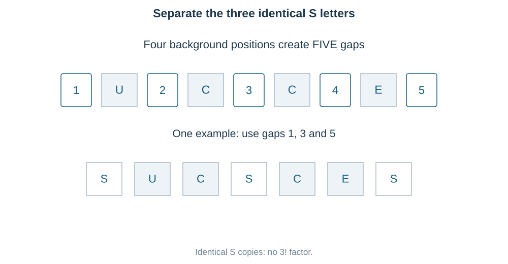

Each row has five gaps, including both ends. Choose three different gaps for the three $S$s:

$$
\binom53=10.
$$

The $S$s are identical, so there is **no extra $3!$**. Thus

$$
\boxed{12\cdot10=120}\quad\text{(d)}.
$$

**Check that nothing is missed or duplicated:** removing the $S$s from a valid word gives exactly one background row. Their original locations give exactly one chosen set of gaps. So the process can be reversed uniquely.

**Another possible viewpoint:** choose three nonadjacent positions among seven: $\binom{7-3+1}3=\binom53$. Fill the four other positions with $U,C,C,E$ in $12$ ways. Same count.

### Question 4 — At least two means three disjoint cases

**PDF page 24 | MCQ | Notes: C05**

A committee of $4$ persons is to be formed from $6$ men and $4$ women so that it has at least $2$ women. The number of ways is

- (a) $90$
- (b) $135$
- (c) $115$
- (d) $195$

**“At least $2$” includes $2,3,$ and $4$ women.** A committee is unordered, so use combinations.

$$
\begin{aligned}
2W,2M &: \binom42\binom62=6(15)=90,\\
3W,1M &: \binom43\binom61=4(6)=24,\\
4W,0M &: \binom44\binom60=1.
\end{aligned}
$$

Add:

$$
\boxed{90+24+1=115}\quad\text{(c)}.
$$

**Why multiply within a row?** We need both its women and its men. **Why add rows?** A final committee has only one possible number of women.

**Another possible approach:** subtract committees with zero or one woman:

$$
\binom{10}4-\binom64-\binom41\binom63
=210-15-80=115.
$$

Both routes are short; direct cases keep the condition visible.

### Question 5 — No polygon side: understand the overlap in the bad cases

**PDF page 24 | Numerical value | Notes: C13**

The number of triangles that can be formed by joining the vertices of a regular $12$-sided polygon such that no side of the triangle is a side of the polygon is ____.

**Translate the geometry first:** a triangle side is a polygon side exactly when two chosen vertices are neighbours on the polygon. We want no neighbouring chosen pair, including across vertices $12$ and $1$.

All vertex triples form triangles because the polygon is convex:

$$
\binom{12}3=220.
$$

**Why $220-12(10)$ is wrong:** choose a forbidden polygon edge, then any of the other ten vertices. This gives $120$ edge–triangle pairs, not $120$ different bad triangles. Each triangle made from three consecutive polygon vertices has two polygon edges, so it was counted twice.

There are $12$ such consecutive-vertex triangles. No triangle in a twelve-gon can have three polygon edges. Therefore

$$
\text{bad triangles}=120-12=108,
$$

$$
\boxed{\text{valid}=220-108=112}.
$$

**Another possible approach — count valid selections directly.**

- Vertex $12$ absent: choose three nonadjacent positions from the line $1,\ldots,11$, giving $\binom93=84$.
- Vertex $12$ present: vertices $1,11$ are absent. Choose two nonadjacent positions from $2,\ldots,10$, a line of nine positions, giving $\binom82=28$.

Total $84+28=112$. The cases use a fixed labelled vertex; we do not identify rotated triangles.

### Question 6 — Alternating around a circle

**PDF page 24 | MCQ | Notes: C06–C07**

The number of ways in which $5$ men and $5$ women can be seated alternately around a circular table is

- (a) $14400$
- (b) $576$
- (c) $2880$
- (d) $5760$

**Start with one group around the circle.** Seat the five distinct men first. Fix one man as a reference to remove repeated rotations:

$$
(5-1)!=24.
$$

The women must fill the five gaps between neighbouring men. They are distinct, so can be assigned in $5!=120$ ways:

$$
\boxed{4!\,5!=24(120)=2880}\quad\text{(c)}.
$$

**Why no additional factor $2$?** An unnumbered circle has no fixed “first seat” at which to choose whether a man or woman starts. The gap construction already counts every alternating circle once.

**Another possible approach:** temporarily label ten seats. There are two alternating gender patterns, each filled in $(5!)^2$ ways. Each ordinary circle occurs in ten rotated seat descriptions, so $2(5!)^2/10=2880$. Mirror orders remain distinct at a table.

### Question 7 — Positive integers mean at least one star per group

**PDF page 24 | Numerical value | Notes: C09**

The number of solutions of $x+y+z+w=15$ in positive integers is ____.

**Positive means every variable is at least one.** Think of fifteen stars in a row. Choose three of the fourteen internal gaps for separators. The four nonempty groups give $x,y,z,w$.

$$
\boxed{\binom{15-1}{4-1}=\binom{14}3=364}.
$$

**Why this route?** Only the number of stars in each labelled group matters. The stars are identical; permutations of individual stars would invent new outcomes.

**Another possible approach:** set $a=x-1,b=y-1,c=z-1,d=w-1$. Then $a+b+c+d=11$, all nonnegative. Stars and bars gives $\binom{11+3}3=\binom{14}3$.

**Check:** $(3,2,4,6)$ is allowed, while $(0,2,4,9)$ is not. A nonnegative formula applied directly to total $15$ would wrongly include the latter.

### Question 8 — Remove each lower bound before distributing freely

**PDF page 24 | MCQ | Notes: C09**

The number of ways of distributing $14$ identical balls into $4$ distinct boxes so that every box contains at least $2$ balls is

- (a) $286$
- (b) $680$
- (c) $120$
- (d) $84$

**Take care of “at least two” first.** Put two identical balls into every box. This reserves $4(2)=8$ balls.

Let $y_i$ be the extra balls in box $i$. Then

$$
y_1+y_2+y_3+y_4=14-8=6,\qquad y_i\ge0.
$$

Therefore

$$
\boxed{\binom{6+4-1}{4-1}=\binom93=84}\quad\text{(d)}.
$$

**Check:** an extra distribution $(6,0,0,0)$ becomes original counts $(8,2,2,2)$, which meets the lower bounds. Empty extra boxes are allowed even though the original boxes are nonempty.

The count is not $4^6$: that would name the six remaining balls and distinguish swaps between identical balls.

### Question 9 — Exactly two correct: all the others must be wrong

**PDF page 24 | MCQ | Notes: C11**

Six letters are to be put into six addressed envelopes, one in each. The number of ways in which exactly two letters go into their correct envelopes is

- (a) $90$
- (b) $135$
- (c) $120$
- (d) $150$

**Exactly two correct means the remaining four must all be incorrect.** First choose the two correct letters:

$$
\binom62=15.
$$

For the other four, use a derangement:

$$
D_4=4!-\binom41 3!+\binom42 2!
-\binom43 1!+\binom44 0!
=24-24+12-4+1=9.
$$

Thus

$$
\boxed{\binom62D_4=15(9)=135}\quad\text{(b)}.
$$

**Why not $15\cdot4!$?** The identity arrangement of the remaining four would make all six letters correct. Other permutations can give three or four correct letters, so a factorial does not enforce “exactly.”

**Another way to get $D_4$:** $D_4=3(D_3+D_2)=3(2+1)=9$. Use the recurrence only with the correct base values.

### Question 10 — Leading and final digits can compete for the same digit

**PDF page 25 | MCQ | Notes: C04**

The number of even four-digit numbers greater than $3000$ that can be formed using the digits $0,1,2,3,4,5$ without repetition is

- (a) $96$
- (b) $108$
- (c) $84$
- (d) $120$

**Both ends are restricted, and their choices can interact.** The first digit must be $3,4,$ or $5$; the last must be one of $0,2,4$.

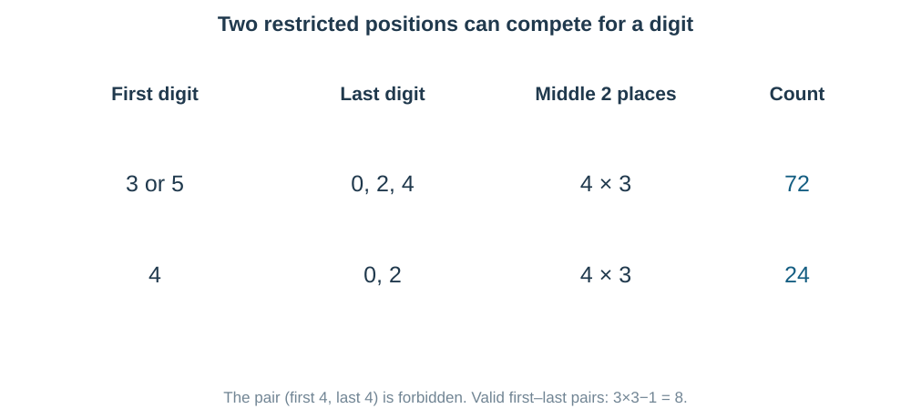

**First digit $3$ or $5$:** $2$ choices. Neither uses an even digit, so all three even endings remain. The middle positions have $4\cdot3$ choices:

$$
2\cdot3\cdot4\cdot3=72.
$$

**First digit $4$:** the final digit cannot reuse $4$, leaving $0$ or $2$. Count $1\cdot2\cdot4\cdot3=24$.

$$
\boxed{72+24=96}\quad\text{(a)}.
$$

Every distinct-digit number beginning with $3$ exceeds $3000$; $3000$ itself cannot occur because its digits repeat.

**Why $3\cdot3\cdot4\cdot3$ fails:** it includes the forbidden pair “first $4$, last $4$.”

**Another possible approach:** count allowable ordered first–last pairs. There are $3\cdot3-1=8$, removing only $(4,4)$. Each leaves $4\cdot3=12$ middle assignments, so $8(12)=96$.

### Question 11 — Dictionary rank: count only the earlier blocks

**PDF page 25 | Numerical value | Notes: C12**

All the arrangements of the letters of the word SMILE are written in alphabetical (dictionary) order. The rank of the word SMILE is ____.

**Alphabetical order is $E<I<L<M<S$.** Count whole blocks before SMILE, keeping the correct prefix fixed at each step.

| Position | Prefix already fixed | Smaller unused letter choices | Earlier words |
|---|---|---|---:|
| $1$: $S$ | None | $E,I,L,M$ | $4\cdot4!=96$ |
| $2$: $M$ | $S$ | $E,I,L$ | $3\cdot3!=18$ |
| $3$: $I$ | $SM$ | $E$ | $1\cdot2!=2$ |
| $4$: $L$ | $SMI$ | $E$ | $1\cdot1!=1$ |
| $5$: $E$ | $SMIL$ | None | $0$ |

These blocks cannot overlap: each is classified by its first difference from the target. There are $96+18+2+1=117$ words before SMILE:

$$
\boxed{\text{rank}=117+1=118}.
$$

**Check by a second local view:** after the first $114$ words, the $SM$ block is SMEIL, SMELI, SMIEL, SMILE, SMLEI, SMLIE. The target is fourth within this six-word block: $114+4=118$.

### Question 12 — Equal-sized groups are not labelled

**PDF page 25 | MCQ | Notes: C08**

The number of ways of dividing $12$ distinct persons into three groups of $4$ each (the groups are not labelled) is

- (a) $34650$
- (b) $5775$
- (c) $17325$
- (d) $1925$

**The groups have no labels.** Temporarily name them A, B, C. Selecting membership gives

$$
\binom{12}4\binom84\binom44
=\frac{12!}{(4!)^3}=34650.
$$

Every unlabelled partition appears $3!=6$ times under the temporary names:

$$
\boxed{\frac{34650}{6}=5775}\quad\text{(b)}.
$$

**Why another division after $(4!)^3$?** Those three factors remove orders **inside** groups. The $3!$ removes names **between** equal-sized groups. They correct different overcounts.

**Another possible approach:** insist that the smallest-numbered person is in the first group. Choose its other three members in $\binom{11}3$ ways. Among the remaining eight, choose four in $\binom84$ ways and divide by $2!$ for the last two unlabelled groups. Count $165(70)/2=5775$.

### Question 13 — Exactly three aces: the other two are non-aces

**PDF page 25 | MCQ | Notes: C05**

From a well-shuffled pack of $52$ cards, the number of $5$-card hands containing exactly $3$ aces is

- (a) $1128$
- (b) $6768$
- (c) $4512$
- (d) $3384$

**The card hand is unordered, and “exactly” forbids a fourth ace.** Choose three of the four aces, then two of the $48$ non-aces:

$$
\boxed{\binom43\binom{48}2
=4\frac{48(47)}2=4512}\quad\text{(c)}.
$$

**Why not choose the last two from $49$ remaining cards?** That pool still contains the fourth ace. Including it would make four aces, contrary to the question.

**Another possible approach:** count ordered draws with exactly three aces as $\binom53\,{}^4P_3\,{}^{48}P_2$, then divide by $5!$ because each hand has $5!$ draw orders. It simplifies to the same answer, but selecting the two card types directly is shorter.

The phrase “well-shuffled” matters for probabilities; it does not change the number of possible hands.

### Question 14 — Different people in the chosen gaps can swap

**PDF page 25 | MCQ | Notes: C06**

Three boys and four girls are to be arranged in a row so that no two boys are together. The number of such arrangements is

- (a) $720$
- (b) $576$
- (c) $2880$
- (d) $1440$

**Arrange the girls first.** Four distinct girls can be ordered in $4!=24$ ways and create five gaps, including both ends.

Choose three of those gaps and arrange the three distinct boys in them:

$$
\boxed{4!\binom53\,3!
=24(10)(6)=1440}\quad\text{(d)}.
$$

**Compare Q3:** its $S$s were identical, so no $3!$ was needed. Here swapping two boys produces a new row.

**Another possible approach:** choose three nonadjacent boy positions among seven, $\binom53$, then fill boy positions in $3!$ ways and girl positions in $4!$ ways. This gives the same unique description of each row.

### Question 15 — Choose digit sets, then handle leading zero

**PDF page 25 | Numerical value | Notes: C04, C15**

The number of three-digit numbers having all distinct digits and digit-sum equal to $9$ is ____.

**A small sum suggests choosing digit sets first.** Write the distinct digits as $a<b<c$. Then $a+b+c=9$.

The complete unordered list is

$$
\begin{array}{c|l}
a=0 & \{0,1,8\},\{0,2,7\},\{0,3,6\},\{0,4,5\}\\
a=1 & \{1,2,6\},\{1,3,5\}\\
a=2 & \{2,3,4\}.
\end{array}
$$

For $a\ge3$, the smallest sum is $3+4+5=12>9$, so nothing else is possible.

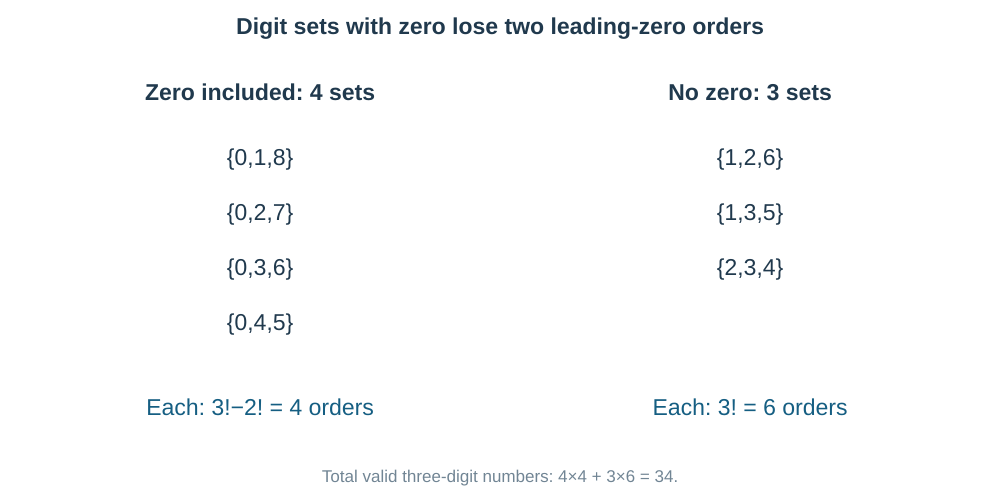

A set containing zero has $3!-2!=4$ valid three-digit orders: remove the two orders starting with zero. Each nonzero set has $3!=6$ orders:

$$
\boxed{4(4)+3(6)=16+18=34}.
$$

**Another possible approach:** count distinct-digit strings of length three with sum $9$. The seven sets give $7(6)=42$ strings. The four zero-containing sets give $4(2)=8$ zero-leading strings, so $42-8=34$.

### Question 16 — A necklace can be turned over

**PDF page 25 | MCQ | Notes: C07**

Statement I: The number of ways of arranging $n$ $(n\ge3)$ distinct beads to form a necklace is $(n-1)!$.

Statement II: The number of circular arrangements of $n$ distinct objects around a table is $(n-1)!$.

- (a) Both Statement I and Statement II are true
- (b) Statement I is true but Statement II is false
- (c) Statement I is false but Statement II is true
- (d) Both Statement I and Statement II are false

**Decide whether turning the object over is allowed.**

For $n\ge3$ distinct beads, a freely turnable necklace identifies a clockwise order with its reverse:

$$
\text{necklaces}=\frac{(n-1)!}{2}.
$$

Statement I omits the division by $2$, so it is false.

Around an ordinary unnumbered table, rotations are the same but the reverse seating order is different. Fixing one person leaves $(n-1)!$ clockwise orders, so Statement II is true.

$$
\boxed{\text{I false, II true}}\quad\text{(c)}.
$$

**Check with three beads:** all six linear arrangements describe one freely turnable necklace. Table orders after fixing A are ABC and ACB, two distinct seatings. The formulas give $2!/2=1$ and $2!=2$.

### Question 17 — Match four different kinds of counting

**PDF page 25 | MCQ | Notes: C02–C03, C11**

Match List-I with List-II.

| List-I | Task |
|---|---|
| A | Arrangements of the letters of the word LEVEL |
| B | Three-digit numbers with distinct digits from $\{1,2,3,4,5\}$ |
| C | Ways to select $2$ objects out of $6$ distinct objects |
| D | Derangements of $4$ objects |

List-II: I. $9$; II. $15$; III. $30$; IV. $60$.

- (a) A-III, B-IV, C-II, D-I
- (b) A-IV, B-III, C-II, D-I
- (c) A-III, B-IV, C-I, D-II
- (d) A-II, B-III, C-IV, D-I

**Each row describes a different counting object.**

$$
\begin{aligned}
\mathrm A:\ \text{LEVEL}&\quad \frac{5!}{2!2!}=30 &&\longrightarrow\mathrm{III},\\
\mathrm B:\ \text{three digit positions}&\quad {}^5P_3=5(4)(3)=60 &&\longrightarrow\mathrm{IV},\\
\mathrm C:\ \text{two-object group}&\quad \binom62=15 &&\longrightarrow\mathrm{II},\\
\mathrm D:\ \text{no correct positions}&\quad D_4=9 &&\longrightarrow\mathrm I.
\end{aligned}
$$

Thus $\boxed{\text{A–III, B–IV, C–II, D–I}}$, **option (a)**.

**Check the choices of formula:** LEVEL has two $L$s and two $E$s, so equal copies need correction. Digits from $1$ to $5$ have no leading-zero issue. A selected pair has no order. Derangements forbid matches, which a plain $4!$ does not.

### Question 18 — A majority of five means three, four, or five

**PDF page 26 | MCQ | Notes: C05**

A committee of $5$ is to be chosen from $6$ men and $5$ women so that men are in majority. The number of ways is

- (a) $281$
- (b) $275$
- (c) $301$
- (d) $266$

**Majority means more than half.** A five-person committee has a male majority for $3,4,$ or $5$ men.

$$
\begin{aligned}
3M,2W &: \binom63\binom52=20(10)=200,\\
4M,1W &: \binom64\binom51=15(5)=75,\\
5M,0W &: \binom65\binom50=6.
\end{aligned}
$$

$$
\boxed{200+75+6=281}\quad\text{(a)}.
$$

**Another possible approach:** from all $\binom{11}5=462$ committees, subtract those with $0,1,$ or $2$ men:

$$
462-\left[\binom60\binom55+
\binom61\binom54+\binom62\binom53\right]
=462-(1+30+150)=281.
$$

The direct majority cases are a little simpler. There is no tie case because the committee size is odd.

### Question 19 — Choose boundary lines; subtract every square size

**PDF page 26 | Numerical value | Notes: C14**

The number of rectangles on a standard $8\times8$ chessboard that are not squares is ____.

**A rectangle is fixed by its boundary lines.** An $8\times8$ board has nine vertical and nine horizontal grid lines.

All grid-aligned rectangles:

$$
\binom92\binom92=36^2=1296.
$$

Squares of side $1,2,\ldots,8$ cells have $8^2,7^2,\ldots,1^2$ placements:

$$
\text{squares}=\sum_{j=1}^8j^2
=\frac{8(9)(17)}6=204.
$$

Thus

$$
\boxed{\text{not-square rectangles}=1296-204=1092}.
$$

**Why not subtract only $64$?** That removes only the single-cell squares. Larger squares are rectangles too and must also be excluded.

**Another possible approach:** directly sum $(9-w)(9-h)$ over widths and heights $1\le w,h\le8$ with $w\ne h$. The complete double sum is $(1+\cdots+8)^2=1296$; its equal-width-height part is $204$. The line-choice route packages the same count more efficiently.

### Question 20 — A divisor is a choice of prime exponents

**PDF page 26 | MCQ | Notes: C16**

The number of positive divisors of $7200$ that are multiples of $10$ is

- (a) $36$
- (b) $24$
- (c) $20$
- (d) $30$

**Prime powers turn the condition into independent exponent choices.**

$$
7200=2^5\,3^2\,5^2.
$$

A divisor is $2^a3^b5^c$. Being a multiple of $10=2\cdot5$ requires $a\ge1,c\ge1$:

$$
a\in\{1,2,3,4,5\},\quad
b\in\{0,1,2\},\quad c\in\{1,2\}.
$$

$$
\boxed{5\cdot3\cdot2=30}\quad\text{(d)}.
$$

**Why not $(5+1)(2+1)(2+1)$?** That counts every divisor, including numbers with no factor $2$ or no factor $5$. The multiple-of-ten restriction removes those choices.

**Another possible approach:** write $d=10q$. Then $d\mid7200$ exactly when $q\mid720$. Since $720=2^4\,3^2\,5$, its divisor count is $5\cdot3\cdot2=30$.

### Question 21 — Sum by place value instead of listing twenty-four numbers

**PDF page 26 | MCQ | Notes: C17**

The sum of all four-digit numbers formed using the digits $1,2,3,4$ without repetition is

- (a) $66660$
- (b) $26664$
- (c) $66600$
- (d) $64440$

**The target is the sum, so count contributions by place.** Listing all $4!=24$ numbers is possible but creates avoidable additions.

Fix one digit in a given place. The other three digits can be arranged in $3!=6$ ways. Thus the digit total in each place is

$$
6(1+2+3+4)=60.
$$

Multiply by place values:

$$
\boxed{60(1000+100+10+1)=60(1111)=66660}
\quad\text{(a)}.
$$

**Why the symmetry is valid:** all four digits are nonzero and every permutation is included. No leading-zero strings are removed.

**Another possible approach:** pair a number with the number formed by replacing each digit $d$ with $5-d$. Each pair sums to $5555$. There are $24/2=12$ pairs, giving $12(5555)=66660$.

### Question 22 — Even sum: classify by the number of odd selections

**PDF page 26 | MCQ | Notes: C05, C18**

The number of ways of choosing $3$ distinct numbers from $\{1,2,\ldots,30\}$ such that their sum is even is

- (a) $2015$
- (b) $2030$
- (c) $2060$
- (d) $4060$

**An even sum needs an even number of odd selections.** There are fifteen odd and fifteen even numbers in $1,\ldots,30$.

The unordered three-number selection has two allowed cases:

$$
\begin{aligned}
\text{three evens}:&\quad\binom{15}3=455,\\
\text{two odds, one even}:&\quad\binom{15}2\binom{15}1=105(15)=1575.
\end{aligned}
$$

$$
\boxed{455+1575=2030}\quad\text{(b)}.
$$

**Why no extra factor $3$?** We are choosing a set, not assigning the even number to an ordered position. OOE, OEO and EOO are three descriptions of the same selected set.

**Another possible approach — a pairing argument:** send each chosen number $t$ to $31-t$. This preserves distinctness and exchanges odd/even status. For three numbers, the new sum is $93-\text{old sum}$, which has opposite parity. So even-sum and odd-sum triples pair one-to-one. Half of $\binom{30}3=4060$ gives $2030$. This symmetry works here because there are paired complementary numbers and an odd selection size.

### Question 23 — An upper bound needs a bad-case subtraction

**PDF page 26 | Numerical value | Notes: C09–C10**

The number of solutions of $x+y+z=12$ in integers with $1\le x,y,z\le6$ is ____.

**The lower-bound formula alone is too broad.** All positive solutions total $\binom{11}2=55$, but this includes variables greater than six.

For the bad case $x\ge7$, write $x=6+u$, $u\ge1$. Then

$$
u+y+z=6,
$$

which has $\binom52=10$ positive solutions. The same count applies to bad $y$ and bad $z$.

Two bad variables would already total at least $14$, exceeding $12$, so the three bad sets cannot overlap. Hence

$$
\boxed{55-3(10)=25}.
$$

**Another possible approach / direct check:** fix $x=1,2,\ldots,6$. Then $y+z=12-x$, with $1\le y,z\le6$. The possible counts are $2,3,4,5,6,5$ respectively. Their sum is $25$.

**Read the graph:** those are the numbers of dots in successive vertical columns. The count of integer points agrees with the case count; the area between two lines would not answer an integer-solution question.

### Question 24 — Three collinear points do not form a triangle

**PDF page 26 | MCQ | Notes: C13**

Out of $12$ points in a plane, $5$ are collinear and no other three are collinear. The number of triangles with vertices at these points is

- (a) $220$
- (b) $200$
- (c) $210$
- (d) $185$

**Choosing any three points overcounts only the flat triples.** There are

$$
\binom{12}3=220
$$

three-point subsets. The five collinear points produce $\binom53=10$ triples with zero area.

No other triple is collinear, so

$$
\boxed{220-10=210}\quad\text{(c)}.
$$

**Why not remove every choice containing two baseline points?** A triangle needs a nonzero height. Two baseline points give a base, and an off-line third point supplies that height; those choices are valid.

**Another possible approach:** classify by how many of the five line points are selected:

$$
\binom73+\binom51\binom72+\binom52\binom71
=35+105+70=210.
$$

There are no valid choices with all three on the line. Subtraction is shorter, while these cases explain which triangles remain.

### Question 25 — Partial words from repeated letters need multiplicity cases

**PDF page 26 | Numerical value | Notes: C03, C15**

The number of distinct $5$-letter arrangements (words, meaningful or not) that can be formed using the letters of the word ARRANGE, using each letter at most as many times as it occurs, is ____.

**A global repeated-letter division would fail here.** We use only five of seven available letters, so the repeats actually present can change. First decide which pairs are used.

The available types are $A,A,R,R,N,G,E$.

**Both pairs:** use $A,A,R,R$ plus one of $N,G,E$:

$$
3\frac{5!}{2!2!}=3(30)=90.
$$

**Exactly one pair:** choose its type ($A$ or $R$), then choose three single letter types from the other four types. The other repeated type may be used once, but not twice:

$$
2\binom43\frac{5!}{2!}=2(4)(60)=480.
$$

**No pair:** use one of each of the five types, with $5!=120$ orders.

$$
\boxed{90+480+120=690}.
$$

**Check the case logic:** a five-letter word cannot use three copies of any letter, because none are available. The number of repeated pairs is therefore exactly $0,1,$ or $2$. Every word belongs to one case.

**Another possible approach — classify the two omitted letters.** Omitting $AA$ or $RR$ gives two cases with $5!/2!=60$ arrangements each. Omitting one $A$ and one $R$ gives $120$. Omitting one of $A,R$ and one of $N,G,E$ gives six cases with $60$ arrangements each. Omitting two of $N,G,E$ gives three cases with $30$ arrangements each:

$$
2(60)+120+6(60)+3(30)=690.
$$

Both methods count letter multiplicities, not choices among physical identical copies. The used-pair route has fewer main cases.

## Answer check

Read after attempting. Source option order and numerical-value formats are preserved.

| Question | Answer | Question | Answer |
|---|---|---|---|
| 1 | (a) $4989600$ | 14 | (d) $1440$ |
| 2 | (b) $5712$ | 15 | $34$ |
| 3 | (d) $120$ | 16 | (c) |
| 4 | (c) $115$ | 17 | (a) |
| 5 | $112$ | 18 | (a) $281$ |
| 6 | (c) $2880$ | 19 | $1092$ |
| 7 | $364$ | 20 | (d) $30$ |
| 8 | (d) $84$ | 21 | (a) $66660$ |
| 9 | (b) $135$ | 22 | (b) $2030$ |
| 10 | (a) $96$ | 23 | $25$ |
| 11 | $118$ | 24 | (c) $210$ |
| 12 | (b) $5775$ | 25 | $690$ |
| 13 | (c) $4512$ |  |  |

## Coverage and source notes

All $25$ supplied questions appear in order, with $18$ MCQs and $7$ numerical-value questions. Every original option is retained. All intended answers agree with the supplied key after independent calculation.

Ordinary table rotations, necklace reflections, identical copies, labelled boxes, unlabelled groups, and grid-aligned rectangles are distinguished explicitly. Each method's assumptions matter as much as its formula.

Recent weightage is an archive-card recount: $20,21,22$ questions in $2024,2025,2026$, over $20,19,19$ full-year papers. The pooled mean is $63/58\approx1.09$. The guide does not claim a full independent $2020$–$2026$ official-paper or formula-frequency audit. Its method-cue table teaches recognition; it is not a measured frequency ranking.

## Offline research record

- Supplied Maths Predicted V1.pdf: questions on PDF pages 24–26, answer key on page 26, source working through page 27. All questions and options were read visually.
- NTA, Syllabus for JEE Main 2027, Mathematics Unit 4: counting principle, permutations, combinations, their meaning and simple applications.
- ExamSIDE, Permutations and Combinations: full category HTML saved; $63$ recent distinct question-card IDs independently recounted.
- PYQSide recent-paper classification was a scope cross-check only; category totals were not merged.

All diagrams are original local SVG files made from explicit counts or coordinates. All useful alternative methods are plain visible content and remain included for the later printed booklet.
