# Binomial Theorem — JEE Main revision guide

*One required power usually needs one term, not the whole expansion. Learn to see which choices create that power.*

> **For Kanna | Chapter 6**  
> Goal: about $120/300$ towards $200/300$ — Physics $60$, Maths $60$, Chemistry $80$.  
> Meaning → picture → equation → calculation → check. All $30$ supplied questions follow the notes and recap.

## Recent chapter weightage

**The checked ExamSIDE 2024–2026 category gives about $1.12$ Binomial Theorem questions per Paper 1.**

| Year | Papers | Chapter questions | Questions per paper |
|---|---:|---:|---:|
| $2024$ | $20$ | $24$ | $1.20$ |
| $2025$ | $19$ | $24$ | $1.26$ |
| $2026$ | $19$ | $17$ | $0.89$ |
| Together | $58$ | $65$ | $1.12$ |

The pooled mean is $65/58$. All $65$ distinct recent category-card IDs were saved and recounted. Another archive, PYQSide, classifies $56$ questions here over these years. The classifications differ; these are not two counts to add. The table consistently uses ExamSIDE. This is an archive recount, not an independent full-paper or formula-frequency audit. The offered-question format also differed in $2024$.

**Revision priority:** general term and its index, matching exponents, coefficient sums at $1$ and $-1$, adjacent-coefficient ratios, and cancellation patterns. A mean is not a promise for a particular shift.

## Scope and source qualifications before studying

The current official Mathematics Unit 5 specifies a **positive integral index**, the general term, middle terms and simple applications. Here the finite theorem is the core. Supporting counting, finite sums, remainders and rational-term conditions are explained as needed.

- **Q20 has a missing condition.** The intended $ab=1$ assumes $a\ne0$. The printed question also permits $a=0$, giving $ab=0$; both cases are explained.
- **Q3 has a tie:** two terms share the greatest numerical value.
- **Q25 uses a nonintegral index.** Its generalized expansion is retained as a clearly labelled supplied-question extension, with the convergence condition. It is outside the positive-index wording of the current official unit.
- Formal term counts treat the displayed letters as independent symbols. Special numerical substitutions can make terms disappear or combine.

## Formula and concept bank

### Concept C01 — Why a binomial coefficient appears

**Important for JEE Main.** A binomial has two parts, such as $a+b$. The expression $(a+b)^n$ means multiplying $n$ copies of $(a+b)$, where $n$ is a nonnegative integer.

To create one product, pick either $a$ or $b$ from each bracket. If exactly $r$ brackets supply $b$, the other $n-r$ supply $a$. The resulting product is $a^{n-r}b^r$.

How many choices create the same product? Choose the $r$ brackets supplying $b$:

$$
\boxed{(a+b)^n=\sum_{r=0}^{n}\binom nr a^{n-r}b^r}.
$$

In the diagrams, $C(n,r)$ is another way to write $\binom nr$: choose $r$ from $n$.

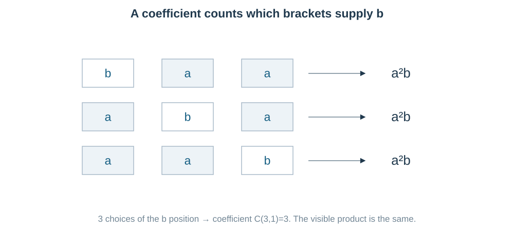

**Read the picture:** the chosen positions differ, but multiplication combines each product into $a^2b$. Therefore its coefficient is $3=\binom31$.

The first terms are

$$
a^n+na^{n-1}b+\frac{n(n-1)}2a^{n-2}b^2+\cdots+b^n.
$$

For $(a-b)^n$, use the whole second part $-b$. The $r$th choice contributes $(-b)^r$, so odd $r$ gives a negative sign. Do not remove the sign before raising the second part to its power.

Both the constant power and the variable power matter. In $(2-3x)^7$, choosing three copies of $-3x$ leaves four copies of $2$.

### Concept C02 — Term number, choice index, and middle position

The choice index starts at $r=0$, but term positions start at $1$:

$$
\boxed{T_{r+1}=\binom nr a^{n-r}b^r},\qquad 0\le r\le n.
$$

Thus the fifth term uses $r=4$. The general $k$th term is

$$
\boxed{T_k=\binom n{k-1}a^{n-k+1}b^{k-1}}.
$$

There are $n+1$ formal terms.

| Index $n$ | Number of terms | Middle position(s) |
|---|---:|---|
| Even | Odd | $\boxed{T_{n/2+1}}$ |
| Odd | Even | $\boxed{T_{(n+1)/2},\ T_{(n+3)/2}}$ |

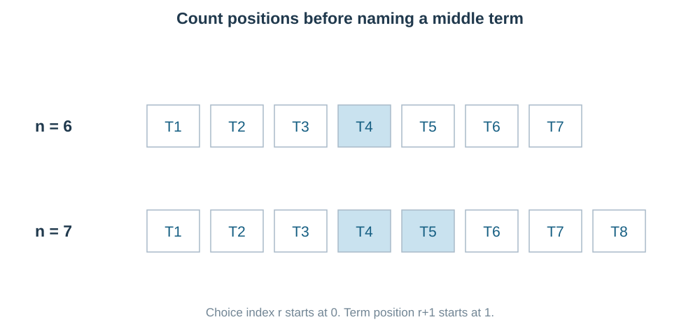

**Read the slots:** for $n=6$, the middle is the fourth term, whose choice index is $3$. Confusing the term position with the choice index is the mistake in source Q18(iv).

The coefficients $\binom nr$ form Pascal's triangle. Each entry is the sum of the two entries directly above:

$$
\boxed{\binom nr=\binom{n-1}r+\binom{n-1}{r-1}},\qquad
\boxed{\binom nr=\binom n{n-r}}.
$$

The symmetry means “choose which $r$ are included” is equivalent to “choose which $n-r$ are left out.” We will use this to match coefficient sums.

### Concept C03 — A coefficient is the multiplier, not the whole term

In $-15120x^3$, the term is $-15120x^3$ and the coefficient of $x^3$ is $-15120$. The binomial coefficient used to produce it is a different number, $\binom73=35$.

For

$$
(Ax^p+Bx^q)^n,
$$

the general term is

$$
\boxed{T_{r+1}=\binom nr A^{n-r}B^r
x^{p(n-r)+qr}}.
$$

**Route for a target power $x^m$:**

1. Set the total exponent $pn+(q-p)r=m$.
2. Check that $r$ is an integer with $0\le r\le n$.
3. Keep the multiplier $\binom nr A^{n-r}B^r$.

If no allowed integer $r$ exists, the coefficient is zero. If $p=q$, all choices have the same exponent; combine the expression as $(A+B)^nx^{pn}$ instead.

**Example:** in $(2x^2-x^{-1})^9$, the exponent is $2(9-r)-r=18-3r$, not $18-r$.

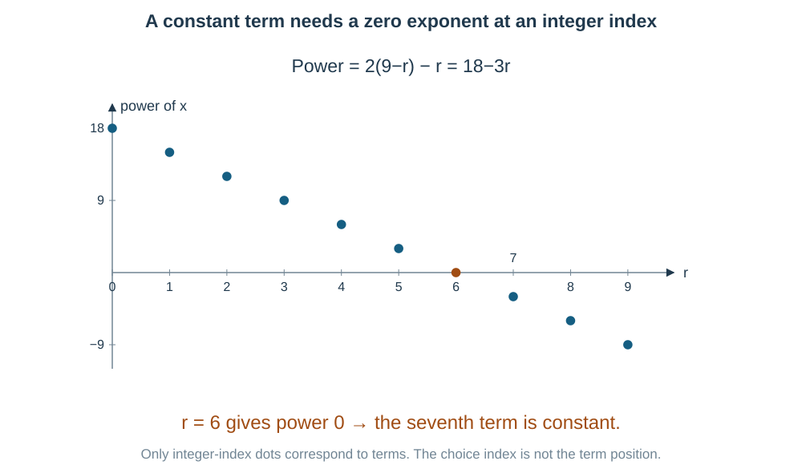

For a product of polynomials $P(x)Q(x)$, the coefficient of $x^m$ is

$$
\boxed{[x^m](PQ)=\sum_j [x^j]P\,[x^{m-j}]Q}.
$$

Here $[x^m]P$ means “the coefficient of $x^m$ in $P$.” **Meaning:** powers in a multiplied pair must add to $m$. Do not multiply just the two coefficients of $x^m$.

Negative powers require $x\ne0$ when interpreting the original expression as a function.

### Concept C04 — Constant and rational terms: test the exponent conditions

**Independent of $x$ means the total power is zero:** $x^0=1$. It does not mean selecting only the first or last bracket part.

For $(Ax^p+Bx^q)^n$, solve

$$
pn+(q-p)r=0
$$

and enforce the integer index range.

For $(x+1/x)^n$, the powers are $n-2r$. A constant term exists iff $n$ is even:

$$
\boxed{\text{constant term}=\binom n{n/2}}\quad(n\text{ even}).
$$

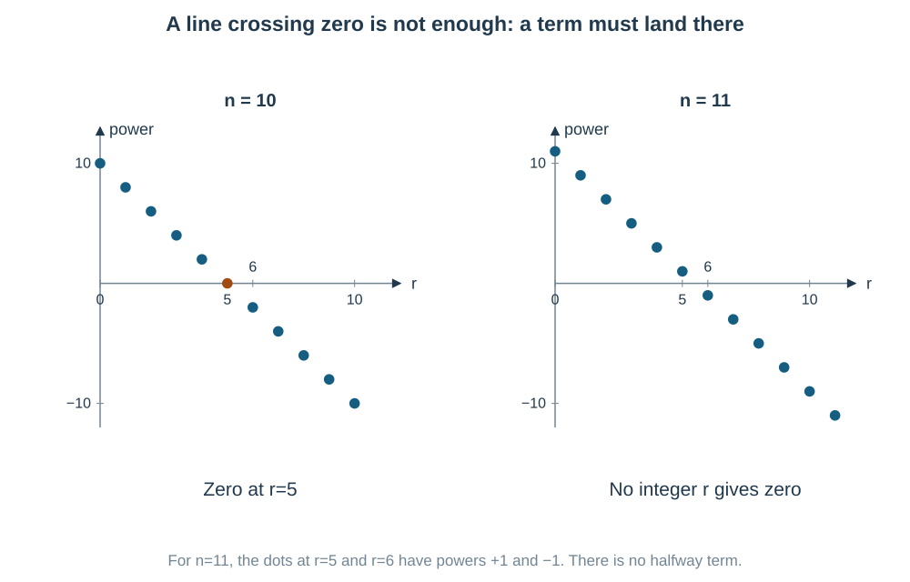

**Read the dots:** only integer values of $r$ are allowed. A line drawn between dots may cross zero even when no term lands there. A noninteger index is not an extra binomial term.

**Rational terms with roots:** write the general term as powers of distinct primes. In Q29 it is

$$
\binom{100}r\,2^{(100-r)/2}3^{r/3}.
$$

It is rational iff both prime exponents are integers. Here $r$ must be even and divisible by $3$, hence divisible by $6$.

Why can one root not cancel the other? After taking a common power, uniqueness of prime factorization forces each prime's exponent separately to be a multiple of that common power. Different primes do not supply missing factors for one another.

### Concept C05 — Sum of coefficients: use a value that removes the powers

If $P(x)=c_0+c_1x+\cdots+c_nx^n$, then

$$
\boxed{P(1)=c_0+c_1+\cdots+c_n},
$$

because every $1^r$ is $1$. Also

$$
\boxed{P(-1)=c_0-c_1+c_2-c_3+\cdots}.
$$

The constant coefficient is $P(0)$ for an ordinary polynomial.

**Question clue:** “sum of all coefficients” should make you try $x=1$ before expanding.

For $(a+bx)^n$, the coefficient sum is $(a+b)^n$. It is $2^n$ only for $(1+x)^n$.

$$
\boxed{\sum_{r=0}^{n}\binom nr=2^n},\qquad
\boxed{\sum_{r=0}^{n}(-1)^r\binom nr=0}\quad(n\ge1).
$$

For a two-variable polynomial, the sum of all coefficients is its value at $x=y=1$. Preserve signs: the algebraic sum of coefficients is different from the sum of their absolute values.

### Concept C06 — A sign-reversed partner filters even or odd choices

Let $P(x)=E(x)+O(x)$, where $E$ contains even powers of $x$ and $O$ contains odd powers. Replacing $x$ by $-x$ leaves the even part and reverses the odd part:

$$
\boxed{E(x)=\frac{P(x)+P(-x)}2},\qquad
\boxed{O(x)=\frac{P(x)-P(-x)}2}.
$$

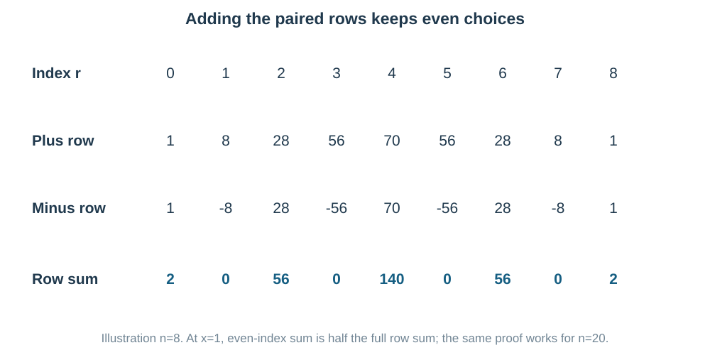

**Notice the matching structure:** $(a+b)^n$ and $(a-b)^n$ have identical even-$b$ terms and opposite odd-$b$ terms.

$$
(a+b)^n+(a-b)^n
=2\sum_{r\text{ even}}\binom nr a^{n-r}b^r,
$$

$$
(a+b)^n-(a-b)^n
=2\sum_{r\text{ odd}}\binom nr a^{n-r}b^r.
$$

For $n\ge1$,

$$
\boxed{\sum_{r\text{ even}}\binom nr
=\sum_{r\text{ odd}}\binom nr=2^{n-1}}.
$$

**When useful:** even-index sums, counting surviving terms, and a difference of conjugate-looking powers. In Q26, take $a=\sqrt3,b=1$; subtraction keeps only three odd-choice terms instead of all six.

**Condition check:** even/odd refers to the power whose sign was reversed. If that part already contains $x^2$, an odd choice index need not mean an odd power of $x$.

### Concept C07 — Greatest coefficient and greatest numerical term differ

The greatest **binomial coefficient** in row $n$ is

$$
\boxed{\binom n{\lfloor n/2\rfloor}}.
$$

For odd $n$, the two central coefficients are equal. For even $n$, there is one largest coefficient.

But a numerical term in $(a+b)^n$ also contains $a^{n-r}b^r$. With $a,b>0$, compare neighbouring terms:

$$
\boxed{\frac{T_{r+2}}{T_{r+1}}
=\frac{n-r}{r+1}\frac ba}.
$$

If the ratio exceeds $1$, the next term is larger; if below $1$, it is smaller; if equal to $1$, they tie. The ratio decreases as $r$ increases, so the sequence grows and then falls.

Let $M=(n+1)b/(a+b)$:

- If $M$ is not an integer, the greatest position is $\lfloor M\rfloor+1$.
- If $M$ is an integer, $T_M$ and $T_{M+1}$ tie.

The ratio proof is safer than recalling a position formula without understanding its indexing.

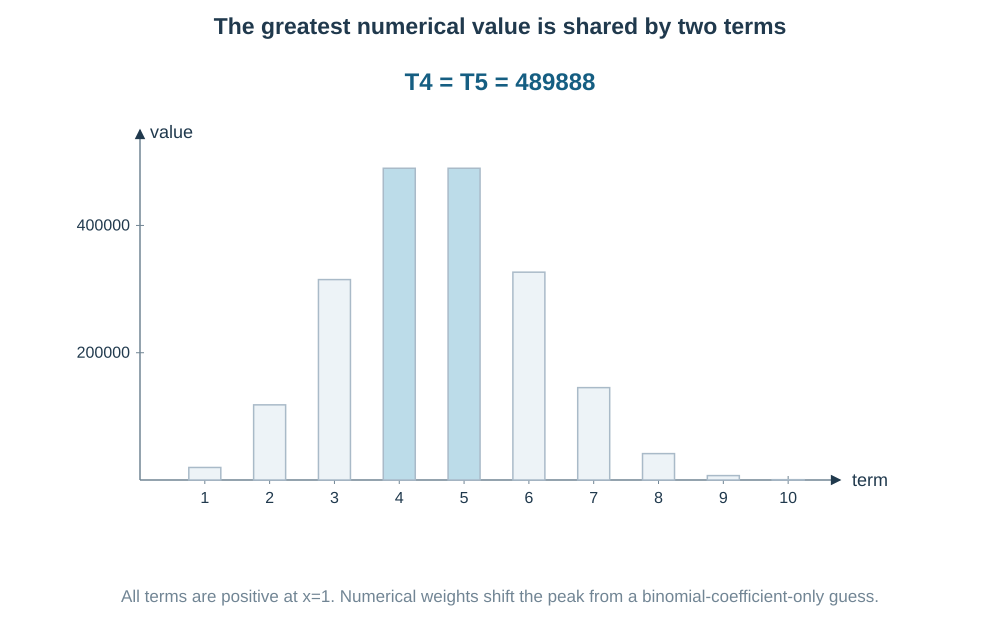

**Read the bars:** Q3 has greatest value at $T_4$ and $T_5$, not automatically at the central binomial-coefficient positions. Substitute the given $x$ first.

For greatest magnitude with signed terms, compare absolute values and then track signs. The largest signed value need not be the largest magnitude. Zero parts and zero denominators need direct handling.

### Concept C08 — Weighted sums: make the weight part of a counting identity

In this section $n\ge1$ unless a stronger condition is stated. A coefficient with a lower index outside its allowed range counts zero choices.

**Important for JEE Main.** A factor $r$ is a clue, not extra arithmetic to do term by term:

$$
\boxed{r\binom nr=n\binom{n-1}{r-1}}.
$$

**Meaning:** select a size-$r$ group and mark one of its $r$ members. Or first choose the marked person in $n$ ways, then its $r-1$ companions. Both count the same outcome.

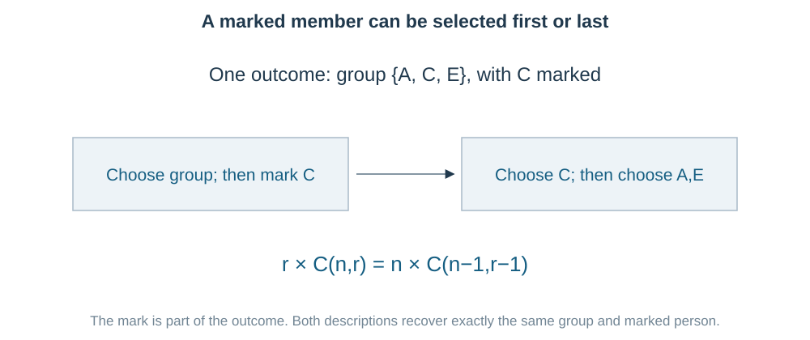

Adding over group sizes gives

$$
\boxed{\sum r\binom nr=n2^{n-1}}.
$$

Marking two ordered different members similarly gives

$$
\boxed{\sum r(r-1)\binom nr=n(n-1)2^{n-2}}\quad(n\ge2).
$$

**Notice the square pattern:** $r^2=r(r-1)+r$. Therefore

$$
\boxed{\sum r^2\binom nr=n(n+1)2^{n-2}}\quad(n\ge1).
$$

For $n=1$ this last identity can be checked directly; no two-mark argument is needed.

More generally,

$$
\sum r\binom nr t^r=nt(1+t)^{n-1},
$$

$$
\sum r(r-1)\binom nr t^r=n(n-1)t^2(1+t)^{n-2}\quad(n\ge2).
$$

These follow from shifting the index in the same identities. Differentiating $(1+t)^n$ is another way to obtain them once derivatives are familiar.

**A denominator $r+1$ suggests the opposite shift:**

$$
\boxed{\frac1{r+1}\binom nr=\frac1{n+1}\binom{n+1}{r+1}},
$$

$$
\boxed{\sum_{r=0}^{n}\frac{\binom nr}{r+1}
=\frac{2^{n+1}-1}{n+1}}.
$$

The shifted index runs from $1$ through $n+1$, so the coefficient at index $0$ is missing. That explains the $-1$. The alternating version is $1/(n+1)$. For a linear weight $Ar+B$, split it into $A\sum r\binom nr+B\sum\binom nr$.

### Concept C09 — Adjacent and equal coefficients: compare indices first

For allowed adjacent indices,

$$
\boxed{\frac{\binom n{r+1}}{\binom nr}=\frac{n-r}{r+1}}.
$$

The factorials mostly cancel. This turns equations between huge coefficients into small rational equations.

**Example clue:** three coefficients in AP means first + third = twice the middle. For the fifth, sixth and seventh terms, write

$$
\binom n4+\binom n6=2\binom n5,\qquad n\ge6.
$$

Dividing by the positive middle coefficient gives $5/(n-4)+(n-5)/6=2$. There is no need to calculate the three large coefficients separately.

**Equal coefficients in the same row:** for integer $0\le p,q\le n$,

$$
\boxed{\binom np=\binom nq\ \Longrightarrow\ p=q\text{ or }p+q=n}.
$$

Why only these possibilities? The adjacent ratio shows that the row increases toward the middle; symmetry gives its matching decrease on the other side. Apart from the central tie, equal entries are mirror positions.

**Term-number caution:** a $(2r+1)$th term has choice index $2r$, while an $(r+2)$th term has index $r+1$. Convert positions before applying symmetry, as in Q28.

### Concept C10 — Products of coefficients: count the same selection in parts

**Vandermonde's identity — Important for JEE Main:**

$$
\boxed{\sum_r\binom ar\binom b{k-r}=\binom{a+b}k}
$$

for nonnegative integers $a,b,k$, with only feasible selections contributing.

**Meaning:** choose $k$ people from two separate populations of sizes $a,b$. If $r$ come from the first, $k-r$ must come from the second. Add over possible $r$.

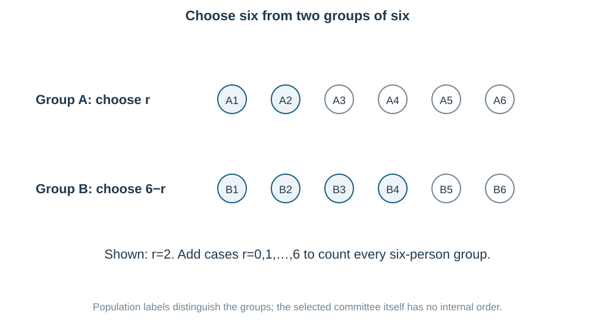

For equal population sizes,

$$
\boxed{\sum_{r=0}^{n}\binom nr^2=\binom{2n}n}.
$$

Here use $\binom nr=\binom n{n-r}$ so the lower indices add to $n$.

Another form is

$$
\boxed{\sum_r\binom ar\binom br=\binom{a+b}a=\binom{a+b}b}.
$$

**Pattern recognition:** when both lower indices are the same, use symmetry in one coefficient to create complementary indices. Q11 becomes $\binom5r\binom7{7-r}$, counting seven selected people from twelve.

**Another proof / viewpoint:** the coefficient of $x^k$ in $(1+x)^a(1+x)^b=(1+x)^{a+b}$ can be found by multiplying the two expansions, or directly from the combined exponent. These are the algebraic and counting views of the same identity.

### Concept C11 — More than two bracket parts: count how often each is chosen

In $(x+y+z)^n$, let $p,q,s$ be the number of brackets supplying $x,y,z$. They must be nonnegative integers with $p+q+s=n$.

$$
\boxed{[x^py^qz^s](x+y+z)^n=\frac{n!}{p!q!s!}}.
$$

If the exponent sum is not $n$, that coefficient is zero. With constant multipliers $(Ax+By+Cz)^n$, multiply by $A^pB^qC^s$.

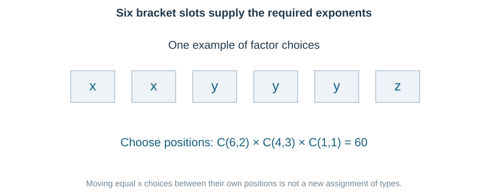

**Read the slots:** choose two $x$ slots, then three of the remaining four for $y$, leaving one $z$:

$$
\binom62\binom43\binom11=\frac{6!}{2!3!1!}.
$$

For $(1+x+x^2)^5$, different bracket choices can create the same final power. Let $n_0,n_1,n_2$ count selections of $1,x,x^2$:

$$
n_0+n_1+n_2=5,\qquad n_1+2n_2=4.
$$

For each allowed count triple, add $5!/(n_0!n_1!n_2!)$. This gives Q8's three patterns.

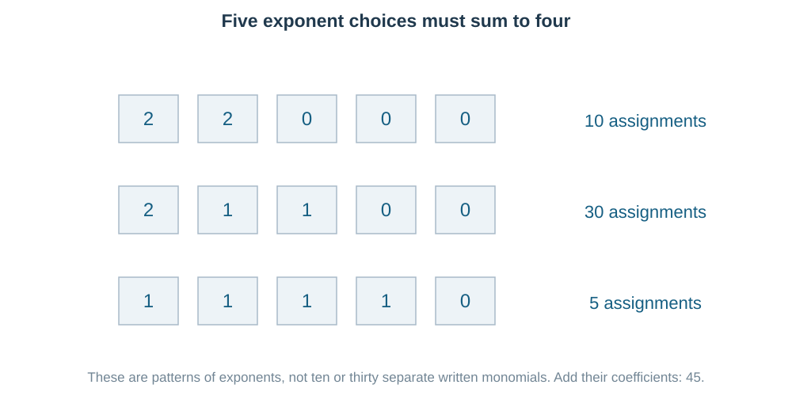

**Why not use one binomial coefficient?** Each factor now has three options. The target power alone does not specify how many times each option was used.

### Concept C12 — Long coefficient sums: Pascal absorption or a telescoping product

Pascal's identity combines neighbouring entries:

$$
\binom mk+\binom m{k+1}=\binom{m+1}{k+1}.
$$

Repeated use gives the hockey-stick identity:

$$
\boxed{\sum_{j=k}^{N}\binom jk=\binom{N+1}{k+1}}.
$$

More generally,

$$
\boxed{\sum_{j=L}^{N}\binom jk
=\binom{N+1}{k+1}-\binom L{k+1}}
\quad(L\ge k).
$$

It follows by writing $\binom jk=\binom{j+1}{k+1}-\binom j{k+1}$; the middle parts cancel.

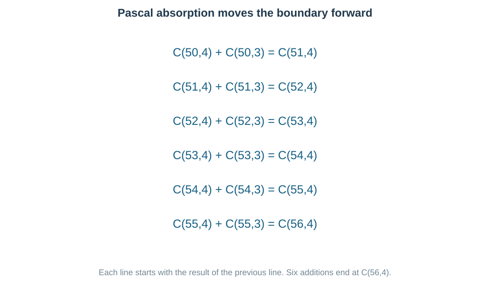

**Read the steps:** $\binom{50}4+\binom{50}3=\binom{51}4$; then the added $\binom{51}3$ gives $\binom{52}4$, and so on. The lower indices must line up correctly.

For long sums of products of two expressions, another useful identity is

$$
\boxed{(A-B)\sum_{j=0}^{n}A^{n-j}B^j=A^{n+1}-B^{n+1}}.
$$

Why? Multiplying by $A$ and $B$ creates identical inside terms with opposite signs. Only the first $A^{n+1}$ and last $-B^{n+1}$ survive.

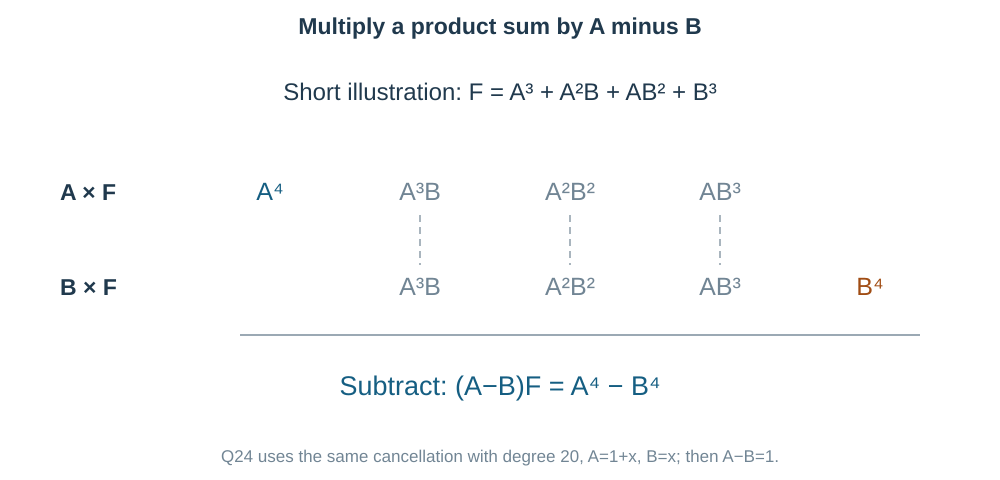

In Q24, $A=1+x,B=x$, so $A-B=1$. The entire long expression becomes $(1+x)^{21}-x^{21}$. One target coefficient is then easy to read. This avoids expanding twenty-one different terms.

### Concept C13 — Remainders and last digits: keep only what survives division

The notation

$$
u\equiv v\pmod m
$$

means $u-v$ is divisible by $m$, so they have the same remainder on division by the positive integer $m$. You may add and multiply congruences; do not divide without an allowed modular inverse.

**Useful clue:** write a base as $1+$ a multiple of the divisor, or find a small power with a simple remainder.

For integers $q,N\ge0$,

$$
(1+mq)^N
=1+Nmq+\binom N2m^2q^2+\cdots
\equiv1\pmod m.
$$

Modulo $m^2$, retain the first two terms:

$$
\boxed{(1+mq)^N\equiv1+Nmq\pmod{m^2}}.
$$

For Q6, $7^2=49\equiv-1\pmod{25}$ is faster than a long expansion.

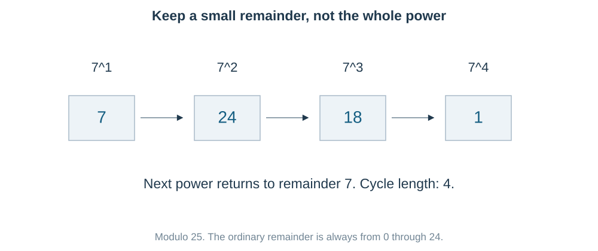

**Last two digits** are the remainder modulo $100$, written with two digits if needed. A negative intermediate residue must be brought into $0,\ldots,m-1$: $-7\equiv18\pmod{25}$.

For a largest divisor that works for every natural $n$, do two jobs:

1. Prove the proposed factor divides every expression, often by binomial cancellation.
2. Find one small input that prevents a larger common divisor.

Testing small inputs alone gives an upper bound, not a proof for all inputs. Q19 needs both steps.

### Concept C14 — Conjugate powers and a fractional-part gap

Suppose $u=a+\sqrt d$, $v=a-\sqrt d$, with integer $a$ and positive nonsquare integer $d$. Then

$$
u^n+v^n
=2\sum_{r\text{ even}}\binom nr a^{n-r}d^{r/2},
$$

an integer. This is the same even-choice cancellation from C06.

If $u^n=I+f$, $I$ integer, $0<f<1$, and also $0<v^n<1$, then

$$
f+v^n\text{ is an integer strictly between }0\text{ and }2.
$$

It must be $1$. Therefore

$$
\boxed{1-f=v^n},\qquad
\boxed{u^n(1-f)=(uv)^n=(a^2-d)^n}.
$$

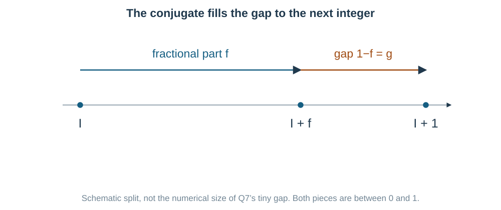

**Read the line:** the conjugate fills the small missing gap to the next integer. In Q7, $a^2-d=36-35=1$.

**Do not use blindly:** if the conjugate power is negative or not below $1$, the integer-gap argument changes. First check its sign and size. Calculating a huge decimal power can lose exactly the small fractional information we need.

### Concept C15 — Approximate near one, but protect the requested rounding

For a small real $h$ and positive integer $n$,

$$
(1+h)^n
=1+nh+\frac{n(n-1)}2h^2
+\frac{n(n-1)(n-2)}6h^3+\cdots.
$$

The first-order approximation is $1+nh$; the second-order approximation includes the $h^2$ term. Higher powers are often small when $|h|$ is small, but their coefficients also matter.

For $n=6,h=0.02$:

$$
1+6h+15h^2=1+0.12+0.006=1.126.
$$

The omitted positive tail is exactly

$$
20h^3+15h^4+6h^5+h^6=0.000162419264.
$$

Thus the exact answer is $1.126162419264$, which rounds to $1.126$ to three decimals. Keeping only $1+6h$ would incorrectly give $1.120$.

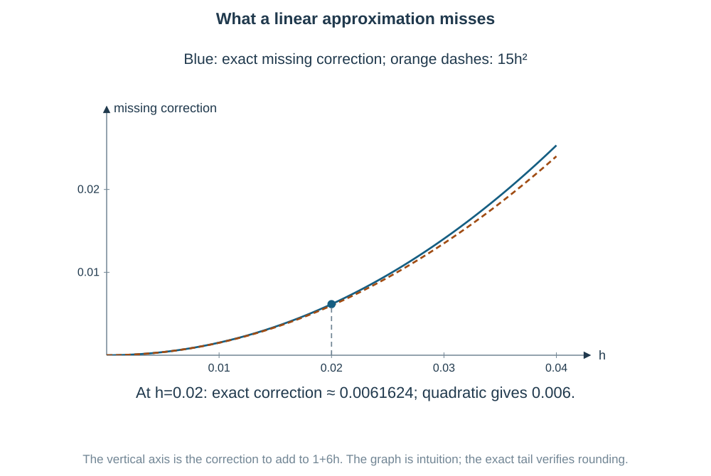

**Read the graph:** its vertical axis is the missing correction, not the original function value. The quadratic correction recovers almost all the linear error.

**Rounding rule:** compare the omitted tail with the distance to the nearest rounding boundary. Merely saying “the next term is small” is not enough near a boundary.

**Supporting inequality:** for integer $n\ge1$ and $h\ge-1$,

$$
\boxed{(1+h)^n\ge1+nh}
$$

(Bernoulli's inequality). It follows by induction: multiply the previous lower bound by the nonnegative $1+h$; the extra term $nh^2$ is nonnegative. It gives a bound, not the requested accurate decimal by itself.

### Concept C16 — Supplied-question extension: a nonintegral index

**Scope label:** the current official unit names a positive integral index. This section is retained to solve source Q25; give the core finite theorem revision priority.

For a real index $\alpha$ and $|u|<1$, the generalized binomial expansion is

$$
(1+u)^\alpha
=1+\alpha u+\frac{\alpha(\alpha-1)}{2!}u^2
+\cdots+
\frac{\alpha(\alpha-1)\cdots(\alpha-r+1)}{r!}u^r+\cdots.
$$

Unless $\alpha$ is a nonnegative integer, it generally does not stop. This is a convergent infinite power series in the stated interval, unlike the finite theorem, which is exact for every real $u$.

For $\alpha=-1/2,u=-4x$,

$$
(1-4x)^{-1/2}
=\boxed{\sum_{r=0}^{\infty}\binom{2r}r x^r},
\qquad |x|<\frac14.
$$

To rebuild the coefficient, the $r$ negative factors from $\alpha,\alpha-1,\ldots$ and the $r$ negatives from $(-4)^r$ cancel:

$$
\frac{(1\cdot3\cdots(2r-1))4^r}{2^r r!}
=\frac{(2r)!}{(r!)^2}.
$$

For $r=0$ the coefficient is $1$. For $r=5$, it is $\binom{10}5$. Do not impose a nonexistent last term or use this infinite series outside its convergence interval.

## Choose the route from the clue

This is a recognition map, not a measured pattern-frequency ranking.

| What you see | First useful move | Why |
|---|---|---|
| One target power | General term and exponent equation | Usually only one index can supply it |
| “Independent of $x$” | Set total exponent to zero | Constant means $x^0$ |
| Sum of coefficients | Set $x=1$ | All powers become one |
| Alternating coefficient sum | Set $x=-1$ | The signs alternate automatically |
| A plus/minus pair | Add or subtract expansions | One parity cancels |
| Greatest term at a given $x$ | Substitute, then neighbouring-term ratio | Includes numeric weights |
| $r$ or $r^2$ multiplying a coefficient | Shift factorial identities | Reduces to ordinary row sums |
| Product of two coefficients | Symmetry, then complementary indices | Same total selection counted in parts |
| Equal coefficients of one row | Same or mirror indices | Symmetry plus increase toward the middle |
| Same lower index, changing upper index | Pascal/hockey-stick cancellation | Consecutive differences telescope |
| Large power modulo an integer | Small repeating power or near-multiple base | Full integer value is unnecessary |
| Conjugate power with fractional part | Check the conjugate's size and integer sum | It can give the gap to the next integer |

## Last-minute formula recap

| Need | Formula / essential condition |
|---|---|
| Finite binomial | $(a+b)^n=\sum_{r=0}^n\binom nr a^{n-r}b^r$, $n\ge0$ integer |
| General term | $T_{r+1}=\binom nr a^{n-r}b^r$ |
| $k$th term | $T_k=\binom n{k-1}a^{n-k+1}b^{k-1}$ |
| Middle term, even $n$ | $T_{n/2+1}$ |
| Middle terms, odd $n$ | $T_{(n+1)/2},T_{(n+3)/2}$ |
| Power in $(Ax^p+Bx^q)^n$ | $pn+(q-p)r$ |
| Coefficient of $x^m$ | Solve exponent $=m$, allowed integer $r$; multiplier $\binom nr A^{n-r}B^r$ |
| Constant term | Solve exponent $=0$ |
| Product coefficient | $[x^m](PQ)=\sum_j[x^j]P[x^{m-j}]Q$ |
| Sum / alternating sum of polynomial coefficients | $P(1)$ / $P(-1)$ |
| Full binomial row sum | $\sum\binom nr=2^n$ |
| Alternating row sum | $\sum(-1)^r\binom nr=0$, $n\ge1$ |
| Even / odd row-index sums | Each $2^{n-1}$, $n\ge1$ |
| Even / odd part of $P$ | $(P(x)+P(-x))/2$ / $(P(x)-P(-x))/2$ |
| Adjacent coefficient ratio | $\binom n{r+1}/\binom nr=(n-r)/(r+1)$ |
| Equal same-row coefficients | Same index or complementary indices |
| Greatest binomial coefficient | $\binom n{\lfloor n/2\rfloor}$; odd $n$ has a central tie |
| Adjacent numerical-term ratio | $T_{r+2}/T_{r+1}=(n-r)b/[(r+1)a]$, positive parts |
| Greatest numerical term | $M=(n+1)b/(a+b)$; noninteger $M$: $T_{\lfloor M\rfloor+1}$; integer $M$: $T_M,T_{M+1}$ |
| Marked coefficient | $r\binom nr=n\binom{n-1}{r-1}$ |
| First weighted sum | $\sum r\binom nr=n2^{n-1}$, $n\ge1$ |
| Second weighted sum | $\sum r^2\binom nr=n(n+1)2^{n-2}$, $n\ge1$ |
| Reciprocal weight | $\sum\binom nr/(r+1)=(2^{n+1}-1)/(n+1)$ |
| Pascal | $\binom nr=\binom{n-1}r+\binom{n-1}{r-1}$ |
| Symmetry | $\binom nr=\binom n{n-r}$ |
| Vandermonde | $\sum_r\binom ar\binom b{k-r}=\binom{a+b}k$ |
| Squared-coefficient sum | $\sum_r\binom nr^2=\binom{2n}n$ |
| Same-index product sum | $\sum_r\binom ar\binom br=\binom{a+b}a$ |
| Three-part coefficient | $n!/(p!q!s!)$, nonnegative $p+q+s=n$ |
| Hockey stick | $\sum_{j=k}^{N}\binom jk=\binom{N+1}{k+1}$ |
| Finite product sum | $(A-B)\sum_{j=0}^{n}A^{n-j}B^j=A^{n+1}-B^{n+1}$ |
| Near-multiple power | $(1+mq)^N\equiv1+Nmq\pmod{m^2}$ |
| Last two digits | Remainder modulo $100$ |
| Conjugate-gap identity | If $0<v^n<1$ and $u^n+v^n$ integer, $1-f=v^n$ |
| Small increment | $(1+h)^n=1+nh+n(n-1)h^2/2+\cdots$; bound omitted terms |
| Bernoulli | $(1+h)^n\ge1+nh$, $h\ge-1,n\ge1$ integer |
| Extension for Q25 | $(1-4x)^{-1/2}=\sum\binom{2r}r x^r$, $|x|<1/4$ |

## Worked solutions to the 30 PDF questions

Try each question, then read the noticed pattern and why the chosen route fits. Diagrams and second methods are included in full.

### Question 1 — Choose the power without expanding everything

**PDF page 28 | MCQ | Notes: C01–C03**

The coefficient of $x^3$ in the expansion of $(2-3x)^7$ is

- (a) $15120$
- (b) $-10080$
- (c) $-22680$
- (d) $-15120$

**One target power needs one bracket-choice count.** To make $x^3$, choose $-3x$ from three of the seven brackets and $2$ from the other four:

$$
[x^3](2-3x)^7=\binom73\,2^4(-3)^3
=35(16)(-27)=\boxed{-15120}\quad\text{(d)}.
$$

**Why this route?** Expanding all eight terms would create seven unneeded terms. The target power already identifies the correct choice index.

**Check:** three negative selections give a negative coefficient. This eliminates (a) before arithmetic. The whole term is $-15120x^3$; the requested coefficient is its multiplier.

### Question 2 — Independent of x means exponent zero

**PDF page 28 | MCQ | Notes: C03–C04**

The term independent of $x$ in the expansion of $\left(2x^2-\dfrac1x\right)^9$ is

- (a) $-672$
- (b) $84$
- (c) $672$
- (d) $-84$

**“Independent of $x$” means the powers cancel to zero.** Write both bracket parts with their powers:

$$
T_{r+1}=\binom9r(2x^2)^{9-r}(-x^{-1})^r
=\binom9r2^{9-r}(-1)^r x^{18-3r}.
$$

Solve $18-3r=0$, giving $r=6$, an allowed integer index. Thus

$$
T_7=\binom96\,2^3(-1)^6
=84(8)=\boxed{672}\quad\text{(c)}.
$$

**Check by balancing contributions:** three choices of $2x^2$ give power $+6$; six choices of $-1/x$ give power $-6$. Their total is $0$, and six negatives give a positive sign. Using $r=7$ because the term is seventh would confuse index with position.

### Question 3 — The greatest value can occur twice

**PDF page 28 | Numerical value | Notes: C07**

The numerically greatest term in the expansion of $(3+2x)^9$ when $x=1$ is ____.

**Substitute the given $x$ before comparing terms.** We need the positive terms of $(3+2)^9$, not just the largest entry in row nine of Pascal's triangle.

If $j$ is a term position,

$$
\frac{T_{j+1}}{T_j}=\frac{10-j}{j}\frac23.
$$

This ratio is greater than $1$ for $j<4$, equals $1$ at $j=4$, and is below $1$ for $j>4$. So the terms rise to $T_4$, tie at $T_5$, then fall.

$$
T_4=\binom93\,3^6\,2^3
=84(729)(8)=\boxed{489888}.
$$

**Check the tie:** $T_5=\binom94\,3^5\,2^4=126(243)(16)=489888$ too. The question asks for the numerical value, so the value is unique even though its position is not.

**Another possible shortcut after understanding the ratio:** $M=(9+1)2/(3+2)=4$ is an integer, so $T_4,T_5$ tie.

### Question 4 — Keep only even choices

**PDF page 28 | MCQ | Notes: C06**

The value of $\binom{20}0+\binom{20}2+\binom{20}4+\cdots+\binom{20}{20}$ is

- (a) $2^{20}$
- (b) $2^{19}$
- (c) $2^{18}$
- (d) $2^{19}-1$

**Notice that the lower indices are even.** Let $E$ be the even-index sum and $O$ the odd-index sum. The expansion of $(1+x)^{20}$ at $x=1$ and $x=-1$ gives

$$
E+O=2^{20},\qquad E-O=0.
$$

Add the equations:

$$
\boxed{E=2^{19}}\quad\text{(b)}.
$$

**Another possible counting view:** among all subsets of a twenty-object set, toggling one fixed object's membership changes the subset size from even to odd or odd to even. Thus the even and odd counts are equal and each is half of $2^{20}$. This also explains why the result requires at least one object.

### Question 5 — A weight r marks a chosen object

**PDF page 28 | Numerical value | Notes: C08**

The value of $\displaystyle\sum_{r=0}^{10}r\binom{10}r$ is ____.

**The weight $r$ should trigger the marked-member identity:**

$$
r\binom{10}r=10\binom9{r-1}.
$$

The $r=0$ term contributes zero. Shift $s=r-1$ for the others:

$$
\sum_{r=0}^{10}r\binom{10}r
=10\sum_{s=0}^9\binom9s
=10(2^9)=\boxed{5120}.
$$

**Why this route?** The weight becomes a fixed factor, leaving an ordinary full row sum.

**Another possible approach:** differentiate $(1+x)^{10}$, multiply by $x$, then set $x=1$. This gives $10x(1+x)^9$ at $1$. The counting identity works without assuming calculus.

### Question 6 — Find a small power close to the divisor

**PDF page 28 | MCQ | Notes: C13**

The remainder when $7^{103}$ is divided by $25$ is

- (a) $18$
- (b) $23$
- (c) $3$
- (d) $20$

**A small square is close to a multiple of $25$:**

$$
7^2=49\equiv-1\pmod{25}.
$$

Since $103=2(51)+1$,

$$
7^{103}\equiv7(-1)^{51}=-7\equiv18\pmod{25}.
$$

The required remainder is $\boxed{18}$, **option (a)**.

**Another possible approach:** the cycle has period four; $103\equiv3\pmod4$, so use $7^3=343$, whose remainder is $18$. Both avoid computing the huge power.

**Check:** $-7$ is a useful residue but not an allowed ordinary remainder. Adding $25$ puts it in $0,\ldots,24$.

### Question 7 — The conjugate fills the gap to the next integer

**PDF page 28 | MCQ | Notes: C14**

Let $(6+\sqrt{35})^9=I+f$, where $I$ is a positive integer and $0<f<1$. Then $(I+f)(1-f)$ equals

- (a) $0$
- (b) $1$
- (c) $2$
- (d) $6+\sqrt{35}$

**Try the conjugate, because its product with the given base is small:**

$$
(6+\sqrt{35})(6-\sqrt{35})=36-35=1.
$$

Let $g=(6-\sqrt{35})^9$. Since $5<\sqrt{35}<6$, we have $0<6-\sqrt{35}<1$, so $0<g<1$.

Adding the two conjugate expansions cancels every odd root power. Hence $(I+f)+g$ is an integer. Subtract $I$: $f+g$ is an integer strictly between $0$ and $2$, so it equals $1$.

Thus $1-f=g$ and

$$
(I+f)(1-f)
=(6+\sqrt{35})^9(6-\sqrt{35})^9
=1^9=\boxed1\quad\text{(b)}.
$$

**Why not calculate the decimal power?** Its tiny distance from an integer is the information that decimal rounding can lose. The conjugate gives that distance exactly.

**Another way to prove the integer sum:** $u+v=12,uv=1$ imply $s_n=u^n+v^n=12s_{n-1}-s_{n-2}$, starting from $s_0=2,s_1=12$. Every $s_n$ is therefore an integer. The cancellation proof is more direct here.

### Question 8 — Three choices per factor: count exponent patterns

**PDF page 28 | Numerical value | Notes: C11**

The coefficient of $x^4$ in the expansion of $(1+x+x^2)^5$ is ____.

**Each of the five factors supplies exponent $0,1,$ or $2$.** We need their total to be $4$. Classify by the number of $x^2$ choices:

| Exponent choices | Count of factor assignments |
|---|---:|
| $2,2,0,0,0$ | $\binom52=10$ |
| $2,1,1,0,0$ | $5\binom42=30$ |
| $1,1,1,1,0$ | $\binom54=5$ |

No third $2$ is possible because it would already exceed $4$. The cases are disjoint, so

$$
\boxed{10+30+5=45}.
$$

**Another possible approach — bounded integer counts:** the five exponent choices sum to $4$, each between $0$ and $2$. Without upper bounds there are $\binom84=70$ choices. If a chosen exponent is at least $3$, reserve $3$ there; the remaining total $1$ has five placements. There are five possible violating positions, and two violations cannot coexist. Subtract $5(5)=25$, giving $45$.

### Question 9 — Fifth term means coefficient indexed four

**PDF page 28 | Numerical value | Notes: C02, C09**

The coefficients of the $5$th, $6$th and $7$th terms in the expansion of $(1+x)^n$ are in A.P. The sum of all possible values of $n$ is ____.

**First convert term positions:** fifth, sixth and seventh coefficients are $\binom n4,\binom n5,\binom n6$, with integer $n\ge6$.

Their AP condition is

$$
\binom n4+\binom n6=2\binom n5.
$$

Instead of expanding factorials independently, divide by the nonzero $\binom n5$:

$$
\frac5{n-4}+\frac{n-5}{6}=2.
$$

Multiply by $6(n-4)$:

$$
30+(n-5)(n-4)=12(n-4),
$$

$$
n^2-21n+98=(n-7)(n-14)=0.
$$

Both $n=7,14$ meet the range. Their sum is $\boxed{21}$.

**Check in the original coefficients:** for $n=7$ they are $35,21,7$; for $n=14$ they are $1001,2002,3003$. Both are APs. There is no need to insist they increase: a decreasing AP is valid too.

### Question 10 — A square of a coefficient is a product of two choices

**PDF page 28 | MCQ | Notes: C10**

The value of $\displaystyle\sum_{r=0}^{6}\binom6r^2$ is

- (a) $792$
- (b) $720$
- (c) $924$
- (d) $1024$

**A product of two choices suggests selecting from two groups.** Use symmetry:

$$
\binom6r^2=\binom6r\binom6{6-r}.
$$

For each $r$, this counts selecting $r$ from the first group of six and $6-r$ from the second.

All possible $r$ together count every six-person subset of twelve once:

$$
\sum_{r=0}^{6}\binom6r^2
=\binom{12}6=\boxed{924}\quad\text{(c)}.
$$

**Another possible approach:** find $[x^6](1+x)^6(1+x)^6=[x^6](1+x)^{12}$. The product rule gives the same sum.

**Check:** it is not $(\sum\binom6r)^2$; that square would include pairs with unrelated indices.

### Question 11 — Use symmetry to match complementary indices

**PDF page 29 | MCQ | Notes: C10**

The value of $\displaystyle\sum_{r=0}^{5}\binom5r\binom7r$ is

- (a) $\binom{12}6$
- (b) $\binom{11}5$
- (c) $\binom{35}5$
- (d) $\binom{12}5$

**The equal lower indices do not yet match a fixed-size selection.** Change one by symmetry:

$$
\binom7r=\binom7{7-r}.
$$

Then

$$
\sum_{r=0}^{5}\binom5r\binom7{7-r}
=\binom{12}7=\boxed{\binom{12}5}\quad\text{(d)}.
$$

**Why this route?** The lower indices now add to $7$, so each summand chooses seven objects from populations of five and seven. No cases are missing: the first population can supply only $0$ through $5$.

**Another coefficient view:** the sum is $[x^7](1+x)^5(1+x)^7=[x^7](1+x)^{12}$. Numerically the answer is $792$.

### Question 12 — Approximation needs a rounding check

**PDF page 29 | MCQ | Notes: C15**

The value of $(1.02)^6$, correct to three decimal places, using the binomial expansion, is

- (a) $1.126$
- (b) $1.120$
- (c) $1.116$
- (d) $1.130$

**The base is close to one:** write $1.02=1+h$ with $h=0.02$. The first three binomial contributions are

$$
1+6h+15h^2=1+0.12+0.006=1.126.
$$

**Do not stop without checking rounding.** The remaining exact tail is

$$
20h^3+15h^4+6h^5+h^6=0.000162419264.
$$

So the exact result is $1.126162419264$, below the upward rounding boundary $1.1265$:

$$
\boxed{1.126}\quad\text{(a)}.
$$

**Why the first-order route is insufficient:** $1+6h=1.120$ misses $0.00616\ldots$, large enough to change the third decimal. The graph shows this missing correction.

**Another possible route:** repeated multiplication gives the same exact value, but the small-increment expansion displays which terms control the requested accuracy.

### Question 13 — Adding a sign-reversed partner removes odd powers

**PDF page 29 | MCQ | Notes: C06**

The number of terms in the simplified expansion of $(x+a)^{100}+(x-a)^{100}$ is

- (a) $51$
- (b) $50$
- (c) $101$
- (d) $52$

**Notice the sign-reversed pair.** A general paired contribution is

$$
\binom{100}r x^{100-r}a^r\{1+(-1)^r\}.
$$

It vanishes for odd $r$ and doubles for even $r$.

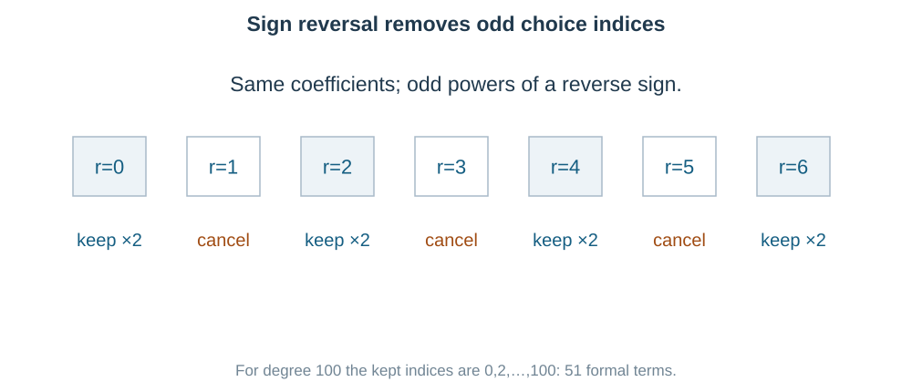

The surviving indices are $0,2,4,\ldots,100$:

$$
\boxed{\frac{100-0}{2}+1=51}\quad\text{(a)}.
$$

**Check the endpoints:** both $x^{100}$ and $a^{100}$ remain, so include both ends when counting. This is the formal two-symbol expansion. Setting $a=0$ afterwards would erase terms and is a different numerical specialization.

### Question 14 — Six factors supply two x, three y, one z

**PDF page 29 | MCQ | Notes: C11**

The coefficient of $x^2y^3z$ in the expansion of $(x+y+z)^6$ is

- (a) $120$
- (b) $60$
- (c) $30$
- (d) $90$

**Six brackets must supply exactly two $x$s, three $y$s and one $z$.** The exponent sum is $2+3+1=6$, so the target is possible.

Choose the positions:

$$
\binom62\binom43\binom11=15(4)(1)
=\boxed{60}\quad\text{(b)}.
$$

**Another possible approach:** the six selected symbols have multiplicities $2,3,1$, so their distinct position assignments are $6!/(2!3!1!)=60$.

A binomial coefficient alone chooses only one type's positions; the other two choices must still be accounted for.

### Question 15 — Sum of coefficients: make every x-power equal one

**PDF page 29 | MCQ | Notes: C05**

The sum of all the coefficients in the expansion of $(3x-2)^5(x+1)^4$ is

- (a) $32$
- (b) $1$
- (c) $16$
- (d) $64$

**“Sum of all coefficients” suggests $x=1$.** Each power of $x$ then becomes $1$, so expansion is unnecessary:

$$
P(1)=(3-2)^5(1+1)^4
=1^5\,2^4=\boxed{16}\quad\text{(c)}.
$$

**Check / another view:** coefficient sums multiply for a product of polynomials. The first factor's coefficient sum is $1$ and the second's is $16$, giving $16$.

Putting $x=0$ would find the constant coefficient, not the sum. Do not replace the first factor by $5^5$: the negative sign remains when evaluating at $1$.

### Question 16 — Zero power must occur at an integer index

**PDF page 29 | MCQ | Notes: C04**

Statement I: The expansion of $\left(x+\dfrac1x\right)^{10}$ contains a term independent of $x$.

Statement II: The expansion of $\left(x+\dfrac1x\right)^{11}$ contains a term independent of $x$.

- (a) Both Statement I and Statement II are true
- (b) Statement I is true but Statement II is false
- (c) Statement I is false but Statement II is true
- (d) Both Statement I and Statement II are false

**A constant term needs an allowed integer index.** The general power in $(x+x^{-1})^n$ is

$$
x^{n-r}x^{-r}=x^{n-2r}.
$$

For $n=10$, $10-2r=0$ gives $r=5$, which is allowed. Statement I is true.

For $n=11$, $11-2r=0$ gives $r=11/2$, not an integer. Statement II is false.

$$
\boxed{\text{I true, II false}}\quad\text{(b)}.
$$

**Check:** for exponent ten the actual constant is $\binom{10}5=252$. For exponent eleven, every power is odd: $11,9,\ldots,-11$. There is no zero power.

### Question 17 — Separate sum, alternating sum, and greatest coefficient

**PDF page 29 | MCQ | Notes: C05–C07**

Match List-I with List-II.

| List-I | Expression |
|---|---|
| A | $\sum_{r=0}^8\binom8r$ |
| B | $\sum_{r\text{ even}}\binom8r$ |
| C | $\sum_{r=0}^8(-1)^r\binom8r$ |
| D | The greatest binomial coefficient of $(1+x)^8$ |

List-II: I. $0$; II. $256$; III. $128$; IV. $70$.

- (a) A-II, B-III, C-I, D-IV
- (b) A-II, B-IV, C-I, D-III
- (c) A-III, B-II, C-I, D-IV
- (d) A-II, B-III, C-IV, D-I

**Use the input or position that matches each pattern.**

$$
\begin{aligned}
\mathrm A&:\ (1+1)^8=256 &&\longrightarrow\mathrm{II},\\
\mathrm B&:\ 2^{8-1}=128 &&\longrightarrow\mathrm{III},\\
\mathrm C&:\ (1-1)^8=0 &&\longrightarrow\mathrm I,\\
\mathrm D&:\ \binom84=70 &&\longrightarrow\mathrm{IV}.
\end{aligned}
$$

So $\boxed{\text{A–II, B–III, C–I, D–IV}}$, **option (a)**.

**Check:** A is the entire row sum, B is half of it, C alternates signs, and D is one central entry. These are different requests even though all use the same expansion.

### Question 18 — The middle index is a position, not an exponent

**PDF page 30 | MCQ | Notes: C01–C02**

Consider the expansion of $(x+y)^n$.

(i) It has $n+1$ terms.

(ii) The general term is $T_{r+1}=\binom nr x^{n-r}y^r$.

(iii) In $(1+x)^n$ the coefficients of $x^r$ and $x^{n-r}$ are equal.

(iv) If $n$ is even, the middle term is $T_{n/2}$.

The correct statements are

- (a) (i), (ii), (iii) only
- (b) (i), (ii), (iv) only
- (c) (ii), (iii), (iv) only
- (d) (i), (iii), (iv) only

**Keep the term-position convention $T_{r+1}$.**

(i) True for the formal finite expansion: $r=0,1,\ldots,n$ gives $n+1$ terms.

(ii) True: choosing $r$ factors of $y$ leaves $n-r$ factors of $x$.

(iii) True: $\binom nr=\binom n{n-r}$ by selection symmetry.

(iv) False: for even $n$, there are $n+1$ terms, so the middle is

$$
T_{(n+2)/2}=\boxed{T_{n/2+1}},
$$

not $T_{n/2}$.

Thus $\boxed{\text{(i), (ii), (iii) only}}$, **option (a)**.

**Small check:** $(x+y)^2$ has three terms. Its middle is $T_2$, not $T_1$.

### Question 19 — Prove a common factor, then prove it is largest

**PDF page 30 | MCQ | Notes: C13**

The largest positive integer that divides $3^{2n+2}-8n-9$ for every natural number $n$ is

- (a) $16$
- (b) $32$
- (c) $128$
- (d) $64$

**The subtracted linear expression suggests cancelling the first two binomial terms.** Since $3^{2n+2}=9^{n+1}=(1+8)^{n+1}$,

$$
9^{n+1}=1+8(n+1)+
\sum_{r=2}^{n+1}\binom{n+1}r8^r.
$$

Subtract $8n+9$. The first two terms cancel exactly, leaving only multiples of $8^2=64$. Therefore $64$ divides the expression for every natural $n$.

**Now prove “largest.”** At $n=1$,

$$
3^4-8-9=81-17=64.
$$

Any common divisor must divide this particular value, so cannot exceed $64$. Hence $\boxed{64}$, **option (d)**.

**Why both steps?** One test input alone cannot establish divisibility for every $n$. The general cancellation establishes it; the small test establishes maximality.

### Question 20 — Do not divide away a possible zero

**PDF page 30 | MCQ | Notes: C03–C04**

If the coefficient of $x^7$ in $\left(ax^2+\dfrac1{bx}\right)^{11}$ equals the coefficient of $x^{-7}$ in $\left(ax-\dfrac1{bx^2}\right)^{11}$, then $ab$ equals

- (a) $2$
- (b) $3$
- (c) $\dfrac12$
- (d) $1$

**Source qualification before division:** $b\ne0$ is required by the denominators. The printed question does not say $a\ne0$, so we must keep the zero case.

In the first expansion the power is $22-3r$. For $x^7$,

$$
22-3r=7\Rightarrow r=5,\qquad
\text{coefficient}=\binom{11}5\frac{a^6}{b^5}.
$$

In the second, the power is $11-3s$. For $x^{-7}$,

$$
11-3s=-7\Rightarrow s=6,\qquad
\text{coefficient}=\binom{11}6\frac{a^5}{b^6}.
$$

The sign is positive because $s=6$ is even. The two binomial coefficients are equal, so multiplying by $b^6/\binom{11}5$ gives

$$
a^6b=a^5\quad\Longrightarrow\quad
\boxed{a^5(ab-1)=0}.
$$

- If $a\ne0$, then $\boxed{ab=1}$, the intended **option (d)**.
- If $a=0$, both requested coefficients are zero and $\boxed{ab=0}$ also satisfies the stated condition.

**Conclusion about the source:** as printed, $ab$ is not uniquely determined. The intended MCQ answer needs the additional condition $a\ne0$.

This is why cancelling $a^5$ immediately would be unsafe. The exponent-matching method is correct; the missing nonzero condition is the issue.

### Question 21 — A denominator r plus one suggests shifting the coefficient

**PDF page 30 | Numerical value | Notes: C08**

The value of $\displaystyle\sum_{r=0}^{5}\frac1{r+1}\binom5r$ is ____ (rounded to $2$ decimal places).

**A denominator $r+1$ suggests increasing the upper index:**

$$
\frac1{r+1}\binom5r=\frac16\binom6{r+1}.
$$

The new lower index runs from $1$ to $6$. Use the full sixth row and remove its index-zero term:

$$
S=\frac16\left(\sum_{j=0}^6\binom6j-\binom60\right)
=\frac{64-1}{6}=\frac{63}{6}
=\boxed{10.50}.
$$

**Check / another possible approach:** direct terms are $1,5/2,10/3,10/4,5/5,1/6$. In sixths, their sum is $(6+15+20+15+6+1)/6=63/6$.

For larger upper indices the shift avoids many fractions. Forgetting the missing index-zero term would give $64/6$.

### Question 22 — Split a square weight into two simpler weights

**PDF page 30 | Numerical value | Notes: C08**

The value of $\displaystyle\sum_{r=0}^{10}r^2\binom{10}r$ is ____.

**Notice that $r^2=r(r-1)+r$.** The two pieces have known marked-choice sums:

$$
\begin{aligned}
\sum r^2\binom{10}r
&=\sum r(r-1)\binom{10}r+\sum r\binom{10}r\\
&=10(9)2^8+10\,2^9\\
&=23040+5120=\boxed{28160}.
\end{aligned}
$$

**Why this route?** The falling-factorial weight cancels directly against the factorials in the coefficient. Squaring the result of $\sum r\binom{10}r$ would introduce unrelated cross terms and is a different operation.

**Another possible route:** differentiate $(1+x)^{10}$ twice, multiply by $x^2$, then add $x$ times the first derivative and evaluate at $1$. It produces exactly the same two pieces.

### Question 23 — The written weight is r plus one

**PDF page 30 | MCQ | Notes: C08**

The value of $\binom80+2\binom81+3\binom82+\cdots+9\binom88$ is

- (a) $1152$
- (b) $1280$
- (c) $1024$
- (d) $2304$

**Align the weight with the lower index.** At index $r=0$ the weight is $1$; at $r=8$ it is $9$. Thus the weight is $r+1$:

$$
\begin{aligned}
S&=\sum_{r=0}^8(r+1)\binom8r\\
&=\sum r\binom8r+\sum\binom8r\\
&=8\,2^7+2^8
=1024+256=\boxed{1280}\quad\text{(b)}.
\end{aligned}
$$

**Another possible approach:** pair indices $r$ and $8-r$. Their coefficients are equal and their weights add to $(r+1)+(9-r)=10$. So the weighted average is $5$ times the full row sum: $S=5(256)=1280$. The central entry has weight $5$ already.

### Question 24 — A long sum can be a finite geometric identity

**PDF page 30 | MCQ | Notes: C12**

The coefficient of $x^7$ in $(1+x)^{20}+x(1+x)^{19}+x^2(1+x)^{18}+\cdots+x^{20}$ is

- (a) $\binom{21}7$
- (b) $\binom{20}7$
- (c) $\binom{21}8$
- (d) $\binom{20}8$

**The two parts trade one power at each step.** Let $A=1+x$ and $B=x$. The expression is

$$
F=A^{20}+A^{19}B+\cdots+B^{20}.
$$

Instead of expanding all summands, multiply by $A-B$:

$$
(A-B)F=A^{21}-B^{21}.
$$

Here $A-B=1$, so

$$
F=(1+x)^{21}-x^{21}.
$$

The last term has no $x^7$, giving

$$
\boxed{[x^7]F=\binom{21}7}\quad\text{(a)}.
$$

**Another possible approach:** the $k$th summand $x^k(1+x)^{20-k}$ contributes $\binom{20-k}{7-k}$ only for $0\le k\le7$. Their sum equals $\binom{21}7$ by the hockey-stick identity after symmetry. The polynomial cancellation is shorter and avoids separate coefficient bookkeeping.

### Question 25 — A supplied extension: nonintegral binomial index

**PDF page 30 | Numerical value | Notes: C16**

The coefficient of $x^5$ in the expansion of $(1-4x)^{-1/2}$ is ____.

**This supplied question uses the generalized expansion, outside the official unit's positive-index wording.** For equality with the function, use $|x|<1/4$.

The fifth-power coefficient is

$$
\frac{(-1/2)(-3/2)(-5/2)(-7/2)(-9/2)}{5!}(-4)^5.
$$

There are five negatives in each group, so the result is positive:

$$
\frac{1\cdot3\cdot5\cdot7\cdot9}{2^5\,5!}\,4^5
=\frac{945(32)}{120}=\boxed{252}.
$$

**Another possible approach:** C16 gives $[x^r](1-4x)^{-1/2}=\binom{2r}r$. Hence the answer is $\binom{10}5=252$.

The finite theorem cannot be applied by pretending that “$n=-1/2$” gives a finite number of terms.

### Question 26 — Paired signs cancel half of the expansion

**PDF page 30 | MCQ | Notes: C06**

The value of $(\sqrt3+1)^5-(\sqrt3-1)^5$ is

- (a) $76$
- (b) $144$
- (c) $152$
- (d) $160$

**The bases differ only in the sign of the second part.** Set $a=\sqrt3,b=1$ in $(a+b)^5-(a-b)^5$. Even choices cancel, while odd choices double:

$$
2\left[\binom51(\sqrt3)^4+
\binom53(\sqrt3)^2+\binom55\right].
$$

Since $(\sqrt3)^4=9$ and $(\sqrt3)^2=3$,

$$
2[5(9)+10(3)+1]
=2(76)=\boxed{152}\quad\text{(c)}.
$$

**Check:** the remaining root powers are even, so an integer answer is expected.

**Another possible approach:** $\sqrt3-1=2/(\sqrt3+1)$ gives a product relation, but computing fifth powers from it still needs a recurrence or algebra. Sign cancellation exposes the three required terms immediately.

### Question 27 — Last two digits means a remainder modulo one hundred

**PDF page 31 | MCQ | Notes: C13**

The last two digits of $7^{2023}$ are

- (a) $07$
- (b) $49$
- (c) $43$
- (d) $01$

**Last two digits means a remainder modulo $100$.** A short power already returns to remainder one:

$$
7^4=2401\equiv1\pmod{100}.
$$

Since $2023=4(505)+3$,

$$
7^{2023}\equiv1^{505}7^3
=343\equiv43\pmod{100}.
$$

Thus the last two digits are $\boxed{43}$, **option (c)**.

**Another possible route:** $7^2=49=50-1$, and $7^{2023}=7(50-1)^{1011}$. Modulo $100$, all terms with $50^2$ vanish, leaving $7[-1+1011(50)]\equiv43$. It works, but the four-power cycle is shorter.

### Question 28 — Convert term positions to coefficient indices first

**PDF page 31 | MCQ | Notes: C02, C09**

If the coefficients of the $(2r+1)$th and $(r+2)$th terms in the expansion of $(1+x)^{43}$ are equal and $r>1$, then $r$ equals

- (a) $13$
- (b) $14$
- (c) $15$
- (d) $21$

**Subtract one from each term position before using coefficient symmetry.**

$$
\binom{43}{2r}=\binom{43}{r+1}.
$$

Equal same-row coefficients have equal indices or complementary indices:

$$
2r=r+1\Rightarrow r=1\quad\text{(excluded)},
$$

$$
2r+(r+1)=43\Rightarrow3r=42
\Rightarrow\boxed{r=14}\quad\text{(b)}.
$$

**Check:** the actual positions are $29$th and $16$th, whose choice indices are $28$ and $15$. They add to $43$, and both are within range.

**Another possible MCQ route:** test the four listed integer $r$s using the complementary-index sum. Only $14$ gives $43$. The two-case proof also rules out any unlisted allowed answer.

### Question 29 — Rational terms require integral prime exponents

**PDF page 31 | Numerical value | Notes: C04**

The number of rational terms in the expansion of $\left(2^{1/2}+3^{1/3}\right)^{100}$ is ____.

**Write the prime exponents before asking for rationality.**

$$
T_{r+1}=\binom{100}r
2^{(100-r)/2}3^{r/3}.
$$

The integer binomial multiplier cannot remove a fractional prime exponent. Thus $100-r$ must be divisible by $2$, and $r$ by $3$:

$$
r\equiv0\pmod2,\qquad r\equiv0\pmod3
\quad\Longrightarrow\quad r\equiv0\pmod6.
$$

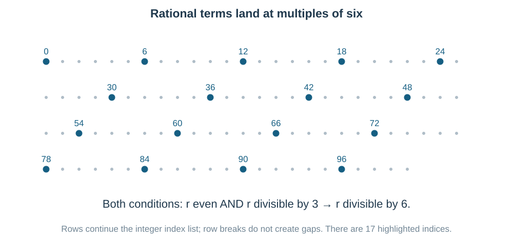

Allowed indices are $0,6,12,\ldots,96$, so

$$
\boxed{\frac{96}{6}+1=17}.
$$

**Check the endpoints:** $r=0$ gives the rational term $2^{50}$; $r=100$ contains $3^{100/3}$ and is irrational. Include index zero but do not include one hundred.

### Question 30 — Pascal’s rule can absorb one term at a time

**PDF page 31 | MCQ | Notes: C12**

The value of $\binom{50}4+\displaystyle\sum_{r=1}^{6}\binom{56-r}3$ is

- (a) $\binom{56}4$
- (b) $\binom{56}3$
- (c) $\binom{55}4$
- (d) $\binom{55}3$

**Reverse the sum to see consecutive upper indices.** As $r$ runs from $1$ to $6$, $56-r$ runs from $55$ down to $50$:

$$
S=\binom{50}4+\binom{50}3+\binom{51}3+
\cdots+\binom{55}3.
$$

Use Pascal's rule repeatedly:

$$
\binom{50}4+\binom{50}3=\binom{51}4,
$$

then add $\binom{51}3$ to obtain $\binom{52}4$, and continue. The final result is

$$
\boxed{\binom{56}4}\quad\text{(a)}.
$$

**Another possible approach:** the general partial hockey-stick sum is $\sum_{t=50}^{55}\binom t3=\binom{56}4-\binom{50}4$. The initial coefficient cancels the subtracted boundary.

## Answer check

Original option order is preserved. Read the qualifications beside Q3, Q20 and Q25.

| Question | Answer | Question | Answer |
|---|---|---|---|
| 1 | (d) $-15120$ | 16 | (b) |
| 2 | (c) $672$ | 17 | (a) |
| 3 | $489888$; $T_4,T_5$ tie | 18 | (a) |
| 4 | (b) $2^{19}$ | 19 | (d) $64$ |
| 5 | $5120$ | 20 | Intended (d) $1$ if $a\ne0$; also $0$ if $a=0$ |
| 6 | (a) $18$ | 21 | $10.50$ |
| 7 | (b) $1$ | 22 | $28160$ |
| 8 | $45$ | 23 | (b) $1280$ |
| 9 | $21$ | 24 | (a) $\binom{21}7$ |
| 10 | (c) $924$ | 25 | $252$ |
| 11 | (d) $\binom{12}5$ | 26 | (c) $152$ |
| 12 | (a) $1.126$ | 27 | (c) $43$ |
| 13 | (a) $51$ | 28 | (b) $14$ |
| 14 | (b) $60$ | 29 | $17$ |
| 15 | (c) $16$ | 30 | (a) $\binom{56}4$ |

## Coverage and source notes

All $30$ source questions appear in order: $22$ MCQs and $8$ numerical-value questions. The intended source answers agree with independent calculations, except that Q20 needs an extra nonzero condition for its intended unique answer. Its full zero case is preserved and explained. Q3's greatest-value tie is explicit. Q25 is a source extension beyond the positive-integral-index wording of the official unit.

The recent weightage is a recount of $65$ distinct ExamSIDE category IDs for $2024$–$2026$ over $58$ full-year papers. PYQSide's separate classification gives $56$; the datasets were not merged. This guide does not claim an independent exhaustive $2020$–$2026$ official-paper or formula-use audit. Teaching priority is distinguished from measured frequency.

## Offline research record

- Supplied Maths Predicted V1.pdf: questions on pages 28–31, key on page 31, working through page 32. All stems and options read visually.
- NTA, Syllabus for JEE Main 2027, Mathematics Unit 5: positive integral index, general term, middle term and simple applications.
- ExamSIDE, Binomial Theorem: saved category HTML, year totals and distinct recent question IDs recounted.
- PYQSide, Mathematics Chapter-wise Weightage 2024–2026: classification comparison; its different category count is disclosed.

Original SVG inputs and scripts are retained. Every useful alternative is plain visible and belongs in the later printed booklet.
