# Matrices — JEE Main revision guide

*A matrix is an organised table. In a multiplication, it can act on a vector. Learn the action and the order before memorising power shortcuts.*

> **For Kanna | Chapter 7**  
> Goal: about $120/300$ towards $200/300$ — Physics $60$, Maths $60$, Chemistry $80$.  
> Full foundations, a compact recap, and all $30$ source questions follow. Every useful alternative is visible.

## Recent chapter weightage

**PYQSide's separate Matrices classification gives $25/58\approx0.43$ questions per Paper 1 over 2024–2026.**

| Year | Papers | Matrices-category questions | Questions per paper |
|---|---:|---:|---:|
| $2024$ | $20$ | $7$ | $0.35$ |
| $2025$ | $19$ | $10$ | $0.53$ |
| $2026$ | $19$ | $8$ | $0.42$ |
| Together | $58$ | $25$ | $0.43$ |

**Read the classification before deciding priority:** this archive places many inverse, adjugate and equation-system questions under **Determinants**, whose separate mean is $82/58\approx1.41$. The two categories together give $107/58\approx1.84$. The supplied Matrices chapter teaches several of those shared tools, so $0.43$ is not the weightage of everything in these notes.

All $25$ separate-category IDs were saved and recounted. ExamSIDE combines Matrices and Determinants: its year counts are $40,34,33$, while PYQSide's combined year counts are $41,35,31$. Both pooled totals happen to be $107$, but the yearly classifications differ. Do not combine the datasets or count the joint total twice.

These are archive counts, not an independent full-paper or formula-frequency audit. The offered-question format differed in $2024$. **Revision priority:** multiplication order, transpose, special matrix powers, inverse/adjugate, and consistent systems.

## Scope and source qualifications

The official Mathematics Unit 3 covers matrices and their algebra, determinants, adjoint/inverse, and systems of two or three variables using matrices. This chapter includes the determinant basics required by its own supplied questions; Chapter 8 develops determinants further.

- Work over real numbers unless stated otherwise. Orthogonal means $A^TA=I$, using the ordinary transpose.
- Rank, elimination, special matrix types and the direct two-by-two polynomial identity are taught as supporting tools. Rank is not separately named in the current unit.
- **Q10 omits a nonzero condition.** For $A=O$, its equation holds for every $\lambda$. The intended $31$ is unique for $A\ne O$, or as the coefficient in a universal identity. This is explained beside the solution.
- $O$ is the zero matrix; $I$ is the identity of the needed order. Neither is an ordinary scalar standing alone in a matrix equation.

## Formula and concept bank

### Concept C01 — Entries, rows, columns, and what a matrix can mean

**Important for JEE Main.** A matrix is a rectangular table of numbers:

$$
A=[a_{ij}]=
\begin{bmatrix}1&2&3\\4&5&6\end{bmatrix}.
$$

Its **order** is $2\times3$: two rows, three columns. A row runs left to right; a column runs top to bottom. In $a_{ij}$, $i$ is the row number and $j$ the column number. Thus $a_{23}=6$.

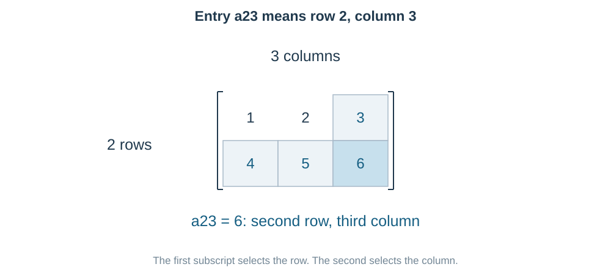

Two matrices are equal only when they have the same order and every matching entry is equal.

A **square matrix** has equally many rows and columns. Its main diagonal contains $a_{11},a_{22},\ldots$. A diagonal matrix has zero off-diagonal entries; a scalar matrix is $cI$; $I$ has diagonal ones and other entries zero. An upper/lower triangular matrix has zeros below/above its main diagonal.

**A useful meaning — a rule acting on vectors.** For a two-by-two matrix

$$
A=\begin{bmatrix}a&b\\c&d\end{bmatrix},\qquad
A\begin{bmatrix}x\\y\end{bmatrix}
=\begin{bmatrix}ax+by\\cx+dy\end{bmatrix}.
$$

This gives a new vector. The first column is where $(1,0)$ goes; the second is where $(0,1)$ goes:

$$
\boxed{A\begin{bmatrix}x\\y\end{bmatrix}
=x\begin{bmatrix}a\\c\end{bmatrix}
+y\begin{bmatrix}b\\d\end{bmatrix}}.
$$

It explains how a whole plane can be moved, stretched, rotated, sheared or flattened by one rule. The origin stays at the origin.

### Concept C02 — Addition, scalar multiplication, identity and zero

Add same-order matrices entry by entry; multiply a matrix by a scalar by multiplying every entry:

$$
\begin{bmatrix}1&2\\3&4\end{bmatrix}
+\begin{bmatrix}5&6\\7&8\end{bmatrix}
=\begin{bmatrix}6&8\\10&12\end{bmatrix}.
$$

Addition is commutative and associative. Scalars distribute through sums. Products involving $I$ and $O$ obey

$$
AI=IA=A,\qquad A+O=A,\qquad AO=OA=O
$$

whenever the orders fit. For compatible rectangular identities, $I_mA=A=AI_n$ if $A$ is $m\times n$.

For an $n\times n$ square matrix, $A^0=I_n$. A scalar constant in a polynomial becomes a multiple of $I$: write $A^2-3A+2I$, not $A^2-3A+2$.

**Entry equality is a solving tool:** if $A^2=I$, the $(1,2)$ entry must equal $0$ and the $(1,1)$ entry must equal $1$. You may choose the easiest entries first, as in Q23.

### Concept C03 — Matrix multiplication: row × column, in the correct order

If $A$ is $m\times n$ and $B$ is $n\times p$, then $AB$ exists and is $m\times p$:

$$
\boxed{(AB)_{ij}=\sum_{k=1}^{n}a_{ik}b_{kj}}.
$$

**Meaning:** row $i$ of $A$ meets column $j$ of $B$. Multiply matching entries and add.

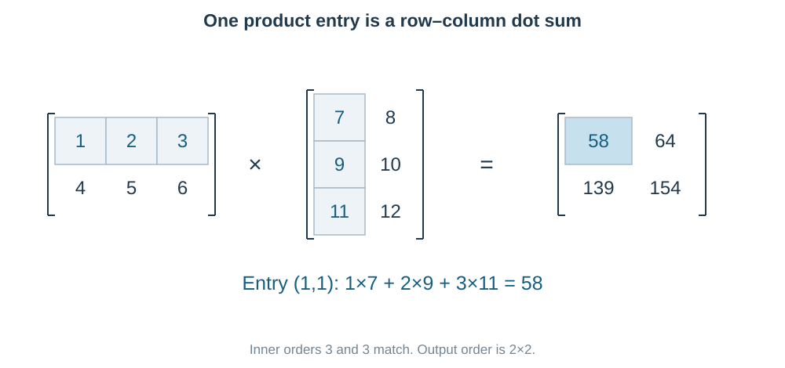

For the pictured example, $(AB)_{11}=1(7)+2(9)+3(11)=58$. You do not multiply only the entries that occupy the same position.

**Why order matters:** acting on a column vector, $ABv=A(Bv)$ means **$B$ acts first, then $A$**. Reversing two transformations can change the result.

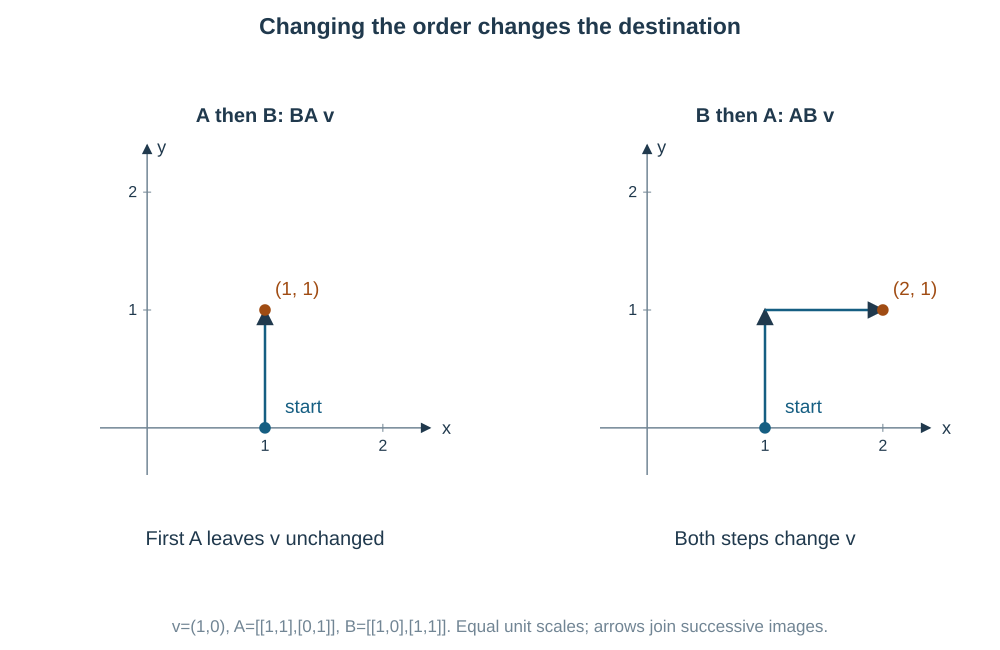

Always retain

$$
\boxed{AB\text{ need not equal }BA},\qquad
(AB)C=A(BC).
$$

Products distribute over sums, but

$$
\boxed{(A+B)^2=A^2+AB+BA+B^2}.
$$

It becomes $A^2+2AB+B^2$ only when $AB=BA$. Matrices that are polynomials in the same $A$ commute; $I$ commutes with every same-order square matrix.

**Another scalar habit that fails:** $AB=O$ does not force $A=O$ or $B=O$. For example,

$$
\begin{bmatrix}1&0\\0&0\end{bmatrix}
\begin{bmatrix}0&0\\0&1\end{bmatrix}=O.
$$

Each factor is nonzero. One action can send the first action's output to zero.

### Concept C04 — Transpose: exchange row and column positions

Transpose reflects entries across the main diagonal:

$$
\boxed{(A^T)_{ij}=a_{ji}},\qquad
\begin{bmatrix}1&2&3\\4&5&6\end{bmatrix}^T
=\begin{bmatrix}1&4\\2&5\\3&6\end{bmatrix}.
$$

It exchanges the order $m\times n$ with $n\times m$.

$$
(A+B)^T=A^T+B^T,\quad
(cA)^T=cA^T,\quad (A^T)^T=A,
$$

$$
\boxed{(AB)^T=B^TA^T},\qquad
(A^m)^T=(A^T)^m.
$$

**Why the product order reverses:** $(AB)_{ji}=\sum_k a_{jk}b_{ki}=\sum_k(B^T)_{ik}(A^T)_{kj}$. The row/column roles exchange too.

When testing a whole expression for symmetry, transpose the whole expression first. Do not guess from whether its individual factors are symmetric.

### Concept C05 — Symmetric and skew-symmetric matrices

For real square matrices:

$$
\boxed{A^T=A\text{ means symmetric}},\qquad
\boxed{A^T=-A\text{ means skew-symmetric}}.
$$

Symmetric entries mirror equally: $a_{ij}=a_{ji}$. Skew entries mirror with opposite signs: $a_{ij}=-a_{ji}$. On a skew diagonal, $a_{ii}=-a_{ii}$ forces $a_{ii}=0$.

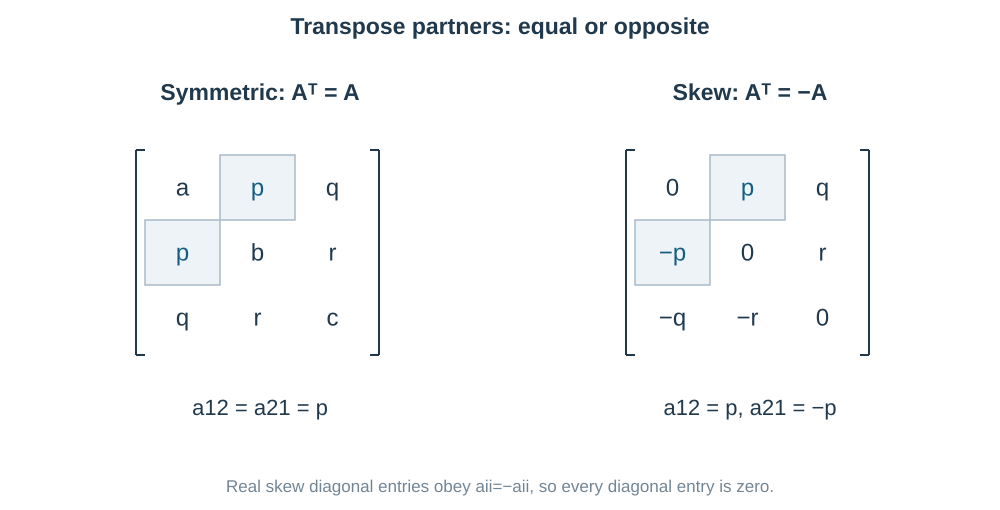

Every real square matrix splits **uniquely** into these two parts:

$$
\boxed{A=\frac{A+A^T}{2}+\frac{A-A^T}{2}=P+Q}.
$$

Why? If $A=P+Q$, transposition gives $A^T=P-Q$. Adding/subtracting the equations determines $P,Q$.

For entries,

$$
\boxed{p_{ij}=\frac{a_{ij}+a_{ji}}2},\qquad
\boxed{q_{ij}=\frac{a_{ij}-a_{ji}}2}.
$$

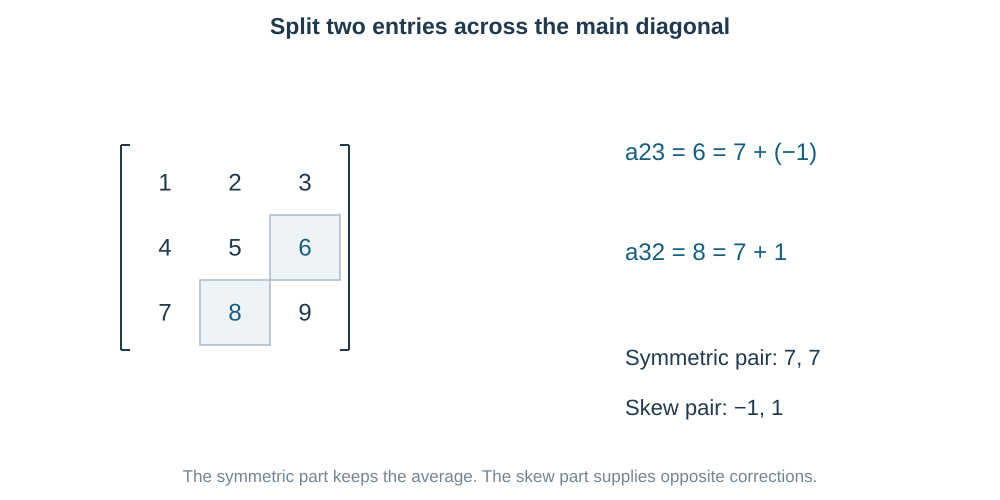

**Useful product tests:**

- If $A,B$ are symmetric, $AB$ is symmetric iff $AB=BA$.
- For any real $A$, $AA^T$ and $A^TA$ are symmetric.
- If $A$ is skew, $A^2$ is symmetric, since $(A^2)^T=(-A)^2=A^2$.
- If $A$ is symmetric and $B$ skew, $AB-BA$ is symmetric, while $AB+BA$ is skew.

These follow by reversing the order under transpose. Q4 and Q22 ask for exactly this reasoning.

### Concept C06 — Orthogonal: lengths and right angles are preserved

A real square matrix is **orthogonal** when

$$
\boxed{A^TA=AA^T=I},\qquad \boxed{A^{-1}=A^T}.
$$

Its columns are **orthonormal**: each has length one, and distinct columns have dot product zero. Its rows have the same property.

Why? The $(i,j)$ entry of $A^TA$ is the dot product of columns $i,j$. The identity asks for $1$ on the diagonal and $0$ off it.

For a vector $v$,

$$
|Av|^2=(Av)^T(Av)=v^TA^TAv=v^Tv=|v|^2.
$$

Thus this action preserves length. Replacing $v$ by two vectors likewise shows $(Au)\cdot(Av)=u\cdot v$, so it preserves angles too.

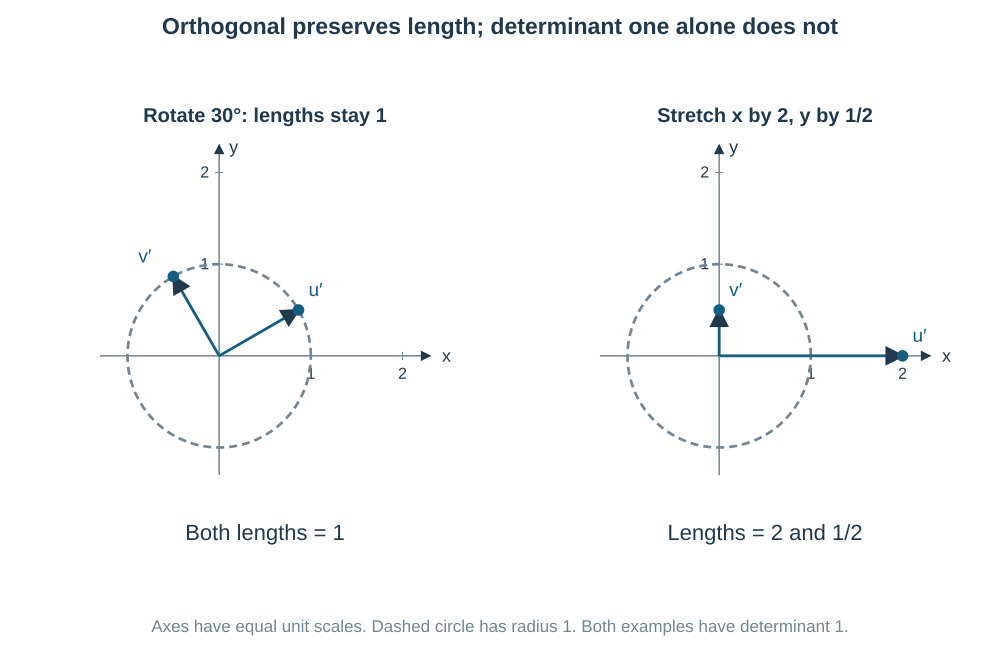

**In Q7**, the factor $1/3$ divides every row length by three. We may use zero dots of the unscaled rows first, then check that each unscaled length is three.

Taking determinants gives

$$
\boxed{\det A=\pm1}.
$$

The converse is false: $\operatorname{diag}(2,1/2)$ has determinant $1$ but changes unit lengths. Product and inverse of orthogonal matrices are orthogonal; the order in a product is still important.

### Concept C07 — Three special equations, three different actions

**Idempotent:** $A^2=A$. Every positive power equals $A$. Applying the action twice has the same effect as once.

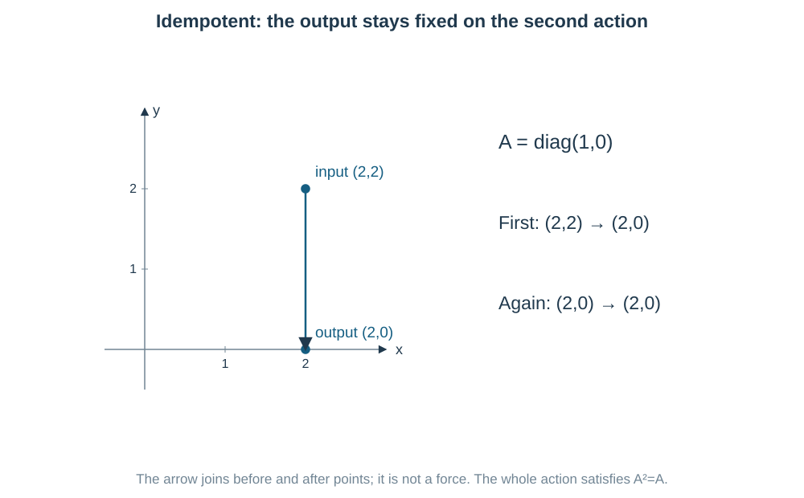

The example $A=\operatorname{diag}(1,0)$ drops the vertical coordinate. General idempotent matrices need not project perpendicularly; the equation $A^2=A$ is the defining test.

**Nilpotent:** $N^k=O$ for some positive integer $k$. A nonzero matrix can become zero after repeated application. For

$$
N=\begin{bmatrix}0&1\\0&0\end{bmatrix},
\qquad (x,y)\mapsto(y,0)\mapsto(0,0).
$$

**Involutory:** $A^2=I$, so $A^{-1}=A$ and positive powers alternate between $A$ and $I$. A reflection such as $\operatorname{diag}(1,-1)$ flips the vertical coordinate; applying it twice restores the point.

**Important distinctions:** idempotent says “the second action changes nothing more”; involutory says “the second action undoes the first”; nilpotent says “after enough actions, every vector becomes zero.”

The zero matrix is idempotent and nilpotent; the identity is idempotent, involutory and orthogonal. Names are not mutually exclusive categories.

### Concept C08 — Matrix powers: look for a short equation before multiplying

**Important for JEE Main.** Multiplying a matrix twenty-five times is usually a signal to look for structure.

For $N^2=O$, since $I$ commutes with $N$,

$$
\boxed{(I+tN)^m=I+mtN}\qquad(m\ge0\text{ integer}).
$$

All binomial terms from $N^2$ onward vanish. More generally, if $N^3=O$,

$$
\boxed{(I+N)^m=I+mN+\binom m2N^2}.
$$

Use count $0$ for $\binom m2$ when $m<2$.

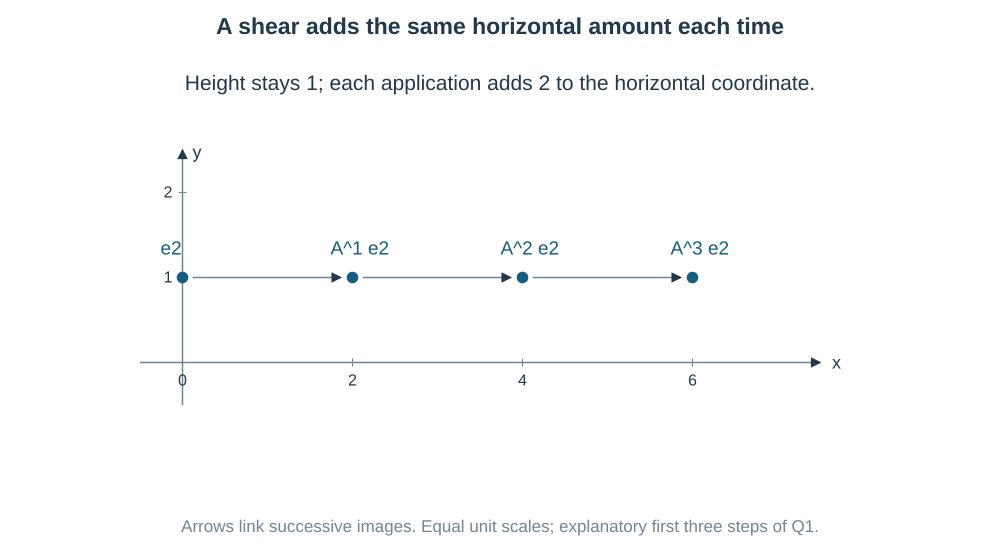

For the source's three-by-three shift,

$$
N(x,y,z)=(y,z,0),\quad N^2(x,y,z)=(z,0,0),\quad N^3(x,y,z)=O.
$$

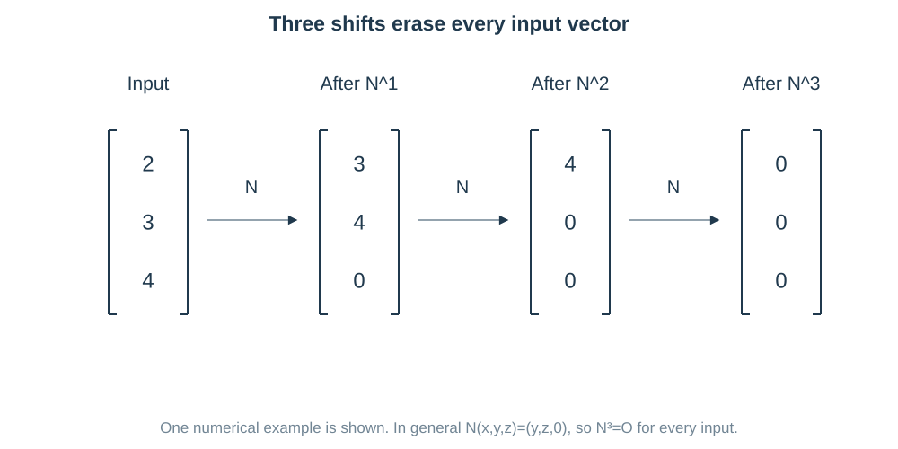

For an idempotent $A$,

$$
\boxed{(I+tA)^m=I+\{(1+t)^m-1\}A}.
$$

All positive powers of $A$ combine, leaving a scalar coefficient sum.

For nilpotent $N^k=O$,

$$
\boxed{(I-N)^{-1}=I+N+\cdots+N^{k-1}}.
$$

Multiply in either order: the sum telescopes to $I-N^k=I$. This constructs an inverse even though $N$ itself is singular.

If a small power is $I$ or $-I$, reduce a large exponent by its cycle. Q2 has $A^2=-I,A^4=I$.

### Concept C09 — Rotation matrices: read the sign convention

The usual counterclockwise rotation by angle $\theta$ is

$$
R(\theta)=\begin{bmatrix}\cos\theta&-\sin\theta\\
\sin\theta&\cos\theta\end{bmatrix}.
$$

The source uses the clockwise form

$$
\boxed{C(\theta)=R(-\theta)=
\begin{bmatrix}\cos\theta&\sin\theta\\
-\sin\theta&\cos\theta\end{bmatrix}}.
$$

Its first column sends $(1,0)$ to $(\cos\theta,-\sin\theta)$, below the horizontal axis for a small positive $\theta$.

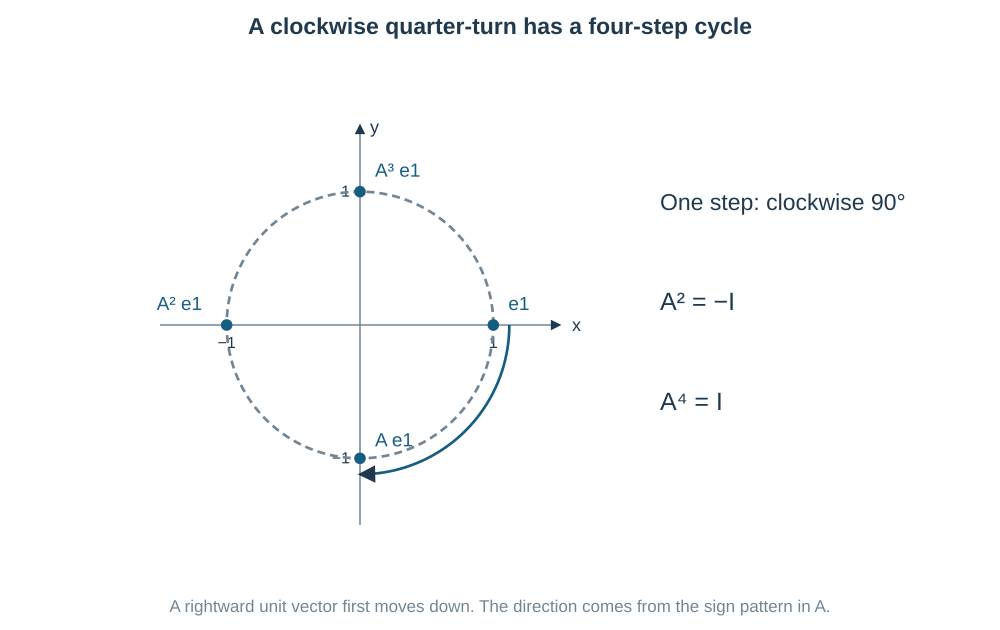

Angle-addition identities give $C(\alpha)C(\beta)=C(\alpha+\beta)$, so

$$
\boxed{C(\theta)^m=C(m\theta)}.
$$

For this form, the $(1,2)$ entry is $+\sin(m\theta)$; the $(2,1)$ entry is its negative. Knowing that the action is clockwise does not mean changing both sine entries to negative.

**Connection:** multiplying complex numbers by $\cos\theta-i\sin\theta$ gives the same clockwise rotation. The matrix and complex-number views express the same coordinate rule.

### Concept C10 — Trace: add only the diagonal

For a square matrix,

$$
\boxed{\operatorname{tr}A=a_{11}+a_{22}+\cdots+a_{nn}}.
$$

It is one number. It is not the sum of every entry. For example, the trace of $\begin{bmatrix}1&50\\0&1\end{bmatrix}$ is $2$; the sum of all entries is $52$.

$$
\operatorname{tr}(A+B)=\operatorname{tr}A+\operatorname{tr}B,\qquad
\operatorname{tr}(cA)=c\,\operatorname{tr}A,\qquad
\operatorname{tr}I_n=n.
$$

**A special order rule for trace:**

$$
\boxed{\operatorname{tr}(AB)=\operatorname{tr}(BA)}.
$$

Why? The first sum is $\sum_{i,j}a_{ij}b_{ji}$; the second contains the same products in another order. This works for compatible rectangular $A,B$ too, even when the two square products have different orders.

For three factors, trace allows a **cyclic** shift:

$$
\operatorname{tr}(ABC)=\operatorname{tr}(BCA)=\operatorname{tr}(CAB).
$$

It does not allow an arbitrary swap of two factors.

**A useful square connection:**

$$
\boxed{\operatorname{tr}(A^2)=\sum_{i,j}a_{ij}a_{ji}},\qquad
\boxed{\operatorname{tr}(AA^T)=\sum_{i,j}a_{ij}^2}.
$$

Thus for a real symmetric matrix, $\operatorname{tr}(A^2)=\sum a_{ij}^2\ge0$. For a real skew matrix,

$$
\boxed{\operatorname{tr}(A^2)=-\sum a_{ij}^2\le0}.
$$

In the skew case $a_{ji}=-a_{ij}$, so each pair-product is a negative square. Q26 uses this connection.

**Trap:** $\operatorname{tr}(A^m)$ is not generally $(\operatorname{tr}A)^m$. Also $\operatorname{tr}(BA-AB)=0$ does not imply its determinant is zero; Q30 is a counterexample.

### Concept C11 — A two-by-two matrix satisfies a quadratic identity

**Important supporting tool for JEE Main matrix powers.** For

$$
A=\begin{bmatrix}a&b\\c&d\end{bmatrix},\quad
t=\operatorname{tr}A=a+d,\quad
\delta=\det A=ad-bc,
$$

direct multiplication gives

$$
\boxed{A^2-tA+\delta I=O}.
$$

For instance, its $(1,2)$ entry is $ab+bd-(a+d)b=0$; its $(1,1)$ entry is $a^2+bc-(a+d)a+ad-bc=0$. The other entries cancel likewise. This is the two-by-two Cayley–Hamilton identity; its meaning here can be checked without learning a new theory.

Therefore

$$
\boxed{A^2=tA-\delta I},\qquad
\boxed{A^m=tA^{m-1}-\delta A^{m-2}}\quad(m\ge2).
$$

Higher powers reduce to a combination of $A$ and $I$. If $\delta\ne0$,

$$
\boxed{A^{-1}=\frac{tI-A}{\delta}}.
$$

**Trace-only shortcuts:** let $s_m=\operatorname{tr}(A^m)$. Since $s_0=2,s_1=t$, the same recurrence gives

$$
\boxed{\operatorname{tr}(A^2)=t^2-2\delta},\qquad
\boxed{\operatorname{tr}(A^3)=t^3-3t\delta}.
$$

These are for **two-by-two** matrices. Do not apply them unchanged to order three.

For a nonscalar two-by-two involutory matrix, combine $A^2=I$ with the quadratic identity: $tA=(1+\delta)I$. If $t\ne0$, this forces $A$ to be scalar, and then $A^2=I$ forces $A=\pm I$. Therefore when $A\ne\pm I$, we have $t=0,\delta=-1$. This explains the optional trace/determinant route in Q23.

**More general clue:** if $A^2=pA+qI$ with $q\ne0$, then $A(A-pI)=qI$, so $A^{-1}=(A-pI)/q$. A polynomial equation can reveal an inverse directly. Keep every nonzero condition before dividing.

### Concept C12 — Determinant and inverse: can the action be undone?

The determinant $|A|=\det A$ is a scalar attached to a square matrix. It is not obtained by adding its entries.

For order two,

$$
\boxed{\left|\begin{matrix}a&b\\c&d\end{matrix}\right|=ad-bc}.
$$

For columns $(a,c)$ and $(b,d)$, $|ad-bc|$ is their parallelogram's area. A zero determinant means these directions lie on one line: the action has flattened the plane and lost a direction.

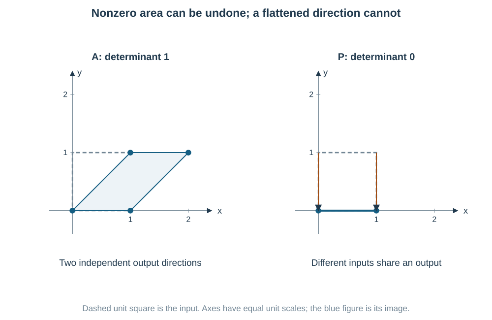

**Read the picture:** once different inputs have the same output, no single reverse rule can recover which input was used. An inverse exists exactly when $\det A\ne0$.

For a nonsingular two-by-two matrix,

$$
\boxed{A^{-1}=\frac1{ad-bc}
\begin{bmatrix}d&-b\\-c&a\end{bmatrix}},\qquad
AA^{-1}=A^{-1}A=I.
$$

For order three,

$$
\det\begin{bmatrix}a&b&c\\d&e&f\\g&h&i\end{bmatrix}
=a(ei-fh)-b(di-fg)+c(dh-eg).
$$

Chapter 8 develops the determinant rules in more detail. Required rules here are

$$
\boxed{\det(AB)=\det A\det B},\quad
\boxed{\det A^T=\det A},\quad
\boxed{\det(cA)=c^n\det A}
$$

for order $n$. In particular $\det(-A)=(-1)^n\det A$, and $\det(A^{-1})=1/\det A$.

**Inverse order:**

$$
\boxed{(AB)^{-1}=B^{-1}A^{-1}},\quad
(A^T)^{-1}=(A^{-1})^T,\quad
(A^m)^{-1}=(A^{-1})^m.
$$

All stated inverses must exist. Undo the last action first. A negative power $A^{-m}$ means $(A^{-1})^m$ and requires a nonsingular matrix.

### Concept C13 — Minor, cofactor and adjugate: three different objects

Delete row $i$ and column $j$; the determinant of what remains is the **minor** $M_{ij}$. Add a sign to get the **cofactor**:

$$
\boxed{C_{ij}=(-1)^{i+j}M_{ij}}.
$$

The order-three sign pattern is

$$
\begin{bmatrix}+&-&+\\-&+&-\\+&-&+\end{bmatrix}.
$$

The **adjugate**, called adjoint in this syllabus, is the transpose of the cofactor matrix:

$$
\boxed{\operatorname{adj}A=[C_{ji}]}.
$$

The transpose matters off the diagonal. On the diagonal, $(\operatorname{adj}A)_{ii}=C_{ii}$.

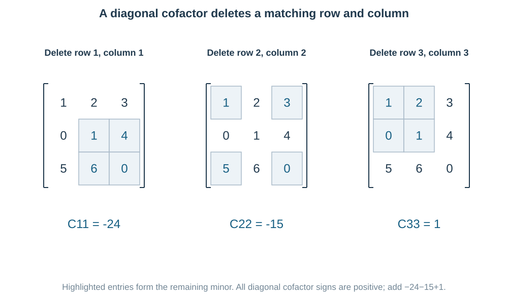

The main identity is

$$
\boxed{A\,\operatorname{adj}A=(\operatorname{adj}A)A=(\det A)I}.
$$

Thus $A^{-1}=\operatorname{adj}A/\det A$ when $\det A\ne0$. A matching row/cofactor expansion gives $\det A$; a mismatched row gives zero, which explains the identity matrix on the right.

For order $n\ge2$,

$$
\boxed{\det(\operatorname{adj}A)=(\det A)^{n-1}},\qquad
\boxed{\operatorname{adj}(cA)=c^{n-1}\operatorname{adj}A}.
$$

The second follows because each minor has order $n-1$. For nonsingular $A$, taking determinants of the main identity proves the first. It also holds for singular $A$; do not derive that case by dividing by zero.

For nonsingular order $n\ge2$,

$$
\boxed{\operatorname{adj}(\operatorname{adj}A)=(\det A)^{n-2}A}.
$$

In particular, for order three, $\operatorname{adj}(\operatorname{adj}A)=(\det A)A$. Taking its determinant gives $(\det A)^4$. Q6 asks for this scalar determinant, not for the whole adjugate matrix.

Other useful identities, with compatible square orders:

$$
\operatorname{adj}(AB)=\operatorname{adj}B\,\operatorname{adj}A,\quad
\operatorname{adj}(A^T)=(\operatorname{adj}A)^T.
$$

**Trace of an adjugate:**

- Order two: $\operatorname{tr}(\operatorname{adj}A)=\operatorname{tr}A$.
- Order three: $\operatorname{tr}(\operatorname{adj}A)=C_{11}+C_{22}+C_{33}$.
- For $A=\operatorname{diag}(a,b,c)$: $\operatorname{adj}A=\operatorname{diag}(bc,ac,ab)$.

A useful order-three connection is

$$
\boxed{\operatorname{tr}(\operatorname{adj}A)
=\frac{(\operatorname{tr}A)^2-\operatorname{tr}(A^2)}2}.
$$

Expand the two traces: diagonal squares cancel, leaving twice the three principal two-by-two minors. This offers another view for Q14 and Q28.

### Concept C14 — Rank: how many independent directions remain?

**Supporting tool for the source.** Rows are dependent if one is a combination of the others. Independent rows cannot be built from the remaining rows.

The **rank** is the number of independent rows; the number of independent columns is the same. For order $m\times n$, rank lies from $0$ to $\min(m,n)$.

For a three-by-three matrix:

- Nonzero determinant means rank $3$.
- Zero determinant means rank below $3$; it does not distinguish rank $0,1,$ or $2$.
- A nonzero two-by-two minor proves rank at least $2$.

Thus **zero determinant + one nonzero two-by-two minor** proves rank exactly $2$.

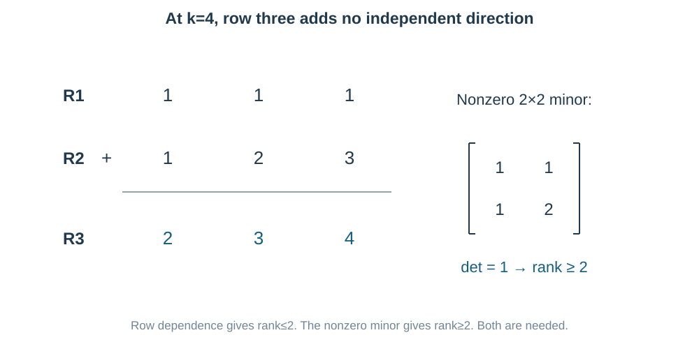

**Read the rows:** $(2,3,4)=(1,1,1)+(1,2,3)$. There are only two independent row directions, not three.

Exchanging rows, multiplying a row by a nonzero scalar, and adding a multiple of another row preserve rank. They help expose dependencies. These elimination tools support the source questions; they are not presented as a separate newly named syllabus unit.

### Concept C15 — Systems: zero solutions, one, or infinitely many

Write a system as

$$
\boxed{AX=b},
$$

where $A$ contains coefficients, $X$ the unknowns, and $b$ the right sides.

If $A$ is square and nonsingular, the unique solution is $X=A^{-1}b$.

A **homogeneous** system has $b=O$. It always has the trivial solution $X=O$. A **non-trivial** solution means at least one component is nonzero:

$$
\boxed{AX=O\text{ has a nonzero solution}\iff\det A=0}
$$

for square $A$. If an inverse existed, multiplying by it would force $X=O$.

For a nonhomogeneous system, $\det A=0$ does **not** automatically mean infinitely many solutions. A dependent left side can have a conflicting right side:

$$
x+y=2,\quad 2x+2y=5
$$

has no solution, whereas replacing $5$ by $4$ makes the second equation redundant.

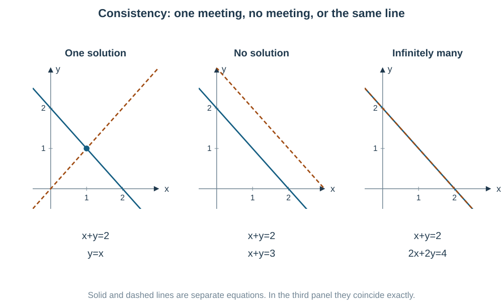

With $n$ unknowns, let $r=\operatorname{rank}A$ and $s=\operatorname{rank}[A\mid b]$, where $[A\mid b]$ means append the right-side column:

$$
\boxed{\begin{array}{ll}
r\ne s &: \text{no solution},\\
r=s=n &: \text{one solution},\\
r=s<n &: \text{infinitely many real solutions}.
\end{array}}
$$

**Meaning:** a row $0=c\ne0$ is a contradiction; a row $0=0$ adds no restriction. Free variables remain when there are fewer independent restrictions than unknowns.

Q19 is easiest by subtraction: its last equation minus the second gives $(\lambda-3)z=\mu-10$. If both sides vanish, $z$ remains free. If only the left coefficient vanishes, there is a contradiction.

### Concept C16 — Solving matrix equations: multiply on the correct side

For invertible $A$,

$$
\boxed{AX=B\Rightarrow X=A^{-1}B},\qquad
\boxed{XA=B\Rightarrow X=BA^{-1}}.
$$

To remove $A$, the inverse must touch it. Moving $A^{-1}$ through an unrelated factor is not allowed.

If $A,B$ are invertible,

$$
AXB=C\quad\Longrightarrow\quad
\boxed{X=A^{-1}CB^{-1}}.
$$

**Why reversed undoing?** First undo the outer action on the left, then undo the right multiplication on the right. Multiply the proposed answer back into the original equation to check.

If $AB=AC$, cancellation of $A$ is safe when $A$ is invertible. If it is singular, different $B,C$ can have the same product. This is the information-loss picture from C12.

Matrix powers can be cancelled on a side where the necessary inverse exists. Ordinary fraction notation $B/A$ hides the side and should be avoided.

### Concept C17 — Counting matrices: choose the free entries

If every entry of an $m\times n$ matrix can independently be one of $k$ values, the count is $\boxed{k^{mn}}$.

For symmetric $n\times n$ matrices, choose the diagonal and one triangular half; the other half is forced:

$$
\boxed{\text{free entries}=\frac{n(n+1)}2},\qquad
\boxed{\text{count}=k^{n(n+1)/2}}.
$$

For skew-symmetric real matrices, the diagonal is forced to zero; only the strict upper half is free:

$$
\boxed{\text{free entries}=\frac{n(n-1)}2}.
$$

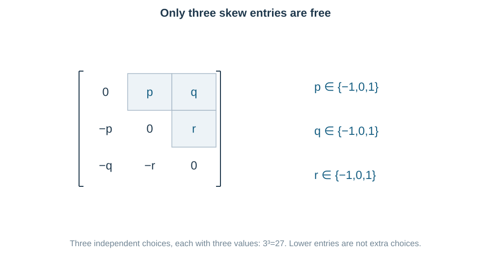

The count is $k^{n(n-1)/2}$ only if the allowed set contains zero and contains the negative of every free choice. Otherwise check which choices are compatible. If zero is forbidden, there are no skew matrices because the diagonal cannot be filled.

For binary two-by-two matrices, invertibility asks for independent rows. The three nonzero binary row vectors are $(1,0),(0,1),(1,1)$. No two different ones are scalar multiples, so choose one of three as the first row and one of the other two as the second:

$$
\boxed{3\cdot2=6}.
$$

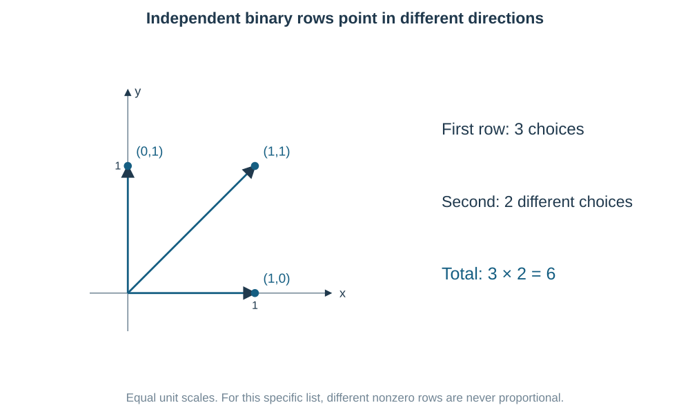

For other entry sets, being nonzero and different does not guarantee independence; for example $(1,2)$ and $(2,4)$ are different but proportional.

## Choose the route from the clue

This is a teaching map, not a measured PYQ-frequency ranking.

| Clue | First useful move | Why |
|---|---|---|
| A very large power near $I$ | Write $A=I+N$ and test small powers of $N$ | Nilpotency can truncate the binomial sum |
| $A^2=A$ or $A^2=I$ | Replace higher powers immediately | Repeated action has a short pattern |
| Trigonometric rotation form | Read signs; multiply the angle | Rotations compose by adding angles |
| Symmetry of a product/expression | Transpose the whole expression | Order reverses |
| Orthogonal matrix | Row/column lengths and dot products | $A^TA=I$ encodes these conditions |
| Trace only | Sum only required diagonal entries or use identities | Full matrix may be unnecessary |
| Two-by-two high power or inverse | $A^2-(\operatorname{tr}A)A+\det(A)I=O$ | Reduces powers to $A,I$ |
| Nested adjugate determinant | Track order and scalar determinant at each step | Matrix and determinant are different objects |
| Rank exactly two | Prove upper and lower rank bounds | Zero determinant alone is insufficient |
| Nonzero homogeneous solution | Set determinant zero, then check | An invertible action cannot send nonzero input to zero |
| Infinitely many solutions | Eliminate and test right-side consistency | Dependence can also produce a contradiction |
| Counting symmetric/skew matrices | Choose only free entries | Mirrored entries are forced |

## Last-minute formula recap

| Need | Formula / condition |
|---|---|
| Matrix order | Rows × columns |
| Product shape | $(m\times n)(n\times p)\to m\times p$ |
| Product entry | $(AB)_{ij}=\sum_k a_{ik}b_{kj}$ |
| Product transpose | $(AB)^T=B^TA^T$ |
| Square of sum | $A^2+AB+BA+B^2$; combine cross terms only if commute |
| Symmetric / skew | $A^T=A$ / $A^T=-A$ |
| Unique symmetric/skew split | $P=(A+A^T)/2,\ Q=(A-A^T)/2$ |
| Orthogonal real matrix | $A^TA=I,\ A^{-1}=A^T,\ \det A=\pm1$ |
| Idempotent | $A^2=A\Rightarrow A^m=A$, $m\ge1$ |
| Involutory | $A^2=I\Rightarrow A^{-1}=A$; powers by parity |
| Nilpotent | $N^k=O$ for some $k\ge1$ |
| Square-zero binomial | $(I+tN)^m=I+mtN$ if $N^2=O$ |
| Cube-zero binomial | $(I+N)^m=I+mN+\binom m2N^2$ if $N^3=O$ |
| Idempotent binomial | $(I+tA)^m=I+\{(1+t)^m-1\}A$ |
| Nilpotent inverse | $(I-N)^{-1}=I+N+\cdots+N^{k-1}$ |
| Clockwise rotation | $C(\theta)=\begin{bmatrix}\cos\theta&\sin\theta\\-\sin\theta&\cos\theta\end{bmatrix}$; $C^m=C(m\theta)$ |
| Trace | $\operatorname{tr}A=\sum_i a_{ii}$ |
| Trace of product | $\operatorname{tr}(AB)=\operatorname{tr}(BA)$; cyclic shifts for more factors |
| Square trace | $\operatorname{tr}(A^2)=\sum_{i,j}a_{ij}a_{ji}$ |
| Real skew square trace | $-\sum a_{ij}^2$ |
| Order-two polynomial | $A^2-tA+\delta I=O$ |
| Order-two trace powers | $\operatorname{tr}A^2=t^2-2\delta$; $\operatorname{tr}A^3=t^3-3t\delta$ |
| Order-two inverse | $(tI-A)/\delta$, $\delta\ne0$ |
| Determinant order two | $ad-bc$ |
| Determinant rules | $\det AB=\det A\det B$; $\det A^T=\det A$; $\det(cA)=c^n\det A$ |
| Inverse exists | $\det A\ne0$ |
| Product inverse | $(AB)^{-1}=B^{-1}A^{-1}$ |
| Cofactor / adjugate | $C_{ij}=(-1)^{i+j}M_{ij}$; $\operatorname{adj}A=[C_{ji}]$ |
| Main adjugate identity | $A\operatorname{adj}A=(\det A)I$ |
| General inverse | $\operatorname{adj}A/\det A$ |
| Adjugate determinant | $\det(\operatorname{adj}A)=(\det A)^{n-1}$ |
| Adjugate scale | $\operatorname{adj}(cA)=c^{n-1}\operatorname{adj}A$ |
| Nested adjugate, nonsingular | $\operatorname{adj}(\operatorname{adj}A)=(\det A)^{n-2}A$ |
| Order-three adjugate trace | $C_{11}+C_{22}+C_{33}=\{(\operatorname{tr}A)^2-\operatorname{tr}A^2\}/2$ |
| Rank exactly two, order three | $\det A=0$ and a nonzero order-two minor |
| Nontrivial $AX=O$, square $A$ | $\det A=0$ |
| General consistency | Compare $\operatorname{rank}A$ and $\operatorname{rank}[A\mid b]$ |
| Matrix equation | $AX=B\Rightarrow X=A^{-1}B$; $XA=B\Rightarrow X=BA^{-1}$ |
| Free symmetric entries | $n(n+1)/2$ |
| Free skew entries | $n(n-1)/2$; diagonal zero and negative-pair compatibility |

## Worked solutions to the 30 PDF questions

Try first, then read why the chosen route fits. Match each picture to its equation before following the calculation. Every alternative is visible.

### Question 1 — Repeated shear: look for I plus a square-zero matrix

**PDF page 33 | MCQ | Notes: C07–C08**

If $A=\begin{bmatrix}1&2\\0&1\end{bmatrix}$, then the sum of all the elements of $A^{25}$ is

- (a) $52$
- (b) $50$
- (c) $51$
- (d) $54$

**The diagonal is already the identity.** Write

$$
A=I+N,\qquad N=\begin{bmatrix}0&2\\0&0\end{bmatrix}.
$$

Direct multiplication gives $N^2=O$. In the binomial expansion all higher $N$ powers vanish:

$$
A^{25}=I+25N=\begin{bmatrix}1&50\\0&1\end{bmatrix}.
$$

The requested sum of **all** entries is

$$
\boxed{1+50+0+1=52}\quad\text{(a)}.
$$

**Why this route?** The square-zero part turns twenty-five matrix multiplications into one scalar multiplication.

**Another possible approach:** prove by induction that $A^m=\begin{bmatrix}1&2m\\0&1\end{bmatrix}$. Multiplying once by $A$ increases the upper-right entry by two. The trace alone would be $2$, a different quantity.

### Question 2 — A short power cycle beats 2023 multiplications

**PDF page 33 | MCQ | Notes: C08–C09**

If $A=\begin{bmatrix}0&1\\-1&0\end{bmatrix}$, then $A^{2023}$ equals

- (a) $A$
- (b) $-A$
- (c) $I$
- (d) $-I$

**Find a small power before a huge power.**

$$
A^2=\begin{bmatrix}-1&0\\0&-1\end{bmatrix}=-I,\qquad A^4=I.
$$

Now $2023=4(505)+3$:

$$
A^{2023}=A^3=A^2A=\boxed{-A}\quad\text{(b)}.
$$

**Another possible view:** $A=C(\pi/2)$, so its power is $C(2023\pi/2)=C(3\pi/2)=-A$. A full turn gives $I$, not $O$.

**Check:** the first basis vector moves right → down → left → up after one, two and three applications. $-A$ sends it up.

### Question 3 — A cube-zero matrix truncates the binomial sum

**PDF page 33 | Numerical value | Notes: C07–C08**

Let $N=\begin{bmatrix}0&1&0\\0&0&1\\0&0&0\end{bmatrix}$. The sum of all the elements of $(I+N)^{10}$ is ____.

**This matrix shifts components and eventually erases them.**

$$
N^2=\begin{bmatrix}0&0&1\\0&0&0\\0&0&0\end{bmatrix},
\qquad N^3=O.
$$

Since $I$ commutes with $N$,

$$
(I+N)^{10}=I+10N+\binom{10}2N^2
=\begin{bmatrix}1&10&45\\0&1&10\\0&0&1\end{bmatrix}.
$$

Sum every entry:

$$
\boxed{3+10+10+45=68}.
$$

**Why not stop at $I+10N$?** Here $N^2$ is not zero; only $N^3$ is zero. The last surviving binomial term matters.

**Another possible check:** multiply repeatedly; the two first upper-diagonal entries increase by one per step, and the corner accumulates $1+2+\cdots+9=45$. That is the same $\binom{10}2$ contribution.

### Question 4 — Transpose reverses the order of a product

**PDF page 33 | MCQ | Notes: C04–C05**

Let $A,B$ be square matrices of the same order. Consider the statements:

(I) $AA^T$ is always symmetric.

(II) $A-A^T$ is always skew-symmetric.

(III) If $A,B$ are symmetric then $AB$ is symmetric.

(IV) If $A$ is skew-symmetric then $A^2$ is skew-symmetric.

Which are correct?

- (a) (I), (II) and (III) only
- (b) (II), (III) and (IV) only
- (c) (I) and (II) only
- (d) (I), (II) and (IV) only

**Transpose each whole expression; reverse product order.**

(I) True:

$$
(AA^T)^T=(A^T)^TA^T=AA^T.
$$

(II) True:

$$
(A-A^T)^T=A^T-A=-(A-A^T).
$$

(III) False in general. If $A,B$ are symmetric, $(AB)^T=BA$, which equals $AB$ only if they commute. For example,

$$
A=\begin{bmatrix}1&0\\0&2\end{bmatrix},\
B=\begin{bmatrix}0&1\\1&0\end{bmatrix}
\Rightarrow AB=\begin{bmatrix}0&1\\2&0\end{bmatrix},
$$

not symmetric.

(IV) False in general: if $A$ is skew, $(A^2)^T=(-A)^2=A^2$, so its square is symmetric. The nonzero example $\begin{bmatrix}0&1\\-1&0\end{bmatrix}^2=-I$ is not skew.

Thus $\boxed{\text{(I) and (II) only}}$, **option (c)**.

One valid counterexample disproves “always.” We do not need to show that every product in (III) fails.

### Question 5 — Reduce powers with a two-by-two identity

**PDF page 33 | MCQ | Notes: C11**

If $A=\begin{bmatrix}1&2\\3&4\end{bmatrix}$ and $A^2=pA+qI$, then $p+q$ equals

- (a) $3$
- (b) $5$
- (c) $9$
- (d) $7$

**A two-by-two square can be reduced using trace and determinant.**

$$
t=1+4=5,\qquad \delta=1(4)-2(3)=-2.
$$

C11 gives $A^2=tA-\delta I=5A+2I$. Hence $p=5,q=2$ and

$$
\boxed{p+q=7}\quad\text{(d)}.
$$

**Another possible approach / direct check:**

$$
A^2=\begin{bmatrix}7&10\\15&22\end{bmatrix}.
$$

From the upper-right entry, $2p=10$, so $p=5$; from the upper-left, $p+q=7$, giving $q=2$. Comparing two entries is also short here and verifies the identity without invoking its name.

### Question 6 — A determinant of an adjugate is a scalar

**PDF page 33 | Numerical value | Notes: C12–C13**

If $A$ is a $3\times3$ non-singular matrix with $|A|=2$, then $|\operatorname{adj}(\operatorname{adj}A)|$ equals ____.

**Track what is a matrix and what is a scalar.** The outside bars ask for a determinant.

For order three,

$$
\det(\operatorname{adj}B)=(\det B)^2.
$$

Apply it first with $B=A$:

$$
\det(\operatorname{adj}A)=2^2=4.
$$

Apply it again with $B=\operatorname{adj}A$:

$$
\boxed{\det(\operatorname{adj}(\operatorname{adj}A))=4^2=16}.
$$

**Another possible approach:** for nonsingular order three, $\operatorname{adj}(\operatorname{adj}A)=(\det A)A=2A$. Its determinant is $2^3\det A=8(2)=16$. Scaling a three-by-three matrix by two scales its determinant by $2^3$, not $2$.

### Question 7 — Orthogonal rows have unit lengths and zero mutual dots

**PDF page 33 | MCQ | Notes: C06**

If $A=\dfrac13\begin{bmatrix}1&2&2\\2&1&x\\2&y&z\end{bmatrix}$ is an orthogonal matrix, then $x+y+z$ equals

- (a) $3$
- (b) $-1$
- (c) $-3$
- (d) $1$

**Orthogonal rows are perpendicular unit vectors.** Let the unscaled rows be

$$
u=(1,2,2),\quad v=(2,1,x),\quad w=(2,y,z).
$$

Dividing all rows by three does not change whether a mutual dot is zero. Use the unscaled dots first:

$$
u\cdot v=2+2+2x=0\Rightarrow x=-2.
$$

Then

$$
u\cdot w=2+2y+2z=0\Rightarrow y+z=-1,
$$

$$
v\cdot w=4+y-2z=0.
$$

Substitute $y=-1-z$ into the last equation: $3-3z=0$. Thus $z=1,y=-2$, and

$$
\boxed{x+y+z=-2-2+1=-3}\quad\text{(c)}.
$$

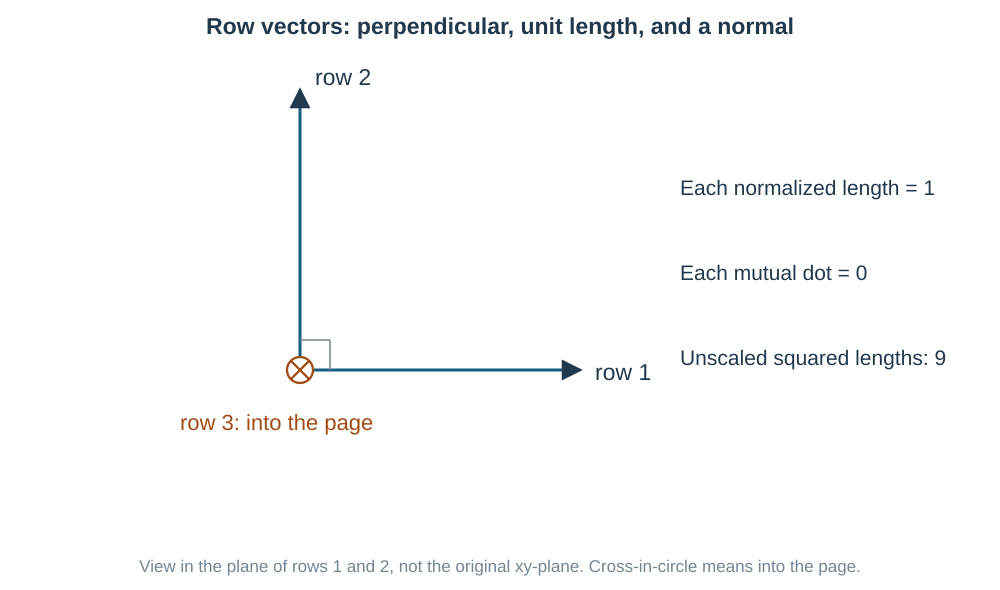

**Check the full condition:** all unscaled squared lengths are $9$, so after division by three each row has length one. All three mutual dots are zero. Perpendicularity alone would not prove orthogonality if row lengths were wrong.

**Another possible approach:** use column dot products from $A^TA=I$. The first column dotted with the second gives $y=-2$ immediately; the remaining columns then determine $x,z$. Rows and columns encode the same condition.

### Question 8 — Zero determinant alone does not prove rank two

**PDF page 33 | MCQ | Notes: C14**

The rank of $\begin{bmatrix}1&1&1\\1&2&3\\2&3&k\end{bmatrix}$ equals $2$ for $k$ equal to

- (a) $4$
- (b) $3$
- (c) $5$
- (d) $6$

**Rank exactly two needs two facts: not three, but at least two.** The determinant is

$$
1(2k-9)-1(k-6)+1(3-4)=k-4.
$$

For rank below three, set $k=4$.

The top-left minor is

$$
\left|\begin{matrix}1&1\\1&2\end{matrix}\right|=1\ne0,
$$

so rank is at least two. Therefore rank is exactly two at $\boxed{k=4}$, **option (a)**.

**Another possible approach:** at $k=4$, row three equals row one plus row two; the first two are not proportional. This directly gives two independent rows.

Setting the determinant to zero alone would not rule out rank one in a different problem.

### Question 9 — Non-trivial means a nonzero solution vector

**PDF page 34 | MCQ | Notes: C15**

The system $x+ky+3z=0,\ 4x+3y+kz=0,\ 2x+y+2z=0$ has a non-trivial solution for certain values of $k$. The sum of all such values of $k$ is

- (a) $9$
- (b) $0$
- (c) $-\dfrac92$
- (d) $\dfrac92$

**The zero vector always solves a homogeneous system.** A non-trivial solution means a nonzero vector also maps to zero, so the coefficient matrix must be singular.

$$
\left|\begin{matrix}1&k&3\\4&3&k\\2&1&2\end{matrix}\right|
=(6-k)-k(8-2k)+3(4-6)
=2k^2-9k.
$$

Set $k(2k-9)=0$. The possible values are $0,9/2$, with sum

$$
\boxed{\frac92}\quad\text{(d)}.
$$

**Check in the original system:** at $k=0$, $(x,y,z)=(-3,4,1)$ is a nonzero solution. At $k=9/2$, $(-3,-2,4)$ is a nonzero solution.

**Another possible route:** eliminate $y$ using the third equation and compare the two remaining equations in $x,z$. Requiring dependence gives the same condition. The determinant packages that dependence compactly.

### Question 10 — Idempotent powers collapse, with a zero-matrix exception

**PDF page 34 | Numerical value | Notes: C07–C08**

Let $A$ be a square matrix with $A^2=A$. If $(I+A)^5=I+\lambda A$, then $\lambda$ equals ____.

**Use the defining equation before expanding powers.** Since $A^2=A$, every $A^j=A$ for $j\ge1$:

$$
(I+A)^5=I+
\left[\binom51+\binom52+\cdots+\binom55\right]A
=I+(2^5-1)A=I+31A.
$$

For a **nonzero** $A$, comparison with $I+\lambda A$ gives

$$
(\lambda-31)A=O\Rightarrow\boxed{\lambda=31}.
$$

**Source qualification:** the printed question permits $A=O$. In that case both sides are $I$ for every $\lambda$, so $\lambda$ is not uniquely determined. The keyed $31$ is the universal identity coefficient, and the unique value for $A\ne O$.

**Another possible approach:** if $(I+A)^m=I+c_mA$, multiply by $I+A$ to get $c_{m+1}=1+2c_m$, starting from $c_1=1$. This gives $1,3,7,15,31$. The coefficient-sum route is shorter.

### Question 11 — Trace can be computed without the entire cube

**PDF page 34 | MCQ | Notes: C10–C11**

For $A=\begin{bmatrix}1&2\\3&4\end{bmatrix}$, the trace of $A^3$ is

- (a) $145$
- (b) $155$
- (c) $125$
- (d) $165$

**Only the trace is requested.** For a two-by-two matrix, use

$$
\operatorname{tr}(A^3)=t^3-3t\delta.
$$

Here $t=5,\delta=-2$, so

$$
\boxed{125-3(5)(-2)=155}\quad\text{(b)}.
$$

**Why this route?** It avoids computing off-diagonal entries we will later discard.

**Another possible approach / check:**

$$
A^3=\begin{bmatrix}37&54\\81&118\end{bmatrix},
\qquad 37+118=155.
$$

The trace is not $5^3=125$; the determinant contribution in the identity matters.

### Question 12 — Invertible binary matrices: count nonzero independent rows

**PDF page 34 | Numerical value | Notes: C12, C17**

The number of invertible $2\times2$ matrices having all entries from the set $\{0,1\}$ is ____.

**Invertible means the two rows are independent.** Neither row can be zero. The possible nonzero binary rows are

$$
(1,0),\quad(0,1),\quad(1,1).
$$

Any two different rows from this particular list are not proportional. Choose the first in three ways and the second in two:

$$
\boxed{3\cdot2=6}.
$$

**Another possible approach:** write the entries as $a,b,c,d\in\{0,1\}$. Need $ad\ne bc$. If $ad=1,bc=0$, there are three choices for $(b,c)$. If $ad=0,bc=1$, there are three for $(a,d)$. Total $3+3=6$.

The “different nonzero rows” shortcut depends on this three-vector list; it fails for general real rows that may be different scalar multiples.

### Question 13 — Choose only the free skew entries

**PDF page 34 | MCQ | Notes: C05, C17**

The number of $3\times3$ skew-symmetric matrices all of whose entries belong to $\{-1,0,1\}$ is

- (a) $9$
- (b) $27$
- (c) $81$
- (d) $729$

**Do not choose all nine entries freely.** Skew symmetry forces the shape

$$
A=\begin{bmatrix}0&p&q\\-p&0&r\\-q&-r&0\end{bmatrix}.
$$

Each of $p,q,r$ has three choices from $\{-1,0,1\}$. The allowed set includes their negatives and the required zero:

$$
\boxed{3^3=27}\quad\text{(b)}.
$$

**Check:** the zero matrix is one valid choice. A count $3^9$ would independently choose entries that are actually constrained.

### Question 14 — Trace of the adjugate needs only diagonal cofactors

**PDF page 34 | MCQ | Notes: C13**

For $A=\begin{bmatrix}1&2&3\\0&1&4\\5&6&0\end{bmatrix}$, the trace of $\operatorname{adj}A$ is

- (a) $38$
- (b) $-24$
- (c) $2$
- (d) $-38$

**A trace needs only diagonal entries.** The diagonal of $\operatorname{adj}A$ consists of $C_{11},C_{22},C_{33}$. Their cofactor signs are all positive.

$$
C_{11}=\left|\begin{matrix}1&4\\6&0\end{matrix}\right|=-24,
\quad
C_{22}=\left|\begin{matrix}1&3\\5&0\end{matrix}\right|=-15,
$$

$$
C_{33}=\left|\begin{matrix}1&2\\0&1\end{matrix}\right|=1.
$$

Thus

$$
\boxed{\operatorname{tr}(\operatorname{adj}A)=-24-15+1=-38}
\quad\text{(d)}.
$$

**Why not find the full adjugate?** Six off-diagonal cofactors would not affect the requested trace.

**Another possible approach:** $\operatorname{tr}A=2$ and $\operatorname{tr}(A^2)=80$. The order-three identity gives $(2^2-80)/2=-38$. This is useful if those traces are already easy to obtain.

### Question 15 — Match a matrix to the equation it satisfies

**PDF page 34 | MCQ | Notes: C06–C07**

Match List-I with List-II.

List-I (type of matrix): A. Idempotent; B. Nilpotent; C. Involutory; D. Orthogonal.

List-II (example):

I. $\begin{bmatrix}0&1\\0&0\end{bmatrix}$;
II. $\begin{bmatrix}1&1\\0&-1\end{bmatrix}$;
III. $\begin{bmatrix}1&1\\0&0\end{bmatrix}$;
IV. $\dfrac15\begin{bmatrix}3&4\\-4&3\end{bmatrix}$.

Choose the correct answer.

- (a) A-III, B-I, C-II, D-IV
- (b) A-I, B-III, C-II, D-IV
- (c) A-III, B-II, C-I, D-IV
- (d) A-III, B-I, C-IV, D-II

**Test the equation in each definition.**

I. $\begin{bmatrix}0&1\\0&0\end{bmatrix}^2=O$: nilpotent.

II. $\begin{bmatrix}1&1\\0&-1\end{bmatrix}^2=I$: involutory.

III. $\begin{bmatrix}1&1\\0&0\end{bmatrix}^2=
\begin{bmatrix}1&1\\0&0\end{bmatrix}$: idempotent.

IV. Its two rows have length one and dot product zero:

$$
\frac{3^2+4^2}{25}=1,\qquad
\frac{3(-4)+4(3)}{25}=0.
$$

So IV is orthogonal.

Therefore $\boxed{\text{A–III, B–I, C–II, D–IV}}$, **option (a)**.

**Check:** a triangular appearance alone does not decide the type; examples I, II and III are all upper triangular but satisfy different square equations.

### Question 16 — Odd skew order forces zero determinant; even does not force nonzero

**PDF page 34 | MCQ | Notes: C05, C12**

Statement I: Every skew-symmetric matrix of odd order is singular.

Statement II: Every skew-symmetric matrix of even order is non-singular.

Choose the correct option.

- (a) Both statements are true
- (b) Statement I is false, Statement II is true
- (c) Statement I is true, Statement II is false
- (d) Both statements are false

**Use the transpose rule and the determinant's order-dependent sign.** For skew $A$ of order $n$,

$$
\det A=\det A^T=\det(-A)=(-1)^n\det A.
$$

For odd $n$, this is $\det A=-\det A$, forcing $\det A=0$. Statement I is true.

For even $n$, the equation becomes $\det A=\det A$, which imposes no nonzero condition. The zero matrix of order two is skew and singular. Statement II is false.

$$
\boxed{\text{I true, II false}}\quad\text{(c)}.
$$

**Check the opposite even example:** $\begin{bmatrix}0&1\\-1&0\end{bmatrix}$ is skew with determinant $1$. Even-order skew matrices can be singular or nonsingular; parity alone does not decide which.

### Question 17 — A finite geometric identity constructs the inverse

**PDF page 34 | MCQ | Notes: C08, C12**

Assertion (A): If $A$ is a $3\times3$ matrix with $A^3=O$, then $I-A$ is invertible.

Reason (R): $(I-A)(I+A+A^2)=I-A^3=I$.

- (a) Both A and R are true but R is not the correct explanation of A
- (b) A is true but R is false
- (c) Both A and R are true and R is the correct explanation of A
- (d) A is false but R is true

**An inverse can be proved by constructing its partner.** The finite geometric product gives

$$
(I-A)(I+A+A^2)=I-A^3=I.
$$

The reverse product also equals $I$, because all factors are polynomials in the same $A$. Thus

$$
\boxed{(I-A)^{-1}=I+A+A^2}.
$$

Both the assertion and reason are true, and the reason explains the assertion: $\boxed{\text{(c)}}$.

**Why the nilpotent condition matters:** it removes the leftover $A^3$. Without $A^3=O$, the same proposed product would not necessarily be an inverse.

**Another possible route:** take determinants of the displayed product. Their product is $1$, so $\det(I-A)\ne0$. This proves existence, while the given product also tells the actual inverse.

### Question 18 — Read the rotation sign before multiplying the angle

**PDF page 35 | MCQ | Notes: C09**

Let $A=\begin{bmatrix}\cos(\pi/12)&\sin(\pi/12)\\-\sin(\pi/12)&\cos(\pi/12)\end{bmatrix}$. The $(1,2)$ entry of $A^{14}$ is

- (a) $\dfrac12$
- (b) $-\dfrac12$
- (c) $-\dfrac{\sqrt3}2$
- (d) $\dfrac{\sqrt3}2$

**Read the matrix form before using angles.** This is the clockwise form $C(\theta)$ with $\theta=\pi/12$:

$$
A^{14}=C(14\theta),\qquad
14\theta=\frac{7\pi}{6}.
$$

The $(1,2)$ entry of this form is $+\sin(14\theta)$:

$$
\boxed{\sin(7\pi/6)=-\frac12}\quad\text{(b)}.
$$

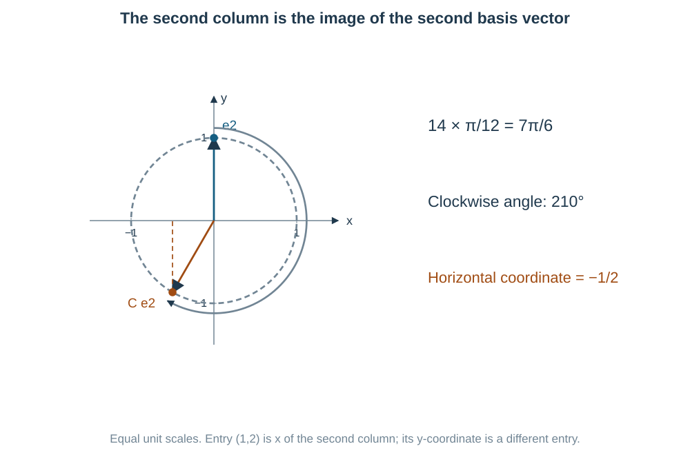

**Read the picture:** entry $(1,2)$ is the horizontal coordinate of the transformed second basis vector, not the vertical coordinate of the first.

**Another possible approach:** express the action as multiplication by $\cos\theta-i\sin\theta$ and use angle addition for its fourteenth power. The sign convention must match the original matrix.

### Question 19 — A dependent equation must have a matching right side

**PDF page 35 | MCQ | Notes: C15**

The system $x+y+z=6,\ x+2y+3z=10,\ x+2y+\lambda z=\mu$ has infinitely many solutions for $(\lambda,\mu)$ equal to

- (a) $(3,12)$
- (b) $(2,10)$
- (c) $(1,6)$
- (d) $(3,10)$

**Subtract equations that already have matching $x,y$ parts.** Third minus second gives

$$
(\lambda-3)z=\mu-10.
$$

For infinitely many solutions, this must impose no new restriction:

$$
\lambda=3,\qquad\mu=10.
$$

We must also verify that the first two equations are consistent and leave a variable free. Put $z=t$. Subtract first from second:

$$
y+2z=4\Rightarrow y=4-2t,\qquad x=2+t.
$$

So every real $t$ gives

$$
(x,y,z)=(2+t,4-2t,t),
$$

an infinite family. Hence $\boxed{(\lambda,\mu)=(3,10)}$, **option (d)**.

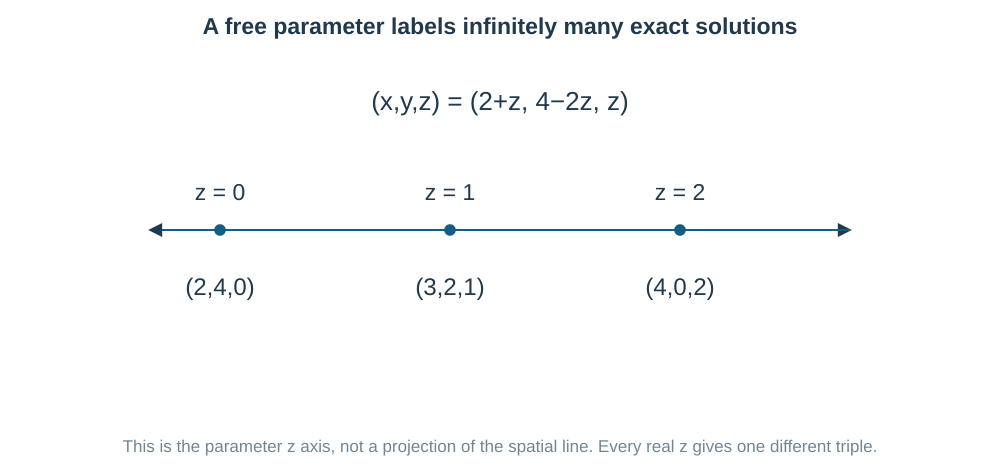

**Why determinant zero alone is insufficient:** $\lambda=3,\mu=12$ would instead require $0=2$, giving no solution. Matching the right side matters.

**Another possible approach:** the coefficient determinant is $\lambda-3$. Set it to zero, then check consistency to obtain $\mu=10$. Direct subtraction shows both requirements in one step.

### Question 20 — Reduce the square before taking the fourth power

**PDF page 35 | MCQ | Notes: C11**

If $A=\begin{bmatrix}1&2\\2&1\end{bmatrix}$ and $A^4=\alpha A+\beta I$, then $\alpha+\beta$ equals

- (a) $41$
- (b) $20$
- (c) $21$
- (d) $61$

**Reduce the square first.** Here $t=2,\delta=-3$, so

$$
A^2=2A+3I.
$$

The two terms $2A$ and $3I$ commute. Therefore

$$
\begin{aligned}
A^4&=(2A+3I)^2\\
&=4A^2+12A+9I\\
&=4(2A+3I)+12A+9I\\
&=20A+21I.
\end{aligned}
$$

Thus $\boxed{\alpha+\beta=41}$, **option (a)**.

**Check / another approach:** direct squaring gives $A^2=\begin{bmatrix}5&4\\4&5\end{bmatrix}$ and $A^4=\begin{bmatrix}41&40\\40&41\end{bmatrix}$. The off-diagonal entry gives $2\alpha=40$, then the diagonal gives $\beta=21$.

### Question 21 — Scale a determinant by the order, then take the adjugate

**PDF page 35 | Numerical value | Notes: C12–C13**

If $A$ is a $3\times3$ matrix with $|A|=3$, then $|\operatorname{adj}(2A)|$ equals ____.

**Apply the scale before the adjugate determinant rule.** Set $B=2A$. Since the order is three,

$$
\det B=2^3\det A=8(3)=24.
$$

Then

$$
\boxed{\det(\operatorname{adj}B)=(\det B)^2=24^2=576}.
$$

**Another possible approach:** $\operatorname{adj}(2A)=2^2\operatorname{adj}A=4\operatorname{adj}A$. Its determinant is $4^3(\det A)^2=64(9)=576$.

The two exponents have different reasons: $3$ from determinant order and $2$ from cofactor order.

### Question 22 — Transpose the whole expression and compare

**PDF page 35 | MCQ | Notes: C04–C05**

Let $A$ be a symmetric and $B$ a skew-symmetric matrix of the same order. Which of the following is necessarily symmetric?

- (a) $AB$
- (b) $AB-BA$
- (c) $AB+BA$
- (d) $A^2B$

**Transpose the candidate, then use $A^T=A,B^T=-B$.**

$$
(AB-BA)^T=B^TA^T-A^TB^T
=-BA+AB=AB-BA.
$$

Thus $\boxed{AB-BA}$ is symmetric, **option (b)**.

For comparison,

$$
(AB+BA)^T=-BA-AB=-(AB+BA),
$$

so the sum is skew, not necessarily symmetric.

**Check that the other options are not guaranteed:** take $A=\operatorname{diag}(1,2)$ and $B=\begin{bmatrix}0&1\\-1&0\end{bmatrix}$. Then $AB=\begin{bmatrix}0&1\\-2&0\end{bmatrix}$ and $A^2B=\begin{bmatrix}0&1\\-4&0\end{bmatrix}$, neither symmetric; $AB+BA$ is a nonzero skew matrix.

### Question 23 — Use the easiest entries of A squared equals I

**PDF page 35 | Numerical value | Notes: C03, C07**

Let $A=\begin{bmatrix}3&4\\x&y\end{bmatrix}$ satisfy $A^2=I$ with $A\ne\pm I$. Then $x^2+y^2$ equals ____.

**Choose the easiest entries of $A^2=I$.** The upper-right entry must be zero:

$$
3(4)+4y=0\Rightarrow y=-3.
$$

The upper-left entry must be one:

$$
3^2+4x=1\Rightarrow x=-2.
$$

Hence

$$
\boxed{x^2+y^2=4+9=13}.
$$

**Check the remaining entries:** $3x+xy=(-2)(3-3)=0$, and $4x+y^2=-8+9=1$. Thus the full square is $I$, not just two entries.

**Another possible approach:** a nonscalar two-by-two involutory matrix has trace zero and determinant $-1$. This gives $y=-3$ and $3y-4x=-1$, hence $x=-2$. Entry comparison requires fewer prerequisites here.

### Question 24 — A matrix-power sum can become an AP sum

**PDF page 35 | Numerical value | Notes: C08**

Let $A=\begin{bmatrix}1&0\\3&1\end{bmatrix}$. The $(2,1)$ entry of $A+A^2+\cdots+A^{10}$ is ____.

**Again the matrix is identity plus a square-zero part:**

$$
A=I+N,\qquad N=\begin{bmatrix}0&0\\3&0\end{bmatrix},\qquad N^2=O.
$$

Thus

$$
A^k=I+kN=\begin{bmatrix}1&0\\3k&1\end{bmatrix}.
$$

The requested $(2,1)$ entry of the sum is therefore

$$
3(1+2+\cdots+10)=3\frac{10(11)}2
=\boxed{165}.
$$

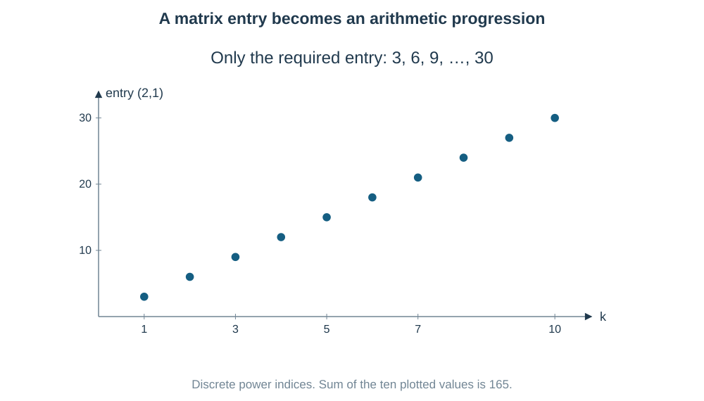

**Why this route?** Matrix structure turns the problem into the earlier Sequences and Series chapter.

**Another possible approach:** sum the matrices first:
$\sum_{k=1}^{10}A^k=10I+55N$. Its $(2,1)$ entry is $55(3)=165$.

### Question 25 — A transpose partner supplies the symmetric and skew parts

**PDF page 35 | MCQ | Notes: C05**

Let $A=\begin{bmatrix}1&2&3\\4&5&6\\7&8&9\end{bmatrix}=P+Q$ with $P$ symmetric and $Q$ skew-symmetric. The product $p_{23}q_{23}$ equals

- (a) $-7$
- (b) $7$
- (c) $-6$
- (d) $6$

**A transpose pair is enough; the whole decomposition is unnecessary.** The positions $(2,3)$ and $(3,2)$ hold $6$ and $8$.

$$
p_{23}=\frac{6+8}{2}=7,\qquad
q_{23}=\frac{6-8}{2}=-1.
$$

Thus

$$
\boxed{p_{23}q_{23}=7(-1)=-7}\quad\text{(a)}.
$$

**Another possible approach:** write $p=p_{23}=p_{32}$ and $q=q_{23}=-q_{32}$. Then $p+q=6,p-q=8$. Adding/subtracting gives $p=7,q=-1$, which derives the average/difference formulas directly.

### Question 26 — A skew square has a negative sum-of-squares trace

**PDF page 35 | Numerical value | Notes: C10**

Let $A=[a_{ij}]$ be the $3\times3$ matrix with $a_{ij}=i-j$. Then $\operatorname{tr}(A^2)$ equals ____.

**Look at the defining entry rule:** $a_{ji}=j-i=-a_{ij}$, so $A$ is skew-symmetric:

$$
A=\begin{bmatrix}0&-1&-2\\1&0&-1\\2&1&0\end{bmatrix}.
$$

The trace-square connection gives

$$
\operatorname{tr}(A^2)
=-\sum_{i,j}a_{ij}^2
=-(1+4+1+1+4+1)=\boxed{-12}.
$$

**Why this route?** It uses the entry symmetry and avoids calculating six irrelevant off-diagonal entries of $A^2$.

**Another possible approach:** calculate only the three diagonal dots. They are $-5,-2,-5$, whose sum is $-12$. The negative sign is expected for the square trace of a real nonzero skew matrix.

### Question 27 — A quadratic matrix identity can give the inverse

**PDF page 35 | MCQ | Notes: C11–C12**

If $A=\begin{bmatrix}1&-1\\2&3\end{bmatrix}$ and $A^{-1}=\alpha A+\beta I$, then $\alpha+\beta$ equals

- (a) $\dfrac15$
- (b) $-\dfrac35$
- (c) $\dfrac35$
- (d) $1$

**A two-by-two inverse is a linear expression in the same matrix.** Here $t=4,\delta=1(3)-(-1)(2)=5\ne0$.

$$
A^2-4A+5I=O.
$$

Multiply by $A^{-1}$, whose existence is justified by $\delta\ne0$:

$$
A-4I+5A^{-1}=O
\Rightarrow A^{-1}=-\frac15A+\frac45I.
$$

Thus

$$
\boxed{\alpha+\beta=-\frac15+\frac45=\frac35}
\quad\text{(c)}.
$$

**Another possible approach / check:** the ordinary inverse is $\frac15\begin{bmatrix}3&1\\-2&1\end{bmatrix}$. Comparing its upper-right entry with $\alpha A+\beta I$ gives $-\alpha=1/5$; its upper-left then gives $\beta=4/5$.

### Question 28 — A diagonal adjugate multiplies the other diagonal entries

**PDF page 36 | MCQ | Notes: C13**

If $A=\begin{bmatrix}2&0&0\\0&3&0\\0&0&4\end{bmatrix}$, then $\operatorname{tr}(\operatorname{adj}A)$ is

- (a) $24$
- (b) $9$
- (c) $52$
- (d) $26$

**A diagonal matrix makes every cofactor simple.** Each diagonal cofactor is the product of the other two diagonal entries:

$$
\operatorname{adj}A=\operatorname{diag}(3\cdot4,\ 2\cdot4,\ 2\cdot3)
=\operatorname{diag}(12,8,6).
$$

Therefore

$$
\boxed{\operatorname{tr}(\operatorname{adj}A)=12+8+6=26}
\quad\text{(d)}.
$$

**Another possible approach:** $\det A=24$ and $A^{-1}=\operatorname{diag}(1/2,1/3,1/4)$. Multiply $24A^{-1}$ to obtain the adjugate. Do not confuse its trace with $\operatorname{tr}A=9$ or $\det A=24$.

### Question 29 — An odd-order determinant equals its own negative

**PDF page 36 | MCQ | Notes: C06, C12**

If $A$ is a $3\times3$ orthogonal matrix with $|A|=1$, then $|A-I|$ equals

- (a) $1$
- (b) $-1$
- (c) $2$
- (d) $0$

**Use orthogonality to build a determinant identity.** Since $AA^T=I$,

$$
A-I=A-AA^T=A(I-A^T).
$$

Let $D=\det(A-I)$. Because $\det A=1$,

$$
D=\det A\det(I-A^T)=\det(I-A).
$$

But $I-A=-(A-I)$ has order three:

$$
\det(I-A)=(-1)^3D=-D.
$$

Thus $D=-D$, so

$$
\boxed{\det(A-I)=0}\quad\text{(d)}.
$$

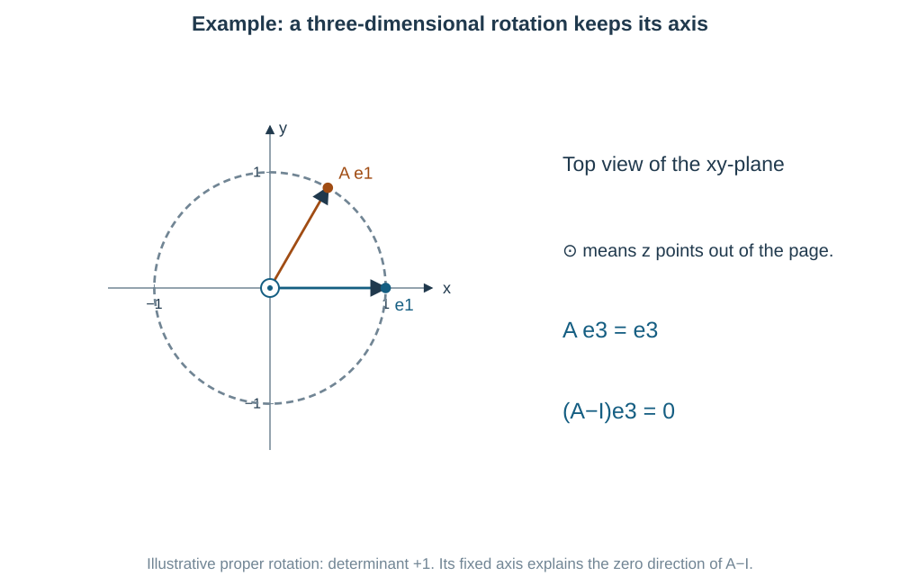

**Meaning of the zero:** a nonzero direction remains fixed by $A$, so subtracting the unchanged input loses that direction. The drawing illustrates a rotation example; the determinant proof establishes the result for every matrix in the question.

**Another route if eigenvalues are already known:** an odd-order real orthogonal matrix of determinant $1$ has an eigenvalue $1$. This also makes $A-I$ singular. The proof above does not require eigenvalue theory.

### Question 30 — A zero trace does not mean a zero determinant

**PDF page 36 | MCQ | Notes: C03, C10, C12**

Let $A=\begin{bmatrix}1&1\\0&1\end{bmatrix}$ and $B=\begin{bmatrix}1&0\\1&1\end{bmatrix}$. Then $\det(BA-AB)$ equals

- (a) $1$
- (b) $0$
- (c) $-1$
- (d) $2$

**Do not replace $BA$ by $AB$.** Compute both in their stated order:

$$
AB=\begin{bmatrix}2&1\\1&1\end{bmatrix},\qquad
BA=\begin{bmatrix}1&1\\1&2\end{bmatrix}.
$$

Therefore

$$
BA-AB=\begin{bmatrix}-1&0\\0&1\end{bmatrix},
\qquad
\boxed{\det(BA-AB)=-1}\quad\text{(c)}.
$$

**Check:** its trace is zero, as every $BA-AB$ has zero trace. Its determinant is nevertheless $-1$. Trace and determinant measure different things.

Taking $\det(BA)-\det(AB)$ would give zero, but determinants do not generally distribute over subtraction. That would be a different, invalid operation.

## Answer check

Original option order and numerical formats are preserved. Q10 has the stated zero-matrix qualification.

| Question | Answer | Question | Answer |
|---|---|---|---|
| 1 | (a) $52$ | 16 | (c) |
| 2 | (b) $-A$ | 17 | (c) |
| 3 | $68$ | 18 | (b) $-1/2$ |
| 4 | (c) | 19 | (d) $(3,10)$ |
| 5 | (d) $7$ | 20 | (a) $41$ |
| 6 | $16$ | 21 | $576$ |
| 7 | (c) $-3$ | 22 | (b) $AB-BA$ |
| 8 | (a) $4$ | 23 | $13$ |
| 9 | (d) $9/2$ | 24 | $165$ |
| 10 | Intended $31$; $A=O$ allows any $\lambda$ | 25 | (a) $-7$ |
| 11 | (b) $155$ | 26 | $-12$ |
| 12 | $6$ | 27 | (c) $3/5$ |
| 13 | (b) $27$ | 28 | (d) $26$ |
| 14 | (d) $-38$ | 29 | (d) $0$ |
| 15 | (a) | 30 | (c) $-1$ |

## Coverage and source notes

All $30$ supplied questions appear in order: $22$ MCQs and $8$ numerical-value questions. Q10's keyed $31$ is the universal identity coefficient and the unique value for a nonzero idempotent matrix; if $A=O$, its printed equation leaves $\lambda$ unrestricted. The other intended source answers agree with independent calculations.

This source chapter overlaps Determinants through adjugates, inverse, rank and systems. The recent separate-category mean $25/58$ follows PYQSide's classification, which assigns many shared inverse/system questions to Determinants. Its separate $82/58$ mean and the joint $107/58$ must be read with that boundary. ExamSIDE's combined category differs by year; the archives were not merged.

Research is a recent archive-card recount, not an independent exhaustive $2020$–$2026$ official-paper or formula-frequency audit. Method priority here is a teaching judgment. Rank and special-matrix identities are included as supporting tools for the supplied questions.

## Offline research record

- Supplied Maths Predicted V1.pdf: questions on pages 33–36, key on page 36, working through page 37. All stems/options read visually.
- NTA, Syllabus for JEE Main 2027, Mathematics Unit 3: matrix algebra, determinants, adjoint/inverse and systems.
- PYQSide, Matrices: all $25$ displayed recent question-card IDs saved and independently recounted.
- PYQSide, Determinants and Mathematics Weightage: category-boundary and full-year denominator checks.
- ExamSIDE, Matrices and Determinants: combined-category year totals and $107$ distinct IDs recounted as a comparison, not added to separate counts.

All figures are original local SVGs with explicit inputs. All second approaches remain plain visible for later inclusion in the printed booklet.
