# Determinants — JEE Main revision guide

*Before expanding nine entries, look for a row, column, zero, factor, or geometric meaning that makes the work smaller.*

> **For Kanna | Chapter 8**  
> Goal: about $120/300$ towards $200/300$ — Physics $60$, Maths $60$, Chemistry $80$.  
> Notes first, then the recap and all $30$ supplied questions. Reasoning, diagrams and useful second approaches are fully visible.

## Recent chapter weightage

**PYQSide's separate Determinants category gives $82/58\approx1.41$ questions per Paper 1 over 2024–2026.**

| Year | Papers | Determinants-category questions | Questions per paper |
|---|---:|---:|---:|
| $2024$ | $20$ | $34$ | $1.70$ |
| $2025$ | $19$ | $25$ | $1.32$ |
| $2026$ | $19$ | $23$ | $1.21$ |
| Together | $58$ | $82$ | $1.41$ |

All $82$ distinct question IDs across three archive pages were saved and recounted. This category includes many inverse, adjugate and equation-system questions that also use Matrices. Its separate Matrices count is $25$, giving a joint mean $(82+25)/58\approx1.84$.

ExamSIDE combines the chapters and reports $40,34,33$ questions by year, compared with PYQSide's combined $41,35,31$. Their pooled totals both happen to be $107$, but the year-wise classifications differ. Use one dataset consistently; do not add the combined category again.

This is an archive-category audit, not an independent full-paper or formula-frequency audit. The offered-question format differed in $2024$. **Revision priority:** row/column rules, cofactor signs, determinant products, singularity/consistency, and triangle-area meaning.

## Scope and correction before studying

The official Mathematics Unit 3 includes determinants of orders two and three, triangle area, adjoint/inverse and systems of two or three variables. These notes cover those topics and the supporting patterns used in the supplied questions.

- **Q14 has a source error.** For its printed matrix, $\Delta(\theta)=1-\cos^2\theta$, so the maximum is **$1$, option (d)**. The source key gives $2$ incorrectly. The solution shows the exact calculation, a quick row check and a graph.
- **Q25 squares a complex determinant.** Matrix-enclosing bars mean determinant, not complex modulus. Its square can therefore be negative.
- **Q18 has two valid values of $k$.** An area is nonnegative, so retain the absolute-value equation.
- **Q9 needs a basic derivative rule.** The small prerequisite is explained locally; later calculus chapters are not being started here.

## Formula and concept bank

### Concept C01 — A determinant is one number, with a geometric meaning

A matrix is a table; its determinant is a scalar. For a two-by-two matrix,

$$
\boxed{\det\begin{bmatrix}a&b\\c&d\end{bmatrix}
=\begin{vmatrix}a&b\\c&d\end{vmatrix}=ad-bc}.
$$

The bars around a matrix mean determinant. They do not mean “take the absolute value of every entry.”

**Geometric meaning over real numbers:** let the columns be $u=(a,c)$ and $v=(b,d)$. The parallelogram built from them has ordinary area

$$
\boxed{\text{area}=|ad-bc|}.
$$

The determinant itself keeps an orientation sign. Swapping the two vectors reverses the sign but not the ordinary area. If the vectors are parallel, the parallelogram is flat and the determinant is zero.

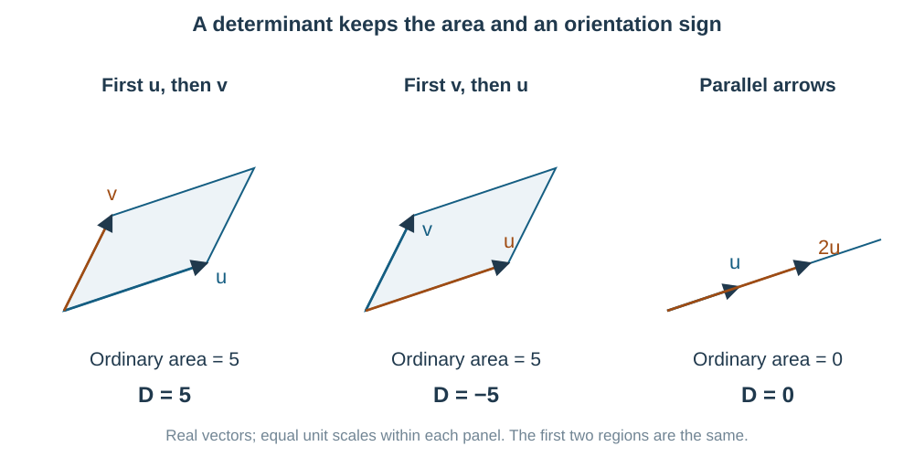

**Read the panels:** the first two enclose the same region, but the vector order is reversed. The third encloses no area.

This explains the link to invertibility: a zero determinant means some direction was lost. An action that sends different input vectors to the same output cannot be undone uniquely.

### Concept C02 — Expansion: pick a row or column, then keep the signs

Delete row $i$ and column $j$ to form a smaller determinant, the **minor** $M_{ij}$. Its signed version is the **cofactor**

$$
\boxed{C_{ij}=(-1)^{i+j}M_{ij}}.
$$

For order three, the signs are

$$
\begin{bmatrix}+&-&+\\-&+&-\\+&-&+\end{bmatrix}.
$$

The determinant can be expanded along any single row or column:

$$
\boxed{D=\sum_j a_{ij}C_{ij}}
\quad\text{for a fixed row }i.
$$

For

$$
D=\begin{vmatrix}a&b&c\\d&e&f\\g&h&i\end{vmatrix},
$$

the first-row formula is

$$
\boxed{D=a(ei-fh)-b(di-fg)+c(dh-eg)}.
$$

**Why choose a row with zeros?** Each zero removes a whole minor calculation. The sign of the original entry and the sign of its cofactor are separate. A negative entry at a negative cofactor position produces two negatives.

For an upper or lower triangular matrix,

$$
\boxed{D=\text{product of the diagonal entries}}.
$$

Expanding repeatedly along a row or column with one surviving entry proves this. Off-diagonal entries in a triangular matrix do not alter the product.

For three-by-three determinants, the six-product version is $aei+bfg+cdh-ceg-bdi-afh$. It is a check, not a reason to ignore an easier zero-rich row. The diagonal-repeat shortcut for order three does not extend to order four.

### Concept C03 — Row and column operations: know what changes the value

**Important for JEE Main.** Every rule for rows has a matching rule for columns.

| Operation | Effect on determinant |
|---|---|
| Interchange two rows | Changes sign |
| Multiply one entire row by $k$ | Multiplies the determinant by $k$ |
| Add a multiple of another row to one row | Leaves determinant unchanged |
| Transpose the matrix | Leaves determinant unchanged |
| Make two rows equal or proportional | Determinant becomes zero |
| A zero row | Determinant is zero |

For example,

$$
R_3\leftarrow R_3-2R_2+R_1
$$

preserves the determinant: it adds multiples of other rows while leaving the coefficient of the old $R_3$ equal to one.

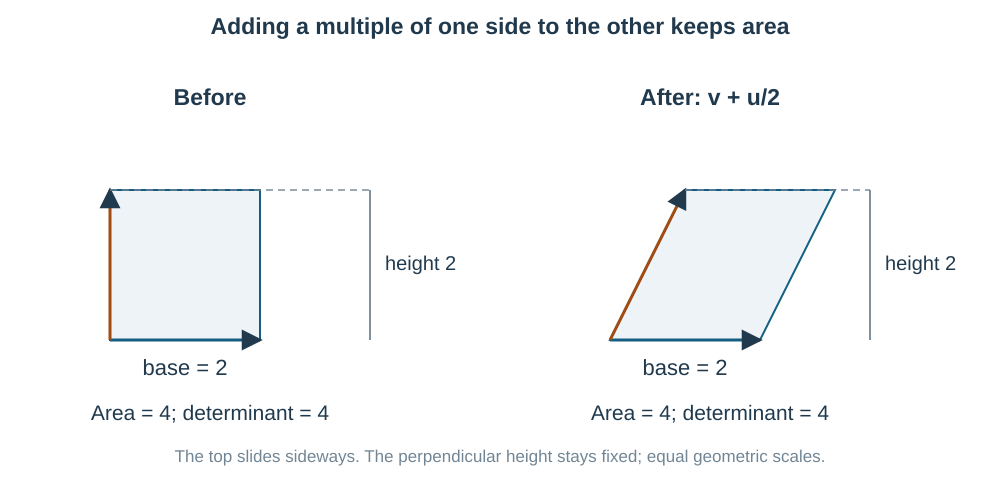

**Read the picture:** the top edge moves sideways, but its perpendicular height stays two. This is the geometric reason behind adding a multiple of another column.

**Common traps:**

- Factoring $k$ from each of $n$ rows gives $k^n$, not $k$.
- A factor may be taken out only when it multiplies the **whole row or column**.
- $R_2\leftarrow aR_2+bR_1$ scales the determinant by $a$, not automatically by one.
- If you divide by a parameter, first separate the case where it is zero.
- A cyclic shift of three rows is two swaps, so its sign is positive.

**Linearity in one row:** with the other rows fixed,

$$
D(u+v,R_2,R_3)=D(u,R_2,R_3)+D(v,R_2,R_3).
$$

This does not imply $\det(A+B)=\det A+\det B$ when every row changes.

### Concept C04 — Several row combinations at once: build their coefficient matrix

Suppose the original rows are $R_1,R_2,R_3$, and the new rows are

$$
R_1+R_2,\qquad R_2+R_3,\qquad R_3+R_1.
$$

All refer to the **original** rows. Write

$$
B=LA,\qquad
L=\begin{bmatrix}1&1&0\\0&1&1\\1&0&1\end{bmatrix}.
$$

Then

$$
\boxed{\det B=\det L\det A=2\det A}.
$$

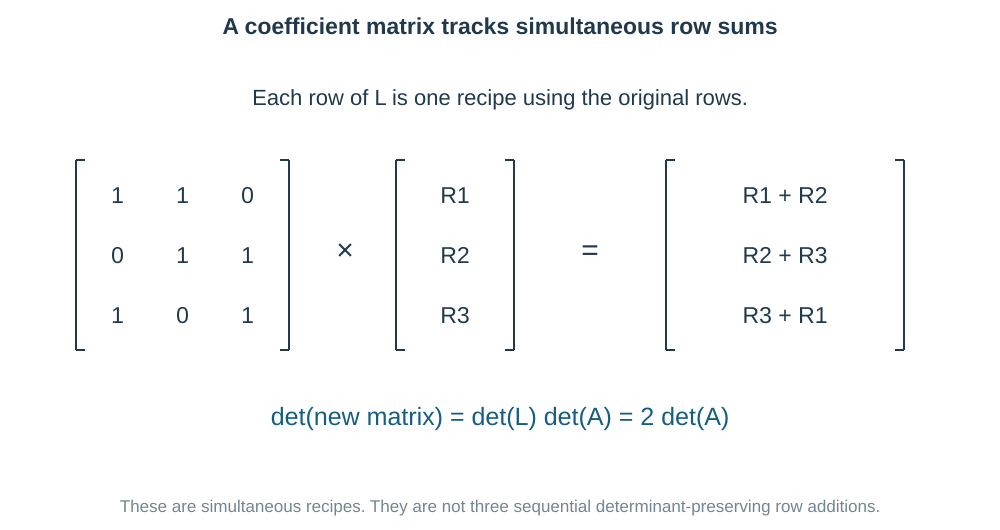

**Why ordinary row-addition reasoning can fail:** after changing $R_1$, a later instruction using that new $R_1$ no longer means the original $R_1$. Sequential and simultaneous descriptions must not be mixed.

More generally, $\det(LA)=\det L\det A$ and $\det(AR)=\det A\det R$ for compatible square row/column transformation matrices.

**Alternative viewpoint:** split each sum by row linearity. Of the eight resulting determinants in this example, six contain a repeated row and vanish. Two are cyclic copies of the original, so the total is $2D$.

### Concept C05 — Cofactor matches: own row gives D, another row gives zero

For fixed row indices $i,k$,

$$
\boxed{\sum_j a_{ij}C_{kj}
=\begin{cases}D,&i=k,\\0,&i\ne k.\end{cases}}
$$

The first case is ordinary cofactor expansion. For the second, replace row $k$ with row $i$. The cofactors of row $k$ are unchanged because their minors delete that row. The new determinant has two equal rows, so is zero.

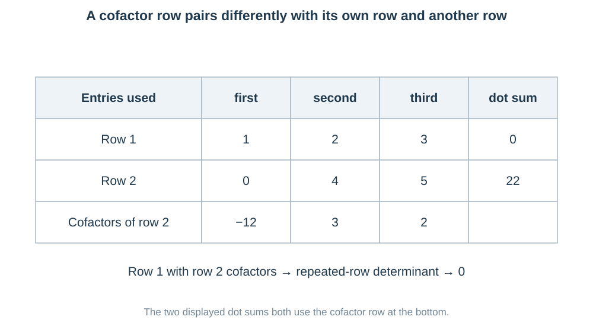

**Pattern clue:** when a long expression has entries from one row multiplied by cofactors from another, do not calculate every cofactor immediately. Check the row indices first.

If $A^T=-A$ is real skew-symmetric of odd order $n$,

$$
D=\det A^T=\det(-A)=(-1)^nD=-D,
$$

so $\boxed{D=0}$. In even order this argument does not force zero or nonzero; both are possible.

### Concept C06 — Structured entries: repeated patterns can create zeros

**Equal diagonal $a$, equal off-diagonal $b$:**

$$
\boxed{\begin{vmatrix}a&b&b\\b&a&b\\b&b&a\end{vmatrix}
=(a-b)^2(a+2b)}.
$$

To rebuild it, replace the first column by the sum of all three columns. Its entries are all $a+2b$; factor that out. Subtract row one from rows two and three. The remaining matrix is triangular with diagonal $1,a-b,a-b$.

In Q8, $a=k,b=1$, so the factorization is $(k-1)^2(k+2)$. A repeated root of this polynomial is still only one parameter value.

**Different diagonal entries, common off-diagonal $t$:**

$$
\boxed{\begin{vmatrix}a&t&t\\t&b&t\\t&t&c\end{vmatrix}
=abc-t^2(a+b+c)+2t^3}.
$$

The six-product expansion verifies it. Q13 is the case $t=1$; it is also short enough for direct expansion.

**Index rules such as $\max(i,j)$:** first build the table. For order three it is

$$
\begin{bmatrix}1&2&3\\2&2&3\\3&3&3\end{bmatrix}.
$$

Subtract row two from row one, then row three from row two. The result is lower triangular:

$$
\begin{bmatrix}-1&0&0\\-1&-1&0\\3&3&3\end{bmatrix},
$$

whose determinant is $3$.

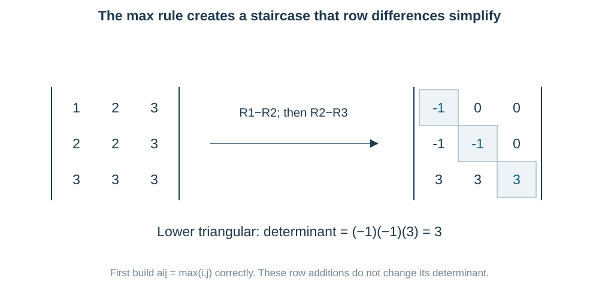

For the general $n\times n$ table $a_{ij}=\max(i,j)$ the same staircase gives $(-1)^{n-1}n$; for $a_{ij}=\min(i,j)$, subtracting rows in the opposite order gives determinant $1$. These are supporting patterns: knowing how to create the staircase is more useful than memorizing two isolated results.

### Concept C07 — Cyclic determinants and root–coefficient connections

The row order matters:

$$
\begin{vmatrix}a&b&c\\c&a&b\\b&c&a\end{vmatrix}
=a^3+b^3+c^3-3abc,
$$

$$
\boxed{\begin{vmatrix}a&b&c\\b&c&a\\c&a&b\end{vmatrix}
=-(a^3+b^3+c^3-3abc)}.
$$

The second matrix interchanges the last two rows of the first, introducing the minus sign.

Use the factorization

$$
\boxed{a^3+b^3+c^3-3abc
=(a+b+c)(a^2+b^2+c^2-ab-bc-ca)}.
$$

Let $s_1=a+b+c,\ s_2=ab+bc+ca$. Then

$$
a^2+b^2+c^2=s_1^2-2s_2,
$$

so the boxed reversed-row determinant is

$$
\boxed{-s_1(s_1^2-3s_2)}.
$$

**When useful:** if $a,b,c$ are roots of a cubic, its coefficients may already give $s_1,s_2$. There is no need to find each root separately.

For $x^3-s_1x^2+s_2x-s_3=0$, the three root relations are sum $s_1$, pair-product sum $s_2$, and product $s_3$. Keep their signs.

### Concept C08 — Vandermonde: differences appear when two columns would match

For ordered columns labelled $a,b,c$,

$$
\boxed{\begin{vmatrix}1&1&1\\a&b&c\\a^2&b^2&c^2\end{vmatrix}
=(b-a)(c-a)(c-b)}.
$$

**Why those factors?** Subtract column one from columns two and three. Their lower entries contain $b-a$ and $c-a$, since $b^2-a^2=(b-a)(b+a)$. Taking out those factors leaves

$$
\begin{vmatrix}1&1\\a+b&a+c\end{vmatrix}=c-b.
$$

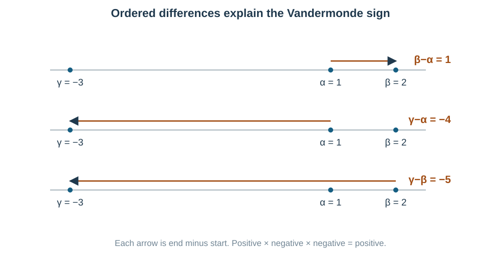

**Read the arrows:** these are signed differences, not just positive distances. Reordering two columns reverses the determinant.

If the last row has cubes instead of squares,

$$
\boxed{\begin{vmatrix}1&1&1\\a&b&c\\a^3&b^3&c^3\end{vmatrix}
=(a+b+c)(b-a)(c-a)(c-b)}.
$$

To see the extra sum, each $t=a,b,c$ satisfies $t^3=s_1t^2-s_2t+s_3$. Replace the cube row by $s_1$ times the square row plus combinations of the existing rows. Those existing-row contributions give zero determinant, leaving $s_1$ times the ordinary Vandermonde.

For small numerical values, simple column differences may be shorter than invoking the general identity, as in Q27.

### Concept C09 — Area, collinearity and a line equation

For three real points $P_i=(x_i,y_i)$,

$$
\boxed{\mathcal A=\frac12\left|
\det\begin{bmatrix}x_1&y_1&1\\x_2&y_2&1\\x_3&y_3&1\end{bmatrix}
\right|}.
$$

An equivalent and often shorter form uses movements from the same starting point:

$$
\boxed{\mathcal A=\frac12\left|
(x_2-x_1)(y_3-y_1)-(y_2-y_1)(x_3-x_1)
\right|}.
$$

**Why the half?** The two movement vectors build a parallelogram. The triangle occupies half of it. **Why absolute value?** Changing the order of vertices can reverse the determinant sign; physical area stays nonnegative.

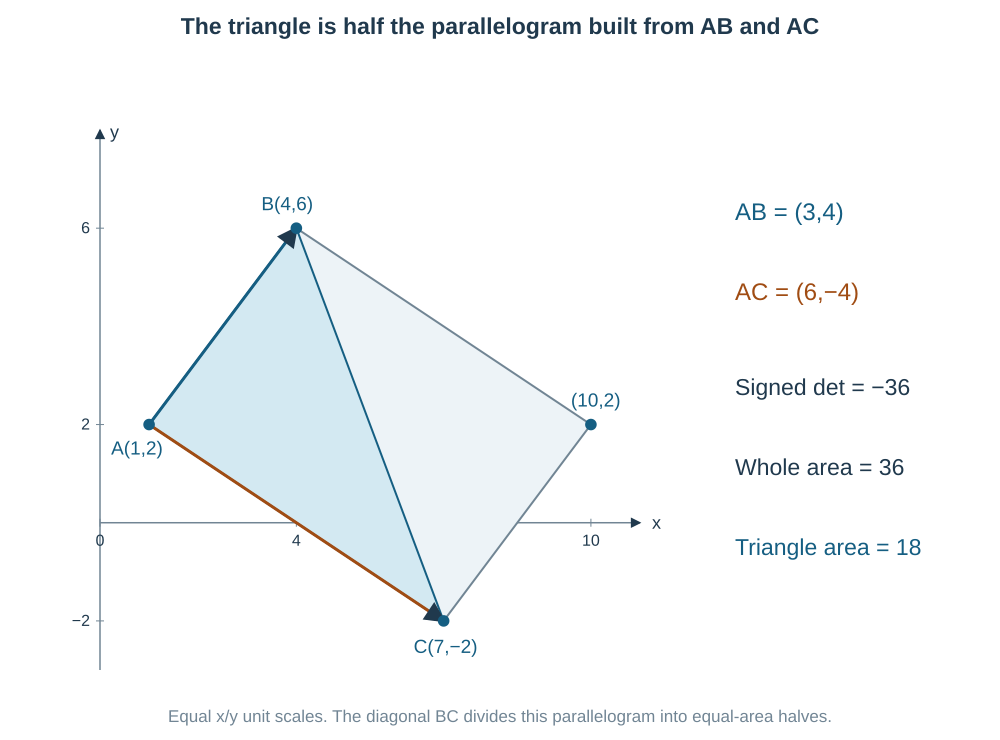

**Read the picture:** the fourth corner closes the parallelogram. The two triangles formed by its diagonal have equal area.

Three points are collinear exactly when this determinant is zero. If two fixed points $P_1\ne P_2$ are given,

$$
\boxed{\det\begin{bmatrix}x&y&1\\x_1&y_1&1\\x_2&y_2&1\end{bmatrix}=0}
$$

is the line through them. If $x_2\ne x_1$, its slope is $(y_2-y_1)/(x_2-x_1)$. If $x_2=x_1$, the line is vertical and has no finite slope.

**Visualization clue:** an axis-aligned base may be faster than a determinant. In Q18, the base lies on the $y$-axis, so its length is $|k-4|$ and its perpendicular height is $2$. A height may meet the extension of a side; it need not land inside the side segment.

**Area equations can have two cases.** If $\mathcal A$ is given, solve the absolute-value condition. Replacing $|D|=c$ by only $D=c$ can discard a valid opposite-orientation triangle.

### Concept C10 — Systems: Cramer's rule and consistency

Write the coefficients as $A$ and let $D=\det A$. If $D\ne0$, the system has one solution. For three unknowns,

$$
\boxed{x=D_x/D,\qquad y=D_y/D,\qquad z=D_z/D},
$$

where $D_x$ replaces the first **column** of coefficients by the right-side column; $D_y,D_z$ replace columns two and three.

**Why columns?** The system means $b=xC_1+yC_2+zC_3$. Then

$$
D_x=\det(b,C_2,C_3)
=x\det(C_1,C_2,C_3)=xD.
$$

The other two terms have repeated columns and vanish. This derives Cramer's rule from determinant linearity.

For two variables $a_1x+b_1y=c_1,\ a_2x+b_2y=c_2$,

$$
D=a_1b_2-a_2b_1,\quad
D_x=c_1b_2-c_2b_1,\quad
D_y=a_1c_2-a_2c_1.
$$

**Choose the method:** when two equations already have matching or opposite coefficients, elimination may be shorter than calculating several determinants. Q6 uses that clue.

**Homogeneous system:** all right sides are zero. It always has the zero solution. For square $A$,

$$
\boxed{\text{a nonzero solution exists iff }D=0}.
$$

**Nonhomogeneous system with $D=0$:** inspect consistency. A dependent equation may either repeat an existing restriction or contradict it.

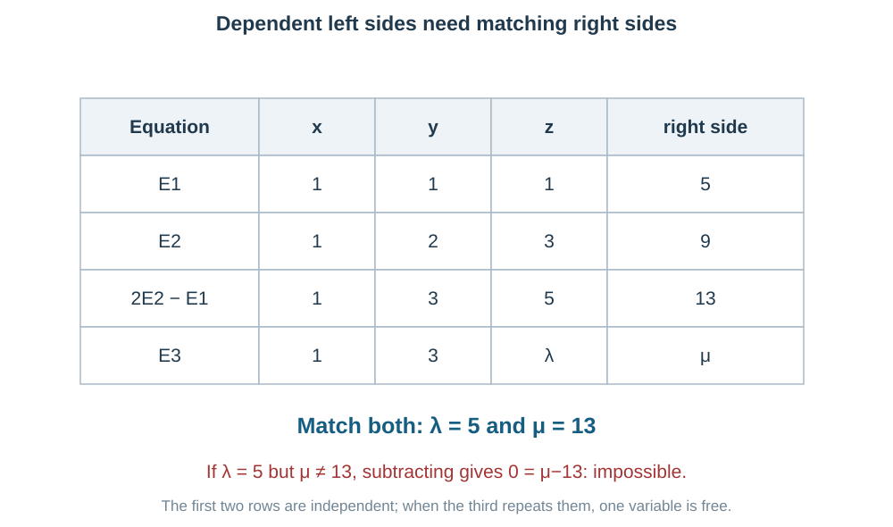

The rank is the number of independent coefficient rows. If $r=\operatorname{rank}A$ and $s=\operatorname{rank}[A\mid b]$ for $n$ unknowns:

$$
\boxed{r\ne s:\ \text{none};\quad
r=s=n:\ \text{unique};\quad
r=s<n:\ \text{infinitely many real solutions}.}
$$

In elimination, a row $0=c\ne0$ proves inconsistency; a row $0=0$ adds no restriction. Remaining free variables give infinitely many solutions.

**Do not use “all Cramer determinants zero” as a universal infinite-solution test.** For example, the three equations $x=1,\ 2x=2,\ 3x=4$ with unused $y,z$ have $D=D_x=D_y=D_z=0$ but are inconsistent. The right-side rank or the original equations must be checked.

### Concept C11 — Products, powers, inverses and adjugates

**Important for JEE Main.** For same-order square matrices,

$$
\boxed{\det(AB)=\det A\det B},\quad
\boxed{\det(A^m)=(\det A)^m}\quad(m\ge0).
$$

For negative $m$, require $\det A\ne0$. The scalar determinants commute even when $AB\ne BA$.

For order $n$ and scalar $k$,

$$
\boxed{\det(kA)=k^n\det A}.
$$

Each of the $n$ rows supplies one factor $k$.

An inverse exists iff $\det A\ne0$, and

$$
\boxed{\det(A^{-1})=\frac1{\det A}}.
$$

The adjugate is the transpose of the cofactor matrix:

$$
\operatorname{adj}A=[C_{ji}],\qquad
A\operatorname{adj}A=(\det A)I,\qquad
A^{-1}=\frac{\operatorname{adj}A}{\det A}.
$$

The adjugate itself is defined even for a singular matrix; only the inverse formula needs a nonzero determinant.

For order $n\ge2$,

$$
\boxed{\det(\operatorname{adj}A)=(\det A)^{n-1}},
\qquad
\boxed{\operatorname{adj}(kA)=k^{n-1}\operatorname{adj}A}.
$$

For nonsingular $A$,

$$
\operatorname{adj}(\operatorname{adj}A)=(\det A)^{n-2}A,
$$

$$
\boxed{\det(\operatorname{adj}(\operatorname{adj}A))
=(\det A)^{(n-1)^2}}.
$$

For order three with $\det A=\Delta\ne0$:

| Object whose determinant is requested | Determinant |
|---|---|
| $kA$ | $k^3\Delta$ |
| $\operatorname{adj}A$ | $\Delta^2$ |
| $A^{-1}$ | $1/\Delta$ |
| $\operatorname{adj}(\operatorname{adj}A)$ | $\Delta^4$ |
| $(\operatorname{adj}A)^{-1}$ | $1/\Delta^2$ |

**Read nested operations from inside out.** In Q28, first $AB$, then its adjugate, then the inverse of that whole matrix.

**Trap:** $\det(A+B)$ or $\det(A-B)$ is not generally the sum or difference of determinants. For $A=B=I_2$, $\det(A+B)=4$, while $\det A+\det B=2$.

### Concept C12 — Counting zero determinants: count equal products

For $A=\begin{bmatrix}a&b\\c&d\end{bmatrix}$,

$$
\boxed{\det A=0\iff ad=bc}.
$$

With entries in $\{-1,0,1\}$, the ordered-pair product frequencies are

| Product | Ordered pairs | Frequency |
|---|---|---:|
| $0$ | $(0,0),(0,1),(0,-1),(1,0),(-1,0)$ | $5$ |
| $1$ | $(1,1),(-1,-1)$ | $2$ |
| $-1$ | $(1,-1),(-1,1)$ | $2$ |

The pairs $(a,d)$ and $(b,c)$ occupy disjoint entries. Choose both with the same product, then add the three cases:

$$
\boxed{5^2+2^2+2^2=33}.
$$

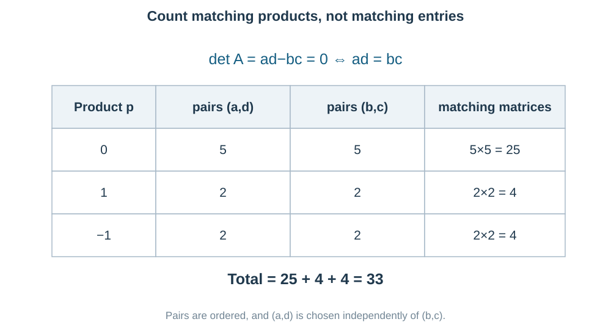

**Why this route?** It groups $3^4=81$ matrices by the exact condition, avoiding a long list.

**Another possible viewpoint:** if the first row is zero, the second has nine choices. If the first row is one of eight nonzero allowed rows, its only allowed proportional second rows are $O$, itself and its negative. Thus $9+8(3)=33$.

For other entry sets, recompute the product frequencies or proportional possibilities. The numbers $5,2,2$ are not universal.

### Concept C13 — A parameter determinant: simplify, then solve or bound

If the question asks when a matrix is singular, solve $\det A(k)=0$. First simplify the determinant by row/column patterns so the polynomial degree and factors are visible.

In Q22,

$$
R_3-2R_2+R_1=(0,0,k-9),
$$

so the determinant is $(k-9)\begin{vmatrix}1&2\\4&5\end{vmatrix}=-3(k-9)$.

For AP entries $a,b,c$, the pattern $a+c-2b=0$ should trigger a second difference. In Q29, it produces a zero row immediately.

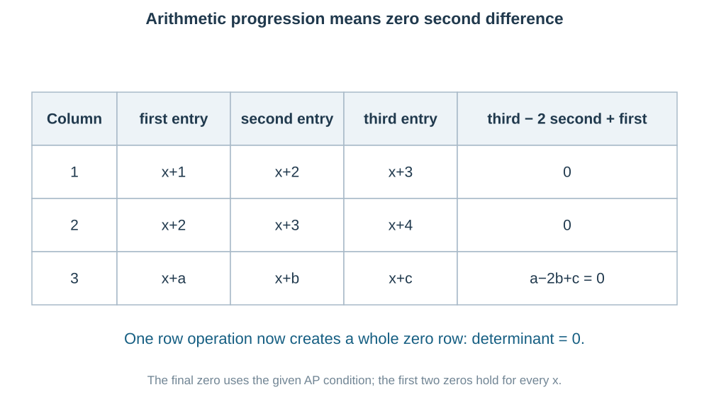

**Another useful observation:** if the same $x$ is added to every matrix entry, subtracting one row from the others removes it there. The determinant has degree at most one in $x$; expanding every apparent cubic term is often wasted work.

**For a trigonometric parameter**, set $t=\cos\theta$ and remember $-1\le t\le1$ for real $\theta$. Reduce to a polynomial in $t$ and optimize on that allowed interval.

For the **printed Q14 matrix**,

$$
\Delta=1(1-t^2)-t(-t+t)=1-t^2=\sin^2\theta.
$$

Therefore $0\le\Delta\le1$, with maximum $1$ when $\cos\theta=0$.

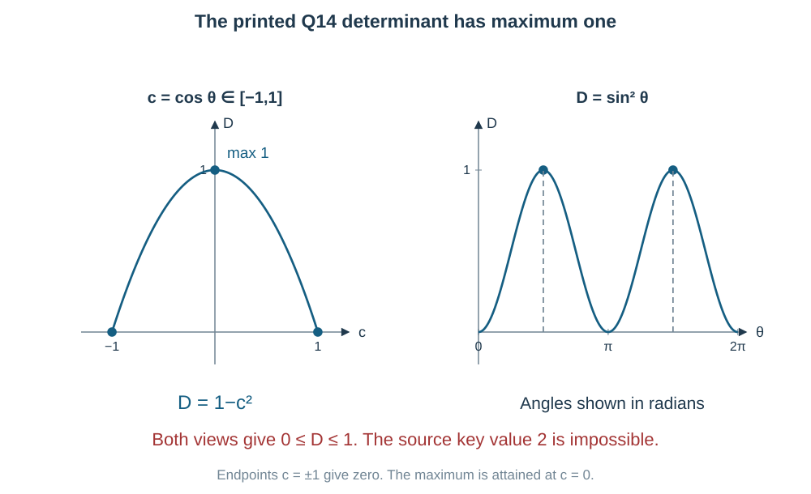

**Source correction:** the key's $2$ comes from an incorrect plus sign in its first minor. At $\cos\theta=1$, the printed matrix has equal last two rows, giving determinant zero. The corrected maximum is $1$, option (d).

### Concept C14 — A determinant function and its derivative

**Small prerequisite needed by source Q9:** the derivative gives the local slope of a graph. For a polynomial,

$$
\frac{d}{dx}x^m=mx^{m-1},\qquad
\frac{d}{dx}(cf+dg)=cf^\prime+dg^\prime.
$$

Constants have derivative zero. For example, $f(x)=2x^3$ gives $f^\prime(x)=6x^2$, so $f^\prime(1)=6$.

**Preferred route when the determinant simplifies:** find the ordinary polynomial first, then differentiate. Q9 becomes $2x^3$ after two minors.

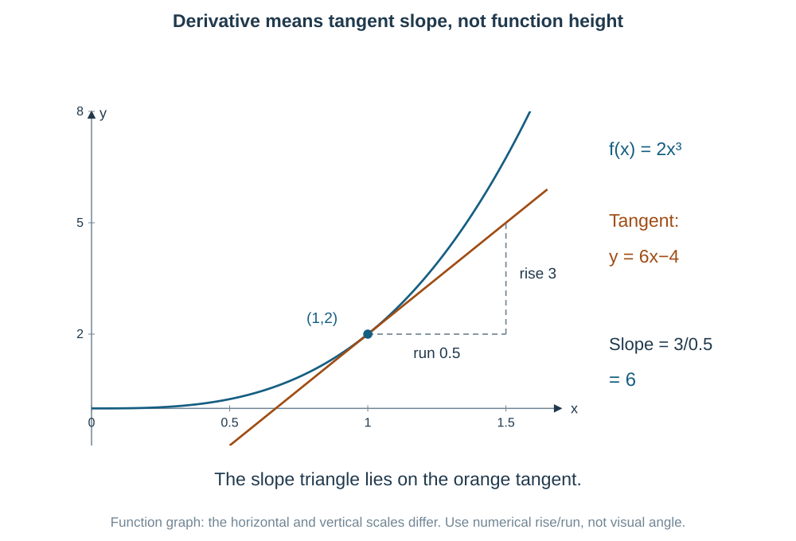

**Read the graph:** the derivative is the tangent's slope at the point, not the height $f(1)=2$.

**Another possible route — derivative of a determinant:** for differentiable row vectors $R_1(x),R_2(x),R_3(x)$,

$$
\begin{aligned}
D^\prime={}&\det(R_1^\prime,R_2,R_3)
+\det(R_1,R_2^\prime,R_3)\\
&+\det(R_1,R_2,R_3^\prime).
\end{aligned}
$$

Differentiate one row at a time and add. This follows by applying the ordinary product rule to the determinant's products of entries. If a differentiated row matches another row, that term vanishes.

Do not differentiate every row simultaneously in a single determinant. That would be like replacing $(fg)^\prime$ by $f^\prime g^\prime$.

### Concept C15 — Complex determinants: a square is not always positive

For a nonreal cube root of unity,

$$
\omega^3=1,\quad \omega\ne1,\quad
\boxed{1+\omega+\omega^2=0}.
$$

The two choices are $-1/2\pm i\sqrt3/2$; they are conjugates.

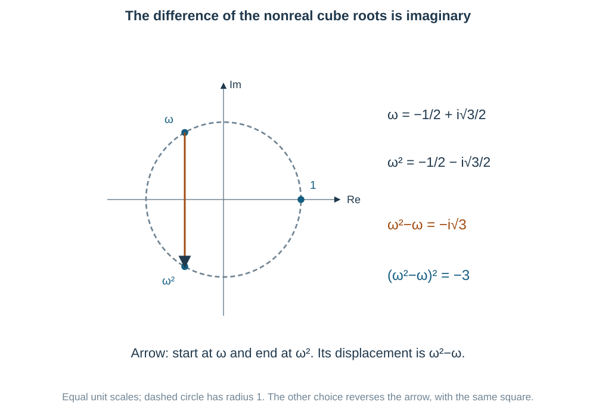

In Q25 the determinant simplifies to $D=3(\omega^2-\omega)$. Rather than choose one root,

$$
(\omega^2-\omega)^2
=\omega^4+\omega^2-2\omega^3
=\omega+\omega^2-2=-3.
$$

Thus $D^2=9(-3)=-27$.

**Why a negative answer is allowed:** $D$ is imaginary, so $D^2$ is negative real. The expression is not $|D|^2$ in the complex-modulus sense. That different quantity would be nonnegative.

The Argand picture explains the imaginary difference. It is not an ordinary real triangle-area interpretation of the complex matrix.

## Choose the route from the clue

This is a method-selection aid, not a measured pattern-frequency ranking.

| Clue | Useful first move | Why |
|---|---|---|
| Nearly repeated rows / AP entries | Differences or second differences | Exposes zeros and dependencies |
| Many zeros in one row/column | Cofactor expansion there | Avoids unnecessary minors |
| A scalar determinant is given, but entries are not | Product/scale/adjugate rules | Only scalar information is needed |
| Several original row combinations | Transformation matrix or multilinearity | Prevents sequential/simultaneous confusion |
| Entries multiplied by cofactors | Check matching row/column indices | Own row gives $D$; another gives zero |
| Equal diagonal and equal off-diagonal | Add columns, then subtract rows | Produces standard factors |
| Rows $1,t,t^2$ or $1,t,t^3$ | Vandermonde differences | Repeated-column zeros explain the factors |
| Triangle or collinearity | Draw the points; area determinant | Sign and absolute value matter |
| Axis-aligned base | Base × perpendicular height | May be shorter than a determinant |
| Infinitely many solutions | Dependence **and** right-side consistency | Zero determinant alone is insufficient |
| Parameter inside trig functions | Replace by its allowed real range | Prevents impossible extrema |
| Function determinant plus derivative | Simplify first; or differentiate one row at a time | Reveals duplicate-row cancellations |

## Last-minute formula recap

| Need | Formula / condition |
|---|---|
| Order-two determinant | $ad-bc$ |
| Order-three first-row expansion | $a(ei-fh)-b(di-fg)+c(dh-eg)$ |
| Minor / cofactor | Delete row/column; $C_{ij}=(-1)^{i+j}M_{ij}$ |
| Swap two rows/columns | Changes sign |
| One row/column scaled by $k$ | One factor $k$ |
| One row plus a multiple of another | Determinant unchanged |
| Transpose | $\det A^T=\det A$ |
| Equal/proportional/zero rows | Determinant zero |
| Triangular matrix | Product of diagonal entries |
| Scalar scale, order $n$ | $\det(kA)=k^n\det A$ |
| Simultaneous row transformation | $\det(LA)=\det L\det A$ |
| Own / other cofactor row | $\sum_j a_{ij}C_{kj}=D$ if $i=k$, otherwise $0$ |
| Odd-order skew matrix | Determinant zero |
| Equal diagonal $a$, off-diagonal $b$, order three | $(a-b)^2(a+2b)$ |
| Common off-diagonal $t$, diagonal $a,b,c$ | $abc-t^2(a+b+c)+2t^3$ |
| Cyclic rows $abc,\ cab,\ bca$ | $a^3+b^3+c^3-3abc$ |
| Reversed cyclic rows $abc,\ bca,\ cab$ | Negative of the preceding expression |
| Cubic factorization | $a^3+b^3+c^3-3abc=(a+b+c)(a^2+b^2+c^2-ab-bc-ca)$ |
| Ordered Vandermonde | $\det[1;\ t;\ t^2]=(b-a)(c-a)(c-b)$ |
| Cube-row variant | $(a+b+c)$ times the ordinary Vandermonde |
| Triangle area | Half absolute determinant of coordinate rows with a final column of ones |
| Side-vector area | $\frac12|u_xv_y-u_yv_x|$ |
| Collinear points | Coordinate determinant zero |
| Two-point line | $\det[(x,y,1);(x_1,y_1,1);(x_2,y_2,1)]=0$, fixed points distinct |
| Slope | $(y_2-y_1)/(x_2-x_1)$ if $x_2\ne x_1$ |
| Cramer's rule | $x_i=D_i/D$, $D\ne0$, replace the matching column |
| Homogeneous nonzero solution | $\det A=0$ for square coefficient matrix |
| General consistency | Equal coefficient/augmented ranks; uniqueness when rank equals unknown count |
| Product / power | $\det AB=\det A\det B$; $\det A^m=(\det A)^m$ |
| Inverse determinant | $1/\det A$, nonzero determinant required |
| Adjugate | Transposed cofactor matrix; $A\operatorname{adj}A=(\det A)I$ |
| Adjugate determinant, order $n\ge2$ | $(\det A)^{n-1}$ |
| Adjugate scale | $\operatorname{adj}(kA)=k^{n-1}\operatorname{adj}A$ |
| Nested adjugate determinant | $(\det A)^{(n-1)^2}$ |
| Singular order-two matrix | $ad=bc$ |
| AP second difference | $a-2b+c=0$ |
| Polynomial derivative | $(x^m)^\prime=mx^{m-1}$ |
| Determinant derivative | Sum of determinants with one row differentiated at a time |
| Nonreal cube roots | $1+\omega+\omega^2=0,\ \omega^3=1$ |
| Determinant versus modulus | A complex determinant can have a negative square; a squared modulus cannot |

## Worked solutions to the 30 PDF questions

Try first. Then read the clue, the reason for the chosen method, and the calculation. When a picture is used, connect its arrows, distances or graph to the equation. Every alternative remains visible.

### Question 1 — A second row difference creates two zeros

**PDF page 38 | MCQ | Notes: C02–C03**

The value of $\begin{vmatrix}1&2&3\\4&5&6\\7&8&10\end{vmatrix}$ is

- (a) $3$
- (b) $-3$
- (c) $0$
- (d) $-9$

**Notice the pattern down the columns.** In the first two columns the numbers increase by $3$ at each step. A second difference therefore gives zero there:

$$
R_3\longleftarrow R_3-2R_2+R_1
\quad\Rightarrow\quad
D=\begin{vmatrix}1&2&3\\4&5&6\\0&0&1\end{vmatrix}.
$$

This operation leaves the determinant unchanged: the coefficient of the old $R_3$ is still $1$; we only add other rows to it.

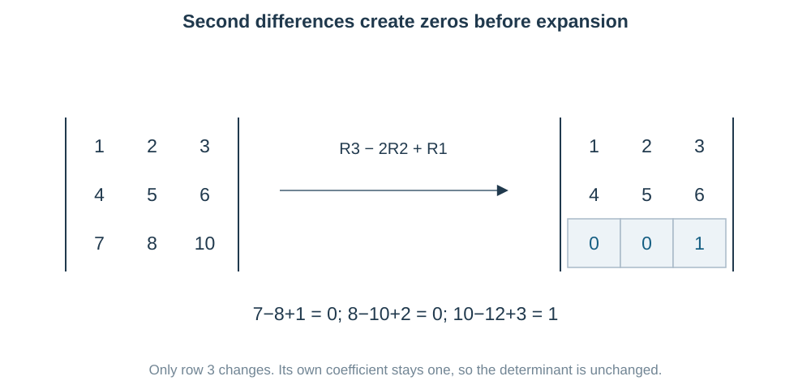

Expand along row $3$. Its last position has positive cofactor sign:

$$
D=1\begin{vmatrix}1&2\\4&5\end{vmatrix}
=5-8=\boxed{-3}\quad\text{(b)}.
$$

**Another possible approach:** ordinary first-row expansion also works:
$1(50-48)-2(40-42)+3(32-35)=2+4-9=-3$.
Here row subtraction reduces the number of products and sign checks.

### Question 2 — Vandermonde signs depend on the stated order

**PDF page 38 | Numerical value | Notes: C08**

Let $\alpha,\beta,\gamma$ be the roots of $x^3-7x+6=0$ taken in the order $\alpha=1,\beta=2,\gamma=-3$. The value of $\begin{vmatrix}1&1&1\\\alpha&\beta&\gamma\\\alpha^2&\beta^2&\gamma^2\end{vmatrix}$ is ____.

**Recognise the rows $1,t,t^2$.** These are exactly the rows of the Vandermonde determinant in C08. Keep the column order $1,2,-3$; sorting the roots can change the sign.

$$
D=(\beta-\alpha)(\gamma-\alpha)(\gamma-\beta)
=(2-1)(-3-1)(-3-2)
=1(-4)(-5)=\boxed{20}.
$$

**Why do differences appear?** If any two roots become equal, two columns become equal and the determinant becomes zero. The difference of those two roots is therefore a factor. C08 shows the column-subtraction derivation.

**Another possible check:** substitute the values first:

$$
\begin{vmatrix}1&1&1\\1&2&-3\\1&4&9\end{vmatrix}
=30-12+2=20.
$$

The direct expansion is short enough here; the pattern is useful when the entries are larger or symbolic.

### Question 3 — Only determinants are needed, not the inverse entries

**PDF page 38 | Numerical value | Notes: C11**

If $A$ is a $3\times3$ matrix with $|A|=4$, then the value of $|(2A)^{-1}\operatorname{adj}(A)|$ is ____ (answer as a decimal).

**We need one number, not the entries of the inverse.** The determinant of a product is the product of the determinants:

$$
\det\big((2A)^{-1}\operatorname{adj}A\big)
=\frac{\det(\operatorname{adj}A)}{\det(2A)}.
$$

Since the order is $3$,

$$
\det(\operatorname{adj}A)=(\det A)^2=16,
\qquad
\det(2A)=2^3\det A=32.
$$

Hence

$$
\boxed{\frac{16}{32}=0.5}.
$$

The inverse exists because $\det(2A)=32\ne0$.

**Another possible approach:** $\operatorname{adj}A=4A^{-1}$ and $(2A)^{-1}=\tfrac12A^{-1}$, so the matrix inside is $2A^{-2}$. Its determinant is $2^3(4^{-2})=1/2$. The first route uses fewer matrix identities.

### Question 4 — A triangle is half a parallelogram

**PDF page 38 | MCQ | Notes: C09**

The area of the triangle with vertices $(1,2)$, $(4,6)$ and $(7,-2)$ is

- (a) $36$ sq. units
- (b) $20$ sq. units
- (c) $9$ sq. units
- (d) $18$ sq. units

**First build the triangle from one common starting point.** Let
$A=(1,2),B=(4,6),C=(7,-2)$. The two arrows out of $A$ are

$$
\overrightarrow{AB}=(3,4),\qquad
\overrightarrow{AC}=(6,-4).
$$

The determinant of these two arrows gives the **signed parallelogram area**:

$$
D=\begin{vmatrix}3&6\\4&-4\end{vmatrix}
=3(-4)-6(4)=-36.
$$

The negative sign records the arrow order. Ordinary area is nonnegative, and our triangle is half the parallelogram:

$$
\text{triangle area}=\frac12|-36|
=\boxed{18\text{ square units}}\quad\text{(d)}.
$$

**Another possible approach:** use the coordinate formula directly,
$\tfrac12\left|\begin{vmatrix}1&2&1\\4&6&1\\7&-2&1\end{vmatrix}\right|=18$.
The side-arrow form explains both the absolute value and the factor $1/2$.

### Question 5 — Collinear means zero enclosed area

**PDF page 38 | Numerical value | Notes: C09**

If the points $(k,0)$, $(0,3)$ and $(2,2)$ are collinear, then $k$ equals ____.

**Collinear means all three points lie on one straight line.** First use the two fixed points $P=(0,3)$ and $Q=(2,2)$.

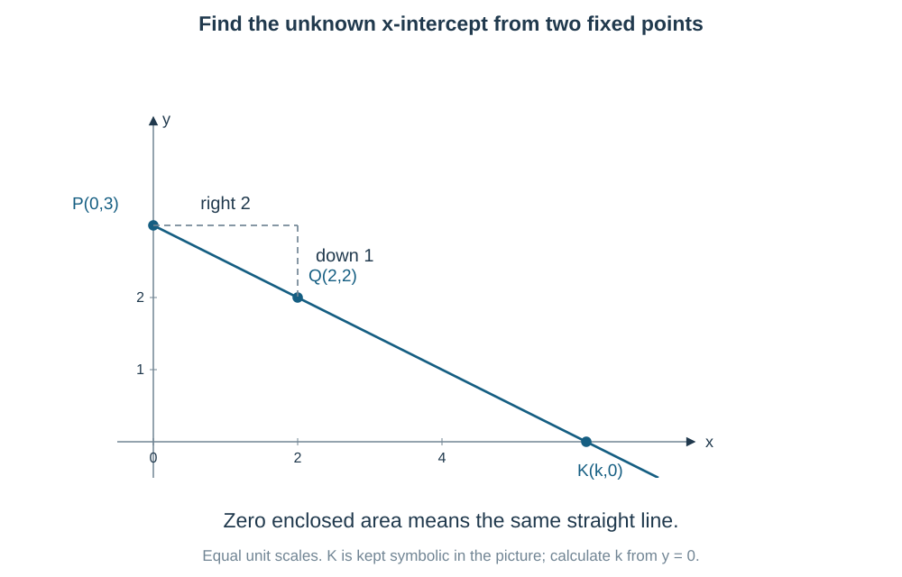

Its slope is

$$
m=\frac{2-3}{2-0}=-\frac12.
$$

Because it passes through $(0,3)$, its equation is $y=3-x/2$.
The unknown point $(k,0)$ is its x-intercept. Thus

$$
0=3-\frac{k}{2}\quad\Rightarrow\quad\boxed{k=6}.
$$

**Another possible approach — zero triangle area:**

$$
\begin{vmatrix}k&0&1\\0&3&1\\2&2&1\end{vmatrix}
=k-6=0.
$$

Both routes are short. The picture explains why a collinearity determinant should be zero: there is no enclosed triangle.

### Question 6 — Choose elimination to expose the requested expression

**PDF page 38 | MCQ | Notes: C10**

If $x,y,z$ satisfy $x+y+z=6,\ x-y+z=2,\ 2x+y-z=1$, then the value of $x+2y+3z$ is

- (a) $14$
- (b) $12$
- (c) $16$
- (d) $10$

**Look at the signs before choosing Cramer's rule.** The first two equations have $+y$ and $-y$, while the $x,z$ coefficients match. Subtract them:

$$
(x+y+z)-(x-y+z)=6-2
\quad\Rightarrow\quad 2y=4,\quad y=2.
$$

Now the first equation gives $x+z=4$. The third gives $2x-z=-1$. Subtract the second of these from twice the first:

$$
2(x+z)-(2x-z)=8-(-1)
\quad\Rightarrow\quad3z=9,\quad z=3.
$$

**Notice what the target contains:**

$$
x+2y+3z=(x+y+z)+y+2z
=6+2+6=\boxed{14}\quad\text{(a)}.
$$

We did not need to find $x$ for this last step. As a check, $x=1$ satisfies all three original equations.

**Another possible approach:** Cramer's rule is valid because the coefficient determinant is $6\ne0$. It needs more determinant calculations here. Matching coefficients makes elimination the shorter route.

### Question 7 — A dependent left side needs the same right-side combination

**PDF page 38 | MCQ | Notes: C10**

The system $x+y+z=5,\ x+2y+3z=9,\ x+3y+\lambda z=\mu$ has infinitely many solutions. Then $\lambda+\mu$ equals

- (a) $13$
- (b) $15$
- (c) $18$
- (d) $20$

**An equation can repeat information already present.** Call the first two equations $E_1,E_2$. Their combination is

$$
2E_2-E_1:\qquad x+3y+5z=13.
$$

The third equation is $x+3y+\lambda z=\mu$. To repeat that same information, **both sides** must match:

$$
\lambda=5,\qquad\mu=13.
$$

**Check that there really are infinitely many solutions.** Put $z=t$, any real number. Subtract $E_1$ from $E_2$:

$$
y+2z=4
\quad\Rightarrow\quad
(x,y,z)=(1+t,\,4-2t,\,t).
$$

Every real $t$ satisfies the third equation when $(\lambda,\mu)=(5,13)$.
Therefore $\boxed{\lambda+\mu=18}$, **option (c)**.

**Another possible approach:** the coefficient determinant is $\lambda-5$; it must vanish. Then elimination must still check $\mu=13$. A zero coefficient determinant alone also permits “no solution,” so stopping at $\lambda=5$ would be incomplete.

### Question 8 — Two distinct parameter values, not three roots with multiplicity

**PDF page 38 | Numerical value | Notes: C06, C10**

The homogeneous system $kx+y+z=0,\ x+ky+z=0,\ x+y+kz=0$ has a non-trivial solution for exactly two real values of $k$. Then the sum of these two values is ____.

**“Non-trivial” means the solution is not $(0,0,0)$.** A square homogeneous system has such a solution exactly when its coefficient determinant is zero:

$$
D=\begin{vmatrix}k&1&1\\1&k&1\\1&1&k\end{vmatrix}
=(k-1)^2(k+2).
$$

We used the equal-diagonal/equal-off-diagonal pattern in C06. Thus $k=1$ or $k=-2$.

**Check the meaning at both values.**

- At $k=1$, all three equations say $x+y+z=0$; $(1,-1,0)$ is a nonzero solution.
- At $k=-2$, $(1,1,1)$ is a nonzero solution.

There are **two distinct values**. The repeated factor $(k-1)^2$ does not mean we count $1$ twice. Their sum is
$\boxed{1+(-2)=-1}$.

**Another possible approach:** subtract neighbouring equations to get
$(k-1)(x-y)=0$ and $(k-1)(y-z)=0$. If $k\ne1$, then $x=y=z$; a nonzero common value requires $k+2=0$. This explains both branches without expanding a determinant.

### Question 9 — Simplify the determinant before differentiating

**PDF page 38 | MCQ | Notes: C14**

Let $f(x)=\begin{vmatrix}x&x^2&x^3\\1&2x&3x^2\\0&2&6x\end{vmatrix}$. Then $f^\prime(1)$ equals

- (a) $6$
- (b) $2$
- (c) $0$
- (d) $12$

**What does $f'(1)$ ask for?** It is the slope of the graph of $f$ at $x=1$, not the height $f(1)$. First turn the determinant into a simple function.

Expand along column $1$, which already contains a zero:

$$
\begin{aligned}
f(x)
&=x\begin{vmatrix}2x&3x^2\\2&6x\end{vmatrix}
-\begin{vmatrix}x^2&x^3\\2&6x\end{vmatrix}\\
&=x(12x^2-6x^2)-(6x^3-2x^3)=2x^3.
\end{aligned}
$$

Use $(x^m)'=mx^{m-1}$:

$$
f'(x)=6x^2,\qquad\boxed{f'(1)=6}\quad\text{(a)}.
$$

**Another possible approach — recognise the derivative rows.** Row $1$ differentiates into row $2$, and row $2$ into row $3$. In the determinant-derivative sum, those two terms have repeated rows and vanish. Only the last-row derivative survives:

$$
f'(x)=\begin{vmatrix}x&x^2&x^3\\1&2x&3x^2\\0&0&6\end{vmatrix}
=6(2x^2-x^2)=6x^2.
$$

The simplified-function route is easier to learn first. Differentiating all three rows at once would be incorrect.

### Question 10 — Odd skew order forces a zero determinant

**PDF page 39 | MCQ | Notes: C05**

Assertion (A): $\begin{vmatrix}0&2&-3\\-2&0&5\\3&-5&0\end{vmatrix}=0$.

Reason (R): The determinant of a skew-symmetric matrix of odd order is zero.

- (a) Both A and R are true but R is not the correct explanation of A
- (b) A is true but R is false
- (c) Both A and R are true and R is the correct explanation of A
- (d) A is false but R is true

**Check the matrix, then apply the reason.** Its diagonal is zero, and entries across the diagonal are opposites: $2,-2$; $-3,3$; $5,-5$. Thus $A^T=-A$, so it is skew-symmetric.

Transpose does not change a determinant. Multiplying all three rows by $-1$ multiplies it by $(-1)^3$:

$$
D=\det A^T=\det(-A)=(-1)^3\det A=-D.
$$

Hence $2D=0$ and $D=0$. Both statements are true, and the reason explains the assertion:
$\boxed{\text{option (c)}}$.

**Another possible check:** direct expansion gives
$-2(15)+(-3)(-10)=-30+30=0$.
The skew pattern proves it immediately and also applies to every real skew-symmetric matrix of odd order.

### Question 11 — Build the indexed matrix, then subtract neighbouring rows

**PDF page 39 | MCQ | Notes: C06**

Let $A=[a_{ij}]$ be a $3\times3$ matrix with $a_{ij}=\max(i,j)$. Then $|A|$ equals

- (a) $-3$
- (b) $0$
- (c) $6$
- (d) $3$

**First translate the index rule into entries.** For example, $a_{12}=\max(1,2)=2$ and $a_{31}=\max(3,1)=3$. Therefore

$$
A=\begin{bmatrix}1&2&3\\2&2&3\\3&3&3\end{bmatrix}.
$$

Neighbouring rows have long matching parts. Subtract them to create zeros:

$$
R_1\leftarrow R_1-R_2,\qquad
R_2\leftarrow R_2-R_3
\quad\Rightarrow\quad
\begin{bmatrix}-1&0&0\\-1&-1&0\\3&3&3\end{bmatrix}.
$$

The second operation uses row $3$, which has not changed. Both operations preserve the determinant. The new matrix is lower triangular:

$$
\det A=(-1)(-1)(3)=\boxed{3}\quad\text{(d)}.
$$

**Another possible approach:** first-row expansion gives
$1(6-9)-2(6-9)+3(6-6)=-3+6=3$. Row subtraction makes the structure easier to see.

### Question 12 — Cyclic entries connect to symmetric root sums

**PDF page 39 | MCQ | Notes: C07**

If $a,b,c$ are the roots of $x^3-6x^2+11x-6=0$, then $\begin{vmatrix}a&b&c\\b&c&a\\c&a&b\end{vmatrix}$ equals

- (a) $18$
- (b) $-18$
- (c) $0$
- (d) $-6$

**Notice two clues together:** the entries repeat in a cycle, and the entries are roots of a cubic. This lets us connect a determinant identity to the root sums.

For this row order, C07 gives

$$
D=-(a^3+b^3+c^3-3abc)
=-(a+b+c)\big((a+b+c)^2-3(ab+bc+ca)\big).
$$

The minus sign matters: the last two rows are interchanged compared with the positive cyclic form.

From $x^3-6x^2+11x-6=0$,

$$
a+b+c=6,\qquad ab+bc+ca=11.
$$

Therefore

$$
D=-6(36-33)=\boxed{-18}\quad\text{(b)}.
$$

**Another possible approach:** the polynomial factors as $(x-1)(x-2)(x-3)$. Put $a,b,c=1,2,3$ and expand:
$1(6-1)-2(4-3)+3(2-9)=-18$.
Here finding the roots is easy. The root-sum route is more useful when individual roots are awkward; its final expression is symmetric, so no unstated root order is needed.

### Question 13 — A short expansion is already efficient

**PDF page 39 | MCQ | Notes: C02, C06**

The value of $\begin{vmatrix}2&1&1\\1&3&1\\1&1&4\end{vmatrix}$ is

- (a) $16$
- (b) $18$
- (c) $17$
- (d) $24$

**A short ordinary expansion is enough here.** There is no need to force a longer transformation:

$$
\begin{aligned}
D&=2\begin{vmatrix}3&1\\1&4\end{vmatrix}
-\begin{vmatrix}1&1\\1&4\end{vmatrix}
+\begin{vmatrix}1&3\\1&1\end{vmatrix}\\
&=2(12-1)-(4-1)+(1-3)\\
&=22-3-2=\boxed{17}\quad\text{(c)}.
\end{aligned}
$$

**Another possible approach:** all off-diagonal entries are $1$. With diagonal entries $a,b,c$, C06 gives
$D=abc-a-b-c+2$.
Here $24-2-3-4+2=17$.
This pattern saves time if it is familiar; otherwise the three-minor expansion is already efficient.

### Question 14 — Source correction: check the sign inside the minor

**PDF page 39 | MCQ | Notes: C02, C13**

The maximum value of $\Delta(\theta)=\begin{vmatrix}1&\cos\theta&0\\-\cos\theta&1&\cos\theta\\-1&\cos\theta&1\end{vmatrix}$ is

- (a) $2$
- (b) $3$
- (c) $\dfrac32$
- (d) $1$

**Correction to the source key:** keep the printed matrix exactly as it is. Write $c=\cos\theta$, so $-1\le c\le1$. Expand the first row, which contains a zero:

$$
\begin{aligned}
\Delta
&=1\begin{vmatrix}1&c\\c&1\end{vmatrix}
-c\begin{vmatrix}-c&c\\-1&1\end{vmatrix}\\
&=(1-c^2)-c(-c+c)\\
&=1-c^2=\sin^2\theta.
\end{aligned}
$$

**Why does the allowed range matter?** Since $0\le c^2\le1$,

$$
0\le\Delta\le1.
$$

The upper value is actually reached: at $\theta=\pi/2$, $c=0$ and $\Delta=1$. Thus the maximum is
$\boxed{1}$, **option (d)**.

**Quick check that catches the source error:** at $c=1$, rows $2$ and $3$ are both $(-1,1,1)$, so $\Delta=0$. The source working's $1+c^2$ would give $2$ there. It has the wrong sign in the first minor, and the keyed **(a) $2$** does not answer the printed question.

**Another possible view:** optimize $1-c^2$ on $[-1,1]$ directly, without a trigonometric graph. Its largest value occurs when the subtracted nonnegative square is smallest, at $c=0$.

### Question 15 — A determinant product can be computed from two scalars

**PDF page 39 | MCQ | Notes: C11**

If $A,B$ are $3\times3$ matrices with $|A|=3$ and $|B|=-2$, then $|A^2B^{-1}|$ equals

- (a) $\dfrac92$
- (b) $-\dfrac92$
- (c) $-6$
- (d) $-\dfrac32$

**Separate the matrix expression into scalar determinant rules.** The nonzero value $\det B=-2$ guarantees that $B^{-1}$ exists:

$$
\det(A^2B^{-1})
=\det(A^2)\det(B^{-1})
=(\det A)^2\frac1{\det B}.
$$

Now substitute:

$$
\boxed{\frac{3^2}{-2}=-\frac92}\quad\text{(b)}.
$$

**Why not find $A^2$ and $B^{-1}$?** Their entries are not supplied, and they are not needed. These rules use exactly the information given.

**Another possible check:** use example diagonal matrices
$A=\operatorname{diag}(3,1,1)$ and $B=\operatorname{diag}(-2,1,1)$.
The product has diagonal $(-9/2,1,1)$ and determinant $-9/2$. This checks the arithmetic; the general determinant laws prove the result for every allowed $A,B$.

### Question 16 — Track row scaling, interchange and addition separately

**PDF page 39 | MCQ | Notes: C03–C04**

If $\begin{vmatrix}a&b\\c&d\end{vmatrix}=7$, then $\begin{vmatrix}a+2c&b+2d\\3a&3b\end{vmatrix}$ equals

- (a) $42$
- (b) $-21$
- (c) $21$
- (d) $-42$

**Name the original rows first:** $R_1=(a,b)$ and $R_2=(c,d)$, with $D(R_1,R_2)=7$.
The new rows are $R_1+2R_2$ and $3R_1$.

Subtract one-third of the **new second row** from the new first row. This preserves the determinant:

$$
D(R_1+2R_2,3R_1)
=D(2R_2,3R_1)
=6D(R_2,R_1)
=-6D(R_1,R_2).
$$

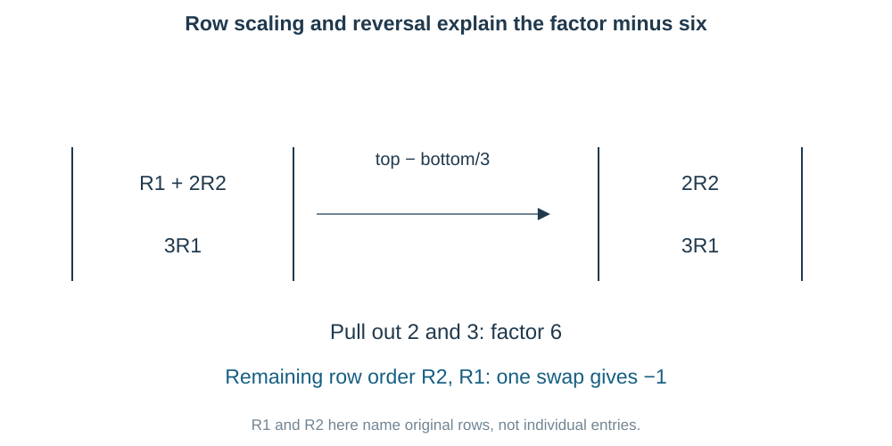

The factors $2$ and $3$ come from scaling two different rows. The minus comes from interchanging their order. Hence
$\boxed{-6(7)=-42}$, **option (d)**.

**Another possible approach:** the new matrix is
$\begin{bmatrix}1&2\\3&0\end{bmatrix}A$.
Its determinant is $(0-6)\det A=-42$.
Ordinary expansion also works, but row tracking makes every factor and sign visible.

### Question 17 — Simultaneous row sums are a separate transformation

**PDF page 39 | Numerical value | Notes: C04**

If $\begin{vmatrix}a&b&c\\d&e&f\\g&h&i\end{vmatrix}=5$, then $\begin{vmatrix}a+d&b+e&c+f\\d+g&e+h&f+i\\g+a&h+b&i+c\end{vmatrix}$ equals ____.

**Notice that all three rows change at once.** Each printed sum uses the **original** rows:

$$
\begin{bmatrix}R_1+R_2\\R_2+R_3\\R_3+R_1\end{bmatrix}
=
\underbrace{\begin{bmatrix}1&1&0\\0&1&1\\1&0&1\end{bmatrix}}_{L}
A.
$$

Thus

$$
D_{\rm new}=\det L\,\det A
=\big(1(1)-1(-1)\big)5
=2(5)=\boxed{10}.
$$

**Why not say “adding rows leaves the determinant unchanged”?** That rule changes one row while keeping the others fixed. Three sequential additions would use already changed rows and produce a different matrix. The transformation $L$ tracks the simultaneous changes correctly.

**Another possible approach — expand in rows:** there are $2^3=8$ terms. Six have a repeated original row and are zero. The survivors are
$D(R_1,R_2,R_3)$ and $D(R_2,R_3,R_1)$.
A three-row cyclic move uses two swaps, so both have sign $+$. The sum is $5+5=10$.

### Question 18 — An absolute area gives two vertical positions

**PDF page 40 | Numerical value | Notes: C09**

The area of the triangle with vertices $(-2,0)$, $(0,4)$ and $(0,k)$ is $4$ square units. The sum of all possible values of $k$ is ____.

**Draw the base on the y-axis.** Both $B=(0,4)$ and $C=(0,k)$ lie there, so their distance is $|k-4|$.
The perpendicular distance from $A=(-2,0)$ to that vertical line is $2$.

$$
\text{area}=\frac12\times |k-4|\times2=|k-4|.
$$

The given area is $4$, so

$$
|k-4|=4
\quad\Rightarrow\quad k-4=4\ \text{or}\ k-4=-4.
$$

Thus $k=8$ or $k=0$, and the requested sum is $\boxed{8}$.

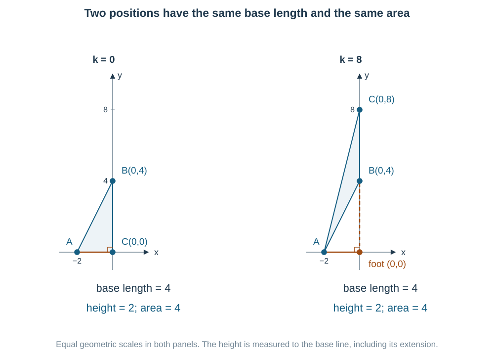

**Why are there two answers?** The moving point can be four units above or four units below $B$. Both enclose the same ordinary area. Dropping the absolute value would lose one position.

**Another possible approach:** the coordinate determinant is

$$
\begin{vmatrix}-2&0&1\\0&4&1\\0&k&1\end{vmatrix}=2(k-4).
$$

Then $\tfrac12|2(k-4)|=4$ gives the same two cases.

### Question 19 — Match the product frequencies in ad equals bc

**PDF page 40 | Numerical value | Notes: C12**

The number of $2\times2$ matrices with all entries from $\{-1,0,1\}$ whose determinant is zero is ____.

**Turn singularity into a product match.** For
$A=\begin{bmatrix}a&b\\c&d\end{bmatrix}$,

$$
\det A=0\iff ad=bc.
$$

Each ordered pair $(a,d)$ has $3^2=9$ possibilities. Its product is:

- $0$ in $5$ cases: either entry is zero, counted as $3+3-1$;
- $1$ in $2$ cases: $(1,1),(-1,-1)$;
- $-1$ in $2$ cases: $(1,-1),(-1,1)$.

The pair $(b,c)$ has exactly the same product counts. Therefore

$$
N=5\cdot5+2\cdot2+2\cdot2=\boxed{33}.
$$

**Why multiply, then add?** Within one product value, choose the first pair **and** the second pair independently, so multiply. The three product values cannot occur together, so add their totals.

**Another possible approach:** if the first row is zero, any of $9$ second rows works. For each of the $8$ nonzero first rows, a parallel allowed second row is only the zero row, that row itself, or its negative: $3$ choices. Total $9+8(3)=33$.

### Question 20 — Substitute small given values before symbolic expansion

**PDF page 40 | Numerical value | Notes: C02–C03**

Evaluate $\begin{vmatrix}a&a^2&bc\\b&b^2&ca\\c&c^2&ab\end{vmatrix}$ at $a=1,b=2,c=3$. The value is ____.

**Use the small given numbers first.** A general expansion in $a,b,c$ is valid but creates unnecessary algebra for this numerical question:

$$
D=\begin{vmatrix}1&1&6\\2&4&3\\3&9&2\end{vmatrix}.
$$

The first two entries in row $1$ match. Use $C_2\leftarrow C_2-C_1$:

$$
D=\begin{vmatrix}1&0&6\\2&2&3\\3&6&2\end{vmatrix}
=1(4-18)+6(12-6)
=-14+36=\boxed{22}.
$$

The last position in row $1$ has positive cofactor sign.

**Another possible approach:** expanding the original numerical determinant gives
$1(8-27)-1(4-9)+6(18-12)=-19+5+36=22$.
Both are short; creating a zero removes one whole minor.

### Question 21 — Matching and mismatching cofactor rows give different sums

**PDF page 40 | MCQ | Notes: C05**

Let $A=[a_{ij}]=\begin{bmatrix}1&2&3\\0&4&5\\1&0&6\end{bmatrix}$ and $C_{ij}$ the cofactor of $a_{ij}$. The value of $a_{11}C_{21}+a_{12}C_{22}+a_{13}C_{23}+a_{21}C_{21}+a_{22}C_{22}+a_{23}C_{23}$ is

- (a) $0$
- (b) $44$
- (c) $-22$
- (d) $22$

**Look at the subscripts before multiplying.** The cofactors are all from **row $2$**. Split the six terms into two groups:

$$
\underbrace{\sum_{j=1}^3a_{1j}C_{2j}}_{\text{row 1 with row 2 cofactors}}
+
\underbrace{\sum_{j=1}^3a_{2j}C_{2j}}_{\text{row 2 with its own cofactors}}.
$$

The first sum is zero. Why? It is the expansion of a determinant in which row $2$ is replaced by row $1$; two rows then match. The second sum is the ordinary row-$2$ expansion of $\det A$.

Since $a_{21}=0$, only two cofactors are needed:

$$
C_{22}=\begin{vmatrix}1&3\\1&6\end{vmatrix}=3,
\qquad
C_{23}=-\begin{vmatrix}1&2\\1&0\end{vmatrix}=2.
$$

Therefore the required value is

$$
0+\det A=0+0C_{21}+4(3)+5(2)
=\boxed{22}\quad\text{(d)}.
$$

**Another possible check:** $C_{21}=-12$.
Directly, $1(-12)+2(3)+3(2)=0$ and $0(-12)+4(3)+5(2)=22$.
The subscript pattern avoids computing a cofactor multiplied by zero.

### Question 22 — Second row differences identify the singular parameter

**PDF page 40 | MCQ | Notes: C03, C13**

The matrix $\begin{bmatrix}1&2&3\\4&5&6\\7&8&k\end{bmatrix}$ is singular for $k$ equal to

- (a) $9$
- (b) $8$
- (c) $10$
- (d) $0$

**Singular means determinant zero.** The first two columns have the same arithmetic pattern as Q1. Use

$$
R_3\leftarrow R_3-2R_2+R_1
\quad\Rightarrow\quad
D=\begin{vmatrix}1&2&3\\4&5&6\\0&0&k-9\end{vmatrix}.
$$

Hence

$$
D=(k-9)(5-8)=-3(k-9).
$$

For singularity, $-3(k-9)=0$, so $\boxed{k=9}$, **option (a)**.

**Check the picture in the numbers:** at $k=9$ the last row is twice the second minus the first:
$(7,8,9)=2(4,5,6)-(1,2,3)$. One row brings no new independent information.

**Another possible approach:** first-row expansion gives
$(5k-48)-2(4k-42)+3(32-35)=-3k+27$, the same equation. The row pattern makes the singular value visible sooner.

### Question 23 — Multiplicative does not mean additive

**PDF page 40 | MCQ | Notes: C03, C11**

Statement I: For any two square matrices $A,B$ of the same order, $|A+B|=|A|+|B|$.

Statement II: For any two square matrices $A,B$ of the same order, $|AB|=|A||B|$.

Choose the correct option.

- (a) Both statements are true
- (b) Statement I is true, Statement II is false
- (c) Statement I is false, Statement II is true
- (d) Both statements are false

**“For any” needs a rule that always holds.** A single counterexample is enough to reject Statement I. Choose the simplest square matrices:

$$
A=B=I_2.
$$

Then

$$
\det(A+B)=\det(2I_2)=4,\qquad
\det A+\det B=1+1=2.
$$

They are unequal, so Statement I is false.
Statement II is the determinant product theorem and is true:

$$
\det(AB)=\det A\,\det B.
$$

Thus $\boxed{\text{option (c)}}$.

**Why does the addition guess fail?** A determinant is linear in **one row at a time**, with the other rows fixed. Adding two whole matrices changes every row and produces extra mixed terms.

**Another possible view:** $\det(AB)=\det(BA)$ because scalar multiplication commutes. This does not say the matrices $AB$ and $BA$ are equal.

### Question 24 — The order decides every scaling exponent

**PDF page 40 | MCQ | Notes: C11**

Let $A$ be a $3\times3$ matrix with $|A|=\Delta\ne0$. Match List-I with List-II.

List-I: A. $|2A|$; B. $|\operatorname{adj}A|$; C. $|A^{-1}|$; D. $|\operatorname{adj}(\operatorname{adj}A)|$.

List-II: P. $\Delta^2$; Q. $8\Delta$; R. $1/\Delta$; S. $\Delta^4$.

- (a) A-P, B-Q, C-R, D-S
- (b) A-Q, B-P, C-R, D-S
- (c) A-Q, B-P, C-S, D-R
- (d) A-R, B-P, C-Q, D-S

**Write the order $n=3$ beside the formulas.** That tells us which exponent to use:

$$
\begin{aligned}
\text{A:}\quad &\det(2A)=2^3\Delta=8\Delta &&\longrightarrow Q,\\
\text{B:}\quad &\det(\operatorname{adj}A)=\Delta^{3-1}=\Delta^2
&&\longrightarrow P,\\
\text{C:}\quad &\det(A^{-1})=\frac1\Delta &&\longrightarrow R,\\
\text{D:}\quad &\det(\operatorname{adj}(\operatorname{adj}A))
=(\Delta^2)^2=\Delta^4 &&\longrightarrow S.
\end{aligned}
$$

Therefore $\boxed{\text{A-Q, B-P, C-R, D-S}}$, **option (b)**.

**Read the nested adjugate from inside out.** First the determinant becomes $\Delta^2$; applying adjugate again squares that new determinant. It does not merely multiply the old determinant by two.

**Another possible check:** a diagonal example $A=\operatorname{diag}(d,1,1)$ has adjugate $\operatorname{diag}(1,d,d)$ and second adjugate $\operatorname{diag}(d^2,d,d)$. Their determinants are $d^2$ and $d^4$, agreeing with the general rules.

### Question 25 — A complex determinant squared can be negative

**PDF page 40 | MCQ | Notes: C15**

If $\omega\ne1$ is a cube root of unity, the value of $\left(\begin{vmatrix}1&1&1\\1&\omega&\omega^2\\1&\omega^2&\omega\end{vmatrix}\right)^2$ is

- (a) $27$
- (b) $-27$
- (c) $0$
- (d) $-9$

**First decide what is being squared.** The bars enclose a matrix, so they mean a determinant $D$. This question asks for $D^2$, not the squared modulus $|D|^2$ of a complex number.

Using $\omega^3=1$ and $1+\omega+\omega^2=0$, first-row expansion gives

$$
\begin{aligned}
D&=(\omega^2-\omega^4)-(\omega-\omega^2)+(\omega^2-\omega)\\
&=3(\omega^2-\omega).
\end{aligned}
$$

Now square the small expression:

$$
(\omega^2-\omega)^2
=\omega^4+\omega^2-2\omega^3
=\omega+\omega^2-2=-1-2=-3.
$$

Therefore $\boxed{D^2=9(-3)=-27}$, **option (b)**.

**Another possible approach — Vandermonde:** the columns correspond to $1,\omega,\omega^2$ because $\omega^4=\omega$:

$$
D=(\omega-1)(\omega^2-1)(\omega^2-\omega).
$$

The first two factors multiply to
$1-(\omega+\omega^2)+1=3$, giving the same result.
The ordinary geometric area interpretation used for real vectors does not make this complex determinant nonnegative.

### Question 26 — A determinant line passes through its fixed rows

**PDF page 40 | MCQ | Notes: C09**

The straight line given by $\begin{vmatrix}x&y&1\\2&3&1\\4&7&1\end{vmatrix}=0$ has slope

- (a) $-2$
- (b) $\dfrac12$
- (c) $2$
- (d) $3$

**What does the zero determinant mean here?** The three coordinate rows describe three collinear points. So $(x,y)$ lies on the line through
$P=(2,3)$ and $Q=(4,7)$.

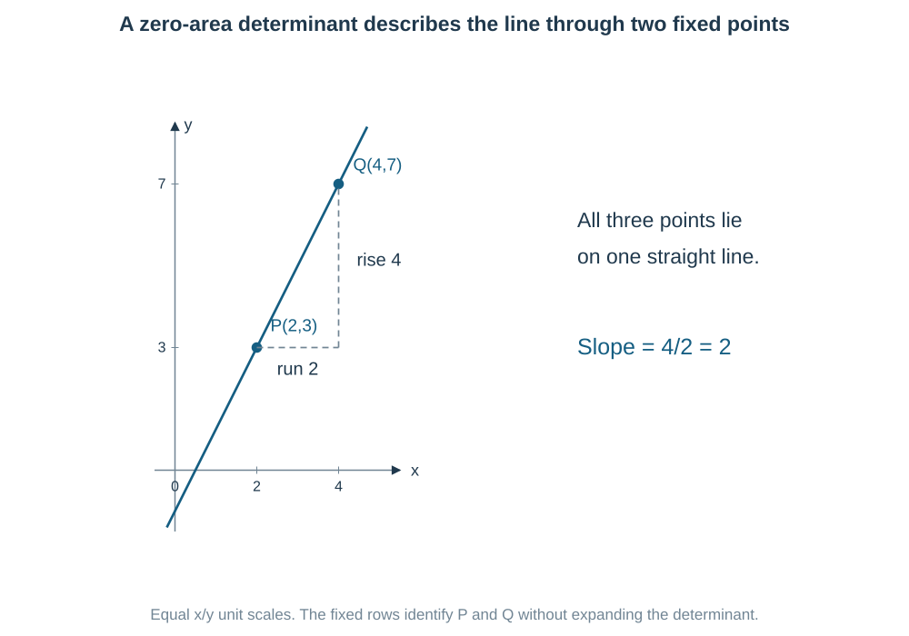

Since their x-coordinates differ, the slope is finite:

$$
m=\frac{7-3}{4-2}=\frac42=\boxed{2}\quad\text{(c)}.
$$

**Why skip expansion?** Only the slope is requested. The two fixed points already give it directly.

**Another possible approach:** expand:

$$
x(3-7)-y(2-4)+(14-12)=0
\quad\Rightarrow\quad -4x+2y+2=0.
$$

Thus $y=2x-1$, again with slope $2$. This route also gives the full line equation.

### Question 27 — A missing square row changes the Vandermonde factor

**PDF page 41 | MCQ | Notes: C03, C08**

The value of $\begin{vmatrix}1&1&1\\1&2&3\\1&8&27\end{vmatrix}$ is

- (a) $12$
- (b) $6$
- (c) $-12$
- (d) $24$

**Notice the first row is all ones.** Subtract column $1$ from each of the other columns:

$$
C_2\leftarrow C_2-C_1,\quad C_3\leftarrow C_3-C_1
\quad\Rightarrow\quad
D=\begin{vmatrix}1&0&0\\1&1&2\\1&7&26\end{vmatrix}.
$$

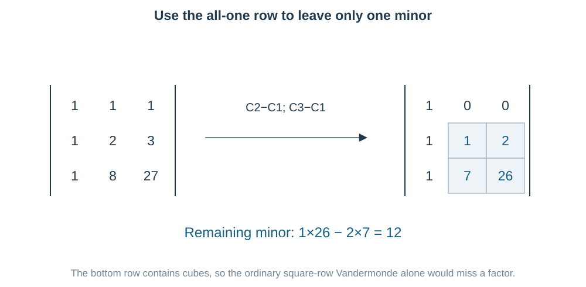

Expand along the first row:

$$
D=\begin{vmatrix}1&2\\7&26\end{vmatrix}
=26-14=\boxed{12}\quad\text{(a)}.
$$

**Pattern warning:** the last row is $1^3,2^3,3^3$, not the square row. The ordinary Vandermonde formula alone would miss a factor.

**Another possible approach:** C08's cube-row variant is
$(a+b+c)(b-a)(c-a)(c-b)$.
With $a,b,c=1,2,3$, it gives $6(1)(2)(1)=12$. The column subtraction is simpler if that extension is not familiar.

### Question 28 — Read the inverse outside the whole adjugate

**PDF page 41 | MCQ | Notes: C11**

If $A,B$ are $3\times3$ matrices with $|A|=2$ and $|B|=3$, then $\left|(\operatorname{adj}(AB))^{-1}\right|$ equals

- (a) $\dfrac16$
- (b) $36$
- (c) $\dfrac1{12}$
- (d) $\dfrac1{36}$

**Work from the innermost matrix outward.**

$$
\underbrace{\det(AB)=2(3)=6}_{\text{multiply first}}
\quad\Rightarrow\quad
\underbrace{\det(\operatorname{adj}(AB))=6^{3-1}=36}_{\text{adjugate, order 3}}
\quad\Rightarrow\quad
\underbrace{\det((\operatorname{adj}(AB))^{-1})=\frac1{36}}_{\text{inverse last}}.
$$

Both needed inverses exist because these determinants are nonzero.
The answer is $\boxed{1/36}$, **option (d)**.

**Another possible approach:** for $X=AB$, $\operatorname{adj}X=(\det X)X^{-1}=6X^{-1}$. Its inverse is $X/6$. The determinant is $(1/6)^3\det X=6/216=1/36$.
This second route also checks that the scalar division affects all three rows.

### Question 29 — AP columns give a dependent row combination

**PDF page 41 | MCQ | Notes: C03**

If $a,b,c$ are in arithmetic progression, then $\begin{vmatrix}x+1&x+2&x+a\\x+2&x+3&x+b\\x+3&x+4&x+c\end{vmatrix}$ equals

- (a) $0$
- (b) $1$
- (c) $a+b+c$
- (d) $x$

**Connect AP to a second difference.** If $a,b,c$ are in arithmetic progression, then

$$
b-a=c-b\quad\Rightarrow\quad a-2b+c=0.
$$

The first two columns also increase by one down the rows. Try that same second difference on the whole third row:

$$
R_3\leftarrow R_3-2R_2+R_1.
$$

Its entries become

$$
\begin{aligned}
&(x+3)-2(x+2)+(x+1)=0,\\
&(x+4)-2(x+3)+(x+2)=0,\\
&(x+c)-2(x+b)+(x+a)=a-2b+c=0.
\end{aligned}
$$

A zero row means zero determinant. Thus $\boxed{0}$, **option (a)**, for every real $x$ and every AP triple.

**Another possible approach:** $R_2-R_1=(1,1,b-a)$ and
$R_3-R_2=(1,1,c-b)$ are equal. Hence the original rows satisfy
$R_3=2R_2-R_1$ and are dependent. This is the same pattern stated as equal first differences.

### Question 30 — A determinant of a power is a power of a determinant

**PDF page 41 | MCQ | Notes: C11**

If $A=\begin{bmatrix}2&1\\1&2\end{bmatrix}$, then $|A^5|$ equals

- (a) $125$
- (b) $243$
- (c) $32$
- (d) $81$

**The question asks for the determinant of a power.** It does not ask for the entries of $A^5$. Use the product rule repeatedly:

$$
\det(A^5)=(\det A)^5.
$$

Now

$$
\det A=2(2)-1(1)=3
\quad\Rightarrow\quad
\boxed{\det(A^5)=3^5=243}\quad\text{(b)}.
$$

**Why avoid five matrix multiplications?** Every multiplication would calculate four entries, while the determinant law carries forward the one number we need.

**Another possible geometric view:** one action of $A$ multiplies ordinary area by $|\det A|=3$. Five successive actions multiply it by $3^5$. The determinant stays positive here because each factor is positive. This agrees with the algebraic product rule.

## Answer check

Original option order and numerical formats are preserved. **Q14 is corrected for the matrix actually printed.**

| Question | Answer | Question | Answer |
|---|---|---|---|
| 1 | (b) $-3$ | 16 | (d) $-42$ |
| 2 | $20$ | 17 | $10$ |
| 3 | $0.5$ | 18 | $8$ (from $k=0,8$) |
| 4 | (d) $18$ | 19 | $33$ |
| 5 | $6$ | 20 | $22$ |
| 6 | (a) $14$ | 21 | (d) $22$ |
| 7 | (c) $18$ | 22 | (a) $9$ |
| 8 | $-1$ | 23 | (c) |
| 9 | (a) $6$ | 24 | (b) |
| 10 | (c) | 25 | (b) $-27$ |
| 11 | (d) $3$ | 26 | (c) $2$ |
| 12 | (b) $-18$ | 27 | (a) $12$ |
| 13 | (c) $17$ | 28 | (d) $1/36$ |
| 14 | Correct (d) $1$; source key (a) $2$ is wrong | 29 | (a) $0$ |
| 15 | (b) $-9/2$ | 30 | (b) $243$ |

## Coverage and source notes

All $30$ supplied questions appear in order: $22$ MCQs and $8$ numerical-value questions. For Q14 the source key is incorrect: the printed determinant equals $\sin^2\theta$, so its maximum is $1$, option (d). The calculation and two graphs show the correction. The other intended source answers agree with independent calculations.

Q25 squares a complex determinant, not its modulus; its negative answer is consistent. Q18 retains both roots of the absolute-area equation. Q9 includes its small polynomial-derivative prerequisite locally.

The recent separate-category mean $82/58$ follows PYQSide's classification, which places many shared inverse, adjugate and system questions in Determinants. Its separate Matrices total is $25$ and their joint total is $107$. ExamSIDE's combined category has a different year-wise distribution. These archives were not merged or counted twice.

Research is a recent archive-card recount, not an independent exhaustive $2020$–$2026$ official-paper or formula-frequency audit. Method priority here is a teaching judgment. Supporting identities are derived or explained where the source questions need them.

## Offline research record

- Supplied Maths Predicted V1.pdf: questions on pages 38–41, key on page 41, working through page 42. All stems/options read visually.
- NTA, Syllabus for JEE Main 2027, Mathematics Unit 3: determinants of orders two and three, triangle area, matrix algebra, adjoint/inverse and systems.
- PYQSide, Determinants: all $82$ displayed recent question-card IDs across three archive pages saved and independently recounted.
- PYQSide, Matrices and Mathematics Weightage: separate-category boundary and full-year denominator checks.
- ExamSIDE, Matrices and Determinants: combined-category totals independently recounted as a comparison, not added to the chosen separate counts.

All figures are original local SVGs with explicit inputs. All second approaches remain plain visible for later inclusion in the printed booklet.
