# Limits — JEE Main revision guide

*A limit asks: where do the output values go when the input moves closer and closer? It does not ask us to divide by zero.*

> **For Kanna | Chapter 9**  
> Goal: about $120/300$ towards $200/300$ — Physics $60$, Maths $60$, Chemistry $80$.  
> Learn the meaning, see the graph, notice the pattern, then calculate. Notes and the recap come first; all $30$ source questions follow.

## Recent chapter weightage

**Nearest separately indexed archive category: Limits and Derivatives — $36/58\approx0.62$ questions per Paper 1 over 2024–2026.** This is a broader category than pure Limits; it is a useful reference, not an exact measured split for this PDF's Chapter 9.

| Year | Full-year papers | PYQSide Limits and Derivatives questions | Questions per paper |
|---|---:|---:|---:|
| $2024$ | $20$ | $15$ | $0.75$ |
| $2025$ | $19$ | $13$ | $0.68$ |
| $2026$ | $19$ | $8$ | $0.42$ |
| Together | $58$ | $36$ | $0.62$ |

All $36$ distinct archive question IDs across two pages were saved and recounted. PYQSide's separate Continuity and Differentiability category has $51$ questions; these two sets of IDs do not overlap. Their joint mean is $87/58=1.50$.

**Why show the boundary?** ExamSIDE instead groups Limits, Continuity and Differentiability at $29,26,21$ questions by year, and has a separate Differentiation category at $16,4,2$. Those categories do not match PYQSide's split. We do not mix the datasets or call a combined total the weightage of Limits alone.

This is a recent archive-category recount, not an independent classification of every official paper or a measured formula-frequency audit. The offered-question format differed in $2024$, and an average is not a promise for a shift. **Study priority:** learn limits well even when their separate average is modest. They are the language used in continuity, derivatives and later calculus.

## Scope and prerequisites before studying

The official Mathematics Unit 7 includes limits and graphs of simple functions. We cover the needed algebraic, trigonometric, exponential and logarithmic limits, plus the sequence limits in the supplied questions.

- Angles in these limits are in **radians**.
- A short derivative-definition lesson is included for Q15. That question assumes differentiability only at one point.
- Q10 and Q11 need the idea of a sum of thin rectangle areas. Its meaning and the two area formulas needed here are explained locally.
- Expansions and L'Hôpital's rule are supporting methods. They are taught with conditions, not as replacements for understanding the basic limits.
- Initial independent calculations agree with the intended source answers. Domains, one-sided signs and cancellation orders still need care.

## Formula and concept bank

### Concept C01 — A limit is a nearby-output question

Think of $x$ as an input to a machine and $f(x)$ as its output. The statement

$$
\boxed{\lim_{x\to a}f(x)=L}
$$

means: by taking allowed inputs sufficiently close to $a$, but different from $a$, we can make the outputs as close as we want to $L$.

The input approaches $a$; the output approaches $L$. The number $f(a)$ may be different, or may not be defined.

For example,

$$
f(x)=\frac{x^2-1}{x-1}=x+1\qquad(x\ne1).
$$

At $x=0.9$, the output is $1.9$; at $x=1.1$, it is $2.1$. As $x$ moves towards $1$, the output moves towards $2$. Therefore

$$
\lim_{x\to1}\frac{x^2-1}{x-1}=2,
$$

even though the displayed fraction has no value at $x=1$.

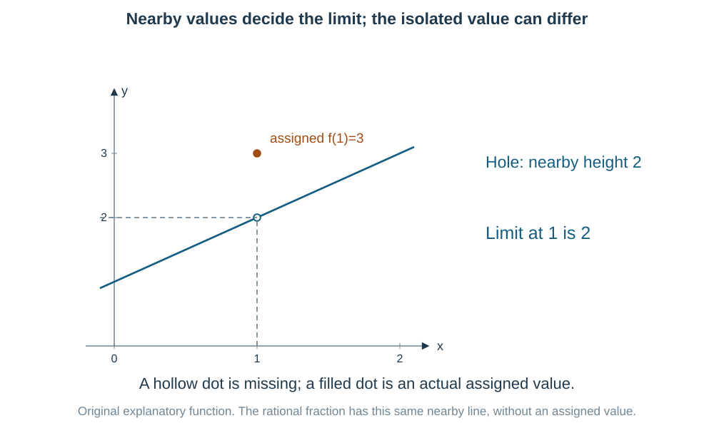

**Read the picture:** the hollow dot is the missing value on the line. A filled dot shows a separately assigned value. The limit follows the nearby line, not the isolated filled dot.

The formal “as close as we want” idea is stronger than looking at a few decimal inputs. A graph and a table help us guess; an identity, bound or theorem proves the limit.

### Concept C02 — Check left, right and the allowed inputs

The left-hand limit uses $x<a$; the right-hand limit uses $x>a$:

$$
\lim_{x\to a^-}f(x),\qquad \lim_{x\to a^+}f(x).
$$

For an ordinary two-sided finite limit at an interior point,

$$
\boxed{\lim_{x\to a}f(x)=L
\iff \text{left limit}=\text{right limit}=L.}
$$

For $|x|/x$, the output is $-1$ on the left and $1$ on the right. Both side limits exist, but they differ, so the two-sided limit does not exist.

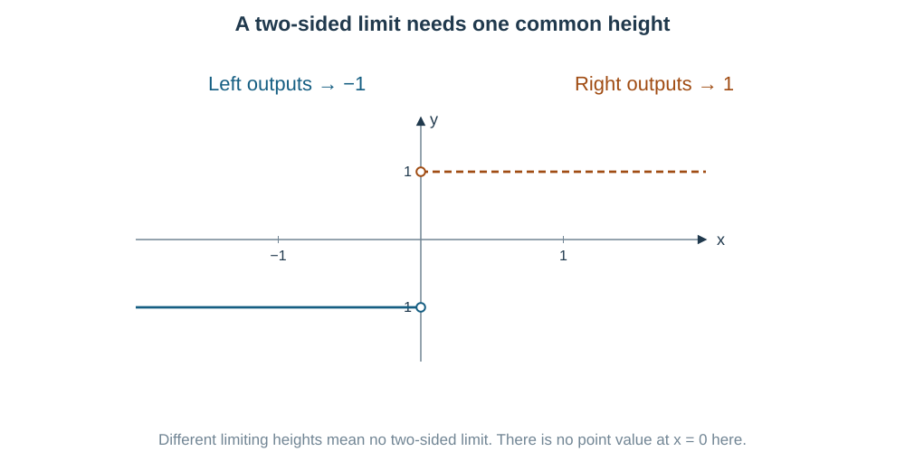

**Important for JEE Main:** modulus, greatest-integer and piecewise functions often require this side check before any formula.

Remember the real domains:

- $\ln u$ needs $u>0$.
- $\sqrt u$ needs $u\ge0$.
- A denominator must not be zero at the nearby inputs used.
- A general real power $u^v$ is safely defined through $e^{v\ln u}$ when $u>0$.

At an endpoint, approach through the allowed domain. For example, $\sqrt x$ near $0$ has a right-hand approach in its real domain. Do not invent a left real branch.

If outputs grow beyond every positive bound, we write a limit $+\infty$; this is not a finite real value. Likewise for $-\infty$. If the sides give opposite infinities, there is no common two-sided infinite limit.

### Concept C03 — Try substitution; then name what is unresolved

If $f,g$ have finite limits $A,B$, then

$$
\lim(f+g)=A+B,\quad \lim(fg)=AB,\quad
\boxed{\lim\frac fg=\frac AB\ \text{if }B\ne0}.
$$

Polynomials can be evaluated directly at finite inputs. Rational functions can too when the denominator there is nonzero. The standard trigonometric, exponential, logarithmic and root functions are continuous at inputs inside their domains.

**What is $0/0$?** It says that both numerator and denominator approach zero. It does not tell us which goes to zero faster:

$$
\frac{x}{x}=1,\quad
\frac{x^2}{x}=x\to0,\quad
\frac{x}{x^2}=\frac1x
$$

have the same $0/0$ substitution pattern but different behaviour.

The forms

$$
\boxed{\frac00,\ \frac{\infty}{\infty},\
\infty-\infty,\ 0\cdot\infty,\
1^\infty,\ 0^0,\ \infty^0}
$$

are called **indeterminate**: the form alone does not decide the answer. Rewrite first.

For composition, if $g(x)\to b$ and $F$ is continuous at $b$, then $F(g(x))\to F(b)$. If $F$ has a jump at $b$, check how $g(x)$ reaches $b$; direct composition can fail. The floor function in C10 is an example.

### Concept C04 — Algebra can remove the apparent zero denominator

**Factor and cancel only at nearby nonzero factors.**

$$
\frac{x^2-a^2}{x-a}=x+a\qquad(x\ne a).
$$

The equality need not hold at $x=a$ to give the limit there. It holds at all sufficiently close inputs except that one point.

**Two square roots or a root minus a number? Try the conjugate.**

$$
(\sqrt A-\sqrt B)(\sqrt A+\sqrt B)=A-B.
$$

For example,

$$
\frac{\sqrt{1+x}-1}{x}
=\frac1{\sqrt{1+x}+1}\longrightarrow\frac12.
$$

**Cube roots? Use the difference of cubes.** If $u^3=A,v^3=B$,

$$
\boxed{u-v=\frac{A-B}{u^2+uv+v^2}}
$$

when the denominator is nonzero. This is the cube-root partner of rationalizing a square root.

A useful general result, for fixed real $\alpha$ and $1+t>0$ near $0$, is

$$
\boxed{\lim_{t\to0}\frac{(1+t)^\alpha-1}{t}=\alpha.}
$$

For integer $n\ge1$,

$$
\boxed{\lim_{x\to a}\frac{x^n-a^n}{x-a}=na^{n-1}}.
$$

It follows by factoring the numerator into $x-a$ times $n$ terms, each tending to $a^{n-1}$. Before using this result, check whether a larger exact factorization already cancels the whole denominator, as in Q8.

### Concept C05 — Small angles: the denominator must match the angle

**Important for JEE Main. For radians,**

$$
\boxed{\lim_{t\to0}\frac{\sin t}{t}=1},\qquad
\boxed{\lim_{t\to0}\frac{\tan t}{t}=1},\qquad
\boxed{\lim_{t\to0}\frac{1-\cos t}{t^2}=\frac12}.
$$

The first says that for a tiny angle the sine height and the angle's numerical value become nearly equal in relative size.

For $0<t<\pi/2$, unit-circle area comparisons give

$$
\sin t<t<\tan t
\quad\Rightarrow\quad
\cos t<\frac{\sin t}{t}<1.
$$

Both bounds tend to $1$. Negative $t$ gives the same ratio because $\sin(-t)/(-t)=\sin t/t$.

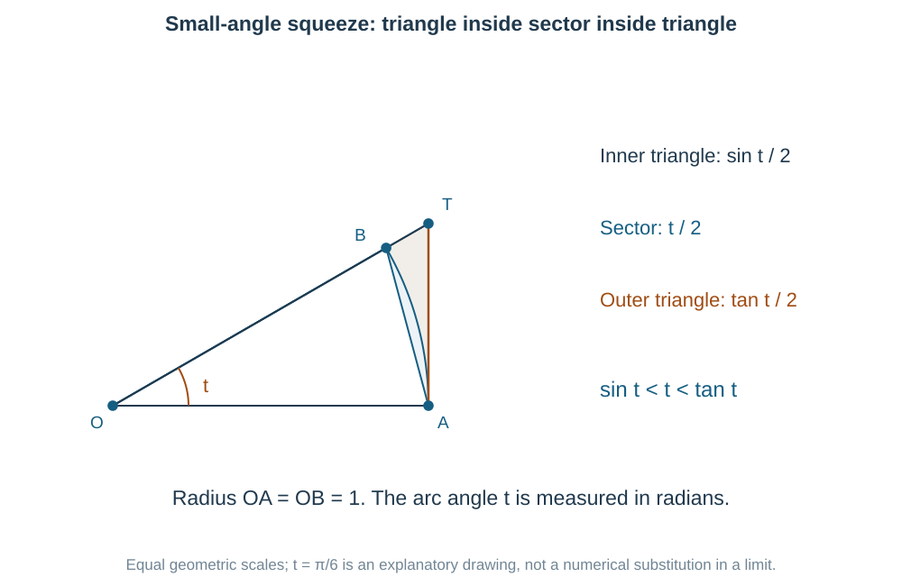

**Read the drawing:** the radius is $1$ and the angle is $t$ radians. Triangle $OAB$, sector $OAB$, and triangle $OAT$ have areas $\tfrac12\sin t$, $\tfrac12t$, and $\tfrac12\tan t$. This is the squeeze behind the first limit.

Then $\tan t/t=(\sin t/t)/\cos t\to1$. Also,

$$
\frac{1-\cos t}{t^2}
=\frac{2\sin^2(t/2)}{t^2}
=\frac12\left(\frac{\sin(t/2)}{t/2}\right)^2\to\frac12.
$$

For constants $a,b$ with $b\ne0$:

$$
\boxed{\lim_{x\to0}\frac{\sin ax}{\sin bx}=\frac ab},\qquad
\boxed{\lim_{x\to0}\frac{1-\cos ax}{x^2}=\frac{a^2}{2}}.
$$

The first also works with $\tan$ in either place. **Match the angle first:** $\sin5x/(5x)\to1$; $\sin5x/x\to5$.

Useful exact identities:

$$
\tan x-\sin x=\tan x(1-\cos x),\quad
3\sin x-\sin3x=4\sin^3x,\quad
\sin(\pi-u)=\sin u.
$$

They can turn a difficult difference into products of standard limits.

### Concept C06 — Exponential, logarithmic, root and inverse-trig standards

$e$ is the natural exponential base, about $2.718$. $\ln$ means logarithm to base $e$.

**Important for JEE Main:**

$$
\boxed{\lim_{t\to0}\frac{e^t-1}{t}=1},\quad
\boxed{\lim_{t\to0}\frac{a^t-1}{t}=\ln a}\quad(a>0),
$$

$$
\boxed{\lim_{t\to0}\frac{\ln(1+t)}{t}=1}\quad(1+t>0).
$$

These are local change-per-input results. Close to zero, $e^t-1$ and $\ln(1+t)$ have leading term $t$.

For $a>0,a\ne1$, $\log_a(1+t)=\ln(1+t)/\ln a$; its ratio to $t$ tends to $1/\ln a$.

To use a small inner expression $u(x)\to0$, factor it explicitly:

$$
\frac{e^{u(x)}-1}{v(x)}
=\frac{e^{u(x)}-1}{u(x)}\frac{u(x)}{v(x)}.
$$

The first factor tends to $1$; the second carries the actual scale. Handle isolated zeros by the corresponding continuous extension when needed.

Other useful standards in radians are

$$
\boxed{\lim_{t\to0}\frac{\sin^{-1}t}{t}=1},\qquad
\boxed{\lim_{t\to0}\frac{\tan^{-1}t}{t}=1}.
$$

For the first, put $t=\sin u$; then $u/\sin u\to1$ on the principal inverse branch. The second follows by $t=\tan u$. Here $\sin^{-1}$ means inverse sine, not $1/\sin$.

### Concept C07 — Expansion: find the first term that survives

An expansion writes a function near zero as a polynomial plus a controlled small remainder. It helps when the question subtracts the earlier terms.

For small real $t$,

$$
\begin{aligned}
e^t&=1+t+\frac{t^2}{2}+\frac{t^3}{6}
+\frac{t^4}{24}+\frac{t^5}{120}+O(t^6),\\
\sin t&=t-\frac{t^3}{6}+\frac{t^5}{120}+O(t^7),\\
\cos t&=1-\frac{t^2}{2}+\frac{t^4}{24}+O(t^6),\\
\tan t&=t+\frac{t^3}{3}+\frac{2t^5}{15}+O(t^7),\\
\ln(1+t)&=t-\frac{t^2}{2}+\frac{t^3}{3}
-\frac{t^4}{4}+\frac{t^5}{5}+O(t^6),\\
(1+t)^\alpha&=1+\alpha t+\frac{\alpha(\alpha-1)}2t^2
+\frac{\alpha(\alpha-1)(\alpha-2)}6t^3+O(t^4).
\end{aligned}
$$

**What does $O(t^m)$ mean?** The remainder has absolute value at most a fixed constant times $|t|^m$ for sufficiently small $t$. Thus $O(t^7)/t^5=O(t^2)\to0$. It is an error bound, not an extra coefficient to calculate. Logarithm and real-power expansions are used near $0$ with $1+t>0$; the infinite log series is not being asserted for all $t$.

**Did you notice the subtraction pattern?**

$$
\sin x-x+\frac{x^3}{6}
=\underbrace{x-x}_{0}
+\underbrace{\left(-\frac{x^3}{6}+\frac{x^3}{6}\right)}_{0}
+\frac{x^5}{120}+O(x^7).
$$

The denominator $x^5$ tells us to keep the fifth-power term. Stopping at $\sin x\approx x$ would erase the very information we need.

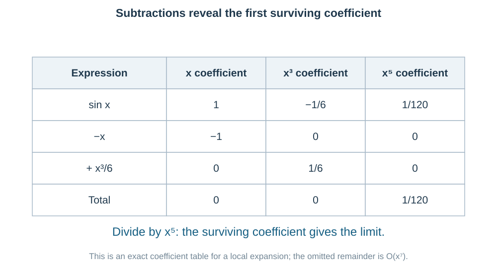

Frequently useful results obtained this way:

$$
\boxed{\lim_{x\to0}\frac{x-\sin x}{x^3}=\frac16},\quad
\boxed{\lim_{x\to0}\frac{\tan x-x}{x^3}=\frac13},
$$

$$
\boxed{\lim_{x\to0}\frac{e^x-1-x}{x^2}=\frac12},\quad
\boxed{\lim_{x\to0}\frac{\ln(1+x)-x}{x^2}=-\frac12},
$$

$$
\boxed{\lim_{x\to0}\frac{\ln\cos x}{x^2}=-\frac12},\quad
\boxed{\lim_{x\to0}\frac{\sqrt{1+x}-1-x/2}{x^2}=-\frac18}.
$$

For example, $\ln\cos x=\ln(1+u)$ with $u=\cos x-1=-x^2/2+O(x^4)$. Since $\ln(1+u)=u+O(u^2)$, the answer follows.

**Safe choice rule:** exact algebra or a standard-limit product is often shorter. Expand when there is genuine cancellation, and retain enough terms to control what remains after division.

### Concept C08 — Variable powers: take the logarithm of the whole expression

**Important for JEE Main.** A base going to $1$ does not force a power to go to $1$ when the exponent grows without bound.

Let $Y(x)=(1+u(x))^{v(x)}$, where $u(x)\to0$ and the base is positive nearby. Then

$$
\ln Y=v\ln(1+u)
=(vu)\frac{\ln(1+u)}u.
$$

If $vu\to\ell$, a finite number, the last factor tends to $1$. Therefore

$$
\boxed{(1+u)^v\longrightarrow e^\ell
\quad\text{if }u\to0,\ 1+u>0,\ vu\to\ell.}
$$

In particular,

$$
\boxed{\lim_{x\to\infty}\left(1+\frac ax\right)^{bx}=e^{ab}}.
$$

**Understand the balance:** the base moves closer to $1$, but more and more multiplications can preserve a finite overall change.

For $(\cos x)^{1/x^2}$, the base is positive for sufficiently small $|x|$. Since

$$
\ln Y=\frac{\ln\cos x}{x^2}\to-\frac12,
$$

we get $Y\to e^{-1/2}$.

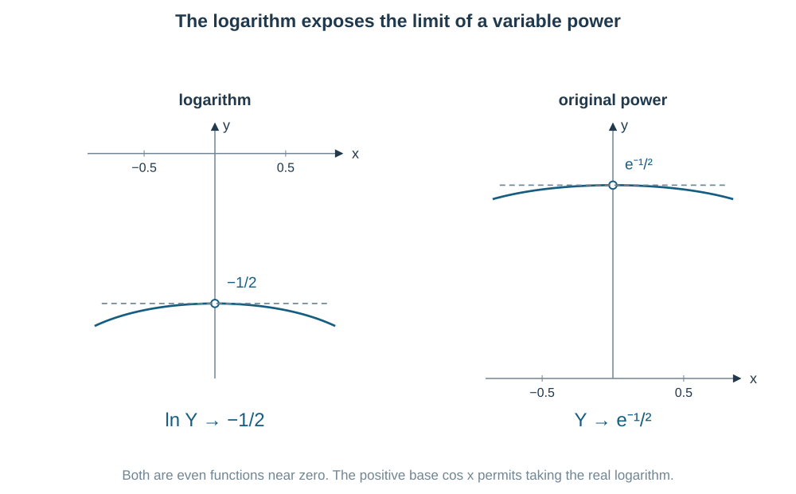

**Read the panels:** the left graph tracks the easier logarithm; the right takes the exponential back. The holes mark the missing input $x=0$.

**Nested powers need enough accuracy.** In Q17 the inner $(1+x)^{1/x}$ tends to $e$, but replacing it by exactly $e$ too early would lose its small error. The outside exponent $1/x$ magnifies that error. Take the logarithm of the complete expression first.

The same logarithm idea handles $0^0$ and $\infty^0$ forms when the base is positive. Analyze $v\ln u$; do not declare the answer from the displayed power form alone.

### Concept C09 — At infinity, compare sizes and keep signs

For rational functions, divide numerator and denominator by the largest relevant power of $x$:

$$
\frac{3x^2+2x}{5x^2-7}\longrightarrow\frac35
\quad(x\to\pm\infty).
$$

If the numerator has lower degree, the ratio tends to zero. If it has higher degree, inspect the leading power and its sign; a finite limit usually does not result.

**A root has an absolute value:**

$$
\boxed{\sqrt{x^2}=|x|,\qquad
\sqrt{x^2+ax+b}
=|x|\sqrt{1+\frac ax+\frac b{x^2}}.}
$$

For $x\to+\infty$, $|x|=x$; for $x\to-\infty$, $|x|=-x$. Forgetting this can reverse an answer.

For a difference of large roots, first rationalize:

$$
\sqrt{x^2+ax+b}-\sqrt{x^2+cx+d}
=\frac{(a-c)x+b-d}
{\sqrt{x^2+ax+b}+\sqrt{x^2+cx+d}}.
$$

As $x\to+\infty$, divide by $x$ to obtain $(a-c)/2$.
As $x\to-\infty$, the corresponding limit is $-(a-c)/2$.

**Why “both roots are about $x$” is not enough:** it removes the smaller terms whose difference may survive. The conjugate keeps those terms exactly.

A useful size hierarchy, for fixed $p>0$ and $a>1$, is

$$
\boxed{\frac{\ln x}{x^p}\to0,\qquad
\frac{x^p}{a^x}\to0\quad(x\to+\infty)}.
$$

Thus $t^p\ln t\to0$ as $t\to0^+$. This hierarchy compares a logarithm, a positive power and an exponential. Their conditions matter; $a^x$ is not a growing exponential when $0<a<1$.

### Concept C10 — Greatest integer: keep a bound on the rounding error

The greatest integer function $[t]=\lfloor t\rfloor$ is the largest integer not exceeding $t$.
For example, $[2.7]=2$ and $[-0.2]=-1$.

$$
\boxed{t-1<[t]\le t}.
$$

It differs from $t$ by less than one. Its graph is a staircase, with a filled left endpoint and a hollow right endpoint on each step.

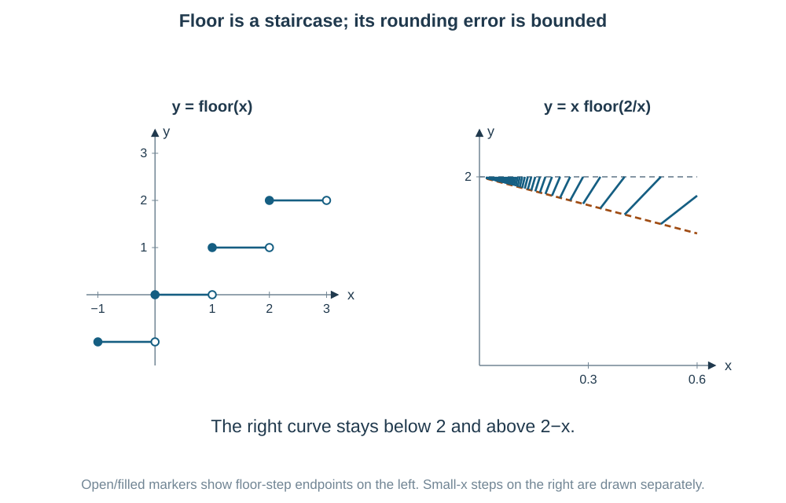

**For Q9, multiply only after checking the sign of $x$.** With $x>0$,

$$
\frac ax-1<\left[\frac ax\right]\le\frac ax
\quad\Rightarrow\quad
\boxed{a-x<x\left[\frac ax\right]\le a}.
$$

Both bounds tend to $a$ as $x\to0^+$. The steps become more frequent, but their **vertical error after scaling** becomes smaller.

Do not write $[a/x]=a/x$ as an exact equality. The inequality is why the limit still works.

The fractional part is $\{t\}=t-[t]\in[0,1)$. This notation is useful when isolating the same bounded error.

### Concept C11 — Squeeze: a small amplitude can defeat fast oscillation

If $A(x)\le f(x)\le B(x)$ near the point and both bounds tend to $L$, then $f(x)\to L$.

Since $|\sin t|\le1$,

$$
|x\sin(1/x)|\le|x|\to0
\quad\Rightarrow\quad
\boxed{x\sin(1/x)\to0}.
$$

But $\sin(1/x)$ alone has no limit: inputs

$$
x_n=\frac1{\pi/2+2\pi n},\qquad
y_n=\frac1{3\pi/2+2\pi n}
$$

both approach zero while their outputs stay $1$ and $-1$.

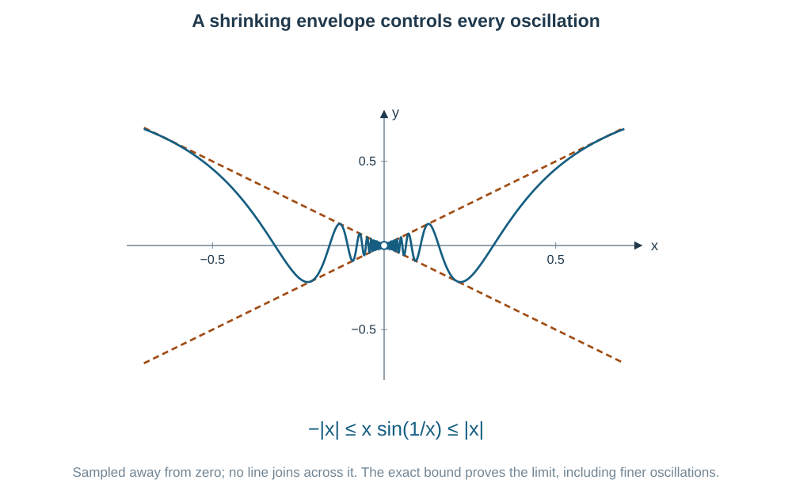

**Read the picture:** the curve wiggles faster near zero, but every wiggle lies inside a shrinking V-shaped envelope.

More generally, if $g$ is bounded nearby and $h(x)\to0$, then $h(x)g(x)\to0$. A bounded function need not have its own limit for this result.

**Recognition clue:** an oscillating sine/cosine with a small multiplying factor suggests a bound. L'Hôpital differentiation may make the oscillation worse instead of solving the problem.

### Concept C12 — Sequence limits: simplify the finite sum first

For a sequence, $n$ approaches infinity through positive integers. If the number of terms grows with $n$, do not take the limit of one fixed term and assume that decides the sum.

A telescoping sum is one in which neighbouring terms cancel. For Q25,

$$
\frac1{(2r-1)(2r+1)}
=\frac12\left(\frac1{2r-1}-\frac1{2r+1}\right).
$$

Write the finite partial sum before the limit:

$$
\begin{aligned}
S_n&=\frac12\left[(1-\tfrac13)
+(\tfrac13-\tfrac15)+\cdots
+(\tfrac1{2n-1}-\tfrac1{2n+1})\right]\\
&=\frac12\left(1-\frac1{2n+1}\right)
\longrightarrow\frac12.
\end{aligned}
$$

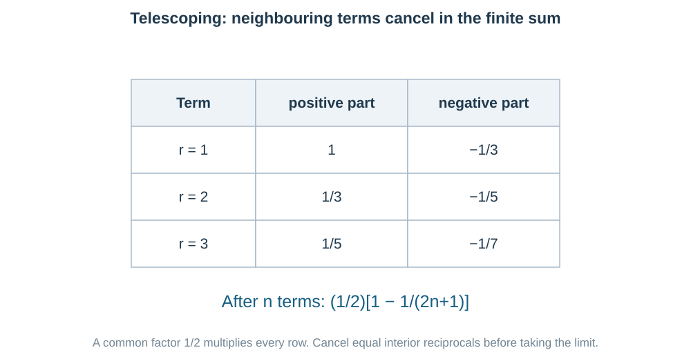

**Another common finite sum:** $1+q+\cdots+q^{n-1}=(1-q^n)/(1-q)$ for $q\ne1$.
If $|q|<1$, then $q^n\to0$ and the sum tends to $1/(1-q)$. For $q=1$ the sum is $n$; it does not have that finite limit.

### Concept C13 — A normalized sum can be an area

Imagine cutting the interval $[0,1]$ into $n$ equal widths. Each width is $\Delta t=1/n$. Build rectangle $r$ with height $F(r/n)$:

$$
\text{total rectangle area}
=\frac1n\sum_{r=1}^n F(r/n).
$$

For continuous $F$ on $[0,1]$, the exact area limit is

$$
\boxed{\lim_{n\to\infty}\frac1n\sum_{r=1}^nF(r/n)
=\int_0^1F(t)\,dt}.
$$

The integral sign here means the signed area limit. For our two questions the heights are positive, so it is ordinary area. A dummy letter such as $t$ labels position across the rectangles; it is not the original sequence index.

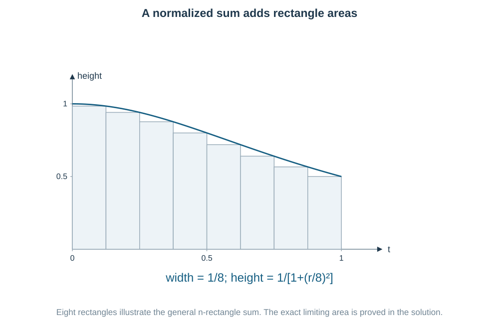

**Read the picture:** each rectangle contributes width times height. More, thinner rectangles fit the curve more closely. One rectangle becoming thin does not make the sum of all rectangles zero.

The two local facts needed are

$$
\int_0^1\frac{dt}{1+t^2}
=[\tan^{-1}t]_0^1=\frac\pi4,\qquad
\int_0^1t^4\,dt=[t^5/5]_0^1=\frac15.
$$

The brackets mean “value at $1$ minus value at $0$.” These follow from the area/antiderivative connection: the derivatives of $\tan^{-1}t$ and $t^5/5$ are the displayed heights. Full integration methods belong to their later chapters; only these two facts are needed here.

For a general interval $[a,b]$,

$$
\boxed{\frac{b-a}{n}\sum_{r=1}^n
F\!\left(a+\frac{r(b-a)}n\right)
\longrightarrow\int_a^bF(t)\,dt}
$$

when $F$ is continuous. **Recognition clue:** look for a width $1/n$ or $(b-a)/n$ and a changing ratio $r/n$.

### Concept C14 — A derivative is a special limit of slopes

This short prerequisite is needed for Q15. The derivative at $a$ is the finite limit

$$
\boxed{f'(a)=\lim_{h\to0}\frac{f(a+h)-f(a)}h}.
$$

The numerator is the output change; $h$ is the input change. Their ratio is the slope of the line joining two nearby graph points. Its limit is the tangent slope.

If the step is $kh$, not $h$, keep the scaling:

$$
\boxed{\frac{f(a+kh)-f(a)}h\longrightarrow kf'(a)}
$$

for fixed $k$ when $f$ is differentiable at $a$. For $k\ne0$, insert $kh$ in the denominator and multiply by $k$.

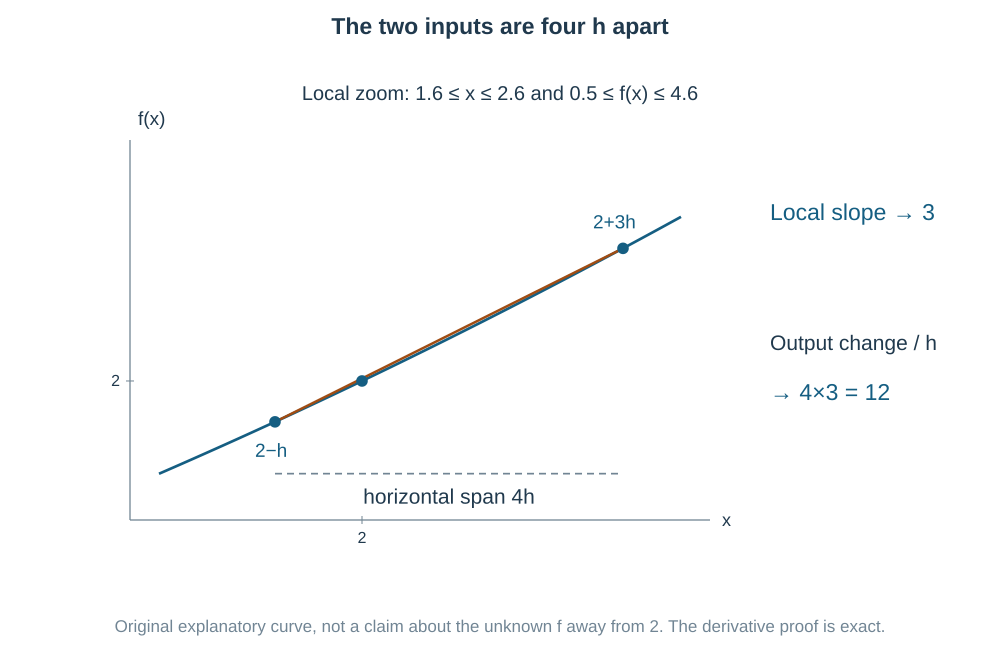

**Read the picture:** in Q15 the two inputs are $4h$ apart. That is why a factor four appears.

For a general numerator $f(a+ph)-f(a+qh)$, add and subtract $f(a)$:

$$
\boxed{\frac{f(a+ph)-f(a+qh)}h\longrightarrow(p-q)f'(a)}.
$$

This uses differentiability at $a$ alone. It does not assume $f'$ exists or is continuous at nearby points.

### Concept C15 — L'Hôpital's rule: useful only after its checks

This is a supporting alternative, not the foundation of the standard-limit proofs. Learn the ordinary derivative rules in Chapter 10 before using it independently.

For a quotient $f(x)/g(x)$ with an actual $0/0$ or $\infty/\infty$ limiting form, a standard version of the rule allows

$$
\boxed{\lim\frac{f(x)}{g(x)}
=\lim\frac{f'(x)}{g'(x)}}
$$

provided $f,g$ are differentiable on the relevant nearby punctured interval, $g$ and $g'$ are nonzero there, and the derivative-ratio limit exists (finite or extended). Treat each side separately when required. A limit may exist even if this method does not apply.

**It is not the quotient differentiation formula.** We are comparing two limits, not saying $f/g=f'/g'$ at each input.

For example,

$$
\lim_{x\to0}\frac{e^x-1-x}{x^2}
\ \overset{\text{rule}}=\ 
\lim_{x\to0}\frac{e^x-1}{2x}
=\frac12.
$$

After the first application the new quotient is still $0/0$, so another valid application would also work. The expansion $e^x=1+x+x^2/2+O(x^3)$ is shorter once that pattern is familiar.

**Do not use it automatically:**

- Rewrite $1^\infty$ using logs; it is not a quotient yet.
- Rewrite $\infty-\infty$ using algebra first.
- For Q15 the unknown function is only known to be differentiable at one point. Its nearby derivative assumptions are not supplied.
- For the oscillation in Q29, a squeeze is direct and reliable.
- Do not prove $\sin x/x\to1$ by using a derivative formula whose own proof used that same limit.

## Choose the route from the clue

| Visible clue | First useful move | Why |
|---|---|---|
| Denominator stays nonzero | Substitute | Continuity already gives the answer |
| Polynomial $0/0$ | Factor | Removes a common zero |
| Root difference | Conjugate / difference of cubes | Keeps the small surviving difference |
| Sine/tangent at a small angle | Match angle with denominator | Preserves scale factors |
| Earlier Taylor terms subtracted | Keep the first surviving order | Prevents false cancellation to zero |
| Variable power | Take the log of the whole expression | Changes the exponent into a product |
| Floor of a large argument | Bound the rounding error | Staircase detail becomes unnecessary |
| Bounded oscillation times a small factor | Squeeze | Bounds may converge even when sine does not |
| Sum of neighbouring reciprocal products | Partial fractions / telescope | Almost all finite terms cancel |
| Width $1/n$ and argument $r/n$ | Rectangle sum | Many small terms can give a finite area |
| Unknown differentiable function at one point | Build difference quotients there | Uses exactly the assumption supplied |

This is a method-selection aid, not a measured PYQ frequency ranking.

## Last-minute formula recap

| Need | Recall and essential condition |
|---|---|
| Two-sided finite limit | Equal finite left and right limits |
| Quotient law | Denominator limit nonzero |
| Trig basics, radians | $\sin t/t\to1$, $\tan t/t\to1$, $(1-\cos t)/t^2\to1/2$ |
| Scaled angles | $\sin ax/\sin bx\to a/b$, $b\ne0$; $(1-\cos ax)/x^2\to a^2/2$ |
| Exponential | $(e^t-1)/t\to1$; $(a^t-1)/t\to\ln a$, $a>0$ |
| Logarithm | $\ln(1+t)/t\to1$, $1+t>0$ |
| Real power | $((1+t)^\alpha-1)/t\to\alpha$, positive base nearby |
| Inverse trig | $\sin^{-1}t/t\to1$, $\tan^{-1}t/t\to1$ |
| Cubic cancellations | $(x-\sin x)/x^3\to1/6$, $(\tan x-x)/x^3\to1/3$ |
| Quadratic cancellations | $(e^x-1-x)/x^2\to1/2$, $(\ln(1+x)-x)/x^2\to-1/2$ |
| Cosine log / root remainder | $\ln(\cos x)/x^2\to-1/2$; $(\sqrt{1+x}-1-x/2)/x^2\to-1/8$ |
| Fifth sine remainder | $(\sin x-x+x^3/6)/x^5\to1/120$ |
| General near-one power | $(1+u)^v\to e^\ell$ if $u\to0$, $vu\to\ell$, $1+u>0$ |
| Infinity root sign | $\sqrt{x^2}=|x|$ |
| Floor bound | $t-1<[t]\le t$ |
| Squeeze | Same limits of upper/lower bounds force the middle limit |
| Bounded times small | $h\to0$, bounded $g$ imply $hg\to0$ |
| Geometric sum | $(1-q^n)/(1-q)$; tends to $1/(1-q)$ if $|q|<1$ |
| Rectangle sum | $(1/n)\sum F(r/n)\to\int_0^1F(t)\,dt$ for continuous $F$ |
| Area facts used | $\int_0^1dt/(1+t^2)=\pi/4$; $\int_0^1t^4dt=1/5$ |
| Derivative step scaling | $[f(a+ph)-f(a+qh)]/h\to(p-q)f'(a)$ |
| L'Hôpital | Only a checked $0/0$ or $\infty/\infty$ quotient with the derivative conditions |

Keep the expansions in C07 with this recap. The denominator tells you how far to expand; the first term that survives decides the finite limit.

## Worked solutions to the 30 PDF questions

Try the question first. Then read the clue and the reason for the method before following the calculation. Use each graph to understand the behaviour; use the equation or bound to prove the answer.

### Question 1 — Make each small angle match its own denominator

**PDF page 43 | MCQ | Notes: C05**

$\displaystyle\lim_{x\to0}\frac{\sin5x}{\tan3x}$ is equal to

- (a) $\dfrac35$
- (b) $1$
- (c) $\dfrac53$
- (d) $15$

**Both angles are small, but their sizes are different.** Did you notice the $5x$ and $3x$? The standard result needs the *same* small angle in numerator and denominator:

$$
\frac{\sin5x}{\tan3x}
=\frac{\sin5x}{5x}\,
\frac{3x}{\tan3x}\,\frac53.
$$

The first two factors tend to $1$ in radians. Thus the answer is
$\boxed{5/3}$, **option (c)**.

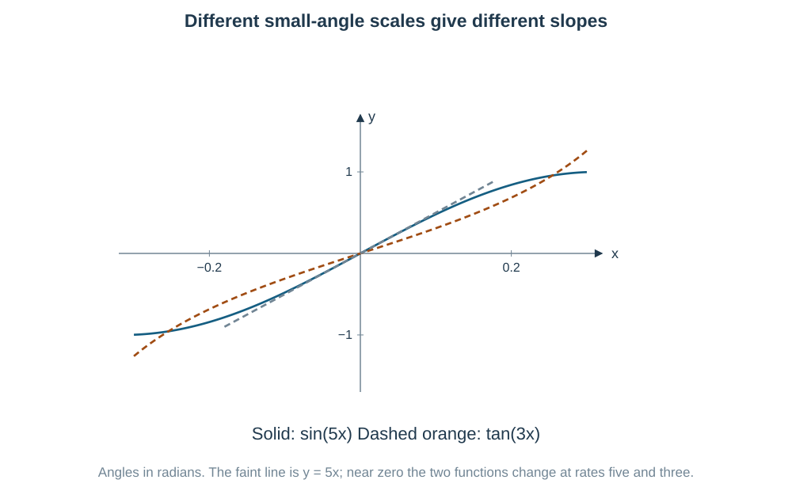

**Why substitution stops:** at $x=0$ it gives $0/0$, not a value.
**Another possible approach:** use $\sin5x=5x+O(x^3)$ and $\tan3x=3x+O(x^3)$. Their ratio tends to $5/3$. Matching the standard limits needs less expansion.

### Question 2 — The cosine difference starts at the square term

**PDF page 43 | Numerical value | Notes: C05**

$\displaystyle\lim_{x\to0}\frac{1-\cos4x}{x^2}=$ ____.

**A cosine difference suggests the half-angle identity.**

$$
1-\cos4x=2\sin^2(2x).
$$

So

$$
\frac{1-\cos4x}{x^2}
=8\left(\frac{\sin2x}{2x}\right)^2
\longrightarrow\boxed{8}.
$$

**Check the factor:** the angle coefficient is $4$, so the general result gives $4^2/2=8$, not $4/2$.

**Another possible approach:** $\cos4x=1-(4x)^2/2+O(x^4)$, giving numerator $8x^2+O(x^4)$. Dividing by $x^2$ gives the same limit.

### Question 3 — Keep the first terms that do not cancel

**PDF page 43 | Numerical value | Notes: C07**

$\displaystyle\lim_{x\to0}\frac{e^x-e^{-x}-2x}{x-\sin x}=$ ____.

**The subtraction tells us how far to expand.** The two exponentials cancel their even powers. Subtracting $2x$ then removes the linear term. The numerator starts at $x^3$, not $x$:

$$
\begin{aligned}
e^x-e^{-x}-2x
&=2\left(x+\frac{x^3}{6}+\frac{x^5}{120}\right)-2x+O(x^7)\\
&=\frac{x^3}{3}+\frac{x^5}{60}+O(x^7),\\
x-\sin x&=\frac{x^3}{6}-\frac{x^5}{120}+O(x^7).
\end{aligned}
$$

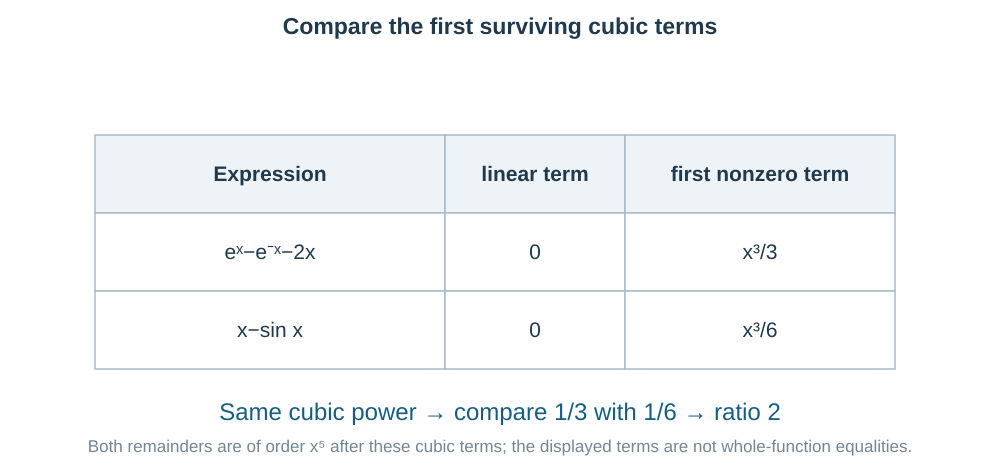

Cancel $x^3$ for nearby $x\ne0$:

$$
\frac{1/3+x^2/60+O(x^4)}
{1/6-x^2/120+O(x^4)}
\longrightarrow\boxed{2}.
$$

Using only $e^x\approx1+x$ and $\sin x\approx x$ would leave another $0/0$ and lose the answer.

**Another possible approach:** after checking smoothness and nonzero denominator derivatives near $0$, three applications of L'Hôpital give
$(e^x+e^{-x})/\cos x\to2$. The expansion shows the cancellation order more directly.

### Question 4 — A base near one and a large exponent

**PDF page 43 | MCQ | Notes: C08**

$\displaystyle\lim_{x\to\infty}\left(1+\frac3x\right)^{2x}$ equals

- (a) $e^6$
- (b) $e^{3/2}$
- (c) $e^{2/3}$
- (d) $e^3$

**The base approaches one while the exponent grows.** Put $u=3/x$. Then $u\to0^+$ and $2x=6/u$:

$$
\left(1+\frac3x\right)^{2x}
=\left((1+u)^{1/u}\right)^6
\longrightarrow e^6.
$$

Thus $\boxed{e^6}$, **option (a)**.

**Another possible approach:** for the positive expression $Y$,
$\ln Y=2x\ln(1+3/x)=6\,\ln(1+3/x)/(3/x)\to6$.
Exponentiating gives the same result. Replacing the base by exactly $1$ before studying the exponent would discard their combined effect.

### Question 5 — A number below one raised to a large power

**PDF page 43 | MCQ | Notes: C08**

$\displaystyle\lim_{x\to0}(\cos x)^{1/x^2}$ equals

- (a) $e^{1/2}$
- (b) $1$
- (c) $e^{-2}$
- (d) $e^{-1/2}$

**A power below one should not produce a limit above one here.** For small nonzero $x$, $0<\cos x<1$ and $1/x^2>0$. This already rules out $e^{1/2}$.

Let $Y=(\cos x)^{1/x^2}$. Its base is positive nearby, so

$$
\ln Y=\frac{\ln\cos x}{x^2}\longrightarrow-\frac12.
$$

Hence $\boxed{Y\to e^{-1/2}}$, **option (d)**.

**Another possible approach:** set $u=\cos x-1$. Then $u\to0$ and $u/x^2\to-1/2$. C08 gives $(1+u)^{1/x^2}\to e^{-1/2}$ without writing a separate log expansion.

### Question 6 — Rewrite the base as one plus a small amount

**PDF page 43 | MCQ | Notes: C08**

$\displaystyle\lim_{x\to\infty}\left(\frac{x^2+1}{x^2-1}\right)^{x^2}$ equals

- (a) $e$
- (b) $e^2$
- (c) $e^{-2}$
- (d) $1$

**Reveal the small change above one:**

$$
\frac{x^2+1}{x^2-1}=1+\frac2{x^2-1}.
$$

Here $u=2/(x^2-1)\to0$ and the exponent is $v=x^2$. Their product is

$$
vu=\frac{2x^2}{x^2-1}\to2.
$$

The base is positive for large $x$. Therefore C08 gives
$\boxed{e^2}$, **option (b)**.

**Another possible approach:** put $t=x^2-1$; then the expression is
$(1+2/t)^{t+1}=(1+2/t)^t(1+2/t)\to e^2\cdot1$.
The extra $+1$ in the exponent does not disappear without this check.

### Question 7 — Turn a difference into a product of known small factors

**PDF page 43 | MCQ | Notes: C05,C07**

$\displaystyle\lim_{x\to0}\frac{\tan x-\sin x}{x^3}$ is

- (a) $1$
- (b) $\dfrac12$
- (c) $0$
- (d) $\dfrac13$

**Can the difference become a product of familiar small factors?** Yes:

$$
\tan x-\sin x
=\frac{\sin x}{\cos x}-\sin x
=\tan x(1-\cos x).
$$

Therefore

$$
\frac{\tan x-\sin x}{x^3}
=\frac{\tan x}{x}\,
\frac{1-\cos x}{x^2}
\longrightarrow1\cdot\frac12=\boxed{\frac12}
\quad\text{(b)}.
$$

**Why this route?** The exact identity avoids subtracting two first-order approximations that would both look like $x$.

**Another possible approach:** $\tan x=x+x^3/3+O(x^5)$ and
$\sin x=x-x^3/6+O(x^5)$. Their difference has cubic coefficient $1/3+1/6=1/2$.

### Question 8 — A hidden difference of squares

**PDF page 43 | Numerical value | Notes: C04**

$\displaystyle\lim_{x\to2}\frac{x^{10}-1024}{x^5-32}=$ ____.

**Notice that $x^{10}=(x^5)^2$ and $1024=32^2$.** It is a difference of squares:

$$
\frac{x^{10}-1024}{x^5-32}
=\frac{(x^5-32)(x^5+32)}{x^5-32}
=x^5+32\qquad(x\ne2).
$$

Now substitution is safe:

$$
\boxed{2^5+32=64}.
$$

**Why cancellation is allowed:** a limit uses nearby inputs, where $x^5-32\ne0$, rather than the undefined fraction at $2$.

**Another possible approach:** L'Hôpital gives
$10x^9/(5x^4)=2x^5\to64$, after its conditions are checked. The exact factorization is shorter and needs no calculus rule.

### Question 9 — The floor error becomes small after multiplying by x

**PDF page 43 | Numerical value | Notes: C10**

$\displaystyle\lim_{x\to0^+}x\left(\left[\frac2x\right]+\left[\frac3x\right]\right)=$ ____, where $[\cdot]$ is the greatest integer function.

**The floor value is awkward, but its error is less than one.** Since the approach is $x\to0^+$, multiplication by $x$ keeps inequality directions:

$$
2-x<x\left[\frac2x\right]\le2,\qquad
3-x<x\left[\frac3x\right]\le3.
$$

Add:

$$
5-2x<
x\left(\left[\frac2x\right]+\left[\frac3x\right]\right)
\le5.
$$

Both bounds approach $5$, so the squeeze theorem gives $\boxed{5}$.

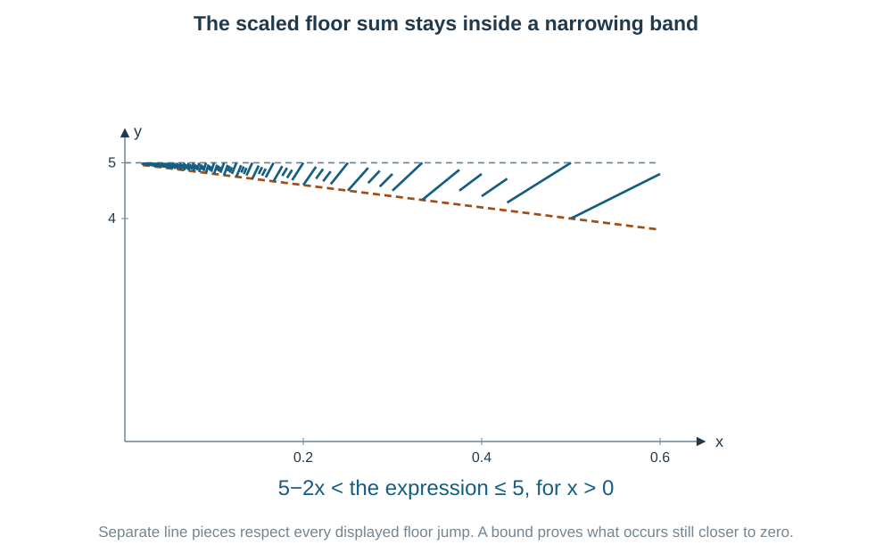

**Another possible approach:** write $[t]=t-\{t\}$, with
$0\le\{t\}<1$. The expression becomes
$5-x(\{2/x\}+\{3/x\})$; the subtracted quantity lies in $[0,2x)$ and tends to zero.

### Question 10 — A growing sum represents thin rectangles

**PDF page 44 | MCQ | Notes: C13**

$\displaystyle\lim_{n\to\infty}\sum_{r=1}^n\frac{n}{n^2+r^2}$ equals

- (a) $\dfrac\pi2$
- (b) $\ln2$
- (c) $1$
- (d) $\dfrac\pi4$

**One term tends to zero, but the number of terms also grows.** First factor $n^2$ out of each denominator:

$$
\sum_{r=1}^n\frac{n}{n^2+r^2}
=\frac1n\sum_{r=1}^n
\frac1{1+(r/n)^2}.
$$

Now the pattern is visible: width $1/n$, sample point $r/n$, height
$F(t)=1/(1+t^2)$ on $[0,1]$.

Since $F$ is continuous there,

$$
\lim S_n=\int_0^1\frac{dt}{1+t^2}
=\tan^{-1}(1)-\tan^{-1}(0)
=\boxed{\frac\pi4}\quad\text{(d)}.
$$

**Another useful check:** the heights lie between $1/2$ and $1$, so the limit is between those values. Also $F$ decreases, so right-endpoint rectangles lie below the curve. This checks size and direction; it does not by itself prove the exact $\pi/4$.

### Question 11 — Scale the fourth powers before adding

**PDF page 44 | Numerical value | Notes: C13**

If $\displaystyle L=\lim_{n\to\infty}\frac{1^4+2^4+\cdots+n^4}{n^5}$, then $20L$ equals ____.

**Match the power of $n$ to the number of terms.**

$$
\frac{1^4+\cdots+n^4}{n^5}
=\frac1n\sum_{r=1}^n\left(\frac rn\right)^4.
$$

This is a rectangle sum for $F(t)=t^4$ on $[0,1]$:

$$
L=\int_0^1t^4\,dt=\frac15.
$$

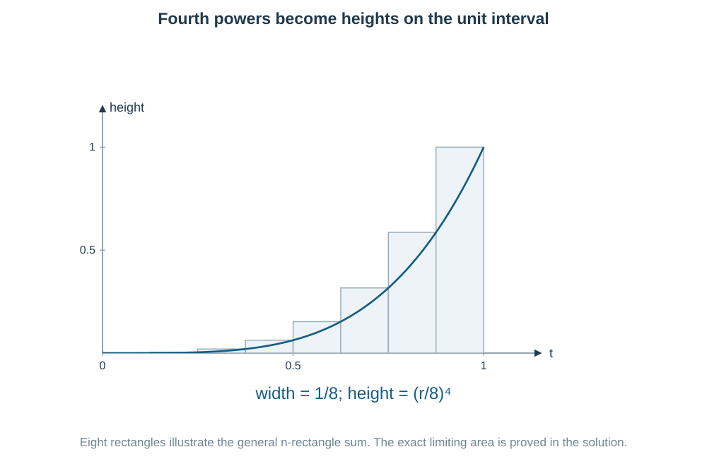

The question asks for $20L$, so $\boxed{20/5=4}$.

**Another possible approach:** the finite identity

$$
\sum_{r=1}^nr^4=
\frac{n(n+1)(2n+1)(3n^2+3n-1)}{30}
$$

has leading term $n^5/5$. Dividing by $n^5$ gives $L=1/5$. The rectangle route is easier if the fourth-power sum formula is not memorized.

### Question 12 — Split a difference by adding and subtracting one

**PDF page 44 | MCQ | Notes: C06,C07**

$\displaystyle\lim_{x\to0}\frac{e^{x^2}-\cos x}{x^2}$ equals

- (a) $\dfrac32$
- (b) $\dfrac12$
- (c) $1$
- (d) $2$

**Both functions approach one. Insert that common value to split the difference:**

$$
\frac{e^{x^2}-\cos x}{x^2}
=\frac{e^{x^2}-1}{x^2}
+\frac{1-\cos x}{x^2}.
$$

In the first fraction put $t=x^2\to0$. It tends to $1$; the second tends to $1/2$. Thus

$$
\boxed{\frac32}\quad\text{(a)}.
$$

**Another possible approach:** $e^{x^2}=1+x^2+O(x^4)$ and
$\cos x=1-x^2/2+O(x^4)$. Subtraction leaves $3x^2/2+O(x^4)$.
The split uses two known limits without any series multiplication.

### Question 13 — Move the sine angle from near pi to near zero

**PDF page 44 | MCQ | Notes: C05**

$\displaystyle\lim_{x\to0}\frac{\sin(\pi\cos^2x)}{x^2}$ is equal to

- (a) $\dfrac\pi2$
- (b) $0$
- (c) $\pi$
- (d) $2\pi$

**The sine angle tends to $\pi$, not zero. Move it to a small angle first.** Since $\cos^2x=1-\sin^2x$,

$$
\sin(\pi\cos^2x)
=\sin(\pi-\pi\sin^2x)
=\sin(\pi\sin^2x).
$$

Set $u=\pi\sin^2x$. Then $u\to0$, and

$$
\frac{\sin(\pi\cos^2x)}{x^2}
=\frac{\sin u}{u}\,
\pi\left(\frac{\sin x}{x}\right)^2
\longrightarrow1\cdot\pi\cdot1
=\boxed{\pi}\quad\text{(c)}.
$$

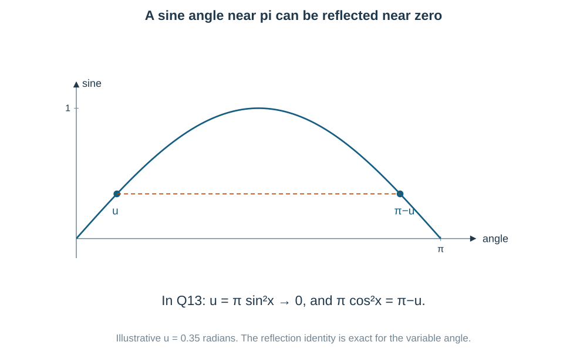

**Another possible approach:** $\cos^2x=1-x^2+O(x^4)$, so the sine angle is $\pi-\pi x^2+O(x^4)$ and the numerator is $\pi x^2+O(x^4)$. The exact reflection identity keeps the signs easier to track.

### Question 14 — Infinity minus infinity needs the conjugate

**PDF page 44 | MCQ | Notes: C04,C09**

$\displaystyle\lim_{x\to\infty}\left(\sqrt{x^2+3x+1}-\sqrt{x^2-x+2}\right)$ equals

- (a) $1$
- (b) $4$
- (c) $\dfrac12$
- (d) $2$

**Direct substitution gives $\infty-\infty$. The two large quantities hide a smaller surviving difference.** Multiply and divide by their sum:

$$
\sqrt{x^2+3x+1}-\sqrt{x^2-x+2}
=\frac{4x-1}
{\sqrt{x^2+3x+1}+\sqrt{x^2-x+2}}.
$$

For $x\to+\infty$, $x$ is positive, so divide numerator and denominator by $x$:

$$
\frac{4-1/x}
{\sqrt{1+3/x+1/x^2}+\sqrt{1-1/x+2/x^2}}
\longrightarrow\frac42=\boxed{2}\quad\text{(d)}.
$$

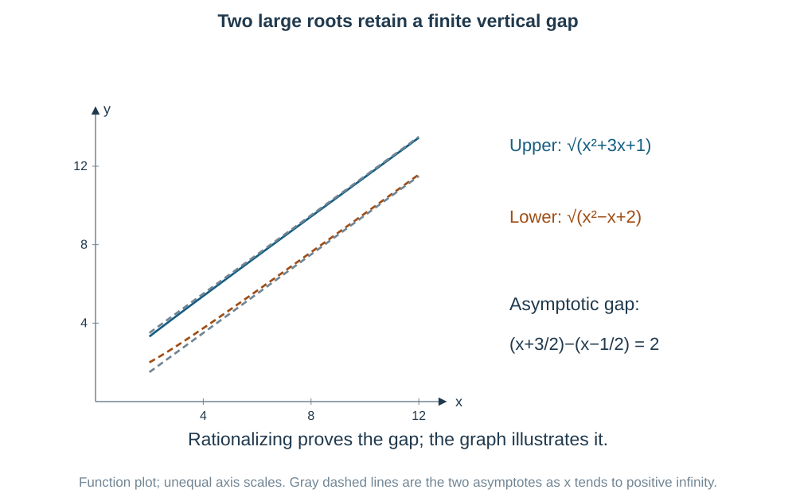

**Another possible approach:** the two roots are
$x+3/2+O(1/x)$ and $x-1/2+O(1/x)$. Subtracting gives $2+O(1/x)$. The conjugate gives an exact starting equality and avoids guessing which correction terms to keep.

### Question 15 — Build the derivative quotients at the known point

**PDF page 44 | Numerical value | Notes: C14**

Let $f$ be differentiable at $x=2$ with $f^\prime(2)=3$. Then $\displaystyle\lim_{h\to0}\frac{f(2+3h)-f(2-h)}h$ equals ____.

**We know a slope only at input $2$. Build quotients around that input.** Add and subtract $f(2)$:

$$
\frac{f(2+3h)-f(2-h)}h
=3\frac{f(2+3h)-f(2)}{3h}
+\frac{f(2-h)-f(2)}{-h}.
$$

Both fractions tend to $f'(2)=3$, since their input steps $3h$ and $-h$ tend to zero.

Therefore the limit is $\boxed{3(3)+3=12}$.

**Another possible view:** differentiability means
$f(2+t)=f(2)+3t+o(t)$, where $o(t)/t\to0$.
Using $t=3h$ and $t=-h$ gives numerator $12h+o(h)$.
Do not apply L'Hôpital to the unknown nearby derivatives: their existence is not part of the printed assumption.

### Question 16 — Each exponential must subtract its own constant term

**PDF page 44 | MCQ | Notes: C06**

$\displaystyle\lim_{x\to0}\frac{8^x-2^x}{x}$ equals

- (a) $\ln6$
- (b) $\ln4$
- (c) $\ln2$
- (d) $\ln64$

**Each exponential approaches one. Subtract that one from each separately:**

$$
\frac{8^x-2^x}{x}
=\frac{8^x-1}{x}-\frac{2^x-1}{x}
\longrightarrow\ln8-\ln2
=\boxed{\ln4}\quad\text{(b)}.
$$

The log law is $\ln a-\ln b=\ln(a/b)$, not $\ln(a-b)$.

**Another possible approach:** $8^x=e^{x\ln8}$ and
$2^x=e^{x\ln2}$. Their linear terms differ by
$x(\ln8-\ln2)$, with remainder $O(x^2)$. Divide by $x$.

### Question 17 — A second power limit needs the next log term

**PDF page 44 | MCQ | Notes: C07,C08**

$\displaystyle\lim_{x\to0}\left(\frac{(1+x)^{1/x}}e\right)^{1/x}$ equals

- (a) $e^{1/2}$
- (b) $e$
- (c) $e^{-1/2}$
- (d) $1$

**The inner expression approaches one, but its small error matters to the outside power.** Let

$$
Y=\left(\frac{(1+x)^{1/x}}e\right)^{1/x}.
$$

For $x$ near $0$ with $x\ne0$ and $1+x>0$, all bases are positive. Take the logarithm of the **whole** expression:

$$
\ln Y=\frac1x\left(\frac{\ln(1+x)}x-1\right)
=\frac{\ln(1+x)-x}{x^2}.
$$

Now the cancellation pattern is familiar:

$$
\ln(1+x)-x=-\frac{x^2}{2}+O(x^3).
$$

So $\ln Y\to-1/2$, and $\boxed{Y\to e^{-1/2}}$, **option (c)**.

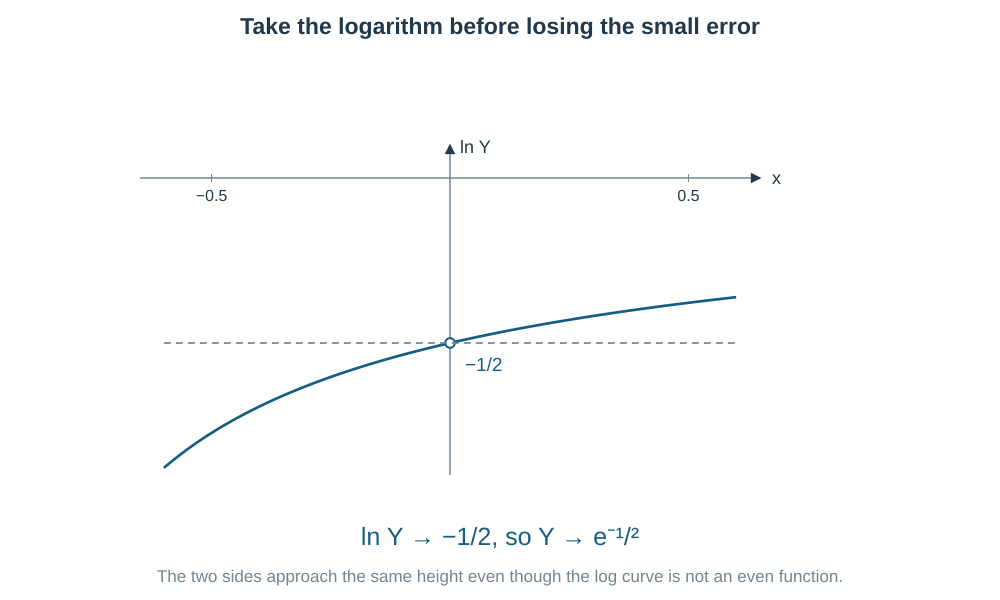

**Why not replace the inner $(1+x)^{1/x}$ by $e$ first?** That gives another unresolved $1^\infty$ form. It loses the quadratic log term deciding the answer.

**Another possible approach:** after taking logs, L'Hôpital gives
$[1/(1+x)-1]/(2x)=-1/[2(1+x)]\to-1/2$. All functions in that quotient are differentiable nearby.

### Question 18 — Use the distance from the cosine peak

**PDF page 44 | MCQ | Notes: C05**

$\displaystyle\lim_{x\to\pi/2}\frac{1-\sin x}{(\pi/2-x)^2}$ equals

- (a) $\dfrac12$
- (b) $1$
- (c) $\dfrac14$
- (d) $0$

**A familiar cosine limit is hiding at a shifted input.** Set
$t=x-\pi/2$. Then $t\to0$,
$\sin x=\cos t$, and $(\pi/2-x)^2=t^2$:

$$
\frac{1-\sin x}{(\pi/2-x)^2}
=\frac{1-\cos t}{t^2}
\longrightarrow\boxed{\frac12}\quad\text{(a)}.
$$

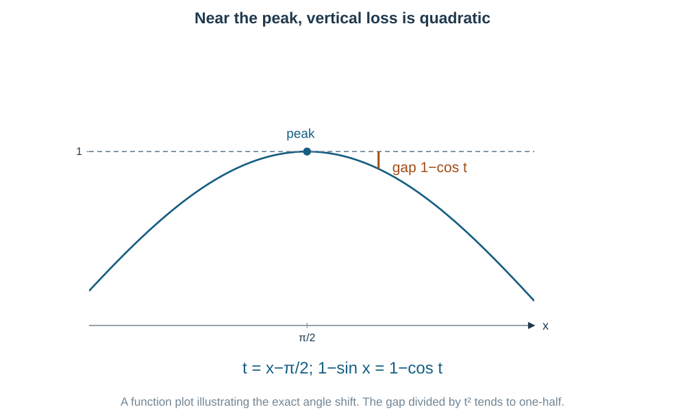

**Another possible approach:** $1-\cos t=2\sin^2(t/2)$, so the ratio is
$\tfrac12[\sin(t/2)/(t/2)]^2\to1/2$.
This is also a derivation of the standard result used above.

### Question 19 — The fifth-order coefficient survives

**PDF page 45 | MCQ | Notes: C07**

$\displaystyle\lim_{x\to0}\frac{\sin x-x+x^3/6}{x^5}$ equals

- (a) $\dfrac1{120}$
- (b) $\dfrac1{24}$
- (c) $\dfrac16$
- (d) $0$

**Did you notice exactly which sine terms were removed?** The numerator subtracts the linear term $x$ and adds back $x^3/6$ to remove the negative cubic term:

$$
\begin{aligned}
\sin x-x+\frac{x^3}{6}
&=\left(x-\frac{x^3}{6}+\frac{x^5}{120}+O(x^7)\right)
-x+\frac{x^3}{6}\\
&=\frac{x^5}{120}+O(x^7).
\end{aligned}
$$

Thus

$$
\frac{\sin x-x+x^3/6}{x^5}
=\frac1{120}+O(x^2)
\longrightarrow\boxed{\frac1{120}}\quad\text{(a)}.
$$

**Another possible approach:** five valid applications of L'Hôpital leave
$\cos x/120\to1/120$. It is correct, but the explicit subtractions and $x^5$ make the expansion much shorter.

### Question 20 — Check the two signs of modulus separately

**PDF page 45 | MCQ | Notes: C02**

Statement I: $\displaystyle\lim_{x\to0}\frac{\sin x}{|x|}$ exists.

Statement II: If both the left-hand and right-hand limits at a point exist but are unequal, the limit does not exist at that point. Choose the correct option.

- (a) Both statements are true
- (b) Statement I is true, Statement II is false
- (c) Statement I is false, Statement II is true
- (d) Both statements are false

**The modulus changes formula at zero.** For $x>0$, $|x|=x$; for $x<0$, $|x|=-x$. Hence

$$
\lim_{x\to0^+}\frac{\sin x}{|x|}=1,\qquad
\lim_{x\to0^-}\frac{\sin x}{|x|}=-1.
$$

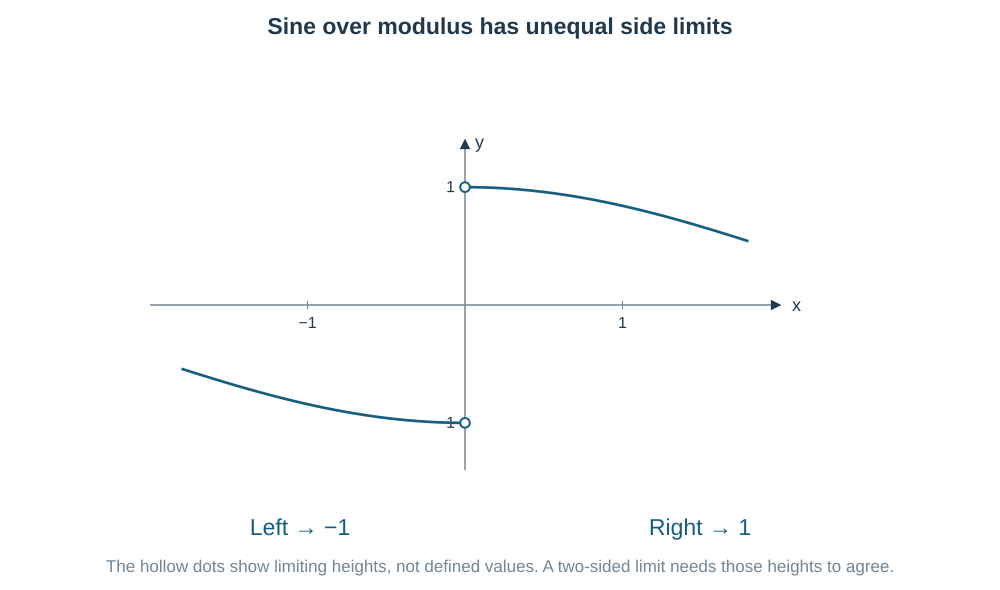

The two sides differ. Statement I is false; Statement II is the correct two-sided-limit criterion.
Therefore $\boxed{\text{option (c)}}$.

**Another possible view:** write
$\sin x/|x|=(\sin x/x)(x/|x|)$.
The first factor tends to $1$; the second keeps the sign of $x$ and has different side limits. Taking $|\sin x/x|$ would be a different function.

### Question 21 — The linear terms cancel, so keep the quadratic term

**PDF page 45 | MCQ | Notes: C06,C07**

$\displaystyle\lim_{x\to0}\frac{x\cos x-\ln(1+x)}{x^2}$ equals

- (a) $1$
- (b) $\dfrac12$
- (c) $0$
- (d) $-\dfrac12$

**Both terms begin with $x$. Add and subtract that common part:**

$$
\frac{x\cos x-\ln(1+x)}{x^2}
=\frac{x(\cos x-1)}{x^2}
+\frac{x-\ln(1+x)}{x^2}.
$$

The first term is

$$
-x\frac{1-\cos x}{x^2}\to0,
$$

while the second tends to $1/2$. Therefore
$\boxed{1/2}$, **option (b)**.

**Why not use $\cos x\to1$ and $\ln(1+x)\approx x$ alone?** Their leading $x$ terms cancel. We need the next surviving order.

**Another possible approach:** $x\cos x=x-x^3/2+O(x^5)$ and
$\ln(1+x)=x-x^2/2+x^3/3+O(x^4)$. Their difference is
$x^2/2+O(x^3)$, giving the same answer.

### Question 22 — Match four standard limits

**PDF page 45 | MCQ | Notes: C05,C06,C08**

Match List-I with List-II.

List-I: A. $\lim_{x\to0}\tan x/x$; B. $\lim_{x\to\infty}(1+1/x)^x$; C. $\lim_{x\to0}(e^{2x}-1)/x$; D. $\lim_{x\to0}(1-\cos x)/x^2$.

List-II: P. $1/2$; Q. $1$; R. $2$; S. $e$.

- (a) A-Q, B-S, C-P, D-R
- (b) A-S, B-Q, C-R, D-P
- (c) A-R, B-S, C-Q, D-P
- (d) A-Q, B-S, C-R, D-P

**Evaluate each standard limit before matching labels.**

$$
\begin{array}{c|c|c}
\text{Item}&\text{Value}&\text{Match}\\ \hline
A&1&Q\\
B&e&S\\
C&2&R\\
D&1/2&P
\end{array}
$$

For C, keep the scale:
$(e^{2x}-1)/x=2(e^{2x}-1)/(2x)\to2$.

Hence $\boxed{\text{A-Q, B-S, C-R, D-P}}$, **option (d)**.
This is direct recall after the meanings and conditions in C05–C08; no longer expansion is needed.

### Question 23 — A triple-angle identity removes cancellation

**PDF page 45 | Numerical value | Notes: C05,C07**

$\displaystyle\lim_{x\to0}\frac{3\sin x-\sin3x}{x-\sin x}=$ ____.

**The coefficients $3$ and the angle $3x$ suggest the triple-angle identity:**

$$
\sin3x=3\sin x-4\sin^3x
\quad\Rightarrow\quad
3\sin x-\sin3x=4\sin^3x.
$$

So

$$
\frac{3\sin x-\sin3x}{x-\sin x}
=\frac{4(\sin x/x)^3}{(x-\sin x)/x^3}
\longrightarrow\frac4{1/6}=\boxed{24}.
$$

**Why this route?** The identity handles the numerator exactly; only one cubic standard limit remains.

**Another possible approach:** $3\sin x=3x-x^3/2+O(x^5)$ and
$\sin3x=3x-27x^3/6+O(x^5)$. Their difference is $4x^3+O(x^5)$, while $x-\sin x=x^3/6+O(x^5)$.

### Question 24 — Subtract a product by breaking it into three differences

**PDF page 45 | Numerical value | Notes: C05,C07**

$\displaystyle\lim_{x\to0}\frac{1-\cos x\cos2x\cos3x}{x^2}=$ ____.

**A product near one can be split without multiplying three series.** Use

$$
1-ABC=(1-A)+A(1-B)+AB(1-C).
$$

With $A=\cos x,B=\cos2x,C=\cos3x$, divide by $x^2$:

$$
\begin{aligned}
\frac{1-ABC}{x^2}
={}&\frac{1-\cos x}{x^2}
+\cos x\frac{1-\cos2x}{x^2}\\
&+\cos x\cos2x\frac{1-\cos3x}{x^2}.
\end{aligned}
$$

The cosine multipliers tend to one, and the three difference ratios tend to
$1/2,\,4/2,\,9/2$. Thus $\boxed{7}$.

**Another possible approach:** each $\cos(kx)=1-k^2x^2/2+O(x^4)$.
In the product, multiplying two quadratic corrections gives order $x^4$, so only their sum matters at order $x^2$:
$ABC=1-(1+4+9)x^2/2+O(x^4)$.

### Question 25 — Write each fraction as a difference

**PDF page 45 | MCQ | Notes: C12**

$\displaystyle\lim_{n\to\infty}\left[\frac1{1\cdot3}+\frac1{3\cdot5}+\cdots+\frac1{(2n-1)(2n+1)}\right]$ equals

- (a) $1$
- (b) $\dfrac13$
- (c) $\dfrac14$
- (d) $\dfrac12$

**The neighbouring odd numbers differ by two. That suggests partial fractions:**

$$
\frac1{(2r-1)(2r+1)}
=\frac12\left(\frac1{2r-1}-\frac1{2r+1}\right).
$$

Consequently

$$
S_n=\frac12\left(1-\frac1{2n+1}\right)
\longrightarrow\boxed{\frac12}\quad\text{(d)}.
$$

**Check:** the error from the limiting value is exactly $1/[2(2n+1)]>0$, so the positive partial sums stay below $1/2$.

Taking each fixed summand's limit separately would miss the dependence of the number of terms on $n$.

### Question 26 — Use the difference-of-cubes identity

**PDF page 45 | MCQ | Notes: C04,C06**

$\displaystyle\lim_{x\to0}\frac{(1+x)^{1/3}-(1-x)^{1/3}}x$ equals

- (a) $\dfrac23$
- (b) $\dfrac13$
- (c) $1$
- (d) $0$

**Cube roots suggest a difference-of-cubes identity.** Put
$u=(1+x)^{1/3}$ and $v=(1-x)^{1/3}$.
Near zero, both are real and positive. Then

$$
(u-v)(u^2+uv+v^2)=u^3-v^3=2x.
$$

For $x\ne0$,

$$
\frac{u-v}{x}=\frac2{u^2+uv+v^2}
\longrightarrow\frac2{1+1+1}
=\boxed{\frac23}\quad\text{(a)}.
$$

**Another possible approach:** each root has linear expansion
$(1\pm x)^{1/3}=1\pm x/3+O(x^2)$. Their difference is $2x/3+O(x^2)$.
The algebraic identity avoids differentiating roots or remembering the expansion.

### Question 27 — Two different roots change at different rates

**PDF page 46 | MCQ | Notes: C04,C06**

$\displaystyle\lim_{x\to0}\frac{\sqrt{1+x}-1}{\sqrt[3]{1+x}-1}$ equals

- (a) $\dfrac23$
- (b) $\dfrac32$
- (c) $1$
- (d) $\dfrac12$

**Both root differences are small, but at different rates.** Let
$u=\sqrt{1+x}$ and $v=\sqrt[3]{1+x}$.
For nearby $x\ne0$,

$$
u-1=\frac{x}{u+1},\qquad
v-1=\frac{x}{v^2+v+1}.
$$

Their ratio is therefore

$$
\frac{u-1}{v-1}
=\frac{v^2+v+1}{u+1}
\longrightarrow\boxed{\frac32}\quad\text{(b)}.
$$

**Another possible approach:** divide both original differences by $x$. The root standards give $(1/2)/(1/3)=3/2$.
Do not assume that two expressions tending to zero have ratio one.

### Question 28 — Factor the tiny difference inside the exponential

**PDF page 46 | Numerical value | Notes: C06**

$\displaystyle\lim_{x\to\infty}x^2\left(e^{1/x}-e^{1/(x+1)}\right)=$ ____.

**The exponent difference is much smaller than either exponent. Keep it exact.** Set

$$
a=\frac1x,\quad b=\frac1{x+1},\quad
d=a-b=\frac1{x(x+1)}.
$$

Then $a,b,d\to0$ as $x\to+\infty$, and

$$
x^2(e^a-e^b)
=e^b\,\frac{e^d-1}{d}\,x^2d
=e^b\,\frac{e^d-1}{d}\,\frac{x}{x+1}
\longrightarrow1\cdot1\cdot1=\boxed{1}.
$$

**Why not use only $e^{1/x}\approx1+1/x$ in both terms?** Each omitted error is of order $1/x^2$, the same order that the outside $x^2$ can preserve. Without checking the difference of the errors, that rough approximation is insufficient.

**Another possible approach:** put $t=1/x$ and use second-order expansions:
$e^t=1+t+t^2/2+O(t^3)$ and
$e^{t/(1+t)}=1+t-t^2/2+O(t^3)$.
Their difference is $t^2+O(t^3)$; dividing by $t^2$ gives one.

### Question 29 — Fast oscillation can still be squeezed to zero

**PDF page 46 | MCQ | Notes: C11**

$\displaystyle\lim_{x\to0}\frac{x^2\sin(1/x)}{\sin x}$ equals

- (a) $1$
- (b) does not exist
- (c) $0$
- (d) $\infty$

**Separate the familiar ratio from the oscillating part:**

$$
\frac{x^2\sin(1/x)}{\sin x}
=\frac{x}{\sin x}\,\big(x\sin(1/x)\big).
$$

The first factor tends to $1$. The second obeys

$$
|x\sin(1/x)|\le|x|\to0.
$$

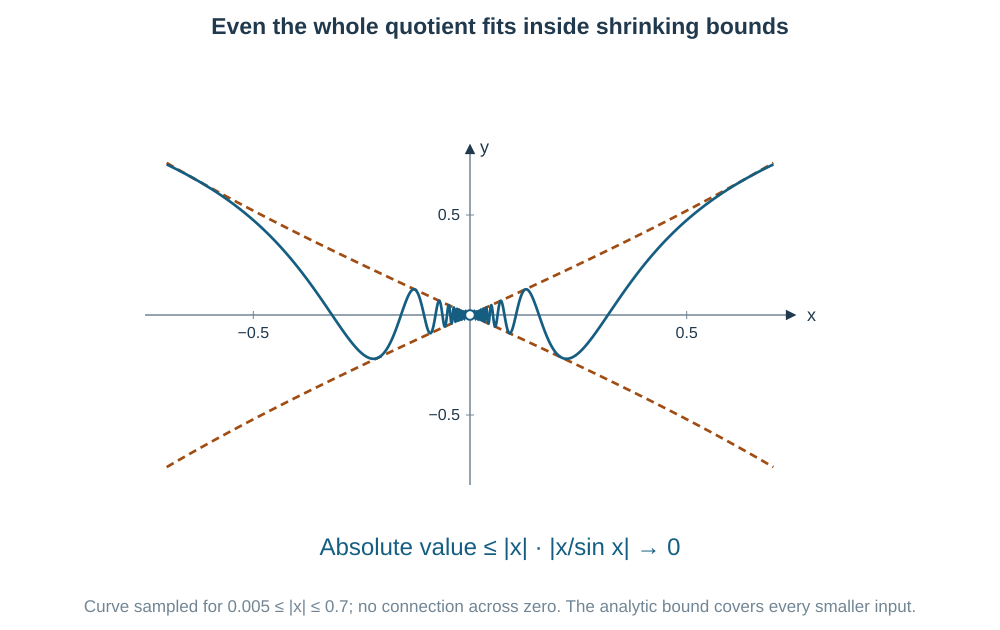

Thus the product tends to $\boxed{0}$, **option (c)**.

**Another possible approach:** bound the whole quotient:

$$
\left|\frac{x^2\sin(1/x)}{\sin x}\right|
\le |x|\left|\frac{x}{\sin x}\right|\to0.
$$

The failure of $\sin(1/x)$ alone to have a limit does not make every product containing it fail. L'Hôpital would introduce more rapid oscillation; the shrinking bound is the useful feature here.

### Question 30 — Keep the coefficient in the small change

**PDF page 46 | MCQ | Notes: C08**

$\displaystyle\lim_{x\to\infty}\left(\frac{3x+1}{3x-1}\right)^x$ equals

- (a) $e^{3/2}$
- (b) $e^2$
- (c) $e^{2/3}$
- (d) $e^{1/3}$

**Write the base as one plus a small fraction:**

$$
\frac{3x+1}{3x-1}=1+\frac2{3x-1}.
$$

The base is positive for sufficiently large $x$,
$u=2/(3x-1)\to0$, and

$$
xu=\frac{2x}{3x-1}\to\frac23.
$$

Therefore $\boxed{e^{2/3}}$, **option (c)**.

**Another possible approach:** let $t=(3x-1)/2$. Then
$x=(2t+1)/3$, and

$$
(1+1/t)^x
=\big((1+1/t)^t\big)^{2/3}(1+1/t)^{1/3}
\to e^{2/3}.
$$

The coefficient $3$ belongs to the denominator's scale; dropping it would give the wrong exponent.

## Answer check

All source question formats and option orders are retained.

| Question | Answer | Question | Answer |
|---|---|---|---|
| 1 | (c) $5/3$ | 16 | (b) $\ln4$ |
| 2 | $8$ | 17 | (c) $e^{-1/2}$ |
| 3 | $2$ | 18 | (a) $1/2$ |
| 4 | (a) $e^6$ | 19 | (a) $1/120$ |
| 5 | (d) $e^{-1/2}$ | 20 | (c) |
| 6 | (b) $e^2$ | 21 | (b) $1/2$ |
| 7 | (b) $1/2$ | 22 | (d) |
| 8 | $64$ | 23 | $24$ |
| 9 | $5$ | 24 | $7$ |
| 10 | (d) $\pi/4$ | 25 | (d) $1/2$ |
| 11 | $4$ | 26 | (a) $2/3$ |
| 12 | (a) $3/2$ | 27 | (b) $3/2$ |
| 13 | (c) $\pi$ | 28 | $1$ |
| 14 | (d) $2$ | 29 | (c) $0$ |
| 15 | $12$ | 30 | (c) $e^{2/3}$ |

## Coverage and source notes

All $30$ supplied questions appear in order: $21$ MCQs and $9$ numerical-value questions. Independent calculations agree with the intended source answers. The notes explicitly handle radians, real domains, one-sided limits, cancellation orders and sequence-sum normalization.

Q10/Q11 include their small rectangle-sum prerequisite. Q15 uses differentiability at the given point alone, without assuming nearby derivatives. L'Hôpital is a checked supporting alternative; it is not used circularly to establish the foundational trig limit.

The recent $36/58$ mean belongs to the broader Limits and Derivatives archive category, not a separately measured pure-Limits subset. Category totals from different archives are not merged. Research is a recent archive-card recount, not an independent exhaustive $2020$–$2026$ official-paper classification or formula-frequency audit.

## Offline research record

- Supplied Maths Predicted V1.pdf: questions on pages 43–46, key on page 46, working on pages 46–47. All stems and options were read visually.
- NTA, Syllabus for JEE Main 2027, Mathematics Unit 7: limits, simple function graphs, continuity and differentiation scope checked.
- PYQSide, Limits and Derivatives: all $36$ recent archive IDs across two pages saved and recounted; category is broader than pure Limits.
- PYQSide, Continuity and Differentiability and Mathematics Weightage: scope boundary, category overlap and full-year denominator checks.
- ExamSIDE, Limits, Continuity and Differentiability, and Differentiation: combined/separate classification comparison; not added to the chosen counts.

All graphs are original local SVGs generated from explicit equations, domains and inputs. Oscillatory graphs are labelled sampled; exact inequalities prove their limits. All alternative explanations are plain visible for the future printed booklet.
