# Continuity and Differentiability — JEE Main revision guide

*Continuity asks whether the graph reaches the assigned height. Differentiability asks whether there is one finite slope there. Continuity of the derivative asks a third question: do nearby slopes approach that slope?*

> **For Kanna | Chapter 10**  
> Goal: about $120/300$ towards $200/300$ — Physics $60$, Maths $60$, Chemistry $80$.  
> Notes first, then the recap and all $35$ supplied questions. Useful alternative methods are fully visible.

## Recent chapter weightage

**PYQSide's Continuity and Differentiability category gives $51/58\approx0.88$ questions per Paper 1 over 2024–2026.**

| Year | Full-year papers | Category questions | Questions per paper |
|---|---:|---:|---:|
| $2024$ | $20$ | $27$ | $1.35$ |
| $2025$ | $19$ | $10$ | $0.53$ |
| $2026$ | $19$ | $14$ | $0.74$ |
| Together | $58$ | $51$ | $0.88$ |

All $51$ distinct archive IDs across two pages were saved and recounted. The archive has a separate Limits and Derivatives category with $36$ IDs; the two sets do not overlap. Their joint mean is $87/58=1.50$.

ExamSIDE uses different boundaries: its combined Limits, Continuity and Differentiability counts are $29,26,21$ by year, and its separate Differentiation counts are $16,4,2$. Those are not the same split as this PDF. We use one named category consistently and do not merge totals across archives.

These are recent archive-card counts, not a complete independent official-paper classification or measured formula-frequency audit. The offered-question format differed in $2024$; an average is not a shift prediction. **Study priority:** continuity joins, one-sided derivatives, chain/product rules, inverse-function slopes, and choosing a simplification before differentiating.

## Scope and source difficulties before studying

The official Mathematics Unit 7 includes continuity, differentiability, algebraic/composite/implicit differentiation, and derivatives up to order two. This chapter teaches those tools. The separate Applications of Derivatives chapter is not being started.

- **Q34 has inconsistent data.** The functional equation and $f'(0)=3$ force $f(x)=e^{3x}$, which contradicts the printed $f(5)=2$. The intended formal calculation gives $6$, but there is no function satisfying all the givens. The worked solution explains both facts.
- **Rolle's and Lagrange's mean value theorems are source extensions.** They are not named in the current official syllabus. We retain Q7, Q8, Q26 and Q31 and teach the conditions, but do not call those theorems new core exam requirements.
- **Q35 needs $a\ne0$** for a parametric curve with a defined slope. For $a=0$ the point does not move.
- **Q5 and Q30 need their principal inverse-trig branches.** Their interval restrictions are part of the solution.
- **Q29 has a local log domain.** Its real inputs lie in $(-1/2,1/3)$, with the value at zero filled separately.

## Formula and concept bank

### Concept C01 — Continuity: left height, right height and actual value

At an interior point $a$, continuity means

$$
\boxed{\lim_{x\to a^-}f(x)=\lim_{x\to a^+}f(x)=f(a)}.
$$

The three jobs are different:

1. Find the height approached from the left.
2. Find the height approached from the right.
3. Check the actual assigned value at $a$.

A limit existing is not enough if the assigned value is wrong. A function being defined at $a$ is not enough if the nearby heights disagree.

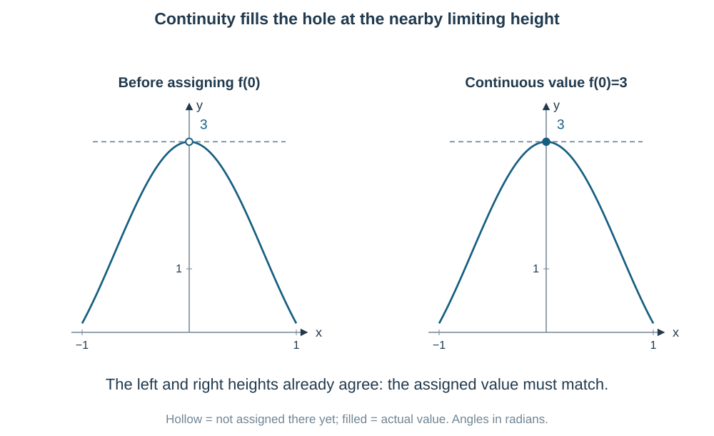

**Read the picture:** a hollow point marks the missing value before filling. Put a filled point at that same height to obtain continuity.

**Important for JEE Main:** piecewise parameter questions usually start with this three-way match. Each formula may be continuous on its own piece; the joins need checking.

Polynomials are continuous everywhere. Rational functions are continuous where their denominator is nonzero. Sine, cosine and exponentials are continuous everywhere; logarithms, roots, tangent and inverse functions must respect their domains. Sums, products and compositions of continuous functions remain continuous where defined; a quotient also needs a nonzero denominator.

At a closed-domain endpoint, continuity uses the available side. Always say whether the question asks about a function on all real inputs or on a smaller natural domain.

Useful discontinuity types:

- **Removable:** a finite limit exists, but the point value is missing or wrong. One correct filled value repairs it.
- **Jump:** the two finite side limits differ. Changing one point value cannot repair it.
- **Infinite or oscillating:** there is no finite nearby height to fill.

### Concept C02 — Differentiability means one finite slope

The derivative at $a$ is

$$
\boxed{f'(a)=\lim_{h\to0}\frac{f(a+h)-f(a)}h}
$$

when this limit is a finite real number. The quotient is output change divided by input change: a nearby secant slope. As the second point moves in, it approaches the tangent slope.

Define the left and right derivatives using $h\to0^-$ and $h\to0^+$ in this same expression. The denominator is still $h$; a left-hand increment is negative.

For $f(x)=|x|$ at zero,

$$
\frac{f(h)-f(0)}h=\frac{|h|}{h}
=\begin{cases}-1,&h<0,\\1,&h>0.\end{cases}
$$

The graph reaches the same height from both sides, but the slopes differ:

$$
\boxed{|x|\text{ is continuous at }0
\text{ but not differentiable there}.}
$$

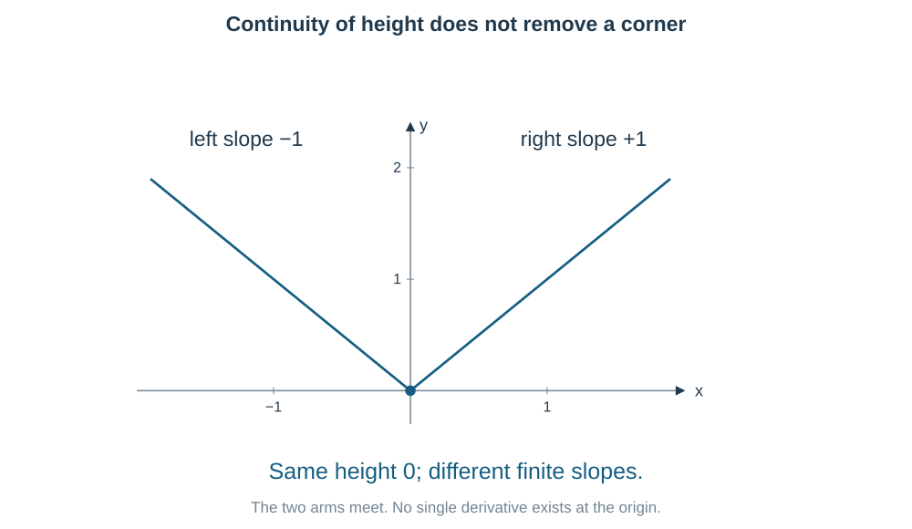

**Read the picture:** there is no height gap. There is a corner, so no single tangent slope.

**Differentiability implies continuity.** If the difference quotient tends to $m$, then

$$
f(a+h)-f(a)
=h\,\frac{f(a+h)-f(a)}h\longrightarrow0\cdot m=0.
$$

So nearby values approach $f(a)$. The converse is false, as $|x|$ shows.

**For a piecewise join:** match the value first. Then compare slopes. If the pieces have derivatives extending to the join and the function is continuous there, these side derivative values can be used. Otherwise return to the difference-quotient definition.

A vertical tangent is another warning: for $x^{1/3}$ at zero, the quotient is $1/h^{2/3}\to+\infty$. The graph is continuous, but there is no finite derivative. A cusp can have opposite infinite slopes. “It looks joined” is therefore not a derivative test.

### Concept C03 — Algebra rules and the standard limits used here

Let $u=u(x)$ and $v=v(x)$ be differentiable at the input in question:

$$
\boxed{(cu+dv)'=cu'+dv'},\qquad
\boxed{(uv)'=u'v+uv'},
$$

$$
\boxed{\left(\frac uv\right)'=\frac{u'v-uv'}{v^2}}
\quad(v\ne0).
$$

$c,d$ are constants. A constant's derivative is zero. For an integer power, $(x^n)'=nx^{n-1}$ wherever the function is defined; for a general real exponent, use the positive-input branch unless a larger real domain is justified.

**Why two product terms?** When both factors change, one first-order contribution comes from the change in $u$, the other from the change in $v$. Their small-change product is of higher order. Differentiating both factors and multiplying, $u'v'$, misses the main contributions.

For example,

$$
(x^2\ln x)'=2x\ln x+x^2\frac1x
=2x\ln x+x\quad(x>0).
$$

**Simplify first when it saves work.** For $x^2/x=x$ away from zero, cancel before differentiating. But cancellation does not automatically define the original quotient at zero.

The supplied limit questions also use these radian results:

$$
\frac{\sin t}{t}\to1,\quad
\frac{\tan t}{t}\to1,\quad
\frac{1-\cos t}{t^2}\to\frac12,\quad
\frac{e^t-1}{t}\to1,\quad
\frac{\ln(1+t)}t\to1.
$$

They are limits as $t\to0$ within the real domain. Useful local expansions are

$$
e^t=1+t+t^2/2+O(t^3),\quad
\sin t=t-t^3/6+O(t^5),\quad
\cos t=1-t^2/2+O(t^4),
$$

$$
\ln(1+t)=t-t^2/2+O(t^3).
$$

$O(t^m)$ is a remainder bounded by a fixed constant times $|t|^m$ nearby. These expansions describe the first surviving terms; they are not exact equalities without their remainders.

### Concept C04 — Chain rule: outside change times inside change

If $y=F(u(x))$, then

$$
\boxed{\frac{dy}{dx}=F'(u(x))u'(x)}.
$$

The input first changes $u$; that change then changes $F$. The two rates multiply. For example,

$$
\frac d{dx}\sin(x^2)=\cos(x^2)\,(2x),
$$

not just $\cos(x^2)$. Point to the inside expression before differentiating.

**Important for JEE Main — derivative table with the inner factor included.**

| Function | Derivative | Real condition near the point |
|---|---|---|
| $u^\alpha$ | $\alpha u^{\alpha-1}u'$ | Positive $u$ is safe for general real $\alpha$ |
| $e^u$ | $e^u u'$ | Any real $u$ |
| $a^u$ | $a^u\ln a\,u'$ | $a>0$ constant |
| $\ln u$ | $u'/u$ | $u>0$ |
| $\ln|u|$ | $u'/u$ | $u\ne0$ nearby |
| $\log_a u$ | $u'/(u\ln a)$ | $u>0$, $a>0$, $a\ne1$ |
| $\sin u$ | $\cos u\,u'$ | Radians |
| $\cos u$ | $-\sin u\,u'$ | Radians |
| $\tan u$ | $\sec^2u\,u'$ | $\cos u\ne0$ |
| $\cot u$ | $-\csc^2u\,u'$ | $\sin u\ne0$ |
| $\sec u$ | $\sec u\tan u\,u'$ | $\cos u\ne0$ |
| $\csc u$ | $-\csc u\cot u\,u'$ | $\sin u\ne0$ |
| $\sin^{-1}u$ | $u'/\sqrt{1-u^2}$ | $|u|<1$ |
| $\cos^{-1}u$ | $-u'/\sqrt{1-u^2}$ | $|u|<1$ |
| $\tan^{-1}u$ | $u'/(1+u^2)$ | Real $u$ |
| $\cot^{-1}u$ | $-u'/(1+u^2)$ | Principal range $(0,\pi)$ |
| $\sec^{-1}u$ | $u'/(|u|\sqrt{u^2-1})$ | $|u|>1$, conventional principal branch |
| $\csc^{-1}u$ | $-u'/(|u|\sqrt{u^2-1})$ | $|u|>1$, conventional principal branch |

Here inverse trig means an angle, not a reciprocal. The usual principal ranges for $\sec^{-1}$ and $\csc^{-1}$ are $[0,\pi]\setminus\{\pi/2\}$ and $[-\pi/2,\pi/2]\setminus\{0\}$ respectively. The absolute value in their derivatives matters for negative inputs.

For $y=A\cos(\ln x)+B\sin(\ln x)$, the inner derivative is $1/x$ and the natural domain is $x>0$. Multiplying the first derivative by $x$ before differentiating again can reduce fractions, as Q9 shows.

### Concept C05 — An inverse function only undoes its chosen branch

$\sin^{-1}z$ returns its principal angle in $[-\pi/2,\pi/2]$.
Thus

$$
\boxed{\sin^{-1}(\sin t)=t\ \text{only when }-\pi/2\le t\le\pi/2.}
$$

For instance, $\sin^{-1}(\sin(3\pi/4))=\pi/4$, not $3\pi/4$.

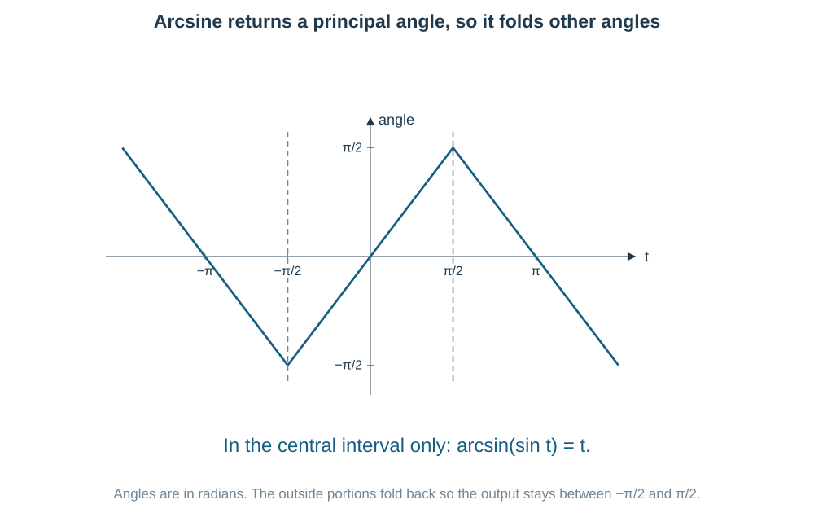

**Read the picture:** outside the central interval, the inverse brings the angle back into its allowed range. It cannot return every original angle.

For Q5, set $x=\sin\theta$ with $\theta=\sin^{-1}x$.
The condition $|x|<1/\sqrt2$ gives $|\theta|<\pi/4$, and
$\sqrt{1-x^2}=\cos\theta>0$. Therefore

$$
2x\sqrt{1-x^2}=\sin2\theta,\quad
\sin^{-1}(\sin2\theta)=2\theta.
$$

For Q30, $3x-4x^3=\sin3\theta$ when $x=\sin\theta$.
The stronger condition $|x|<1/2$ gives $|3\theta|<\pi/2$ and permits the same undoing.

**Half-angle clue for inverse tangent:** if $\theta=\tan^{-1}x\in(-\pi/2,\pi/2)$, then $\cos\theta>0$ and

$$
\frac{x}{\sqrt{1+x^2}+1}=\tan\frac\theta2.
$$

Rationalizing $(\sqrt{1+x^2}-1)/x$ gives the left side for $x\ne0$. The half-angle is inside the principal arctangent range, so the outside inverse returns $\theta/2$. Q21 uses this simplification.

### Concept C06 — Modulus and floor: inspect the special inputs

For $u(x)\ne0$,

$$
\boxed{(|u|)'=\frac{u}{|u|}u'}.
$$

At $u(a)=0$, this formula is undefined. Check the original difference quotient or the local expression.

For $|x-c|$, the derivative is $-1$ before $c$ and $1$ after $c$. It jumps by $2$. In a sum of positively weighted modulus terms, a single zero of one term gives a genuine new corner because the other nonzero terms are smooth there.

**A multiplier can remove a corner.** With $h=x-a$,

$$
|h|:\ \text{corner},\qquad
h|h|:\ \frac{h|h|-0}{h}=|h|\to0.
$$

So $h|h|$ is differentiable at zero. Also, if differentiable $u$ has $u(a)=u'(a)=0$, then $|u|$ is differentiable there with derivative zero. Merely counting roots inside a modulus can overcount.

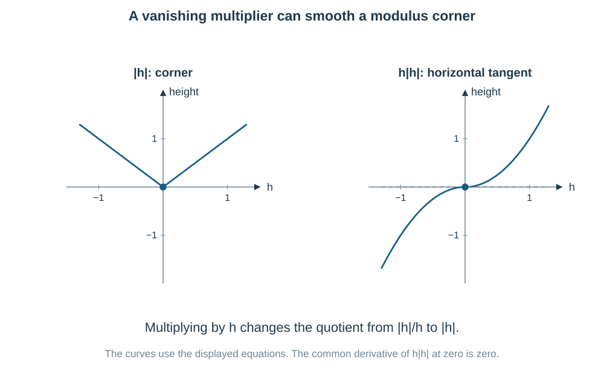

For the floor function,

$$
[t]=\lfloor t\rfloor,\quad t-1<[t]\le t.
$$

It jumps at each integer and is constant between consecutive integers. For $[3x]$, solve $3x=m$ for integer $m$ and check the requested interval. At a floor boundary, inspect the sides; touching a level without crossing it need not produce the same jump as a strictly increasing argument.

For example, $[x^2]$ is zero throughout a small neighbourhood of zero, so it is continuous there. But $[-x^2]$ is $-1$ at nearby nonzero inputs and $0$ at zero, so it is discontinuous there. In both examples the inside reaches an integer at zero; the side values decide what actually happens.

For $\sin|x|$ and $|\sin x|$, both functions equal $|\sin x|$ sufficiently close to zero, so both have a corner there. They are **not equal everywhere**: for $\pi<|x|<2\pi$, $\sin|x|$ can be negative while $|\sin x|$ cannot.

### Concept C07 — Oscillation: check the function and derivative separately

Define

$$
f(x)=x\sin(1/x),\quad
g(x)=x^2\sin(1/x)\quad(x\ne0),\qquad f(0)=g(0)=0.
$$

Both are continuous at zero because $|f(x)|\le|x|$ and
$|g(x)|\le x^2$. But their derivative quotients are different:

$$
\frac{f(h)-f(0)}h=\sin(1/h)
\quad\text{has no limit},
$$

$$
\frac{g(h)-g(0)}h=h\sin(1/h)\to0.
$$

Therefore $f'(0)$ does not exist, while $g'(0)=0$.

For $x\ne0$,

$$
g'(x)=2x\sin(1/x)-\cos(1/x).
$$

Its first term tends to zero, but the cosine term continues to oscillate with size one.
Along $x_n=1/(2\pi n)$, $g'(x_n)=-1$; along
$y_n=1/((2n+1)\pi)$, $g'(y_n)=1$. Thus $g'$ is not continuous at zero.

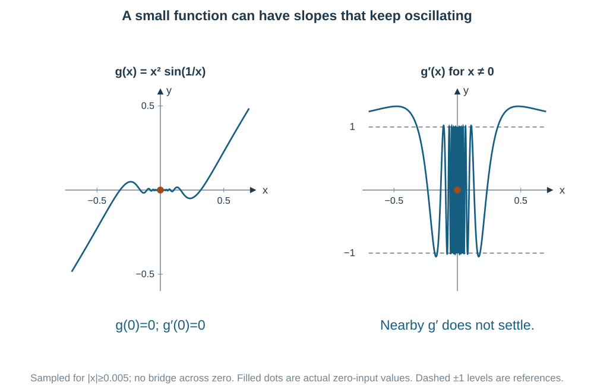

**Read the panels:** small function height does not guarantee settling slopes.

**Important for JEE Main:** distinguish
$f$ continuous, $f$ differentiable, and $f'$ continuous.
The last is stronger than the second.

For awareness, multiplying by still more powers can tame the derivative too. For example, $x^3\sin(1/x)$ extended by zero has derivative
$3x^2\sin(1/x)-x\cos(1/x)\to0$. Check the powers after differentiation rather than memorizing “oscillation always fails.”

### Concept C08 — Logarithmic differentiation for variable powers

For $y=u(x)^{v(x)}$ with $u>0$, take the logarithm:

$$
\ln y=v\ln u.
$$

Differentiate using the product and chain rules:

$$
\boxed{y'=u^v\left(v'\ln u+v\,\frac{u'}u\right)}.
$$

There are two contributions: change in the exponent and change in the base.
The ordinary rule $d(x^n)/dx=nx^{n-1}$ assumes a **constant** exponent. Applying it to $x^x$ would miss the exponent's change.

For $y=x^x$ with $x>0$,

$$
\ln y=x\ln x,\quad \frac{y'}y=\ln x+1,\quad
\boxed{y'=x^x(1+\ln x)}.
$$

For $y=x^{\sin x}$ with $x>0$,

$$
\boxed{y'=x^{\sin x}\left(\cos x\ln x+\frac{\sin x}{x}\right)}.
$$

**Differentiate before substituting the input.** Substituting $x=\pi/2$ at the start turns the function into one number; a number does not retain information about nearby change.

Logs also turn long nonzero products and quotients into sums and differences. Use $\ln|y|$ where a nonzero function is negative and the identity is valid locally; do not take a real $\ln y$ of a negative value.

For the supplied power limit,

$$
Y=(\cos x)^{1/x^2},\quad
\ln Y=\frac{\ln\cos x}{x^2}\to-\frac12,
\quad \boxed{Y\to e^{-1/2}}.
$$

Here $\cos x>0$ sufficiently near zero. One way to check the log limit is to write
$u=\cos x-1$, use $\ln(1+u)/u\to1$, and
$u/x^2\to-1/2$.

### Concept C09 — Implicit and parametric derivatives

**Implicit** means $x,y$ are linked by an equation instead of $y$ being isolated. Treat $y$ as a changing function of $x$:

$$
x^2+y^2=r^2
\quad\Rightarrow\quad2x+2y\,y'=0
\quad\Rightarrow\quad
\boxed{y'=-x/y}\quad(y\ne0).
$$

Why the extra $y'$? Differentiating $y^2$ uses the chain rule. At $y=0$ we cannot divide by $y$; the circle has a vertical tangent there, not a finite slope.

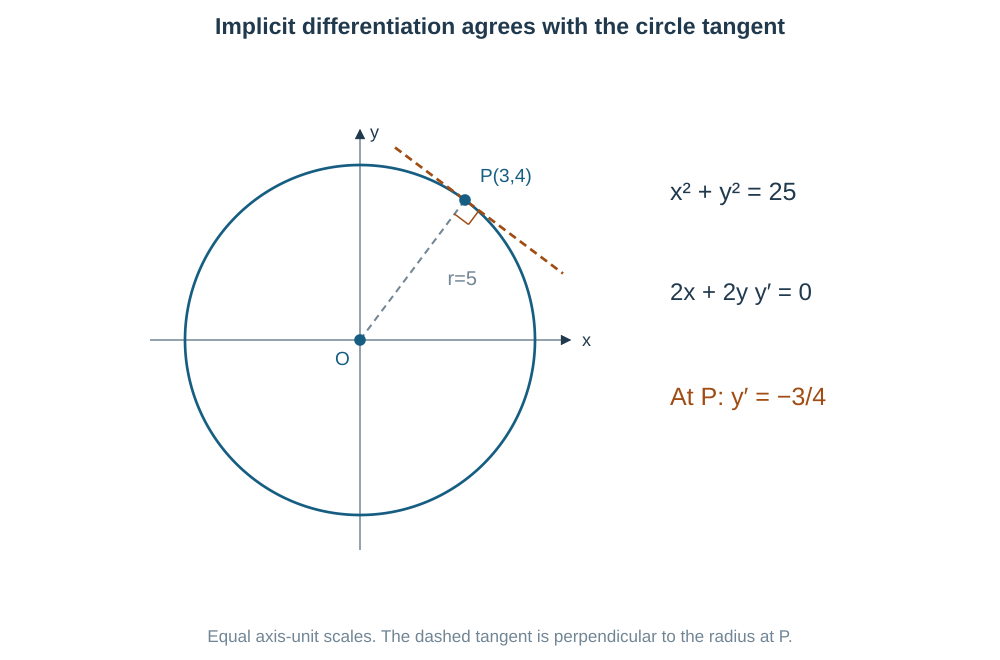

**Read the picture:** the radius has slope $4/3$ and the tangent has slope $-3/4$, so their product is $-1$. The derivative calculation agrees with the geometry.

More generally, for differentiable $F(x,y)=0$ locally defining $y$,

$$
\boxed{y'=-F_x/F_y}\quad(F_y\ne0).
$$

$F_x$ means differentiate with respect to $x$ while holding $y$ fixed; $F_y$ means the reverse. This is a compact form of the same implicit calculation, not an extra condition to memorize without meaning.

**Parametric** means a third input $t$ controls both coordinates:

$$
x=X(t),\qquad y=Y(t).
$$

Provided $X'(t)\ne0$,

$$
\boxed{\frac{dy}{dx}=\frac{dy/dt}{dx/dt}}.
$$

Both numerator and denominator are changes per unit $t$; dividing them gives change in $y$ per unit $x$.

For the second derivative, differentiate that slope with respect to $x$, not merely to $t$:

$$
\boxed{\frac{d^2y}{dx^2}
=\frac{d}{dt}(dy/dx)\,\frac1{dx/dt}
=\frac{Y''X'-Y'X''}{(X')^3}}.
$$

If $X'=0$, stop and inspect the curve; the displayed division is not valid.
In Q35, $a=0$ makes both coordinates constant, so no curve slope can be obtained by cancelling $a$.

### Concept C10 — The second derivative is the derivative of the slope

$f'$ is itself a function: it assigns a tangent slope to each input where the derivative exists.
$f''=(f')'$ measures how that slope changes. It is not $(f')^2$.

For $y=x^2\ln x$,

$$
y'=2x\ln x+x,\qquad
\boxed{y''=2\ln x+3}\quad(x>0).
$$

For a composite function $F(u(x))$,

$$
\boxed{y''=F''(u)(u')^2+F'(u)u''}.
$$

The second term comes from differentiating the inner rate too.

**Repeated mixed products:** for $y=e^x\sin x$,

$$
y'=e^x(\sin x+\cos x),\qquad
y''=2e^x\cos x.
$$

So $y''-2y'+2y=0$.
The supplied equation is an identity to check by differentiating twice; it does not require solving a differential equation.

For $y=A\cos(\ln x)+B\sin(\ln x)$, first write
$xy'=-A\sin(\ln x)+B\cos(\ln x)$.
Differentiating this product gives $xy''+y'=-y/x$, hence
$x^2y''+xy'+y=0$.

**Recognition clue:** multiply away a repeated inner $1/x$ before a second derivative when that makes the expression shorter.

### Concept C11 — Inverse-function slopes are reciprocal at corresponding points

An inverse function swaps the input and output. If $b=f(a)$ and
$g=f^{-1}$ is the corresponding local inverse, then

$$
g(f(x))=x.
$$

Use the chain rule:

$$
g'(f(x))f'(x)=1
\quad\Rightarrow\quad
\boxed{g'(b)=\frac1{f'(a)}}\quad(f'(a)\ne0).
$$

First find **which input $a$ gives the requested output $b$**. Plugging $b$ directly into $f'$ is usually the wrong point.

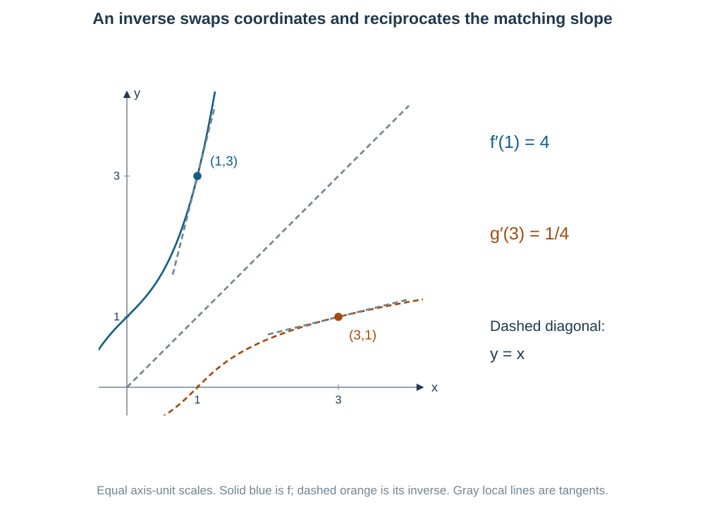

For $f(x)=x^3+x+1$, $f'(x)=3x^2+1>0$, so $f$ increases strictly and has one real inverse. Since $f(1)=3$, $g'(3)=1/f'(1)=1/4$. We do not need to solve the cubic inverse explicitly.

The nonzero-derivative condition matters. An inverse may exist even when its derivative is not finite at the corresponding point, as with $x^3$ and $x^{1/3}$ at zero.

### Concept C12 — Source extension: Rolle and mean value theorems

These theorems are needed for four supplied questions, but are not named in the current official syllabus. Retain them for understanding the source; prioritize the core differentiation and continuity tools first.

**Rolle's theorem:** if $f$ is continuous on $[a,b]$, differentiable on $(a,b)$, and $f(a)=f(b)$, then at least one $c\in(a,b)$ has

$$
\boxed{f'(c)=0}.
$$

Equal endpoint heights force at least one horizontal tangent for a curve satisfying those conditions. The statement does not promise a unique $c$.

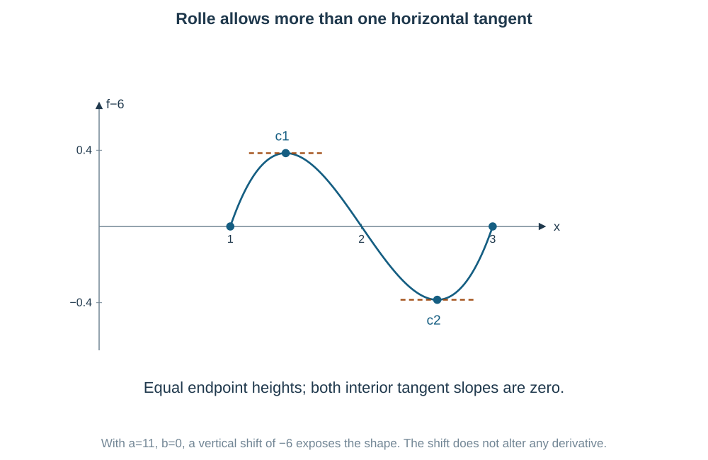

**Read the picture:** the two interior turns are both allowed by Rolle's theorem. The vertical shift used in the drawing does not change slopes.

**Lagrange's mean value theorem:** if $f$ is continuous on $[a,b]$ and differentiable on $(a,b)$, then some $c\in(a,b)$ satisfies

$$
\boxed{f'(c)=\frac{f(b)-f(a)}{b-a}}.
$$

The right side is the endpoint chord's slope, the average change. Some tangent inside has that same slope.

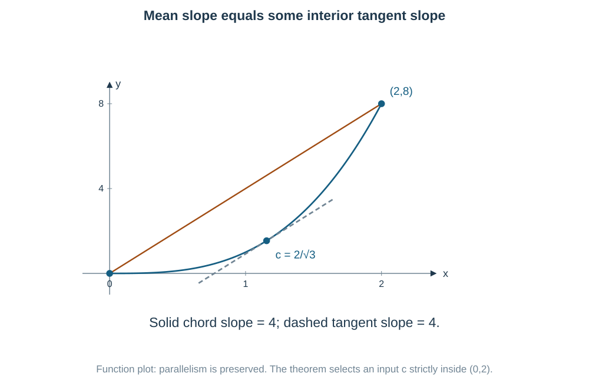

**Why the conditions?** The continuous graph can reach its extreme heights on the closed interval. If equal endpoints surround a different interior height, an interior maximum or minimum has derivative zero. For the mean value theorem, subtract the chord line and apply Rolle to the resulting equal-endpoint function.

Corners or missing values can break the conclusion. For $|x|$ on $[-1,1]$, the endpoint heights are equal, but its only potential turning input is a corner with no derivative. Rolle cannot be applied.

An important consequence used in C14: a differentiable function with derivative zero throughout an interval is constant there. Apply the mean value theorem between any two inputs.

### Concept C13 — Rational and irrational pieces need branch-limit reasoning

Rational inputs and irrational inputs both occur arbitrarily close to every real number. This is called **density**; neither set has a small empty neighbourhood around a real point.

Suppose

$$
f(x)=\begin{cases}P(x),&x\text{ rational},\\
Q(x),&x\text{ irrational},\end{cases}
$$

where $P,Q$ are continuous at $a$.
Approaching through rational inputs gives $P(a)$; approaching through irrational inputs gives $Q(a)$.

Therefore

$$
\boxed{f\text{ is continuous at }a\iff P(a)=Q(a)}.
$$

**Why is matching enough?** Both continuous branches then approach the same height; every nearby input uses one of those branches. The actual assigned branch at $a$ also has that height.

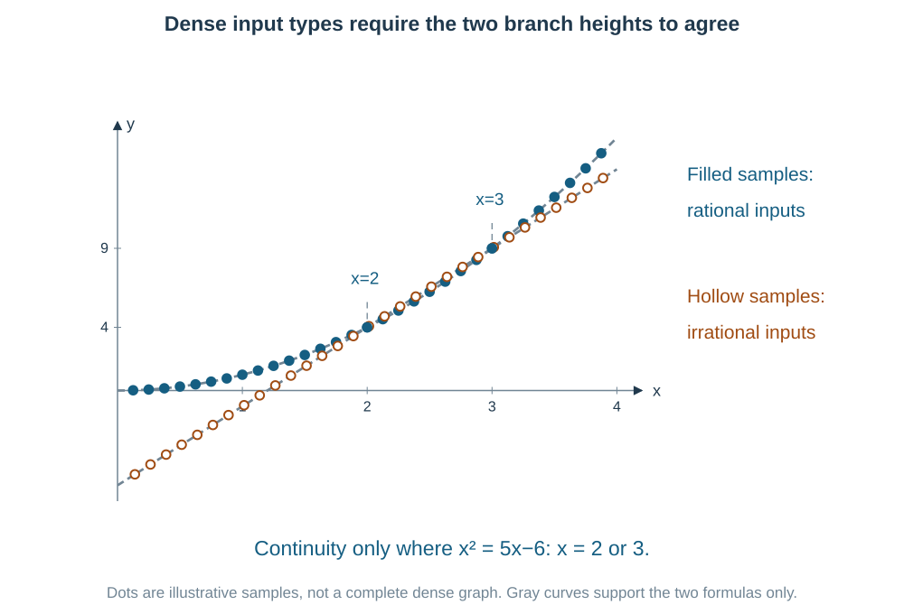

**Read the picture carefully:** the dots are illustrative samples. The supporting curves show the two formulas; the actual mixed function is not a connected choice of one curve followed by the other.

For Q33, continuity requires $a^2=5a-6$, giving $a=2,3$. Solving the intersection equation is enough; drawing a dense exact graph is neither possible nor necessary.

### Concept C14 — Functional equations: derive a local identity, then check all data

A functional equation relates values at different inputs. For

$$
f(x+h)=f(x)f(h),
$$

one nonzero value forces $f(0)=1$: put $h=0$.
If $f$ is differentiable at zero,

$$
\begin{aligned}
f'(x)
&=\lim_{h\to0}\frac{f(x+h)-f(x)}h\\
&=f(x)\lim_{h\to0}\frac{f(h)-1}h
=f(x)f'(0).
\end{aligned}
$$

This is the useful recognition pattern: the equation turns a derivative at a general input into a derivative at zero.

**But check that the remaining numbers are compatible.** If $f'(0)=3$, define $H(x)=e^{-3x}f(x)$. Product differentiation gives

$$
H'(x)=e^{-3x}(f'(x)-3f(x))=0.
$$

Thus $H$ is constant, and $H(0)=1$. Consequently

$$
\boxed{f(x)=e^{3x}}.
$$

The printed Q34 value $f(5)=2$ conflicts with $f(5)=e^{15}$.
The local substitution $f'(5)=3(2)=6$ explains the intended option, but it does not create a function satisfying the contradictory givens.

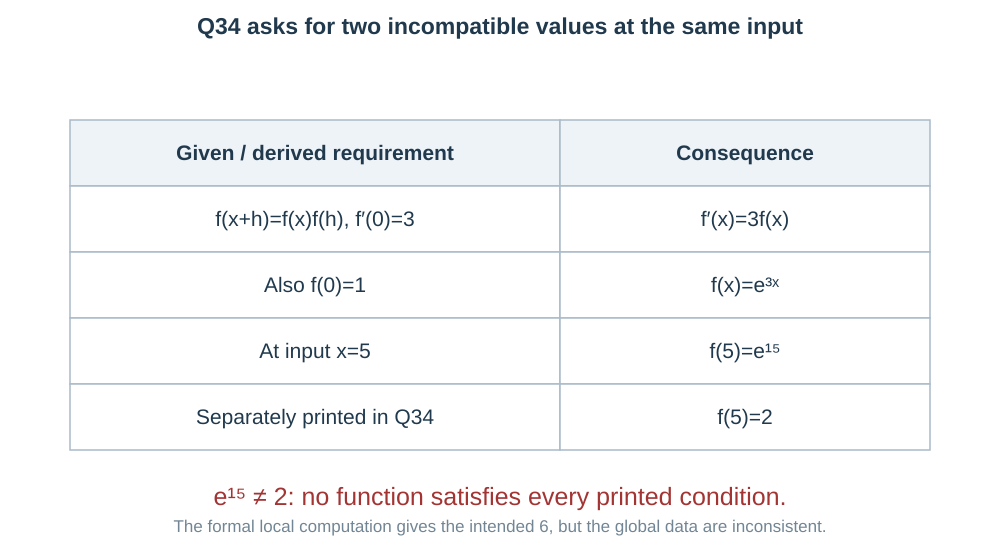

**Lesson:** a valid intermediate identity is not enough if another given contradicts the function it forces.

## Choose the route from the clue

| Clue | First useful move | Why |
|---|---|---|
| Piecewise function with a filled value | Match left limit, right limit, value | Continuity is a height condition |
| “Differentiable at the join” | Continuity first, then side slopes | Slope matching cannot repair a jump |
| Modulus root | Inspect local factors | A vanishing multiplier may remove the corner |
| Floor function | Locate integer levels and inspect sides | Do not count every real input |
| Oscillation with powers of $x$ | Check the quotient at zero separately | Nearby derivative formulas need not extend |
| Nested function | Name inside and outside | Keeps the chain-rule factor |
| Both base and exponent vary | Logarithmic differentiation | Both changes contribute |
| Inverse trig of a multiple-angle pattern | Check the principal interval | Cancellation outside the branch is false |
| Parametric second derivative | Differentiate the slope and divide by $x'$ again | The requested variable is $x$, not $t$ |
| Inverse function derivative at $b$ | Solve $f(a)=b$ first | Slopes are reciprocal at corresponding points |
| Rational/irrational pieces | Match branch limits | Both input types occur near every point |
| Functional equation | Use a small increment, then audit the data | A formal answer may conceal inconsistent givens |

This is a teaching aid, not a measured frequency ranking.

## Last-minute formula recap

| Need | Recall and condition |
|---|---|
| Continuity at interior $a$ | Left limit = right limit = $f(a)$ |
| Derivative | $f'(a)=\lim_{h\to0}[f(a+h)-f(a)]/h$, finite |
| Strength of conditions | $f'$ continuous implies $f$ differentiable implies $f$ continuous; converses can fail |
| Product / quotient | $(uv)'=u'v+uv'$; $(u/v)'=(u'v-uv')/v^2$, $v\ne0$ |
| Chain rule | $(F(u))'=F'(u)u'$ |
| Real power / exponential | $(u^\alpha)'=\alpha u^{\alpha-1}u'$; $(e^u)'=e^uu'$ |
| Logarithms | $(\ln|u|)'=u'/u$, $u\ne0$; $(\log_a u)'=u'/(u\ln a)$ with its domain |
| Trig / inverse trig | Keep the full table in C04; radians and principal branches matter |
| Variable power | $(u^v)'=u^v(v'\ln u+vu'/u)$, $u>0$ |
| Modulus away from zero | $(|u|)'=(u/|u|)u'$; inspect zeros separately |
| Oscillation at zero | Use the original difference quotient; do not assume nearby derivative limits |
| Implicit derivative | $y'=-F_x/F_y$, $F_y\ne0$ |
| Parametric slope | $dy/dx=Y'/X'$, $X'\ne0$ |
| Parametric second derivative | $(Y''X'-Y'X'')/(X')^3$ |
| Composite second derivative | $F''(u)(u')^2+F'(u)u''$ |
| Inverse slope | $(f^{-1})'(b)=1/f'(a)$ where $f(a)=b$, nonzero derivative |
| Rational/irrational continuity | Equal continuous branch values at that input |
| Multiplicative functional equation | With $f(0)=1$, $f'(x)=f(x)f'(0)$; check all additional givens |
| Source extension: Rolle | Continuous on $[a,b]$, differentiable inside, equal ends imply some interior $f'(c)=0$ |
| Source extension: mean value | Continuous on $[a,b]$, differentiable inside imply some $f'(c)=[f(b)-f(a)]/(b-a)$ |

Before choosing an option: check domains, branch restrictions, join values, zero factors and the variable with respect to which the derivative is requested.

## Worked solutions to the 35 PDF questions

Try first, then read why the visible clue suggests the method. In a graph question, identify the relevant height, slope or side behaviour before calculating. Every useful second approach remains visible.

### Question 1 — Fill the hole at the nearby limiting height

**PDF page 48 | MCQ | Notes: C01**

Let $f(x)=\sin3x/x$ for $x\ne0$ and $f(0)=k$. If $f$ is continuous at $x=0$, then $k$ equals

- (a) $1$
- (b) $\dfrac13$
- (c) $3$
- (d) $0$

**Continuity asks for the hole's height.** For nearby $x\ne0$,

$$
f(x)=3\frac{\sin3x}{3x}\longrightarrow3.
$$

So the assigned value must be $\boxed{k=3}$, **option (c)**.

**Why not substitute zero in the fraction?** It gives $0/0$; it does not define $f(0)$. The separately assigned $k$ must match the limit.

**Another possible approach:** $\sin3x=3x+O(x^3)$ gives
$f(x)=3+O(x^2)\to3$.

### Question 2 — Two quadratic changes add

**PDF page 48 | MCQ | Notes: C01,C03**

$\displaystyle\lim_{x\to0}\frac{e^{x^2}-\cos x}{x^2}$ is equal to

- (a) $\dfrac32$
- (b) $\dfrac12$
- (c) $1$
- (d) $2$

**Split at the common limiting value one:**

$$
\frac{e^{x^2}-\cos x}{x^2}
=\frac{e^{x^2}-1}{x^2}
+\frac{1-\cos x}{x^2}
\longrightarrow1+\frac12
=\boxed{\frac32}\quad\text{(a)}.
$$

In the first term the small input is $t=x^2$. Matching that input to its denominator is why its limit is one.

**Another possible approach:** $e^{x^2}=1+x^2+O(x^4)$ and
$\cos x=1-x^2/2+O(x^4)$. Their difference starts with $3x^2/2$.

### Question 3 — Count genuine slope changes at modulus points

**PDF page 48 | Numerical value | Notes: C06**

The number of points at which $f(x)=|x|+|x-1|+|x-2|+|x-3|$ is not differentiable is ____.

**Each modulus changes slope where its inside becomes zero.** The candidates are $0,1,2,3$. Away from those inputs all signs are fixed, so the sum is a straight-line expression locally.

As $x$ crosses one candidate, exactly one term changes slope from $-1$ to $1$. The other terms have the same slope on both sides of that candidate. The total slope therefore jumps by $2$.

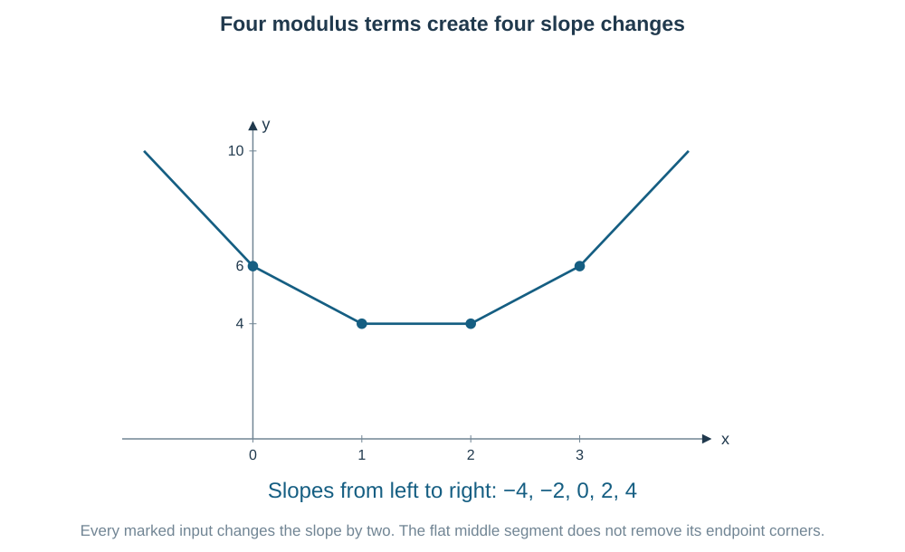

Explicitly, the slopes are

$$
-4,\ -2,\ 0,\ 2,\ 4
$$

on $(-\infty,0),(0,1),(1,2),(2,3),(3,\infty)$.
Thus all four candidates are genuine corners:
$\boxed{4}$.

**Another possible approach:** form the left and right derivative at each candidate directly. This gives the same four slope jumps. Counting zeros alone would need more care if negative weights or vanishing multipliers could cancel a corner.

### Question 4 — A joined graph can still have two slopes

**PDF page 48 | MCQ | Notes: C02**

Statement I: $f(x)=|x|$ is continuous at $x=0$.

Statement II: $f(x)=|x|$ is differentiable at $x=0$. Choose the correct option.

- (a) Both Statement I and Statement II are true
- (b) Statement I is true but Statement II is false
- (c) Statement I is false but Statement II is true
- (d) Both Statement I and Statement II are false

**Separate height from slope.** The value is $f(0)=0$ and
$|x|\to0$, so Statement I is true.

The derivative quotient is

$$
\frac{|h|-0}{h}
=\begin{cases}-1,&h<0,\\1,&h>0.\end{cases}
$$

The left and right slopes differ, so Statement II is false.
The answer is $\boxed{\text{option (b)}}$.

**Another possible view:** write the two straight-line pieces as $-x$ for $x<0$ and $x$ for $x>0$. Their slopes are $-1$ and $1$. A joined graph need not have a unique tangent.

### Question 5 — Check the principal arcsine interval

**PDF page 48 | Numerical value | Notes: C05**

If $\dfrac{d}{dx}\!\left[\sin^{-1}\!\left(2x\sqrt{1-x^2}\right)\right]=k\,\dfrac{d}{dx}[\sin^{-1}x]$ for $|x|<1/\sqrt2$, then $k=$ ____.

**The restriction is the clue that allows an inverse-trig simplification.** Let
$x=\sin\theta$, where $\theta=\sin^{-1}x$.
Since $|x|<1/\sqrt2$, $|\theta|<\pi/4$ and $\cos\theta>0$.

$$
2x\sqrt{1-x^2}=2\sin\theta\cos\theta=\sin2\theta.
$$

Now $2\theta\in(-\pi/2,\pi/2)$, the principal arcsine interval, so

$$
\sin^{-1}\left(2x\sqrt{1-x^2}\right)
=2\theta=2\sin^{-1}x.
$$

Differentiate: $\boxed{k=2}$.

**Another possible approach:** direct chain differentiation gives

$$
\frac{2(1-2x^2)}
{\sqrt{1-x^2}\sqrt{1-4x^2(1-x^2)}}
=\frac{2(1-2x^2)}
{\sqrt{1-x^2}|1-2x^2|}.
$$

The bound makes $1-2x^2>0$, so this is $2/\sqrt{1-x^2}$.
Without the bound, silently dropping the absolute value would be wrong.

### Question 6 — Both the base and the exponent depend on x

**PDF page 48 | MCQ | Notes: C08**

If $y=x^x$ for $x>0$, then $\dfrac{dy}{dx}$ at $x=2$ is

- (a) $4\ln2$
- (b) $2(1+\ln2)$
- (c) $4+\ln2$
- (d) $4(1+\ln2)$

**Both parts of $x^x$ vary.** The constant-power formula alone is insufficient. For $x>0$,

$$
\ln y=x\ln x
\quad\Rightarrow\quad
\frac{y'}y=\ln x+1.
$$

Hence $y'=x^x(1+\ln x)$. Substitute only now:

$$
\boxed{y'(2)=4(1+\ln2)}\quad\text{(d)}.
$$

**Another possible approach:** write $y=e^{x\ln x}$ and use the chain rule:
$y'=e^{x\ln x}(\ln x+1)$.
This is the same dependence of the base and exponent seen through an exponential.

### Question 7 — Equal endpoints impose the coefficient condition

**PDF page 48 | Numerical value | Notes: C12**

If $f(x)=x^3-6x^2+ax+b$ satisfies the conditions of Rolle's theorem on $[1,3]$, then $a=$ ____.

**Source extension — Rolle's theorem.** A polynomial is continuous on $[1,3]$ and differentiable inside. The condition that still needs imposing is equal endpoint values:

$$
f(1)=-5+a+b,\qquad f(3)=-27+3a+b.
$$

Set them equal:

$$
-5+a+b=-27+3a+b
\quad\Rightarrow\quad2a=22,\quad\boxed{a=11}.
$$

The constant $b$ cancels because a vertical shift does not change whether the endpoints have equal heights.

**Another possible check:** with $a=11$,
$f'(x)=3x^2-12x+11$ has roots
$2\pm1/\sqrt3$, both inside $(1,3)$. Finding those roots is not needed to determine $a$, but checks the theorem's conclusion.

### Question 8 — A tangent must match the chord slope

**PDF page 48 | MCQ | Notes: C12**

For $f(x)=x^3$ on $[0,2]$, the value of $c$ in Lagrange's mean value theorem is

- (a) $\dfrac1{\sqrt3}$
- (b) $\dfrac2{\sqrt3}$
- (c) $1$
- (d) $\sqrt3$

**Source extension — mean value theorem.** The polynomial meets its continuity and differentiability conditions. The endpoint chord slope is

$$
\frac{f(2)-f(0)}{2-0}=\frac8{2}=4.
$$

The tangent slope is $f'(c)=3c^2$. Therefore

$$
3c^2=4
\quad\Rightarrow\quad c=\pm\frac2{\sqrt3}.
$$

Only the positive root is in $(0,2)$:
$\boxed{c=2/\sqrt3}$, **option (b)**.

**Check with the options:** $2/\sqrt3\approx1.155$ is inside the interval and gives slope four. Solving the squared equation without checking the interval would keep an invalid negative root.

### Question 9 — Multiply away the inner log derivative before differentiating again

**PDF page 48 | MCQ | Notes: C04,C10**

If $y=A\cos(\ln x)+B\sin(\ln x)$, then

- (a) $x^2y^{\prime\prime}-xy^\prime+y=0$
- (b) $x^2y^{\prime\prime}+xy^\prime+y=0$
- (c) $x^2y^{\prime\prime}+xy^\prime-y=0$
- (d) $xy^{\prime\prime}+y^\prime+y=0$

**The inner logarithm gives a repeated factor $1/x$. Clear it before the second derivative.** For $x>0$,

$$
xy'=-A\sin(\ln x)+B\cos(\ln x).
$$

Differentiate both sides. The left side needs the product rule:

$$
y'+xy''=\frac{-A\cos(\ln x)-B\sin(\ln x)}x=-\frac yx.
$$

Multiply by $x$:

$$
\boxed{x^2y''+xy'+y=0}\quad\text{(b)}.
$$

**Another possible approach:** compute $y''$ directly by the quotient rule, then simplify. It works but creates fractions that the $xy'$ step avoids.
The multipliers $x^2$ and $x$ in the options are a clue to try this cleanup.

### Question 10 — Both side limits must meet the assigned value

**PDF page 49 | Numerical value | Notes: C01**

Let $f(x)=\begin{cases}(1-\cos4x)/x^2,&x<0,\\a,&x=0,\\\sqrt{x}/(\sqrt{16+\sqrt{x}}-4),&x>0.\end{cases}$ If $f$ is continuous at $x=0$, then $a=$ ____.

**Continuity needs both side heights, even though the formulas look unrelated.**
On the left,

$$
\lim_{x\to0^-}\frac{1-\cos4x}{x^2}
=\frac{4^2}{2}=8.
$$

On the right, rationalize the denominator:

$$
\frac{\sqrt x}{\sqrt{16+\sqrt x}-4}
=\frac{\sqrt x(\sqrt{16+\sqrt x}+4)}{\sqrt x}
=\sqrt{16+\sqrt x}+4
\longrightarrow8.
$$

This cancellation uses $x>0$, so $\sqrt x\ne0$.

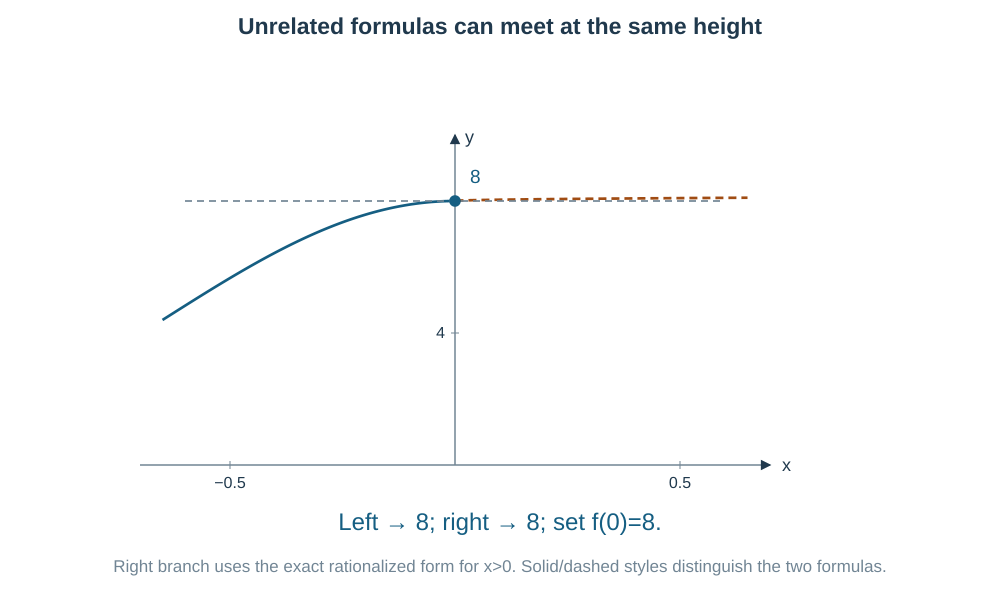

Both sides agree, so continuity requires $\boxed{a=8}$.
The function's value at zero is supplied separately; do not substitute zero into either original quotient.

### Question 11 — Count the input values that cross a floor step

**PDF page 49 | Numerical value | Notes: C06**

The number of points of discontinuity of $f(x)=[3x]$ in the interval $(0,2)$, where $[\cdot]$ is the greatest integer function, is ____.

**A floor jump occurs when its input crosses an integer.** Here the inside function $3x$ increases strictly. On $(0,2)$ its range is $(0,6)$.

The crossed integers are $1,2,3,4,5$, giving

$$
x=\frac13,\frac23,1,\frac43,\frac53.
$$

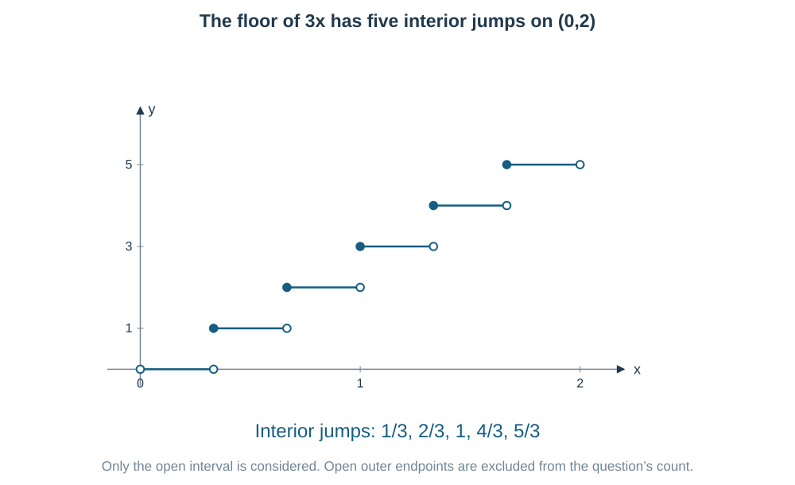

At each input, the left value approaches one less than the right value. There are $\boxed{5}$ discontinuities.

**Another possible check:** list the open intervals between consecutive multiples of $1/3$; the function is constant on each. The only possible discontinuities are their five interior boundaries.

### Question 12 — Distinguish f, its derivative and continuity of its derivative

**PDF page 49 | MCQ | Notes: C02,C06,C07**

Match List-I with List-II (all at $x=0$).

List-I: A. $f(x)=|x|$; B. $f(x)=x|x|$; C. $f(x)=[x]$; D. $f(x)=x^2\sin(1/x)$ for $x\ne0$, $f(0)=0$.

List-II: I. Discontinuous; II. Continuous but not differentiable; III. Differentiable and $f^\prime$ continuous; IV. Differentiable but $f^\prime$ not continuous.

- (a) A-II, B-III, C-I, D-IV
- (b) A-II, B-IV, C-I, D-III
- (c) A-I, B-III, C-II, D-IV
- (d) A-III, B-II, C-I, D-IV

**Use three separate tests: value limit, derivative quotient, then nearby derivative limit.**

- A: $|x|$ is continuous at zero, but its side slopes are $-1,1$: **II**.
- B: $x|x|$ has quotient $|h|\to0$, so $f'(0)=0$. For $x\ne0$, $f'(x)=2|x|\to0$, making $f'$ continuous: **III**.
- C: $[x]$ has left limit $-1$ and right limit $0$: **I**.
- D: $x^2\sin(1/x)$ has derivative at zero $0$, since its quotient is $h\sin(1/h)\to0$. But for $x\ne0$,
  $f'(x)=2x\sin(1/x)-\cos(1/x)$ has no limit at zero: **IV**.

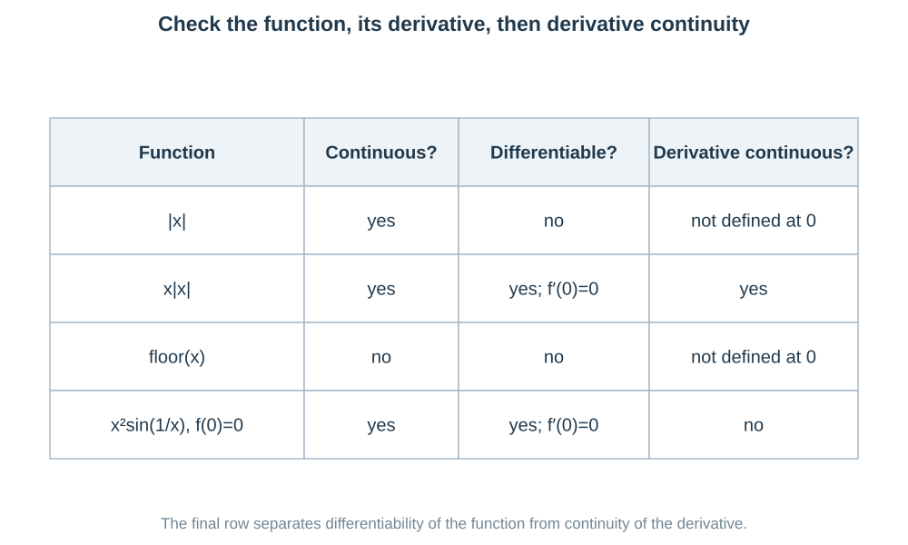

Thus $\boxed{\text{A-II, B-III, C-I, D-IV}}$, **option (a)**.

**Check D exactly:** at $x_n=1/(2\pi n)$ the nearby derivative is $-1$; at $y_n=1/((2n+1)\pi)$ it is $1$. Both sequences approach zero. This proves the failure of derivative continuity rather than relying on a drawn wiggle.

### Question 13 — Second parametric derivative needs division by dx over dt again

**PDF page 49 | MCQ | Notes: C09,C10**

If $x=t^2,\ y=t^3$, then $\dfrac{d^2y}{dx^2}$ at $t=2$ is

- (a) $\dfrac34$
- (b) $\dfrac32$
- (c) $\dfrac3{16}$
- (d) $\dfrac38$

**The requested second derivative is with respect to $x$, not $t$.** First,

$$
\frac{dy}{dx}=\frac{3t^2}{2t}=\frac{3t}{2}
\quad(t\ne0).
$$

Differentiate this slope with respect to $t$, then divide by $dx/dt$ again:

$$
\frac{d^2y}{dx^2}
=\frac{d(3t/2)/dt}{dx/dt}
=\frac{3/2}{2t}=\frac3{4t}.
$$

At $t=2$, $\boxed{3/8}$, **option (d)**.

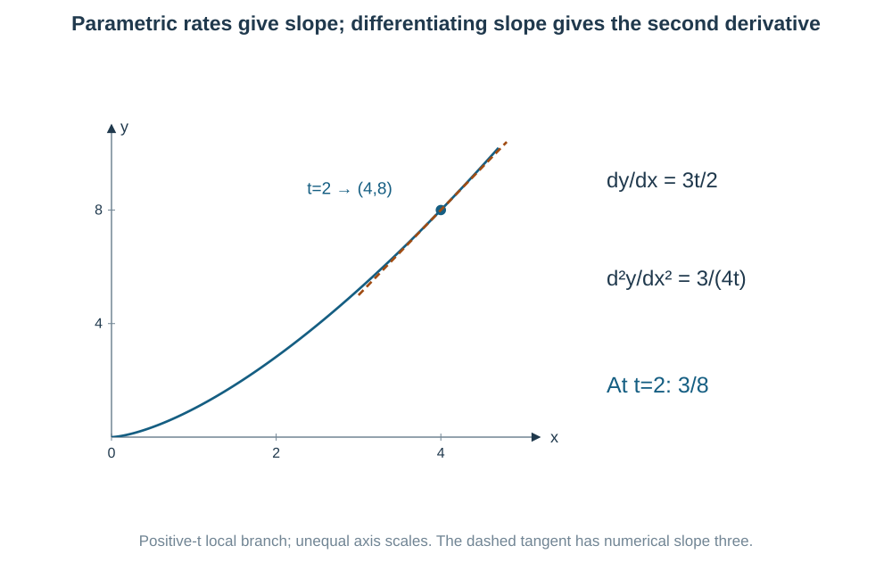

**Another possible approach:** locally $t>0$, so $y=x^{3/2}$.
Then $y''=(3/4)x^{-1/2}$; at $x=4$, it is $3/8$.
The positive-branch statement is needed before replacing $t$ by $\sqrt x$.

### Question 14 — Differentiate a variable power before substituting the point

**PDF page 49 | MCQ | Notes: C08**

If $y=x^{\sin x}$, then $\dfrac{dy}{dx}$ at $x=\pi/2$ equals

- (a) $1$
- (b) $0$
- (c) $\dfrac\pi2$
- (d) $\dfrac2\pi$

**The exponent $\sin x$ also changes, so use logs.** On $x>0$,

$$
\ln y=\sin x\ln x
\quad\Rightarrow\quad
y'=x^{\sin x}\left(\cos x\ln x+\frac{\sin x}{x}\right).
$$

At $x=\pi/2$, $\sin x=1$ and $\cos x=0$:

$$
y'=\frac\pi2\left(0+\frac2\pi\right)
=\boxed{1}\quad\text{(a)}.
$$

**Another possible approach:** write $y=e^{\sin x\ln x}$ and apply the chain rule. Substituting $\sin(\pi/2)=1$ into the function *before* differentiating would wrongly ignore the exponent's nearby variation. The full derivative above shows why its contribution happens to vanish at this particular point.

### Question 15 — Differentiability is the stronger condition

**PDF page 49 | MCQ | Notes: C02**

Statement I: If a function is continuous at $x=a$, then it is differentiable at $x=a$.

Statement II: If a function is differentiable at $x=a$, then it is continuous at $x=a$. Choose the correct option.

- (a) Both Statement I and Statement II are true
- (b) Statement I is true but Statement II is false
- (c) Statement I is false but Statement II is true
- (d) Both Statement I and Statement II are false

**One counterexample settles Statement I.** The function $|x|$ is continuous at zero but has side slopes $-1$ and $1$, so it is not differentiable there. Statement I is false.

Statement II is true. If the derivative at $a$ is finite, write

$$
f(a+h)-f(a)
=h\frac{f(a+h)-f(a)}h\to0.
$$

So $f(a+h)\to f(a)$, which is continuity.
Therefore $\boxed{\text{option (c)}}$.

The reverse implication cannot be obtained by reversing this proof; a product tending to zero does not force its quotient factor to have a limit.

### Question 16 — An exact identity makes the cubic limit a product

**PDF page 49 | MCQ | Notes: C03**

$\displaystyle\lim_{x\to0}\frac{\tan x-\sin x}{x^3}$ equals

- (a) $1$
- (b) $\dfrac16$
- (c) $\dfrac12$
- (d) $0$

**Turn the difference into two known small factors:**

$$
\tan x-\sin x=\tan x(1-\cos x).
$$

Then

$$
\frac{\tan x-\sin x}{x^3}
=\frac{\tan x}{x}\frac{1-\cos x}{x^2}
\longrightarrow1\cdot\frac12
=\boxed{\frac12}\quad\text{(c)}.
$$

**Another possible approach:** subtract
$\tan x=x+x^3/3+O(x^5)$ and
$\sin x=x-x^3/6+O(x^5)$.
The cubic coefficient is $1/3+1/6=1/2$.
First-order approximations alone would cancel the information needed.

### Question 17 — Use logs for the positive cosine power

**PDF page 50 | MCQ | Notes: C08**

$\displaystyle\lim_{x\to0}(\cos x)^{1/x^2}$ equals

- (a) $e^{1/2}$
- (b) $1$
- (c) $e^{-1/2}$
- (d) $e^{-2}$

**Check the real base, then take logs.** For small $|x|$, $\cos x>0$.
Let $Y=(\cos x)^{1/x^2}$. Then

$$
\ln Y=\frac{\ln\cos x}{x^2}.
$$

With $u=\cos x-1$, the exact product is

$$
\frac{\ln(1+u)}u\frac{\cos x-1}{x^2}
\longrightarrow1\cdot\left(-\frac12\right).
$$

Therefore $\boxed{Y\to e^{-1/2}}$, **option (c)**.

**Another possible approach:** after verifying a $0/0$ form and the derivative conditions,
$\lim\ln(\cos x)/x^2=\lim(-\tan x)/(2x)=-1/2$.
The standard-limit product above avoids a derivative-rule detour.

### Question 18 — Match the height first, then the slope

**PDF page 50 | MCQ | Notes: C01,C02**

Let $f(x)=\begin{cases}x^2,&x\le1,\\ax+b,&x>1\end{cases}$ be differentiable at $x=1$. Then $a-b$ equals

- (a) $3$
- (b) $1$
- (c) $2$
- (d) $-1$

**Differentiability requires a good height join before a slope join.** The left piece gives $f(1)=1$; the right limiting height is $a+b$. Thus

$$
a+b=1.
$$

The derivative of $x^2$ at $1$ is $2$, while the right straight line has slope $a$. Matching them gives $a=2$, hence $b=-1$.

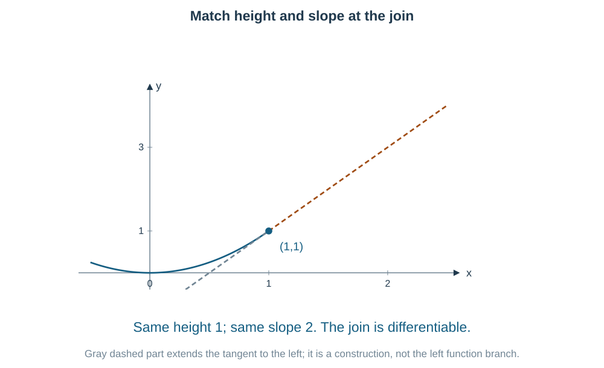

Therefore $\boxed{a-b=2-(-1)=3}$, **option (a)**.

**Another possible approach:** form the right quotient directly:

$$
\frac{a(1+h)+b-1}{h}
=\frac{a+b-1}{h}+a.
$$

A finite two-sided derivative first forces $a+b-1=0$, then gives right slope $a$, which must equal $2$. This shows why matching slopes alone would miss continuity.

### Question 19 — A zero multiplier can remove a modulus corner

**PDF page 50 | Numerical value | Notes: C06**

The number of points in $\mathbb R$ at which $f(x)=(x^2-1)|x^2-3x+2|+\sin|x|$ is not differentiable is ____.

**List candidates, then test whether each corner survives.** The modulus polynomial factors as $(x-1)(x-2)$, so its candidates are $1,2$. The term $\sin|x|$ also needs checking at $0$. Away from $0,1,2$, all pieces are smooth.

At $x=1$, put $h=x-1$. For small $|h|$,

$$
(x^2-1)|x^2-3x+2|
=h(2+h)\,|h|(1-h).
$$

This has the form $h|h|$ times a smooth factor. Its derivative at $h=0$ is zero, so the multiplier removes the potential corner. The other term is $\sin x$ nearby and is differentiable.

At $x=2$, put $h=x-2$:

$$
(x^2-1)|x^2-3x+2|
=(3+4h+h^2)(1+h)|h|.
$$

Its leading term is $3|h|$, whose side slopes are $-3$ and $3$. Adding the smooth $\sin x$ shifts both slopes by $\cos2$; it cannot remove their difference.

At $x=0$, the polynomial/modulus part is smooth, while $\sin|x|$ has side slopes $-1,1$. This corner survives too.

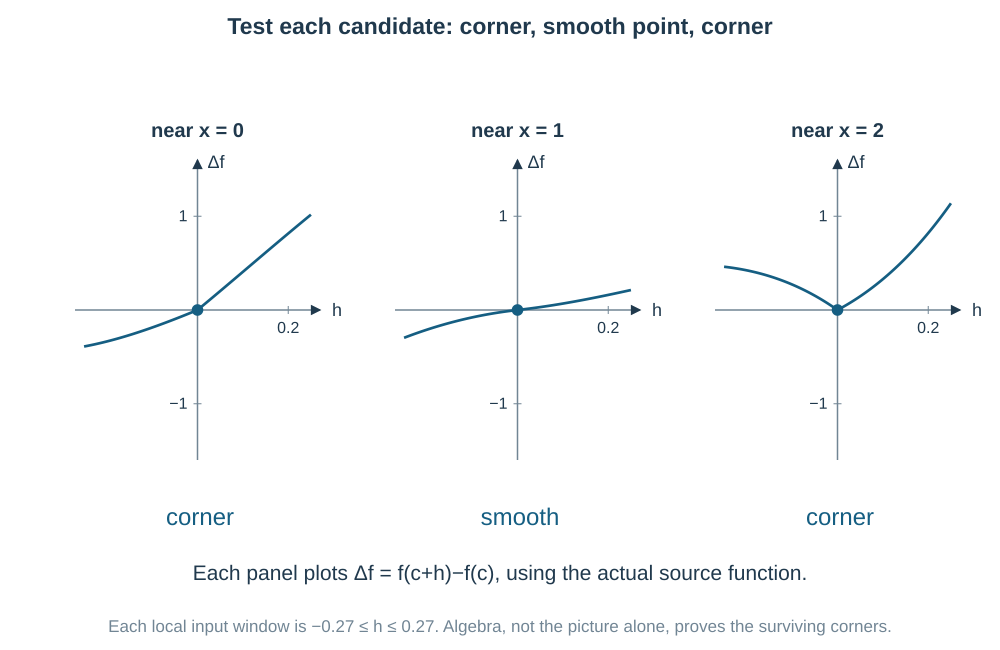

Hence the non-differentiable inputs are exactly $\{0,2\}$:
$\boxed{2}$.

**Another possible approach:** expand the absolute value with fixed signs on
$(-\infty,1),(1,2),(2,\infty)$ and compare one-sided derivatives at $1,2$, then inspect $0$ separately. It works; the local factor forms above make the cancellation at $1$ easier to see.

### Question 20 — A small function can have an oscillating derivative

**PDF page 50 | MCQ | Notes: C07**

Consider $f(x)=x\sin(1/x)$, $g(x)=x^2\sin(1/x)$ for $x\ne0$, with $f(0)=g(0)=0$.

(A) $f$ is continuous at $0$.

(B) $f$ is differentiable at $0$.

(C) $g$ is differentiable at $0$.

(D) $g^\prime$ is continuous at $0$.

Choose the correct answer.

- (a) (A) and (C) only
- (b) (A), (B) and (C) only
- (c) (B) and (D) only
- (d) (A), (C) and (D) only

**Test the definition at zero before using a formula valid only away from zero.**

(A) True: $|x\sin(1/x)|\le|x|\to0=f(0)$.

(B) False:

$$
\frac{f(h)-f(0)}h=\sin(1/h)
$$

has no limit. For example, sequences with $1/h=\pi/2+2\pi n$ and
$1/h=3\pi/2+2\pi n$ give outputs $1$ and $-1$.

(C) True:

$$
\frac{g(h)-g(0)}h=h\sin(1/h)\to0,
\qquad g'(0)=0.
$$

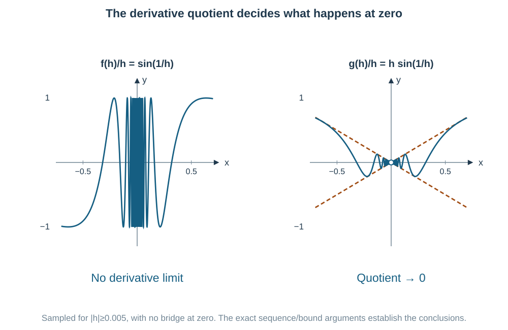

(D) False: for $x\ne0$,

$$
g'(x)=2x\sin(1/x)-\cos(1/x).
$$

Along $x_n=1/(2\pi n)$ this is $-1$, and along
$y_n=1/((2n+1)\pi)$ it is $1$. It does not approach $g'(0)=0$.

Thus $\boxed{\text{(A) and (C) only}}$, **option (a)**.
This also shows why the nearby formula for $g'$ cannot be used as a substitute for finding $g'(0)$ from the definition.

### Question 21 — Rationalize the inner half-angle expression

**PDF page 50 | MCQ | Notes: C05**

If $y=\tan^{-1}\!\left(\dfrac{\sqrt{1+x^2}-1}{x}\right)$, then $8\,\dfrac{dy}{dx}$ at $x=1$ is

- (a) $1$
- (b) $2$
- (c) $4$
- (d) $8$

**The root-minus-one suggests rationalizing first:**

$$
\frac{\sqrt{1+x^2}-1}{x}
=\frac{x}{\sqrt{1+x^2}+1}\qquad(x\ne0).
$$

Put $\theta=\tan^{-1}x\in(-\pi/2,\pi/2)$. Since $\cos\theta>0$,
the last expression is $\sin\theta/(1+\cos\theta)=\tan(\theta/2)$.
The half-angle is in the principal arctangent range, so

$$
y=\frac12\tan^{-1}x,\qquad
y'=\frac1{2(1+x^2)}.
$$

At $x=1$, $y'=1/4$. The requested value is
$\boxed{8y'=2}$, **option (b)**.

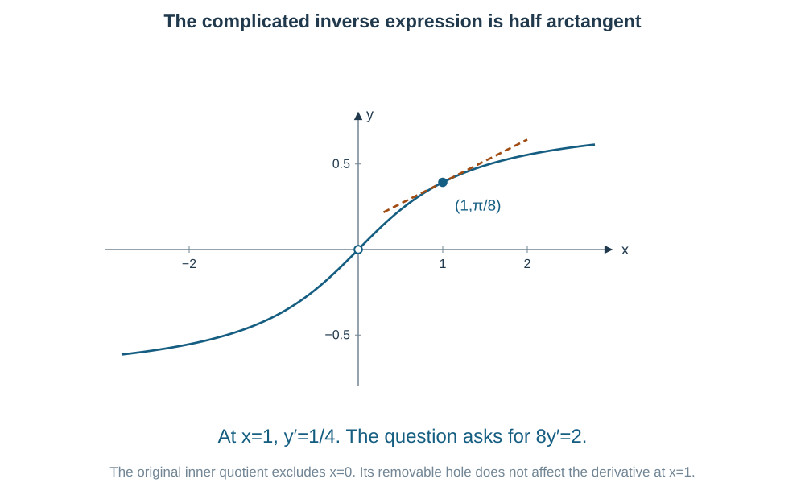

**Another possible approach:** with $r=\sqrt{1+x^2}$ and $u=x/(r+1)$,
$u'=1/[r(r+1)]$ and $1+u^2=2r/(r+1)$.
Thus $y'=u'/(1+u^2)=1/(2r^2)$, the same result without an angle substitution.

### Question 22 — The inverse derivative uses the corresponding input

**PDF page 50 | MCQ | Notes: C11**

If $f(x)=x^3+x+1$ and $g=f^{-1}$, then $g^\prime(3)$ equals

- (a) $4$
- (b) $\dfrac13$
- (c) $\dfrac17$
- (d) $\dfrac14$

**The requested input $3$ for the inverse is an output of $f$. Find its matching input first:**

$$
f(1)=1+1+1=3,\qquad g(3)=1.
$$

Also $f'(x)=3x^2+1>0$, so the real inverse is single valued, and $f'(1)=4\ne0$.

Therefore

$$
\boxed{g'(3)=\frac1{f'(1)}=\frac14}\quad\text{(d)}.
$$

**Another possible approach:** differentiate
$g(y)^3+g(y)+1=y$:
$(3g(y)^2+1)g'(y)=1$. Put $y=3$, $g(3)=1$.
There is no need to solve the whole cubic inverse.

### Question 23 — Two joins give two continuity equations

**PDF page 50 | MCQ | Notes: C01**

The values of $a,b$ for which $f(x)=\begin{cases}5,&x\le2,\\ax+b,&2<x<10,\\21,&x\ge10\end{cases}$ is continuous on $\mathbb R$ are

- (a) $a=1,b=3$
- (b) $a=2,b=1$
- (c) $a=2,b=-1$
- (d) $a=3,b=-1$

**Only the two joins need checking.** Each piece is continuous inside its own interval.

At $x=2$, the value and left height are $5$, so $2a+b=5$.
At $x=10$, the value and right height are $21$, so $10a+b=21$.

$$
(10a+b)-(2a+b)=21-5
\quad\Rightarrow\quad8a=16,\quad a=2,\quad b=1.
$$

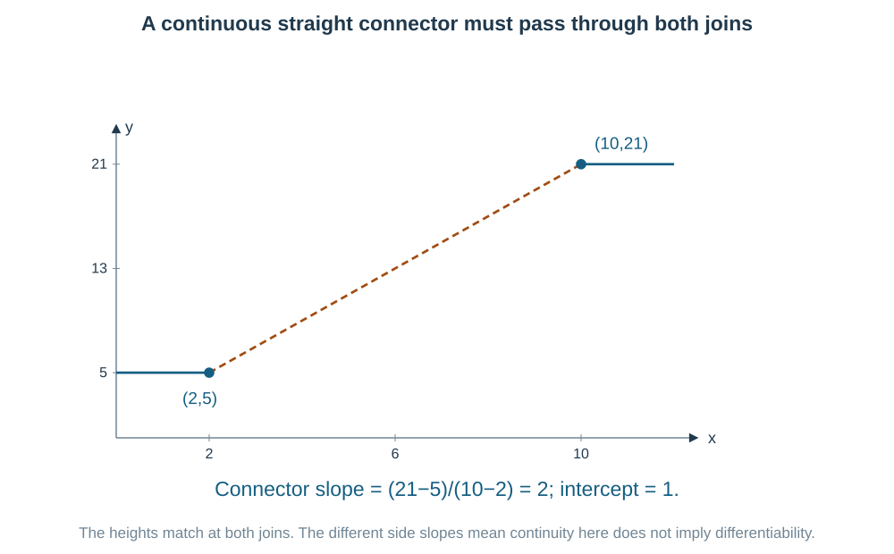

Thus $\boxed{a=2,\ b=1}$, **option (b)**.

**Another possible approach:** the line through the two join points has slope
$(21-5)/(10-2)=2$, then intercept $5-2(2)=1$.
The finished function is continuous, although its slopes change at the joins; differentiability was not required.

### Question 24 — Differentiate products and combine before comparing options

**PDF page 50 | MCQ | Notes: C03,C10**

If $y=e^x\sin x$, then

- (a) $y^{\prime\prime}+2y^\prime+2y=0$
- (b) $y^{\prime\prime}-2y^\prime+2y=0$
- (c) $y^{\prime\prime}-2y^\prime-2y=0$
- (d) $y^{\prime\prime}+y=0$

**The product rule is needed twice:**

$$
y'=e^x\sin x+e^x\cos x=e^x(\sin x+\cos x).
$$

Then

$$
y''=e^x(\sin x+\cos x)+e^x(\cos x-\sin x)
=2e^x\cos x.
$$

Substitute into the candidate combination:

$$
y''-2y'+2y
=2e^x\cos x-2e^x(\sin x+\cos x)+2e^x\sin x=0.
$$

Hence $\boxed{\text{option (b)}}$.

**Another useful check:** if $y=e^xu$, then
$y''-2y'+2y=e^x(u''+u)$. Here $u=\sin x$ has $u''+u=0$.
This groups the same derivatives and explains the repeated coefficients; solving an equation is not needed.

### Question 25 — Apply the product rule twice

**PDF page 50 | Numerical value | Notes: C03,C10**

If $y=x^2\ln x$, then $\dfrac{d^2y}{dx^2}$ at $x=e$ is ____.

**Differentiate the product before evaluating $x=e$.** On $x>0$,

$$
y'=2x\ln x+x,\qquad
y''=2\ln x+2+1=2\ln x+3.
$$

Since $\ln e=1$,

$$
\boxed{y''(e)=2+3=5}.
$$

The second $+2$ comes from differentiating $2x\ln x$ with the product rule. Forgetting it is a common source of the answer $3$.

### Question 26 — Equal endpoint heights guarantee a horizontal tangent

**PDF page 51 | MCQ | Notes: C12**

For $f(x)=e^{-x}\sin x$ on $[0,\pi]$, the value of $c$ guaranteed by Rolle's theorem is

- (a) $\dfrac\pi2$
- (b) $\dfrac\pi3$
- (c) $\dfrac{3\pi}4$
- (d) $\dfrac\pi4$

**Source extension — verify Rolle's conditions first.** The exponential and sine are smooth, and
$f(0)=f(\pi)=0$.

$$
f'(x)=-e^{-x}\sin x+e^{-x}\cos x
=e^{-x}(\cos x-\sin x).
$$

Since $e^{-x}\ne0$, $f'(c)=0$ means $\cos c=\sin c$.
Within $(0,\pi)$, the unique solution is $c=\pi/4$.

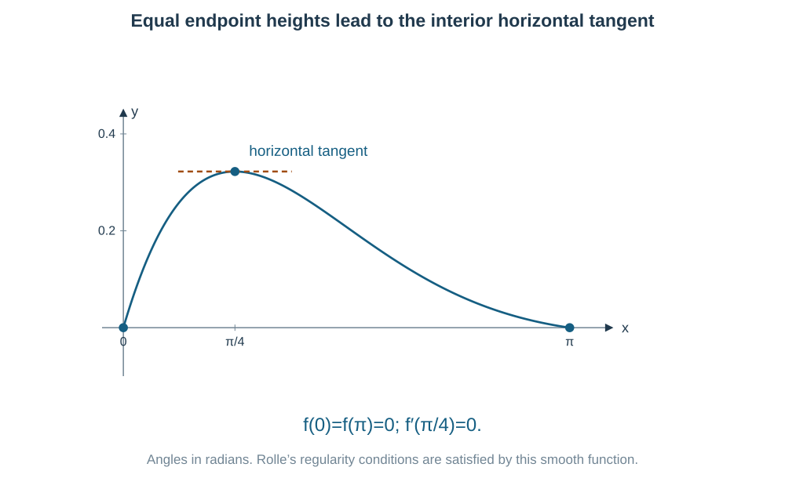

Thus $\boxed{\pi/4}$, **option (d)**.

**Another possible check:** $\tan c=1$ has solutions $\pi/4+k\pi$. The interval selects only $\pi/4$. Checking the interval prevents accepting a root outside the theorem's conclusion.

### Question 27 — Different one-sided slopes explain the failure

**PDF page 51 | MCQ | Notes: C02**

Assertion (A): $f(x)=|x|$ is not differentiable at $x=0$.

Reason (R): The left hand derivative $(-1)$ and the right hand derivative $(1)$ of $|x|$ at $x=0$ are not equal.

Choose the correct option.

- (a) Both A and R are true and R is the correct explanation of A
- (b) Both A and R are true but R is not the correct explanation of A
- (c) A is true but R is false
- (d) A is false but R is true

**The reason gives exactly the definition's failure.**

$$
f'_-(0)=\lim_{h\to0^-}\frac{|h|}{h}=-1,\qquad
f'_+(0)=\lim_{h\to0^+}\frac{|h|}{h}=1.
$$

A derivative needs both to be the same finite number. Thus A and R are true, and R correctly explains A:
$\boxed{\text{option (a)}}$.

### Question 28 — A product difference becomes three standard limits

**PDF page 51 | Numerical value | Notes: C03**

$\displaystyle\lim_{x\to0}\frac{1-\cos x\cos2x\cos3x}{x^2}=$ ____.

**The three cosine factors are near one. Split their combined loss:**

$$
1-ABC=(1-A)+A(1-B)+AB(1-C).
$$

Set $A=\cos x,B=\cos2x,C=\cos3x$, then divide by $x^2$:

$$
\lim\frac{1-ABC}{x^2}
=\frac12+1\cdot\frac{2^2}{2}
+1\cdot1\cdot\frac{3^2}{2}
=\boxed{7}.
$$

We used $(1-\cos kx)/x^2\to k^2/2$ in radians.

**Another possible approach:** multiply the three local expansions
$1-k^2x^2/2+O(x^4)$. Their quadratic losses add:
$ABC=1-7x^2+O(x^4)$. Products of two losses only appear at order $x^4$, so they do not affect this limit.

### Question 29 — Choose the hole value inside the logarithm domain

**PDF page 51 | MCQ | Notes: C01,C04**

If $f(x)=\begin{cases}\big(\ln(1+2x)-\ln(1-3x)\big)/x,&x\ne0,\\k,&x=0\end{cases}$ is continuous at $x=0$, then $k$ equals

- (a) $5$
- (b) $1$
- (c) $6$
- (d) $-1$

**Find the nearby height within the real log domain.** Both log arguments must be positive:

$$
1+2x>0,\quad1-3x>0
\quad\Rightarrow\quad-\frac12<x<\frac13.
$$

This interval includes both sides of zero. For $x\ne0$,

$$
\frac{\ln(1+2x)-\ln(1-3x)}x
=2\frac{\ln(1+2x)}{2x}
+3\frac{\ln(1-3x)}{-3x}
\longrightarrow2+3=5.
$$

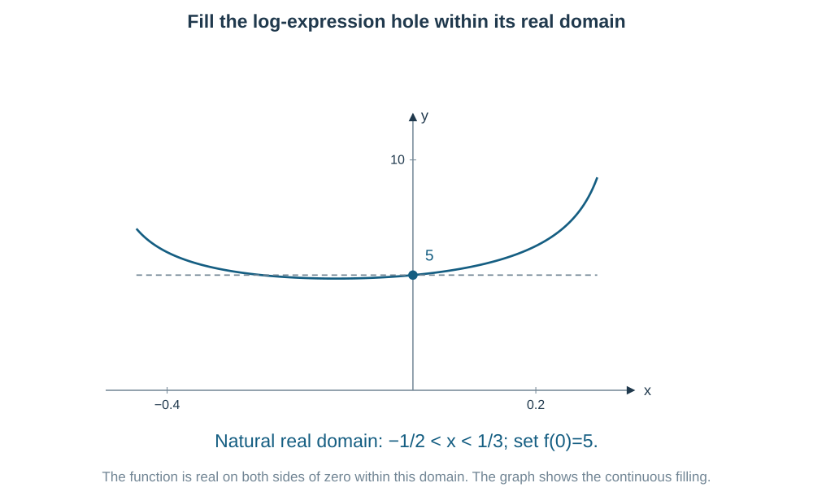

Thus $\boxed{k=5}$, **option (a)**.

**Another possible approach:** the numerator is $5x+O(x^2)$ by the two log expansions.
The minus before the second logarithm changes its $-3x$ term to $+3x$.

### Question 30 — A principal inverse only undoes the allowed triple angle

**PDF page 51 | MCQ | Notes: C05**

For $|x|<1/2$, $\dfrac d{dx}\sin^{-1}(3x-4x^3)$ equals

- (a) $\dfrac{-3}{\sqrt{1-x^2}}$
- (b) $\dfrac1{\sqrt{1-x^2}}$
- (c) $\dfrac3{\sqrt{1-x^2}}$
- (d) $\dfrac{3x}{\sqrt{1-x^2}}$

**The polynomial is a triple-angle sine.** Set $\theta=\sin^{-1}x$.
The condition $|x|<1/2$ gives $|\theta|<\pi/6$, so
$3\theta$ stays inside the principal arcsine interval.

$$
3x-4x^3=\sin3\theta
\quad\Rightarrow\quad
\sin^{-1}(3x-4x^3)=3\theta=3\sin^{-1}x.
$$

Differentiate:

$$
\boxed{\frac3{\sqrt{1-x^2}}}\quad\text{(c)}.
$$

**Another possible approach:** chain differentiation gives

$$
\frac{3(1-4x^2)}
{\sqrt{1-(3x-4x^3)^2}}
=\frac{3(1-4x^2)}
{\sqrt{1-x^2}|1-4x^2|}.
$$

The printed bound makes $1-4x^2>0$, so it simplifies to the same answer. The absolute value is the algebraic reminder of the branch restriction.

### Question 31 — The mean slope selects the tangent location

**PDF page 51 | Numerical value | Notes: C12**

If $c$ is the point in $(1,3)$ given by the mean value theorem for $f(x)=x+1/x$ on $[1,3]$, then $c^2=$ ____.

**Source extension — match the average slope with an interior tangent.**
The function is continuous on $[1,3]$ and differentiable inside because zero is outside the interval.

$$
\frac{f(3)-f(1)}{3-1}
=\frac{(3+1/3)-(1+1)}2=\frac23.
$$

Since $f'(c)=1-1/c^2$, the mean value theorem gives

$$
1-\frac1{c^2}=\frac23
\quad\Rightarrow\quad\boxed{c^2=3}.
$$

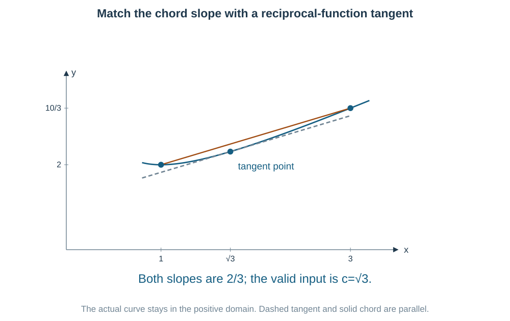

**Check:** $c=\sqrt3\in(1,3)$; the negative square root is outside the interval. The target is $c^2$, so no decimal approximation is needed.

### Question 32 — Moving modulus inside sine still leaves a corner

**PDF page 51 | MCQ | Notes: C06**

Statement I: $f(x)=\sin|x|$ is differentiable at $x=0$.

Statement II: $f(x)=|\sin x|$ is not differentiable at $x=0$.

Choose the correct option.

- (a) Both Statement I and Statement II are true
- (b) Statement I is true but Statement II is false
- (c) Statement I is false but Statement II is true
- (d) Both Statement I and Statement II are false

**A smooth sine does not automatically remove the modulus corner.** For the first function,

$$
\frac{\sin|h|-\sin0}{h}
=\begin{cases}-\sin h/h,&h<0,\\\sin h/h,&h>0.\end{cases}
$$

Its side limits are $-1,1$, so Statement I is false.
For sufficiently small $h$, $\sin h$ has the sign of $h$. Hence
$|\sin h|/h$ has those same side limits, so Statement II is true.

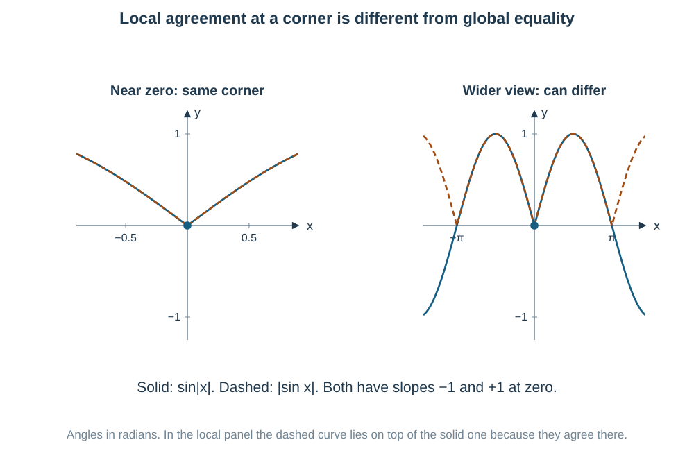

Therefore $\boxed{\text{option (c)}}$.

**Another possible view:** near zero, both functions behave like $|x|$ to first order. The displayed quotients prove the slopes exactly. Do not replace that local equality by a claim that the two functions are identical on all real inputs.

### Question 33 — Rational and irrational inputs can approach the same point

**PDF page 51 | Numerical value | Notes: C13**

Let $f(x)=x^2$ if $x$ is rational and $f(x)=5x-6$ if $x$ is irrational. The sum of all the points where $f$ is continuous is ____.

**Both types of input occur arbitrarily close to any real $a$.** Along rational inputs the output tends to $a^2$; along irrational inputs it tends to $5a-6$.
Continuity therefore requires the two heights to match:

$$
a^2=5a-6
\quad\Rightarrow\quad
(a-2)(a-3)=0.
$$

**Check sufficiency too:** at $a=2$ or $3$, both polynomial branches approach the same common value, and the assigned value equals it. Thus these points really are continuous, not merely candidates.

The requested sum is $\boxed{2+3=5}$.

A graph alone would not prove this result: a finite plot cannot display the density of both input sets. The two branch limits are the decisive argument.

### Question 34 — Check whether all the given facts can hold together

**PDF page 51 | MCQ | Notes: C14**

Let $f:\mathbb R\to\mathbb R$ be differentiable with $f(x+y)=f(x)f(y)$, $f^\prime(0)=3$ and $f(5)=2$. Then $f^\prime(5)$ equals

- (a) $3$
- (b) $5$
- (c) $6$
- (d) $10$

**Source correction — the printed conditions cannot all hold together.** First see where the intended option comes from.
Putting $y=0$ and using $f(5)=2\ne0$ gives $f(0)=1$. For any real $x$,

$$
\begin{aligned}
f'(x)
&=\lim_{h\to0}\frac{f(x+h)-f(x)}h\\
&=f(x)\lim_{h\to0}\frac{f(h)-1}h
=3f(x).
\end{aligned}
$$

Substituting the printed $f(5)=2$ formally gives $f'(5)=6$, the **intended option (c)**.

**Now check that a function with those facts exists.** Define
$H(x)=e^{-3x}f(x)$. Then

$$
H'(x)=e^{-3x}(f'(x)-3f(x))=0.
$$

So $H$ is constant; $H(0)=f(0)=1$. It follows that

$$
f(x)=e^{3x},\qquad f(5)=e^{15}\ne2.
$$

Therefore **no differentiable real function satisfies all the printed givens**. Record the intended local answer $6$ for comparison with the key, while keeping this consistency correction.

The check uses only product differentiation and the zero-derivative-implies-constant result; it does not require a new differential-equations chapter.

### Question 35 — Divide the parameter rates only when the x-rate is nonzero

**PDF page 52 | MCQ | Notes: C09**

If $x=a(\theta+\sin\theta),\ y=a(1-\cos\theta)$, then $\dfrac{dy}{dx}$ at $\theta=\pi/3$ is

- (a) $\dfrac1{\sqrt3}$
- (b) $\sqrt3$
- (c) $1$
- (d) $\dfrac12$

**The parameter controls both coordinates. Compare their rates with respect to the same parameter:**

$$
\frac{dx}{d\theta}=a(1+\cos\theta),\qquad
\frac{dy}{d\theta}=a\sin\theta.
$$

For $a\ne0$ at $\theta=\pi/3$, the x-rate is $3a/2\ne0$. Hence

$$
\frac{dy}{dx}
=\frac{a\sin\theta}{a(1+\cos\theta)}
=\frac{\sqrt3/2}{3/2}
=\boxed{\frac1{\sqrt3}}\quad\text{(a)}.
$$

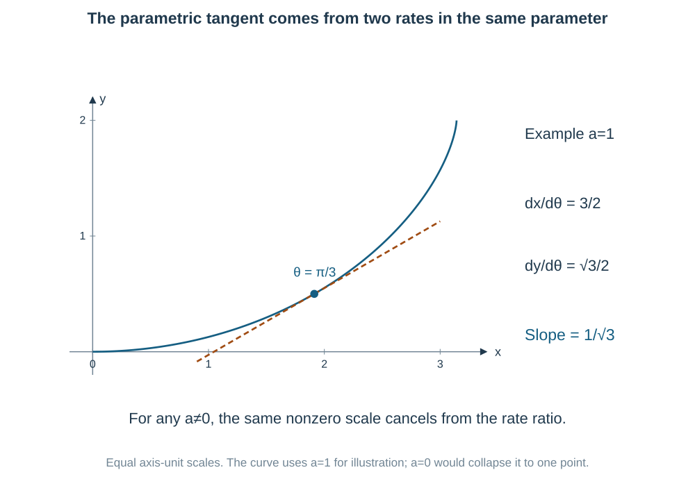

**Another possible approach:** $\sin\theta/(1+\cos\theta)=\tan(\theta/2)$, so the slope is
$\tan(\pi/6)=1/\sqrt3$.

**Condition omitted in the source:** if $a=0$, both coordinates are always zero. There is only a fixed point, and cancelling $a$ would divide by zero. The keyed answer applies for nonzero $a$, conventionally a positive radius.

## Answer check

Original formats and option order are retained. **Q34 is inconsistent as printed; its intended formal option is identified separately. Q35 needs $a\ne0$.**

| Question | Answer | Question | Answer |
|---|---|---|---|
| 1 | (c) $3$ | 19 | $2$ |
| 2 | (a) $3/2$ | 20 | (a) |
| 3 | $4$ | 21 | (b) $2$ |
| 4 | (b) | 22 | (d) $1/4$ |
| 5 | $2$ | 23 | (b) $a=2,b=1$ |
| 6 | (d) $4(1+\ln2)$ | 24 | (b) |
| 7 | $11$ | 25 | $5$ |
| 8 | (b) $2/\sqrt3$ | 26 | (d) $\pi/4$ |
| 9 | (b) | 27 | (a) |
| 10 | $8$ | 28 | $7$ |
| 11 | $5$ | 29 | (a) $5$ |
| 12 | (a) | 30 | (c) $3/\sqrt{1-x^2}$ |
| 13 | (d) $3/8$ | 31 | $3$ |
| 14 | (a) $1$ | 32 | (c) |
| 15 | (c) | 33 | $5$ |
| 16 | (c) $1/2$ | 34 | Intended (c) $6$; no function satisfies all printed conditions |
| 17 | (c) $e^{-1/2}$ | 35 | (a) $1/\sqrt3$ for $a\ne0$ |
| 18 | (a) $3$ |  |  |

## Coverage and source notes

All $35$ supplied questions appear in order: $25$ MCQs and $10$ numerical-value questions. All intended source answers have been independently checked, with these qualifications:

- Q34's formal local calculation gives the keyed $6$, but the complete data contradict the forced exponential. There is no such differentiable real function.
- Q35's slope applies for $a\ne0$. The zero-scale case is a fixed point.
- Q7, Q8, Q26 and Q31 are retained mean-value-theorem source extensions, not labelled as new core syllabus requirements.
- The printed inverse-trig restrictions and natural log domains are retained. A finite sample plot is never used to prove dense-input or infinitely oscillating behaviour.

The recent category mean $51/58$ follows PYQSide's Continuity and Differentiability classification. Its separate Limits and Derivatives category and ExamSIDE's LCD/Differentiation split use different boundaries. No category datasets were merged. Research is a recent archive-card recount, not an independent exhaustive $2020$–$2026$ official-paper or formula-frequency audit.

## Offline research record

- Supplied Maths Predicted V1.pdf: questions on pages 48–52, key on page 52, working on pages 52–53. All stems/options were read visually.
- NTA, Syllabus for JEE Main 2027, Mathematics Unit 7: continuity, differentiability, composite/implicit derivatives and order-two derivatives checked; mean value theorems are not named there.
- PYQSide, Continuity and Differentiability: all $51$ recent question-card IDs across two pages saved and recounted.
- PYQSide, Limits and Derivatives and Mathematics Weightage: category boundary, zero ID overlap and full-year denominator checks.
- ExamSIDE, Limits, Continuity and Differentiability, and Differentiation: classification comparison, not added to the chosen category.

All diagrams are original local SVGs with explicit inputs. Graphs respect holes, actual point values, separate branches and labelled sampling limits. All alternatives are visible ordinary content for the future printed booklet.
