# Application of Derivatives — JEE Main revision guide

*The derivative tells how fast an output changes. On a graph it tells the slope. That one idea helps us find rising parts, falling parts, best values, and rates in changing shapes.*

> **For Kanna | Chapter 11**  
> Goal: about $120/300$ towards $200/300$ — Physics $60$, Maths $60$, Chemistry $80$.  
> Meaning first, then formulas, a short recap, and all $35$ source questions. All useful second approaches are visible.

## Recent chapter weightage

**ExamSIDE's Application of Derivatives category gives $50/58\approx0.86$ questions per Paper 1 in 2024–2026.**

| Year | Full-year papers | Chapter questions | Questions per paper |
|---|---:|---:|---:|
| $2024$ | $20$ | $25$ | $1.25$ |
| $2025$ | $19$ | $14$ | $0.74$ |
| $2026$ | $19$ | $11$ | $0.58$ |
| Together | $58$ | $50$ | $0.86$ |

All $50$ distinct archive question IDs were saved and recounted. PYQSide's comparison counts are $24,12,10$; we do not merge the two classifications. These are named archive counts, not NTA chapter labels or a fresh classification of every official paper. The offered-question format differed in $2024$. A mean does not promise a question in a particular shift.

**Study priority:** derivative sign tables; local versus absolute best values; constraints and domains in optimization; rates with units; parameter conditions for increase. These priorities are teaching judgments, not measured formula-frequency ranks.

## Source and syllabus details before studying

Current official Mathematics Unit 7 names rate of change, increasing/decreasing functions, and maxima/minima. The source also asks tangents/normals, differentials, inflection points and Rolle's theorem. We retain and teach every supplied question. Those extra tools are labelled **supporting source extensions** rather than separately named current-syllabus topics.

No answer-key error was found in these $35$ questions. Watch three wording details: a **value** is $f(x)$, not its input $x$; a downward **speed** is positive though the height rate is negative; and an **approximation** is not an exact finite change.

## Concept C01 — What the derivative actually measures

Think of a walk. Time is the input; distance travelled is the output. “Two metres each second” compares output change with input change. For a graph $y=f(x)$, a small step $h$ gives average slope

$$
\frac{f(x+h)-f(x)}h.
$$

Shrink the step towards zero:

$$
f'(x)=\lim_{h\to0}\frac{f(x+h)-f(x)}h.
$$

This is the instantaneous rate and the tangent slope. It is a number at one input, and a function when the input can vary.

- $f'(x)>0$: a small move to the right raises the graph.
- $f'(x)<0$: a small move to the right lowers it.
- $f'(x)=0$: the tangent is horizontal. We still need to check whether the graph turns.

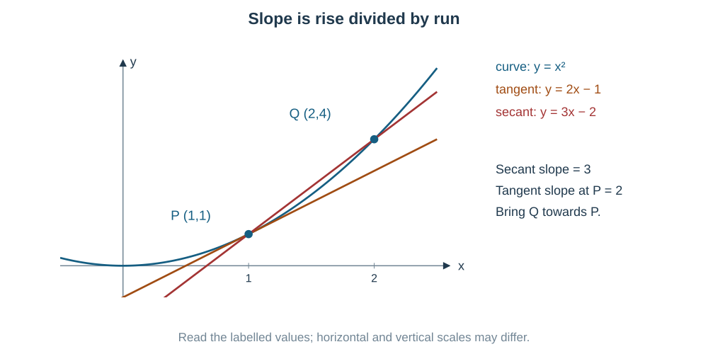

**Quick derivative toolbox — Important for JEE Main.** Use radians for trig derivatives.

$$
\begin{gathered}
(x^n)'=nx^{n-1},\quad (e^x)'=e^x,\quad
(\ln x)'=\frac1x\ (x>0),\\
(\sin x)'=\cos x,\quad(\cos x)'=-\sin x,\quad
(\tan x)'=\sec^2x,\\
(uv)'=u'v+uv',\qquad
\left(\frac uv\right)'=\frac{u'v-uv'}{v^2}\ (v\ne0),\\
[F(g(x))]'=F'(g(x))g'(x).
\end{gathered}
$$

The last rule says: **outer change multiplied by inner change**. For $V(r(t))$, it becomes $dV/dt=(dV/dr)(dr/dt)$. Do not drop the second factor.

If position is $s(t)$, velocity $v=ds/dt$ and acceleration $a=dv/dt$. Speed is $|v|$. For $v\ne0$, speed rises when $va>0$ and falls when $va<0$: velocity and acceleration in the same direction increase speed. This connects the maths rate to a physical meaning.

## Concept C02 — Tangent, normal and contact

**Supporting source extension.** A tangent is the straight line with the curve's slope at the chosen point. It can cross the curve elsewhere. A normal is the line at right angles to that tangent.

At $P(x_0,y_0)$ on $y=f(x)$ with finite slope $m=f'(x_0)$:

$$
\boxed{y-y_0=m(x-x_0)}\quad\text{tangent}.
$$

For $m\ne0$:

$$
\boxed{y-y_0=-\frac1m(x-x_0)}\quad\text{normal}.
$$

Why the minus reciprocal? Direction vectors $(1,m)$ and $(m,-1)$ have dot product $m-m=0$. They are perpendicular. If $m=0$, the normal is **vertical**, $x=x_0$; do not divide by zero. A vertical tangent, where established, has a horizontal normal.

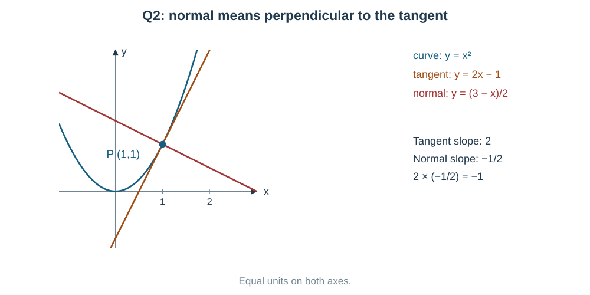

For an implicit curve $F(x,y)=0$, differentiate both sides while treating $y$ as depending on $x$. Example: $y^2=4x$ gives $2yy'=4$, so $y'=2/y$ when $y\ne0$.

**Question clues and equations**

| Clue | What it means | Equation to use |
|---|---|---|
| Parallel to $y=mx+c$ | Same slope | $f'(x_0)=m$ |
| Perpendicular to a line of nonzero slope $m$ | Product of slopes $-1$ | $f'(x_0)=-1/m$ |
| Angle between two curves | Angle between their tangents at the common point | $\tan\theta=\left|\frac{m_1-m_2}{1+m_1m_2}\right|$ for the acute angle when denominator nonzero |
| Tangent through an outside point | Contact point is unknown | Put $(t,f(t))$ in tangent formula, then impose the given point |
| A line touches a quadratic curve | Intersection root repeats | Discriminant $=0$ |

If $1+m_1m_2=0$, the tangents are perpendicular; the angle is $\pi/2$. The tangent equations also need the **point**, not only the slope.

For $y=x^2$, contact at $(t,t^2)$ gives $y=2tx-t^2$. This is a derived tool: slope $2t$, then point-slope form. For $y^2=4ax$, contact $(at^2,2at)$ gives $ty=x+at^2$; it includes the vertex tangent $x=0$ when $t=0$. Derive or check before using a remembered conic result.

## Concept C03 — Increasing and decreasing: read the derivative sign

On an interval, strictly increasing means

$$
x_1<x_2\quad\Rightarrow\quad f(x_1)<f(x_2).
$$

“Nondecreasing” allows equality. **Important for JEE Main:** if $f'>0$ throughout an interval, $f$ is strictly increasing there; if $f'<0$, it is strictly decreasing. If $f'\ge0$, it is nondecreasing. It is also strictly increasing if it is not constant on any subinterval, as for a polynomial with only isolated zero derivatives.

For example, $x^3$ is strictly increasing even though $f'(0)=0$. So “strictly increasing requires $f'>0$ at every point” is false.

**Build a sign table in this order.**

1. Find the real domain. A missing input splits the domain.
2. Factor $f'$. Mark its zeros and points where the derivative fails.
3. Test the sign in each interval. Factors like $e^x$ or a nonzero square keep a fixed sign.
4. Translate $+$ into rise and $-$ into fall.

For $f'=3(x-1)(x-3)$:

| Input interval | $x-1$ | $x-3$ | $f'$ | Graph |
|---|---|---|---|---|
| $x<1$ | $-$ | $-$ | $+$ | rises |
| $1<x<3$ | $+$ | $-$ | $-$ | falls |
| $x>3$ | $+$ | $+$ | $+$ | rises |

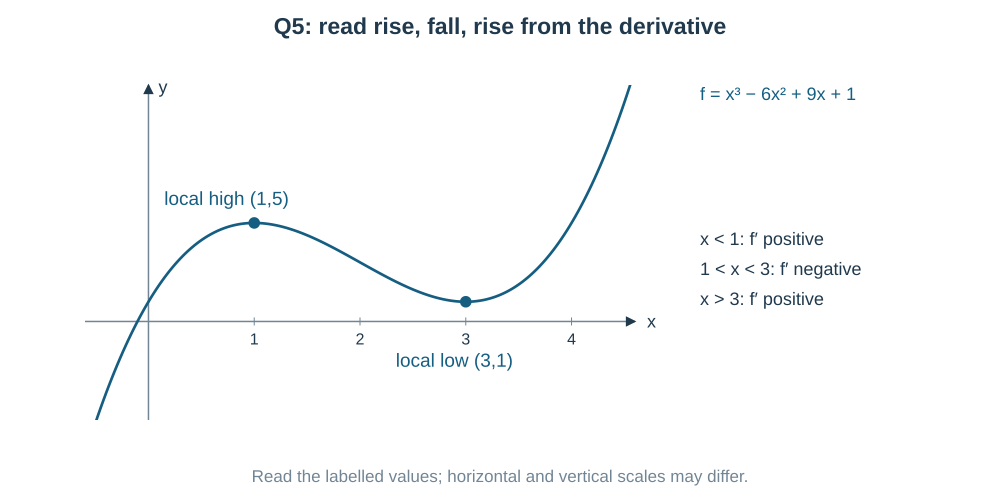

When an option writes two open intervals joined by $\cup$, read it in the usual exam sense: increasing on **each** listed interval. Do not compare an arbitrary point from one disconnected piece with a point from the other. Isolated stationary endpoints can often be included in a maximal interval, but the source options use the standard open derivative-sign intervals.

For a parameter question, “increasing for all real $x$” means the derivative cannot become negative anywhere. If $f'=Ax^2+Bx+C$ and $A>0$:

$$
f'(x)\ge0\ \forall x\quad\Longleftrightarrow\quad B^2-4AC\le0.
$$

**Why?** A positive-opening quadratic has its least height at the vertex; discriminant $\le0$ keeps it on or above the axis. Check equality cases rather than discarding them automatically.

## Concept C04 — A local maximum or minimum is a nearby comparison

A local maximum at $c$ means $f(c)$ is at least as high as all sufficiently nearby values. A local minimum is at least as low. “Local” means near that point; it need not win over the full domain.

**Important for JEE Main: first-derivative sign test**

$$
\begin{array}{c|c}
\text{Sign of }f'\text{ from left to right}&\text{What happens}\\ \hline
+\ \to\ -&\text{local maximum}\\
-\ \to\ +&\text{local minimum}\\
+\ \to\ +\text{ or }-\ \to\ -&\text{no turn}
\end{array}
$$

The first row means “positive before, negative after”.

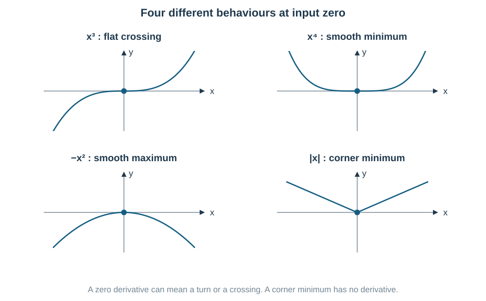

Candidate points are interior inputs where $f'=0$ **or** $f'$ does not exist but $f$ does. A differentiable interior extremum must satisfy $f'=0$. The reverse need not hold: $x^3$ crosses through zero with a horizontal tangent.

The **second-derivative test** is quicker when it decides the question:

$$
f'(c)=0,\quad
\begin{cases}
f''(c)<0&\Rightarrow\text{local maximum},\\
f''(c)>0&\Rightarrow\text{local minimum},\\
f''(c)=0&\Rightarrow\text{test gives no decision}.
\end{cases}
$$

At zero, $x^4$ has a minimum, $-x^4$ a maximum, and $x^3$ neither. All have $f''(0)=0$. Go back to signs or direct value comparison.

## Concept C05 — Absolute best values need the whole allowed domain

An absolute maximum is the greatest attained value in the full allowed domain; an absolute minimum is the least. **Important for JEE Main:** for a continuous function on a closed bounded interval $[a,b]$, both exist.

Make a small table of $f(a)$, $f(b)$ and $f(c)$ at every interior critical point. Compare the **values**. Endpoints can win even when their derivative is nonzero.

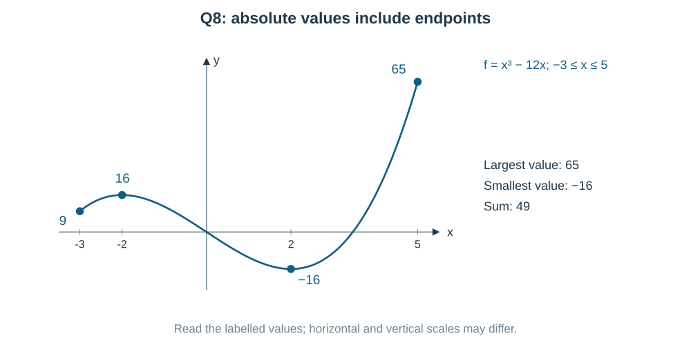

On an open or unbounded interval, existence needs checking. For $x>0$, $f(x)=x$ has no minimum: values approach $0$, but $x=0$ is not allowed. The infimum, the greatest lower bound, is $0$. It is not an attained minimum.

For $x\ln x$ on $x>0$, the derivative changes from negative to positive at $1/e$. Every allowed input on the left decreases towards that point, and every input on the right increases away. This proves a global minimum despite the open domain.

## Concept C06 — Related rates: first connect the changing quantities

**Important for JEE Main.** “Rate” means change per unit time. Draw the shape, name its changing lengths, write a true relation, then differentiate **with respect to time**. Insert the current measurements afterwards.

For a sphere:

$$
V=\frac43\pi r^3,\qquad
\frac{dV}{dt}=4\pi r^2\frac{dr}{dt}.
$$

$dV/dt$ has units volume/time; $dr/dt$ has units length/time. The surface area $4\pi r^2$ converts one rate into the other.

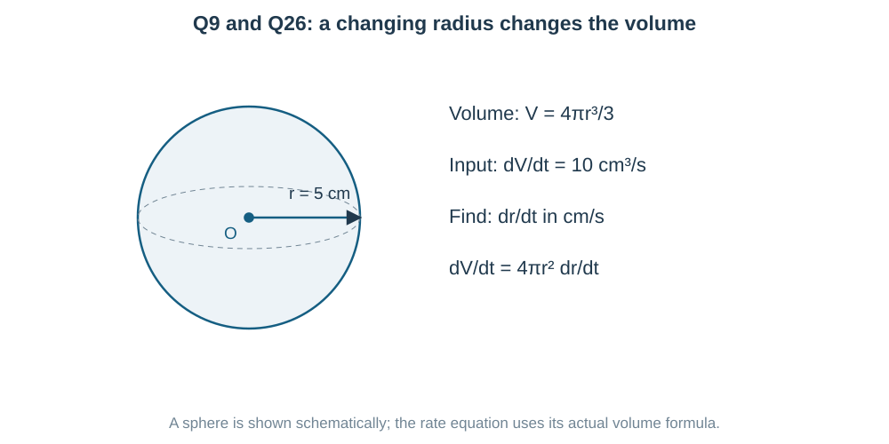

For a fixed ladder of length $L$, foot distance $x$ and top height $y$:

$$
x^2+y^2=L^2
\quad\Rightarrow\quad
x\frac{dx}{dt}+y\frac{dy}{dt}=0.
$$

If $dx/dt>0$, then $dy/dt<0$: moving the foot out lowers the top. If you put $x=3$ **before** differentiating, you turn a changing quantity into a constant and lose its rate.

Other useful shape relations:

$$
S_{\rm cube}=6a^2,\quad V_{\rm cube}=a^3,\quad
A_{\rm circle}=\pi r^2,\quad V_{\rm cone}=\frac13\pi r^2h.
$$

For water in a conical tank, first use similar triangles to relate $r$ to $h$. If $r/h=R/H$, substitute $r=(R/H)h$ so volume depends on one changing length. Do not hold $r$ fixed when the surface radius also grows.

## Concept C07 — A tangent gives a nearby estimate

**Supporting source extension.** For a small input change $\Delta x$, the tangent predicts

$$
\Delta y=f(a+\Delta x)-f(a)\approx f'(a)\Delta x.
$$

The differential is $dy=f'(a)\,dx$; set $dx=\Delta x$ for the estimate. Thus

$$
\boxed{f(a+\Delta x)\approx f(a)+f'(a)\Delta x}.
$$

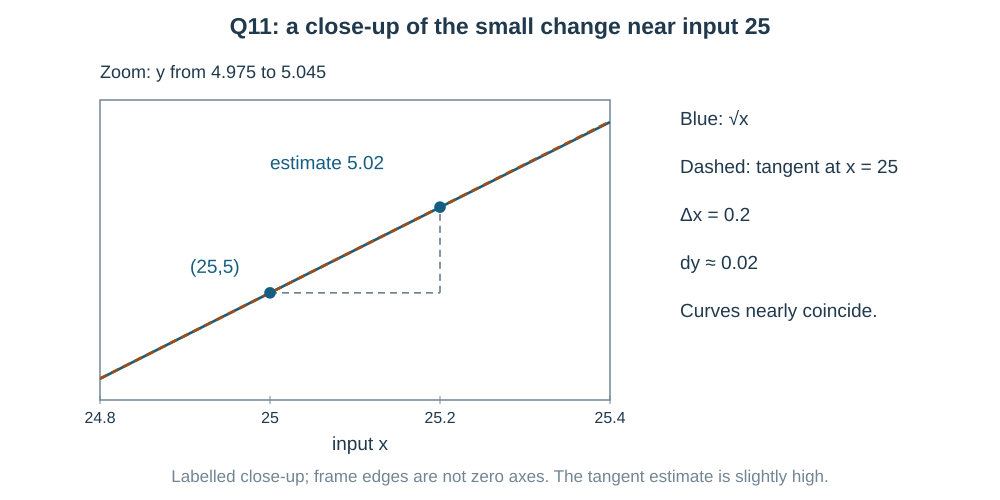

Take $\sqrt{25.2}$. Choose $a=25$, because $\sqrt{25}=5$ is easy. The input grows by $0.2$, not by $25.2$. The slope is $1/(2\sqrt{25})=1/10$. The predicted output grows by $0.02$.

For $y=Cx^n$ with positive measured $x$ and nonzero $y$:

$$
\frac{dy}{y}=n\frac{dx}{x}.
$$

Multiply by $100$ for approximate percentage change. For a volume proportional to $r^3$, a small $0.1\%$ radius error gives about $0.3\%$ volume error. For an error bound use absolute values. This ignores terms in $(\Delta x)^2$ and higher; it is not an exact formula for a large error.

## Concept C08 — Before differentiating, look for a useful inequality

**Important for JEE Main — AM–GM.** For positive numbers $u,v$,

$$
u+v\ge2\sqrt{uv},
$$

with equality when $u=v$. It comes from $(\sqrt u-\sqrt v)^2\ge0$. For $n$ positive terms, their sum is at least $n$ times their product's $n$th root; equality needs all terms equal.

Did you notice the reciprocal pair in $ax+b/x$, with $a,b,x>0$? Their product is the fixed number $ab$. Therefore

$$
\boxed{ax+\frac bx\ge2\sqrt{ab}},\qquad
x=\sqrt{\frac ba}\text{ at equality}.
$$

Checking equality is essential: a bound is the minimum only if some allowed input reaches it. For $2x+1/x^2$, split $2x$ as $x+x$; now the three-term product is $1$. This is a purposeful expansion.

**Important for JEE Main — Cauchy–Schwarz inequality.** For real numbers,

$$
(u_1v_1+\cdots+u_nv_n)^2
\le(u_1^2+\cdots+u_n^2)(v_1^2+\cdots+v_n^2).
$$

Meaning: the dot product of two lists cannot be larger in magnitude than the product of their lengths. Equality needs proportional lists, including the usual zero-vector case.

For two terms this is just a square:

$$
(u^2+v^2)(a^2+b^2)-(au+bv)^2=(bu-av)^2\ge0.
$$

Set $(u,v)=(\sin x,\cos x)$ and $(a,b)=(1,1)$:

$$
|\sin x+\cos x|\le\sqrt{1\cdot2}=\sqrt2.
$$

For the **maximum** $+\sqrt2$, equality needs $\sin x=\cos x=1/\sqrt2$. A negative equal pair gives the minimum $-\sqrt2$.

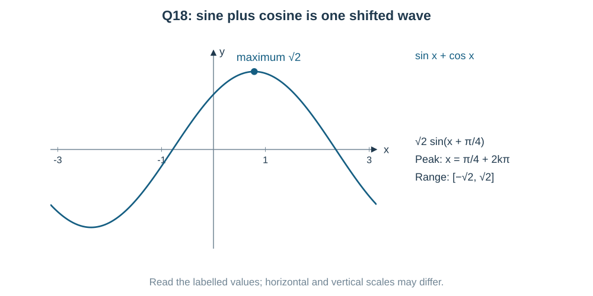

**Another possible approach — change the view to a wave:**

$$
A\sin x+B\cos x=R\sin(x+\phi),\quad
R=\sqrt{A^2+B^2},
$$

where $R\cos\phi=A$, $R\sin\phi=B$. Over all real inputs its range is $[-R,R]$. On a restricted interval, the peak phase may be outside the interval: check that and the endpoints. This shortcut does not automatically solve every restricted trig maximum.

## Concept C09 — Bending and inflection

**Supporting source extension.** $f'$ measures slope. $f''$ measures how that slope changes as we move right.

- $f''>0$: slopes increase; the graph bends like a bowl, called concave up.
- $f''<0$: slopes decrease; it bends like an upside-down bowl, called concave down.
- An inflection point is a continuous point where the bending changes from one type to the other.

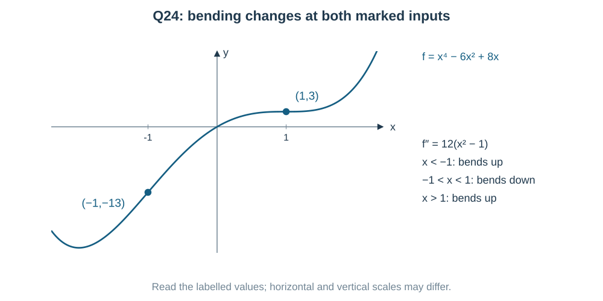

Solve $f''=0$ to get **candidates**, then check the signs on both sides. At $x=0$, $x^4$ has $f''=12x^2\ge0$ on both sides, so it has no inflection there. For functions whose second derivative fails to exist, such points can also be candidates; the definition is change of bending, not just $f''=0$.

## Concept C10 — Optimization: translate the words into one variable

**Important for JEE Main.** An optimization problem asks for the best possible value under given restrictions. Use this order:

1. Draw and name the lengths or quantities. State what must be positive.
2. Write the target: volume, area, distance, product or cost.
3. Use the constraint to remove one variable.
4. Find candidates and prove which is best on the actual domain.
5. Return to the requested quantity, with units.

**Distance clue.** Square roots make differentiation longer. Since $\sqrt s$ is increasing for $s\ge0$, minimizing distance $D$ is equivalent to minimizing $D^2$. Do not square a signed expression and assume its order is preserved.

For $P(3,0)$ and $Q(x,y)$ on $y^2=4x$:

$$
D^2=(x-3)^2+y^2
=(x-3)^2+4x=(x-1)^2+8,\qquad x\ge0.
$$

The nonnegative square shows the minimum directly. Both $y=2$ and $y=-2$ are possible at $x=1$.

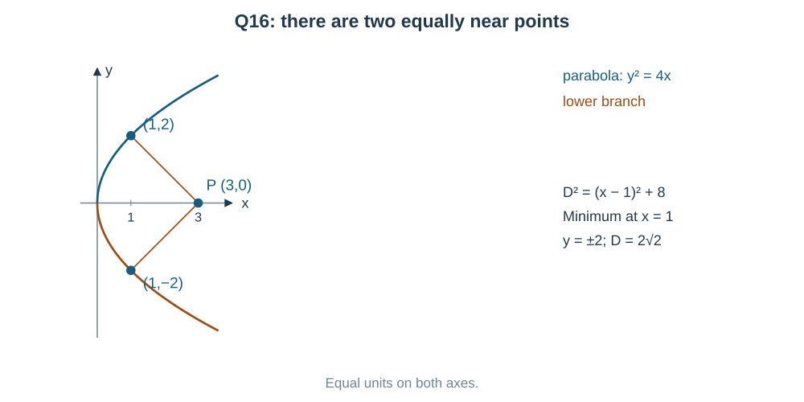

**Constraint clue.** For $x+y=L$ and $x,y>0$, rewrite $x^py^q$ as $x^p(L-x)^q$, with $0<x<L$. For $p,q>0$,

$$
\frac d{dx}\ln[x^p(L-x)^q]=\frac px-\frac q{L-x}=0
\quad\Rightarrow\quad x:y=p:q.
$$

The derivative changes from positive to negative there; endpoint limits are zero. Thus it is the global maximum. This is why a repeated factor $x^2y$ does **not** usually peak at $x=y$.

## Concept C11 — Use graph shape to count roots or impose contact

**Important for JEE Main.** Roots are places where the graph meets the horizontal axis. A derivative sign table tells where there can be at most one root on each rising or falling interval.

For $g(x)=x^3-3x+k$, the turns are fixed at $x=-1$ and $x=1$; changing $k$ shifts the whole graph up or down.

$$
g(-1)=k+2,\qquad g(1)=k-2.
$$

There are three distinct real roots exactly when the local high point is above the axis and the local low point below it:

$$
k+2>0,\quad k-2<0
\quad\Longleftrightarrow\quad -2<k<2.
$$

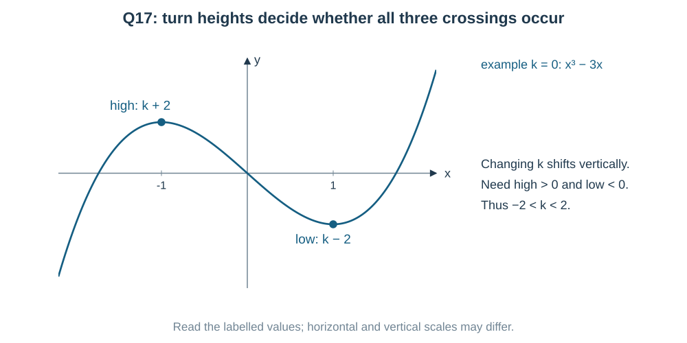

At equality, a turn sits on the axis, giving a repeated root rather than three distinct roots. Do not replace the strict inequalities by weak ones.

For a line touching a quadratic graph, the difference of their $y$ expressions is a quadratic with a double zero. For a general curve, “same point and same slope” is the basic test; a quadratic discriminant trick applies only after the intersection equation really is quadratic.

## Concept C12 — Equal endpoints and bounded slopes

**Rolle's theorem — supporting source extension.** A function continuous on $[a,b]$, differentiable on $(a,b)$, with $f(a)=f(b)$ has at least one interior $c$ with $f'(c)=0$.

Picture a smooth journey starting and finishing at the same height. Somewhere the tangent is horizontal. The theorem promises existence; solve $f'=0$ and keep only roots inside $(a,b)$. A corner can break the differentiability condition.

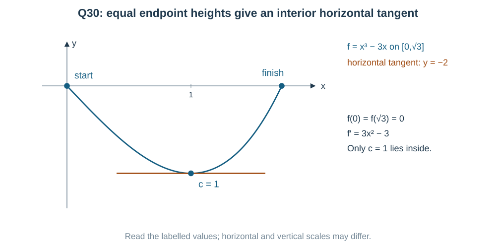

The mean value theorem, also a supporting extension, says under the same continuity/differentiability conditions:

$$
f'(c)=\frac{f(b)-f(a)}{b-a}
$$

for some interior $c$. The right side is the chord's average slope.

**Bounded-slope questions can also use ordinary monotonicity.** If $f'\le M$, define $g(x)=f(x)-Mx$. Then $g'\le0$, so for $b>a$,

$$
f(b)-Mb\le f(a)-Ma
\quad\Rightarrow\quad
\boxed{f(b)-f(a)\le M(b-a)}.
$$

If $|f'|\le M$, then $|f(b)-f(a)|\le M|b-a|$. A derivative bound controls total rise even when we do not know the exact function. To claim a **largest possible** value, also give a function that reaches the bound.

## Last-minute formula recap

| Need | Recall and condition |
|---|---|
| Tangent at $(a,f(a))$ | $y-f(a)=f'(a)(x-a)$; finite derivative |
| Normal | Slope $-1/f'(a)$ if $f'(a)\ne0$; horizontal tangent gives vertical normal |
| Acute tangent angle | $\tan\theta=\left|(m_1-m_2)/(1+m_1m_2)\right|$; perpendicular case handled separately |
| Rise/fall | Sign of $f'$ on each connected domain interval |
| Local high/low | $+\to-$ / $-\to+$ in $f'$; $f'=0$ alone is insufficient |
| Second-derivative test | At stationary point: negative gives max, positive gives min, zero is inconclusive |
| Absolute best on $[a,b]$ | Compare all critical values and both endpoints; continuity gives existence |
| Rate chain | $dy/dt=(dy/dx)(dx/dt)$; keep units and signed rates |
| Small change | $\Delta y\approx f'(a)\Delta x$; relative power error $dy/y=n\,dx/x$ |
| Positive reciprocal pair | $ax+b/x\ge2\sqrt{ab}$; equality $x=\sqrt{b/a}$ |
| Cauchy–Schwarz | $(\sum u_iv_i)^2\le(\sum u_i^2)(\sum v_i^2)$; check proportionality and requested sign |
| Trig amplitude | $A\sin x+B\cos x$ has full-real range $\pm\sqrt{A^2+B^2}$ |
| Distance | Minimize $D^2$, using the curve equation and its domain |
| Bending | Sign change of $f''$, not just a zero, identifies ordinary smooth inflection candidates |
| Parameter quadratic | $Ax^2+Bx+C\ge0$ for all real inputs, $A>0$, iff $B^2-4AC\le0$ |
| Root count | Use turns, heights, monotone pieces and end behaviour; distinctness needs strict conditions |
| Bound on slope | $f'\le M\Rightarrow f(b)-f(a)\le M(b-a)$ for $b>a$ |

**Before submitting:** Did I find the input or the value asked? Did I use the actual domain? Did I check endpoints, corners and equality? Is the answer a signed rate or a speed?

## Worked solutions to the 35 PDF questions

Read the question first. Notice the pattern, choose a route, then calculate. Alternative methods below are fully visible.

### Question 1 — The derivative gives the tangent slope

**PDF page 54 | MCQ | Notes: C01,C02**

The equation of the tangent to the curve $y=x^3-3x+2$ at the point where $x=2$ is

- (a) $y=9x+14$
- (b) $y=3x-2$
- (c) $y=9x-14$
- (d) $y=9x-4$

**We need a point and a slope.** At $x=2$, the curve's height is $8-6+2=4$. So the tangent must pass through $(2,4)$.

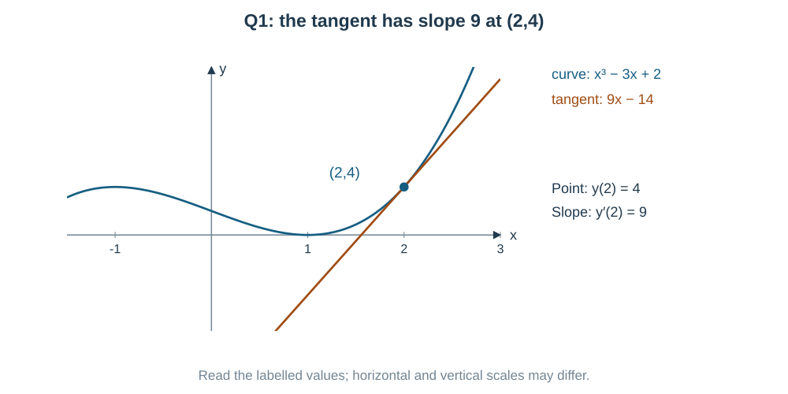

$$
y'=3x^2-3,\quad m=3(2)^2-3=9.
$$

Put that point and slope into the line equation:

$$
y-4=9(x-2)\quad\Rightarrow\quad
\boxed{y=9x-14}\quad\text{(c)}.
$$

**Check:** at $x=2$ the line gives $4$. Option (b) also passes through that point, but its slope is $3$, so a point check alone cannot choose the tangent.

---

### Question 2 — The normal is perpendicular to the tangent

**PDF page 54 | MCQ | Notes: C02**

The equation of the normal to the parabola $y=x^2$ at the point $(1,1)$ is

- (a) $x+2y=3$
- (b) $2x+y=3$
- (c) $x-2y=-1$
- (d) $x+y=2$

**Normal means the line at right angles to the tangent.** First find the tangent's slope, then turn it by a right angle.

$$
y'=2x,\qquad m_{\rm tangent}=2,\qquad
m_{\rm normal}=-\frac12.
$$

Thus

$$
y-1=-\frac12(x-1)
\quad\Rightarrow\quad \boxed{x+2y=3}\quad\text{(a)}.
$$

**Check:** $(1,1)$ satisfies the equation and $2(-1/2)=-1$. Using slope $2$ would find the tangent, a different line.

---

### Question 3 — Parallel lines have the same slope

**PDF page 54 | MCQ | Notes: C02**

The tangent to $y=x^2+3x$ is parallel to the line $y=7x+1$ at a point. The ordinate of that point is

- (a) $4$
- (b) $7$
- (c) $14$
- (d) $10$

**Ordinate means the $y$ coordinate.** The given line has slope $7$. Parallel tangents must also have slope $7$.

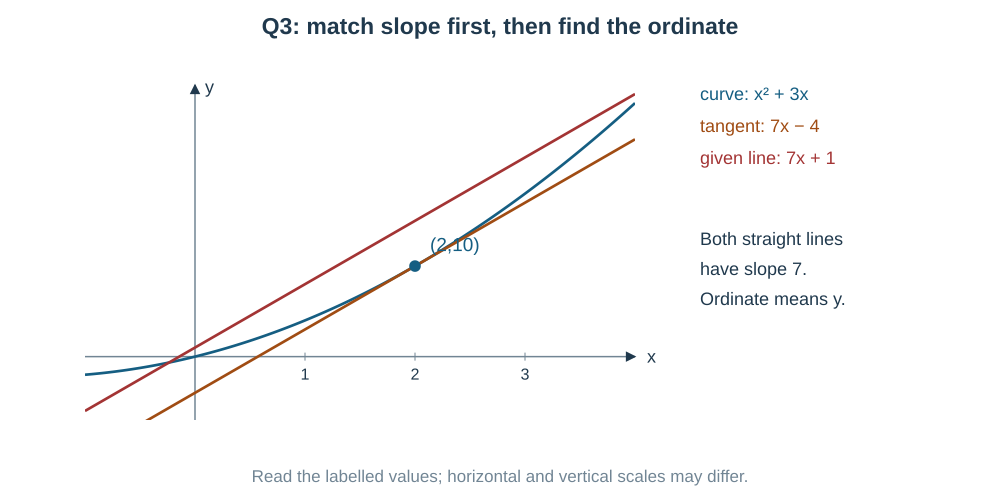

$$
y'=2x+3=7\Rightarrow x=2,\qquad
y=2^2+3(2)=\boxed{10}\quad\text{(d)}.
$$

We used $7x+1$ only to read the slope; the contact point is on the curve, so its height must come from $x^2+3x$.

---

### Question 4 — Angle between curves means angle between their tangents

**PDF page 54 | MCQ | Notes: C02**

The acute angle between the curves $y=x^2$ and $x=y^2$ at their point of intersection $(1,1)$ is

- (a) $\tan^{-1}\dfrac43$
- (b) $\tan^{-1}\dfrac34$
- (c) $\dfrac\pi4$
- (d) $\tan^{-1}\dfrac12$

**The curves meet, but each has its own direction there.** Draw their tangents at $(1,1)$. The acute angle between those lines is the angle asked.

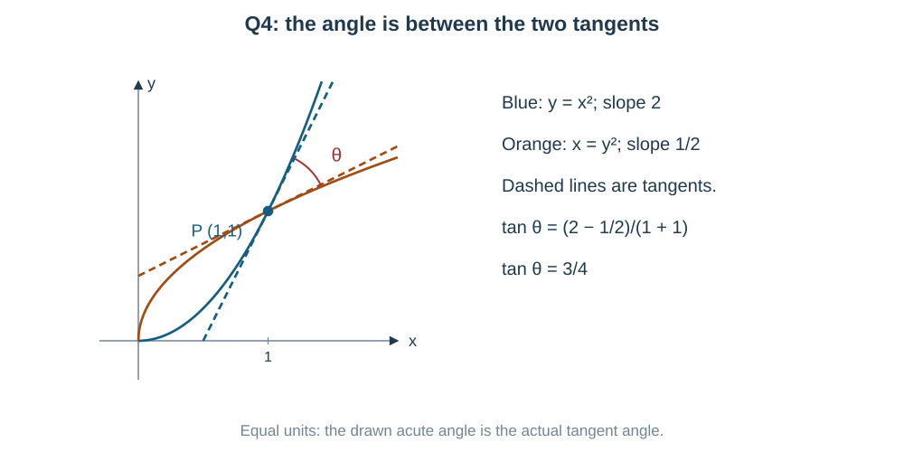

For $y=x^2$, $m_1=2x=2$. For $x=y^2$, implicit differentiation gives

$$
1=2y\,y'\Rightarrow m_2=\frac1{2y}=\frac12.
$$

Therefore

$$
\tan\theta=
\left|\frac{m_1-m_2}{1+m_1m_2}\right|
=\frac{2-\tfrac12}{1+1}=\frac34,
\qquad
\boxed{\theta=\tan^{-1}(3/4)}\quad\text{(b)}.
$$

**Another possible approach:** tangent directions $(1,2)$ and $(2,1)$ have dot product $4$, both lengths $\sqrt5$. Thus $\cos\theta=4/5$; the positive sine is $3/5$, giving $\tan\theta=3/4$ again.

---

### Question 5 — Build a sign table from the derivative factors

**PDF page 54 | MCQ | Notes: C03**

The function $f(x)=x^3-6x^2+9x+1$ is strictly increasing in

- (a) $(1,3)$
- (b) $(-\infty,1)\cup(3,\infty)$
- (c) $(-\infty,3)$
- (d) $(0,3)$

**Did you notice that the derivative factors into two easy sign-changing pieces?**

$$
f'(x)=3x^2-12x+9=3(x-1)(x-3).
$$

| Interval | Signs of $(x-1),(x-3)$ | Sign of $f'$ |
|---|---|---|
| $(-\infty,1)$ | $-,-$ | $+$ |
| $(1,3)$ | $+,-$ | $-$ |
| $(3,\infty)$ | $+,+$ | $+$ |

So the listed increasing pieces are
$\boxed{(-\infty,1)\cup(3,\infty)}$, **(b)**. This means increasing on each piece separately. It does not compare every input in the first piece with every input in the second.

---

### Question 6 — An exponential factor never changes sign

**PDF page 54 | MCQ | Notes: C03**

The interval in which $f(x)=x^2e^{-x}$ is strictly increasing is

- (a) $(-\infty,0)$
- (b) $(2,\infty)$
- (c) $(-\infty,2)$
- (d) $(0,2)$

**Keep the positive factor out of the sign decision.** Product differentiation gives

$$
f'=2xe^{-x}-x^2e^{-x}=e^{-x}x(2-x).
$$

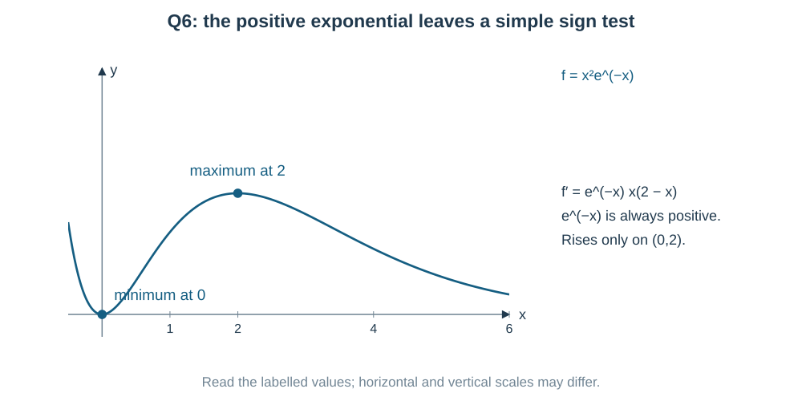

Since $e^{-x}>0$, only $x(2-x)$ matters:

$$
\begin{array}{c|ccc}
x&(-\infty,0)&(0,2)&(2,\infty)\\ \hline
f'&-&+&-
\end{array}
$$

Thus $\boxed{(0,2)}$, **(d)**. The exponential getting smaller does not by itself make the whole product smaller; $x^2$ changes too.

---

### Question 7 — Find the maximum value after locating the turn

**PDF page 54 | MCQ | Notes: C04**

The local maximum value of $f(x)=2x^3-9x^2+12x+5$ is

- (a) $10$
- (b) $9$
- (c) $5$
- (d) $14$

**A maximum value is a height, not an input.** Find where the graph changes from rising to falling.

$$
f'=6x^2-18x+12=6(x-1)(x-2).
$$

The signs are $+,-,+$ on the three intervals. Hence $x=1$ gives the local maximum; $x=2$ gives the local minimum.

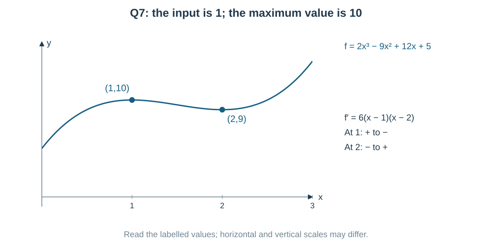

$$
f(1)=2-9+12+5=\boxed{10}\quad\text{(a)}.
$$

**Another possible approach:** $f''=12x-18$ is negative at $1$ and positive at $2$. After finding the stationary inputs, this quickly classifies them.

---

### Question 8 — Check the endpoints as well as stationary points

**PDF page 54 | Numerical value | Notes: C05**

If $M$ and $m$ are the absolute maximum and absolute minimum values of $f(x)=x^3-12x$ on $[-3,5]$, then $M+m=$ ____.

**Absolute means compare the whole allowed interval.** Solving $f'=0$ alone could miss an endpoint winner.

$$
f'=3x^2-12=0\Rightarrow x=\pm2.
$$

Both lie inside $[-3,5]$. Compare:

| Input | $-3$ | $-2$ | $2$ | $5$ |
|---|---:|---:|---:|---:|
| $f(x)=x^3-12x$ | $9$ | $16$ | $-16$ | $65$ |

So $M=65$, $m=-16$, and
$\boxed{M+m=49}$. The derivative finds interior candidates; the closed interval adds the endpoints.

---

### Question 9 — Volume rate and radius rate are different quantities

**PDF page 54 | MCQ | Notes: C06**

Gas is pumped into a spherical balloon at $10\ \mathrm{cm^3/s}$. The rate at which the radius increases when $r=5\ \mathrm{cm}$ is

- (a) $\dfrac1\pi\ \mathrm{cm/s}$
- (b) $\dfrac1{100\pi}\ \mathrm{cm/s}$
- (c) $\dfrac1{10\pi}\ \mathrm{cm/s}$
- (d) $\dfrac1{4\pi}\ \mathrm{cm/s}$

**The input rate is volume per second; the wanted rate is radius per second.** Connect them with the sphere's volume.

$$
V=\frac43\pi r^3
\Rightarrow
\frac{dV}{dt}=4\pi r^2\frac{dr}{dt}.
$$

At the stated instant,

$$
10=4\pi(5)^2\frac{dr}{dt}
\Rightarrow
\boxed{\frac{dr}{dt}=\frac1{10\pi}\ \mathrm{cm/s}}\quad\text{(c)}.
$$

**Unit check:** $(\mathrm{cm^3/s})/\mathrm{cm^2}=\mathrm{cm/s}$. Do not set $r=5$ before differentiating; $r$ is changing.

---

### Question 10 — The ladder gives a relation between two changing lengths

**PDF page 55 | Numerical value | Notes: C06**

A ladder $5\ \mathrm m$ long rests against a wall. Its foot is pulled away from the wall at $2\ \mathrm{m/s}$. The speed at which the top slides down when the foot is $3\ \mathrm m$ from the wall is ____ $\mathrm{m/s}$.

**Name both changing lengths.** Let $x$ be the foot's distance from the wall and $y$ the top's height. The fixed ladder is the right triangle's hypotenuse.

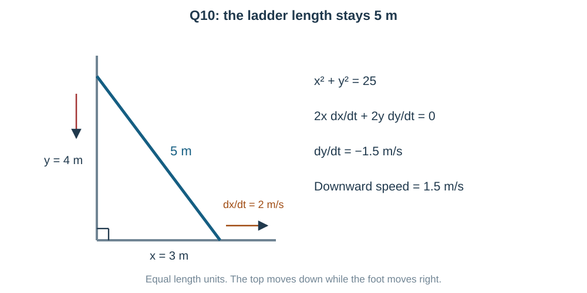

$$
x^2+y^2=25,\qquad
2x\frac{dx}{dt}+2y\frac{dy}{dt}=0.
$$

When $x=3$, $y=\sqrt{25-9}=4$. Hence

$$
\frac{dy}{dt}=-\frac xy\frac{dx}{dt}
=-\frac34(2)=-\frac32\ \mathrm{m/s}.
$$

The negative sign says the height decreases. The asked downward **speed** is its magnitude:
$\boxed{1.5\ \mathrm{m/s}}$.

---

### Question 11 — Use a nearby easy square root

**PDF page 55 | MCQ | Notes: C07**

Using differentials, the approximate value of $\sqrt{25.2}$ is

- (a) $5.2$
- (b) $5.04$
- (c) $5.02$
- (d) $5.002$

**Choose a nearby input with an easy exact value.** We know $\sqrt{25}=5$, and $25.2=25+0.2$.

$$
f'(x)=\frac1{2\sqrt x},\quad f'(25)=\frac1{10},
\quad dy=\frac1{10}(0.2)=0.02.
$$

Thus $\sqrt{25.2}\approx5+0.02=\boxed{5.02}$, **(c)**.

**Check the approximation:** $(5.02)^2=25.2004$, very close to $25.2$. The estimate is slightly high. Indeed $f''(x)<0$ for $x>0$, so the tangent lies above this concave-down curve.

---

### Question 12 — A horizontal tangent need not be a maximum or minimum

**PDF page 55 | MCQ | Notes: C04,C09**

Statement I: $f(x)=x^3$ has no local extremum at $x=0$ although $f^\prime(0)=0$.

Statement II: $f^\prime(x)=3x^2\ge0$ for all real $x$ and does not change sign at $x=0$. Choose the correct option.

- (a) Both Statement I and Statement II are true
- (b) Statement I is true but Statement II is false
- (c) Statement I is false but Statement II is true
- (d) Both Statement I and Statement II are false

**Zero slope does not automatically mean a turn.** For $x^3$, negative inputs give negative outputs and positive inputs give positive outputs. So $f(0)=0$ is neither a nearby highest nor a nearby lowest value.

Also $f'=3x^2>0$ on both sides of $0$. It is zero only at $0$, with no sign change. **Both statements are true, option (a).**

---

### Question 13 — Separate a turn from a flat crossing and a corner

**PDF page 55 | MCQ | Notes: C04**

Match List-I with List-II.

List-I: A. $f(x)=x^3$ at $x=0$; B. $f(x)=x^4$ at $x=0$; C. $f(x)=-x^2$ at $x=0$; D. $f(x)=|x|$ at $x=0$.

List-II: I. Local maximum; II. Local minimum with $f^\prime(0)=0$; III. Neither maximum nor minimum; IV. Local minimum but derivative does not exist.

- (a) A-III, B-II, C-I, D-IV
- (b) A-II, B-III, C-I, D-IV
- (c) A-III, B-I, C-II, D-IV
- (d) A-III, B-II, C-IV, D-I

**Use the picture, then confirm each feature.**

- A: $x^3$ crosses through $0$, so **III**, neither.
- B: $x^4\ge0=f(0)$ and $f'(0)=0$, so **II**.
- C: $-x^2\le0=f(0)$, so **I**, local maximum.
- D: $|x|\ge0=f(0)$ but left slope is $-1$ and right slope $1$, so **IV**.

Thus $\boxed{\text{A-III, B-II, C-I, D-IV}}$, **(a)**. Direct value comparison is simpler here than forcing a second-derivative test that returns zero.

---

### Question 14 — Positive reciprocal terms suggest an inequality

**PDF page 55 | MCQ | Notes: C08**

The minimum value of $4x+\dfrac9x$ for $x>0$ is

- (a) $12$
- (b) $6$
- (c) $9$
- (d) $13$

**Did you notice the $x$ and $1/x$ pair?** Their product is constant:
$(4x)(9/x)=36$. Both terms are positive.

$$
4x+\frac9x\ge2\sqrt{36}=12.
$$

Equality requires $4x=9/x$, giving $x=3/2$, which is allowed. Therefore the bound is reached:
$\boxed{12}$, **(a)**.

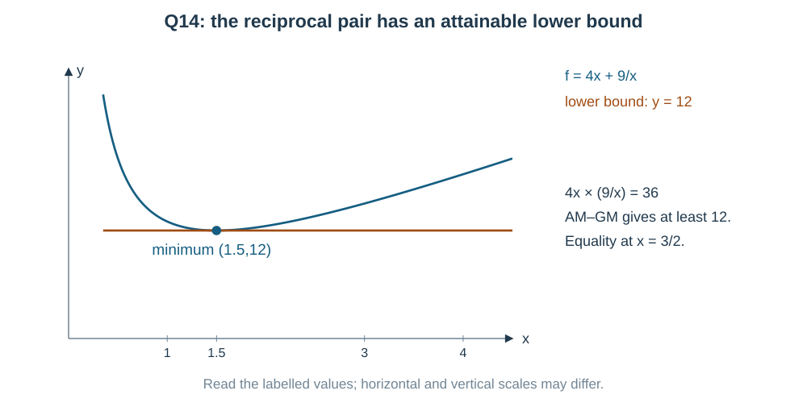

**Another possible approach:** $f'=4-9/x^2$ is negative before $3/2$ and positive after it. This gives the same global minimum. AM–GM is shorter because the fixed product is already visible.

---

### Question 15 — Write the box dimensions before maximizing volume

**PDF page 55 | Numerical value | Notes: C10,C05**

An open box is made by cutting equal squares of side $x$ cm from the corners of a square tin sheet of side $18$ cm and folding up the sides. The maximum volume of the box is ____ $\mathrm{cm^3}$.

**Draw the cuts before writing volume.** Each side loses $x$ at both ends, so the folded base is $(18-2x)$ by $(18-2x)$; the height is $x$.

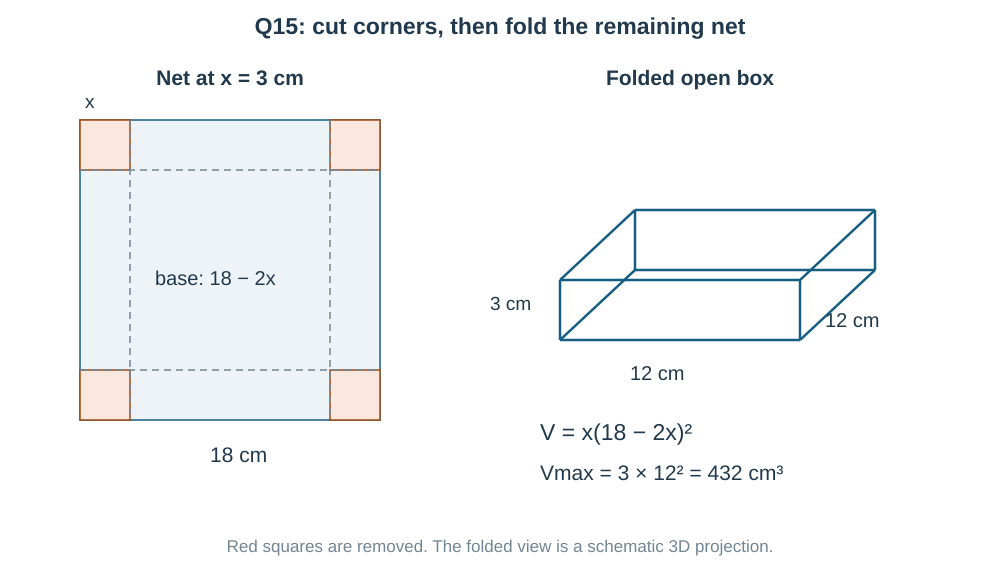

$$
V=x(18-2x)^2,\qquad 0<x<9.
$$

Differentiate in factored form:

$$
V'=(18-2x)^2-4x(18-2x)
=(18-2x)(18-6x).
$$

The first factor is positive in the physical domain. The second changes $+\to-$ at $x=3$. So that point gives the global maximum; the limiting volumes at $0$ and $9$ are zero.

$$
V_{\max}=3(18-6)^2=\boxed{432\ \mathrm{cm^3}}.
$$

**Why not take the root $x=9$?** It leaves zero base width and is outside the nondegenerate box domain.

---

### Question 16 — Minimize distance squared, with the curve constraint

**PDF page 55 | MCQ | Notes: C10,C05**

The shortest distance of the point $(3,0)$ from the parabola $y^2=4x$ is

- (a) $2$
- (b) $\sqrt5$
- (c) $3$
- (d) $2\sqrt2$

**A distance is a square root. We can first minimize its square.** Squaring preserves the order of nonnegative distances.

Let $Q(x,y)$ be a point on the parabola and $P=(3,0)$.

$$
D^2=(x-3)^2+y^2.
$$

Did you notice that the curve already gives $y^2=4x$? Use it directly:

$$
D^2=(x-3)^2+4x=x^2-2x+9=(x-1)^2+8.
$$

The square is at least zero, so $D^2\ge8$, with equality at $x=1$. This is allowed because the parabola has $x\ge0$, and $y=\pm2$ there.

$$
\boxed{D_{\min}=\sqrt8=2\sqrt2}\quad\text{(d)}.
$$

**Another possible approach:** put $Q=(t^2,2t)$. Then
$D^2=(t^2-3)^2+4t^2=(t^2-1)^2+8$,
with equality at $t=\pm1$. This also keeps both branches automatically. Directly differentiating $\sqrt{(x-3)^2+4x}$ is valid but adds an unnecessary square root and denominator.

---

### Question 17 — A cubic needs one turn above and the other below the axis

**PDF page 55 | Numerical value | Notes: C11**

The number of integer values of $k$ for which $x^3-3x+k=0$ has three distinct real roots is ____.

**Three distinct roots mean three separate axis crossings.** The cubic rises, falls, then rises. Its middle high point must be above the axis and its middle low point below.

$$
g'=3(x^2-1),\qquad
g(-1)=k+2,\quad g(1)=k-2.
$$

Thus $k+2>0$ and $k-2<0$, giving $-2<k<2$.
The integers are $-1,0,1$, so the answer is $\boxed3$.

Each outer branch runs to an opposite infinite end and is strictly increasing; the middle branch is strictly decreasing. The stated strict height inequalities therefore give exactly one root on each of the three pieces. At $k=\pm2$ two roots merge at a turn, so those endpoints are excluded.

---

### Question 18 — Sine and cosine cannot both equal one

**PDF page 56 | MCQ | Notes: C08**

The maximum value of $\sin x+\cos x$ is

- (a) $1$
- (b) $\sqrt2$
- (c) $2$
- (d) $\dfrac1{\sqrt2}$

**The two terms are connected by $\sin^2x+\cos^2x=1$.** They cannot both be $1$ at the same input.

Use the addition identity:

$$
\sin x+\cos x=\sqrt2\sin\left(x+\frac\pi4\right).
$$

Since a sine is at most $1$, the maximum is
$\boxed{\sqrt2}$, **(b)**, attained at $x=\pi/4+2k\pi$.

**Another possible approach — Important for JEE Main, Cauchy–Schwarz:**

$$
(\sin x+\cos x)^2\le(1^2+1^2)(\sin^2x+\cos^2x)=2.
$$

So the sum is at most $\sqrt2$. Equality with the positive sign occurs at $\sin x=\cos x=1/\sqrt2$. The wave identity is the quickest visual route here.

---

### Question 19 — Use the tangent to find both axis intercepts

**PDF page 56 | Numerical value | Notes: C02**

The sum of the intercepts made on the coordinate axes by the tangent to $xy=4$ at $(2,2)$ is ____.

**An axis intercept is where the line meets an axis.** First find the tangent at the given curve point.

$$
xy=4\Rightarrow y+xy'=0
\Rightarrow y'(2)=-\frac22=-1.
$$

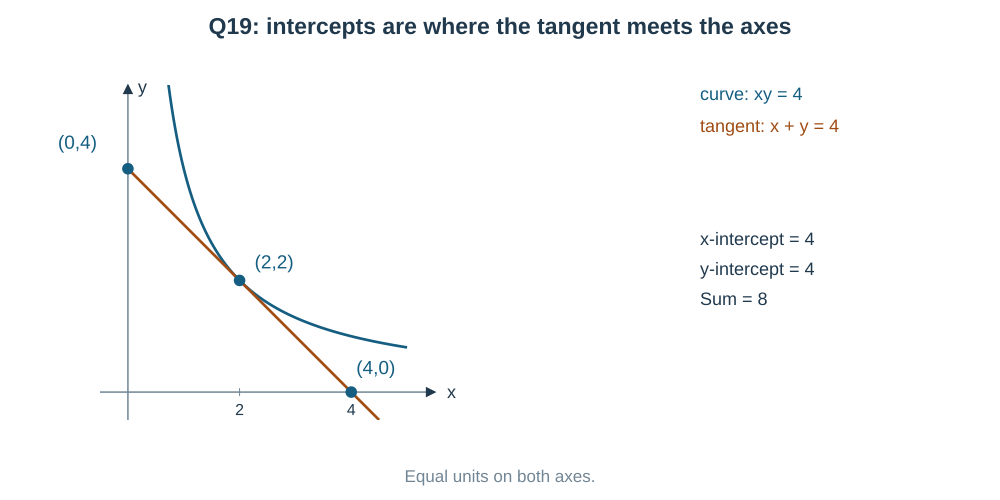

$$
y-2=-(x-2)\Rightarrow x+y=4.
$$

Set $y=0$ for the $x$-intercept $4$; set $x=0$ for the $y$-intercept $4$. Their sum is $\boxed8$.

---

### Question 20 — Differentiate the implicit parabola equation

**PDF page 56 | MCQ | Notes: C02**

The equation of the tangent to $y^2=4x$ at $(4,4)$ is

- (a) $x+2y-12=0$
- (b) $x-2y+4=0$
- (c) $2x-y-4=0$
- (d) $x-2y-4=0$

**The curve is written using both $x$ and $y$.** Differentiate its equation rather than guess a slope from its appearance.

$$
2y\,y'=4\Rightarrow y'=\frac2y.
$$

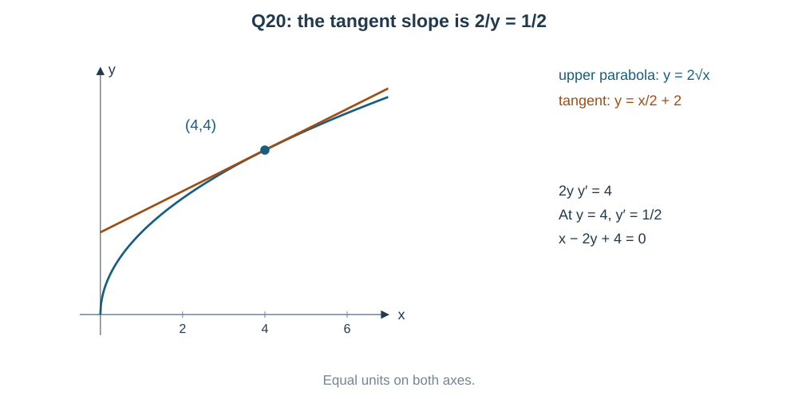

At $(4,4)$, slope $=1/2$. Hence

$$
y-4=\frac12(x-4)
\Rightarrow\boxed{x-2y+4=0}\quad\text{(b)}.
$$

**Check:** the point satisfies both the curve and the line.

---

### Question 21 — Let the unknown contact point set the tangent slope

**PDF page 56 | MCQ | Notes: C02,C11**

Two tangents are drawn from $(1,-3)$ to the parabola $y=x^2$. The product of their slopes is

- (a) $12$
- (b) $-6$
- (c) $-3$
- (d) $-12$

**The point $(1,-3)$ is outside the curve, not a contact point.** We cannot substitute $x=1$ into $y'=2x$ to get a tangent from it. Let the actual contact point be $(t,t^2)$.

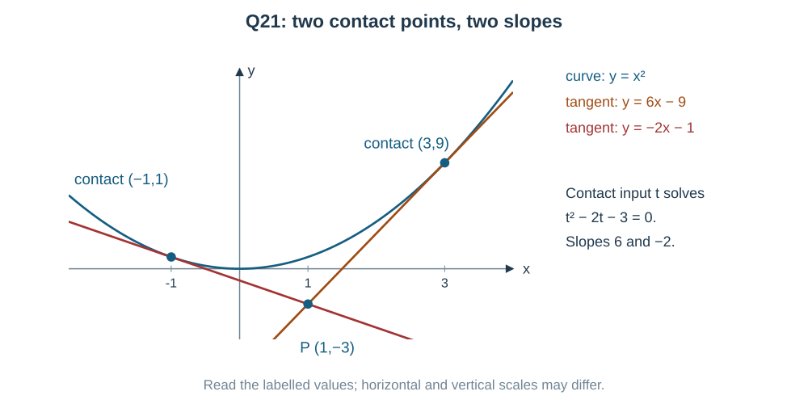

The tangent at that point is

$$
y-t^2=2t(x-t)\Rightarrow y=2tx-t^2.
$$

It passes through $(1,-3)$, so
$-3=2t-t^2$, or $t^2-2t-3=0$.
The product of its two roots is $-3$. Since each slope is $2t$, their product is
$4(-3)=\boxed{-12}$, **(d)**.

The roots $t=3,-1$ give slopes $6,-2$ as a direct check.

**Another possible approach:** a line through the outside point is
$y=m(x-1)-3$. Intersecting $y=x^2$ gives
$x^2-mx+m+3=0$.
Tangency requires $m^2-4m-12=0$; its slope-root product is again $-12$. Both routes work; the contact parameter uses the derivative meaning more directly.

---

### Question 22 — Increasing for every real input means a quadratic stays nonnegative

**PDF page 56 | MCQ | Notes: C03,C11**

The values of $a$ for which $f(x)=x^3+ax^2+3x+5$ is increasing for all real $x$ are

- (a) $[-3,3]$
- (b) $(-\infty,-3]\cup[3,\infty)$
- (c) $[0,3]$
- (d) $(-3,\infty)$

**For every real input, the derivative must stay on or above the axis.**

$$
f'=3x^2+2ax+3.
$$

This upward-opening quadratic is nonnegative everywhere iff

$$
(2a)^2-4(3)(3)\le0
\Rightarrow a^2\le9
\Rightarrow \boxed{-3\le a\le3}\quad\text{(a)}.
$$

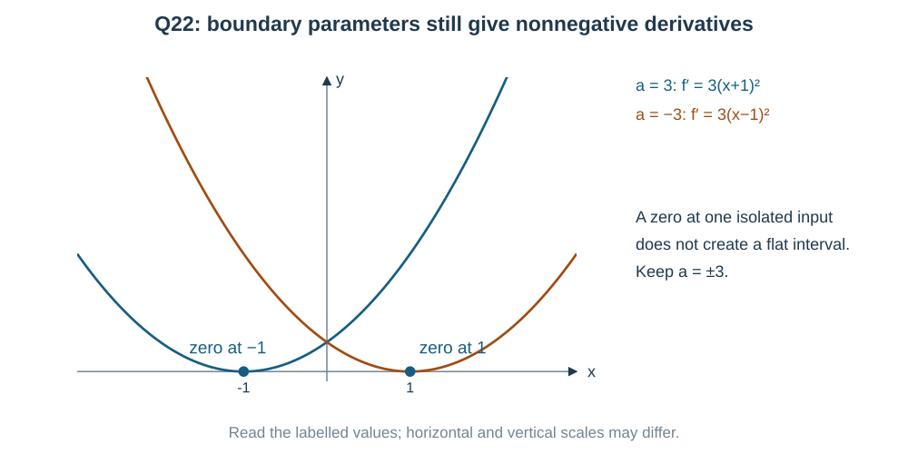

**Why include equality?** At $a=3$, $f'=3(x+1)^2$; at $a=-3$, $f'=3(x-1)^2$. Each vanishes only once and is positive elsewhere, so the cubic is still strictly increasing.

**Another possible approach:** complete the square:
$f'=3(x+a/3)^2+3-a^2/3$.
Its least value is $3-a^2/3$, so require this to be nonnegative. This explains the discriminant condition visually.

---

### Question 23 — The logarithm makes the derivative simpler

**PDF page 56 | MCQ | Notes: C04,C05**

The minimum value of $x\ln x$ for $x>0$ is

- (a) $\dfrac1e$
- (b) $-1$
- (c) $-\dfrac1e$
- (d) $0$

**The domain is $x>0$.** Product differentiation gives

$$
f'=\ln x+1=0\Rightarrow x=e^{-1}.
$$

For $0<x<1/e$, $f'<0$; for $x>1/e$, $f'>0$. Thus the function falls towards this input from the left and rises away on the right. This proves a global minimum.

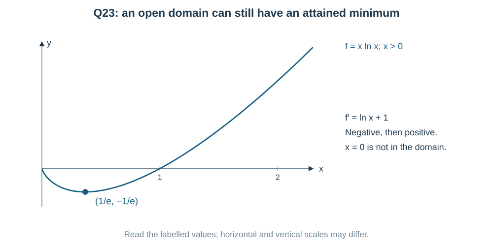

$$
f(1/e)=\frac1e(-1)=\boxed{-\frac1e}\quad\text{(c)}.
$$

**Another possible check:** $f''=1/x>0$ throughout the domain. The slopes keep increasing, consistent with a single global low point.

---

### Question 24 — Inflection needs a change of bending

**PDF page 56 | Numerical value | Notes: C09**

The number of points of inflection of $f(x)=x^4-6x^2+8x$ is ____.

**Inflection means a change of bending.** A zero second derivative only gives a candidate.

$$
f'=4x^3-12x+8,\qquad
f''=12x^2-12=12(x-1)(x+1).
$$

The second-derivative signs are $+$ for $x<-1$, $-$ for $-1<x<1$, and $+$ for $x>1$. Both candidates change bending, so the answer is $\boxed2$. Their coordinates are $(-1,-13)$ and $(1,3)$.

---

### Question 25 — The question asks for surface area, not volume

**PDF page 56 | Numerical value | Notes: C06**

The edge of a cube increases at $0.1\ \mathrm{cm/s}$. The rate of increase of its surface area when the edge is $10\ \mathrm{cm}$ is ____ $\mathrm{cm^2/s}$.

**Read the target: surface area.** A cube has six square faces, each of area $a^2$.

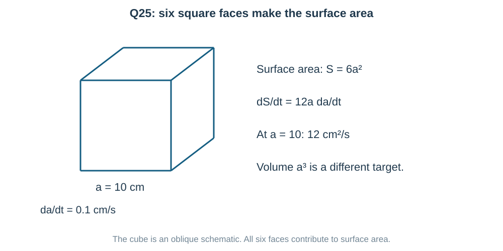

$$
S=6a^2\Rightarrow
\frac{dS}{dt}=12a\frac{da}{dt}.
$$

At $a=10$ and $da/dt=0.1$,
$dS/dt=12(10)(0.1)=\boxed{12\ \mathrm{cm^2/s}}$.
Using $a^3$ would calculate a volume rate instead.

---

### Question 26 — A small relative radius error is tripled in volume

**PDF page 56 | MCQ | Notes: C07**

If the percentage error in the radius of a sphere is $0.1\%$, then the approximate percentage error in its volume is

- (a) $0.1\%$
- (b) $0.03\%$
- (c) $0.3\%$
- (d) $0.9\%$

**The radius is raised to the third power in volume.** For a small measurement error,

$$
V=\frac43\pi r^3
\Rightarrow
\frac{dV}{V}=3\frac{dr}{r}.
$$

Thus the approximate percentage error is
$3(0.1\%)=\boxed{0.3\%}$, **(c)**.

**Why approximate?** If the radius is too large by exactly $0.1\%$, the exact relative increase is $(1.001)^3-1=0.003003001$, or $0.3003001\%$. The differential keeps only its first-order part.

---

### Question 27 — Use a double-angle identity in the derivative

**PDF page 56 | MCQ | Notes: C04,C05**

The maximum value of $\sin x(1+\cos x)$ on $[0,\pi/2]$ is

- (a) $\dfrac{3\sqrt3}4$
- (b) $1$
- (c) $\dfrac{\sqrt3}2$
- (d) $\dfrac34$

**The interval is closed, so include its endpoints.** Product differentiation gives

$$
f'=\cos x(1+\cos x)-\sin^2x
=\cos x+\cos2x.
$$

Did you notice that $\cos2x=2\cos^2x-1$ makes this a quadratic in $\cos x$?

$$
f'=(2\cos x-1)(\cos x+1)=0.
$$

On $[0,\pi/2]$, $\cos x$ is between $0$ and $1$. Only $\cos x=1/2$, or $x=\pi/3$, is possible.

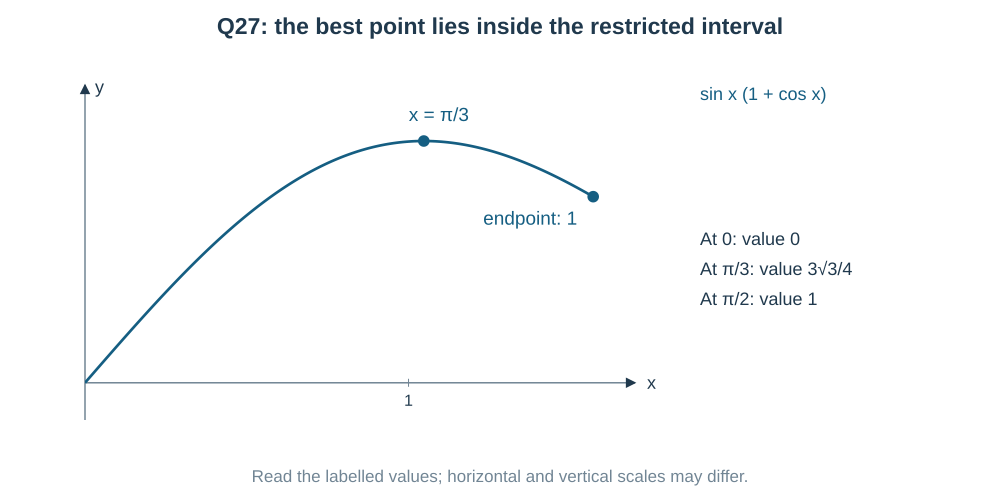

$$
f(0)=0,\quad f(\pi/2)=1,\quad
f(\pi/3)=\frac{\sqrt3}2\left(1+\frac12\right)
=\boxed{\frac{3\sqrt3}4}\quad\text{(a)}.
$$

Trying to maximize $\sin x$ and $1+\cos x$ separately would require incompatible inputs. Their product needs one shared input.

---

### Question 28 — A tangent may meet a cubic again

**PDF page 57 | Numerical value | Notes: C02,C11**

The tangent to $y=x^3$ at $(1,1)$ meets the curve again at a point whose abscissa is ____.

**A tangent matches the slope locally; it can meet the curve again.** At $(1,1)$, $y'=3x^2=3$, so its line is
$y-1=3(x-1)$, or $y=3x-2$.

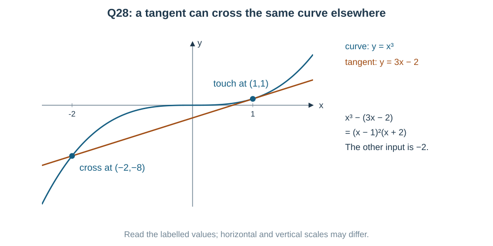

At an intersection,

$$
x^3=3x-2\Rightarrow
x^3-3x+2=(x-1)^2(x+2)=0.
$$

The double root $1$ is the known contact. The other abscissa, meaning $x$ coordinate, is $\boxed{-2}$. Check: the cubic and line both give $y=-8$ there.

---

### Question 29 — Tangency gives a repeated intersection root

**PDF page 57 | MCQ | Notes: C02,C11**

The line $y=2x+c$ is tangent to the parabola $y^2=8x$. Then $c$ equals

- (a) $2$
- (b) $4$
- (c) $\dfrac12$
- (d) $1$

**Tangency can be found from the contact slope.** On $y^2=8x$,
$2yy'=8$, so $y'=4/y$. The given line has slope $2$.

$$
\frac4y=2\Rightarrow y=2,\qquad
x=\frac{y^2}8=\frac12.
$$

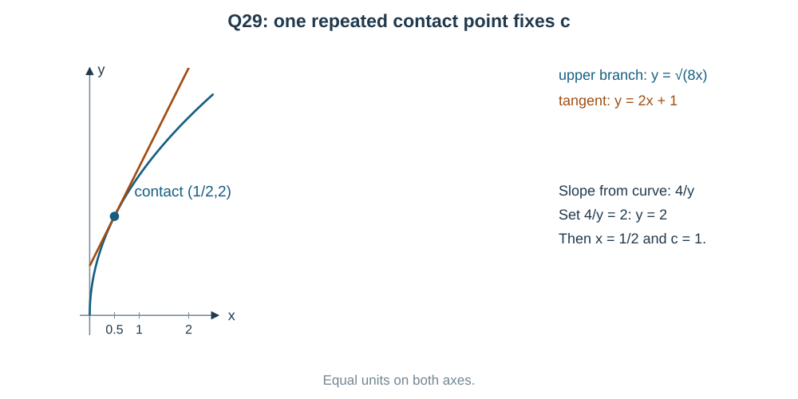

Put the point in $y=2x+c$:
$2=2(1/2)+c\Rightarrow\boxed{c=1}$, **(d)**.

**Another possible approach:** substitute the line into the curve:
$4x^2+(4c-8)x+c^2=0$.
The discriminant must vanish:
$(4c-8)^2-16c^2=64(1-c)=0$.
It gives $c=1$ again.

---

### Question 30 — Rolle's theorem locates a horizontal tangent

**PDF page 57 | MCQ | Notes: C12**

For $f(x)=x^3-3x$ on $[0,\sqrt3]$, the value of $c$ satisfying Rolle's theorem is

- (a) $\dfrac{\sqrt3}2$
- (b) $1$
- (c) $\sqrt3$
- (d) $\dfrac32$

**Supporting source extension — check Rolle's conditions.** A polynomial is continuous and differentiable, and
$f(0)=0=f(\sqrt3)$. So at least one horizontal tangent lies inside.

$$
f'(c)=3c^2-3=0\Rightarrow c=\pm1.
$$

Only $1$ belongs to $(0,\sqrt3)$, hence $\boxed{c=1}$, **(b)**. The theorem does not allow choosing a stationary point outside the specified interval.

---

### Question 31 — Split the first term into two equal positive terms

**PDF page 57 | Numerical value | Notes: C08**

The minimum value of $2x+\dfrac1{x^2}$ for $x>0$ is ____.

**Did you notice that $2x$ can become two equal terms?** This gives three positive terms with fixed product:

$$
2x+\frac1{x^2}=x+x+\frac1{x^2}
\ge3\sqrt[3]{x\cdot x\cdot x^{-2}}=3.
$$

Equality needs $x=x^{-2}$, so $x=1$ in the positive domain. The minimum is $\boxed3$.

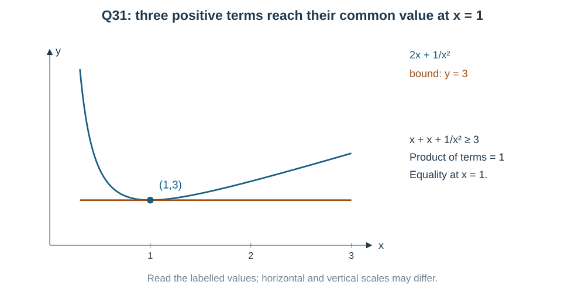

**Another possible approach:** $f'=2-2/x^3$ is negative for $0<x<1$ and positive for $x>1$. Thus $f(1)=3$ is the global minimum. The split into three terms is shorter once we see the fixed product.

---

### Question 32 — A bound on slope gives a bound on total rise

**PDF page 57 | MCQ | Notes: C03,C12**

If $f$ is differentiable on $\mathbb R$, $f(1)=2$ and $f^\prime(x)\le2$ for all $x$, then the largest possible value of $f(4)$ is

- (a) $6$
- (b) $8$
- (c) $10$
- (d) $4$

**Slope at most $2$ means the output can rise by at most $2$ per unit input.** To prove it with monotonicity, remove that allowed linear rise:

$$
g(x)=f(x)-2x,\qquad g'(x)=f'(x)-2\le0.
$$

Thus $g(4)\le g(1)$:

$$
f(4)-8\le2-2=0\Rightarrow f(4)\le8.
$$

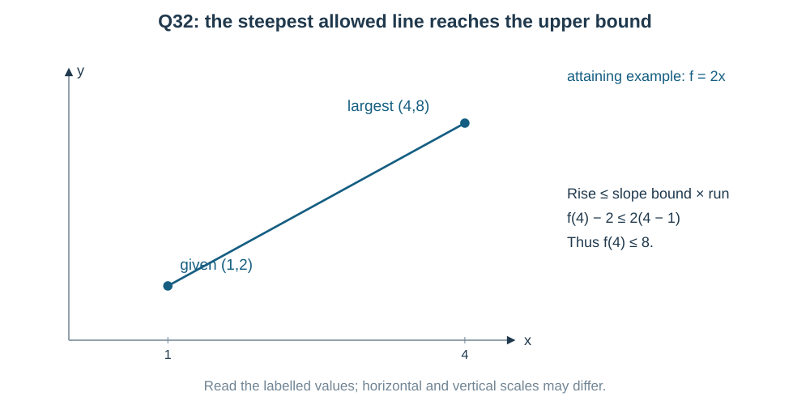

The function $f(x)=2x$ satisfies every condition and reaches $8$. Therefore the **largest possible** value is $\boxed8$, **(b)**.

**Another possible approach — mean value theorem, supporting extension:**
$f(4)-f(1)=f'(c)(4-1)\le2(3)=6$.
This gives the same bound. An example attaining it is still needed.

---

### Question 33 — The constraint leaves just one free variable

**PDF page 57 | Numerical value | Notes: C10,C08**

If $x,y>0$ and $x+y=30$, then the maximum value of $x^2y$ is ____.

**The sum condition removes one unknown.** Put $y=30-x$, with $0<x<30$.

$$
P=x^2(30-x),\qquad P'=60x-3x^2=3x(20-x).
$$

So $P$ rises before $20$ and falls after $20$. The endpoint limits are zero. At $x=20$, $y=10$:
$P_{\max}=20^2(10)=\boxed{4000}$.

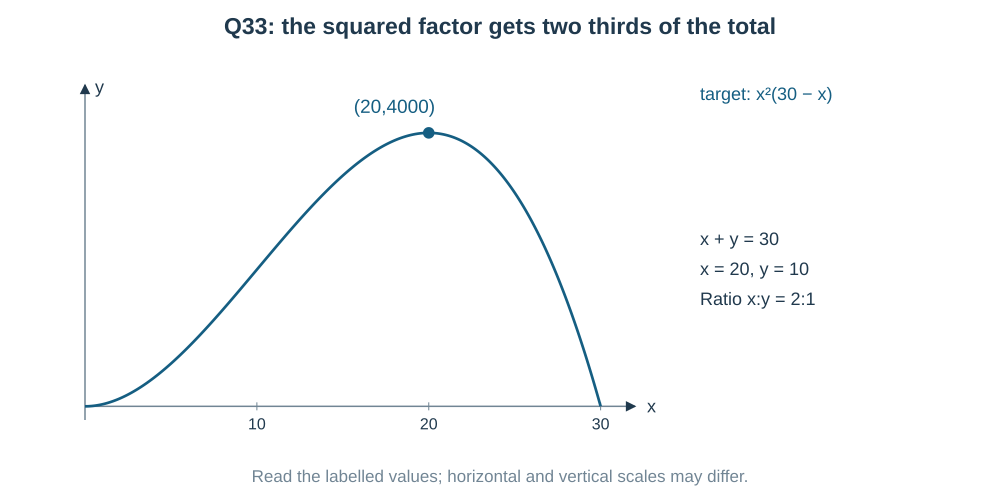

**Another possible approach:** split the repeated factor's share into two parts:

$$
\frac x2+\frac x2+y=30
\Rightarrow
\frac{x^2y}{4}\le\left(\frac{30}3\right)^3=1000.
$$

Equality needs $x/2=y=10$. This gives $4000$ directly. “Equal variables maximize a product” applies to equal powers under the right constraint; here $x$ occurs twice.

---

### Question 34 — Touching gives both a height and a slope equation

**PDF page 57 | MCQ | Notes: C02,C11**

If the parabola $y=ax^2+bx+c$ touches the line $y=x$ at $(1,1)$ and passes through $(-1,0)$, then $(a,b,c)$ is

- (a) $\left(\dfrac12,\dfrac14,\dfrac14\right)$
- (b) $\left(\dfrac14,\dfrac14,\dfrac12\right)$
- (c) $(1,0,0)$
- (d) $\left(\dfrac14,\dfrac12,\dfrac14\right)$

**Touching supplies two facts: same height and same slope.**

$$
a+b+c=1,\qquad 2a+b=1.
$$

Passing through $(-1,0)$ gives $a-b+c=0$.
Subtract the two height equations: $2b=1$, so $b=1/2$.
Then $a=1/4$ and $c=1/4$.

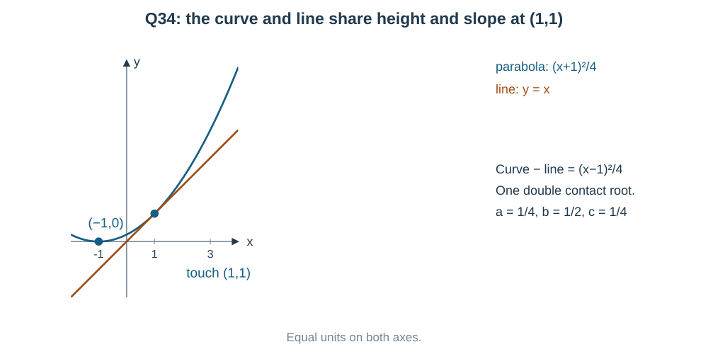

$$
\boxed{(a,b,c)=\left(\frac14,\frac12,\frac14\right)}
\quad\text{(d)}.
$$

**Another possible approach — recognize double contact.** The difference
$ax^2+(b-1)x+c$ has a repeated zero at $1$, so it equals $a(x-1)^2$.
At $x=-1$, curve minus line is $0-(-1)=1$, hence $4a=1$.
Expanding now gives the same coefficients. This is faster when the double-root picture is familiar.

---

### Question 35 — Check each statement using its own definition

**PDF page 57 | MCQ | Notes: C04,C09,C05**

Which of the following statements are correct?

(A) $f(x)=x^3-3x$ has a local maximum at $x=-1$.

(B) $f(x)=x^3-3x$ has a local minimum at $x=1$.

(C) $f(x)=x^4$ has a point of inflection at $x=0$.

(D) The absolute maximum of $\sin x$ on $\mathbb R$ is $1$.

- (a) (A), (B) and (D) only
- (b) (A), (B) and (C) only
- (c) (B), (C) and (D) only
- (d) (A) and (C) only

**Use the correct test for each claim.**

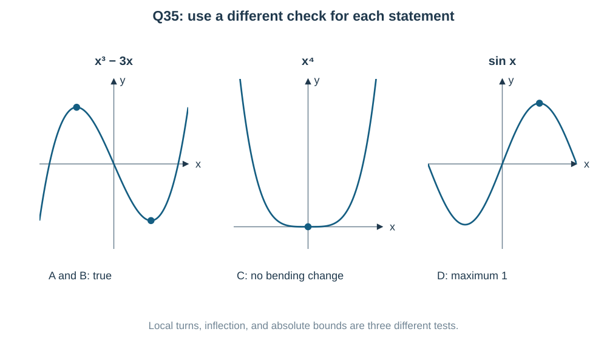

For $x^3-3x$, $f'=3(x-1)(x+1)$ has signs $+,-,+$. Thus $-1$ is a local maximum and $1$ a local minimum: **A and B true**.

For $x^4$, $f''=12x^2$ is positive on both sides of zero. There is no bending change: **C false**.

Finally $\sin x\le1$ for every real $x$, and $1$ is attained at $\pi/2+2k\pi$: **D true**.

Therefore $\boxed{\text{A, B and D only}}$, **(a)**.

## Answer check

Read the qualifications in the solutions before using the key.

| Question | Answer | Question | Answer |
|---|---|---|---|
| 1 | (c) $y=9x-14$ | 19 | $8$ |
| 2 | (a) $x+2y=3$ | 20 | (b) $x-2y+4=0$ |
| 3 | (d) $10$ | 21 | (d) $-12$ |
| 4 | (b) $\tan^{-1}(3/4)$ | 22 | (a) $[-3,3]$ |
| 5 | (b) | 23 | (c) $-1/e$ |
| 6 | (d) $(0,2)$ | 24 | $2$ |
| 7 | (a) $10$ | 25 | $12$ |
| 8 | $49$ | 26 | (c) $0.3\%$ |
| 9 | (c) $1/(10\pi)\ \mathrm{cm/s}$ | 27 | (a) $3\sqrt3/4$ |
| 10 | $1.5$ | 28 | $-2$ |
| 11 | (c) $5.02$ | 29 | (d) $1$ |
| 12 | (a) | 30 | (b) $1$ |
| 13 | (a) | 31 | $3$ |
| 14 | (a) $12$ | 32 | (b) $8$ |
| 15 | $432$ | 33 | $4000$ |
| 16 | (d) $2\sqrt2$ | 34 | (d) $(1/4,1/2,1/4)$ |
| 17 | $3$ | 35 | (a) |
| 18 | (b) $\sqrt2$ |  |  |

## Coverage and source notes

All $35$ source questions are present in order: $25$ MCQs and $10$ numerical questions. The independent answers agree with the intended source key. Supporting tangent/normal, approximation, bending and Rolle questions are retained with their syllabus qualification. Increasing on a union of listed intervals means increasing on each component separately.

The notes include the named current-syllabus applications, the basic derivative tools needed to use them, and the supplied supporting questions. Geometry diagrams show the actual question data. Folded solids are explicitly schematic projections. Useful inequalities and second views remain plain visible.

## Offline research record

- Supplied Maths Predicted V1.pdf, pages 54–59: all stems, options, keys and working read from rendered local pages.
- Official NTA 2027 Mathematics Unit 7: rates, monotonicity, maxima/minima; separate source extensions identified.
- ExamSIDE, Application of Derivatives: $25,14,11$ recent questions; all $50$ archive IDs saved and recounted.
- PYQSide, Mathematics Weightage: comparison $24,12,10$; classification disagreement disclosed.

The pooled mean is $50/58$, using full-year paper denominators $20,19,19$. This is recent archive-card research, not an exhaustive $2020$–$2026$ official-paper or formula-frequency audit. Original source questions are practice questions, not claimed as actual PYQs.
