# Indefinite Integration — JEE Main revision guide

*Differentiation asks for the rate of a function. Indefinite integration goes backwards: the rate is given, and we look for a function that has that rate.*

> **For Kanna | Chapter 12**  
> Goal: about $120/300$ towards $200/300$ — Physics $60$, Maths $60$, Chemistry $80$.  
> Notes, recap, then all $20$ supplied questions. Every useful alternative stays visible.

## Recent chapter weightage

**ExamSIDE's separate Indefinite Integrals category gives $23/58\approx0.40$ questions per Paper 1 in 2024–2026.**

| Year | Full-year papers | Chapter questions | Questions per paper |
|---|---:|---:|---:|
| $2024$ | $20$ | $8$ | $0.40$ |
| $2025$ | $19$ | $8$ | $0.42$ |
| $2026$ | $19$ | $7$ | $0.37$ |
| Together | $58$ | $23$ | $0.40$ |

All $23$ unique recent archive IDs were retained and recounted. The same archive separately gives Definite Integration $43,23,31$, with no shared IDs between the two sets. PYQSide instead has one combined Integrals category: $52,30,36$. That is a different scope; it cannot supply an honest indefinite-only split. We do not add it to these counts.

These are archive-card counts, not an independently reclassified official-paper census or measured formula-frequency audit. The offered-question format differed in $2024$. A mean is not a prediction for one shift.

**Study priority:** standard primitives with correct scale factors, substitution, parts, partial fractions, trig identities, and checking by differentiation. These tools also support definite integrals, so the standalone mean understates their usefulness across calculus.

## Source difficulties before studying

The official integration unit includes antiderivatives of fundamental functions, substitution, parts, partial fractions and trig identities, together with standard rational and radical forms.

- **Q6:** the keyed formula works separately for $x>0$ and $x<0$, but is undefined and jumps at $0$. The original integrand is smooth there. We explain this and give a smooth all-real answer too.
- **Q11:** the printed $\sec^{-1}x$ match needs $x>1$ under the usual principal-value convention. For negative inputs, use the corrected domain-aware primitive.

These are source qualifications, not changes to the printed questions. Preserve domain information; a familiar formula without its conditions can have the wrong sign.

## Concept C01 — What does an indefinite integral return?

If $F'(x)=f(x)$ on an interval, $F$ is an **antiderivative**, also called a primitive, of $f$. The indefinite integral means the whole family:

$$
\boxed{\int f(x)\,dx=F(x)+C}.
$$

Here $f$ is the integrand, $dx$ names the variable, and $C$ is any constant. The output is a family of functions, not one numerical area.

Why $C$? The derivatives of $x^2$, $x^2+3$, and $x^2-2$ are all $2x$. Raising a graph by a constant changes its height but leaves every slope unchanged.

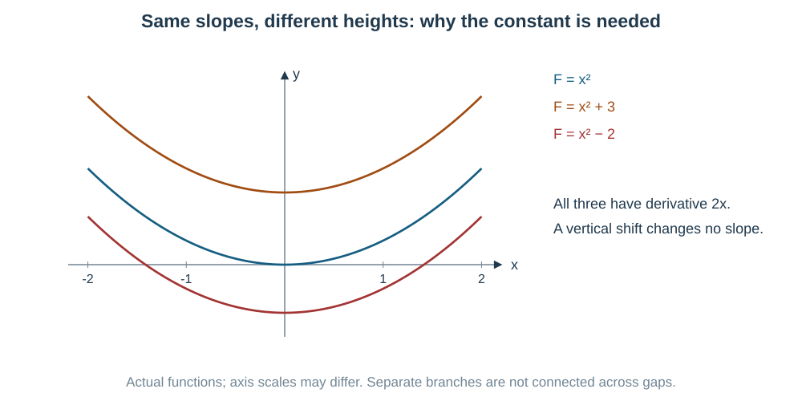

For example, $\int2x\,dx=x^2+C$. If we also know $F(0)=3$, then $C=3$ and the family reduces to one member.

**Important for JEE Main: differentiation is the final check.** An answer is correct if its derivative equals the **original integrand on the stated interval**. Two different-looking answers can differ only by a constant on a connected interval.

Linearity is allowed:

$$
\int(af+bg)\,dx=a\int f\,dx+b\int g\,dx
$$

for constants $a,b$. But in general
$\int fg\ne(\int f)(\int g)$ and
$\int(f/g)\ne(\int f)/(\int g)$. For example, $\int x^2dx=x^3/3+C$, whereas $(\int xdx)^2$ has the wrong derivative.

## Concept C02 — Logs, absolute values and separate intervals

The real $\ln x$ is defined only for $x>0$. Yet $1/x$ exists for negative $x$ too:

$$
\boxed{\int\frac{dx}x=\ln|x|+C}\qquad(x\ne0).
$$

For $x<0$, $\ln|x|=\ln(-x)$ and its derivative is $(-1)/(-x)=1/x$. The absolute value makes the log input positive; it does not make the derivative positive.

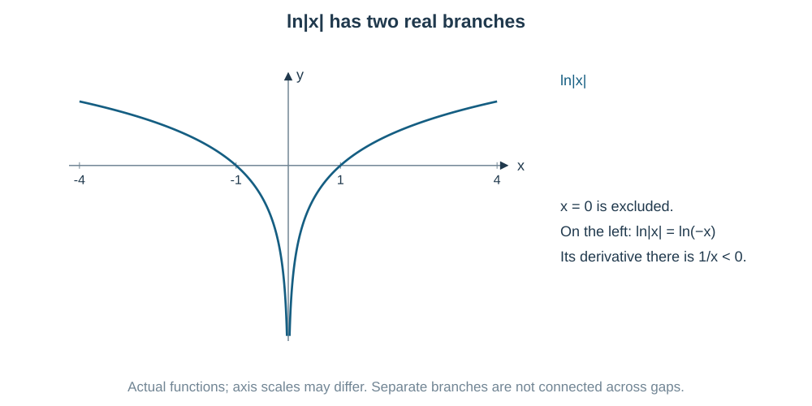

**The interval matters.** A primitive can have one constant on $(-\infty,0)$ and another on $(0,\infty)$. There is no requirement to join across a point where the original function is undefined.

The useful pattern is

$$
\boxed{\int\frac{g'(x)}{g(x)}\,dx=\ln|g(x)|+C}
$$

where $g\ne0$ on the interval. For instance,
$\int2x/(x^2+3)\,dx=\ln(x^2+3)+C$; here the inside is always positive.

## Concept C03 — Standard primitives and the inner scale

**Important for JEE Main.** Each row comes from differentiating the expression on the right. All answers include $+C$.

| Integrand | A primitive | Conditions |
|---|---|---|
| $x^n$ | $x^{n+1}/(n+1)$ | $n\ne-1$; work on a real differentiable power domain |
| $1/x$ | $\ln|x|$ | $x\ne0$ |
| $e^x$ | $e^x$ | all real $x$ |
| $a^x$ | $a^x/\ln a$ | $a>0$, $a\ne1$ |
| $\sin x$ | $-\cos x$ | radians |
| $\cos x$ | $\sin x$ | radians |
| $\sec^2x$ | $\tan x$ | $\cos x\ne0$ |
| $\csc^2x$ | $-\cot x$ | $\sin x\ne0$ |
| $\sec x\tan x$ | $\sec x$ | $\cos x\ne0$ |
| $\csc x\cot x$ | $-\csc x$ | $\sin x\ne0$ |
| $\tan x$ | $-\ln|\cos x|$ | $\cos x\ne0$ |
| $\cot x$ | $\ln|\sin x|$ | $\sin x\ne0$ |
| $\sec x$ | $\ln|\sec x+\tan x|$ | $\cos x\ne0$ |
| $\csc x$ | $\ln|\csc x-\cot x|$ | $\sin x\ne0$ |

To see the secant row, multiply by $(\sec x+\tan x)/(\sec x+\tan x)$. The numerator becomes the derivative of the denominator. This also explains the log rather than treating it as a magic formula.

**Inner-scale rule:** for constant $k\ne0$,

$$
\int f(kx+b)\,dx=\frac1kF(kx+b)+C,\quad F'=f.
$$

The $1/k$ cancels the extra $k$ when we differentiate. For example,
$\int e^{2x}dx=e^{2x}/2+C$.

For $a>0$:

$$
\begin{aligned}
\int\frac{dx}{a^2+x^2}&=\frac1a\tan^{-1}\frac xa+C,\\
\int\frac{dx}{\sqrt{a^2-x^2}}&=\sin^{-1}\frac xa+C
&&(|x|<a),\\
\int\frac{dx}{a^2-x^2}&=\frac1{2a}\ln\left|\frac{a+x}{a-x}\right|+C
&&(x\ne\pm a),\\
\int\frac{dx}{x^2-a^2}&=\frac1{2a}\ln\left|\frac{x-a}{x+a}\right|+C
&&(x\ne\pm a),\\
\int\frac{dx}{\sqrt{x^2+a^2}}&=\ln\left(x+\sqrt{x^2+a^2}\right)+C,\\
\int\frac{dx}{\sqrt{x^2-a^2}}&=\ln\left|x+\sqrt{x^2-a^2}\right|+C
&&(|x|>a),\\
\int\frac{dx}{x\sqrt{x^2-a^2}}&=\frac1a\sec^{-1}\frac{|x|}a+C
&&(|x|>a).
\end{aligned}
$$

**Inverse trig notation:** $\tan^{-1}u$ means arctangent, not $1/\tan u$. The usual principal $\sec^{-1}u$ has derivative $1/(|u|\sqrt{u^2-1})$; the absolute value is why the final row needs care.

## Concept C04 — Substitution is the chain rule backwards

Suppose the integrand contains an inner expression $g(x)$ **and its derivative**:

$$
\int f(g(x))g'(x)\,dx.
$$

Set $u=g(x)$, so $du=g'(x)\,dx$. The integral becomes $\int f(u)\,du$. After integrating, put $u$ back.

**Did you notice the matching pair?**

$$
\int\frac{2x}{1+x^4}\,dx,\qquad
u=x^2,\quad du=2x\,dx
\quad\Rightarrow\quad
\int\frac{du}{1+u^2}=\tan^{-1}u+C.
$$

The fourth power becomes $u^2$, while $2x\,dx$ becomes exactly $du$. This is a useful substitution because it removes **all** the old $x$.

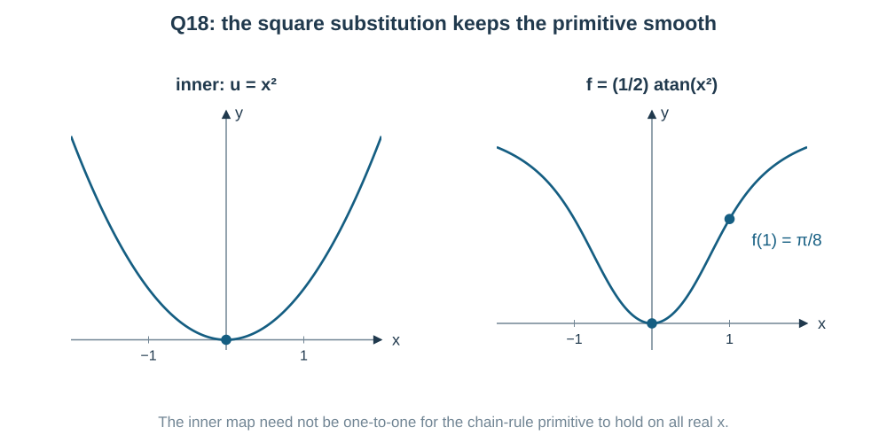

**Bad route check:** setting $u=x^4$ in $\int x/(1+x^4)dx$ leaves a factor $x^{-2}$ after forming $du$. It can be repaired, but it is longer. $u=x^2$ matches the numerator immediately.

## Concept C05 — Reverse a product or quotient before using parts

**Important for JEE Main.** If you see $e^x$ multiplying a function plus its derivative, the product rule is already present:

$$
\frac d{dx}(e^xg)=e^x(g+g')
\quad\Rightarrow\quad
\boxed{\int e^x(g+g')\,dx=e^xg+C}.
$$

More generally, $\int e^{ax}[g'+ag]dx=e^{ax}g+C$.
For $g=\sin x$, this gives $\int e^x(\sin x+\cos x)dx=e^x\sin x+C$.

For a quotient:

$$
\frac d{dx}\frac{g}{h}=\frac{hg'-gh'}{h^2},\quad h\ne0.
$$

In Q3, $e^x(1/x-1/x^2)$ is the derivative of $e^x/x$. Separate integration by parts would create an integral that leads back to the original one. Seeing the combined derivative saves that loop.

## Concept C06 — Integration by parts moves a derivative

**Important for JEE Main.** Start with the product rule:
$(uv)'=u'v+uv'$.
Rearrange and integrate:

$$
\boxed{\int u\,dv=uv-\int v\,du}.
$$

Choose $u$ so differentiation makes it simpler, and $dv$ so its primitive is easy. The aim is a **simpler new integral**, not just a legal formula substitution.

| Product type | Useful choice | Why |
|---|---|---|
| polynomial $\times e^{ax}$ or trig | polynomial as $u$ | its degree falls |
| $\ln x$ or inverse trig alone | that function as $u$, $dv=dx$ | derivative becomes rational/algebraic |
| polynomial $\times\ln x$ | log as $u$ often helps | $d(\ln x)=dx/x$ cancels powers |
| exponential $\times$ trig | parts twice if no combined derivative is visible | the original integral returns; solve algebraically |

Example:

$$
\int xe^{2x}dx
=\frac{xe^{2x}}2-\frac12\int e^{2x}dx
=e^{2x}\left(\frac x2-\frac14\right)+C.
$$

For $a^2+b^2>0$, the repeated-parts results are

$$
\begin{aligned}
\int e^{ax}\sin bx\,dx&=
\frac{e^{ax}(a\sin bx-b\cos bx)}{a^2+b^2}+C,\\
\int e^{ax}\cos bx\,dx&=
\frac{e^{ax}(a\cos bx+b\sin bx)}{a^2+b^2}+C.
\end{aligned}
$$

Use these after checking the combined-derivative pattern first. A mnemonic for choosing $u$ is only a hint, not a law.

## Concept C07 — Trig integrals: keep a derivative factor

**Important for JEE Main.** Do not integrate a power by blindly raising the power again. For example, $(\tan^4x/4)'=\tan^3x\sec^2x$, which has an extra factor.

Use the identities

$$
\sin^2x+\cos^2x=1,\quad
\sec^2x=1+\tan^2x,\quad
\csc^2x=1+\cot^2x.
$$

| Visible power pattern | Useful route |
|---|---|
| $\sin^{2k+1}x\cos^n x$ | Save $\sin x\,dx$, convert remaining $\sin^2x$; use $u=\cos x$ |
| $\cos^{2k+1}x\sin^n x$ | Save $\cos x\,dx$; use $u=\sin x$ |
| Both sine/cosine powers even | $\sin^2x=(1-\cos2x)/2$, $\cos^2x=(1+\cos2x)/2$ |
| Even secant power with tangent powers | Save $\sec^2x\,dx$; use $u=\tan x$ |
| Odd tangent power with a secant factor | Save $\sec x\tan x\,dx$ when the remaining factors become powers of $\sec x$ |
| Product of trig waves | Product-to-sum can separate the frequencies |

The table is for nonnegative integer power patterns in their domains. Check the leftover factors before choosing.

For Q5,
$\tan^3x=\tan x(\sec^2x-1)$.
For Q19,
$\sec^4x=(1+\tan^2x)\sec^2x$.
Each rewrite saves a useful derivative.

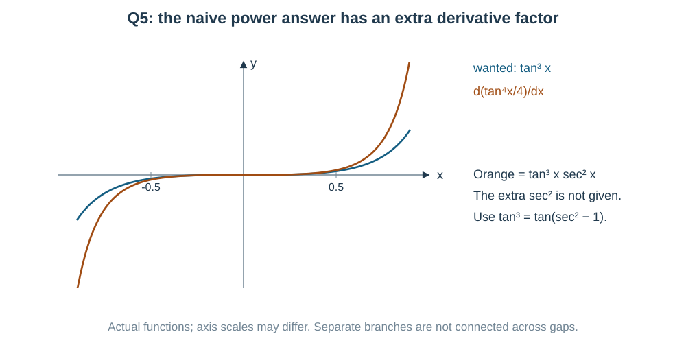

Useful product-to-sum formulas:

$$
\begin{aligned}
2\sin A\cos B&=\sin(A+B)+\sin(A-B),\\
2\cos A\cos B&=\cos(A+B)+\cos(A-B),\\
2\sin A\sin B&=\cos(A-B)-\cos(A+B).
\end{aligned}
$$

## Concept C08 — Partial fractions undo a combined denominator

**Important for JEE Main.** A rational function is a polynomial divided by another polynomial. If the numerator degree is at least the denominator degree, first divide. Then split a proper fraction into pieces we can integrate.

$$
\frac{x+5}{(x+1)(x+3)}
=\frac A{x+1}+\frac B{x+3}.
$$

Multiplying by the denominator gives an identity:

$$
x+5=A(x+3)+B(x+1).
$$

Choose $x=-1$ to isolate $A=2$ and $x=-3$ to isolate $B=-1$. We use those values in the **polynomial identity**, not as inputs in the original undefined fraction.

Then integrate the simpler terms as logs. The original exclusions $x=-1,-3$ stay excluded.

Templates worth remembering:

$$
\begin{aligned}
\frac{P(x)}{(x-a)(x-b)}&=\frac A{x-a}+\frac B{x-b},\quad a\ne b,\\
\frac{P(x)}{(x-a)^2}&=\frac A{x-a}+\frac B{(x-a)^2}
\quad\text{after polynomial division if needed},\\
\frac{P(x)}{(x-a)(x^2+px+q)}
&=\frac A{x-a}+\frac{Bx+C}{x^2+px+q}
\end{aligned}
$$

for a real irreducible quadratic in the last row. Include every repeated power, and use a linear numerator over a quadratic. Determine coefficients by an identity, not by guessing from the integrals.

## Concept C09 — Complete the square before deciding “log or inverse tan”

For a quadratic $q(x)=ax^2+bx+c$, $a\ne0$:

$$
q=a\left[\left(x+\frac b{2a}\right)^2+
\frac{4ac-b^2}{4a^2}\right].
$$

After shifting the input, a **sum of squares** gives inverse tangent; a **difference of squares** gives logs via partial fractions. A perfect square gives a power integral.

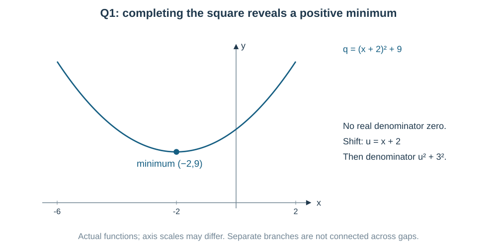

If the numerator is $Mx+N$, first match the denominator derivative:

$$
Mx+N=\frac{M}{2a}(2ax+b)+
\left(N-\frac{Mb}{2a}\right).
$$

The first part integrates to $(M/2a)\ln|q|$; the constant part uses the completed-square standard form.

**Reciprocal quartic clue:** for Q6 divide numerator and denominator by $x^2$ on $x\ne0$:

$$
\frac{x^2+1}{x^4+1}
=\frac{1+x^{-2}}{x^2+x^{-2}}
=\frac{1+x^{-2}}{(x-x^{-1})^2+2}.
$$

Now $u=x-1/x$ has exactly the required derivative $1+1/x^2$. Notice the **minus** in $u$: differentiating $-1/x$ gives a plus. We will separately check the missing input $0$ before claiming an all-real answer.

## Concept C10 — Radicals and a triangle

**Important for JEE Main.** Choose a substitution that makes the radical simpler:

| Radical | Useful substitution | Interval/sign check |
|---|---|---|
| $\sqrt{a^2-x^2}$ | $x=a\sin\theta$ | choose $\theta\in[-\pi/2,\pi/2]$, so $\sqrt{a^2-x^2}=a\cos\theta$ |
| $\sqrt{x^2+a^2}$ | $x=a\tan\theta$ | choose $\theta\in(-\pi/2,\pi/2)$, so secant is positive |
| $\sqrt{x^2-a^2}$ | $x=a\sec\theta$ on a suitable branch | track signs; $\sqrt{\tan^2\theta}=|\tan\theta|$ |

Here $a>0$. The square root always means the nonnegative root.

For the circular radical, the point $(x,\sqrt{1-x^2})$ lies on the upper unit semicircle. If $x=\sin\theta$ on the principal interval, the other triangle side is $\cos\theta\ge0$.

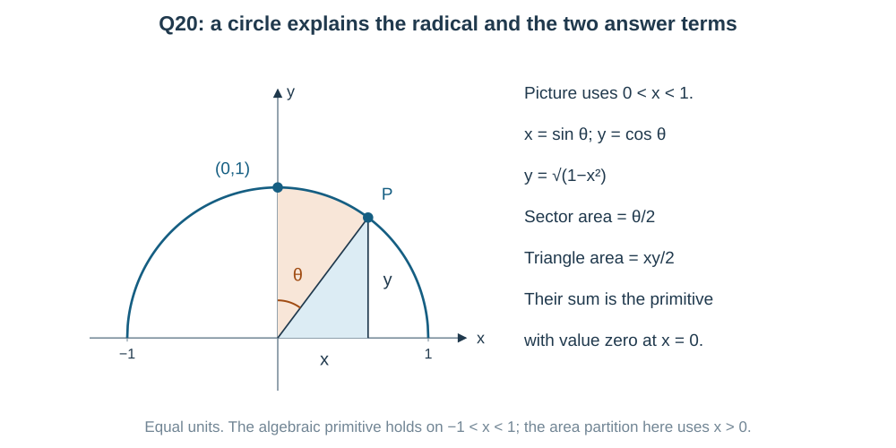

Then

$$
\int\sqrt{1-x^2}\,dx
=\int\cos^2\theta\,d\theta
=\frac12(\theta+\sin\theta\cos\theta)+C.
$$

Putting the original variable back gives
$[x\sqrt{1-x^2}+\sin^{-1}x]/2+C$.

Standard radical primitives for $a>0$:

$$
\begin{aligned}
\int\sqrt{a^2-x^2}\,dx
&=\frac12\left[x\sqrt{a^2-x^2}
+a^2\sin^{-1}\frac xa\right]+C,\\
\int\sqrt{x^2+a^2}\,dx
&=\frac12\left[x\sqrt{x^2+a^2}
+a^2\ln\left|x+\sqrt{x^2+a^2}\right|\right]+C,\\
\int\sqrt{x^2-a^2}\,dx
&=\frac12\left[x\sqrt{x^2-a^2}
-a^2\ln\left|x+\sqrt{x^2-a^2}\right|\right]+C.
\end{aligned}
$$

Use their real interior domains; endpoint values may be obtained by continuity where finite. The signs in front of the log follow the sign under the radical.

**General quadratic radicals — Important for JEE Main.** The syllabus also lists $1/\sqrt{ax^2+bx+c}$ and $(Mx+N)/\sqrt{ax^2+bx+c}$. Do not memorize each shifted version separately.

For $q(x)=ax^2+bx+c$, $a\ne0$, work on an interval where $q>0$. Match its derivative:

$$
Mx+N=\frac M{2a}(2ax+b)+
\left(N-\frac{Mb}{2a}\right).
$$

Since $(\sqrt q)'=q'/(2\sqrt q)$,

$$
\boxed{
\int\frac{Mx+N}{\sqrt q}\,dx
=\frac Ma\sqrt q+
\left(N-\frac{Mb}{2a}\right)\int\frac{dx}{\sqrt q}}.
$$

Include the final $+C$ after evaluating the remaining integral. Complete the square in that integral, then use the standard sum/difference radical rows from C03. For example,

$$
\begin{aligned}
\int\frac{dx}{\sqrt{-x^2+4x+5}}
&=\int\frac{dx}{\sqrt{9-(x-2)^2}}
=\sin^{-1}\frac{x-2}3+C,\quad -1<x<5,\\
\int\frac{dx}{\sqrt{2x^2+4x+6}}
&=\frac1{\sqrt2}\int\frac{dx}{\sqrt{(x+1)^2+2}}\\
&=\frac1{\sqrt2}\ln\left(x+1+\sqrt{(x+1)^2+2}\right)+C.
\end{aligned}
$$

For $\int\sqrt{ax^2+bx+c}\,dx$, the same shift and scale reduce it to one of the three radical primitives above. If $a=0$, the inside is linear and $u=bx+c$ is simpler. Always determine the real interval before taking a square root outside a factor.

## Concept C11 — Simplify roots or combine trig waves first

**Conjugate clue:** with $\sqrt{x+1}+\sqrt x$ below the fraction, multiply by the difference:

$$
\frac1{\sqrt{x+1}+\sqrt x}
=\frac{\sqrt{x+1}-\sqrt x}{(x+1)-x}
=\sqrt{x+1}-\sqrt x.
$$

Now ordinary power integration is enough. Expanding a power series here would be much longer and would introduce a convergence question that we do not need.

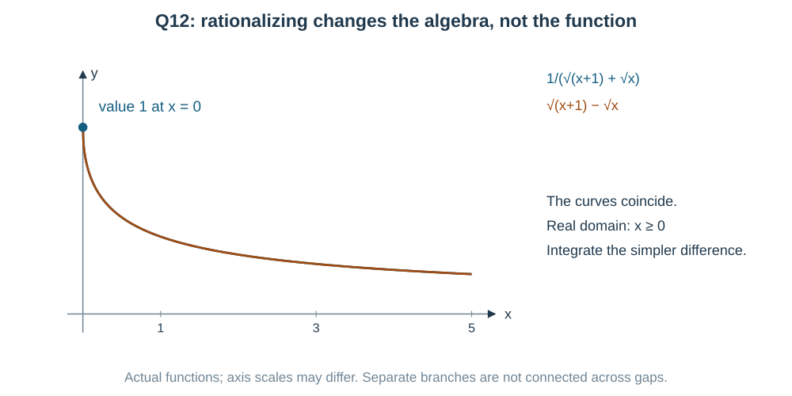

**Shifted-wave clue:** write

$$
A\cos x+B\sin x=R\cos(x-\phi),\quad
R=\sqrt{A^2+B^2}>0,
$$

where $R\cos\phi=A$, $R\sin\phi=B$. A reciprocal then becomes a scaled secant integral. This is simpler than the general half-angle substitution when the denominator is just one linear combination.

For a more general rational expression in $\sin x,\cos x$, set $t=\tan(x/2)$:

$$
\sin x=\frac{2t}{1+t^2},\quad
\cos x=\frac{1-t^2}{1+t^2},\quad
dx=\frac{2\,dt}{1+t^2}.
$$

It converts the problem into a rational integral. Use it on intervals where the substitution is defined; $x=(2k+1)\pi$ is a break of this coordinate formula even when the original integrand is finite there. A shorter identity or derivative match should be tried first.

For rational powers such as $x^{1/2}$ and $x^{1/3}$ together on $x>0$, $x=t^6$ can remove both fractional powers. For a lone $\sqrt{ax+b}$, $t=\sqrt{ax+b}$ may help. The substitution must simplify the entire integrand, including $dx$.

## Concept C12 — A primitive formula can have a branch jump

Inverse trig functions return principal angles. They do not automatically join through every input introduced by a substitution.

In Q6 the original function is positive and continuous for all real $x$, so any all-real primitive should be smooth and increasing. The printed expression

$$
P(x)=\frac1{\sqrt2}\tan^{-1}\left(\frac{x^2-1}{\sqrt2\,x}\right)
$$

has a jump at $0$. Its derivative is correct on each side, but the formula alone is not an all-real primitive.

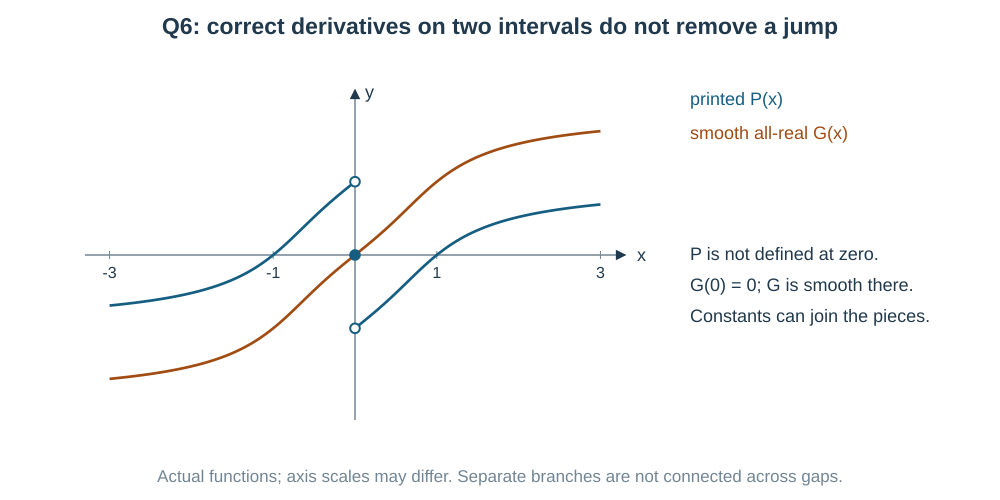

A globally smooth alternative is

$$
G(x)=\frac1{\sqrt2}
\left[\tan^{-1}(\sqrt2x+1)+\tan^{-1}(\sqrt2x-1)\right].
$$

Its derivative is the original integrand at every real input. The solution shows the algebra. The lesson is useful beyond this question: **check the original domain and the transformed formula's domain separately**.

For Q11, $\sec^{-1}x$ has positive derivative on both $x>1$ and $x<-1$, whereas $1/[x\sqrt{x^2-1}]$ is negative on $x<-1$. A safe primitive is $\sec^{-1}|x|$, or $\tan^{-1}\sqrt{x^2-1}$, on the two separate intervals.

## Concept C13 — Given answer forms and initial values can save work

**Important for JEE Main.** If a question gives a proposed answer with unknown coefficients, differentiate it and compare with the original integrand.

For Q14:

$$
\frac d{dx}\left[e^{x^2}(ax^2+b)\right]
=e^{x^2}\left[2ax^3+2(a+b)x\right].
$$

To equal $x^3e^{x^2}$, match $2a=1$ and $a+b=0$. This is a usable alternative to doing substitution and parts.

If a condition gives $F(a)=b$, first find $F=G+C$, then $C=b-G(a)$. Do not put $C=0$ just because the given value is zero; $G(a)$ may not be zero.

**Method-choice card**

| What you see | First useful question |
|---|---|
| An inner expression with its derivative nearby | Can $u=g(x)$ remove every old $x$? |
| $e^x(g+g')$ or a quotient pattern | Is this already one derivative? |
| A polynomial times an exponential | Will parts lower the polynomial degree? |
| A rational function | Divide if needed, then derivative match / complete square / partial fractions |
| Trig powers | Which derivative factor can I save? |
| Root sum in a denominator | Does its conjugate give a simple denominator? |
| A circular radical | Can a triangle remove it with a sign-controlled trig substitution? |
| A supplied primitive with unknown constants | Is differentiating the proposed form shorter? |

## Last-minute formula recap

$$
\begin{gathered}
\int x^n dx=\frac{x^{n+1}}{n+1}+C\ (n\ne-1),\qquad
\int\frac{g'}g dx=\ln|g|+C,\\
\int f(g)g'\,dx=F(g)+C\quad(F'=f),\qquad
\int u\,dv=uv-\int v\,du,\\
\int e^{ax}(g'+ag)\,dx=e^{ax}g+C,\\
\int\frac{dx}{a^2+x^2}=\frac1a\tan^{-1}\frac xa+C,\quad
\int\frac{dx}{\sqrt{a^2-x^2}}=\sin^{-1}\frac xa+C,\\
\int\sec x\,dx=\ln|\sec x+\tan x|+C,\qquad
\int\tan x\,dx=-\ln|\cos x|+C.
\end{gathered}
$$

Here $a>0$ and all domain conditions from the full tables still apply. Remember the power, exponential and trig primitive table in C03 and the three radical formulas in C10.

**Final check:** differentiate; check inner factors; keep $+C$; keep excluded points; and use the given value only after finding the general primitive.

## Worked solutions to the 20 PDF questions

Read the question first. Notice the pattern, choose a route, then calculate. Alternative methods below are fully visible.

### Question 1 — Complete the square to expose a standard integral

**PDF page 60 | MCQ | Notes: C03,C09**

$\displaystyle\int\frac{dx}{x^2+4x+13}$ equals

- (a) $\frac12\tan^{-1}\left(\frac{x+2}2\right)+C$
- (b) $\tan^{-1}(x+2)+C$
- (c) $\frac13\tan^{-1}\left(\frac{x+2}3\right)+C$
- (d) $\frac13\tan^{-1}\left(\frac{x+2}9\right)+C$

**Did you notice a quadratic below a constant numerator?** First ask whether it can become a sum of squares:

$$
x^2+4x+13=(x+2)^2+9.
$$

Put $u=x+2$, $du=dx$. Then

$$
\int\frac{du}{u^2+3^2}
=\boxed{\frac13\tan^{-1}\frac{x+2}3+C}\quad\text{(c)}.
$$

**Check the scale:** differentiating gives
$\frac13\frac{1/3}{1+(x+2)^2/9}=1/[(x+2)^2+9]$.
The two factors of $1/3$ have different jobs: one is outside the primitive; one comes from differentiating the inside.

---

### Question 2 — See the product rule backwards

**PDF page 60 | MCQ | Notes: C05**

$\displaystyle\int e^x(\sin x+\cos x)\,dx$ equals

- (a) $e^x\sin x+C$
- (b) $e^x\cos x+C$
- (c) $e^x(\sin x-\cos x)+C$
- (d) $\dfrac{e^x\sin x}2+C$

**This is already a product derivative.** Did you notice that the derivative of $\sin x$ is the other term, $\cos x$?

$$
\frac d{dx}(e^x\sin x)
=e^x\sin x+e^x\cos x.
$$

Therefore
$\boxed{\int e^x(\sin x+\cos x)\,dx=e^x\sin x+C}$, **(a)**, for all real $x$.

**Another possible approach:** integrate the sine term by parts:
$\int e^x\sin x=e^x\sin x-\int e^x\cos x$.
The remaining cosine integral cancels the original cosine term. The reverse-product view sees that cancellation before calculating.

---

### Question 3 — A quotient derivative is already present

**PDF page 60 | MCQ | Notes: C05**

$\displaystyle\int e^x\left(\frac1x-\frac1{x^2}\right)\,dx$ equals

- (a) $e^x\ln x+C$
- (b) $-\dfrac{e^x}x+C$
- (c) $\dfrac{e^x}{x^2}+C$
- (d) $\dfrac{e^x}x+C$

**Read the two terms as one derivative pattern.** The derivative of $1/x$ is $-1/x^2$, so

$$
\frac d{dx}\left(e^x\frac1x\right)
=e^x\left(\frac1x-\frac1{x^2}\right).
$$

Thus $\boxed{e^x/x+C}$, **(d)**, on an interval with $x\ne0$.

**Another possible view:** the quotient rule gives
$(e^x/x)'=(xe^x-e^x)/x^2$, exactly the same integrand. Splitting and trying parts repeatedly is possible but hides the cancellation. Keep the two terms together.

---

### Question 4 — Integration by parts removes the polynomial factor

**PDF page 60 | MCQ | Notes: C06**

$\displaystyle\int xe^{2x}\,dx$ equals

- (a) $e^{2x}\left(\frac x2+\frac14\right)+C$
- (b) $e^{2x}\left(\frac x2-\frac14\right)+C$
- (c) $e^{2x}(x-1)+C$
- (d) $\dfrac{x^2e^{2x}}4+C$

**The factor $x$ becomes simpler when differentiated.** Use parts with $u=x$, $dv=e^{2x}dx$. Then $du=dx$ and $v=e^{2x}/2$.

$$
\begin{aligned}
I&=\frac{xe^{2x}}2-\frac12\int e^{2x}dx\\
&=\boxed{e^{2x}\left(\frac x2-\frac14\right)+C}
\quad\text{(b)}.
\end{aligned}
$$

**Another possible approach — use the answer's shape.** Try $e^{2x}(Ax+B)$. Its derivative is
$e^{2x}[2Ax+(2B+A)]$.
Matching $xe^{2x}$ gives $A=1/2$, $B=-1/4$.
Both routes are short; parts is the general reusable method.

---

### Question 5 — Save a tangent derivative by using an identity

**PDF page 60 | MCQ | Notes: C07**

$\displaystyle\int\tan^3x\,dx$ equals

- (a) $\dfrac{\tan^2x}2-\ln|\cos x|+C$
- (b) $\dfrac{\tan^2x}2+\ln|\cos x|+C$
- (c) $\dfrac{\tan^4x}4+C$
- (d) $\dfrac{\sec^2x}2+\ln|\sin x|+C$

**Why not write $\tan^4x/4$?** Differentiating it gives $\tan^3x\sec^2x$, with an extra factor absent from the question.

Save a known derivative by writing

$$
\tan^3x=\tan x(\sec^2x-1).
$$

Then

$$
\int\tan^3x\,dx
=\int\tan x\sec^2x\,dx-\int\tan x\,dx
=\boxed{\frac{\tan^2x}2+\ln|\cos x|+C}
\quad\text{(b)}.
$$

For the first term use $u=\tan x$; for the second use the standard tangent primitive. Work on intervals where $\cos x\ne0$.

---

### Question 6 — The reciprocal substitution works on separate intervals

**PDF page 60 | MCQ | Notes: C04,C09,C12**

$\displaystyle\int\frac{x^2+1}{x^4+1}\,dx$ equals

- (a) $\dfrac1{\sqrt2}\tan^{-1}\left(\dfrac{x^2+1}{\sqrt2\,x}\right)+C$
- (b) $\tan^{-1}\left(\dfrac{x^2-1}x\right)+C$
- (c) $\dfrac12\ln\left|\dfrac{x^2-1}{x^2+1}\right|+C$
- (d) $\dfrac1{\sqrt2}\tan^{-1}\left(\dfrac{x^2-1}{\sqrt2\,x}\right)+C$

**First notice the reciprocal structure.** A direct $u=x^2$ would not match the numerator $x^2+1$. Instead, on $x\ne0$, divide top and bottom by $x^2$:

$$
I=\int\frac{1+x^{-2}}{x^2+x^{-2}}\,dx
=\int\frac{1+x^{-2}}{(x-x^{-1})^2+2}\,dx.
$$

Good, the derivative of $x-1/x$ is precisely $1+1/x^2$. Let $u=x-1/x$:

$$
I=\int\frac{du}{u^2+2}
=\frac1{\sqrt2}\tan^{-1}\frac{x^2-1}{\sqrt2\,x}+C.
$$

This is the **intended option (d), separately on $x>0$ or on $x<0$**.

**Source qualification:** the original integrand has no real denominator zero, including at $x=0$. But the printed expression has limits

$$
\lim_{x\to0^-}P(x)=\frac{\pi}{2\sqrt2},\qquad
\lim_{x\to0^+}P(x)=-\frac{\pi}{2\sqrt2}.
$$

One single added constant cannot remove that jump.

**Another possible approach — an all-real primitive.** The identity

$$
\frac{x^2+1}{x^4+1}
=\frac12\left[
\frac1{x^2+\sqrt2x+1}+
\frac1{x^2-\sqrt2x+1}\right]
$$

follows by adding the fractions; their denominator product is $x^4+1$.
Completing the square in each gives

$$
\boxed{G(x)=\frac1{\sqrt2}
\left[\tan^{-1}(\sqrt2x+1)+\tan^{-1}(\sqrt2x-1)\right]+C}.
$$

Its derivative equals the original integrand for **every real $x$**. The reciprocal substitution is shorter for choosing the intended MCQ option; the split-quadratic route also handles the missing input honestly.

---

### Question 7 — Split before expanding a cubic denominator

**PDF page 61 | MCQ | Notes: C05,C08**

$\displaystyle\int\frac{dx}{x(x^3+1)}$ equals

- (a) $\dfrac13\ln\left|\dfrac{x^3}{x^3+1}\right|+C$
- (b) $\dfrac13\ln\left|\dfrac{x^3+1}{x^3}\right|+C$
- (c) $\ln|x|+\ln|x^3+1|+C$
- (d) $\dfrac13\ln|x^3(x^3+1)|+C$

**Try a small split before factoring the whole cubic.** We want a $1/x$ term and a denominator-derivative term:

$$
\frac1{x(x^3+1)}=\frac1x-\frac{x^2}{x^3+1}.
$$

Check by combining: the numerator becomes $(x^3+1)-x^3=1$.
Now

$$
I=\ln|x|-\frac13\ln|x^3+1|+C
=\boxed{\frac13\ln\left|\frac{x^3}{x^3+1}\right|+C}
\quad\text{(a)}.
$$

Here $\ln|x^3|=3\ln|x|$. Exclude $x=0,-1$ and use separate constants on the resulting intervals. Full partial fractions after factoring $x^3+1$ would work, but it is longer than this exact split.

---

### Question 8 — Use the given value to fix the constant

**PDF page 61 | Numerical value | Notes: C01,C06,C13**

Let $f^\prime(x)=xe^x$ with $f(0)=0$. Then $f(1)=$ ____.

**The derivative is given; the function is one primitive selected by an initial value.**

Using parts as in Q4, now with exponential $e^x$:

$$
f(x)=xe^x-\int e^x dx=(x-1)e^x+C.
$$

At $x=0$, $0=-1+C$, so $C=1$.

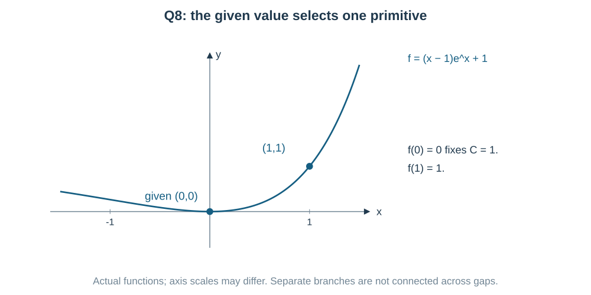

Therefore $f(1)=(1-1)e+1=\boxed1$.
Do not set $C=0$ just because $f(0)=0$; the nonconstant part equals $-1$ there.

---

### Question 9 — Insert one as sine squared plus cosine squared

**PDF page 61 | Numerical value | Notes: C07**

If $\displaystyle\int\frac{dx}{\sin^2x\cos^2x}=\tan x+k\cot x+C$, then $k=$ ____.

**Did you notice the identity $1=\sin^2x+\cos^2x$?** Put it into the numerator:

$$
\frac1{\sin^2x\cos^2x}
=\frac{\sin^2x+\cos^2x}{\sin^2x\cos^2x}
=\sec^2x+\csc^2x.
$$

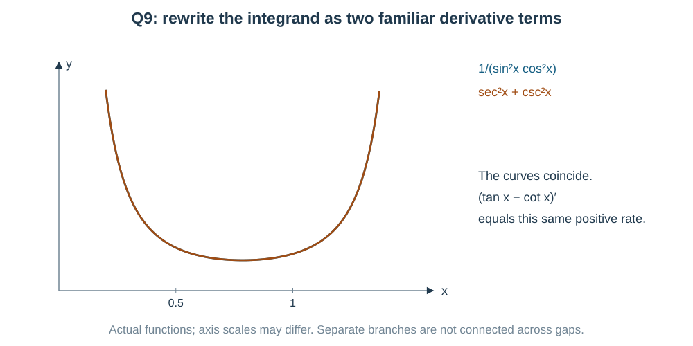

Hence the integral is
$\tan x-\cot x+C$. Comparing with $\tan x+k\cot x+C$ gives $\boxed{k=-1}$.

**Check by differentiating:** $(\cot x)'=-\csc^2x$, so the minus in the primitive is needed. Exclude zeros of either sine or cosine.

---

### Question 10 — A real logarithm needs the correct domain

**PDF page 61 | MCQ | Notes: C02**

Statement I: $\displaystyle\int\frac1x\,dx=\ln x+C$ for every real $x\ne0$.

Statement II: $\dfrac d{dx}\ln|x|=\dfrac1x$ for $x\ne0$. Choose the correct option.

- (a) Both Statement I and Statement II are true
- (b) Statement I is true but Statement II is false
- (c) Statement I is false but Statement II is true
- (d) Both Statement I and Statement II are false

**Try one negative input in Statement I.** At $x=-1$, $1/x$ exists, but the real $\ln x$ does not. So the statement “for every real $x\ne0$” is false.

For Statement II:

$$
\frac d{dx}\ln|x|=
\begin{cases}
1/x,&x>0,\\
(-1)/(-x)=1/x,&x<0.
\end{cases}
$$

Thus I is false and II true: $\boxed{\text{(c)}}$.
Constants can differ on the two separate domain intervals.

---

### Question 11 — Match formulas with their domain conditions

**PDF page 61 | MCQ | Notes: C03,C10,C12**

Match List-I with List-II (constants omitted).

List-I: A. $\displaystyle\int2^xe^x\,dx$; B. $\displaystyle\int\frac{dx}{\sqrt{x^2+1}}$; C. $\displaystyle\int\frac{dx}{x\sqrt{x^2-1}}$; D. $\displaystyle\int\frac{x\,dx}{\sqrt{1-x^2}}$.

List-II: I. $\sec^{-1}x$; II. $-\sqrt{1-x^2}$; III. $\dfrac{(2e)^x}{1+\ln2}$; IV. $\ln\left(x+\sqrt{x^2+1}\right)$.

- (a) A-III, B-IV, C-I, D-II
- (b) A-IV, B-III, C-I, D-II
- (c) A-III, B-IV, C-II, D-I
- (d) A-I, B-IV, C-III, D-II

**Check each match by its derivative and domain.**

A: $2^xe^x=e^{(1+\ln2)x}$, so its primitive is
$e^{(1+\ln2)x}/(1+\ln2)$: **III**.

B: use the standard hyperbolic-shaped radical formula,
$\ln(x+\sqrt{x^2+1})$: **IV**. Its log input is positive for every real $x$ because $\sqrt{x^2+1}>|x|$.

D: let $u=1-x^2$, $du=-2x\,dx$. The primitive is $-\sqrt{1-x^2}$ on $|x|<1$: **II**.

C: on $x>1$, $(\sec^{-1}x)'=1/[x\sqrt{x^2-1}]$: **I**.
The intended matching is therefore
$\boxed{\text{A-III, B-IV, C-I, D-II}}$, **(a), with C-I requiring $x>1$ as printed**.

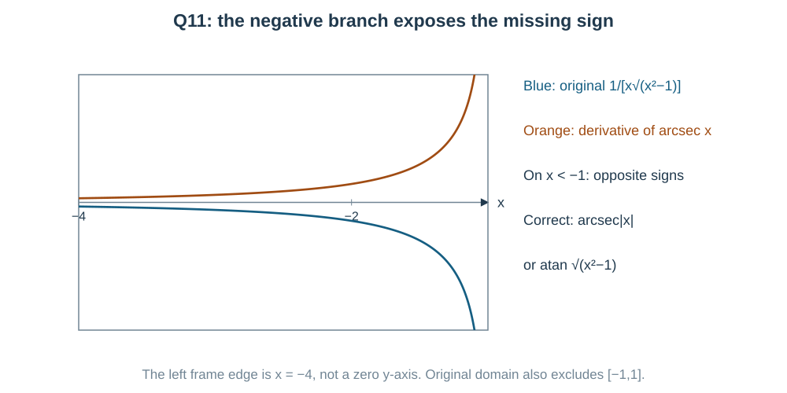

**Source qualification:** the original C integrand also exists on $x<-1$. There,
$(\sec^{-1}x)'=1/[|x|\sqrt{x^2-1}]$ has the wrong sign.
A primitive valid on each original domain component is

$$
\boxed{\sec^{-1}|x|+C
=\tan^{-1}\sqrt{x^2-1}+C}.
$$

For the arctangent version the derivative is
$[x/\sqrt{x^2-1}]/[1+(x^2-1)]
=1/[x\sqrt{x^2-1}]$, including negative $x$.

---

### Question 12 — The conjugate removes a radical denominator

**PDF page 61 | MCQ | Notes: C11**

$\displaystyle\int\frac{dx}{\sqrt{x+1}+\sqrt x}$ equals

- (a) $\dfrac23\left[(x+1)^{3/2}+x^{3/2}\right]+C$
- (b) $\ln\left(\sqrt{x+1}+\sqrt x\right)+C$
- (c) $\dfrac23\left[(x+1)^{3/2}-x^{3/2}\right]+C$
- (d) $2\left[\sqrt{x+1}-\sqrt x\right]+C$

**Two square roots added in a denominator suggest a conjugate.** The difference gives a denominator of exactly one:

$$
\frac1{\sqrt{x+1}+\sqrt x}
=\frac{\sqrt{x+1}-\sqrt x}{(x+1)-x}
=\sqrt{x+1}-\sqrt x.
$$

Now integrate each power:

$$
\boxed{\frac23[(x+1)^{3/2}-x^{3/2}]+C}
\quad\text{(c)}.
$$

The real integrand has domain $x\ge0$. The primitive is differentiated on $x>0$ and extends continuously to $0$; its right derivative there also matches the endpoint value $1$.

---

### Question 13 — Find the coefficients before integrating

**PDF page 61 | Numerical value | Notes: C08**

If $\displaystyle\int\frac{x+5}{(x+1)(x+3)}\,dx=a\ln|x+1|+b\ln|x+3|+C$, then $a^2+b^2=$ ____.

**The two logarithms tell us which fractions to look for.** Differentiating them would give $a/(x+1)+b/(x+3)$.

$$
\frac{x+5}{(x+1)(x+3)}
=\frac a{x+1}+\frac b{x+3}
\Rightarrow x+5=a(x+3)+b(x+1).
$$

Set $x=-1$ in this polynomial identity: $4=2a$, so $a=2$.
Set $x=-3$: $2=-2b$, so $b=-1$.

$$
\boxed{a^2+b^2=4+1=5}.
$$

We did not substitute excluded inputs into the original fraction. We used the identity after clearing denominators; the primitive still excludes $-1,-3$.

---

### Question 14 — One substitution exposes one integration by parts

**PDF page 62 | Numerical value | Notes: C04,C06,C13**

If $\displaystyle\int x^3e^{x^2}\,dx=e^{x^2}(ax^2+b)+C$, then $4(a-b)=$ ____.

**The question gives the answer's form. Differentiating it is shortest here.**

$$
\frac d{dx}\left[e^{x^2}(ax^2+b)\right]
=e^{x^2}[2ax^3+2(a+b)x].
$$

To match $x^3e^{x^2}$ for all $x$, require
$2a=1$ and $a+b=0$. Thus $a=1/2$, $b=-1/2$ and
$\boxed{4(a-b)=4}$.

**Another possible approach:** set $u=x^2$, so $x^3dx=u\,du/2$. Then

$$
\frac12\int ue^u du
=\frac12e^u(u-1)+C
=\frac12e^{x^2}(x^2-1)+C.
$$

This uses substitution followed by parts. It is the standard integration route; coefficient matching is faster because the source already supplies the form.

---

### Question 15 — Log powers without dx over x need parts

**PDF page 62 | MCQ | Notes: C06,C13**

$\displaystyle\int(\ln x)^2\,dx$ equals

- (a) $x(\ln x)^2-2x\ln x-2x+C$
- (b) $\dfrac{(\ln x)^3}3+C$
- (c) $x(\ln x)^2-2x\ln x+2x+C$
- (d) $x(\ln x)^2+2x\ln x+2x+C$

**Why not write $(\ln x)^3/3$?** Its derivative is $(\ln x)^2/x$. The question has $dx$, not $dx/x$.

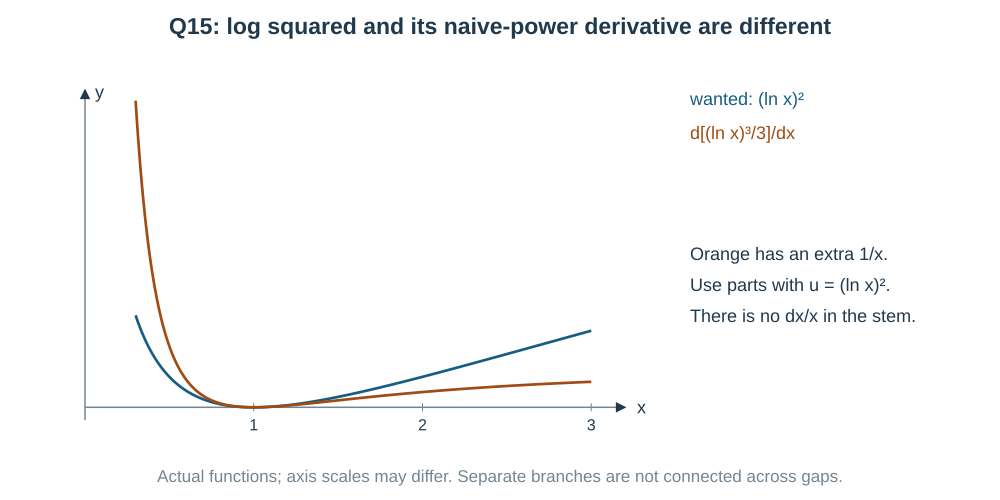

Use parts with $u=(\ln x)^2$, $dv=dx$:

$$
I=x(\ln x)^2-2\int\ln x\,dx.
$$

A second parts step gives $\int\ln x\,dx=x\ln x-x$. Therefore

$$
\boxed{I=x(\ln x)^2-2x\ln x+2x+C}\quad\text{(c)},\qquad x>0.
$$

**Another possible route:** $u=\ln x$ gives $dx=e^u du$, so the new integral is $\int u^2e^u du$, still requiring parts twice. It works, but doing parts directly avoids changing variables.

---

### Question 16 — Turn the denominator into one shifted cosine

**PDF page 62 | MCQ | Notes: C07,C11**

$\displaystyle\int\frac{dx}{\cos x+\sqrt3\sin x}$ equals

- (a) $\dfrac12\ln\left|\sec\left(x-\dfrac\pi3\right)+\tan\left(x-\dfrac\pi3\right)\right|+C$
- (b) $\dfrac12\ln\left|\sec\left(x+\dfrac\pi3\right)+\tan\left(x+\dfrac\pi3\right)\right|+C$
- (c) $2\ln\left|\tan\left(\dfrac x2+\dfrac\pi6\right)\right|+C$
- (d) $\ln\left|\sec\left(x-\dfrac\pi3\right)+\tan\left(x-\dfrac\pi3\right)\right|+C$

**The denominator is one shifted wave.** Using the cosine difference formula:

$$
2\cos(x-\pi/3)
=2\left(\frac12\cos x+\frac{\sqrt3}2\sin x\right)
=\cos x+\sqrt3\sin x.
$$

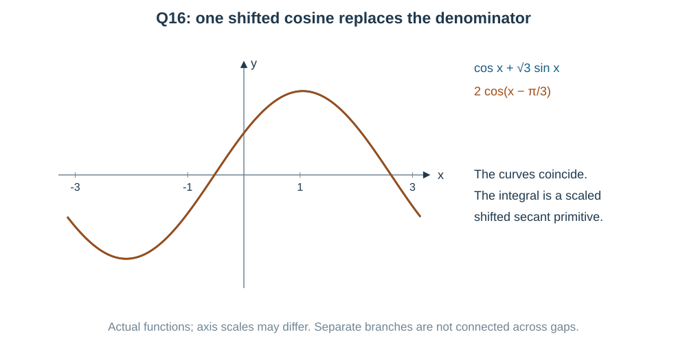

Let $u=x-\pi/3$. Then

$$
I=\frac12\int\sec u\,du
=\boxed{\frac12\ln|\sec(x-\pi/3)+\tan(x-\pi/3)|+C}
\quad\text{(a)}.
$$

Use intervals avoiding $\cos(x-\pi/3)=0$.
Check the shift sign by expanding it: the plus shift would produce a **negative** sine coefficient.

**Another possible approach:** the half-angle substitution makes the denominator rational. It is valid, but for just $A\cos x+B\sin x$ the amplitude-phase rewrite uses fewer steps.

---

### Question 17 — Choose the inner expression whose derivative is the numerator

**PDF page 62 | MCQ | Notes: C04,C07**

$\displaystyle\int\frac{\sin x+\cos x}{\sqrt{\sin2x}}\,dx$ equals

- (a) $\sin^{-1}(\sin x+\cos x)+C$
- (b) $\ln|\sin x+\cos x|+C$
- (c) $\cos^{-1}(\sin x-\cos x)+C$
- (d) $\sin^{-1}(\sin x-\cos x)+C$

**Match the numerator before choosing the inside.** Since
$(\sin x-\cos x)'=\cos x+\sin x$, try $u=\sin x-\cos x$.

Now check the radical too:

$$
u^2=\sin^2x+\cos^2x-2\sin x\cos x
=1-\sin2x.
$$

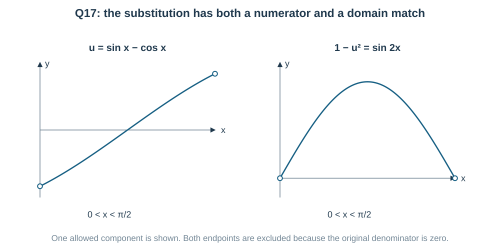

Thus

$$
I=\int\frac{du}{\sqrt{1-u^2}}
=\boxed{\sin^{-1}(\sin x-\cos x)+C}\quad\text{(d)}.
$$

The real original integrand needs $\sin2x>0$; zeros are excluded. Then $|u|<1$, so the principal arcsine derivative is valid. Choosing $\sin x+\cos x$ would give derivative $\cos x-\sin x$, which does not match the numerator.

---

### Question 18 — The fourth power is a square of the useful inner variable

**PDF page 62 | Numerical value | Notes: C04,C13**

Let $f(x)=\displaystyle\int\frac{x}{1+x^4}\,dx$ with $f(0)=0$. Then $\dfrac{16f(1)}\pi=$ ____.

**The numerator $x\,dx$ suggests $u=x^2$.** It turns $x^4$ into $u^2$:

$$
f(x)=\frac12\int\frac{du}{1+u^2}
=\frac12\tan^{-1}(x^2)+C.
$$

At $x=0$, $C=0$.

$$
f(1)=\frac12\frac\pi4=\frac\pi8,\qquad
\boxed{\frac{16f(1)}\pi=2}.
$$

**Check:** differentiating $\tfrac12\tan^{-1}(x^2)$ gives
$\tfrac12(2x)/(1+x^4)$, exactly the original integrand for every real $x$.

---

### Question 19 — Save a secant squared for the tangent substitution

**PDF page 62 | MCQ | Notes: C07**

$\displaystyle\int\sec^4x\,dx$ equals

- (a) $\dfrac{\sec^5x}5+C$
- (b) $\tan x+\dfrac{\tan^3x}3+C$
- (c) $\tan x-\dfrac{\tan^3x}3+C$
- (d) $\sec x\tan x+C$

**Save the derivative of tangent.** Write

$$
\sec^4x=\sec^2x\,\sec^2x
=(1+\tan^2x)\sec^2x.
$$

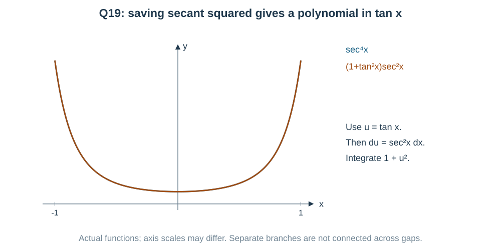

With $u=\tan x$, $du=\sec^2x\,dx$:

$$
I=\int(1+u^2)du
=\boxed{\tan x+\frac{\tan^3x}3+C}\quad\text{(b)}.
$$

Differentiate to check:
$\sec^2x+\tan^2x\sec^2x
=\sec^2x(1+\tan^2x)=\sec^4x$.
The answer applies on intervals with $\cos x\ne0$.

---

### Question 20 — A circular radical suggests a sine substitution

**PDF page 62 | MCQ | Notes: C10**

$\displaystyle\int\sqrt{1-x^2}\,dx$ equals

- (a) $\dfrac x2\sqrt{1-x^2}-\dfrac12\sin^{-1}x+C$
- (b) $\dfrac x2\sqrt{1-x^2}+\dfrac12\sin^{-1}x+C$
- (c) $-\dfrac13(1-x^2)^{3/2}+C$
- (d) $\dfrac x2\sqrt{1-x^2}+\sin^{-1}x+C$

**The radical is the upper unit circle's height.** It suggests $x=\sin\theta$, with $\theta\in(-\pi/2,\pi/2)$, so $\cos\theta>0$.

Then $\sqrt{1-x^2}=\cos\theta$ and $dx=\cos\theta\,d\theta$:

$$
\begin{aligned}
I&=\int\cos^2\theta\,d\theta
=\frac12\int(1+\cos2\theta)\,d\theta\\
&=\frac\theta2+\frac{\sin2\theta}4+C\\
&=\boxed{\frac12\sin^{-1}x+\frac x2\sqrt{1-x^2}+C}
\quad\text{(b)}.
\end{aligned}
$$

**Another possible approach — area view:** for $0<x<1$, the area from $0$ to $x$ under the circle is sector area $\theta/2$ plus triangle area $x\sqrt{1-x^2}/2$. This gives the same primitive with value zero at $0$. The algebraic formula extends to the full interior domain $-1<x<1$.

**Check:** the derivative is
$\frac12\sqrt{1-x^2}-\frac{x^2}{2\sqrt{1-x^2}}+\frac1{2\sqrt{1-x^2}}
=\sqrt{1-x^2}$.
The formula extends continuously to the endpoints; ordinary derivative statements here use the interior domain.

## Answer check

Read the qualifications in the solutions before using the key.

| Question | Answer | Question | Answer |
|---|---|---|---|
| 1 | (c) $\frac13\tan^{-1}((x+2)/3)+C$ | 11 | Intended (a); C-I as printed requires $x>1$ |
| 2 | (a) $e^x\sin x+C$ | 12 | (c) $\frac23[(x+1)^{3/2}-x^{3/2}]+C$ |
| 3 | (d) $e^x/x+C$ | 13 | $5$ |
| 4 | (b) $e^{2x}(x/2-1/4)+C$ | 14 | $4$ |
| 5 | (b) $\tan^2x/2+\ln|\cos x|+C$ | 15 | (c) $x(\ln x)^2-2x\ln x+2x+C$ |
| 6 | Intended (d), separately on $x>0$ or $x<0$ | 16 | (a) |
| 7 | (a) $\frac13\ln|x^3/(x^3+1)|+C$ | 17 | (d) $\sin^{-1}(\sin x-\cos x)+C$ |
| 8 | $1$ | 18 | $2$ |
| 9 | $-1$ | 19 | (b) $\tan x+\tan^3x/3+C$ |
| 10 | (c) | 20 | (b) $(x\sqrt{1-x^2}+\sin^{-1}x)/2+C$ |

## Coverage and source notes

All $20$ source questions appear in order: $15$ MCQs and $5$ numerical questions. The intended source answers agree with independent derivative/evaluation checks subject to the explicit Q6 and Q11 domain qualifications. The printed options remain unchanged.

The notes cover fundamental primitives, substitution, reverse product/quotient patterns, parts, partial fractions, complete-square and radical standards, trig identities, half-angle rationalization, branch conditions and initial values. Every useful alternative is visible.

## Offline research record

- Supplied Maths Predicted V1.pdf, pages 60–63: stems, options, key and working visually read.
- Official NTA 2027 integration unit: antiderivatives and the named integration methods checked.
- ExamSIDE, Indefinite Integrals: $8,8,7$ recent question IDs, all $23$ saved and recounted.
- ExamSIDE's separate Definite Integration ID set has zero overlap; PYQSide's combined Integrals counts $52,30,36$ are a scope comparison only.

The pooled standalone mean is $23/58$. Full-year denominators are $20,19,19$. This is recent archive research, not a complete independent $2020$–$2026$ official-paper or formula-frequency audit. Supplied questions are JEE Main-style practice, not claimed as actual PYQs.
