# Definite Integration — JEE Main revision guide

*A definite integral adds many tiny contributions. A graph turns those contributions into signed strips of area. Symmetry can pair the strips before we do any long integration.*

> **For Kanna | Chapter 13**  
> Goal: about $120/300$ towards $200/300$ — Physics $60$, Maths $60$, Chemistry $80$.  
> Notes first, then the recap and all $40$ supplied questions. All second approaches are plain visible.

## Recent chapter weightage

**ExamSIDE's separate Definite Integration category gives $97/58\approx1.67$ questions per Paper 1 in 2024–2026.**

| Year | Full-year papers | Chapter questions | Questions per paper |
|---|---:|---:|---:|
| $2024$ | $20$ | $43$ | $2.15$ |
| $2025$ | $19$ | $23$ | $1.21$ |
| $2026$ | $19$ | $31$ | $1.63$ |
| Together | $58$ | $97$ | $1.67$ |

All $97$ unique archive IDs were saved and recounted. ExamSIDE's separate Indefinite Integrals set has $23$ recent IDs and zero overlap with this set. Their joint counts are $51,31,38$. PYQSide's **combined** Integrals category instead has $52,30,36$; different archive boundaries/counts are disclosed rather than merged.

This is a recent archive-card recount, not an independent classification of all official papers or a measured formula-frequency audit. The offered-question format differed in $2024$; a mean is not a prediction for one shift. **Revision priority:** symmetry with its interval conditions, definite substitution, fundamental theorem, floor/modulus splitting, and recognizing rectangle sums. Indefinite integration methods remain essential underneath these.

## Source difficulties before studying

Official Unit 8 includes the fundamental theorem, properties and evaluation of definite integrals. The supplied source also includes elementary improper-integral examples with logarithmic endpoints or an infinite upper limit. We teach the needed endpoint limits, without assuming an advanced Beta/Gamma course.

**Q12 has an answer-key error as printed.** The two-sided limit does not exist. Its right-hand limit is $2/3$, but its left-hand limit is $-2/3$. The keyed $0.67$ applies only if the intended question was $x\to0^+$. We preserve the original two-sided question and explain the difference.

**Read Q3's options carefully:** $\pi/4$ and $\pi^2/4$ are different. Q18 and Q32 require splitting at changes of formula. For Q31, do not replace $\pi$ by $22/7$; the small difference is the exact answer.

## Concept C01 — From tiny rectangles to one signed total

Divide $[a,b]$ into $n$ equal widths $\Delta x=(b-a)/n$. A narrow strip at input $x_r$ has approximate signed area $f(x_r)\Delta x$. Adding them and shrinking the widths gives

$$
\boxed{\int_a^b f(x)\,dx
=\lim_{n\to\infty}\sum_{r=1}^n f(x_r)\Delta x}
$$

for a continuous function. Some functions with jumps, such as the floor function, also work: their strip sums still approach one total. When that total exists in this sense, we call the function Riemann-integrable. $a$ is the lower limit, $b$ the upper limit. The result is a **number** when both limits are fixed.

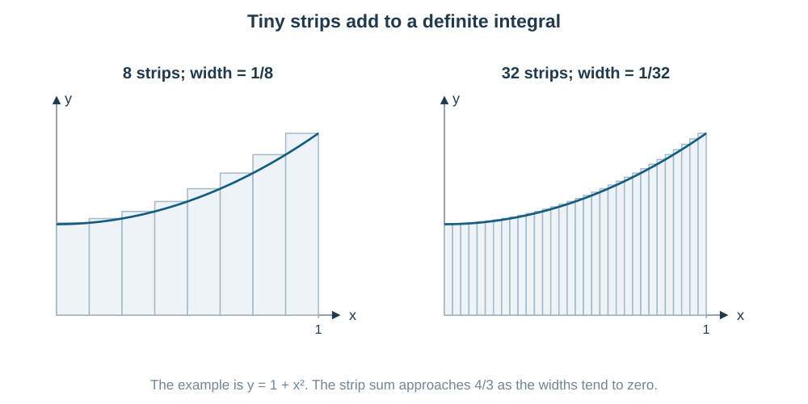

For $a<b$, strips above the axis contribute positively and strips below it negatively:

$$
\text{signed integral}=\text{area above}-\text{area below}.
$$

Total geometric area uses $\int_a^b|f(x)|dx$. For $f(x)=x$ on $[-1,1]$, the signed total is $0$ but the total area is $1$.

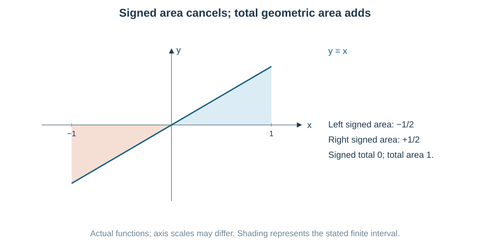

**Fundamental theorem — Important for JEE Main.** If $F'=f$ and $f$ is continuous on $[a,b]$,

$$
\boxed{\int_a^b f(x)\,dx=F(b)-F(a)}.
$$

The notation $[F(x)]_a^b$ means this upper value minus lower value. The constant cancels, so do not add $+C$ to the final definite number. The letter inside is a dummy variable:
$\int_a^b f(x)dx=\int_a^b f(t)dt$.

## Concept C02 — Basic properties and size checks

For integrable functions and limits where the expressions are defined:

$$
\begin{gathered}
\int_a^a f=0,\qquad
\int_a^b f=-\int_b^a f,\qquad
\int_a^c f=\int_a^b f+\int_b^c f,\\
\int_a^b(\alpha f+\beta g)=\alpha\int_a^b f+\beta\int_a^b g.
\end{gathered}
$$

Here $\alpha,\beta$ are constants. For $a<b$:

$$
f\ge0\Rightarrow\int_a^b f\ge0,\qquad
f\le g\Rightarrow\int_a^b f\le\int_a^b g.
$$

If $m\le f(x)\le M$ throughout $[a,b]$,

$$
m(b-a)\le\int_a^b f\le M(b-a).
$$

Meaning: the true strip heights lie between two rectangle heights. The average value of $f$ is

$$
f_{\rm avg}=\frac1{b-a}\int_a^b f(x)\,dx.
$$

For continuous $f$, this average is attained at some input in $[a,b]$.

**Important for JEE Main — bounds and sign checks:**

$$
\left|\int_a^b f\right|\le\int_a^b|f|,\qquad
\left(\int_a^b f\right)^2\le(b-a)\int_a^b f^2.
$$

The second is the integral Cauchy–Schwarz bound; it requires a finite integral of $f^2$ and $a<b$. For continuous $f$, it also follows from
$\int_a^b(f-f_{\rm avg})^2\ge0$; expanding leaves the displayed inequality. Equality then needs $f$ constant. This is useful for estimating an integral when its exact primitive is awkward.

## Concept C03 — Substitution and parts still work, with limits

**Important for JEE Main.** When $u=g(x)$ is a suitable differentiable monotone substitution on the interval, change the bounds together with the integrand:

$$
\int_a^b f(g(x))g'(x)dx
=\int_{g(a)}^{g(b)}f(u)\,du.
$$

A decreasing substitution reverses the order of the new bounds; its negative differential handles that reversal. Never use $u$ inside and the old $x$ bounds outside. If a change of variable is not monotone, split into suitable pieces where necessary. A valid chain-rule primitive can still be used without a one-to-one change of coordinates.

For parts:

$$
\boxed{\int_a^b u\,v'\,dx=[uv]_a^b-\int_a^b u'v\,dx}.
$$

Pick $u$ whose derivative simplifies. Example: $u=\tan^{-1}x$, $dv=x\,dx$ turns inverse tangent into $1/(1+x^2)$.

Carry forward the important indefinite tools:

$$
\int\frac{dx}{1+x^2}=\tan^{-1}x+C,\quad
\int\frac{g'}g dx=\ln|g|+C,\quad
\int x^n dx=\frac{x^{n+1}}{n+1}+C\ (n\ne-1).
$$

Simplify first: polynomial division, a conjugate, product-to-sum, or a derivative match can avoid a long primitive.

## Concept C04 — Reflection pairs equal distances from the midpoint

**Important for JEE Main.** On $[a,b]$, put $u=a+b-x$. An input near the left end pairs with one equally far from the right end:

$$
\boxed{\int_a^b f(x)\,dx=\int_a^b f(a+b-x)\,dx}.
$$

Why? As $x$ runs left to right, $u$ runs right to left; $dx=-du$ restores the order. The interval and strip widths stay the same.

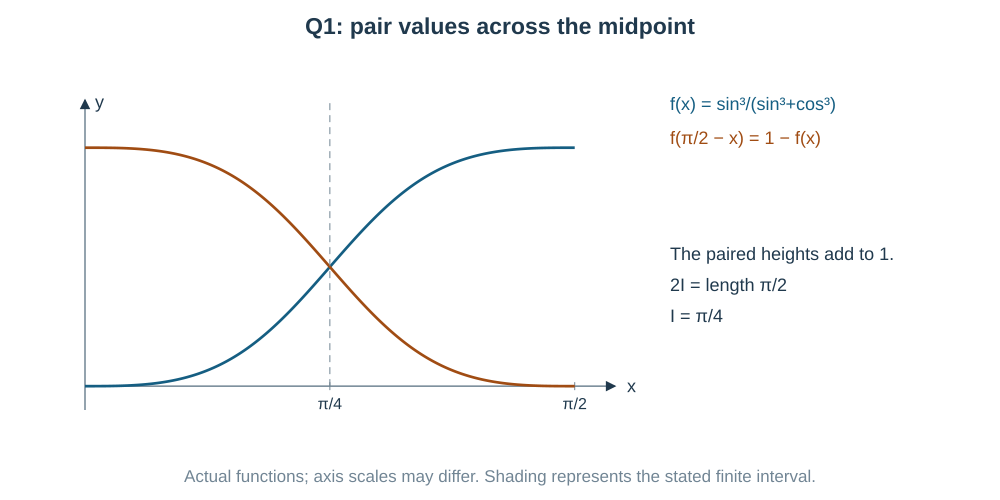

Let the integral be $I$. Write its reflected version and add:

$$
2I=\int_a^b[f(x)+f(a+b-x)]dx.
$$

If the pair sum is the constant $K$, then

$$
\boxed{I=\frac{K(b-a)}2}.
$$

For $\sin^p x/(\sin^p x+\cos^p x)$ on $[0,\pi/2]$, $p>0$, reflection swaps sine and cosine. The pair sum is $1$, so the answer is $\pi/4$. This is often shorter than finding any primitive.

**Log clue:** if $h(x)h(a+b-x)=K>0$ and both log integrals exist, then the logs add to $\ln K$. Integrate the sum rather than each difficult log separately.

## Concept C05 — Symmetric weight: replace x by the midpoint

Suppose $h(a+b-x)=h(x)$ and both relevant integrals exist. Set $I=\int_a^b xh(x)dx$ and reflect:

$$
I=\int_a^b(a+b-x)h(x)dx.
$$

Add the two:

$$
\boxed{\int_a^b xh(x)dx=\frac{a+b}2\int_a^b h(x)dx}.
$$

Meaning: the equal weights at two paired inputs have average input $(a+b)/2$.

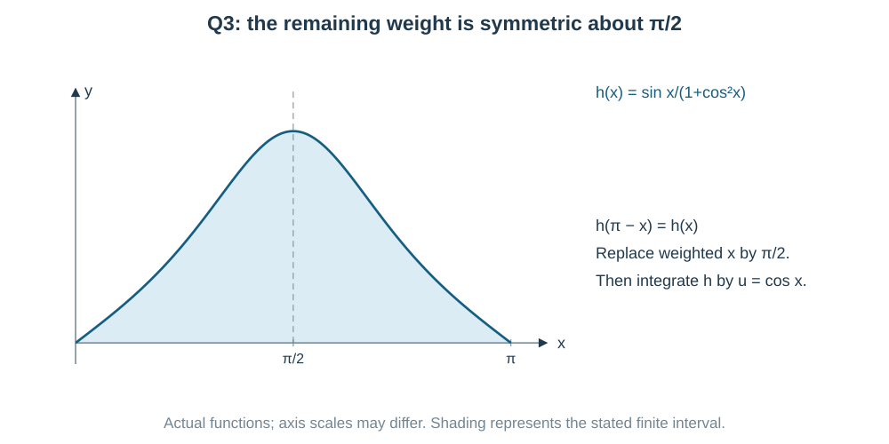

Do not replace $x$ by the midpoint in an arbitrary integrand. The symmetry of **the remaining factor** is the condition. On $[0,\pi]$, both $\sin x/(1+\cos^2x)$ and $1/(1+\sin x)$ have this symmetry.

## Concept C06 — Even, odd and complementary exponential weights

**Important for JEE Main.** On a symmetric interval $[-a,a]$, assuming integrability:

$$
\begin{aligned}
f(-x)=f(x)&\Rightarrow\int_{-a}^a f=2\int_0^a f
&&\text{(even)},\\
f(-x)=-f(x)&\Rightarrow\int_{-a}^a f=0
&&\text{(odd)}.
\end{aligned}
$$

An even graph mirrors in the vertical axis. An odd graph matches after a half-turn about the origin; opposite signed strips cancel. $x^2\sin x$ is odd because even times odd is odd. $x|x|$ is also odd. Do not treat a positive even function such as $\cos x$ on $[-\pi/2,\pi/2]$ as a cancelling one.

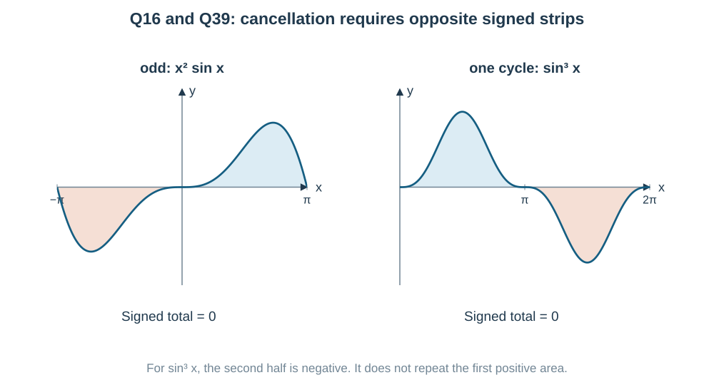

For an odd function $g$, the complementary pair

$$
\frac1{1+e^{g(x)}}+\frac1{1+e^{-g(x)}}=1
$$

can simplify a non-even integrand. If $w$ is even,

$$
\boxed{\int_{-a}^a\frac{w(x)}{1+e^{g(x)}}dx
=\frac12\int_{-a}^a w(x)dx}.
$$

The **whole** integrand is usually not even; pairing proves the result. This handles Q2 with $g=x,w=\sin^2x$ and Q20 with $g=\sin x,w=1$.

## Concept C07 — Periods, modulus waves and complete cycles

If $f(x+T)=f(x)$, $T>0$, and $f$ is integrable over a period:

$$
\int_c^{c+T}f(x)dx=\int_0^Tf(x)dx,\qquad
\int_0^{nT}f=n\int_0^Tf
$$

for a positive integer $n$. For a noninteger number of periods, separate the full periods and the remaining part.

**Important for JEE Main:** $|\sin x|$ has period $\pi$, with one-period integral $2$. Ordinary $\sin x$ has period $2\pi$, with one-period signed integral $0$.

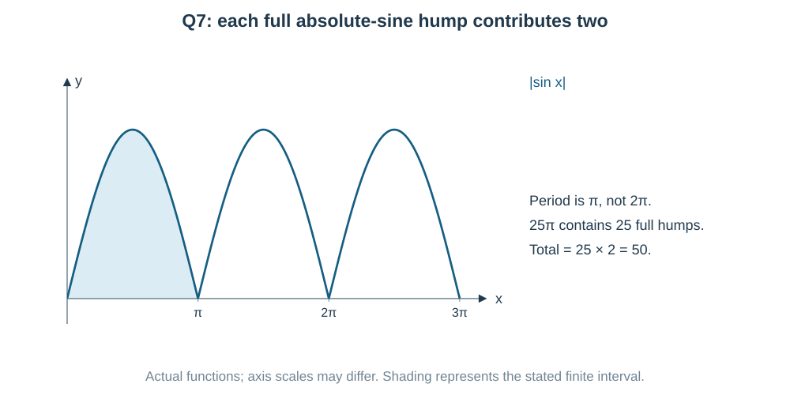

Do not use “twice the first half” unless the second half really has the same signed contribution. For $\sin^3x$, the second $\pi$-interval contributes the negative of the first.

For $R=\sqrt{A^2+B^2}>0$,
$A\sin x+B\cos x=R\sin(x+\phi)$.
Thus its absolute value has period $\pi$ and one-period integral $2R$. A phase shift does not change an integral over a **whole** period.

Product-to-sum is useful when frequencies differ:

$$
2\sin A\cos B=\sin(A+B)+\sin(A-B).
$$

For integer $k\ne0$,
$\int_0^\pi\sin(kx)dx=[1-(-1)^k]/k$.
An odd harmonic gives $2/k$, an even one $0$.

## Concept C08 — Modulus and floor: find all change points first

**Important for JEE Main.** Before removing $|g(x)|$, solve $g(x)=0$ and test the sign between roots.

$$
|g|=\begin{cases}g,&g\ge0,\\-g,&g<0.\end{cases}
$$

For $|x^2-x|$, the inside is negative on $(0,1)$ and positive on $(1,2)$. The negative piece is reflected above the axis.

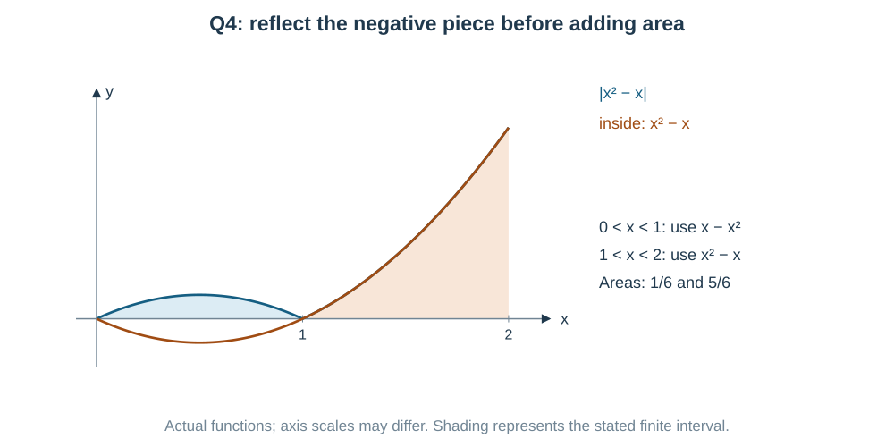

The floor $[u]=\lfloor u\rfloor$ is the greatest integer **not exceeding** $u$. For $[x^2]$, changes occur where $x^2$ crosses an integer:

$$
[x^2]=
\begin{cases}
0,&0\le x<1,\\
1,&1\le x<\sqrt2,\\
2,&\sqrt2\le x<\sqrt3,\\
3,&\sqrt3\le x<2.
\end{cases}
$$

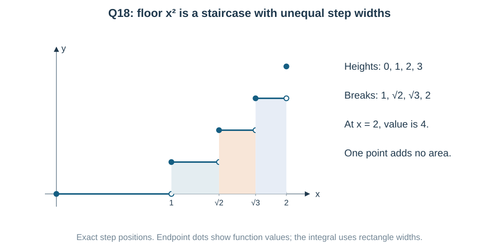

Height times width gives each rectangular area. The single endpoint value $[2^2]=4$ contributes no width, hence no area. More generally, changing finitely many point values does not change a bounded Riemann integral.

## Concept C09 — Powers of sine/cosine and simple polynomial products

**Important for JEE Main.** For
$S_n=\int_0^{\pi/2}\sin^n x\,dx$, nonnegative integer $n$,

$$
\boxed{S_n=\frac{n-1}nS_{n-2}\quad(n\ge2)},\qquad
S_0=\frac\pi2,\quad S_1=1.
$$

**Why the recurrence?** Write $S_n=\int\sin^{n-1}x\,\sin x\,dx$ and use parts. The endpoint product
$[-\sin^{n-1}x\cos x]_0^{\pi/2}$ is zero for $n\ge2$. The remaining integral is

$$
S_n=(n-1)\int_0^{\pi/2}\sin^{n-2}x\cos^2x\,dx
=(n-1)(S_{n-2}-S_n).
$$

Move the last term to the left. This gives the formula. Reflection gives the same values for cosine powers.

$$
S_{2m}=\frac{1\cdot3\cdots(2m-1)}{2\cdot4\cdots2m}\frac\pi2,\quad
S_{2m+1}=\frac{2\cdot4\cdots2m}{3\cdot5\cdots(2m+1)}.
$$

Use $S_0,S_1$ directly for the base cases. For $\int_0^\pi\sin^n x\,dx$, reflection gives $2S_n$.

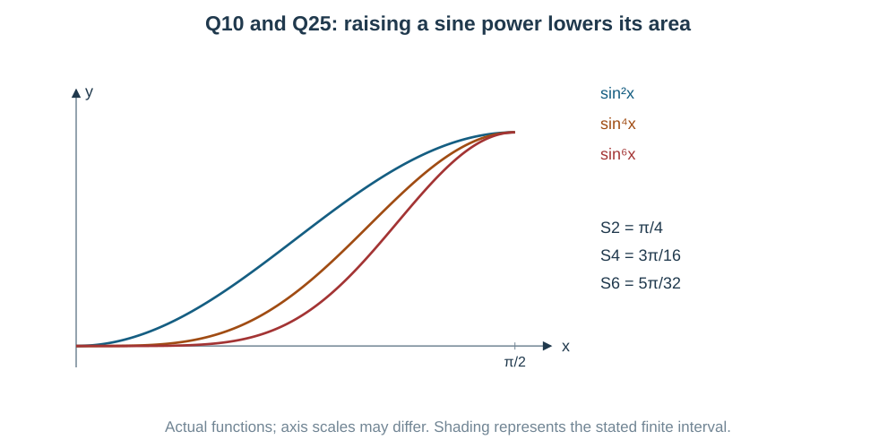

If one power in $\sin^m x\cos^n x$ is odd, saving one derivative factor and substituting is often shorter than a recurrence. Q30 uses $u=\sin x$.

For nonnegative integers $m,n$, a useful finite-parts result is

$$
\int_0^1x^m(1-x)^n dx=\frac{m!\,n!}{(m+n+1)!}.
$$

It follows by parts:
$J_{m,n}=\frac n{m+1}J_{m+1,n-1}$ for $n\ge1$,
ending with $J_{m+n,0}=1/(m+n+1)$. This is an elementary factorial result; no Gamma function is needed. In Q9, $u=1-x$ is even shorter than repeated parts.

## Concept C10 — The derivative of accumulated area

For continuous $f$, define $A(x)=\int_a^x f(t)dt$. Increasing $x$ by a tiny $h$ adds a strip with approximate area $f(x)h$. Therefore

$$
\boxed{A'(x)=f(x)}.
$$

With a changing upper input $v(x)$, chain rule adds its rate:

$$
\frac d{dx}\int_a^{v(x)}f(t)dt=f(v(x))v'(x).
$$

If both ends move:

$$
\boxed{\frac d{dx}\int_{u(x)}^{v(x)}f(t)dt
=f(v(x))v'(x)-f(u(x))u'(x)}.
$$

**Upper end adds; lower end removes.** This is a signed formula, so it still works when the upper value is less than the lower value, provided the function is regular on the needed interval.

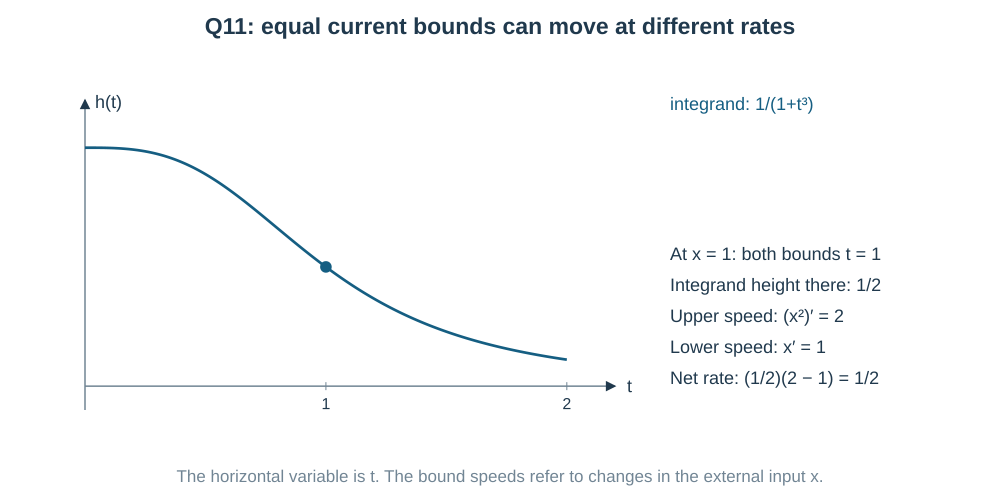

The rule above assumes the integrand depends on the dummy variable $t$, not additionally on the external $x$. An integral with $x$ also inside the integrand needs that dependence handled; do not apply this rule mechanically.

## Concept C11 — An integral may define a function or a constant

Look at the limits before differentiating.

- $\int_0^1tf(t)dt$ is a fixed number. Rename it $C$ and solve the resulting ordinary equation.
- $\int_0^x f(t)dt$ changes with $x$. Its derivative is $f(x)$.

For Q21,

$$
f(x)=x+C,\qquad
C=\int_0^1t(t+C)dt=\frac13+\frac C2.
$$

The unknown function has become one unknown number.

For $F(x)=\int_0^x(t^2-3t+2)dt$, the derivative is $(x-1)(x-2)$. Its sign tells where the accumulated signed area grows or shrinks. This is the link to Applications of Derivatives.

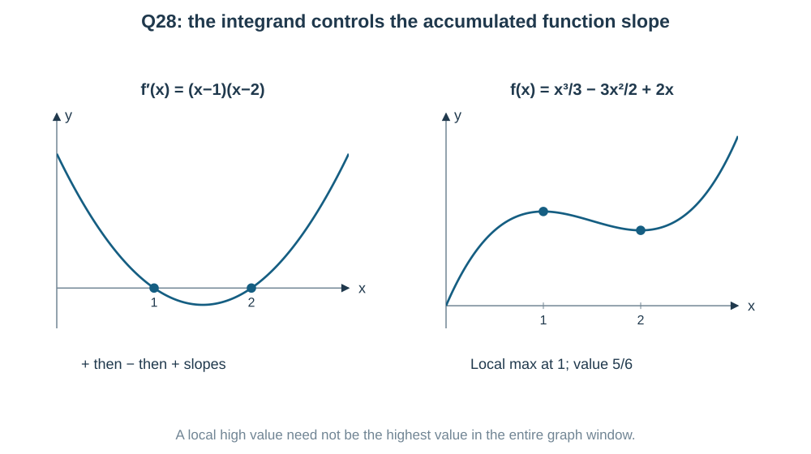

## Concept C12 — Rectangle sums and products with many factors

**Important for JEE Main.** The standard pattern is

$$
\boxed{\frac1n\sum_{r=1}^n f\left(\frac rn\right)
\longrightarrow\int_0^1f(t)dt}
$$

for continuous $f$. Here $1/n$ is the strip width and $r/n$ its right-end sample input.

Do the scaling explicitly:

$$
\frac r{n^2+r^2}
=\frac1n\frac{r/n}{1+(r/n)^2}.
$$

Now the strip-height function is $f(t)=t/(1+t^2)$.

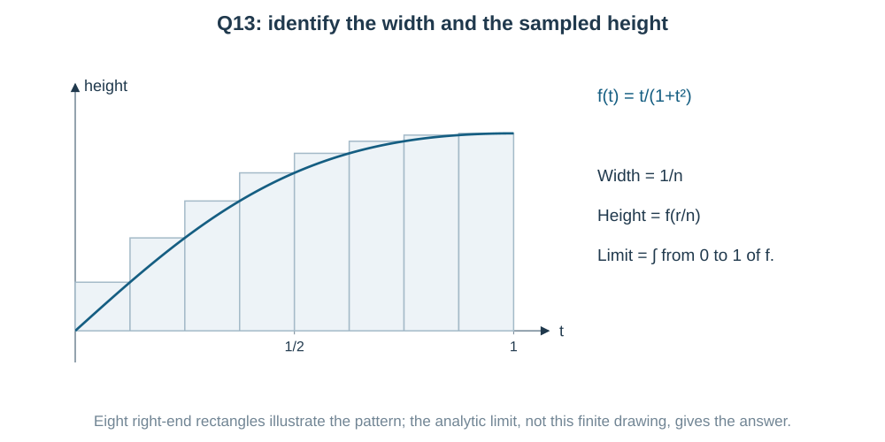

For $[a,b]$, use
$\Delta x=(b-a)/n$, sample input $a+r\Delta x$, and the matching factor $\Delta x$. A sum without the right width may tend to infinity or need an extra scaling factor.

**A product becomes a sum after taking logs.** For positive continuous $h$ on $[0,1]$,

$$
\left[\prod_{r=1}^n h(r/n)\right]^{1/n}
\longrightarrow
\exp\left(\int_0^1\ln h(t)dt\right).
$$

First remove any growing powers of $n$. In Q14, each factor $n+r=n(1+r/n)$, and there are exactly $n$ factors. The external $1/n$ cancels their $n$th-root factor $n$. Only then take logs.

## Concept C13 — An endpoint infinity needs a limit

**Supporting source examples.** An improper integral has an infinite bound or an integrand that becomes unbounded at a bound or inside the interval.

$$
\int_0^\infty f=\lim_{R\to\infty}\int_0^Rf,\qquad
\int_0^b f=\lim_{\varepsilon\to0^+}\int_\varepsilon^b f
$$

when the indicated limits exist finitely. An interior singularity needs separate limits on its two sides. Opposite infinities cannot be cancelled and called an ordinary improper integral.

Useful convergence clues:

$$
\int_0^1x^{-p}dx\text{ converges iff }p<1,\qquad
\int_1^\infty x^{-p}dx\text{ converges iff }p>1.
$$

Also $\int_0^1|\ln x|dx=1$. An unbounded height may still give a finite area because the strip widths near the endpoint become very small.

Near zero, $\sin x/x\to1$, so
$\ln(\sin x)=\ln x+\ln(\sin x/x)$.
The second term stays bounded, while $\ln x$ has a convergent integral. This justifies the log-sine endpoint in Q5.

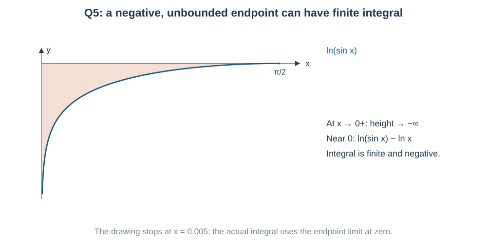

For $c>0$ and a nonnegative integer $n$,

$$
\int_0^\infty x^ne^{-cx}dx=\frac{n!}{c^{n+1}}.
$$

Derive it by parts $n$ times, starting with $\int_0^\infty e^{-cx}dx=1/c$. Every polynomial-times-exponential boundary term tends to zero at infinity. This elementary result handles Q22; it is not permission to ignore convergence.

## Concept C14 — Limits with a short integral: look at the interval size

If $f$ is continuous at $a$,

$$
\boxed{\frac1h\int_a^{a+h}f(t)dt\to f(a)}
$$

as $h\to0$ through allowed inputs. It is the average height over a short interval.

If $f(t)$ behaves like $ct^p$ as $t\to0^+$, $p>-1$, then for $u\to0^+$,

$$
\int_0^u f(t)dt\sim\frac c{p+1}u^{p+1}.
$$

The symbol $\sim$ means the ratio tends to $1$ when the leading comparison is nonzero. The statement follows by bounding $f(t)$ between $(c-\varepsilon)t^p$ and $(c+\varepsilon)t^p$ for small positive $t$; it is not a rule for ignoring signs.

**Important sign check in Q12:** $\sin\sqrt t\sim\sqrt t$, so

$$
\int_0^{x^2}\sin\sqrt t\,dt
\sim\frac23(x^2)^{3/2}
=\frac23|x|^3.
$$

Dividing by $x^3$ leaves different signs on the two sides. Always use $\sqrt{x^2}=|x|$.

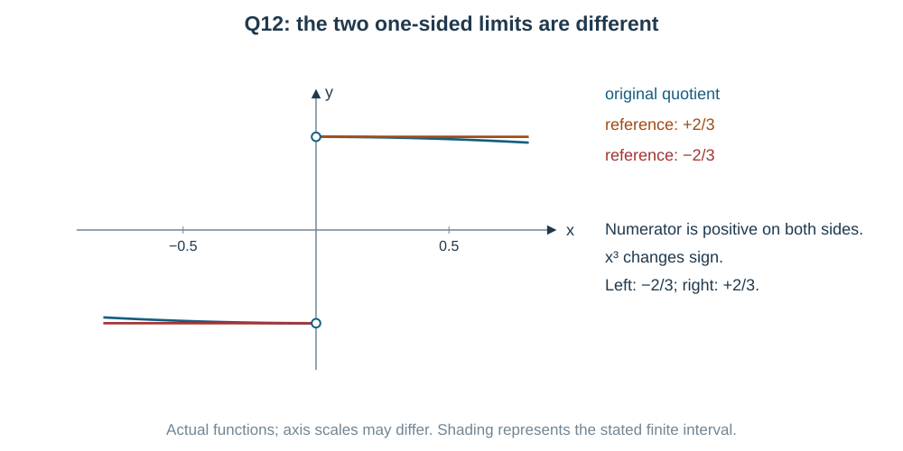

An expansion or L'Hôpital check can be useful, but the domain/sign analysis must come first. For the printed two-sided question, finding only the right-side value is incomplete.

## Concept C15 — Choose the route before doing long algebra

| Visible clue | Short route and its reason |
|---|---|
| Sine/cosine swapped by $x\mapsto\pi/2-x$ | Pair reflected integrands; their sum may be $1$ |
| $xh(x)$ with midpoint-symmetric $h$ | Replace the weighted input by the midpoint after proving symmetry |
| Symmetric bounds $[-a,a]$ | Check the whole integrand for parity or complementary pairs |
| Modulus or floor | Mark sign/step changes before integrating |
| Complete cycles | Find the period of the actual integrand, including its modulus |
| Moving integration limits | Fundamental theorem plus each bound's derivative |
| $\sum$ with large $n$ | Factor out the correct strip width and recognize the sample input |
| A positive product with an $n$th root | Normalize, take logs, then recognize a rectangle sum |
| A high polynomial over a lower-degree polynomial | Divide first |
| Infinite bound or log endpoint | Establish the endpoint limit before using cancellation |

**Standard values worth recalling, with their reasons already taught:**

$$
\begin{gathered}
\int_0^1\frac{dx}{1+x^2}=\frac\pi4,\qquad
\int_0^{\pi/2}\sin x\,dx=\int_0^{\pi/2}\cos x\,dx=1,\\
\int_0^{\pi/2}\sin^2x\,dx=\frac\pi4,\qquad
\int_0^{\pi/2}\sin x\cos x\,dx=\frac12,\\
\int_0^{\pi/2}\ln(\sin x)dx
=\int_0^{\pi/2}\ln(\cos x)dx=-\frac\pi2\ln2,\\
\int_0^\pi\frac{dx}{a+b\cos x}
=\frac\pi{\sqrt{a^2-b^2}}\qquad(a>|b|).
\end{gathered}
$$

The final row comes from $t=\tan(x/2)$:
$2\int_0^\infty dt/[(a+b)+(a-b)t^2]$.
Both coefficients are positive under $a>|b|$; changing that condition can introduce a singularity.

## Last-minute formula recap

$$
\begin{gathered}
\int_a^bf=F(b)-F(a),\quad
\int_a^bf=\int_a^bf(a+b-x)dx,\\
f(x)+f(a+b-x)=K\Rightarrow\int_a^bf=\frac{K(b-a)}2,\\
h(a+b-x)=h(x)\Rightarrow\int_a^b xh(x)dx=\frac{a+b}2\int_a^bh(x)dx,\\
\int_{-a}^a\text{odd}=0,\quad
\int_{-a}^a\text{even}=2\int_0^a\text{even},\\
\frac d{dx}\int_{u(x)}^{v(x)}f(t)dt=f(v)v'-f(u)u',\\
\frac1n\sum_{r=1}^nf(r/n)\to\int_0^1f,\quad
S_n=\frac{n-1}nS_{n-2},\ S_0=\frac\pi2,\ S_1=1,\\
\int_0^\pi|\sin x|dx=2,\quad
\int_0^{nT}f=n\int_0^Tf\quad(T\text{ a period}),\\
\int_a^b|f|\text{ is total area for }a<b,\qquad
\sqrt{x^2}=|x|.
\end{gathered}
$$

All integrals in property formulas must exist with the stated ordinary or convergent improper meaning. **Before submitting:** check the limits, signs, symmetry condition, modulus breakpoints and requested rounding.

## Worked solutions to the 40 PDF questions

Read the question first. Notice the pattern, choose a route, then calculate. Alternative methods below are fully visible.

### Question 1 — Reflection swaps sine and cosine

**PDF page 64 | MCQ | Notes: C04**

The value of $\displaystyle\int_0^{\pi/2}\frac{\sin^3x}{\sin^3x+\cos^3x}\,dx$ is

- (a) $\dfrac\pi2$
- (b) $\dfrac\pi8$
- (c) $\dfrac\pi4$
- (d) $\dfrac{3\pi}4$

**Did you notice the same two cubes in the denominator?** On $[0,\pi/2]$, reflection $x\mapsto\pi/2-x$ swaps sine and cosine.

Let the integral be $I$. Its reflected version is

$$
I=\int_0^{\pi/2}\frac{\cos^3x}{\cos^3x+\sin^3x}dx.
$$

Add:

$$
2I=\int_0^{\pi/2}1\,dx=\frac\pi2
\Rightarrow\boxed{I=\frac\pi4}\quad\text{(c)}.
$$

The denominator is positive throughout this interval. A tangent substitution could produce a rational integral, but reflection gives the definite value immediately and avoids finding a primitive.

---

### Question 2 — An even numerator works with a complementary denominator pair

**PDF page 64 | MCQ | Notes: C06**

$\displaystyle\int_{-\pi/2}^{\pi/2}\frac{\sin^2x}{1+e^x}\,dx$ equals

- (a) $\dfrac\pi4$
- (b) $\dfrac\pi2$
- (c) $\pi$
- (d) $\dfrac\pi8$

**The whole function is not even, but its reflected partner is useful.** The numerator stays $\sin^2x$, while $e^x$ becomes $e^{-x}$.

$$
\frac1{1+e^x}+\frac1{1+e^{-x}}=1.
$$

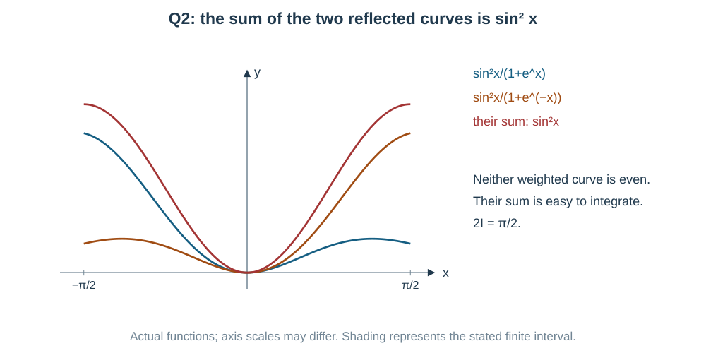

Thus

$$
2I=\int_{-\pi/2}^{\pi/2}\sin^2x\,dx
=2\int_0^{\pi/2}\frac{1-\cos2x}2dx
=\frac\pi2.
$$

Therefore $\boxed{I=\pi/4}$, **(a)**.
Do not apply the even-function rule to the original integrand; we proved a complementary-pair identity instead.

---

### Question 3 — A symmetric weight replaces x by the midpoint

**PDF page 64 | MCQ | Notes: C05**

The value of $\displaystyle\int_0^\pi\frac{x\sin x}{1+\cos^2x}\,dx$ is

- (a) $\dfrac{\pi^2}2$
- (b) $\dfrac{\pi^2}8$
- (c) $\dfrac\pi4$
- (d) $\dfrac{\pi^2}4$

**Separate the extra $x$ from its weight.** Put
$h(x)=\sin x/(1+\cos^2x)$.
Because $\sin(\pi-x)=\sin x$ and $\cos^2(\pi-x)=\cos^2x$, the weight is symmetric.

Reflection gives $I=\int_0^\pi(\pi-x)h(x)dx$. Add it to the original:

$$
2I=\pi\int_0^\pi h(x)dx.
$$

Now $u=\cos x$, $du=-\sin x\,dx$:

$$
\int_0^\pi h(x)dx
=\int_{-1}^1\frac{du}{1+u^2}
=\frac\pi2.
$$

Hence $\boxed{I=\pi^2/4}$, **(d)**.

Direct $u=\cos x$ in the original integral would turn $x$ into $\cos^{-1}u$, adding work. Remove the weighted input by symmetry first. Notice that option (c) lacks a square on $\pi$.

---

### Question 4 — Split where the expression inside the modulus changes sign

**PDF page 64 | MCQ | Notes: C08**

The value of $\displaystyle\int_0^2|x^2-x|\,dx$ is

- (a) $\dfrac43$
- (b) $1$
- (c) $\dfrac23$
- (d) $\dfrac76$

**The modulus asks us to make the negative part positive.** The inside is $x(x-1)$: negative on $(0,1)$, positive on $(1,2)$.

$$
\begin{aligned}
I&=\int_0^1(x-x^2)dx+\int_1^2(x^2-x)dx\\
&=\left[\frac{x^2}2-\frac{x^3}3\right]_0^1
+\left[\frac{x^3}3-\frac{x^2}2\right]_1^2\\
&=\frac16+\frac56=\boxed1\quad\text{(b)}.
\end{aligned}
$$

Without the modulus, the answer would be $2/3$. Integrating the polynomial first and putting a modulus around the final number does not give total area.

---

### Question 5 — A convergent log singularity can be handled by symmetry

**PDF page 64 | MCQ | Notes: C04,C13**

$\displaystyle\int_0^{\pi/2}\ln(\sin x)\,dx$ equals

- (a) $\dfrac\pi2\ln2$
- (b) $-\dfrac\pi2\ln2$
- (c) $-\pi\ln2$
- (d) $0$

**First check the endpoint.** Near $0$, $\ln(\sin x)=\ln x+\ln(\sin x/x)$. The second part stays bounded, and $\int_0^1|\ln x|dx$ is finite. So this improper integral converges.

Let $I=\int_0^{\pi/2}\ln(\sin x)dx$. Reflection gives the same $I$ for $\ln(\cos x)$. Add:

$$
2I=\int_0^{\pi/2}\ln(\sin x\cos x)dx
=\int_0^{\pi/2}\ln(\sin2x)dx-\frac\pi2\ln2.
$$

For the remaining integral, put $u=2x$. Symmetry of $\sin u$ about $\pi/2$ gives

$$
\int_0^{\pi/2}\ln(\sin2x)dx
=\frac12\int_0^\pi\ln(\sin u)du=I.
$$

Hence $2I=I-(\pi/2)\ln2$, so
$\boxed{I=-(\pi/2)\ln2}$, **(b)**.
The negative answer matches the graph because $0<\sin x\le1$.

---

### Question 6 — Reflection turns a logarithmic product into a constant

**PDF page 64 | MCQ | Notes: C04**

The value of $\displaystyle\int_0^{\pi/4}\ln(1+\tan x)\,dx$ is

- (a) $\dfrac\pi4\ln2$
- (b) $\dfrac\pi2\ln2$
- (c) $\dfrac\pi{16}\ln2$
- (d) $\dfrac\pi8\ln2$

**The upper bound $\pi/4$ suggests reflecting by $\pi/4-x$.** Let $t=\tan x$. The reflected tangent is
$(1-t)/(1+t)$.

$$
(1+t)\left(1+\frac{1-t}{1+t}\right)=2.
$$

So the two reflected logarithms add to $\ln2$.

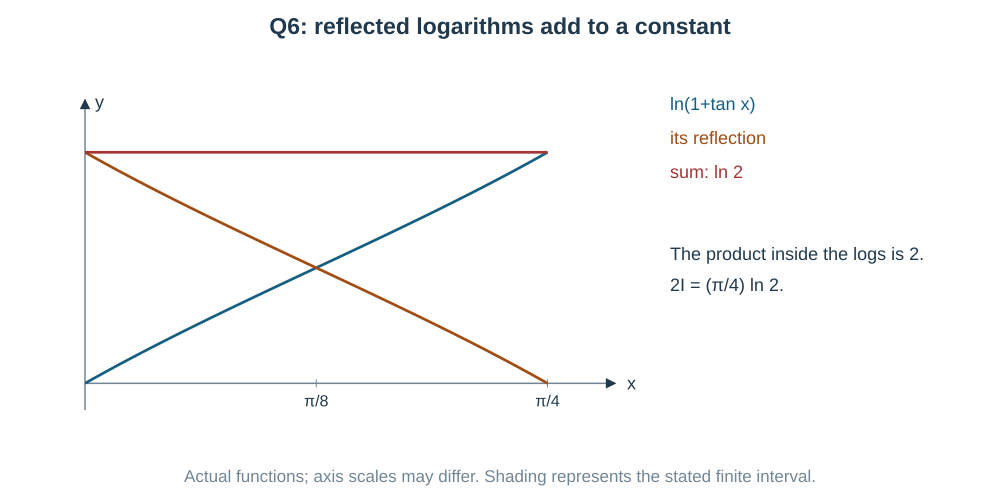

$$
2I=\int_0^{\pi/4}\ln2\,dx=\frac\pi4\ln2
\Rightarrow\boxed{I=\frac\pi8\ln2}\quad\text{(d)}.
$$

Both log inputs are positive and finite. Expanding $\ln(1+\tan x)$ into a series is possible only with extra convergence care and is much longer than this exact pair.

---

### Question 7 — Count complete periods after applying the modulus

**PDF page 64 | Numerical value | Notes: C07**

The value of $\displaystyle\int_0^{25\pi}|\sin x|\,dx$ is ____.

**The modulus changes the period.** Every negative sine hump is flipped upwards, so $|\sin x|$ repeats after $\pi$.

One hump contributes

$$
\int_0^\pi|\sin x|dx=\int_0^\pi\sin x\,dx
=[-\cos x]_0^\pi=2.
$$

There are $25$ complete periods, so $I=25(2)=\boxed{50}$.
Using the ordinary sine's full-cycle cancellation would ignore the modulus.

---

### Question 8 — The interval endpoints tell us the reflection sum

**PDF page 64 | MCQ | Notes: C04**

$\displaystyle\int_{\pi/6}^{\pi/3}\frac{dx}{1+\sqrt{\tan x}}$ equals

- (a) $\dfrac\pi{12}$
- (b) $\dfrac\pi6$
- (c) $\dfrac\pi3$
- (d) $\dfrac\pi{24}$

**Use the endpoint sum, not only the upper endpoint.** Here
$\pi/6+\pi/3=\pi/2$, so reflection is $x\mapsto\pi/2-x$.

Since $\tan(\pi/2-x)=1/\tan x$ and tangent is positive here, put $u=\sqrt{\tan x}>0$:

$$
\frac1{1+u}+\frac1{1+1/u}=1.
$$

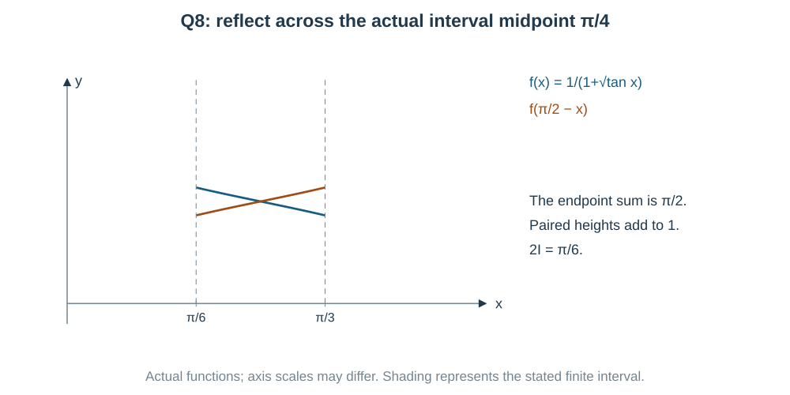

Therefore
$2I=\pi/3-\pi/6=\pi/6$ and
$\boxed{I=\pi/12}$, **(a)**.
The square root causes no sign ambiguity because tangent is positive throughout the interval.

---

### Question 9 — A simple substitution avoids a ten-term expansion

**PDF page 65 | MCQ | Notes: C03,C09**

The value of $\displaystyle\int_0^1x(1-x)^{10}\,dx$ is

- (a) $\dfrac1{110}$
- (b) $\dfrac1{121}$
- (c) $\dfrac1{132}$
- (d) $\dfrac1{66}$

**Expanding $(1-x)^{10}$ would create eleven terms.** Instead let the repeated bracket itself be $u=1-x$. Then $x=1-u$, $dx=-du$, and bounds $0,1$ become $1,0$:

$$
I=\int_1^0(1-u)u^{10}(-du)
=\int_0^1(u^{10}-u^{11})du
=\frac1{11}-\frac1{12}
=\boxed{\frac1{132}}\quad\text{(c)}.
$$

**Another possible approach:** the finite factorial result from C09 gives
$1!\,10!/12!=1/(12\cdot11)$.
The one-substitution route is shorter and shows why a large exponent need not mean a long calculation.

---

### Question 10 — Reduce an even sine power two steps at a time

**PDF page 65 | Numerical value | Notes: C09**

If $I=\displaystyle\int_0^{\pi/2}\sin^6x\,dx$, then the value of $\dfrac{32I}\pi$ is ____.

**An even sine power on $[0,\pi/2]$ fits the reduction formula.** C09 derived it from parts, so we can reduce by two at a time:

$$
I=S_6=\frac56S_4
=\frac56\frac34S_2
=\frac56\frac34\frac12\frac\pi2
=\frac{5\pi}{32}.
$$

Hence $\boxed{32I/\pi=5}$.

**Another possible approach:** power reduction gives
$\sin^6x=(10-15\cos2x+6\cos4x-\cos6x)/32$.
Each cosine integrates to zero on this interval; the constant gives $10(\pi/2)/32=5\pi/32$. The recurrence avoids remembering this longer identity.

---

### Question 11 — Both limits move, so both ends contribute

**PDF page 65 | MCQ | Notes: C10**

Let $F(x)=\displaystyle\int_x^{x^2}\frac{dt}{1+t^3}$ for $x>0$. Then $F^\prime(1)$ equals

- (a) $0$
- (b) $1$
- (c) $-\dfrac12$
- (d) $\dfrac12$

**Both ends move, so use both endpoint rates.** For integrand $h(t)=1/(1+t^3)$,

$$
F'(x)=h(x^2)(2x)-h(x)
=\frac{2x}{1+x^6}-\frac1{1+x^3}.
$$

Thus $F'(1)=1-1/2=\boxed{1/2}$, **(d)**.

**Why isn't it zero because $F(1)=0$?** A function being zero at one input does not make its derivative zero. For $x=1+h$, the oriented interval width is
$(1+h)^2-(1+h)=h+h^2$.
The nearby integrand height is about $1/2$, so $F(1+h)\approx h/2$, which confirms the slope.

---

### Question 12 — The square root of x squared is absolute x

**PDF page 65 | Numerical value | Notes: C10,C14**

$\displaystyle\lim_{x\to0}\frac{\int_0^{x^2}\sin\sqrt t\,dt}{x^3}=$ ____ (round to $2$ decimal places).

**Check the two sides before using the answer key.** The numerator integrates a positive function over a positive-width interval for small nonzero $x$, so it is positive on both sides. But $x^3$ changes sign. This already tells us to be careful.

Set $u=\sqrt t$, so $t=u^2$, $dt=2u\,du$. The upper limit is
$\sqrt{x^2}=|x|$, **not $x$**. With $r=|x|$,

$$
N(x)=2\int_0^r u\sin u\,du
=2(\sin r-r\cos r).
$$

Use the small-input expansions:

$$
\sin r=r-\frac{r^3}6+O(r^5),\quad
r\cos r=r-\frac{r^3}2+O(r^5).
$$

Thus $N(x)=\tfrac23|x|^3+O(|x|^5)$, and

$$
\lim_{x\to0^+}\frac{N(x)}{x^3}=\frac23,\qquad
\lim_{x\to0^-}\frac{N(x)}{x^3}=-\frac23.
$$

$$
\boxed{\text{The printed two-sided limit does not exist.}}
$$

**Source-key correction:** $0.67$ is the rounded right-hand limit only. There is no single two-decimal numerical answer to the question as printed.

**Another possible approach — L'Hôpital on each side.** The fundamental theorem and chain rule give $N'(x)=2x\sin|x|$. Hence the derivative quotient is

$$
\frac{2x\sin|x|}{3x^2}
=\frac23\frac{\sin|x|}{x}.
$$

Its right and left limits are again $+2/3$ and $-2/3$. This validates the result independently while retaining the crucial absolute value.

---

### Question 13 — Expose rectangle width one over n

**PDF page 65 | MCQ | Notes: C12**

$\displaystyle\lim_{n\to\infty}\sum_{r=1}^n\frac r{n^2+r^2}$ equals

- (a) $\dfrac12\ln2$
- (b) $\ln2$
- (c) $\dfrac\pi4$
- (d) $\dfrac12\ln3$

**Find the strip width.** Factor out $n$ carefully:

$$
\frac r{n^2+r^2}
=\frac1n\frac{r/n}{1+(r/n)^2}.
$$

Now we have width $1/n$, sample input $r/n$, and height $f(t)=t/(1+t^2)$.

The limit is

$$
\int_0^1\frac t{1+t^2}dt
=\left[\frac12\ln(1+t^2)\right]_0^1
=\boxed{\frac12\ln2}\quad\text{(a)}.
$$

Trying to find an exact closed form for the finite sum is unnecessary; its normalized rectangle pattern already gives the limit.

---

### Question 14 — Take logs after removing the growing factor n

**PDF page 65 | MCQ | Notes: C12**

$\displaystyle\lim_{n\to\infty}\frac1n\left[(n+1)(n+2)\cdots(2n)\right]^{1/n}$ equals

- (a) $\dfrac e4$
- (b) $\dfrac2e$
- (c) $\dfrac4e$
- (d) $\dfrac4{e^2}$

**First count the factors.** There are $n$ factors, each $n+r=n(1+r/n)$.
So the outside $1/n$ cancels the $n$th root of $n^n$:

$$
a_n=\left[\prod_{r=1}^n\left(1+\frac rn\right)\right]^{1/n}>0.
$$

Take logs to turn multiplication into addition:

$$
\ln a_n=\frac1n\sum_{r=1}^n\ln(1+r/n)
\to\int_0^1\ln(1+t)dt.
$$

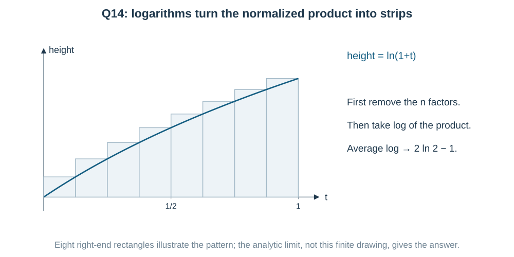

$$
\int_0^1\ln(1+t)dt
=[(1+t)\ln(1+t)-(1+t)]_0^1
=2\ln2-1.
$$

Exponentiating gives
$\boxed{e^{2\ln2-1}=4/e}$, **(c)**.
Multiplying the original large factors directly hides the simple average-log pattern.

---

### Question 15 — A power sum is another rectangle sum

**PDF page 65 | Numerical value | Notes: C12**

$\displaystyle8\lim_{n\to\infty}\frac{1^3+2^3+\cdots+n^3}{n^4}=$ ____.

**The denominator is $n^4$ because a cubic height needs $n^3$ and the strip width needs one more $n$.**

$$
\frac{1^3+\cdots+n^3}{n^4}
=\frac1n\sum_{r=1}^n\left(\frac rn\right)^3
\to\int_0^1t^3dt=\frac14.
$$

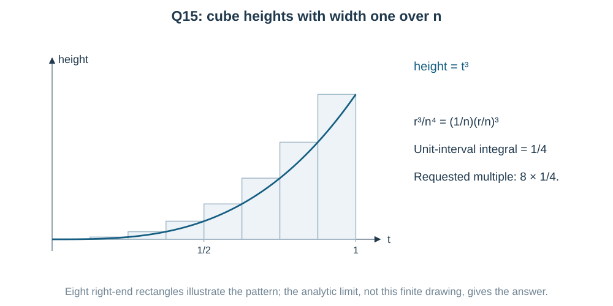

The requested multiple is $8(1/4)=\boxed2$.

**Another possible approach:** use
$\sum_{r=1}^nr^3=[n(n+1)/2]^2$.
After division by $n^4$, this is $(1+1/n)^2/4\to1/4$.
Both are short; the integral view also handles sums without a memorized finite-sum formula.

---

### Question 16 — Signed cancellation and equal positive areas are different

**PDF page 65 | MCQ | Notes: C06,C07**

Statement I: $\displaystyle\int_{-\pi}^\pi x^2\sin x\,dx=0$.

Statement II: $\displaystyle\int_0^{2\pi}\sin^3x\,dx=2\int_0^\pi\sin^3x\,dx$. Choose the correct option.

- (a) Both Statement I and Statement II are true
- (b) Statement I is true but Statement II is false
- (c) Statement I is false but Statement II is true
- (d) Both Statement I and Statement II are false

**I:** $x^2$ is even and $\sin x$ odd, so their product is odd. On symmetric limits its integral is $0$: true.

**II:** $\sin^3(x+\pi)=-\sin^3x$. Thus its second half cancels its first, giving left side $0$.
But

$$
\int_0^\pi\sin^3x\,dx
=\int_{-1}^1(1-u^2)du=\frac43,
\quad u=\cos x.
$$

The proposed right side is $8/3$, not $0$. So II is false and the answer is $\boxed{\text{(b)}}$.
The rule for repeating complete periods cannot be applied to half a period with the opposite sign.

---

### Question 17 — Use four short standard evaluations

**PDF page 66 | MCQ | Notes: C03,C15**

Match List-I with List-II.

List-I: A. $\displaystyle\int_0^{\pi/2}\sin x\cos x\,dx$; B. $\displaystyle\int_0^1xe^x\,dx$; C. $\displaystyle\int_0^{\pi/4}\tan x\,dx$; D. $\displaystyle\int_0^1\frac{dx}{1+x^2}$.

List-II: I. $\pi/4$; II. $1$; III. $1/2$; IV. $(\ln2)/2$.

- (a) A-III, B-II, C-IV, D-I
- (b) A-II, B-III, C-IV, D-I
- (c) A-III, B-II, C-I, D-IV
- (d) A-I, B-II, C-IV, D-III

**Each item has a short primitive.** Evaluate upper minus lower:

| Item | Primitive / evaluation | Match |
|---|---|---|
| A | $[\sin^2x/2]_0^{\pi/2}=1/2$ | III |
| B | $[(x-1)e^x]_0^1=0-(-1)=1$ | II |
| C | $[-\ln|\cos x|]_0^{\pi/4}=-\ln(1/\sqrt2)=(\ln2)/2$ | IV |
| D | $[\tan^{-1}x]_0^1=\pi/4$ | I |

Thus $\boxed{\text{A-III, B-II, C-IV, D-I}}$, **(a)**.
For B, the lower-end contribution is essential; the upper-end product alone is zero.

---

### Question 18 — A floor of a square changes at square roots of integers

**PDF page 66 | Numerical value | Notes: C08**

The value of $\displaystyle\int_0^2[x^2]\,dx$, where $[\cdot]$ denotes the greatest integer function, is ____ (round to $2$ decimal places).

**The floor changes when $x^2$ crosses $1,2,3,4$.** Therefore the $x$ breakpoints are square roots, not equally spaced integers.

$$
\begin{aligned}
I&=0(1-0)+1(\sqrt2-1)
+2(\sqrt3-\sqrt2)+3(2-\sqrt3)\\
&=5-\sqrt2-\sqrt3
\approx1.85373563.
\end{aligned}
$$

Rounded as requested: $\boxed{1.85}$.
At $x=2$ the function equals $4$, but that one point has zero width and adds no area.

---

### Question 19 — Remove the x factor by symmetry before integrating

**PDF page 66 | MCQ | Notes: C05,C03**

$\displaystyle\int_0^\pi\frac{x}{1+\sin x}\,dx$ equals

- (a) $\dfrac\pi2$
- (b) $2\pi$
- (c) $\pi$
- (d) $\dfrac{\pi^2}2$

**Remove the troublesome $x$ by symmetry first.** The weight
$h(x)=1/(1+\sin x)$ satisfies $h(\pi-x)=h(x)$. Thus

$$
I=\frac\pi2J,\qquad J=\int_0^\pi\frac{dx}{1+\sin x}.
$$

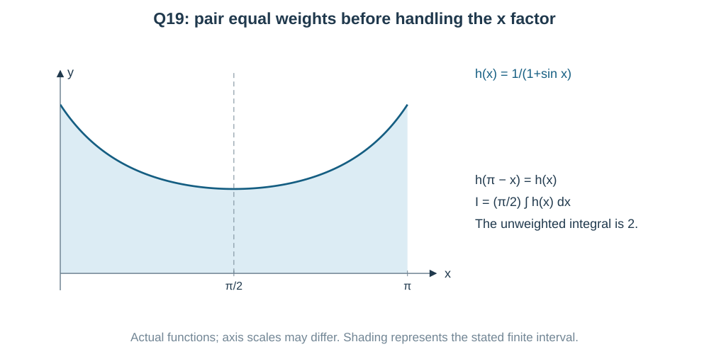

For $J$, use $t=\tan(x/2)$, with bounds $0$ to $\infty$:

$$
J=2\int_0^\infty\frac{dt}{(1+t)^2}
=\left[-\frac2{1+t}\right]_0^\infty=2.
$$

So $\boxed{I=\pi}$, **(c)**.

**Another possible approach for $J$:** the smooth primitive
$-\cos x/(1+\sin x)$ has derivative $1/(1+\sin x)$. Its values at $\pi,0$ are $1,-1$, giving $J=2$.
The equivalent-looking $\tan x-\sec x$ formula is undefined at $\pi/2$ before simplification; the smooth expression avoids that artificial break.

---

### Question 20 — An odd exponent makes complementary logistic values

**PDF page 66 | MCQ | Notes: C06**

The value of $\displaystyle\int_{-\pi/2}^{\pi/2}\frac{dx}{1+e^{\sin x}}$ is

- (a) $\pi$
- (b) $\dfrac\pi2$
- (c) $0$
- (d) $\dfrac\pi4$

**Sine changes sign under $x\mapsto-x$.** The two reflected terms are complementary:

$$
\frac1{1+e^{\sin x}}+\frac1{1+e^{-\sin x}}=1.
$$

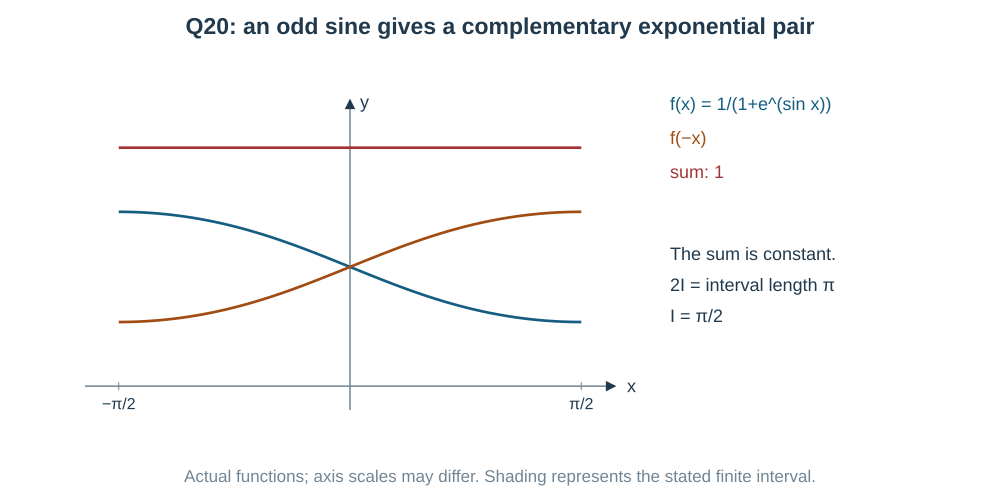

Hence
$2I=\int_{-\pi/2}^{\pi/2}1dx=\pi$ and
$\boxed{I=\pi/2}$, **(b)**.
The original function is neither odd nor even; the pairing identity is what makes the calculation short.

---

### Question 21 — A fixed-limit integral is one constant

**PDF page 66 | MCQ | Notes: C11**

Let $f$ be a continuous function satisfying $f(x)=x+\displaystyle\int_0^1tf(t)\,dt$ for all $x$. Then $f(1)$ equals

- (a) $\dfrac43$
- (b) $\dfrac32$
- (c) $2$
- (d) $\dfrac53$

**The integral has fixed limits, so it is one constant, not a function of the outside $x$.** Name it
$C=\int_0^1tf(t)dt$. Then $f(x)=x+C$.

Use the definition of the same constant:

$$
C=\int_0^1t(t+C)dt
=\frac13+\frac C2.
$$

Thus $C=2/3$, and
$f(1)=1+2/3=\boxed{5/3}$, **(d)**.

**Check:** substituting $f(t)=t+2/3$ in the original integral returns $1/3+1/3=2/3$.
Merely differentiating the original equation gives $f'=1$, but still leaves this constant to be found.

---

### Question 22 — Scale the infinite integral, then use parts

**PDF page 66 | Numerical value | Notes: C13**

The value of $\displaystyle\int_0^\infty x^3e^{-x/2}\,dx$ is ____.

**The infinite upper bound means a limit.** The exponential decays faster than the cubic grows, so the repeated-parts boundary terms vanish at infinity.

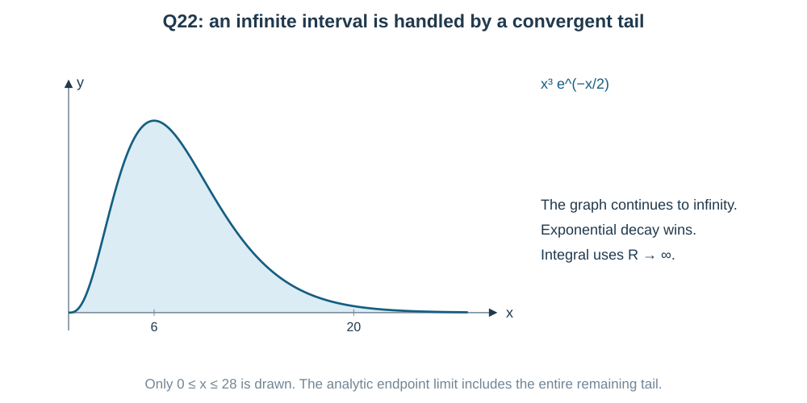

Let $x=2u$. Then $x^3dx=16u^3du$:

$$
I=16\int_0^\infty u^3e^{-u}du.
$$

For $J_n=\int_0^\infty u^ne^{-u}du$, parts gives $J_n=nJ_{n-1}$ for positive integers $n$, and $J_0=1$. Each endpoint term $[-u^ne^{-u}]_0^\infty$ is zero.

$$
I=16(3\cdot2\cdot1)J_0=\boxed{96}.
$$

The two factors in $16=2^3\cdot2$ come from the cubic and the differential. Omitting the differential factor would halve the answer.

---

### Question 23 — Parts turns inverse tangent into a rational function

**PDF page 66 | MCQ | Notes: C03**

The value of $\displaystyle\int_0^1x\tan^{-1}x\,dx$ is

- (a) $\dfrac\pi4-1$
- (b) $\dfrac\pi8-\dfrac12$
- (c) $\dfrac\pi4-\dfrac12$
- (d) $\dfrac\pi2-\dfrac12$

**The inverse tangent becomes rational after differentiation.** Use parts:
$u=\tan^{-1}x$, $dv=x\,dx$. Then $du=dx/(1+x^2)$ and $v=x^2/2$.

$$
I=\left[\frac{x^2}2\tan^{-1}x\right]_0^1
-\frac12\int_0^1\frac{x^2}{1+x^2}dx.
$$

Did you notice $x^2=(1+x^2)-1$? Therefore

$$
I=\frac\pi8-\frac12\left(1-\frac\pi4\right)
=\boxed{\frac\pi4-\frac12}\quad\text{(c)}.
$$

This positive result agrees with the nonnegative integrand. Choosing the inverse tangent as $dv$ would make the next integral more complicated.

---

### Question 24 — The numerator is exactly the derivative of sine squared

**PDF page 67 | MCQ | Notes: C03**

$\displaystyle\int_0^{\pi/2}\frac{\sin2x}{(1+\sin^2x)^2}\,dx$ equals

- (a) $\dfrac12$
- (b) $\dfrac14$
- (c) $1$
- (d) $\dfrac12\ln2$

**The numerator is a complete inner derivative:**
$(\sin^2x)'=2\sin x\cos x=\sin2x$.

Let $u=\sin^2x$; the bounds become $0$ and $1$.

$$
I=\int_0^1\frac{du}{(1+u)^2}
=\left[-\frac1{1+u}\right]_0^1
=-\frac12+1=\boxed{\frac12}\quad\text{(a)}.
$$

We did not need a long trig expansion. The denominator's square means a power $-2$ integral, rather than a logarithm.

---

### Question 25 — Reduce an even fourth power

**PDF page 67 | MCQ | Notes: C09**

The value of $\displaystyle\int_0^\pi\sin^4x\,dx$ is

- (a) $\dfrac{3\pi}{16}$
- (b) $\dfrac{3\pi}4$
- (c) $\dfrac\pi4$
- (d) $\dfrac{3\pi}8$

**Use reflection to halve the interval, then the even-power recurrence.**

$$
I=2S_4
=2\left(\frac34\frac12\frac\pi2\right)
=\boxed{\frac{3\pi}8}\quad\text{(d)}.
$$

**Another possible approach:** $\sin^4x=(3-4\cos2x+\cos4x)/8$. The cosine terms integrate to zero on $[0,\pi]$; the constant gives $3\pi/8$. Both routes work; the recurrence scales easily to higher powers.

---

### Question 26 — Separate the odd part from the easy polynomial

**PDF page 67 | Numerical value | Notes: C06**

The value of $\displaystyle\int_{-2}^2\left(x^3e^{x^2}+3x^2+1\right)\,dx$ is ____.

**Split by symmetry before trying to integrate the exponential term.**
The factor $x^3$ is odd and $e^{x^2}$ even, so their product is odd.

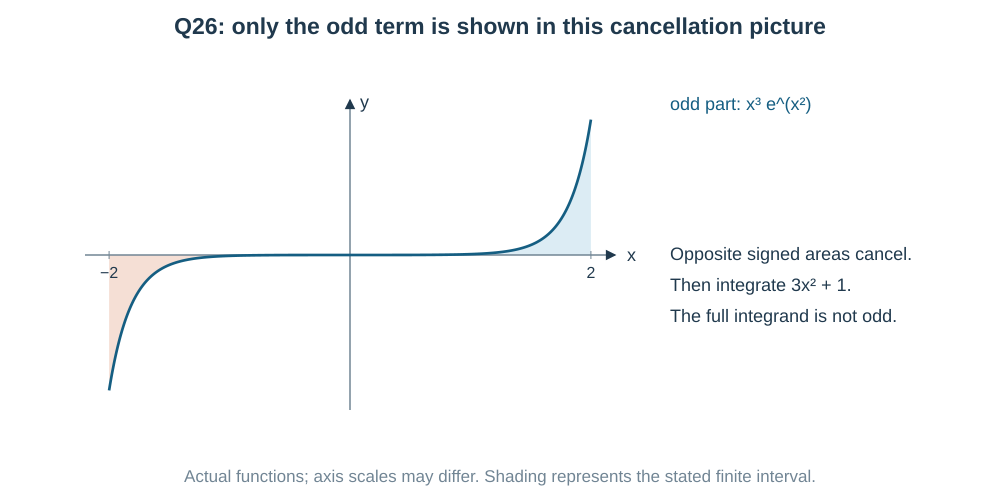

$$
\int_{-2}^2x^3e^{x^2}dx=0.
$$

The rest is even:

$$
I=2\int_0^2(3x^2+1)dx
=2[x^3+x]_0^2=2(8+2)=\boxed{20}.
$$

The full integrand is not odd. Direct substitution in the first term is possible, but symmetry removes that work entirely.

---

### Question 27 — A shifted absolute sine still has a fixed period area

**PDF page 67 | MCQ | Notes: C07**

The value of $\displaystyle\int_0^{4\pi}|\sin x+\cos x|\,dx$ is

- (a) $4\sqrt2$
- (b) $8\sqrt2$
- (c) $8$
- (d) $16$

**Turn the sum into one wave before applying the modulus.**

$$
|\sin x+\cos x|
=\sqrt2\,|\sin(x+\pi/4)|.
$$

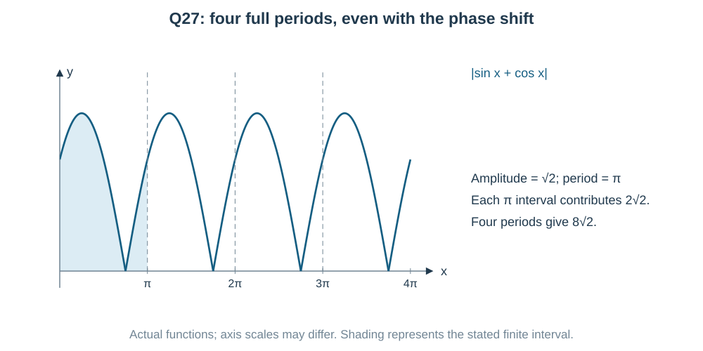

Its period is $\pi$. The interval length $4\pi$ contains four complete periods. Each contributes $2\sqrt2$ independently of its starting phase.

$$
I=4(2\sqrt2)=\boxed{8\sqrt2}\quad\text{(b)}.
$$

Splitting at every zero would also work, but the period-and-amplitude view avoids several separate modulus cases.

---

### Question 28 — The derivative of accumulated area gives the turning test

**PDF page 67 | MCQ | Notes: C10,C11**

If $f(x)=\displaystyle\int_0^x(t^2-3t+2)\,dt$, then the local maximum value of $f$ is

- (a) $\dfrac12$
- (b) $\dfrac56$
- (c) $\dfrac13$
- (d) $\dfrac76$

**The integral defines accumulated signed area.** Its derivative is the integrand at the moving upper input:

$$
f'(x)=x^2-3x+2=(x-1)(x-2).
$$

The signs are $+,-,+$, so $x=1$ gives the local maximum. The question asks its **value**:

$$
f(1)=\left[\frac{t^3}3-\frac{3t^2}2+2t\right]_0^1
=\frac13-\frac32+2
=\boxed{\frac56}\quad\text{(b)}.
$$

**Another possible approach:** first evaluate $f(x)=x^3/3-3x^2/2+2x$, then apply the usual derivative test. The fundamental theorem gives the same test before finding a primitive.

---

### Question 29 — Evaluate first, then solve for the positive endpoint

**PDF page 67 | Numerical value | Notes: C01,C11**

If $a>0$ and $\displaystyle\int_0^a(3x^2+2x)\,dx=12$, then $a=$ ____.

**The unknown is the endpoint, so evaluate the integral in terms of it.**

$$
[x^3+x^2]_0^a=a^3+a^2=12.
$$

Since $a=2$ works, factor:

$$
a^3+a^2-12=(a-2)(a^2+3a+6)=0.
$$

For $a>0$, the second factor is positive. Thus
$\boxed{a=2}$ is the only allowed solution.

**Another possible check:** the accumulated value $a^3+a^2$ has derivative $3a^2+2a>0$ for $a>0$. It is strictly increasing, so once $2$ reaches $12$, no other positive endpoint can.

---

### Question 30 — An odd cosine power leaves the needed differential

**PDF page 67 | Numerical value | Notes: C03,C09**

If $I=\displaystyle\int_0^{\pi/2}\sin^5x\cos^3x\,dx$, then $\dfrac1I=$ ____.

**The odd cosine power lets us save one $\cos x\,dx$.**
Write $\cos^3x=(1-\sin^2x)\cos x$ and set $u=\sin x$.

$$
I=\int_0^1u^5(1-u^2)du
=\frac16-\frac18=\frac1{24}.
$$

The question asks the reciprocal, so
$\boxed{1/I=24}$.
Expanding multiple-angle identities would be longer than saving the derivative already present.

---

### Question 31 — Divide a rational function instead of approximating pi

**PDF page 67 | MCQ | Notes: C02,C03,C15**

The value of $\displaystyle\int_0^1\frac{x^4(1-x)^4}{1+x^2}\,dx$ is

- (a) $\pi-\dfrac{22}7$
- (b) $\dfrac{22}7-\dfrac\pi2$
- (c) $\dfrac1{630}$
- (d) $\dfrac{22}7-\pi$

**A high-degree numerator over a quadratic suggests polynomial division.** First expand only the numerator, then divide:

$$
\frac{x^4(1-x)^4}{1+x^2}
=x^6-4x^5+5x^4-4x^2+4-\frac4{1+x^2}.
$$

You can verify this identity by multiplying by $1+x^2$. Every remaining term now has an easy primitive.

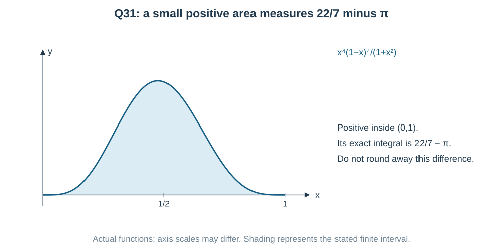

$$
\begin{aligned}
I&=\frac17-\frac46+\frac55-\frac43+4
-4\left[\tan^{-1}x\right]_0^1\\
&=\frac{22}7-\pi.
\end{aligned}
$$

Therefore $\boxed{22/7-\pi}$, **(d)**.

**Another useful view — bounds and options:** the integrand is strictly positive inside $(0,1)$, so the negative option (a) is impossible. Also $1+x^2>1$ inside, hence

$$
I<\int_0^1x^4(1-x)^4dx=\frac1{630}.
$$

So option (c) is a strict upper bound, not the actual answer. These checks support the exact division result. Replacing $\pi$ by $22/7$ would falsely make a positive area zero.

---

### Question 32 — Two moduli give three intervals

**PDF page 67 | Numerical value | Notes: C08**

The value of $\displaystyle\int_{-1}^3\left(|x-1|+|x-2|\right)\,dx$ is ____.

**Mark both corners: $x=1$ and $x=2$.** The expression is

$$
|x-1|+|x-2|=
\begin{cases}
3-2x,&-1\le x\le1,\\
1,&1\le x\le2,\\
2x-3,&2\le x\le3.
\end{cases}
$$

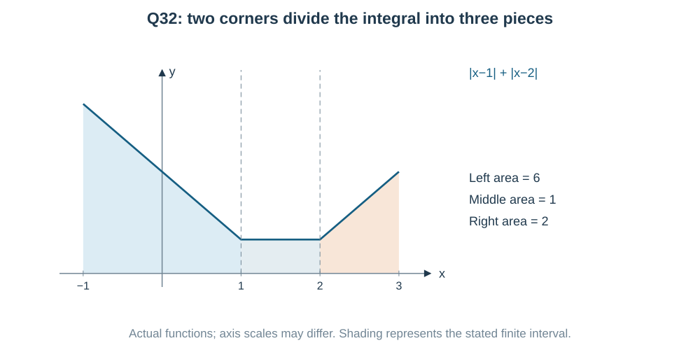

$$
I=\int_{-1}^1(3-2x)dx+\int_1^2 1dx+\int_2^3(2x-3)dx
=6+1+2=\boxed9.
$$

**Another possible approach — add the two V-shaped areas separately.**

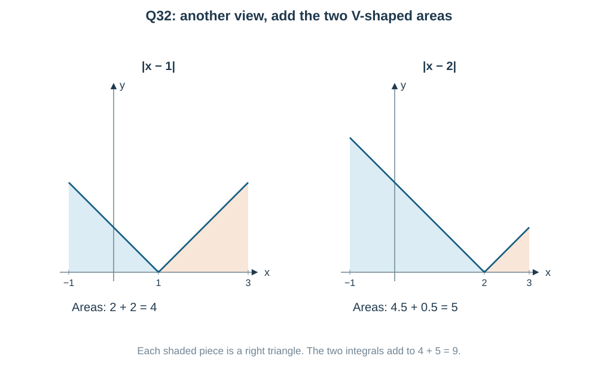

$$
\int_{-1}^3|x-1|dx=\frac{2^2}2+\frac{2^2}2=4,
\quad
\int_{-1}^3|x-2|dx=\frac{3^2}2+\frac{1^2}2=5.
$$

These are triangle areas, so the sum is again $9$. The piecewise route also teaches how to handle a sum with more corners.

---

### Question 33 — Factor n out of the square root

**PDF page 67 | MCQ | Notes: C12**

$\displaystyle\lim_{n\to\infty}\frac1n\sum_{r=1}^n\frac r{\sqrt{n^2+r^2}}$ equals

- (a) $\sqrt2-1$
- (b) $\sqrt2$
- (c) $\dfrac{\sqrt2-1}2$
- (d) $\ln(1+\sqrt2)$

**The outside $1/n$ is already the strip width.** Inside the sum, factor the positive $n$ from the square root:

$$
\frac r{\sqrt{n^2+r^2}}
=\frac{r/n}{\sqrt{1+(r/n)^2}}.
$$

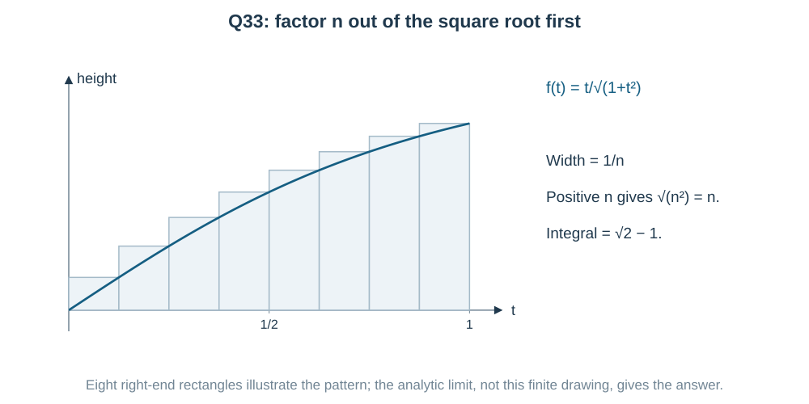

Thus the limit is

$$
\int_0^1\frac t{\sqrt{1+t^2}}dt
=[\sqrt{1+t^2}]_0^1
=\boxed{\sqrt2-1}\quad\text{(a)}.
$$

Do not create an extra $1/n$ when simplifying the inside fraction.

---

### Question 34 — Reflection cancels a convergent log-tangent integral

**PDF page 68 | MCQ | Notes: C04,C13**

Assertion (A): $\displaystyle\int_0^{\pi/2}\ln(\tan x)\,dx=0$.

Reason (R): $\displaystyle\int_0^a f(x)\,dx=\int_0^a f(a-x)\,dx$. Choose the correct option.

- (a) Both A and R are true, but R is not the correct explanation of A
- (b) A is true but R is false
- (c) Both A and R are true and R is the correct explanation of A
- (d) A is false but R is true

**Check that the improper integral exists before cancelling.**
$\ln(\tan x)=\ln(\sin x)-\ln(\cos x)$.
Each part has a convergent logarithmic endpoint as established in Q5, so both endpoint contributions are legitimate.

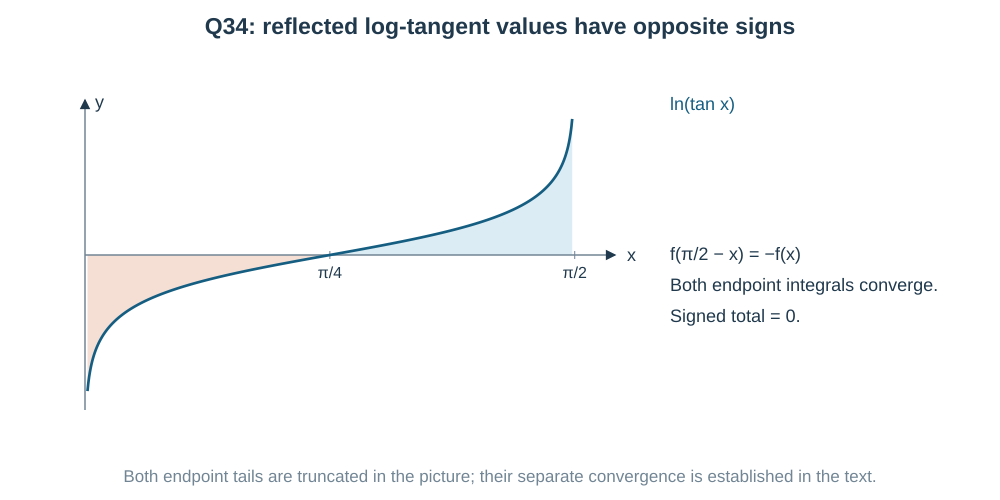

With $a=\pi/2$, reflection gives

$$
I=\int_0^{\pi/2}\ln\tan(\pi/2-x)dx
=\int_0^{\pi/2}\ln(\cot x)dx=-I.
$$

Hence $I=0$. The reason is true for integrable functions and directly explains the assertion: $\boxed{\text{(c)}}$.

**Another possible approach:** Q5 and its cosine reflection both equal $-(\pi/2)\ln2$. Subtracting these two convergent integrals gives zero.

---

### Question 35 — Pair an unknown function with its reflection

**PDF page 68 | Numerical value | Notes: C04**

If $f$ is continuous on $[0,4]$ and $f(x)+f(4-x)=6$ for all $x\in[0,4]$, then $\displaystyle\int_0^4f(x)\,dx=$ ____.

**We do not need the formula for $f$.** Let $I=\int_0^4f(x)dx$. Reflection says $\int_0^4f(4-x)dx=I$.

Integrate the given pair identity:

$$
2I=\int_0^4[f(x)+f(4-x)]dx=\int_0^4 6dx=24.
$$

So $\boxed{I=12}$.

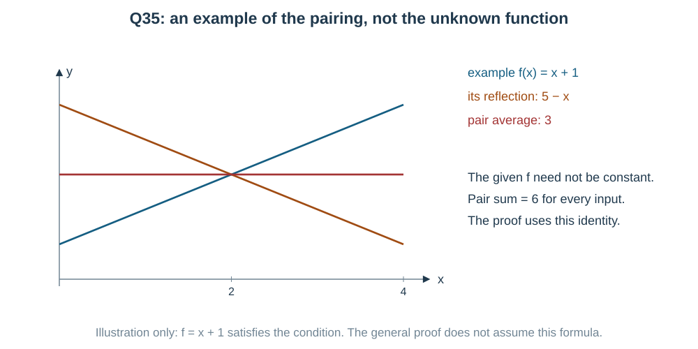

**Another possible approach:** let $g(x)=f(x)-3$. Then $g(4-x)=-g(x)$, so after shifting the midpoint to zero with $u=x-2$, its integral is an odd-function integral and equals zero. The remaining constant height $3$ over width $4$ gives $12$.

---

### Question 36 — Half-angle substitution gives a standard rational integral

**PDF page 68 | MCQ | Notes: C03**

The value of $\displaystyle\int_0^\pi\frac{dx}{3+2\cos x}$ is

- (a) $\dfrac\pi5$
- (b) $\dfrac\pi{\sqrt{13}}$
- (c) $\dfrac{2\pi}{\sqrt5}$
- (d) $\dfrac\pi{\sqrt5}$

**A denominator linear in cosine becomes rational with the half-angle substitution.**
Set $t=\tan(x/2)$:

$$
\cos x=\frac{1-t^2}{1+t^2},\quad
dx=\frac{2dt}{1+t^2},\quad
3+2\cos x=\frac{5+t^2}{1+t^2}.
$$

As $x$ goes from $0$ to $\pi^-$, $t$ goes from $0$ to $\infty$. Therefore

$$
I=2\int_0^\infty\frac{dt}{t^2+5}
=\frac2{\sqrt5}\left[\tan^{-1}\frac t{\sqrt5}\right]_0^\infty
=\boxed{\frac\pi{\sqrt5}}\quad\text{(d)}.
$$

The original integrand is continuous because $3+2\cos x\ge1$. The infinite transformed bound comes from the substitution, not an original denominator singularity.

**Another possible route:** use the C15 standard result with $a=3,b=2$; its condition $a>|b|$ holds. The substitution above explains and checks that shortcut.

---

### Question 37 — Parts integrates the inverse sine through an endpoint limit

**PDF page 68 | MCQ | Notes: C03,C13**

The value of $\displaystyle\int_0^1\sin^{-1}x\,dx$ is

- (a) $\dfrac\pi2-1$
- (b) $\dfrac\pi2+1$
- (c) $1-\dfrac\pi2$
- (d) $\dfrac\pi4$

**The original inverse sine is finite at both endpoints.** Use parts on $[0,b]$ with $b<1$, then let $b\to1^-$ because its derivative becomes unbounded at $1$.

With $u=\sin^{-1}x$, $dv=dx$:

$$
\int\sin^{-1}x\,dx
=x\sin^{-1}x-\int\frac x{\sqrt{1-x^2}}dx
=x\sin^{-1}x+\sqrt{1-x^2}+C.
$$

Thus
$I=\pi/2-1=\boxed{\pi/2-1}$, **(a)**.

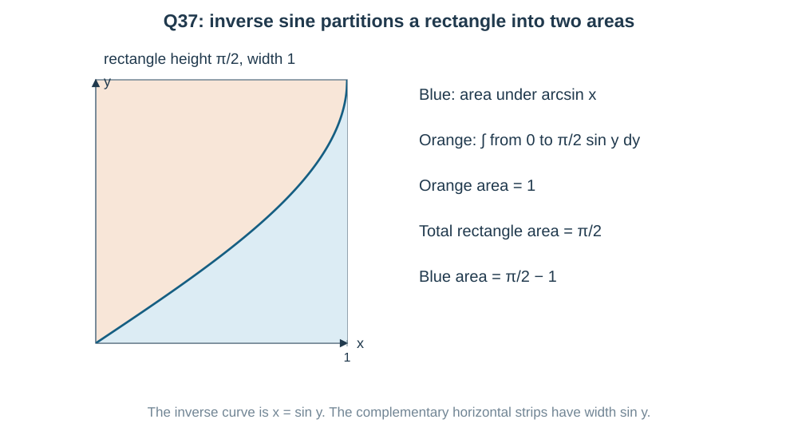

**Another possible approach — inverse-function area.** The rectangle has width $1$ and height $\pi/2$. Horizontal strips to the left of $x=\sin y$ have total area
$\int_0^{\pi/2}\sin y\,dy=1$.
The remaining area under $y=\sin^{-1}x$ is therefore $\pi/2-1$.

---

### Question 38 — Expand the square before doing any integration

**PDF page 68 | Numerical value | Notes: C03**

The value of $\displaystyle\int_0^{\pi/2}(\sin x+\cos x)^2\,dx$ is ____ (round to $2$ decimal places).

**Did you notice that expanding joins the two squares into one?**

$$
(\sin x+\cos x)^2
=\sin^2x+\cos^2x+2\sin x\cos x
=1+\sin2x.
$$

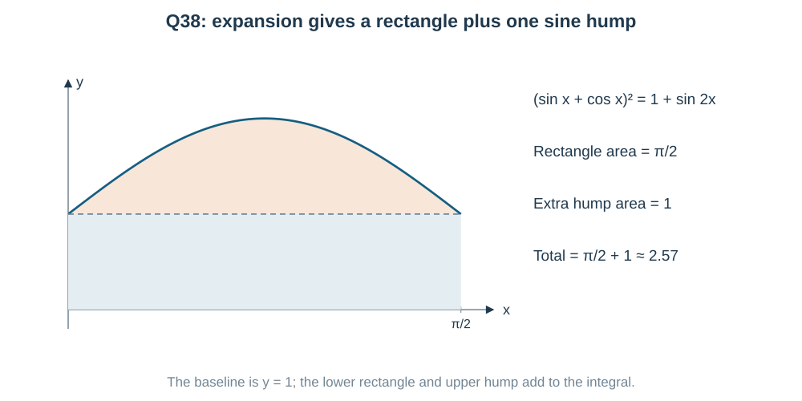

$$
I=\frac\pi2+\left[-\frac{\cos2x}2\right]_0^{\pi/2}
=\frac\pi2+1\approx2.57079633.
$$

Rounded: $\boxed{2.57}$.
The sine hump is positive on this interval, so it adds area; it does not cancel.

---

### Question 39 — Check parity and signed periods separately

**PDF page 68 | MCQ | Notes: C06,C07**

Consider the statements:

(a) $\displaystyle\int_{-1}^1x|x|\,dx=0$.

(b) $\displaystyle\int_{-\pi/2}^{\pi/2}\cos x\,dx=0$.

(c) $\displaystyle\int_0^{\pi/2}\ln(\sin x)\,dx=\int_0^{\pi/2}\ln(\cos x)\,dx$.

(d) $\displaystyle\int_0^{2\pi}\sin x\,dx=2\int_0^\pi\sin x\,dx$.

Which statements are correct?

- (a) (a), (b) and (c) only
- (b) (b) and (d) only
- (c) (a) and (c) only
- (d) (a), (c) and (d) only

**Check each statement separately.**

- (a) $x|x|$ is odd. Symmetric limits give $0$: **true**.
- (b) Cosine is even here, and $[\sin x]_{-\pi/2}^{\pi/2}=2$, not $0$: **false**.
- (c) Reflection $x\mapsto\pi/2-x$ swaps the two convergent log integrals: **true**.
- (d) $\int_0^{2\pi}\sin xdx=0$ but $2\int_0^\pi\sin xdx=4$: **false**.

Therefore $\boxed{\text{(a) and (c) only}}$, **option (c)**.
Evenness means doubling the half-interval integral, not setting it to zero.

---

### Question 40 — Product-to-sum separates two frequencies

**PDF page 68 | MCQ | Notes: C03,C07**

The value of $\displaystyle\int_0^\pi\sin3x\cos2x\,dx$ is

- (a) $\dfrac35$
- (b) $\dfrac65$
- (c) $\dfrac{12}5$
- (d) $0$

**Different frequencies suggest product-to-sum.**

$$
\sin3x\cos2x=\frac12[\sin5x+\sin x].
$$

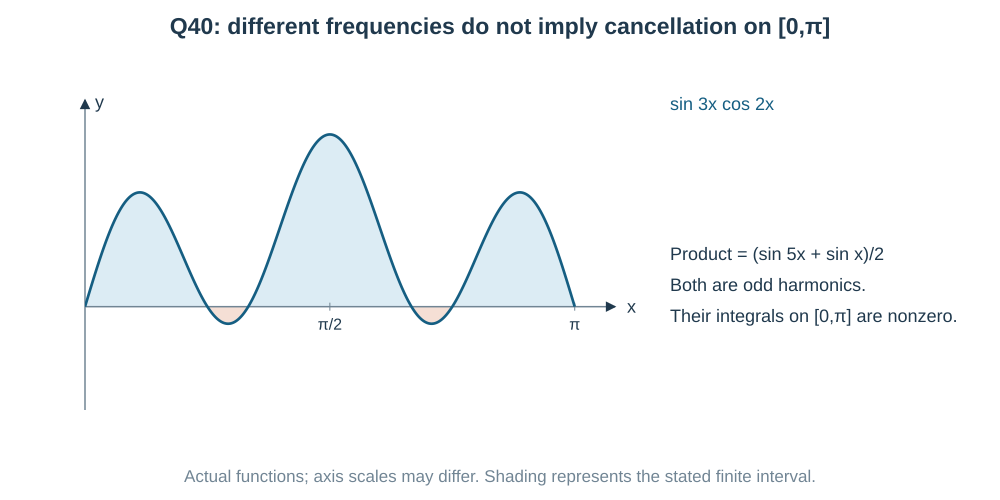

Both frequencies are odd, so

$$
I=\frac12\left(
\left[-\frac{\cos5x}5\right]_0^\pi+
[-\cos x]_0^\pi\right)
=\frac12\left(\frac25+2\right)
=\boxed{\frac65}\quad\text{(b)}.
$$

Do not assume every product of different trig frequencies integrates to zero on every interval. The limits and sine/cosine types decide that. On the symmetric interval $[-\pi,\pi]$ this particular product would be odd and cancel, but the question uses $[0,\pi]$.

## Answer check

Read the qualifications in the solutions before using the key.

| Question | Answer | Question | Answer |
|---|---|---|---|
| 1 | (c) $\pi/4$ | 21 | (d) $5/3$ |
| 2 | (a) $\pi/4$ | 22 | $96$ |
| 3 | (d) $\pi^2/4$ | 23 | (c) $\pi/4-1/2$ |
| 4 | (b) $1$ | 24 | (a) $1/2$ |
| 5 | (b) $-\pi\ln2/2$ | 25 | (d) $3\pi/8$ |
| 6 | (d) $\pi\ln2/8$ | 26 | $20$ |
| 7 | $50$ | 27 | (b) $8\sqrt2$ |
| 8 | (a) $\pi/12$ | 28 | (b) $5/6$ |
| 9 | (c) $1/132$ | 29 | $2$ |
| 10 | $5$ | 30 | $24$ |
| 11 | (d) $1/2$ | 31 | (d) $22/7-\pi$ |
| 12 | Does not exist; keyed $0.67$ is right-hand only | 32 | $9$ |
| 13 | (a) $\ln2/2$ | 33 | (a) $\sqrt2-1$ |
| 14 | (c) $4/e$ | 34 | (c) |
| 15 | $2$ | 35 | $12$ |
| 16 | (b) | 36 | (d) $\pi/\sqrt5$ |
| 17 | (a) | 37 | (a) $\pi/2-1$ |
| 18 | $1.85$ | 38 | $2.57$ |
| 19 | (c) $\pi$ | 39 | (c) |
| 20 | (b) $\pi/2$ | 40 | (b) $6/5$ |

## Coverage and source notes

All $40$ source questions appear in order: $28$ MCQs and $12$ numerical questions. **Q12 is corrected explicitly: the printed two-sided limit does not exist; $0.67$ is right-hand only.** All other intended source values agree with independent checks.

The notes cover signed accumulation, the fundamental theorem, linearity and bounds, substitutions and parts, reflection, midpoint weights, parity, periodicity, modulus/floor pieces, power recurrences, integral-defined functions, rectangle sums and log-products. The source's improper examples are handled through their endpoint limits rather than advanced special functions.

## Offline research record

- Supplied Maths Predicted V1.pdf, pages 64–70: questions, options, keys and working visually inspected.
- Official NTA 2027 Mathematics Unit 8: fundamental theorem, properties and evaluation of definite integrals checked.
- ExamSIDE, Definite Integration: all $97$ recent archive IDs saved; year counts $43,23,31$.
- ExamSIDE, Indefinite Integrals: zero overlap with the separate $23$-ID set.
- PYQSide, combined Integrals weightage: $52,30,36$, a differently scoped comparison only.

The pooled mean is $97/58$ with full-year paper denominators $20,19,19$. Research is a recent archive-card recount, not an independently exhaustive $2020$–$2026$ official-paper or formula-frequency audit. These supplied questions are practice questions, not claimed as actual PYQs.

All diagrams are original local SVGs. Finite rectangles illustrate limiting sums; analytic arguments establish the limits. Truncated log/infinite tails are labelled. Alternative solutions remain ordinary visible content for the future printed booklet.
