# Area Under Curves — JEE Main revision guide

*Area is built by adding thin strips. The main work is choosing the right strips and their endpoints. A correct integral starts with a correct picture.*

> **For Kanna | Chapter 14**  
> Goal: about $120/300$ towards $200/300$ — Physics $60$, Maths $60$, Chemistry $80$.  
> Notes, recap, then all $25$ source questions. Useful alternatives remain fully visible.

## Recent chapter weightage

**ExamSIDE's Area Under The Curves category gives $59/58\approx1.02$ questions per Paper 1 over 2024–2026.**

| Year | Full-year papers | Chapter questions | Questions per paper |
|---|---:|---:|---:|
| $2024$ | $20$ | $22$ | $1.10$ |
| $2025$ | $19$ | $18$ | $0.95$ |
| $2026$ | $19$ | $19$ | $1.00$ |
| Together | $58$ | $59$ | $1.02$ |

All $59$ recent archive IDs were saved and recounted. PYQSide's Application of Integrals comparison gives $21,20,19$, total $60$. We use one named archive consistently and disclose the difference. These are archive categories, not official NTA chapter labels or a new classification of every paper. The offered-question format differed in $2024$; a mean is not a promise for a shift.

**Study priority:** draw intersections, decide top/bottom or right/left, split at changes, use symmetry, and recognise simple geometric areas. This is a teaching priority, not a measured formula-frequency rank.

## Scope and difficulties before studying

The official integration unit includes finding areas bounded by simple curves in standard forms. We teach the required integration, graph and elementary geometry tools here without assuming later conics chapters have already been revised.

The $25$ intended source answers agree with independent setups. Three wording points need care:

- Q14 asks for the **finite closed region** under the lower of tangent and cotangent, with the axis below.
- In Q21 use the positive closed region from $1$ to $2$, avoiding the hyperbola's pole at $0$.
- Q22's first intersection means the first positive one after their shared point at the origin.

## Concept C01 — What a strip of area means

An area counts the amount of flat space inside a boundary. It is nonnegative and has square units.

Take a very thin vertical rectangle. Its width is $dx$ and height is top minus bottom:

$$
dA=[y_{\rm top}(x)-y_{\rm bottom}(x)]\,dx.
$$

Adding all strips gives the exact area as the widths shrink:

$$
\boxed{A=\int_a^b[y_{\rm top}(x)-y_{\rm bottom}(x)]dx}.
$$

This needs $a<b$ and the same top/bottom ordering on the whole piece. The height is a **difference of coordinates**, not necessarily the distance of the top curve from the axis.

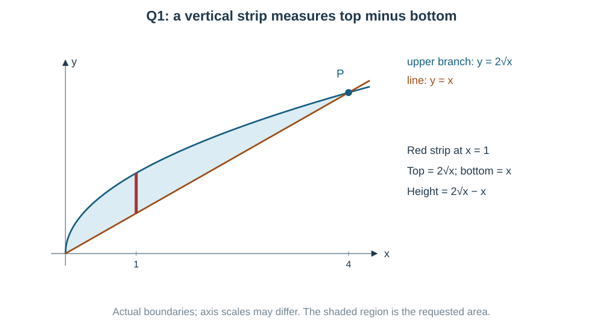

For a region between $y=f(x)$ and the axis:

$$
\boxed{A=\int_a^b|f(x)|dx}.
$$

For two curves whose order can switch:

$$
\boxed{A=\int_a^b|f(x)-g(x)|dx},
$$

with appropriate splitting. The modulus belongs **inside** the integral; taking a modulus only after signed areas cancel cannot recover the lost area.

## Concept C02 — Turn the strip sideways when that is simpler

A horizontal strip has thickness $dy$. Its length is right boundary minus left boundary:

$$
\boxed{A=\int_c^d[x_{\rm right}(y)-x_{\rm left}(y)]dy}.
$$

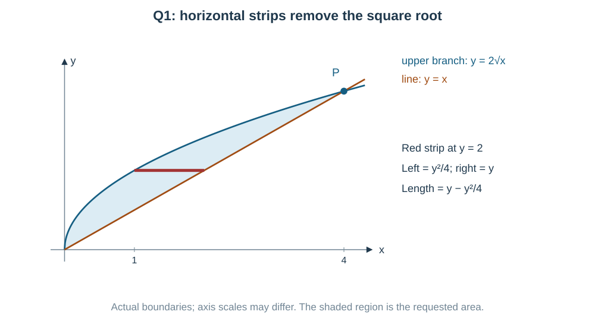

**Important for JEE Main:** choose the direction that needs fewer pieces and simpler boundary formulas.

For $y^2=4x$ and $y=x$, a vertical strip uses $2\sqrt x-x$. A horizontal strip uses $y-y^2/4$. Both are valid; the horizontal version avoids a square root.

For $x=y^2$ and $x=3-2y^2$, the equations already give left/right positions. Solving each for $y$ would create upper and lower branches unnecessarily.

Do not write top minus bottom and then integrate in $dy$. The strip direction, boundary coordinates and differential must agree.

## Concept C03 — Build the closed boundary before integrating

“Bounded” means the curves or lines form a closed fence around a finite region.

1. Find intersections using the **original equations and domains**.
2. Include every stated boundary: an axis or $x=a$ can close a region.
3. Mark a point between consecutive intersections to decide the order.
4. Split if the boundary curve or its expression changes.

For $y^2=4x$, $x\ge0$. Writing $y=2\sqrt x$ chooses only the upper branch; the lower branch is $-2\sqrt x$. Which one belongs to the closed region must come from the picture.

For $\sqrt x=x^3$, require $x\ge0$ first. Then $x=0$ or $x=1$; squaring without checking a domain can create unwanted candidates.

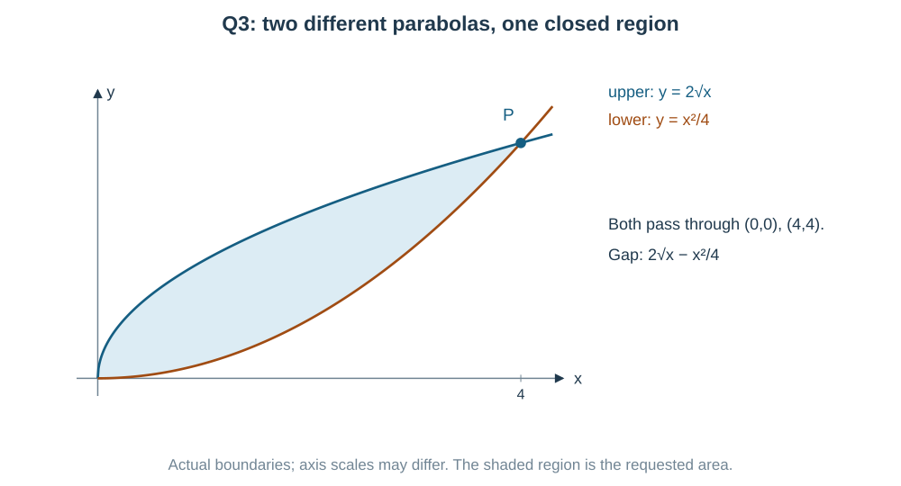

**A useful midpoint test:** if $f-g$ is continuous and has no zero inside the piece, its sign cannot change there. One test point decides the order on that piece. The picture suggests the order; this sign argument confirms it.

## Concept C04 — Signed integral versus ordinary area

The integral $\int f$ adds above-axis strips and subtracts below-axis strips. Area adds their positive sizes.

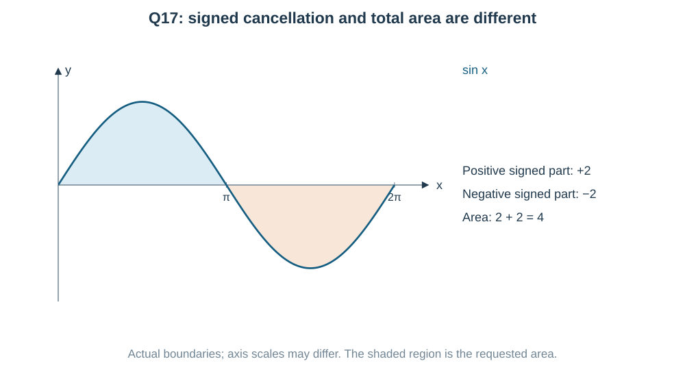

For a full sine cycle:

$$
\int_0^{2\pi}\sin x\,dx=0,\qquad
\int_0^{2\pi}|\sin x|dx=4.
$$

For $\ln x$, the zero is $x=1$. Thus a region spanning that input needs

$$
A=-\int_a^1\ln x\,dx+\int_1^b\ln x\,dx
\quad(0<a<1<b).
$$

For $y=x|x|$, $y=-x^2$ on the negative side and $y=x^2$ on the positive side. Its absolute height is $x^2$ on both sides. Simplifying that height first can save casework.

## Concept C05 — Symmetry saves work; corners still need splitting

If the **whole region** mirrors across the $y$-axis:

$$
A=2\int_0^a(\text{top}-\text{bottom})dx.
$$

If it mirrors across both axes, four times the first-quadrant area may be easier.

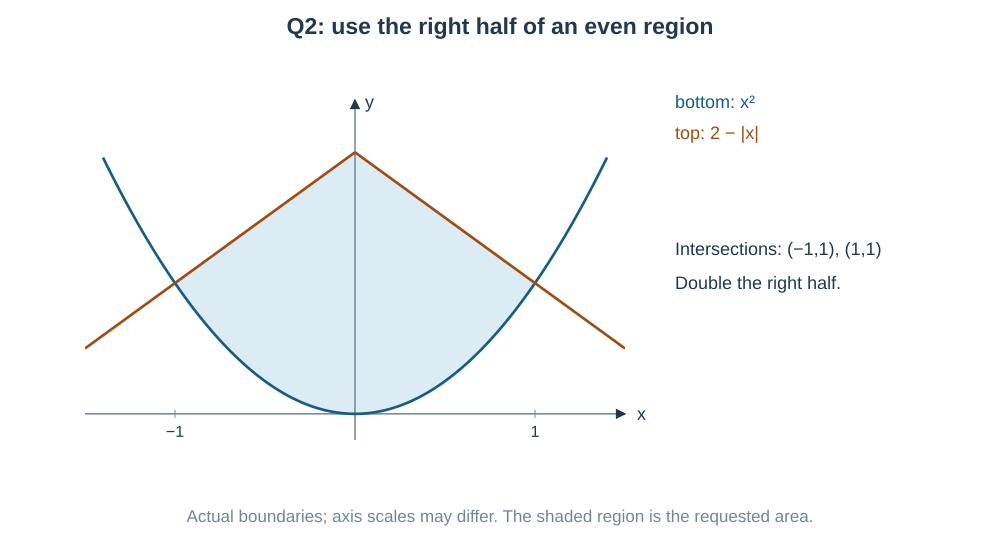

Use

$$
|x|=\begin{cases}-x,&x<0,\\x,&x\ge0,\end{cases}
\qquad
|x-1|=\begin{cases}1-x,&x<1,\\x-1,&x\ge1.\end{cases}
$$

For several moduli, collect **all** their corner inputs and split at each one. Do not assume symmetry only because one boundary is even; the other boundary and any cutting lines must also preserve the region.

Translations move a region without changing its area. Rotations also preserve area and can reveal an ordinary rectangle in a tilted picture, as in Q25.

## Concept C06 — Standard shapes, with the quantities identified

**Important for JEE Main:** recognise geometry before doing unnecessary integration.

| Shape | Area | What the symbols mean |
|---|---|---|
| Triangle | $\tfrac12 bh$ | base $b$, perpendicular height $h$ |
| Rectangle | $ab$ | adjacent side lengths $a,b$ |
| Circle/disc | $\pi R^2$ | radius $R$ |
| Ellipse | $\pi ab$ | semiaxes $a,b$, half the full axis lengths |
| Rhombus | $\tfrac12 d_1d_2$ | perpendicular diagonals |
| Circular sector | $\tfrac12R^2\theta$ | central angle $\theta$ in **radians** |

The disc includes its interior; a circle equation describes its boundary. Boundary points alone have no area.

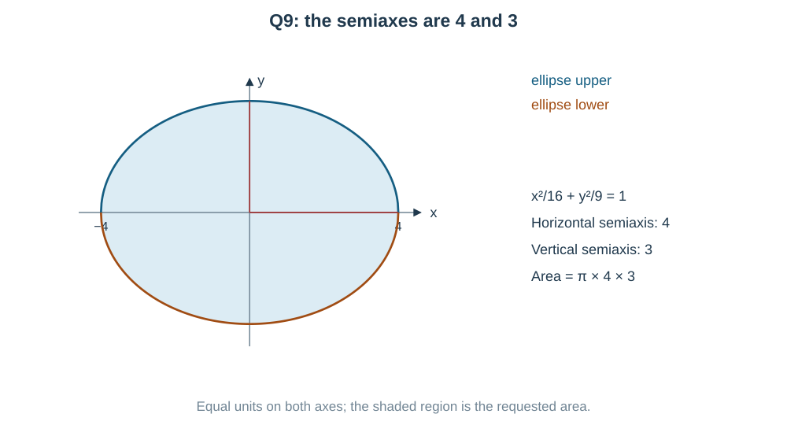

For $(x-h)^2/a^2+(y-k)^2/b^2=1$, the centre is $(h,k)$ and full widths are $2a,2b$. Stretching a unit disc horizontally by $a$ and vertically by $b$ multiplies its area by $ab$.

For

$$
\frac{|x|}a+\frac{|y|}b\le1,\quad a,b>0,
$$

the vertices are $(\pm a,0),(0,\pm b)$. Four right triangles, each of area $ab/2$, give

$$
\boxed{A=2ab}.
$$

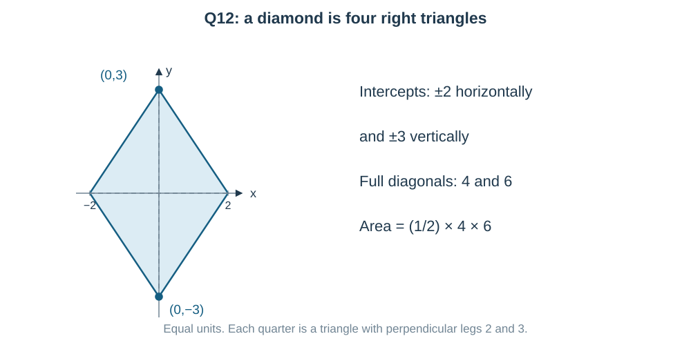

## Concept C07 — Useful primitives and trig clues

Use the earlier integration chapter, including conditions:

$$
\begin{aligned}
\int x^n dx&=\frac{x^{n+1}}{n+1}+C\quad(n\ne-1),\\
\int\ln x\,dx&=x\ln x-x+C\quad(x>0),\\
\int\frac{dx}x&=\ln|x|+C,\qquad
\int e^{kx}dx=\frac{e^{kx}}k+C\ (k\ne0),\\
\int\sin x\,dx&=-\cos x+C,\quad
\int\cos x\,dx=\sin x+C,\\
\int\tan x\,dx&=-\ln|\cos x|+C,\quad
\int\cot x\,dx=\ln|\sin x|+C.
\end{aligned}
$$

For circle boundaries, $R>0$:

$$
\int\sqrt{R^2-x^2}dx
=\frac12\left[x\sqrt{R^2-x^2}+R^2\sin^{-1}\frac xR\right]+C
$$

on the interior $|x|<R$, extending to finite endpoints by a limit.

**Trig intersections:** $\sin2x=2\sin x\cos x$. In a positive interval, cancelling $\sin x$ is valid only after recording its zero endpoints. Also $\tan x=\cot x$ in $(0,\pi/2)$ gives $\tan x=1$, hence $x=\pi/4$.

Use radians for every integral formula involving angles. A finite plot supports the region choice; the intersection equations establish the exact endpoints.

## Concept C08 — A region written as inequalities

An inequality such as $x^2\le y\le6-|x|$ says:

- the point must be **above** $y=x^2$;
- it must also be **below** $y=6-|x|$.

There is a vertical strip only where bottom $\le$ top. Solve that condition to get the horizontal range.

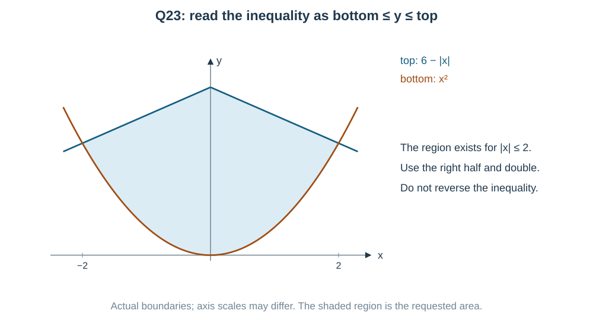

Likewise, “inside $x^2+y^2\le2$ and above $y=x^2$” is an intersection of two conditions. The parabola is nonnegative, so only the upper circle boundary can be the top of this particular region.

**Common mistake:** the area of the whole disc minus the entire area “under the parabola” over an arbitrary interval is not automatically the requested region. First identify the actual common boundaries.

## Concept C09 — A parabola-line gap has a useful cubic-width pattern

**Important for JEE Main.** If the positive gap between two boundaries is

$$
h(x)=K(x-a)(b-x),\quad K>0,\quad a\le x\le b,
$$

then, with $L=b-a$ and $u=(x-a)/L$,

$$
A=KL^3\int_0^1u(1-u)du
=\boxed{\frac{K(b-a)^3}6}.
$$

The extra width factor comes from $dx=L\,du$; height already contains $L^2$. This explains why halving the width does **not** usually halve area.

For $2x+3-x^2=(x+1)(3-x)$, $K=1$ and width is $4$, so $A=4^3/6$. Learn the factorisation and the condition before using the shortcut.

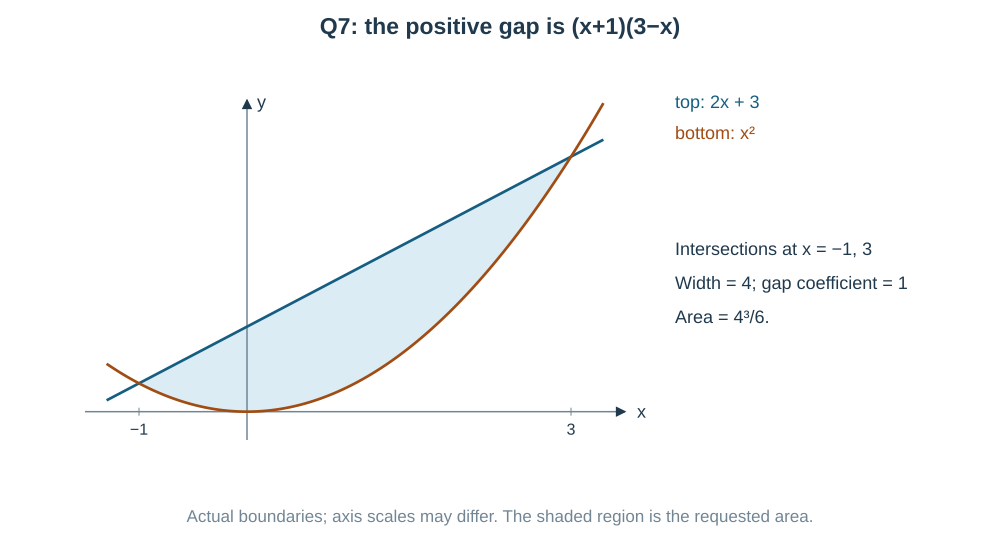

For an equal-area cut, first find the **whole area**, then set the chosen piece to half. In Q15, the cap between the line and parabola has width $1-m$ and area $(1-m)^3/6$. It is only one of the two pieces of the original region.

## Concept C10 — Circular segments and overlapping discs

A **segment** is the cap between a chord and its circular arc. It is a sector minus a triangle.

For a circle of radius $R$ and a chord at distance $d$ from the centre, $0\le d\le R$, set the half-angle
$\alpha=\cos^{-1}(d/R)$.
The full sector angle is $2\alpha$.

$$
\boxed{A_{\rm smaller\ cap}
=R^2\cos^{-1}\frac dR-d\sqrt{R^2-d^2}}.
$$

Why the second term? The chord has length $2\sqrt{R^2-d^2}$, so the triangle area is half that base times height $d$.

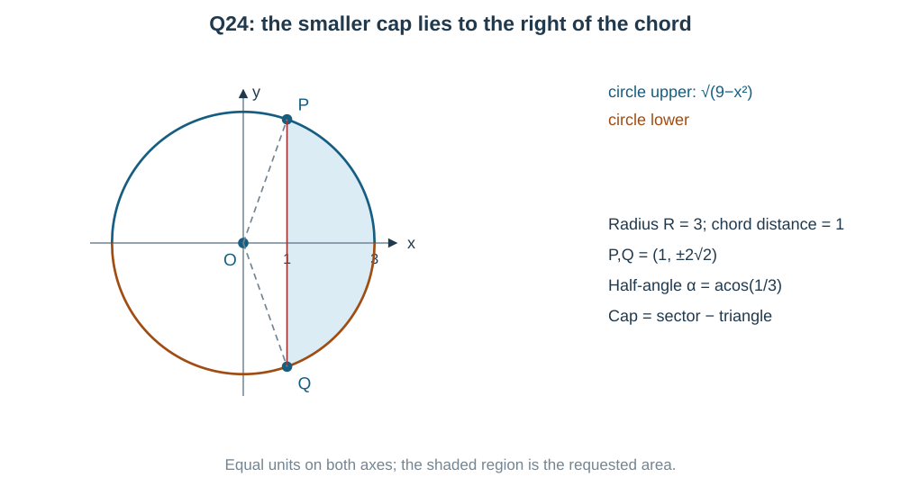

For equal-radius overlapping discs, draw their common chord. The lens is two segments:

$$
A_{\rm lens}
=2R^2\cos^{-1}\frac D{2R}
-\frac D2\sqrt{4R^2-D^2},
\quad0\le D\le2R,
$$

where $D$ is the centre separation. For $D>2R$, the common area is zero. This formula is a convenient consequence of the picture, not a substitute for drawing it.

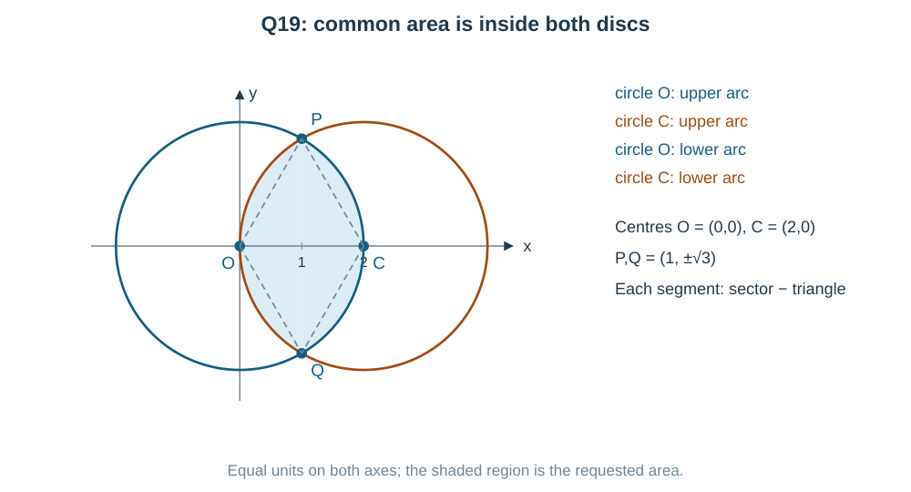

An integral route is equally valid: use the smaller upper height and larger lower height at each input, splitting where the controlling circle changes. The geometry route often gives fewer algebra steps.

## Concept C11 — Indirect curves, parameter curves and geometric alternatives

An implicit equation can often be rewritten as $x=g(y)$ more simply than $y=f(x)$. Use horizontal strips instead of forcing square roots and branches.

For a parametrized curve $x=x(t),y=y(t)$ describing a nonnegative upper boundary with monotone increasing $x$,

$$
A=\int y(t)x'(t)\,dt
$$

over the corresponding parameter range. This is just $dx=x'(t)dt$ in the strip formula. If the direction reverses, handle orientation and split into suitable pieces; a signed line integral is not automatically total geometric area.

**Another useful view:** before calculating, ask whether the enclosed region is a triangle, rectangle, diamond or sector in a different orientation. In Q25, four straight sides of slopes $+1,-1$ form a rotated rectangle. Adjacent side lengths give the area directly.

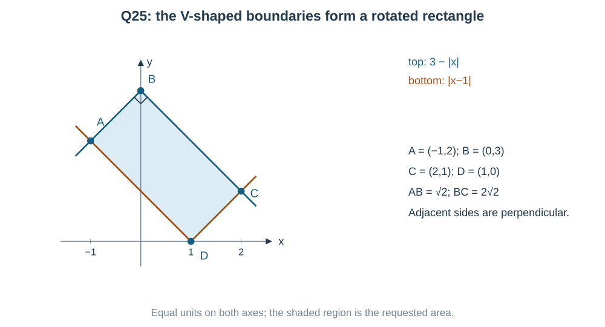

## Concept C12 — Route choice and quick checks

| Visible clue | What to do before calculating |
|---|---|
| Equations give $x$ in terms of $y$ | Try horizontal strips |
| A curve crosses the axis | Split signed contributions into positive areas |
| Absolute values | Mark every inside-zero point and use the correct signs |
| Symmetry of the whole region | Integrate one half or one quarter |
| Disc and line | Sector minus triangle, or the circle-root primitive |
| Equal-area condition | Express one piece and equate to half the total |
| Two inequalities | Identify the top and bottom simultaneously |
| Parabola minus line | Factor the quadratic gap; check the cubic-width shortcut |

**Size checks:** area must be nonnegative; a contained region cannot exceed its containing rectangle/disc. A common area cannot exceed either disc. If all coordinates are multiplied by $s$, area multiplies by $s^2$. If only horizontal lengths multiply by $a$ and vertical lengths by $b$, area multiplies by $|ab|$.

## Last-minute formula recap

$$
\begin{gathered}
A=\int_a^b(\text{top}-\text{bottom})dx
=\int_c^d(\text{right}-\text{left})dy,\\
A_{\rm axis}=\int_a^b|f(x)|dx,\qquad
A_{\rm between}=\int_a^b|f(x)-g(x)|dx,\\
\text{even region: }A=2A_{\rm right},\qquad
A_{\rm triangle}=\frac12bh,\quad A_{\rm ellipse}=\pi ab,\\
A_{\rm disc}=\pi R^2,\quad
A_{\rm sector}=\frac12R^2\theta\quad(\theta\text{ radians}),\\
\frac{|x|}a+\frac{|y|}b\le1\Rightarrow A=2ab\quad(a,b>0),\\
\int_a^bK(x-a)(b-x)dx=\frac{K(b-a)^3}6,\\
A_{\rm cap}=R^2\cos^{-1}(d/R)-d\sqrt{R^2-d^2}.
\end{gathered}
$$

**Before submitting:** draw; find exact intersections; choose strip direction; identify the actual closed region; split at sign/boundary changes; check units; then answer the quantity asked, including any multiplier such as $3A$ or $k$.

## Worked solutions to the 25 PDF questions

Read the question first. Notice the pattern, choose a route, then calculate. Alternative methods below are fully visible.

### Question 1 — Choose horizontal strips to avoid a square root

**PDF page 71 | MCQ | Notes: C01,C02,C03**

The area of the region bounded by the parabola $y^2=4x$ and the line $y=x$ is

- (a) $\dfrac{16}3$ sq. units
- (b) $\dfrac43$ sq. units
- (c) $\dfrac83$ sq. units
- (d) $\dfrac{32}3$ sq. units

**First close the fence.** Substitute $y=x$ into $y^2=4x$:
$x^2=4x$, so the intersections are $(0,0)$ and $(4,4)$.

Horizontal strips are simpler here. At a fixed height $y$, the parabola is at $x=y^2/4$ and the line at $x=y$. On $0<y<4$, the line is to the right.

$$
A=\int_0^4\left(y-\frac{y^2}4\right)dy
=\left[\frac{y^2}2-\frac{y^3}{12}\right]_0^4
=8-\frac{16}3=\boxed{\frac83}\quad\text{(c)}.
$$

**Another possible approach — vertical strips.**

The upper branch is $y=2\sqrt x$ and the lower curve is $y=x$:
$A=\int_0^4(2\sqrt x-x)dx=32/3-8=8/3$.
Both routes work; the horizontal one avoids the square root. The negative parabola branch forms no second closed region with this line.

---

### Question 2 — An even region lets us use only its right half

**PDF page 71 | MCQ | Notes: C03,C05**

The area of the region bounded by $y=x^2$ and $y=2-|x|$ is

- (a) $\dfrac73$ sq. units
- (b) $\dfrac53$ sq. units
- (c) $\dfrac{14}3$ sq. units
- (d) $\dfrac83$ sq. units

**Both boundaries are even, so the full region mirrors across the $y$-axis.** On the right, $|x|=x$. Intersections satisfy
$x^2=2-x$, giving $x=1$ as the nonnegative root. The other intersection is its mirror at $-1$.

$$
A=2\int_0^1(2-x-x^2)dx
=2\left(2-\frac12-\frac13\right)
=\boxed{\frac73}\quad\text{(a)}.
$$

**Check the region:** at $x=0$ the top is $2$ and bottom $0$, so the chosen order is correct. The total fits inside a rectangle of width $2$ and height $2$.

---

### Question 3 — Keep the two different parabola equations distinct

**PDF page 71 | Numerical value | Notes: C02,C03**

If $A$ is the area bounded by the parabolas $y^2=4x$ and $x^2=4y$, then $3A=$ ____ sq. units.

**The two equations describe different parabolas.** Their common points are $(0,0),(4,4)$. For example, substituting $y=x^2/4$ into $y^2=4x$ gives $x=0$ or $x^3=64$.

$$
A=\int_0^4\left(2\sqrt x-\frac{x^2}4\right)dx
=\frac{32}3-\frac{16}3=\frac{16}3.
$$

The requested quantity is $\boxed{3A=16}$.

**Another possible view:** the region is unchanged when $x,y$ are swapped. Horizontal strips therefore give $\int_0^4(2\sqrt y-y^2/4)dy$, the same calculation with the strip turned sideways.

---

### Question 4 — The y-axis closes the region at x zero

**PDF page 71 | MCQ | Notes: C03,C07**

The area of the region bounded by $y=\sin x$, $y=\cos x$ and the $y$-axis, lying in the first quadrant, is

- (a) $\sqrt2+1$
- (b) $2\sqrt2-2$
- (c) $1-\dfrac1{\sqrt2}$
- (d) $\sqrt2-1$

**The $y$-axis means $x=0$, so it closes the left edge.** The curves first meet in the first quadrant where $\sin x=\cos x$, giving $x=\pi/4$.

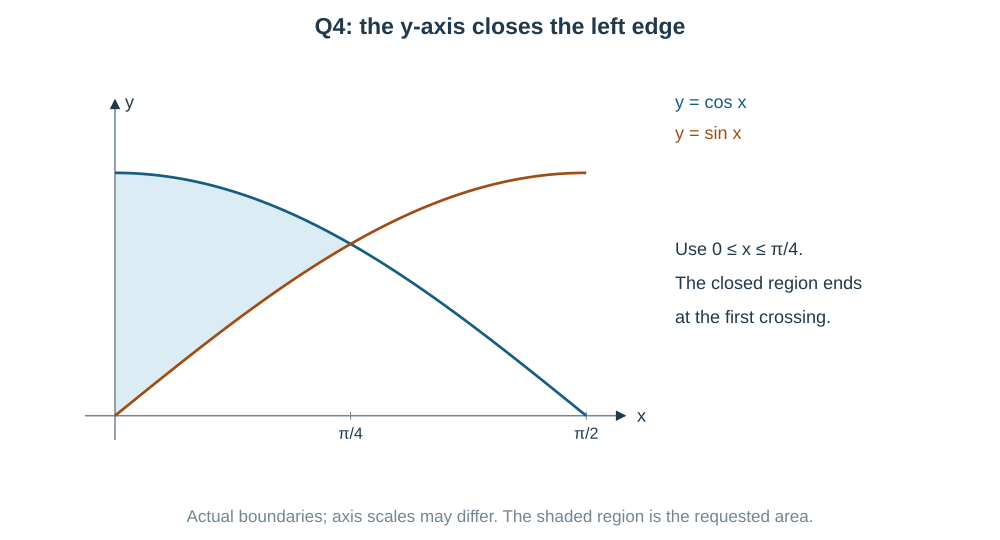

$$
A=\int_0^{\pi/4}(\cos x-\sin x)dx
=[\sin x+\cos x]_0^{\pi/4}
=\boxed{\sqrt2-1}\quad\text{(d)}.
$$

Why stop there? That crossing closes the boundary formed with the $y$-axis. Continuing past it would count another region that the question did not ask for.

---

### Question 5 — Split at the logarithm zero before adding area

**PDF page 71 | MCQ | Notes: C04,C07**

The area bounded by $y=\ln x$, the $x$-axis and the lines $x=1/e$ and $x=e$ is

- (a) $2$
- (b) $2(1-1/e)$
- (c) $1-2/e$
- (d) $2(1+1/e)$

**Area adds sizes on both sides of the axis.** The logarithm crosses the axis at $x=1$. It is negative before $1$ and positive after.

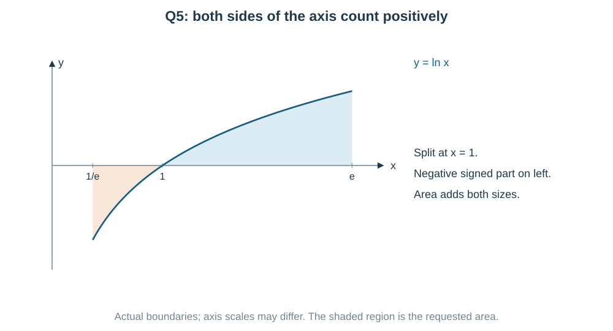

With $F(x)=x\ln x-x$,

$$
\begin{aligned}
A&=-[F(x)]_{1/e}^1+[F(x)]_1^e\\
&=-\left(-1+\frac2e\right)+(0+1)\\
&=\boxed{2\left(1-\frac1e\right)}\quad\text{(b)}.
\end{aligned}
$$

The left area is $1-2/e$ and the right area $1$. Directly integrating $\ln x$ over the full interval would subtract the left area; that signed result answers a different question.

---

### Question 6 — Inside the disc and above the parabola means satisfy both

**PDF page 71 | MCQ | Notes: C06,C08**

The area of the part of the disc $x^2+y^2\le2$ lying above the parabola $y=x^2$ is

- (a) $\dfrac\pi2-\dfrac13$ sq. units
- (b) $\dfrac\pi2+\dfrac13$ sq. units
- (c) $\pi+\dfrac13$ sq. units
- (d) $\dfrac\pi4+\dfrac23$ sq. units

**We must be inside the disc and above the parabola at the same time.** At a crossing,
$x^2+(x^2)^2=2$, so $(x^2-1)(x^2+2)=0$. Real crossings are $(-1,1),(1,1)$.

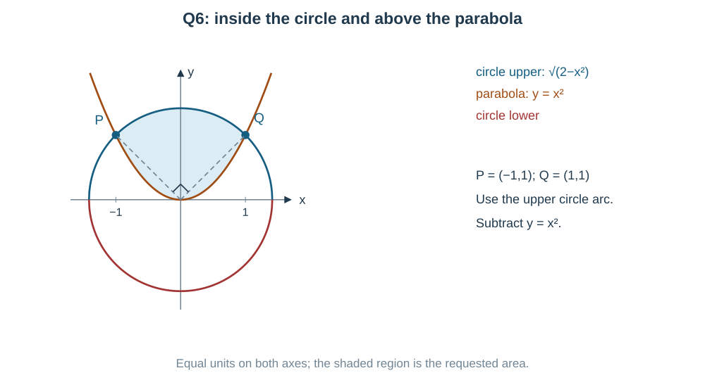

For $-1\le x\le1$, the top is $\sqrt{2-x^2}$ and bottom $x^2$:

$$
A=\int_{-1}^1\sqrt{2-x^2}dx-\int_{-1}^1x^2dx.
$$

The circle-root primitive gives the first integral $1+\pi/2$; the second is $2/3$. Thus
$\boxed{A=\pi/2+1/3}$, **(b)**.

**Another possible approach — see the first integral geometrically.** The two radius vectors $(-1,1)$ and $(1,1)$ are perpendicular, so the sector angle is $\pi/2$ and sector area $\pi/2$. The triangle below their chord has base $2$, height $1$, area $1$. Together they give $1+\pi/2$ under the arc. Subtracting the parabola's $2/3$ gives the same answer.

---

### Question 7 — The line is above the parabola between the intersections

**PDF page 71 | MCQ | Notes: C03,C09**

The area of the region enclosed by $y=x^2$ and $y=2x+3$ is

- (a) $\dfrac{16}3$ sq. units
- (b) $\dfrac{64}3$ sq. units
- (c) $9$ sq. units
- (d) $\dfrac{32}3$ sq. units

**Find the roots of the gap, then keep its positive order.**

$$
x^2=2x+3\Rightarrow(x+1)(x-3)=0.
$$

Between $-1$ and $3$, the line is above the parabola.

$$
A=\int_{-1}^3(2x+3-x^2)dx
=\left[x^2+3x-\frac{x^3}3\right]_{-1}^3
=9-\left(-\frac53\right)
=\boxed{\frac{32}3}\quad\text{(d)}.
$$

**Another possible approach — cubic-width pattern:** the gap is
$(x+1)(3-x)$. C09 gives area $4^3/6=32/3$. Its coefficient is $1$ and its width is $4$; those conditions are what make the shortcut fit.

---

### Question 8 — The square-root domain removes negative inputs

**PDF page 71 | MCQ | Notes: C03**

The area enclosed between the curves $y=\sqrt x$ and $y=x^3$ is

- (a) $\dfrac5{12}$ sq. units
- (b) $\dfrac7{12}$ sq. units
- (c) $\dfrac14$ sq. units
- (d) $\dfrac13$ sq. units

**Start with the domain $x\ge0$.** The intersection $x=0$ is immediate. For $x>0$,
$x^{1/2}=x^3$ implies $x^{5/2}=1$, hence $x=1$.

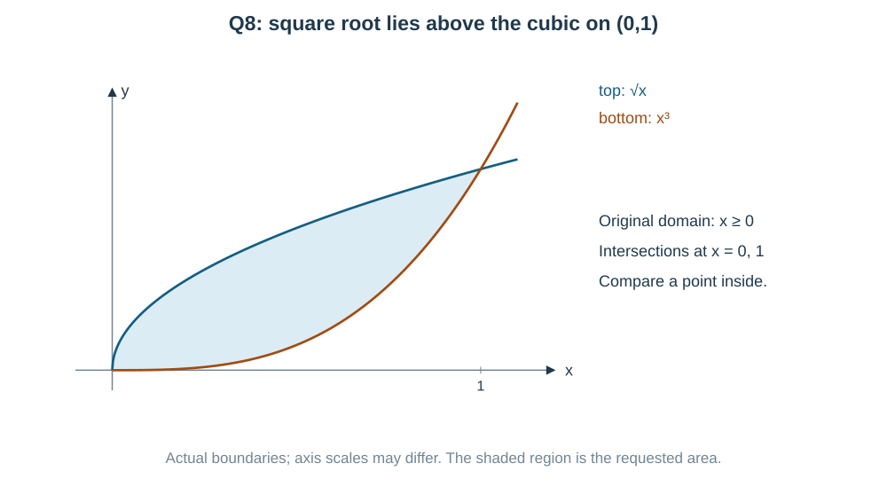

On $0<x<1$, a smaller positive exponent gives a larger value. Therefore

$$
A=\int_0^1(x^{1/2}-x^3)dx
=\frac23-\frac14
=\boxed{\frac5{12}}\quad\text{(a)}.
$$

Checking one interior input, such as $x=1/4$, also confirms the order because there is no further crossing.

---

### Question 9 — Read semiaxes after normalizing the ellipse equation

**PDF page 72 | Numerical value | Notes: C06**

The area of the region enclosed by $9x^2+16y^2=144$ is $k\pi$ sq. units. Then $k=$ ____.

**Normalize the equation before reading lengths:**

$$
\frac{x^2}{16}+\frac{y^2}{9}=1.
$$

So the horizontal semiaxis is $4$ and vertical semiaxis $3$, not $16$ and $9$.

Its area is $\pi ab=\pi(4)(3)=12\pi$.
Since the source writes this as $k\pi$, $\boxed{k=12}$.

**Another possible approach:** $4\int_0^4 3\sqrt{1-x^2/16}dx$. Put $x=4u$; it becomes $48\int_0^1\sqrt{1-u^2}du=48(\pi/4)=12\pi$, using a unit quarter-disc.

---

### Question 10 — The curves supply the missing left boundary

**PDF page 72 | MCQ | Notes: C03,C07**

The area bounded by $y=e^x$, $y=e^{-x}$ and the line $x=1$ is

- (a) $e-\dfrac1e$
- (b) $e+\dfrac1e$
- (c) $e+\dfrac1e-2$
- (d) $e-\dfrac1e-2$

**Only one vertical line is stated; the curves supply the other endpoint.**
$e^x=e^{-x}$ gives $e^{2x}=1$, so they meet at $x=0$.

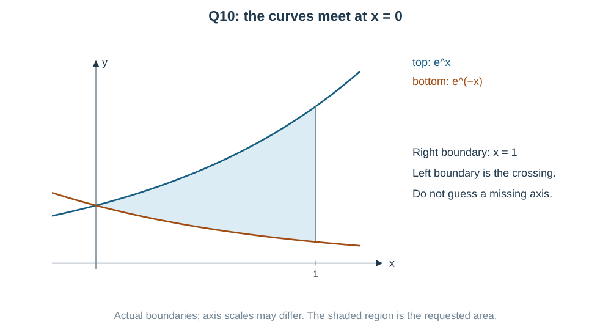

For $0<x\le1$, $e^x>e^{-x}$:

$$
A=\int_0^1(e^x-e^{-x})dx
=[e^x+e^{-x}]_0^1
=\boxed{e+\frac1e-2}\quad\text{(c)}.
$$

Check the sign in the primitive: differentiating $+e^{-x}$ gives $-e^{-x}$.

---

### Question 11 — A sideways pair is easiest with horizontal strips

**PDF page 72 | MCQ | Notes: C02**

The area of the region bounded by the parabolas $x=y^2$ and $x=3-2y^2$ is

- (a) $2$ sq. units
- (b) $\dfrac83$ sq. units
- (c) $6$ sq. units
- (d) $4$ sq. units

**The equations already give horizontal positions. Use that advantage.**
They meet where $y^2=3-2y^2$, so $y=\pm1$.

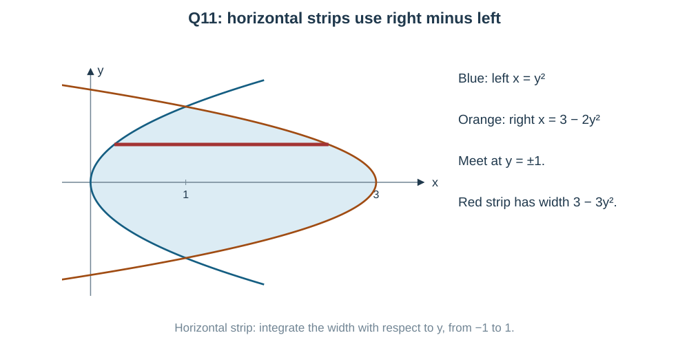

At $y=0$, the positions are $0$ and $3$, confirming left and right. Then

$$
A=\int_{-1}^1[(3-2y^2)-y^2]dy
=[3y-y^3]_{-1}^1
=2-(-2)=\boxed4\quad\text{(d)}.
$$

Solving for $y$ would create positive and negative branches and extra pieces. It is valid but longer than using $dy$.

---

### Question 12 — The absolute-value inequality forms four triangles

**PDF page 72 | Numerical value | Notes: C05,C06,C08**

The area of the region $\dfrac{|x|}2+\dfrac{|y|}3\le1$ is ____ sq. units.

**In the first quadrant the moduli disappear.** The boundary is $x/2+y/3=1$, a line joining $(2,0)$ to $(0,3)$. The other quadrants are reflections.

Each triangle has area $\tfrac12(2)(3)=3$. So the full area is $\boxed{12}$.

**Another possible approach:** diagonals give $\tfrac12(4)(6)=12$.
Or integrate the upper boundary $3(1-|x|/2)$ minus its negative reflection. Geometry is shortest because the boundaries are straight.

---

### Question 13 — The sign of x times absolute x changes at zero

**PDF page 72 | MCQ | Notes: C04**

The area bounded by $y=x|x|$, the $x$-axis and the lines $x=-1$, $x=2$ is

- (a) $3$ sq. units
- (b) $\dfrac73$ sq. units
- (c) $\dfrac83$ sq. units
- (d) $\dfrac{10}3$ sq. units

**Find the height, not only the signed function.** For $x<0$, $x|x|=-x^2$; for $x>0$, it is $x^2$. Its absolute height is therefore $x^2$ everywhere.

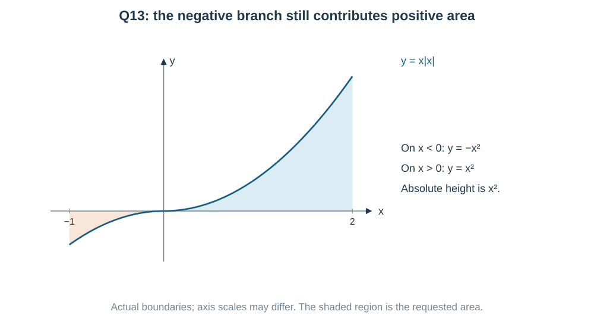

$$
A=\int_{-1}^0x^2dx+\int_0^2x^2dx
=\frac13+\frac83
=\boxed3\quad\text{(a)}.
$$

**Another possible view:** $|x|x||=x^2$, so simply integrate $x^2$ from $-1$ to $2$. The signed integral of $x|x|$ would instead be $7/3$, which is a tempting wrong option.

---

### Question 14 — The finite region lies below the lower curve

**PDF page 72 | MCQ | Notes: C03,C07**

The area of the region bounded by $y=\tan x$, $y=\cot x$ and the $x$-axis in $0\le x\le\pi/2$ is

- (a) $2\ln2$
- (b) $\dfrac12\ln2$
- (c) $\ln2$
- (d) $1$

**First identify the finite fence.** Tangent starts at zero on the left, cotangent ends at zero on the right, and they meet at $x=\pi/4$, height $1$. The closed region with the axis is below the lower curve.

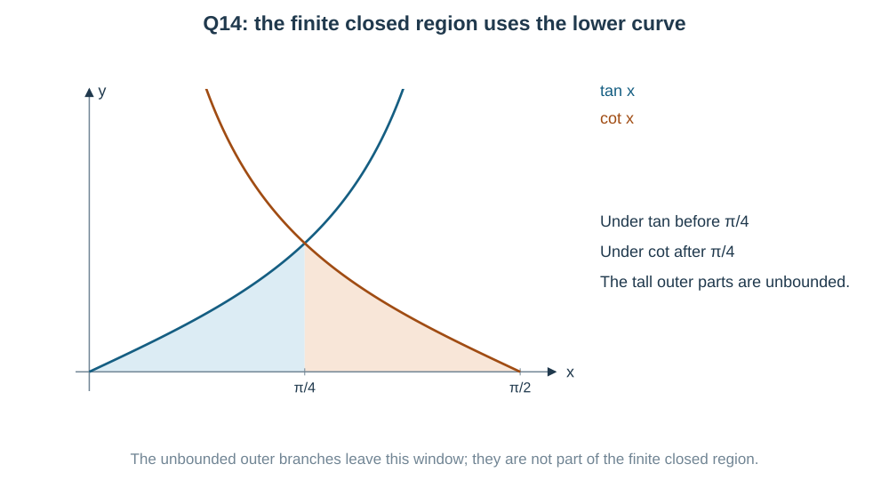

$$
\begin{aligned}
A&=\int_0^{\pi/4}\tan x\,dx+
\int_{\pi/4}^{\pi/2}\cot x\,dx\\
&=[-\ln\cos x]_0^{\pi/4}
+[\ln\sin x]_{\pi/4}^{\pi/2}\\
&=\frac12\ln2+\frac12\ln2
=\boxed{\ln2}\quad\text{(c)}.
\end{aligned}
$$

**Another possible approach:** reflection swaps tangent and cotangent, so twice the first area is enough. Integrating $|\tan x-\cot x|$ across the full interval would be a different, unbounded region and would diverge at the endpoints.

---

### Question 15 — Half the total area is not half the width

**PDF page 72 | MCQ | Notes: C09**

The line $y=mx$ divides the region bounded by $y=x-x^2$ and the $x$-axis into two regions of equal area. Then $m$ equals

- (a) $\dfrac12$
- (b) $1-\dfrac1{\sqrt[3]2}$
- (c) $1-\dfrac1{\sqrt2}$
- (d) $\dfrac1{\sqrt[3]2}$

**Find the whole area first.** The parabola is above the axis for $0<x<1$:
$A_{\rm whole}=\int_0^1(x-x^2)dx=1/6$.
Each required part is therefore $1/12$.

For a genuine cut we need $0<m<1$. The line meets the parabola where
$mx=x-x^2$, giving $x=0$ and $x=1-m$.

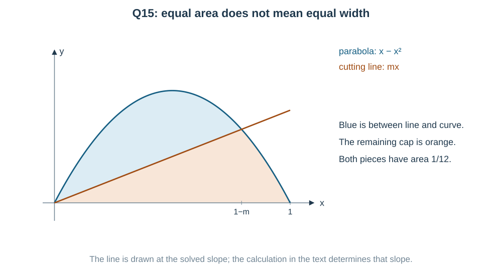

The cap between line and curve has area

$$
\int_0^{1-m}[(1-m)x-x^2]dx
=\frac{(1-m)^3}6.
$$

Set this to $1/12$:
$(1-m)^3=1/2$, so
$\boxed{m=1-1/\sqrt[3]2}$, **(b)**.

The C09 width rule gives the same cap formula immediately. Choosing the midpoint width would miss the cubic dependence of area on width.

---

### Question 16 — Do not stop at the area; the question asks k

**PDF page 72 | Numerical value | Notes: C09**

The area enclosed by $y=4x-x^2$ and $y=x$ is $k/2$ sq. units. Then $k=$ ____.

**Subtract the line from the parabola.** Their gap is
$4x-x^2-x=x(3-x)$, positive between intersections $0,3$.

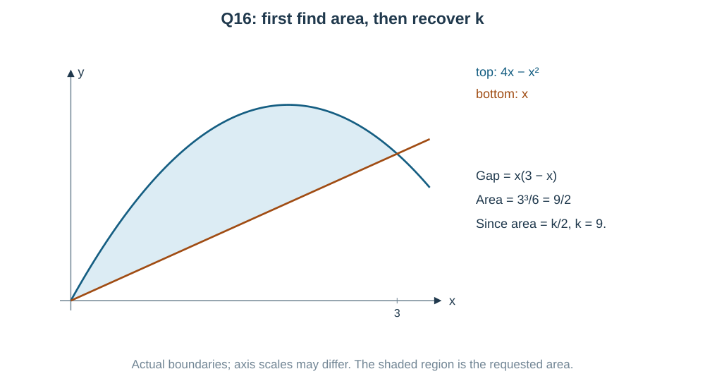

$$
A=\int_0^3(3x-x^2)dx
=\frac{27}2-9=\frac92.
$$

The source gives $A=k/2$, so $\boxed{k=9}$.
The shortcut $3^3/6=9/2$ is another check, but it still gives the area first, not $k$ directly.

---

### Question 17 — A zero signed integral can coexist with positive area

**PDF page 72 | MCQ | Notes: C04**

Statement I: The area bounded by $y=\sin x$ and the $x$-axis from $x=0$ to $x=2\pi$ is $4$ sq. units.

Statement II: $\displaystyle\int_0^{2\pi}\sin x\,dx=0$. Choose the correct option.

- (a) Statement I is true and Statement II is true
- (b) Statement I is true and Statement II is false
- (c) Statement I is false and Statement II is true
- (d) Both statements are false

**The statements ask about different totals.** Ordinary area counts both humps positively; the integral keeps their signs.

$$
A=2+2=4,\qquad
\int_0^{2\pi}\sin xdx=2-2=0.
$$

Both statements are true: $\boxed{\text{(a)}}$.
This is why a zero integral does not imply an empty region.

---

### Question 18 — Two even parabolas enclose a symmetric lens

**PDF page 72 | Numerical value | Notes: C05,C09**

Let $A$ be the area enclosed by $y=x^2$ and $y=8-x^2$. Then $\dfrac{3A}8=$ ____.

**Both boundaries are even.** Intersections satisfy
$x^2=8-x^2$, so $x=\pm2$.

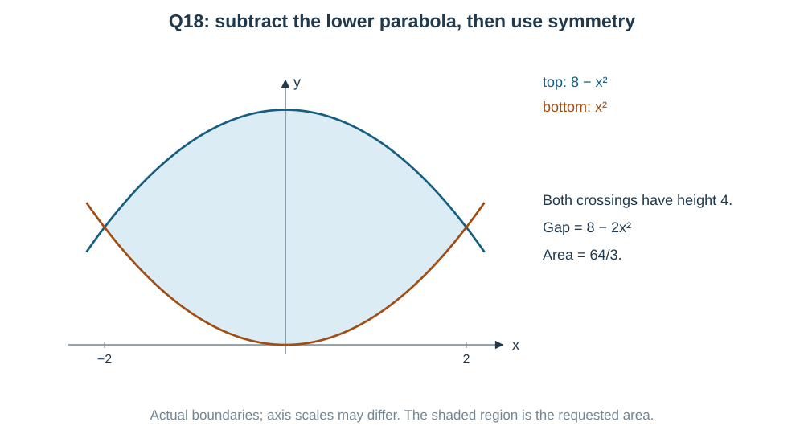

$$
A=2\int_0^2(8-2x^2)dx
=2\left(16-\frac{16}3\right)=\frac{64}3.
$$

Thus $\boxed{3A/8=8}$.

**Another possible approach:** the gap is $2(x+2)(2-x)$. With coefficient $2$ and width $4$, C09 gives $A=2(4^3)/6=64/3$.

---

### Question 19 — Common area means inside both circles

**PDF page 73 | MCQ | Notes: C06,C10**

The area common to the circles $x^2+y^2=4$ and $(x-2)^2+y^2=4$ is

- (a) $\dfrac{4\pi}3-\sqrt3$ sq. units
- (b) $\dfrac{8\pi}3-\sqrt3$ sq. units
- (c) $\dfrac{8\pi}3-2\sqrt3$ sq. units
- (d) $\dfrac{4\pi}3-2\sqrt3$ sq. units

**Common area means inside both discs.** Subtracting their boundary equations gives $x=1$. The crossing points are $P,Q=(1,\pm\sqrt3)$.

Each circle has radius $2$. At centre $O$, $\cos\alpha=1/2$, so the half-angle is $\pi/3$ and full sector angle $2\pi/3$.

One sector has area $\tfrac12(2^2)(2\pi/3)=4\pi/3$.
The triangle with base $PQ=2\sqrt3$ and height $1$ has area $\sqrt3$.
Two equal segments give

$$
A=2\left(\frac{4\pi}3-\sqrt3\right)
=\boxed{\frac{8\pi}3-2\sqrt3}\quad\text{(c)}.
$$

**Another possible approach — strips:** by both symmetries,
$A=4\int_1^2\sqrt{4-x^2}dx$.
The primitive gives $4(2\pi/3-\sqrt3/2)$, the same result.
Counting a whole sector without subtracting its triangle would include area outside the lens.

---

### Question 20 — Use evenness and then split the inner polynomial sign

**PDF page 73 | MCQ | Notes: C04,C05**

The area bounded by $y=|x^2-1|$, the $x$-axis and the lines $x=-2$, $x=2$ is

- (a) $\dfrac83$ sq. units
- (b) $4$ sq. units
- (c) $\dfrac{14}3$ sq. units
- (d) $\dfrac{16}3$ sq. units

**The graph is even, and its inside polynomial changes sign at $x=1$ on the right.**

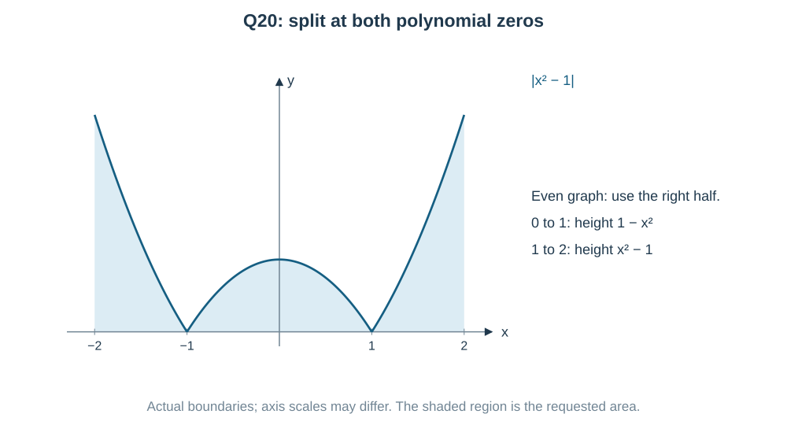

$$
\begin{aligned}
A&=2\left[\int_0^1(1-x^2)dx+\int_1^2(x^2-1)dx\right]\\
&=2\left(\frac23+\frac43\right)
=\boxed4\quad\text{(b)}.
\end{aligned}
$$

Do not integrate $x^2-1$ on the whole interval and then take its absolute value. The negative central contribution must be flipped before adding.

---

### Question 21 — Use the closed positive region, away from the pole

**PDF page 73 | Numerical value | Notes: C03,C07**

The area of the region bounded by $y=1/x$, $y=x$ and $x=2$ is ____ sq. units (round to $2$ decimal places).

**Choose the actual closed positive region.** The curves meet at $x=\pm1$, but the line $x=2$ closes a finite region with the positive crossing $1$. There is no connection through the pole at zero.

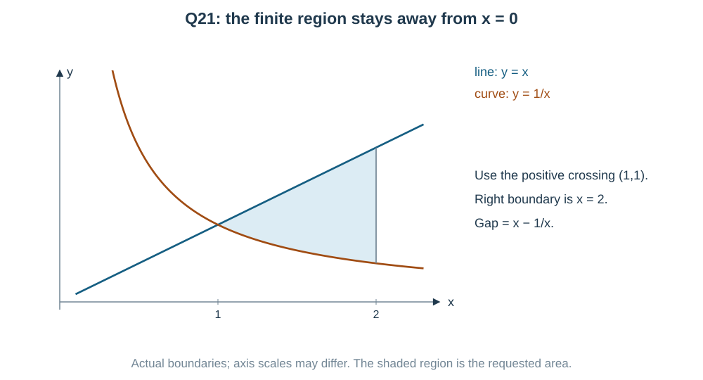

$$
A=\int_1^2\left(x-\frac1x\right)dx
=\left[\frac{x^2}2-\ln x\right]_1^2
=\frac32-\ln2
\approx0.80685282.
$$

Rounded as requested: $\boxed{0.81}$ square units. The bound $0<A<3/2$ is an immediate sign/size check.

---

### Question 22 — Find the first positive crossing after the starting point

**PDF page 73 | MCQ | Notes: C03,C07**

The area of the region bounded by $y=\sin x$, $y=\sin2x$ and $x=0$ in the first quadrant (up to their first intersection) is

- (a) $\dfrac12$ sq. units
- (b) $\dfrac34$ sq. units
- (c) $\dfrac18$ sq. units
- (d) $\dfrac14$ sq. units

**Record the shared starting point, then find the next crossing.**

$$
\sin2x=\sin x
\Rightarrow\sin x(2\cos x-1)=0.
$$

After $x=0$, the first positive intersection is $\cos x=1/2$, hence $x=\pi/3$. On $(0,\pi/3)$, $\sin x>0$ and $2\cos x-1>0$, so $\sin2x$ is above $\sin x$.

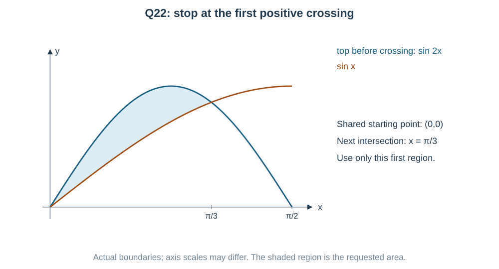

$$
A=\int_0^{\pi/3}(\sin2x-\sin x)dx
=\left[-\frac{\cos2x}2+\cos x\right]_0^{\pi/3}
=\frac34-\frac12
=\boxed{\frac14}\quad\text{(d)}.
$$

---

### Question 23 — Translate the inequality into bottom and top

**PDF page 73 | Numerical value | Notes: C05,C08**

If $A$ is the area of the region $\{(x,y):x^2\le y\le6-|x|\}$, then $3A=$ ____.

**The inequality already names the bottom and top.** A strip starts at $y=x^2$ and ends at $y=6-|x|$. It exists only when $x^2\le6-|x|$.

Set $u=|x|\ge0$. The condition is $u^2+u-6\le0$, so $0\le u\le2$, or $-2\le x\le2$.

By symmetry,

$$
A=2\int_0^2(6-x-x^2)dx
=2\left(12-2-\frac83\right)=\frac{44}3.
$$

The requested result is $\boxed{3A=44}$.

---

### Question 24 — A circular cap is a sector minus a triangle

**PDF page 73 | MCQ | Notes: C06,C10**

The area of the smaller region cut off from the circle $x^2+y^2=9$ by the line $x=1$ (the part of the disc with $x\ge1$) is

- (a) $9\cos^{-1}\dfrac13-\sqrt2$ sq. units
- (b) $9\sin^{-1}\dfrac13-2\sqrt2$ sq. units
- (c) $9\cos^{-1}\dfrac13-2\sqrt2$ sq. units
- (d) $9\cos^{-1}\dfrac13+2\sqrt2$ sq. units

**A chord cuts a circular segment.** At $x=1$, the circle gives $y=\pm\sqrt8=\pm2\sqrt2$. Draw radii to those endpoints.

The half-angle $\alpha$ satisfies $\cos\alpha=1/3$. Sector area is
$\tfrac12(3^2)(2\alpha)=9\alpha$.
The triangle has base $4\sqrt2$ and perpendicular height $1$, so its area is $2\sqrt2$.

$$
\boxed{A=9\cos^{-1}(1/3)-2\sqrt2}\quad\text{(c)}.
$$

**Another possible approach:** $A=2\int_1^3\sqrt{9-x^2}dx$.
Its value is $9\pi/2-9\sin^{-1}(1/3)-2\sqrt2$, which matches because
$\cos^{-1}u=\pi/2-\sin^{-1}u$.
Angles must be in radians.

---

### Question 25 — Two V-shaped graphs also form a rotated rectangle

**PDF page 73 | MCQ | Notes: C05,C11**

The area of the region bounded by $y=|x-1|$ and $y=3-|x|$ is

- (a) $4$ sq. units
- (b) $\dfrac92$ sq. units
- (c) $\dfrac72$ sq. units
- (d) $6$ sq. units

**The corner inputs are $0$ and $1$.** Checking the three sign pieces gives intersections at $x=-1,2$. The upper curve is $3-|x|$.

The vertical gap is

$$
\begin{cases}
2+2x,&-1\le x\le0,\\
2,&0\le x\le1,\\
4-2x,&1\le x\le2.
\end{cases}
$$

Hence $A=1+2+1=\boxed4$, **(a)**.

**Another possible approach — change the view.** The adjacent side vectors are
$\overrightarrow{AB}=(1,1)$ and $\overrightarrow{BC}=(2,-2)$.
Their dot product is $2-2=0$, so the sides meet at right angles. The region is a rotated rectangle:

$$
AB=\sqrt2,\quad BC=\sqrt8=2\sqrt2,\quad
A=AB\cdot BC=4.
$$

The piecewise route is systematic; the rectangle view is faster once those perpendicular directions are noticed.

## Answer check

Read the qualifications in the solutions before using the key.

| Question | Answer | Question | Answer |
|---|---|---|---|
| 1 | (c) $8/3$ | 14 | (c) $\ln2$ |
| 2 | (a) $7/3$ | 15 | (b) $1-2^{-1/3}$ |
| 3 | $16$ | 16 | $9$ |
| 4 | (d) $\sqrt2-1$ | 17 | (a) |
| 5 | (b) $2(1-1/e)$ | 18 | $8$ |
| 6 | (b) $\pi/2+1/3$ | 19 | (c) $8\pi/3-2\sqrt3$ |
| 7 | (d) $32/3$ | 20 | (b) $4$ |
| 8 | (a) $5/12$ | 21 | $0.81$ |
| 9 | $12$ | 22 | (d) $1/4$ |
| 10 | (c) $e+1/e-2$ | 23 | $44$ |
| 11 | (d) $4$ | 24 | (c) $9\cos^{-1}(1/3)-2\sqrt2$ |
| 12 | $12$ | 25 | (a) $4$ |
| 13 | (a) $3$ |  |  |

## Coverage and source notes

All $25$ source questions appear in order: $18$ MCQs and $7$ numerical questions. Independent calculations agree with the intended key. Q14's finite lower-envelope region and Q22's first positive intersection are explained before calculation. All area questions have actual local region diagrams.

The chapter covers vertical/horizontal strips, original domains and intersections, signed versus ordinary area, modulus and symmetry, geometric standard areas, trig/log/exponential regions, inequalities, equal-area parameters, circle segments/lenses and useful alternatives. Circle, ellipse, diamond and rectangle geometry preserves equal axis units.

## Offline research record

- Supplied Maths Predicted V1.pdf, pages 71–74: all question data/options, key and working read visually.
- Official NTA 2027 Mathematics Unit 8: areas bounded by simple curves in standard forms.
- ExamSIDE, Area Under The Curves: all $59$ recent archive IDs saved and recounted; year counts $22,18,19$.
- PYQSide, Application of Integrals: comparison counts $21,20,19$; not merged with the chosen archive.

The pooled mean is $59/58$, using full-year paper denominators $20,19,19$. This is recent archive-card research, not an independently exhaustive $2020$–$2026$ paper or formula-frequency audit. Supplied questions are original JEE Main-style practice, not claimed as actual PYQs.
