# Chapter 15 — Differential Equations

**For Kanna: understand the change, choose a method, then find the curve.**

Your overall target is **200 marks**: Physics 60, Maths 60, Chemistry 80. This chapter can give useful marks because many questions become short once you recognize their form. First learn what the equation says. Then practise choosing the route.

## Recent question weightage — a guide for revision time

| Year | Questions tagged Differential Equations in the checked archive | Paper shifts in the full year | Tagged questions per shift |
|---|---:|---:|---:|
| 2024 | 37 | 20 | 1.85 |
| 2025 | 21 | 19 | 1.11 |
| 2026 | 21 | 19 | 1.11 |
| Total | 79 | 58 | **1.36** |

This is a count of distinct question IDs in one named archive, ExamSIDE. It suggests **roughly one question per shift, sometimes more**; it does not promise a question in your paper. A second archive, PYQSide, tags 40, 26 and 27 in these years. Its chapter boundaries differ, so we have kept its counts separate. We have not independently reclassified every original paper. The 2024 paper also offered more optional numerical questions than the later format. This is a recent tagged-question average, not a guarantee or an exact prediction of marks. Sources, saved data and counting steps are in the evidence folder.

**Important for JEE Main:** order and degree, separation of variables, homogeneous first-order equations and linear first-order equations are named in the current official syllabus. Give these first priority. The PDF also asks formation of equations, exactness, orthogonal curves and substitutions that turn a nonlinear equation into a linear one. We teach those supporting methods here so that every supplied question can be understood.

**How to read:** C01–C06 are the core. C07–C12 explain the extra patterns in this PDF. C13 is the safety check that applies everywhere. The recap comes before the solutions. All second approaches are visible and will remain visible in a future printed booklet.

## Concept C01 — What is a differential equation?

You already know that a derivative tells us **how fast something changes**. If a graph is $y=y(x)$, then

$$
y'=\frac{dy}{dx}=\text{slope of the tangent at }(x,y).
$$

For example, $y'=2x$ says: at horizontal position $x$, the graph must have slope $2x$. At $x=1$ the slope must be 2. At $x=0$ it must be 0. It does **not** give the height of the graph yet.

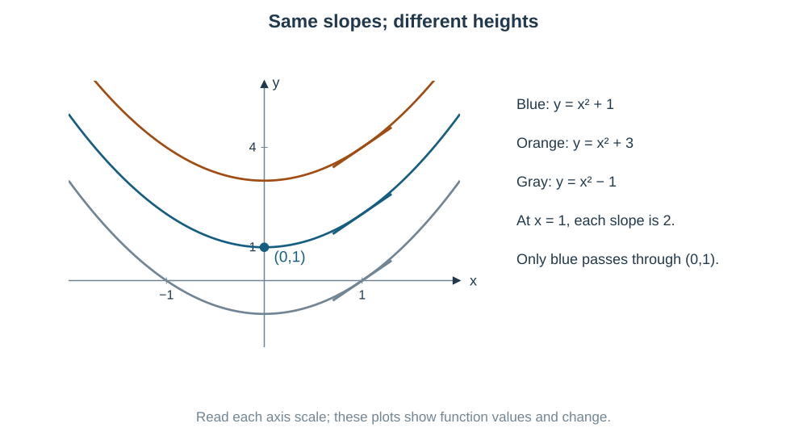

All curves $y=x^2+C$ have derivative $2x$. Changing the constant $C$ moves the graph up or down without changing its slope at a given $x$.

$$
y'=2x
\quad\Longrightarrow\quad
y=x^2+C.
\qquad
y(0)=1\quad\Longrightarrow\quad C=1.
$$

A **differential equation** contains an unknown function and one or more of its derivatives. To **solve** it, find the function or family of functions that obeys it. A **general solution** keeps arbitrary constants. A **particular solution** uses extra information, such as $y(0)=1$, to fix them. That extra information is an **initial condition**: it gives a starting point or a starting slope.

**Quick check:** differentiate your answer and substitute into the **original** equation. Also check the initial condition. Checking only the final numerical value can miss a wrong curve.

## Concept C02 — Order and degree: use two separate questions

**Order:** which is the highest derivative present?

$$
y' \text{ is first order},\qquad y'' \text{ is second order},\qquad y''' \text{ is third order}.
$$

**Degree:** after the equation is written as a polynomial in its derivatives, what is the power of the **highest-order derivative**? Lower derivatives may have larger powers; those powers do not decide the degree.

$$
(y''')^2+(y'')^3+y'+y^4=0
\quad\Longrightarrow\quad
\text{order}=3,\quad \text{degree}=2.
$$

Here $y^4$ does not affect either answer: it is the function, not a derivative.

**Radicals:** remove derivative radicals algebraically when possible.

$$
\sqrt{1+(y')^2}=y''
\quad\Longrightarrow\quad
1+(y')^2=(y'')^2.
$$

Order 2, degree 2. The original equation also requires $y''\ge0$. Squaring helps classify the equation but can introduce extra candidate solutions; check the original sign if you solve it.

**Degree may not exist.**

$$
y''+\sin(y'')+y=0:
\qquad \text{order}=2,\quad\text{degree is undefined}.
$$

The derivative is inside sine, so we cannot turn this into a polynomial in derivatives by algebraic removal of radicals or denominators. By contrast, $\sin x$ or $e^x$ as a coefficient is fine: $y''+\sin x\,y'=0$ has degree 1.

**Important for JEE Main:** do not answer “degree 3” merely because you see $(y')^3$. First circle the highest derivative, then inspect its power.

## Concept C03 — Form an equation by removing arbitrary constants

An arbitrary constant labels different members of a family. Differentiation often removes it. Example:

$$
y=Cx^2
\quad\Longrightarrow\quad
y'=2Cx.
\qquad
xy'=2y.
$$

We multiplied by $x$ and used $Cx^2=y$. The final equation contains no $C$.

For a regular family with $n$ **independent** constants, eliminating them usually gives an equation of order $n$. Count independent combinations, not names:

$$
y=(c_1+c_2)x
\quad\Longrightarrow\quad
y=Ax.
$$

There is only one free coefficient $A$. Similarly,

$$
R\cos(x+\phi)=R\cos\phi\cos x-R\sin\phi\sin x
=A\cos x+B\sin x.
$$

Amplitude and phase together represent two independent real coefficients. We use this in Q3. The family-formation questions here use differentiation and elimination; we do not need a full course on solving second-order equations.

**Geometry clue:** identify the family first. A circle through the origin, a sideways parabola and a vertical parabola need different equations. Draw the family before differentiating if its orientation matters.

## Concept C04 — Separation of variables means put each variable on its own side

Suppose

$$
\frac{dy}{dx}=g(x)h(y).
$$

The $x$ part and the $y$ part are multiplied. On a branch where $h(y)\ne0$,

$$
\frac{dy}{h(y)}=g(x)\,dx,
\qquad
\int\frac{dy}{h(y)}=\int g(x)\,dx+C.
$$

We are using the chain rule in reverse. If $H'(y)=1/h(y)$, then $\frac d{dx}H(y(x))=y'/h(y)$.

Example:

$$
y'=2xy
\quad\Longrightarrow\quad
\frac{dy}{y}=2x\,dx
\quad\Longrightarrow\quad
\ln|y|=x^2+C
\quad\Longrightarrow\quad
y=Ke^{x^2}.
$$

We divided by $y$, so check $y=0$ separately. It satisfies the original equation and is included when $K=0$ in the final expression.

**Do not force separation on sums.** In $y'+y=x$, writing $dy=(x-y)dx$ does not separate anything: the right side still mixes $x$ and $y$. Use the linear method in C05.

Useful integrals, with real domains understood:

$$
\int\frac{du}{u}=\ln|u|+C,\qquad
\int\frac{du}{1+u^2}=\tan^{-1}u+C,
\qquad
\int e^u\,du=e^u+C.
$$

Here $\tan^{-1}u$ means inverse tangent, not $1/\tan u$. All trigonometric calculus uses radians.

**An initial value can save work:** instead of introducing a constant and finding it later, use

$$
\int_{y_0}^{y(x)}\frac{du}{h(u)}
=\int_{x_0}^x g(t)\,dt,
$$

provided the same valid branch connects the endpoints.

## Concept C05 — Linear equations: make a product derivative

A first-order equation is linear in $y$ when it has the form

$$
y'+P(x)y=Q(x).
$$

The unknown $y$ and its derivative occur to the first power, and the coefficients depend only on $x$. A $y^2$, $yy'$ or $\sin y$ term makes this form nonlinear.

**First make the coefficient of $y'$ equal to 1.** If $a(x)y'+b(x)y=c(x)$, divide by $a(x)$ on an interval where $a(x)\ne0$. Then $P=b/a$.

Why do we multiply by an integrating factor? The product rule says

$$
(\mu y)'=\mu y'+\mu' y.
$$

We want the left side of the equation, after multiplication by $\mu$, to look exactly like this. So choose $\mu'=\mu P$. Separating this small equation gives

$$
\boxed{\mu(x)=e^{\int P(x)\,dx}},
\qquad
(\mu y)'=\mu Q,
\qquad
\boxed{\mu y=\int\mu Q\,dx+C}.
$$

The **integrating factor** is the multiplier $\mu$ that joins two terms into one product derivative. We normally omit its arbitrary nonzero constant because multiplying the whole equation by a constant changes no solutions.

**Notice the pattern!**

$$
y'+\frac2x y=x
\quad\overset{\mu=x^2}{\Longrightarrow}\quad
x^2y'+2xy=x^3
\quad\Longrightarrow\quad
(x^2y)'=x^3.
$$

The factor $x^2$ is useful because its derivative is $2x$. That is the reason for the method, not just a formula to memorize.

| Coefficient $P(x)$ | A convenient integrating factor | Valid interval |
|---|---|---|
| $a$ constant | $e^{ax}$ | any interval |
| $n/x$ | $x^n$ when this is real and nonzero; otherwise use $e^{n\ln|x|}$ | avoid $x=0$ |
| $\tan x$ | $\sec x$ up to a nonzero constant on each interval | avoid $\cos x=0$ |
| $2x/(1+x^2)$ | $1+x^2$ | all real $x$ |

**Important for JEE Main:** normalization, the product rule and the initial condition are three separate steps. Check all three. If the product is already visible, use it directly; you need not recompute an integrating factor.

## Concept C06 — Homogeneous first-order equations: see a ratio

In this method, “homogeneous” means that the slope depends only on $y/x$:

$$
y'=F(y/x),\qquad x\ne0.
$$

An equivalent test is unchanged slope under common scaling:

$$
f(\lambda x,\lambda y)=f(x,y)
$$

whenever both points belong to the domain. For a ratio of polynomials, equal total degrees in numerator and denominator often make this happen.

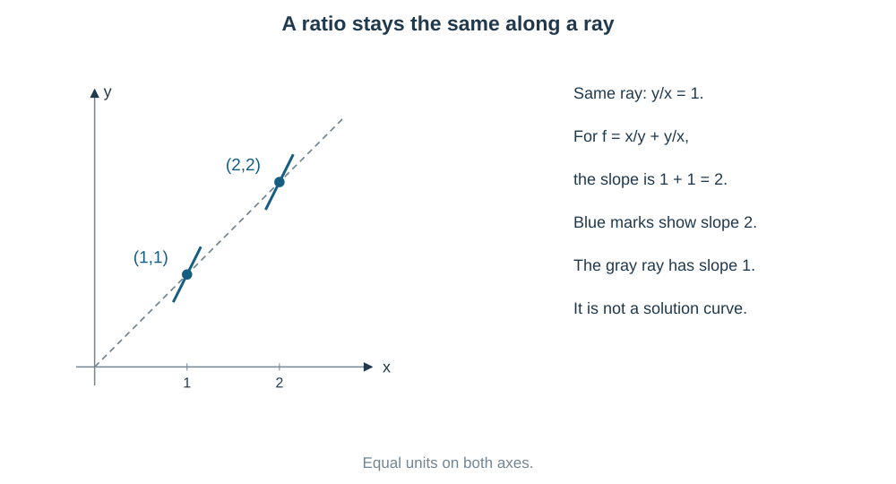

Example:

$$
\frac{x^2+y^2}{xy}
=\frac{x}{y}+\frac yx
=\frac1v+v,\qquad v=\frac yx.
$$

So replace the repeated ratio by $v$:

$$
\boxed{y=vx,\qquad y'=v+xv'}.
$$

**Why the extra $xv'$?** The ratio $v$ usually changes as $x$ changes. Differentiate $vx$ by the product rule. Treating $v$ as constant would incorrectly force every solution to be a straight line.

$$
v+xv'=F(v)
\quad\Longrightarrow\quad
\frac{dv}{F(v)-v}=\frac{dx}{x}.
$$

Now it is separable. Before dividing, check roots of $F(v)-v=0$: they give possible straight-line solutions $y=v_0x$.

Two uses of the same word: a **linear homogeneous equation** means $y'+P(x)y=0$, with zero right side. That meaning is different from the ratio method here. Decide from the actual equation.

## Concept C07 — Sometimes x is the easier unknown

An equation may be nonlinear in $y(x)$ but linear in $x(y)$. If inversion is valid locally,

$$
\frac{dx}{dy}=\frac1{dy/dx}.
$$

Example:

$$
y'=\frac1{x+y}
\quad\Longrightarrow\quad
\frac{dx}{dy}=x+y.
$$

Now write $\frac{dx}{dy}-x=y$. This is linear: the unknown is $x$, the independent variable is $y$, and the integrating factor is $e^{-y}$. The same product-rule logic works.

**When to try this:** a complicated denominator containing $x$ linearly, or a form such as $(x+g(y))y'=h(y)$. Do not invert through a zero slope, and do not forget restrictions in the original equation. The final relation may describe curves with vertical tangents, where a differentiable $y(x)$ branch stops.

## Concept C08 — A substitution should simplify the troublesome pattern

Do not choose a new letter randomly. Look at what its derivative would be.

| Visible pattern | Try | Why it helps |
|---|---|---|
| $2yy'$ | $z=y^2$ | $z'=2yy'$ |
| $y'/y^2$ | $u=1/y$ | $u'=-y'/y^2$ |
| $y'/y-1/x$ | $w=\ln(y/x)$ for positive ratio | $w'=y'/y-1/x$ |
| $xy'-y$ with $x\ne0$ | $v=y/x$ | $v'=(xy'-y)/x^2$ |
| $xy'-y$ divided by $x^2+y^2$ | $\theta=\tan^{-1}(y/x)$ | $\theta'=(xy'-y)/(x^2+y^2)$ |
| $x+y$ repeated | $u=x+y$ | $u'=1+y'$ |

The ratio and inverse-tangent identities are **important recognition tools for JEE Main**. Derive them once from quotient and chain rules so the numerator is familiar.

**A useful supporting extension — Bernoulli's form:**

$$
y'+P(x)y=Q(x)y^n,\qquad n\ne0,1.
$$

The direct linear formula does not apply because of $y^n$. On a suitable nonzero real branch, divide by $y^n$ and set

$$
u=y^{1-n},\qquad
u'=(1-n)y^{-n}y'.
$$

Then

$$
\boxed{u'+(1-n)P(x)u=(1-n)Q(x)}.
$$

It has become linear. For $n=2$, $u=1/y$ is especially useful in Q12 and Q31. Check $y=0$ directly if the original equation allows it. It cannot appear while $1/y$ is being used.

## Concept C09 — Recognize a total differential; exactness is a check for it

You know the product rule:

$$
d(xy)=y\,dx+x\,dy.
$$

You also know

$$
d\!\left(\frac{x^2+y^2}{2}\right)=x\,dx+y\,dy.
$$

Thus $x\,dy+y\,dx=0$ means $d(xy)=0$, so $xy=C$. We are looking for **one quantity that stays constant**.

More generally, if

$$
M(x,y)\,dx+N(x,y)\,dy=dF(x,y),
$$

then the equation equals zero when $F(x,y)=C$. Such an equation is called **exact**.

To test the smooth polynomial expressions in this PDF, use

$$
\boxed{\frac{\partial M}{\partial y}=\frac{\partial N}{\partial x}}.
$$

The symbol $\partial$ means “differentiate with respect to this variable while holding the other one fixed.” For example,

$$
M=3x^2y^2+2xy
\quad\Longrightarrow\quad
M_y=6x^2y+2x.
$$

This test comes from $M=F_x$, $N=F_y$ and equality of the mixed derivatives. For our polynomial functions on the plane, it also lets us recover $F$. On domains with holes, a global converse needs extra care; the PDF's polynomial exactness question has no such issue. This is a supporting source method, not a reason to study a full partial-differential-equations course.

## Concept C10 — Slope, tangent, normal and orthogonal trajectories

**Tangent:** the line that gives the curve's direction at a point. Its slope is $y'$.

**Normal:** the line through that point perpendicular to the tangent.

For two finite nonzero perpendicular slopes,

$$
m_1m_2=-1,\qquad m_2=-\frac1{m_1}.
$$

A horizontal line is perpendicular to a vertical line; the vertical line has no finite slope. Handle these cases with directions or geometry instead of dividing by zero.

**Orthogonal trajectories** are a new family of curves that crosses the original family at right angles. The right angle is between the **two tangents at the crossing point**.

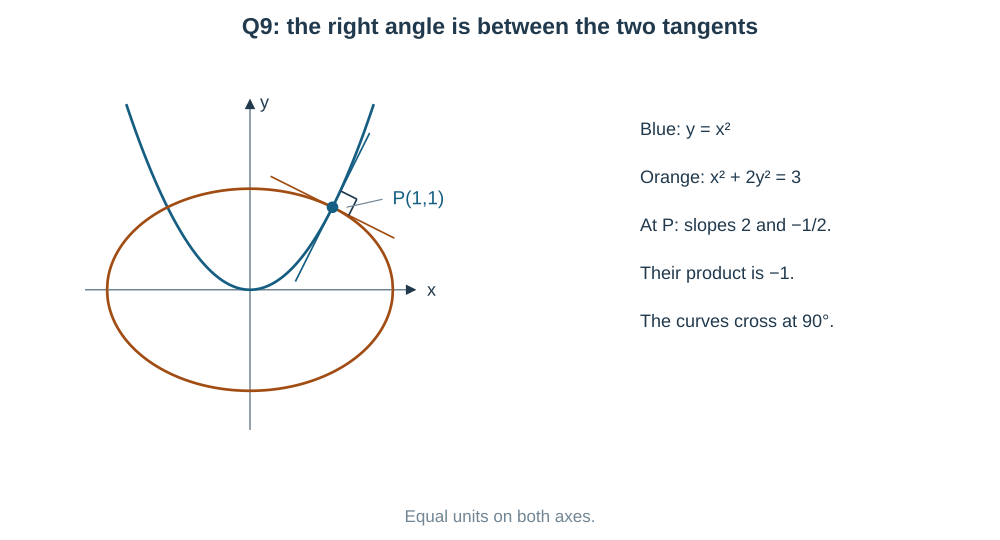

Procedure: eliminate the original family's constant to get its slope $m(x,y)$; set the new slope to $-1/m(x,y)$ where meaningful; solve the new differential equation. Check exceptional horizontal or vertical cases geometrically.

**Example clue:** $y=Cx^2$ gives original slope $2y/x$. The new slope must be $-x/(2y)$, not just $-2y/x$. Negating a slope alone usually does not make a right angle.

If every normal passes through a fixed point, think **circle with that point as centre**. A radius is normal to a circle. You can prove it without slope fractions: for centre $(0,0)$, the radius direction $(x,y)$ is perpendicular to tangent direction $(1,y')$, so

$$
(x,y)\cdot(1,y')=0
\quad\Longrightarrow\quad
x+yy'=0
\quad\Longrightarrow\quad
x^2+y^2=C.
$$

This connects vectors, coordinate geometry and differential equations.

## Concept C11 — Rate problems and integral equations

**Proportional to the present amount** means

$$
N'=kN
\quad\Longrightarrow\quad
\boxed{N(t)=N_0e^{kt}}.
$$

$N_0$ is the amount at time zero. $k>0$ gives growth; $k<0$ gives decay. Equal time gaps multiply the amount by the same factor; they do not add the same amount.

$$
\text{doubling time }T:\quad k=\frac{\ln2}{T},\quad
N(t)=N_0\,2^{t/T}.
$$

**Mixing:** amount changes at

$$
\boxed{\text{rate in}-\text{rate out}}.
$$

If volume is $V$ and salt amount is $S$, a well-mixed outflow has concentration $S/V$. Multiply concentration by outflow volume per unit time:

$$
\text{salt out per minute}=
\frac{S\ \mathrm{kg}}{V\ \mathrm L}\,
q\ \frac{\mathrm L}{\mathrm{min}}
=\frac{qS}{V}\ \frac{\mathrm{kg}}{\mathrm{min}}.
$$

Pure water brings in zero salt. Equal inflow and outflow keep $V$ fixed, but **the concentration changes** as salt leaves.

**Integral equations:** the fundamental theorem of calculus says

$$
\frac d{dx}\int_a^x f(t)\,dt=f(x)
$$

for continuous $f$. The letter $t$ is a temporary integration variable; it disappears after integration. Differentiate to get an equation for $f$, and put $x=a$ in the original relation to obtain an initial value. Finally check the original integral equation, because differentiation can lose a constant condition.

## Concept C12 — Higher derivatives and sideways families

If only a higher derivative is given, integrate repeatedly:

$$
y''=g(x)
\quad\Longrightarrow\quad
y'=\int g(x)\,dx+C_1
\quad\Longrightarrow\quad
y=\int y'\,dx+C_2.
$$

Two conditions are needed to determine two independent constants.

For forming an equation of a geometrical family, use its actual orientation:

$$
\text{axis parallel to }x:\quad
(y-b)^2=4a(x-c),\ a\ne0;
\qquad
x=Ay^2+By+C,\ A\ne0.
$$

Here the parabola opens left or right, not up or down.

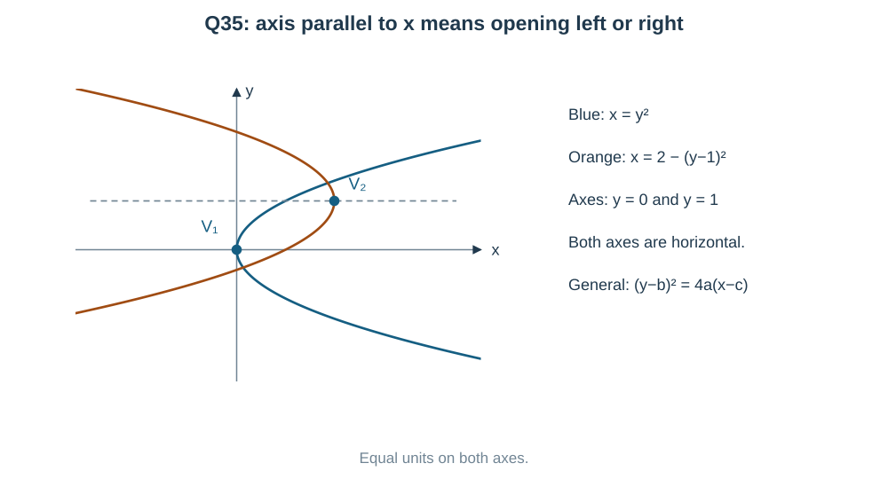

There are three independent parameters. Differentiating and eliminating them on regular $y(x)$ branches gives

$$
y'y'''-3(y'')^2=0.
$$

Q35 derives this rather than asking you to memorize it. At a sideways parabola's vertex, $dy/dx$ is not finite, so this equation describes regular branches away from the vertex.

## Concept C13 — A correct answer includes the correct branch

1. **Before division**, write what could be zero. Test it in the original equation. A valid constant solution is called an equilibrium solution; a constant ratio can give a straight-line solution.
2. **Before logarithms**, check the argument. Use $\ln|u|$ for $\int du/u$; if the original question contains $\ln x$, it already requires $x>0$.
3. **After a substitution**, return to the original variables. Check both the differential equation and the initial value.
4. **Do not cross a forbidden point.** An initial-value solution lives on a connected interval containing its starting point, with no denominator zero, forbidden logarithm or tangent pole inside it.
5. **Keep full precision until the last step.** If two decimals are requested, round only at the end.

Examples: $y=1/[x(3-x)]$ has poles at $0,3$; the branch through $x=1$ lies in $(0,3)$. And $y=\tan(x^2/2)$ through $(0,0)$ stops at the nearest poles $x=\pm\sqrt\pi$, even though tangent is defined again farther away.

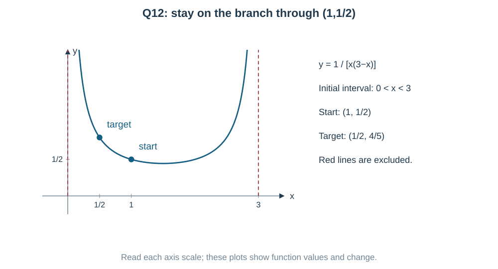

## Last-minute formula recap

| If you notice… | Think… | Equation or caution |
|---|---|---|
| highest derivative | order | highest differentiation number |
| polynomial in derivatives | degree | power of highest derivative only |
| derivative inside $\sin$ or $e^{(\cdot)}$ | degree may be undefined | do not invent a degree |
| $y'=g(x)h(y)$ | separate | $\int dy/h(y)=\int g(x)\,dx+C$; check $h(y)=0$ |
| $y'+P(x)y=Q(x)$ | linear | $\mu=e^{\int Pdx}$; $(\mu y)'=\mu Q$ |
| $a(x)y'+a'(x)y$ | product rule | $(ay)'$ |
| $y'=F(y/x)$ | homogeneous ratio | $y=vx,\ y'=v+xv'$; check constant $v$ |
| $(x+g(y))y'=h(y)$ | possibly invert | solve a linear equation for $x(y)$ |
| $y'+Py=Qy^n$ | supporting Bernoulli method | $u=y^{1-n}$, check omitted zero |
| $2yy'$ or $y'/y^2$ | derivative of a new variable | $(y^2)'=2yy'$, $(1/y)'=-y'/y^2$ |
| $xy'-y$ | ratio derivative | $(y/x)'=(xy'-y)/x^2$ |
| $Mdx+Ndy$ | one total differential? | $M_y=N_x$ in the polynomial test |
| orthogonal curves | perpendicular tangents | new slope $-1/m$; watch vertical/horizontal |
| normals through origin | constant distance | $x^2+y^2=C$ |
| rate proportional to amount | exponential change | $N=N_0e^{kt}$ |
| salt mixing | input minus output | $S'=\text{in concentration}\times\text{in flow}-Sq_{\rm out}/V$ |
| $\int_a^x f(t)\,dt$ | differentiate by FTC | derivative $f(x)$; keep the starting value |
| arbitrary constants in a family | differentiate and eliminate | count independent combinations |

**Final exam habit:** name the pattern before calculating. If direct substitution leaves the unknown function inside an integral, that route has not solved the equation. Try a product derivative, ratio, inverse variable or a useful power instead.

## Worked solutions to the 35 PDF questions

Read the question first. Notice the pattern, choose a route, then calculate. Alternative methods below are fully visible.

### Question 1 — Order and degree ask two different things

**PDF page 75 | MCQ | Notes: C02**

The order and degree, respectively, of the differential equation $\left[1+\left(\dfrac{dy}{dx}\right)^2\right]^{3/2}=k\dfrac{d^2y}{dx^2}$ are

- (a) 2 and 3/2
- (b) 1 and 2
- (c) 2 and 2
- (d) 2 and 3

**Notice two different tasks.** The highest derivative is $y''$, so the order is **2**. The exponent $3/2$ belongs to a bracket containing $y'$. It does not directly give the degree.

For the intended nonzero parameter $k$, square to remove the derivative radical:

$$
\left[1+(y')^2\right]^3=k^2(y'')^2.
$$

This is polynomial in the derivatives. The highest derivative, $y''$, has power **2**.

$$
\boxed{\text{order}=2,\quad\text{degree}=2;\quad\text{option (c)}}.
$$

**Check the tempting answer:** expanding the left bracket would produce $(y')^6$, but that is a lower derivative. It cannot decide the degree.

**A small condition:** squaring can add candidates. A real solution of the original equation must have $k y''>0$, since $[1+(y')^2]^{3/2}>0$. If $k=0$, the original equation has no real solutions; the stated classification uses the intended nonzero $k$.

---

### Question 2 — Remove constants by matching the same exponential terms

**PDF page 75 | MCQ | Notes: C03,C12**

The differential equation representing the family $y=Ae^{2x}+Be^{-x}$, where $A,B$ are arbitrary constants, is

- (a) $y''-y'-2y=0$
- (b) $y''+y'-2y=0$
- (c) $y''-y'+2y=0$
- (d) $y''-2y'-y=0$

**Did you notice the two exponential rates, 2 and $-1$?** Differentiating preserves each exponential and only changes its coefficient. We can remove $A,B$ by combining $y,y',y''$.

$$
\begin{aligned}
y&=Ae^{2x}+Be^{-x},\\
y'&=2Ae^{2x}-Be^{-x},\\
y''&=4Ae^{2x}+Be^{-x}.
\end{aligned}
$$

Look for the combination in the options. In $y''-y'-2y$, the coefficients are

$$
A e^{2x}:\ 4-2-2=0,\qquad
B e^{-x}:\ 1-(-1)-2=0.
$$

Thus

$$
\boxed{y''-y'-2y=0;\quad\text{option (a)}}.
$$

**Another useful view — quick option check.** For an equation $y''+\alpha y'+\beta y=0$, test each rate $r$ in $r^2+\alpha r+\beta$. Both $r=2$ and $r=-1$ must give zero. Option (a) gives $r^2-r-2=(r-2)(r+1)$. This shortcut follows from the derivatives above; it does not require memorizing a new differential-equation solving method.

---

### Question 3 — Count independent constants, not printed symbols

**PDF page 75 | Numerical value | Notes: C03**

For the family $y=(c_1+c_2)\cos(x+c_3)-c_4e^{x+c_5}$, where $c_1,c_2,c_3,c_4,c_5$ are arbitrary constants, the order of the differential equation obtained by eliminating the arbitrary constants is ____.

**Five symbols do not always mean five independent choices!** First join constants that always occur together:

$$
R=c_1+c_2,\qquad D=-c_4e^{c_5}.
$$

Then expand the shifted cosine:

$$
\begin{aligned}
y&=R\cos(x+c_3)+De^x\\
&=(R\cos c_3)\cos x-(R\sin c_3)\sin x+De^x\\
&=A\cos x+B\sin x+De^x.
\end{aligned}
$$

There are **three independent coefficients**, $A,B,D$. For example, any pair $A,B$ can be represented by a suitable amplitude and phase.

**Check by actually eliminating them.**

$$
y''+y=2De^x.
$$

Differentiate once:

$$
y'''+y'=2De^x.
$$

Subtract the previous relation:

$$
y'''-y''+y'-y=0.
$$

The highest derivative is third order, and the three functions $\cos x,\sin x,e^x$ are independent. Hence

$$
\boxed{\text{order}=3}.
$$

**Pattern to keep:** simplify sums, products and phase shifts of arbitrary constants before counting them.

---

### Question 4 — Separate the exponential into an x part and a y part

**PDF page 75 | MCQ | Notes: C04,C13**

If $\dfrac{dy}{dx}=e^{x+y}$ and $y(0)=0$, then $y\!\left(\ln\dfrac32\right)$ equals

- (a) $\ln\dfrac32$
- (b) $\ln3$
- (c) $\dfrac12\ln2$
- (d) $\ln2$

**Notice $e^{x+y}=e^x e^y$.** This is a product of an $x$ part and a $y$ part. Separation is the short route; directly writing $y=\int e^{x+y}dx$ leaves the unknown $y(x)$ inside the integral and solves nothing.

$$
e^{-y}\,dy=e^x\,dx
\quad\Longrightarrow\quad
-e^{-y}=e^x+C.
$$

Use $x=0,y=0$: $-1=1+C$, so $C=-2$. Therefore

$$
e^{-y}=2-e^x,\qquad y=-\ln(2-e^x).
$$

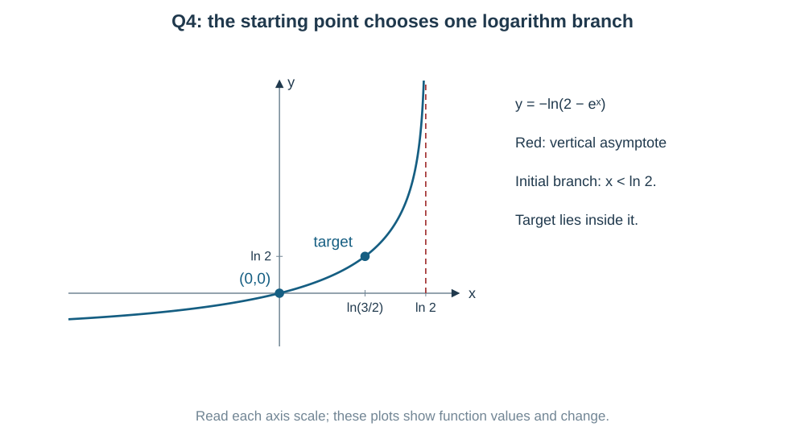

The logarithm requires $2-e^x>0$, so the initial branch is $x<\ln2$. The requested input $\ln(3/2)$ belongs to it.

$$
y\!\left(\ln\frac32\right)
=-\ln\left(2-\frac32\right)
=-\ln\frac12
=\boxed{\ln2;\quad\text{(d)}}.
$$

**Check:** $y'=e^x/(2-e^x)$ and $e^{x+y}=e^x/(2-e^x)$ agree; $y(0)=0$.

**Another approach:** $u=e^{-y}$ gives $u'=-e^{-y}y'=-e^x$, so $u=2-e^x$ directly. It is the same chain-rule idea with a new variable.

---

### Question 5 — A y times y-prime pattern suggests y squared

**PDF page 75 | Numerical value | Notes: C05,C06,C08**

If $\dfrac{dy}{dx}=\dfrac{x^2+y^2}{2xy}$, $y>0$ and $y(1)=2$, then $(y(3))^2=$ ____.

**Can you see a derivative hiding after multiplication?**

$$
2xyy'=x^2+y^2.
$$

The piece $2yy'$ is exactly $(y^2)'$. Since the question also asks for $y(3)^2$, set $z=y^2$. We can solve directly for the quantity we need.

$$
xz'=x^2+z
\quad\Longrightarrow\quad
z'-\frac zx=x.
$$

For the initial branch $x>0$, the integrating factor is $1/x$:

$$
\left(\frac zx\right)'=1,\qquad
\frac zx=x+C,\qquad z=x^2+Cx.
$$

$z(1)=y(1)^2=4$ gives $C=3$. Thus

$$
y^2=x^2+3x,\qquad
\boxed{y(3)^2=9+9=18}.
$$

The positive solution is $y=\sqrt{x^2+3x}$ on $x>0$. Differentiating its square gives $2yy'=2x+3$, which agrees with the original right side after $y^2=x^2+3x$ is inserted.

**Another possible approach — homogeneous ratio.**

$$
y=vx,\qquad
v+xv'=\frac{1+v^2}{2v},
\qquad
\frac{2v\,dv}{1-v^2}=\frac{dx}{x}.
$$

Integration gives $-\ln|1-v^2|=\ln|x|+C$, hence $y^2=x^2+Kx$. Dividing by $1-v^2$ omits $v=\pm1$, so check $y=\pm x$ separately on valid branches. They are the $K=0$ members. This route works, but $z=y^2$ is shorter here.

---

### Question 6 — The coefficient tan x tells us the integrating factor

**PDF page 75 | MCQ | Notes: C05**

If $\dfrac{dy}{dx}+y\tan x=\sin2x$ and $y(0)=1$, then $y(\pi/3)$ equals

- (a) $\dfrac12$
- (b) $1$
- (c) $\dfrac32$
- (d) $\dfrac32-\dfrac14$

**Recognize a linear equation:** $y'+(\tan x)y=\sin2x$. The coefficient of $y'$ is already 1. We want a multiplier whose derivative produces the $\tan x$ term.

$$
\mu=e^{\int\tan x\,dx}
=e^{-\ln|\cos x|}.
$$

On the interval $(-\pi/2,\pi/2)$ containing the initial point, $\cos x>0$, so take $\mu=\sec x$.

$$
(y\sec x)'=\sin2x\sec x=2\sin x.
$$

Therefore

$$
y\sec x=-2\cos x+C,\qquad
y=C\cos x-2\cos^2x.
$$

$y(0)=1$ gives $C=3$. At $x=\pi/3$,

$$
y=\frac32-2\left(\frac12\right)^2
=\frac32-\frac12
=\boxed{1;\quad\text{(b)}}.
$$

**Check without long expansion:** the product equation above becomes $(y\sec x)'=2\sin x$, so multiplication by $\cos x$ gives back the original equation. The target is inside the same interval as $0$.

**Pattern:** $\sin2x=2\sin x\cos x$ makes the integrating-factor integrand simple. Expanding this identity **after** choosing $\sec x$ exposes the cancellation.

---

### Question 7 — Change which variable is the unknown

**PDF page 75 | MCQ | Notes: C07,C13**

The general solution of $(x+2y^3)\dfrac{dy}{dx}=y$ is

- (a) $x=y^3+\dfrac cy$
- (b) $x=y^3+cy$
- (c) $y=x^3+cx$
- (d) $x=2y^3+cy$

**Why not the usual linear formula in $y$?** Solving for $y'$ puts $x+2y^3$ in the denominator, so the equation is not linear in $y$. But $x$ occurs only to the first power. Try making $x$ the unknown.

For a nonzero branch,

$$
\frac{dx}{dy}=\frac{x+2y^3}{y}
\quad\Longrightarrow\quad
\frac{dx}{dy}-\frac xy=2y^2.
$$

This is linear in $x(y)$. A convenient integrating factor is $1/y$ on an interval avoiding $y=0$:

$$
\frac d{dy}\left(\frac xy\right)=2y,
\qquad
\frac xy=y^2+C.
$$

Hence

$$
\boxed{x=y^3+Cy;\quad\text{intended option (b)}}.
$$

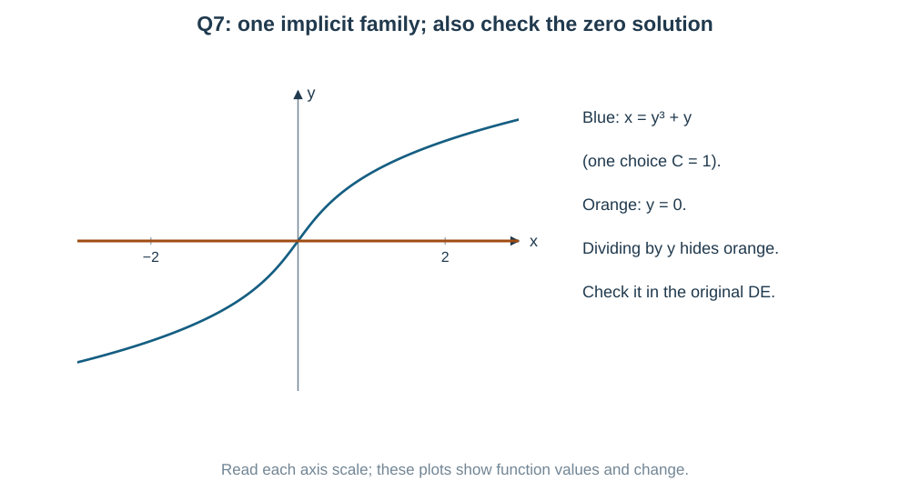

**The division check matters!** We divided by $y$. In the original equation, $y=0$ gives $(x+0)\cdot0=0$, so it is a separate valid solution. The implicit family above does not contain the whole line $y=0$.

**Check the family:** differentiate $x=y^3+Cy$ to get $1=(3y^2+C)y'$. Also $x+2y^3=y(3y^2+C)$, so $(x+2y^3)y'=y$. This describes regular $y(x)$ branches; a vertical tangent cannot be treated as a finite derivative.

---

### Question 8 — Three doubling periods are easier than finding the rate

**PDF page 75 | Numerical value | Notes: C11**

The population of a town increases at a rate proportional to its population. It doubles in $4$ years. If the population after $12$ years is $1000$, then the initial population is ____.

**What does “rate proportional to population” mean?** If the present population doubles, its rate of growth also doubles. It means $P'=kP$, not constant growth.

$$
P(t)=P_0e^{kt},\qquad
P(4)=2P_0
\quad\Longrightarrow\quad e^{4k}=2.
$$

We do not need a decimal value of $k$. Twelve years contain exactly three 4-year periods:

$$
P(12)=P_0(e^{4k})^3=8P_0=1000.
$$

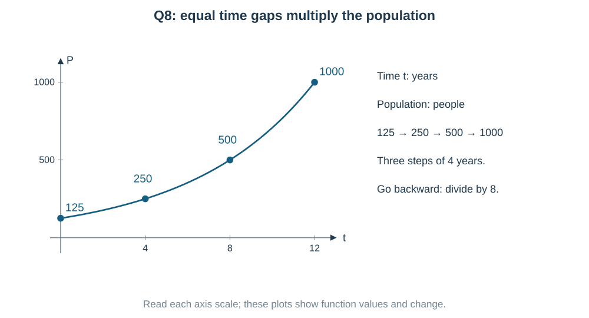

$$
\boxed{P_0=\frac{1000}{8}=125}.
$$

**Why adding a fixed number is wrong:** the increase from 125 to 250 is 125, while the next increase from 250 to 500 is 250. Equal time gaps multiply by 2; they do not add the same number.

**Another compact expression:** $P(t)=P_0\,2^{t/4}$. It directly displays the doubling time. Checking at $t=12$ gives $125\cdot2^3=1000$.

---

### Question 9 — Perpendicular curves have perpendicular tangents

**PDF page 76 | MCQ | Notes: C10**

The orthogonal trajectories of the family $y=cx^2$ are

- (a) $2x^2+y^2=k$
- (b) $x^2-2y^2=k$
- (c) $y=\dfrac{k}{x^2}$
- (d) $x^2+2y^2=k$

**First understand the picture.** A new curve must cross each original parabola at a right angle. It is the **tangent lines at the crossing** that must be perpendicular.

For $y=cx^2$,

$$
y'=2cx=\frac{2y}{x}.
$$

So at a regular crossing the original tangent slope is $2y/x$. The new slope must be its **negative reciprocal**:

$$
\frac{dy}{dx}=-\frac{x}{2y}.
$$

Separate and integrate:

$$
2y\,dy=-x\,dx
\quad\Longrightarrow\quad
y^2=-\frac{x^2}{2}+C
\quad\Longrightarrow\quad
\boxed{x^2+2y^2=k;\quad\text{(d)}}.
$$

**Check:** at $(1,1)$, choose original $c=1$ and new $k=3$. Their slopes are $2$ and $-1/2$, whose product is $-1$. The figure uses equal units so that the right angle is shown honestly.

**Why merely changing the sign fails:** $-2y/x$ is generally not perpendicular to $2y/x$. Their product is $-4y^2/x^2$, which is not always $-1$. Horizontal/vertical limiting cases need the geometric tangent test, not division by zero.

---

### Question 10 — Both terms already belong to one product derivative

**PDF page 76 | MCQ | Notes: C05,C09**

If $(2xy+y)\,dx+(x^2+x)\,dy=0$ and $y(1)=1$, then $y(2)$ is

- (a) $\dfrac13$
- (b) $\dfrac12$
- (c) $\dfrac23$
- (d) $\dfrac14$

**Notice the matching pieces!**

$$
\frac d{dx}(x^2+x)=2x+1.
$$

After writing $dy=y'dx$, the given equation is

$$
(x^2+x)y'+(2x+1)y=0.
$$

These are exactly the two pieces in the derivative of $(x^2+x)y$:

$$
\big[(x^2+x)y\big]'=0
\quad\Longrightarrow\quad
(x^2+x)y=C.
$$

Use $x=1,y=1$: $C=2$. Therefore

$$
y=\frac2{x(x+1)},\qquad
y(2)=\frac2{2\cdot3}
=\boxed{\frac13;\quad\text{(a)}}.
$$

**Check:** the product $(x^2+x)y$ stays equal to 2, so its derivative is zero. Its initial branch is $x>0$; it does not cross $x=0$ or $x=-1$.

**Another possible approach:** divide by $x^2+x$ to get a linear equation. Its integrating factor is

$$
e^{\int(2x+1)/(x^2+x)\,dx}=|x^2+x|,
$$

or simply $x^2+x$ up to a constant sign on each interval. It gives the same product. Spotting the product first saves that integral.

---

### Question 11 — Multiply the whole equation by x squared

**PDF page 76 | MCQ | Notes: C05**

If $\dfrac{dy}{dx}+\dfrac2x y=x$, $x>0$, and $y(1)=1$, then $y(2)$ equals

- (a) $\dfrac{17}{16}$
- (b) $\dfrac54$
- (c) $\dfrac{19}{16}$
- (d) $\dfrac{21}{16}$

**The pattern is $y'+P(x)y=Q(x)$.** Here $P=2/x$. We need a multiplier that turns $y'+(2/x)y$ into a product derivative.

$$
\mu=e^{\int 2/x\,dx}=x^2\qquad(x>0).
$$

Multiply **every term** by $x^2$:

$$
x^2y'+2xy=x^3
\quad\Longrightarrow\quad
(x^2y)'=x^3.
$$

Integrate and use the starting value:

$$
x^2y=\frac{x^4}{4}+C,\qquad
1=\frac14+C,\qquad C=\frac34.
$$

Hence

$$
y=\frac{x^2}{4}+\frac3{4x^2},\qquad
y(2)=1+\frac3{16}
=\boxed{\frac{19}{16};\quad\text{(c)}}.
$$

**Check:** $y'=x/2-3/(2x^3)$, while $2y/x=x/2+3/(2x^3)$. Adding cancels the inverse powers and gives exactly $x$. Also $y(1)=1$.

---

### Question 12 — The y-squared term means the original equation is not linear

**PDF page 76 | MCQ | Notes: C05,C08,C13**

If $\dfrac{dy}{dx}+\dfrac yx=xy^2$ and $y(1)=\dfrac12$, then $y(1/2)$ is

- (a) $\dfrac25$
- (b) $\dfrac54$
- (c) $\dfrac43$
- (d) $\dfrac45$

**Why the direct linear formula does not apply yet:** the right side contains $y^2$. It is not a function of $x$ alone. But dividing by $y^2$ creates $y'/y^2$, the derivative pattern of $1/y$.

The initial value is nonzero. On its nonzero branch set $u=1/y$, so $u'=-y'/y^2$:

$$
\frac{y'}{y^2}+\frac1{xy}=x
\quad\Longrightarrow\quad
u'-\frac ux=-x.
$$

Now it is linear. Use integrating factor $1/x$:

$$
\left(\frac ux\right)'=-1,\qquad
u=Cx-x^2.
$$

$u(1)=2$ gives $C=3$. Thus

$$
y=\frac1{3x-x^2},\qquad
y(1/2)=\frac1{3/2-1/4}
=\boxed{\frac45;\quad\text{(d)}}.
$$

**Check:** $y'=(2x-3)/(3x-x^2)^2$. Substitution into $y'+y/x=xy^2$ verifies the equation. The interval containing $x=1$ is $(0,3)$, and $1/2$ is inside it.

**Lost solution:** $y=0$ also solves the original equation wherever $x\ne0$. It was excluded by $u=1/y$, but it does not meet $y(1)=1/2$.

**Another possible route:** the equation is Bernoulli's form with $n=2$, so the general substitution $u=y^{1-n}$ gives the same $u=1/y$. The derivative pattern explains why that rule works.

---

### Question 13 — A derivative inside sine has no polynomial degree

**PDF page 76 | MCQ | Notes: C02**

Statement I: The degree of $\dfrac{d^2y}{dx^2}+\sin\!\left(\dfrac{d^2y}{dx^2}\right)+y=0$ is $1$.

Statement II: The order of this differential equation is $2$. Choose the correct option.

- (a) Statement I is false and Statement II is true
- (b) Both statements are true
- (c) Statement I is true and Statement II is false
- (d) Both statements are false

**Find the highest derivative first.** Both $y''$ and $\sin(y'')$ involve the second derivative. No third derivative is present, so the order is **2**. Statement II is true.

**Now ask whether degree can be defined.** Degree requires a polynomial equation in derivatives after valid algebraic removal of radicals and denominators. Here $y''$ is **inside sine**. We cannot turn $\sin(y'')$ into a polynomial in $y''$ by those operations.

Thus the degree is **undefined**, not 1. Statement I is false.

$$
\boxed{\text{I false, II true; option (a)}}.
$$

**Useful comparison:** $y''+(\sin x)y'+y=0$ would have order 2 and degree 1. In that equation sine contains the independent variable $x$, not a derivative. The location of the derivative inside or outside the function makes the difference.

---

### Question 14 — Match each differential form to its integrated family

**PDF page 76 | MCQ | Notes: C04,C09,C10**

Match List I with List II.

| List I | Equation | List II | Family |
|---|---|---|---|
| A | $x\,dy=y\,dx$ | I | $xy=c$ |
| B | $x\,dy+y\,dx=0$ | II | $y=cx$ |
| C | $x\,dy=2y\,dx$ | III | $y=cx^2$ |
| D | $y\,dy+x\,dx=0$ | IV | $x^2+y^2=c$ |

- (a) A–I, B–II, C–III, D–IV
- (b) A–II, B–I, C–IV, D–III
- (c) A–II, B–I, C–III, D–IV
- (d) A–III, B–I, C–II, D–IV

**Match by seeing derivatives you already know.** We can solve the separated forms or differentiate each proposed family.

**A:** $x\,dy=y\,dx$ gives $y'=y/x$. On a nonzero branch,

$$
\frac{dy}{y}=\frac{dx}{x}
\quad\Longrightarrow\quad y=Cx.
$$

This is **II**; the zero solution is included when $C=0$.

**B:** $x\,dy+y\,dx=d(xy)=0$, so $xy=C$. This is **I**.

**C:** $x\,dy=2y\,dx$ gives

$$
\frac{dy}{y}=2\frac{dx}{x}
\quad\Longrightarrow\quad y=Cx^2.
$$

This is **III**, again including $C=0$ in the final family.

**D:**

$$
y\,dy+x\,dx
=\frac12\,d(y^2+x^2)=0
\quad\Longrightarrow\quad x^2+y^2=C.
$$

This is **IV**. As a real curve it is a circle for $C>0$; use regular $y(x)$ arcs away from vertical tangents.

$$
\boxed{\text{A–II,\ B–I,\ C–III,\ D–IV;\quad (c)}}.
$$

**Fast alternative for a matching question:** differentiate the four proposed families directly. For instance, $xy=C$ immediately gives $x\,dy+y\,dx=0$. That avoids solving each equation from the beginning. Divisions by $x$ above apply on intervals avoiding $0$; the differential-form families can be checked directly at their regular points.

---

### Question 15 — An integral equation can hide a simple differential equation

**PDF page 76 | Numerical value | Notes: C11**

A differentiable function $f$ satisfies $f(x)=1+2\displaystyle\int_0^x f(t)\,dt$ for all $x$. Then $f(\ln3)=$ ____.

**Did you notice an integral whose upper limit is $x$?** Differentiating removes that integral:

$$
f(x)=1+2\int_0^x f(t)\,dt
\quad\Longrightarrow\quad
f'(x)=2f(x).
$$

The constant 1 disappears on differentiation, so we must keep its information. Put $x=0$ in the **original** equation:

$$
f(0)=1+2\int_0^0 f(t)\,dt=1.
$$

Solve the simple growth equation:

$$
f(x)=Ce^{2x},\qquad f(0)=1\Longrightarrow C=1.
$$

Therefore

$$
\boxed{f(\ln3)=e^{2\ln3}=3^2=9}.
$$

**Check the original relation:**

$$
1+2\int_0^x e^{2t}\,dt
=1+\left(e^{2x}-1\right)
=e^{2x}=f(x).
$$

**Why not guess $f(x)$ by expanding the integral repeatedly?** It creates more nested integrals without using the simple derivative pattern. Differentiation plus the starting value reaches the answer directly.

---

### Question 16 — Log y minus log x is the log of one ratio

**PDF page 77 | MCQ | Notes: C06,C08**

If $x\dfrac{dy}{dx}=y(\ln y-\ln x+1)$ and $y(1)=e$, then $y(2)$ equals

- (a) $e^2$
- (b) $2e^2$
- (c) $2e$
- (d) $4e$

**Notice $\ln y-\ln x=\ln(y/x)$.** The repeated ratio suggests $v=y/x$. Since the original logarithms are real, $x>0,y>0$.

$$
y=vx,\qquad y'=v+xv'.
$$

Substitute:

$$
x(v+xv')=vx(\ln v+1)
\quad\Longrightarrow\quad
xv'=v\ln v.
$$

Now notice $v'/v$, the derivative of $\ln v$. Set $w=\ln v$:

$$
w'=\frac{v'}v=\frac wx.
$$

So $(w/x)'=0$ and $w=Cx$. This step does **not** divide by $w$; it keeps the possible $w=0$ solution.

From $y(1)=e$, $v(1)=e$ and $w(1)=1$, so $C=1$. Hence

$$
\ln(y/x)=x,\qquad y=xe^x,\qquad
\boxed{y(2)=2e^2;\quad\text{(b)}}.
$$

**Check:** $xy'=x e^x(1+x)=y(1+\ln(y/x))$.

**Another shorter view after you know the pattern:** set $w=\ln(y/x)$ directly. Then

$$
w'=\frac{y'}y-\frac1x=\frac{\ln(y/x)}x=\frac wx.
$$

Why prefer this over integrating $dv/(v\ln v)$ blindly? It avoids introducing $\ln|\ln v|$ and then worrying about its zero case. The full family $y=xe^{Cx}$ includes $y=x$ when $C=0$.

---

### Question 17 — A slope statement is already a differential equation

**PDF page 77 | Numerical value | Notes: C01,C04,C10**

The slope of the tangent to a curve at any point $(x,y)$ is $2y/x$. If the curve passes through $(1,3)$, then the ordinate of the point on the curve with abscissa $2$ is ____.

**Translate the words into an equation.** “Slope of the tangent” means $dy/dx$. “Abscissa” means $x$-coordinate; “ordinate” means $y$-coordinate.

$$
\frac{dy}{dx}=\frac{2y}{x},\qquad y(1)=3.
$$

This is separable:

$$
\frac{dy}{y}=2\frac{dx}{x}
\quad\Longrightarrow\quad
\ln|y|=2\ln|x|+C
\quad\Longrightarrow\quad
y=Kx^2.
$$

The point $(1,3)$ gives $K=3$. At $x=2$,

$$
\boxed{y=3(2)^2=12}.
$$

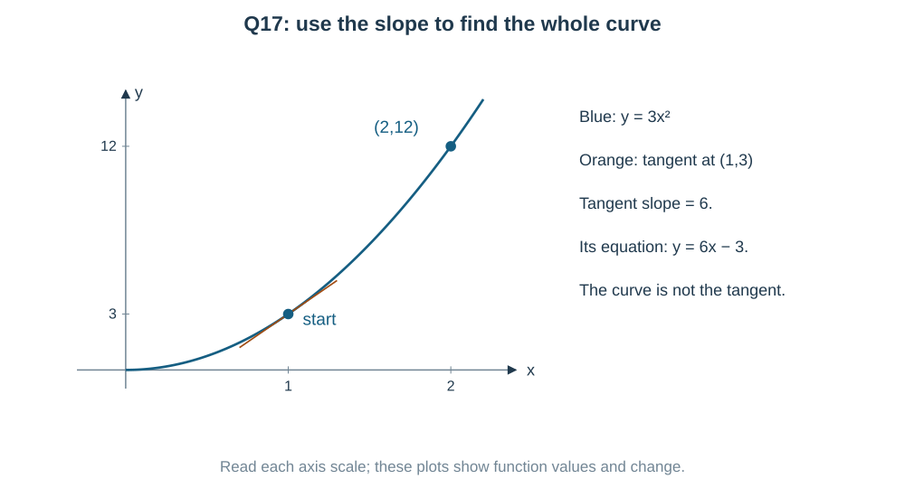

**Important distinction:** the tangent at $(1,3)$ has slope 6 and equation $y-3=6(x-1)$. That is only the local tangent line. Using it to find the curve's height at $x=2$ would give 9, which is wrong. The slope changes along the curve.

**Another route:** view $y'-2y/x=0$ as linear, with integrating factor $1/x^2$. Then $(y/x^2)'=0$, immediately giving $y=Kx^2$. The zero family member fails the initial condition; the original slope equation requires $x\ne0$, so the branch through $1$ uses $x>0$.

---

### Question 18 — Normalize first, or recognize the product immediately

**PDF page 77 | MCQ | Notes: C05,C09**

If $(1+x^2)\dfrac{dy}{dx}+2xy=4x^2$ and $y(0)=0$, then $y(1)$ is

- (a) $\dfrac23$
- (b) $\dfrac43$
- (c) $\dfrac12$
- (d) $\dfrac13$

**Notice a product rule before doing any integrals.**

$$
\frac d{dx}(1+x^2)=2x.
$$

The left side is therefore exactly

$$
(1+x^2)y'+2xy=\big[(1+x^2)y\big]'.
$$

So

$$
(1+x^2)y=\int4x^2\,dx=\frac{4x^3}{3}+C.
$$

$y(0)=0$ gives $C=0$. Thus

$$
y=\frac{4x^3}{3(1+x^2)},\qquad
\boxed{y(1)=\frac23;\quad\text{(a)}}.
$$

**Another possible approach — the linear method:** first divide by $1+x^2$:

$$
y'+\frac{2x}{1+x^2}y=\frac{4x^2}{1+x^2}.
$$

The integrating factor is $e^{\ln(1+x^2)}=1+x^2$, so we return to the same product equation.

**Common wrong move:** using $e^{\int2x\,dx}$ without first normalizing would give the wrong factor. $P(x)$ is $2x/(1+x^2)$, not $2x$.

**Check:** differentiating the displayed product recovers the original equation directly. Since $1+x^2$ never vanishes, this solution is defined for every real $x$.

---

### Question 19 — The family is a circle through the origin

**PDF page 77 | MCQ | Notes: C03,C10**

The differential equation of the family of circles $x^2+y^2=2ax$, where $a$ is an arbitrary constant, is

- (a) $2xy\dfrac{dy}{dx}=x^2-y^2$
- (b) $2xy\dfrac{dy}{dx}=x^2+y^2$
- (c) $2xy\dfrac{dy}{dx}=y^2-x^2$
- (d) $xy\dfrac{dy}{dx}=y^2-x^2$

**Draw the family before differentiating.** Completing the square gives

$$
(x-a)^2+y^2=a^2.
$$

The centre is $(a,0)$, the radius is $|a|$, and every nondegenerate member passes through the origin.

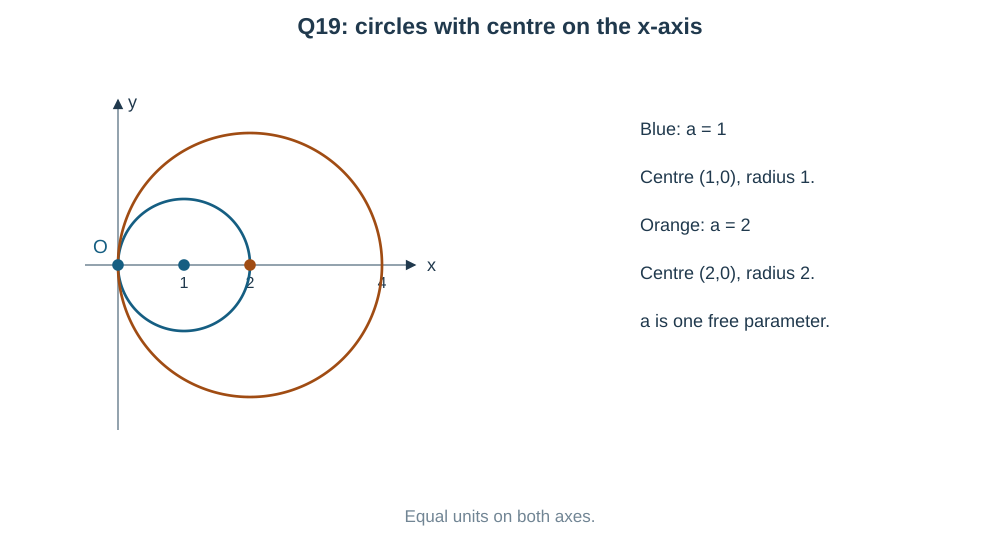

There is one arbitrary constant $a$, so differentiate once:

$$
2x+2yy'=2a.
$$

We must remove $a$. Instead of dividing the original equation by $x$, multiply this derivative equation by $x$:

$$
2x^2+2xyy'=2ax=x^2+y^2.
$$

Hence

$$
\boxed{2xy\,y'=y^2-x^2;\quad\text{(c)}}.
$$

**Why this route is useful:** multiplying avoids an unnecessary division by $x$. The final relation still applies to regular differentiable arcs; at the origin these nondegenerate circles have a vertical tangent, so there is no finite $y'$ to substitute there.

**Check at an easy point:** on the $a=1$ circle, $(1,1)$ is its top point, with horizontal tangent $y'=0$. Both sides of the resulting equation are zero.

---

### Question 20 — Salt leaves at the current concentration

**PDF page 77 | Numerical value | Notes: C11**

A tank contains $50$ L of solution with $25$ kg of salt. Pure water enters at $2$ L/min and the well-mixed solution leaves at the same rate. The amount of salt (in kg) after $25$ min is ____ (round to $2$ decimal places; use $e^{-1}=0.3679$).

**Build the rate equation from the physical meaning.** Let $S(t)$ be salt amount in kg after $t$ minutes. Inflow equals outflow, so volume stays $50$ L. Pure water brings in **zero** salt.

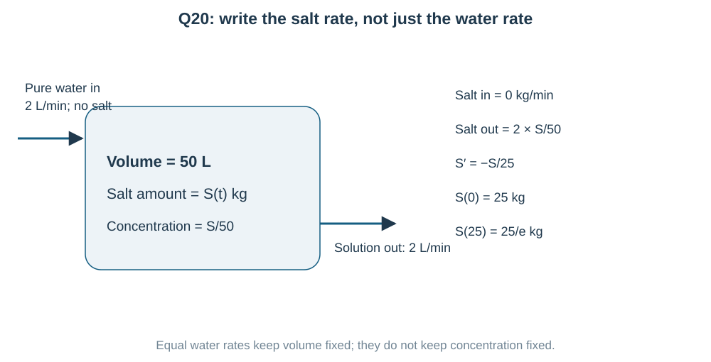

At time $t$, the concentration is $S(t)/50$ kg/L. The outflow carries

$$
\frac S{50}\ \frac{\mathrm{kg}}{\mathrm L}
\times2\ \frac{\mathrm L}{\mathrm{min}}
=\frac S{25}\ \frac{\mathrm{kg}}{\mathrm{min}}.
$$

Therefore

$$
\frac{dS}{dt}=0-\frac S{25},\qquad S(0)=25.
$$

Separate, or use the exponential-decay formula:

$$
S(t)=25e^{-t/25}.
$$

At $t=25$, using the supplied approximation,

$$
S(25)=25(0.3679)=9.1975
\quad\Longrightarrow\quad
\boxed{9.20\ \mathrm{kg}}.
$$

**Why not subtract a constant amount each minute?** The concentration falls as salt leaves, so later outflow removes less salt per minute. The rate depends on the current $S$, not always on the initial 25 kg.

**Check:** the answer is positive and below 25 kg, and differentiating $25e^{-t/25}$ gives $-S/25$. Using the more precise $e^{-1}$ gives the same two-decimal answer.

---

### Question 21 — A second derivative needs two integrations

**PDF page 77 | MCQ | Notes: C12**

If $\dfrac{d^2y}{dx^2}=12x^2$, $y(0)=1$ and $y'(0)=2$, then $y(1)$ equals

- (a) $3$
- (b) $4$
- (c) $5$
- (d) $6$

**What is given?** The second derivative, which describes how the slope changes. We need the function itself. That takes **two** integrations.

First integrate:

$$
y''=12x^2
\quad\Longrightarrow\quad
y'=4x^3+C_1.
$$

The slope condition $y'(0)=2$ gives $C_1=2$. Integrate again:

$$
y= x^4+2x+C_2.
$$

The height condition $y(0)=1$ gives $C_2=1$. Hence

$$
\boxed{y(1)=1+2+1=4;\quad\text{(b)}}.
$$

**Check all the information:** for $y=x^4+2x+1$, we have $y'=4x^3+2$ and $y''=12x^2$, with $y(0)=1$, $y'(0)=2$.

**Why one constant is not enough:** integrating once only finds the slope. Curves with different heights can have the same slope function. The second constant fixes the height.

---

### Question 22 — One plus y squared suggests inverse tangent

**PDF page 77 | MCQ | Notes: C04,C13**

If $\dfrac{dy}{dx}=x(1+y^2)$ and $y(0)=0$, then $y\!\left(\sqrt{\dfrac{2\pi}3}\right)$ is

- (a) $\dfrac1{\sqrt3}$
- (b) $1$
- (c) $\dfrac\pi3$
- (d) $\sqrt3$

**Did you recognize $1+y^2$?** Its reciprocal is the derivative of inverse tangent. Separate:

$$
\frac{dy}{1+y^2}=x\,dx
\quad\Longrightarrow\quad
\tan^{-1}y=\frac{x^2}{2}+C.
$$

$y(0)=0$ gives $C=0$, so

$$
y=\tan\left(\frac{x^2}{2}\right).
$$

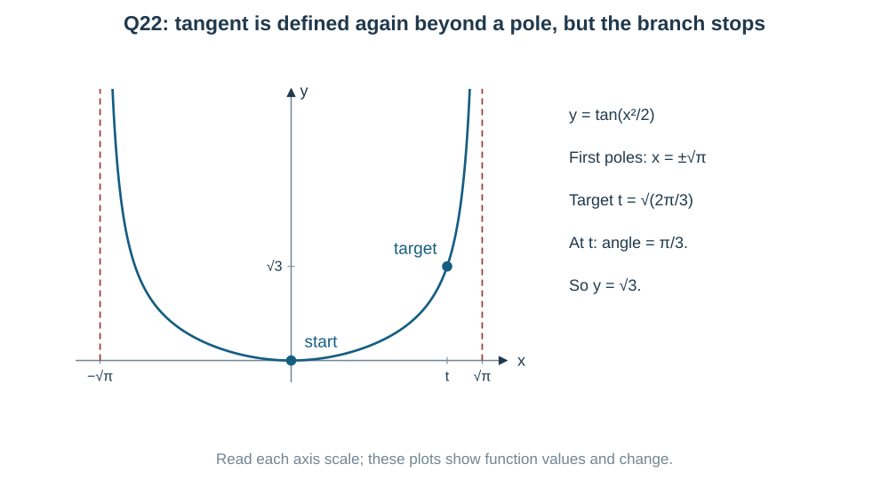

**Check the angle before using tangent.** The interval containing $0$ ends where $x^2/2=\pi/2$, namely $x=\pm\sqrt\pi$. The target satisfies $2\pi/3<\pi$, so it is inside that interval. Its angle is

$$
\frac12\left(\sqrt{\frac{2\pi}{3}}\right)^2=\frac\pi3.
$$

Therefore

$$
\boxed{y=\tan(\pi/3)=\sqrt3;\quad\text{(d)}}.
$$

**Check:** $y'=x\sec^2(x^2/2)=x(1+y^2)$. The initial value also holds.

**Useful connection:** set $\theta=\tan^{-1}y$ at the start. Then $\theta'=y'/(1+y^2)=x$. It is the same separation viewed as finding an angle.

---

### Question 23 — A factored equation gives alternative slopes, not their sum

**PDF page 77 | MCQ | Notes: C02,C13**

The general solution of $\left(\dfrac{dy}{dx}\right)^2-5\dfrac{dy}{dx}+6=0$ is

- (a) $y=2x+3x+c$
- (b) $(y-2x-c)(y-3x-c)=0$
- (c) $(y-2x-c_1)(y-3x-c_2)=0$
- (d) $y=c_1e^{2x}+c_2e^{3x}$

**Source warning:** this is not a uniquely correct single-answer question as written. The supplied key chooses **(c)**, but **(b) describes the same set of individual solution branches**.

**The pattern is an ordinary quadratic in the slope.** Put $p=y'$:

$$
p^2-5p+6=(p-2)(p-3)=0.
$$

So the slope is **2 or 3**, not $2+3$. On a connected differentiable solution interval it must stay with one of these values. A switch from one straight slope to the other would make a corner; more generally, derivatives have the intermediate-value property and cannot jump between these two isolated values.

Integrating each possible slope gives

$$
\boxed{y=2x+A\quad\text{or}\quad y=3x+B}.
$$

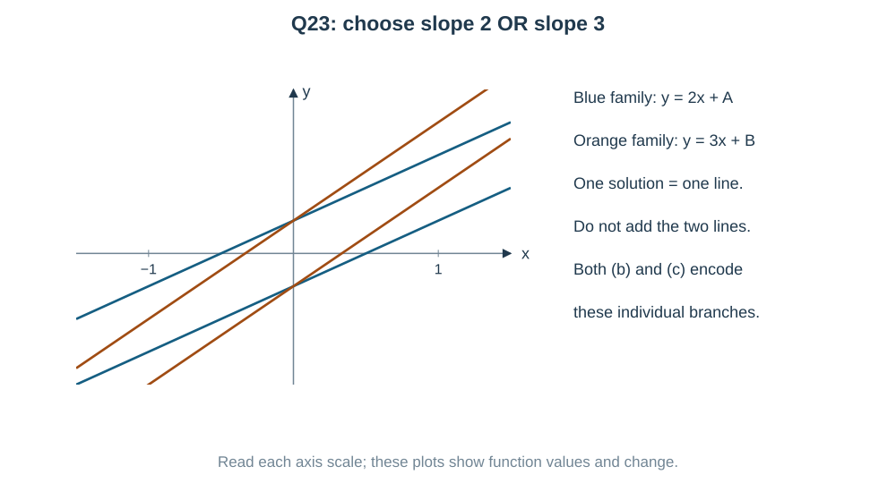

**Why both (b) and (c) work as branch descriptions.** Option (c) writes the union of two line equations with separate constants. In (b), choose $c=A$ when using the slope-2 factor, or choose $c=B$ when using the slope-3 factor. Because $c$ ranges over all real values, no individual solution line is lost.

For example, $y=2x+7$ is in (b) with $c=7$, and $y=3x-4$ is in (b) with $c=-4$. We are choosing **one solution at a time**; there is no need for both lines to share one chosen intercept in the same solution.

**Why the other routes fail:** option (a) has slope 5, giving $25-25+6=6\ne0$. Option (d) mistakes the numbers 2,3 for exponential rates. Here the quadratic is in $y'$, not a linear second-order equation.

**Exam note:** intended key **(c)**; mathematical answer **both (b) and (c)** with the branch interpretation above. Each regular solution needs one arbitrary constant. A product-zero equation is a convenient union, not a claim that a single solution has two independent constants.

---

### Question 24 — x dy minus y dx is a ratio derivative clue

**PDF page 77 | MCQ | Notes: C06,C08**

If $x\,dy-y\,dx=(x^2+y^2)\,dx$ and $y(1)=0$, then $y(1+\pi/4)$ equals

- (a) $1+\dfrac\pi4$
- (b) $\dfrac\pi4$
- (c) $\left(1+\dfrac\pi4\right)^2$
- (d) $\dfrac1{1+\pi/4}$

**Notice the numerator $xy'-y$.** It comes from differentiating $y/x$:

$$
\left(\frac yx\right)'=\frac{xy'-y}{x^2}.
$$

The equation becomes $xy'-y=x^2+y^2$. Set $v=y/x$ on the branch through $x=1$:

$$
x(v+xv')-vx=x^2(1+v^2)
\quad\Longrightarrow\quad
v'=1+v^2.
$$

Thus $\tan^{-1}v=x+C$. At $x=1$, $v=0$, so $C=-1$ and

$$
y=x\tan(x-1).
$$

At $x=1+\pi/4$ the tangent factor is 1:

$$
\boxed{y=1+\frac\pi4;\quad\text{(a)}}.
$$

We can work on $0<x<1+\pi/2$. This interval contains both the starting point and the target, keeps the ratio substitution valid and avoids the tangent pole. Do not mistake a restriction introduced by division for an automatic ban in the original differential form: here the displayed curve also extends smoothly through $(0,0)$ and satisfies that original form there.

**Another possible approach — see the angle directly.**

$$
\frac d{dx}\tan^{-1}(y/x)
=\frac{xy'-y}{x^2+y^2}
=1.
$$

So the angle $\tan^{-1}(y/x)$ changes by exactly $x-1$ from its initial value zero. This compact derivative identity is useful whenever the numerator $xy'-y$ and denominator $x^2+y^2$ appear together.

**Check:** for $y=xv$, $xy'-y=x^2v'=x^2(1+v^2)=x^2+y^2$.

---

### Question 25 — Degree belongs to the highest derivative only

**PDF page 78 | Numerical value | Notes: C02**

If the order and degree of $\left(\dfrac{d^3y}{dx^3}\right)^2+\left(\dfrac{d^2y}{dx^2}\right)^3+\dfrac{dy}{dx}+y^4=0$ are $p$ and $q$, respectively, then $pq=$ ____.

**Circle the highest derivative before looking at powers.**

$$
(y''')^2+(y'')^3+y'+y^4=0.
$$

The highest derivative is $y'''$, so order $p=3$. The equation is already polynomial in derivatives. The power of **that highest derivative** is 2, so degree $q=2$.

$$
\boxed{pq=3\cdot2=6}.
$$

**Why not 3 or 4 for the degree?** The power 3 belongs to the lower derivative $y''$. The power 4 belongs to $y$, which is not a derivative. Neither decides the degree.

---

### Question 26 — The integrating factor comes before integration by parts

**PDF page 78 | MCQ | Notes: C05**

If $\dfrac{dy}{dx}+\dfrac yx=\ln x$, $x>0$, and $y(1)=0$, then $y(e)$ equals

- (a) $\dfrac{e^2-1}{4e}$
- (b) $\dfrac{e^2+1}{2e}$
- (c) $\dfrac e4$
- (d) $\dfrac{e^2+1}{4e}$

**Choose the linear method first.** The coefficient of $y$ is $1/x$, so for $x>0$,

$$
\mu=e^{\int dx/x}=x.
$$

Multiplying gives

$$
(xy)'=x\ln x.
$$

Now the remaining integral needs integration by parts. Take $u=\ln x$, $dv=x\,dx$:

$$
\int x\ln x\,dx
=\frac{x^2}{2}\ln x-\int\frac x2\,dx
=\frac{x^2}{2}\ln x-\frac{x^2}{4}.
$$

Hence

$$
xy=\frac{x^2}{2}\ln x-\frac{x^2}{4}+C.
$$

$y(1)=0$ gives $C=1/4$. At $x=e$,

$$
e\,y(e)=\frac{e^2}{2}-\frac{e^2}{4}+\frac14
=\frac{e^2+1}{4}.
$$

$$
\boxed{y(e)=\frac{e^2+1}{4e};\quad\text{(d)}}.
$$

**Why integrating $\ln x$ alone would not solve it:** the extra $y/x$ term must first be joined with $y'$ into a product. After that, the required integral is $x\ln x$, not $\ln x$.

**Check:** differentiating the displayed formula for $xy$ gives exactly $x\ln x$, and its value at $1$ is zero.

---

### Question 27 — Exactness asks whether both pieces come from one function

**PDF page 78 | MCQ | Notes: C09**

The equation $(3x^2y^2+2xy)\,dx+(2x^3y+kx^2)\,dy=0$ is exact for $k$ equal to

- (a) $2$
- (b) $1$
- (c) $3$
- (d) $-1$

**What does “exact” mean here?** Both pieces must come from differentiating one function $F(x,y)$. For the smooth polynomial functions in this question, test $M_y=N_x$:

$$
M=3x^2y^2+2xy,\qquad N=2x^3y+kx^2.
$$

When differentiating $M$ with respect to $y$, hold $x$ fixed. When differentiating $N$ with respect to $x$, hold $y$ fixed:

$$
M_y=6x^2y+2x,\qquad N_x=6x^2y+2kx.
$$

They must agree as functions, not merely at one selected point. Thus $2x=2kx$ for all $x$, so

$$
\boxed{k=1;\quad\text{(b)}}.
$$

**Another possible approach — build the hidden function.** Integrate $M$ with respect to $x$ while treating $y$ as constant:

$$
F=x^3y^2+x^2y+h(y).
$$

Then

$$
F_y=2x^3y+x^2+h'(y).
$$

For this to equal $N$, $(k-1)x^2$ would have to equal $h'(y)$. A function of $y$ alone cannot supply a nonconstant $x^2$ term. Hence $k=1$, $h'=0$. Indeed,

$$
d(x^3y^2+x^2y)=Mdx+Ndy\quad(k=1).
$$

This also checks that the complete solution is $x^3y^2+x^2y=C$.

---

### Question 28 — Homogeneous here means unchanged by scaling both inputs

**PDF page 78 | MCQ | Notes: C06**

Statement I: $\dfrac{dy}{dx}=\dfrac{x^2+y^2}{xy}$ is a homogeneous differential equation.

Statement II: A function $f(x,y)$ is homogeneous of degree zero if $f(\lambda x,\lambda y)=f(x,y)$ for all $\lambda\ne0$. Choose the correct option.

- (a) Statement I is true and Statement II is false
- (b) Both statements are true
- (c) Statement I is false and Statement II is true
- (d) Both statements are false

**Test the slope, not just the equation's name.** Here

$$
f(x,y)=\frac{x^2+y^2}{xy},\qquad xy\ne0.
$$

If both coordinates are multiplied by $\lambda\ne0$,

$$
f(\lambda x,\lambda y)
=\frac{\lambda^2x^2+\lambda^2y^2}{\lambda^2xy}
=f(x,y).
$$

The scale cancels. Thus $f$ is homogeneous of degree zero, and the equation is a homogeneous **ratio-type** first-order equation. Both statements are true.

$$
\boxed{\text{option (b)}}.
$$

**Another quick recognition:** set $v=y/x$. Then

$$
f=\frac xy+\frac yx=\frac1v+v,
$$

which depends only on $y/x$. The diagram shows the same prescribed slope at $(1,1)$ and $(2,2)$. It does not say the ray joining them is a solution.

**Domain detail:** the scaling definition compares points where $f$ is defined. Here the domain $xy\ne0$ is preserved by every nonzero $\lambda$.

---

### Question 29 — The new slope is the negative reciprocal of y

**PDF page 78 | MCQ | Notes: C10**

The orthogonal trajectories of the family $y=ce^x$ are

- (a) $y^2=k+2x$
- (b) $y=ke^{-x}$
- (c) $y=k-x$
- (d) $y^2=k-2x$

**Start from the original family's tangent slope.**

$$
y=ce^x
\quad\Longrightarrow\quad
y'=ce^x=y.
$$

The new curves must cross these with perpendicular tangents, so their slope is $-1/y$ wherever $y\ne0$:

$$
\frac{dy}{dx}=-\frac1y
\quad\Longrightarrow\quad
y\,dy=-dx.
$$

Integrate:

$$
\frac{y^2}{2}=-x+C
\quad\Longrightarrow\quad
\boxed{y^2=k-2x;\quad\text{(d)}}.
$$

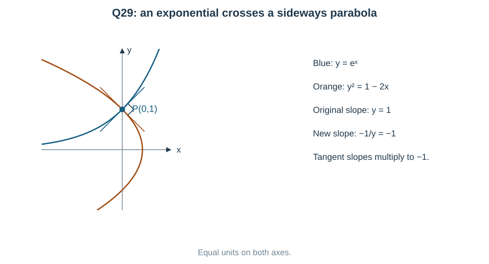

**Check:** at $(0,1)$ the original slope is 1 and the new slope is $-1$. Their product is $-1$. The new curves are **sideways parabolas**, not decreasing exponentials.

**Why option (b) is tempting but wrong:** $y=ke^{-x}$ has slope $-y$, so the product with the original slope is $-y^2$, not always $-1$.

At the original zero member $y=0$, its tangent is horizontal; the orthogonal parabola has a vertical tangent at its vertex on that line. The implicit curve handles this geometrically, although a finite-slope formula cannot be used at that vertex.

---

### Question 30 — Normals through the origin are radii of a circle

**PDF page 78 | Numerical value | Notes: C10**

A curve passes through $(3,4)$ and all its normals pass through the origin. The positive $y$-coordinate of the point where the curve meets the $y$-axis is ____.

**Visual clue:** every normal goes through the same point, the origin. A radius is perpendicular to a circle's tangent, so a circle centred at the origin is a strong candidate. Let us prove it rather than guess.

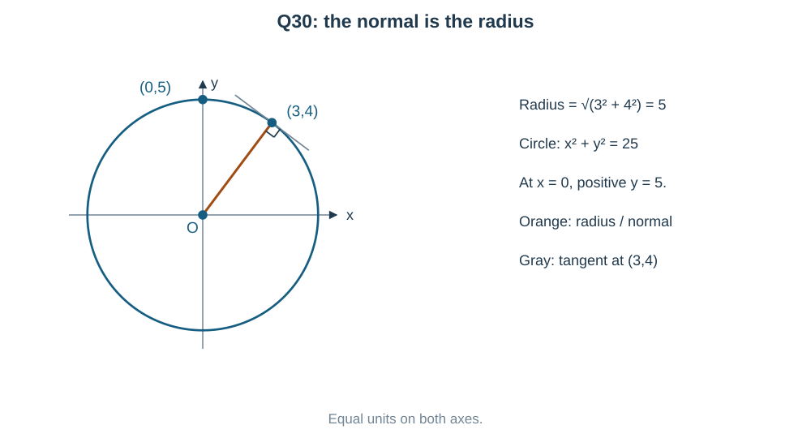

At $(x,y)$, a tangent direction is $(1,y')$. The normal's direction from the origin is $(x,y)$. Their dot product is zero:

$$
(1,y')\cdot(x,y)=x+yy'=0.
$$

Multiply by $dx$ and integrate:

$$
x\,dx+y\,dy=0
\quad\Longrightarrow\quad
x^2+y^2=C.
$$

The supplied point fixes $C=3^2+4^2=25$. At the $y$-axis, $x=0$, so $y^2=25$. The question asks for the **positive** value:

$$
\boxed{y=5}.
$$

**Another approach after recognizing the circle:** its radius is the distance from $(0,0)$ to $(3,4)$, namely 5. Its positive $y$-intercept is therefore 5.

**Why directions are cleaner than slope fractions:** writing a normal slope as $y/x$ would require division by $x$, exactly where the requested point has $x=0$. The dot-product route keeps the geometry valid there.

---

### Question 31 — Two available substitutions: choose the shorter linear route

**PDF page 78 | MCQ | Notes: C06,C08,C13**

If $x^2\,dy+y(x+y)\,dx=0$ and $y(1)=1$, then $y(2)$ is

- (a) $\dfrac4{11}$
- (b) $\dfrac25$
- (c) $\dfrac49$
- (d) $\dfrac13$

**Two patterns are available. Which is shorter here?** After dividing by $x^2$,

$$
y'+\frac yx=-\frac{y^2}{x^2}.
$$

This is Bernoulli with $n=2$. A ratio substitution also works, but it leads to partial fractions. Try $u=1/y$ first; it turns the equation directly into a linear one.

Divide by $y^2$ on the nonzero initial branch:

$$
u'-\frac ux=\frac1{x^2}.
$$

The integrating factor is $1/x$ on $x>0$:

$$
\left(\frac ux\right)'=\frac1{x^3},
\qquad
\frac ux=-\frac1{2x^2}+C,
\qquad
u=Cx-\frac1{2x}.
$$

$u(1)=1$ gives $C=3/2$. Hence

$$
y=\frac{2x}{3x^2-1},\qquad
\boxed{y(2)=\frac4{11};\quad\text{(a)}}.
$$

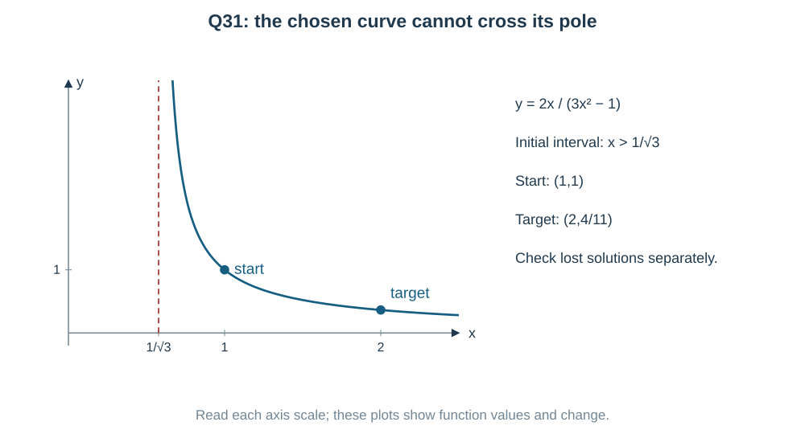

The interval containing $1$ is $x>1/\sqrt3$. The target 2 is inside it. Substitution into $x^2y'+y(x+y)$ gives zero.

**Another possible approach — homogeneous ratio.**

$$
y=vx,\qquad xv'=-v(v+2).
$$

For $v\ne0,-2$,

$$
\int\frac{dv}{v(v+2)}=-\int\frac{dx}{x}
\quad\Longrightarrow\quad
\frac12\ln\left|\frac v{v+2}\right|=-\ln|x|+C.
$$

Thus $v/(v+2)=K/x^2$. From $v(1)=1$, $K=1/3$, so $v=2/(3x^2-1)$ and the same answer follows.

**The important lost-solution check:** dividing by $v(v+2)$ removes $v=0$ and $v=-2$, giving $y=0$ and $y=-2x$. Both satisfy the original equation, but neither meets $y(1)=1$. The inverse-$y$ route already contains $y=-2x$ when its $C=0$; only $y=0$ needs to be restored separately in that route.

---

### Question 32 — Keep enough digits until the final rounding

**PDF page 78 | Numerical value | Notes: C05**

If $\dfrac{dy}{dx}+y=x$ and $y(0)=1$, then $y(1)$ is ____ (round to $2$ decimal places).

**Recognize a linear equation with $P=1$.** The integrating factor is $e^x$:

$$
e^xy'+e^xy=xe^x
\quad\Longrightarrow\quad
(e^xy)'=xe^x.
$$

Integrate by parts:

$$
e^xy=xe^x-e^x+C,\qquad
y=x-1+Ce^{-x}.
$$

$y(0)=1$ gives $1=-1+C$, so $C=2$.

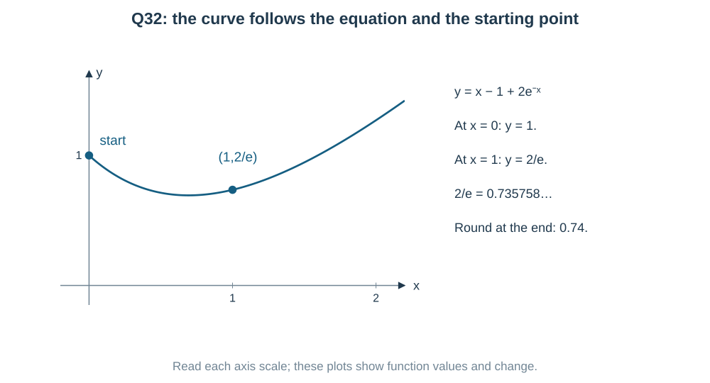

$$
y(1)=1-1+\frac2e=0.73575888\ldots
\quad\Longrightarrow\quad
\boxed{0.74}.
$$

**Check:** $y'=1-2e^{-x}$, so $y'+y=x$. Also $y(0)=1$.

**Another useful view:** a simple particular solution is $y_p=x-1$, because $y_p'+y_p=1+x-1=x$. The difference $z=y-y_p$ must satisfy $z'+z=0$, so $z=Ce^{-x}$. This explains the two pieces: the $x-1$ part responds to the right side, while the exponential part fits the initial value.

---

### Question 33 — Check each statement separately

**PDF page 79 | MCQ | Notes: C02,C04,C05**

Consider the following statements:

(a) The integrating factor of $\dfrac{dy}{dx}+\dfrac yx=x^2$ is $x$.

(b) The solution of $\dfrac{dy}{dx}=-\dfrac xy$ is $x^2+y^2=c$.

(c) The degree of $\dfrac{d^2y}{dx^2}+\left(\dfrac{dy}{dx}\right)^3=0$ is $3$.

(d) The differential equation of the family $y=ce^x$ is $\dfrac{dy}{dx}=y$.

The correct statements are

- (a) (a), (b), (c)
- (b) (b), (c), (d)
- (c) (a), (b), (d)
- (d) (a), (c), (d)

**Check each statement on its own.** One wrong degree claim can remove several options quickly.

**(a) True.** For $y'+y/x=x^2$, a convenient integrating factor is $x$ on any interval avoiding $0$:

$$
x y'+y=(xy)'.
$$

The exponential formula gives $|x|$; $x$ differs by a constant sign on a negative interval, so it is equally valid.

**(b) True on regular solution arcs.**

$$
y'=-x/y
\quad\Longrightarrow\quad
y\,dy=-x\,dx
\quad\Longrightarrow\quad
x^2+y^2=C.
$$

The explicit slope equation requires $y\ne0$.

**(c) False.** In $y''+(y')^3=0$, the highest derivative is $y''$, and its power is 1. The degree is **1**, not 3.

**(d) True.** Differentiating $y=ce^x$ gives $y'=ce^x=y$.

$$
\boxed{\text{(a), (b), (d) are correct;\quad option (c)}}.
$$

**Fast exam route:** once statement (c) is found false, only option (c) omits it. Still check the other statements if time allows; option elimination supports the mathematics rather than replacing it.

---

### Question 34 — Interchanging x and y makes the equation linear

**PDF page 79 | MCQ | Notes: C07,C13**

The general solution of $\dfrac{dy}{dx}=\dfrac1{x+y}$ is

- (a) $x+y+1=ce^x$
- (b) $x+y-1=ce^y$
- (c) $x-y+1=ce^{-y}$
- (d) $x+y+1=ce^y$

**Why the linear formula in $y(x)$ is not ready:** $y$ sits inside the denominator $x+y$. But the reciprocal derivative gives a simpler equation:

$$
\frac{dx}{dy}=x+y
\quad\Longrightarrow\quad
\frac{dx}{dy}-x=y.
$$

This is linear in the unknown $x(y)$. Its integrating factor is $e^{-y}$:

$$
\frac d{dy}(xe^{-y})=ye^{-y}.
$$

By integration by parts,

$$
xe^{-y}=-(y+1)e^{-y}+C
\quad\Longrightarrow\quad
\boxed{x+y+1=Ce^y;\quad\text{(d)}}.
$$

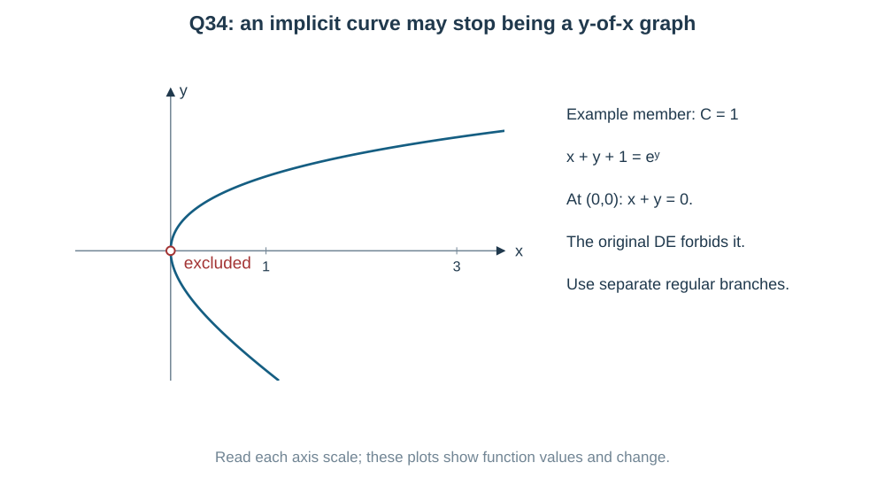

**Check and branch restriction:** differentiating the implicit relation gives

$$
1+y'=Ce^y y'=(x+y+1)y'
\quad\Longrightarrow\quad
1=(x+y)y'.
$$

This recovers the original equation where $x+y\ne0$. Any point with $x+y=0$ is excluded, even if it lies on an implicit member.

**Another approach — repeated sum.** Set $u=x+y$. Then

$$
u'=1+\frac1u=\frac{u+1}{u}.
$$

For $u\ne-1$,

$$
\int\frac{u}{u+1}\,du=x+C
\quad\Longrightarrow\quad
u-\ln|u+1|=x+C.
$$

Since $u=x+y$, this rearranges to $x+y+1=Ke^y$. We divided by $u+1$, so check $u=-1$: it gives the valid line $y=-x-1$. It is already included in the final family when $K=0$. The inverse-variable linear route keeps it automatically.

---

### Question 35 — Axis parallel to x means sideways parabolas

**PDF page 79 | Numerical value | Notes: C03,C12**

For the differential equation of all parabolas whose axes are parallel to the $x$-axis, let the order be $p$ and the degree be $q$. Then $p+q=$ ____.

**First visualize the orientation.** “Axis parallel to the $x$-axis” means the parabola opens left or right:

$$
(y-b)^2=4a(x-c),\qquad a\ne0.
$$

There are three independent parameters: opening/width $a$, vertical shift $b$ and horizontal shift $c$. So expect an equation of order 3. We will check the degree by deriving it.

Write $z=y-b$ only to shorten the working. The three derivative relations are

$$
zy'=2a,\qquad
(y')^2+zy''=0,\qquad
3y'y''+zy'''=0.
$$

We must remove $z$ as well as $a,b,c$. Multiply the second relation by $y'''$ and the third by $y''$:

$$
\begin{aligned}
(y')^2y'''+zy''y'''&=0,\\
3y'(y'')^2+zy'''y''&=0.
\end{aligned}
$$

Subtract to cancel the $z$ terms:

$$
y'\left[y'y'''-3(y'')^2\right]=0.
$$

On a regular branch of a nondegenerate sideways parabola, $zy'=2a\ne0$, so $y'\ne0$. Therefore

$$
\boxed{y'y'''-3(y'')^2=0}.
$$

Highest derivative: $y'''$, so $p=3$. Its power is 1, so $q=1$, even though $y''$ is squared:

$$
\boxed{p+q=3+1=4}.
$$

**Another view — make $y$ the independent variable.** A sideways parabola is $x=Ay^2+By+C$, so $d^3x/dy^3=0$. Using

$$
\frac{dx}{dy}=\frac1{y'},\qquad
\frac{d^2x}{dy^2}=-\frac{y''}{(y')^3},\qquad
\frac{d^3x}{dy^3}
=\frac{3(y'')^2-y'y'''}{(y')^5}
$$

gives the same equation. This is a connection with inverse derivatives, not an extra formula you must memorize for this question.

**Check a simple member:** $y=\sqrt{x}$ for $x>0$ gives $y'=1/(2\sqrt x)$, $y''=-1/(4x^{3/2})$, $y'''=3/(8x^{5/2})$, and both sides of $y'y'''=3(y'')^2$ equal $3/(16x^3)$. The vertex itself has no finite $y'$; use the regular branches.

## Answer check

Read the qualifications in the solutions before using the key.

| Question | Answer | Question | Answer |
|---|---|---|---|
| 1 | (c) | 19 | (c) |
| 2 | (a) | 20 | $9.20$ |
| 3 | $3$ | 21 | (b) $4$ |
| 4 | (d) $\ln2$ | 22 | (d) $\sqrt3$ |
| 5 | $18$ | 23 | Key (c); (b) is also valid |
| 6 | (b) $1$ | 24 | (a) $1+\pi/4$ |
| 7 | (b), with separate $y=0$ | 25 | $6$ |
| 8 | $125$ | 26 | (d) $(e^2+1)/(4e)$ |
| 9 | (d) | 27 | (b) $1$ |
| 10 | (a) $1/3$ | 28 | (b) |
| 11 | (c) $19/16$ | 29 | (d) |
| 12 | (d) $4/5$ | 30 | $5$ |
| 13 | (a) | 31 | (a) $4/11$ |
| 14 | (c) | 32 | $0.74$ |
| 15 | $9$ | 33 | (c) |
| 16 | (b) $2e^2$ | 34 | (d) |
| 17 | $12$ | 35 | $4$ |
| 18 | (a) $2/3$ |  |  |

## What to remember after this chapter

Before touching a formula, say the pattern aloud: “separate product”, “linear product derivative”, “same ratio”, “inverse variable”, or “derivative of a useful new quantity”. If the first route creates more mixed variables, pause and compare another route.

The source questions are practice questions from the supplied PDF, not verified past-paper reproductions. Q23 has two valid options as explained above. Keep that source defect separate from the correct mathematics. All diagrams are original equation-driven SVGs; their code and numerical inputs are saved. No optional explanation is hidden. The final compact booklet PDF will be prepared only after the remaining requested review steps.
