# Chapter 16 — Straight Lines

**Kanna, a line equation is a rule for points. A good picture tells us which rule to use.**

Your overall target is **200 marks**: Physics 60, Maths 60, Chemistry 80. Learn this chapter carefully because distance, slope, midpoint and perpendicularity return in circles, conics and vectors.

## Recent chapter weightage

| Year | Questions tagged Straight Lines and Pair of Straight Lines in the checked archive | Full-year paper shifts | Tagged questions per shift |
|---|---:|---:|---:|
| 2024 | 24 | 20 | 1.20 |
| 2025 | 18 | 19 | 0.95 |
| 2026 | 14 | 19 | 0.74 |
| Total | 56 | 58 | **0.97** |

These are distinct question IDs recounted in ExamSIDE's named category, which includes **pair of straight lines**. Think roughly one tagged question per shift on average; a particular paper can differ. PYQSide's Straight Lines category gives 29, 24 and 15 in these years. Its classification differs, so the counts are not merged. This is an archive recount, not an independent classification of every official paper. The 2024 format offered more optional numerical questions. Sources, raw data and the counting script are saved in the evidence folder.

**Important for JEE Main:** the official coordinate-geometry unit names coordinates, distance, section, locus, slope, line forms, intersections, angles, concurrency, point-to-line distance, centroid, orthocentre and circumcentre. Those are the core. The PDF also uses reflection, bisectors, an incentre and moving-rod constructions; we teach the supporting ideas needed for them.

**Source warning:** Q18 has a printed sign error in its worked solution. The guide keeps the original question, finds its actual fixed point and explains the mismatch. Read that qualification before using its key.

## Concept C01 — A point tells us where; a difference tells us a movement

A point $P(x,y)$ means: move $x$ units along the horizontal axis and $y$ units along the vertical axis. Negative values mean the opposite direction. For $A(x_1,y_1)$ and $B(x_2,y_2)$, the movement from $A$ to $B$ is

$$
\overrightarrow{AB}=(x_2-x_1,\ y_2-y_1).
$$

The horizontal and vertical movements are perpendicular. Pythagoras gives

$$
\boxed{AB=\sqrt{(x_2-x_1)^2+(y_2-y_1)^2}}.
$$

The midpoint takes half of each movement:

$$
M=\left(\frac{x_1+x_2}{2},\frac{y_1+y_2}{2}\right).
$$

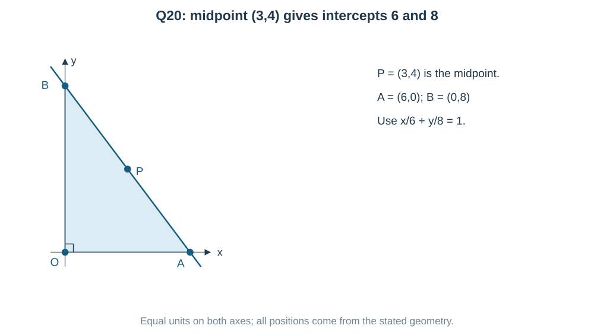

If $AP:PB=m:n$, the point $P$ lies $m/(m+n)$ of the way from $A$ to $B$:

$$
\boxed{P=\frac{nA+mB}{m+n}}
=\left(\frac{nx_1+mx_2}{m+n},\frac{ny_1+my_2}{m+n}\right).
$$

**Notice the opposite weights:** if $AP$ is small, $P$ is close to $A$, so $A$ gets the larger weight. Do not attach the ratio numbers to the wrong endpoint.

For external division in ratio $m:n$, use $P=(mB-nA)/(m-n)$ with $m\ne n$. Verify the point lies outside the segment. Equal external ratios have no finite dividing point. The centroid of a triangle averages its three vertices:

$$
G=\left(\frac{x_1+x_2+x_3}{3},\frac{y_1+y_2+y_3}{3}\right).
$$

## Concept C02 — Slope measures rise per horizontal run

For a nonvertical line through two different points,

$$
\boxed{m=\frac{y_2-y_1}{x_2-x_1}}.
$$

If $m=2$, moving 1 unit right raises the line by 2 units. If $m=-2$, moving 1 unit right lowers it by 2 units. A horizontal line has $m=0$. A vertical line has **undefined slope**, because the horizontal run is zero.

The **inclination** $\theta$ is the angle from the positive $x$ direction to the line's upward-counterclockwise direction, with $0\le\theta<180^\circ$:

$$
m=\tan\theta
$$

when the line is not vertical. For instance, slopes $\sqrt3$ and $1/\sqrt3$ correspond to inclinations $60^\circ$ and $30^\circ$.

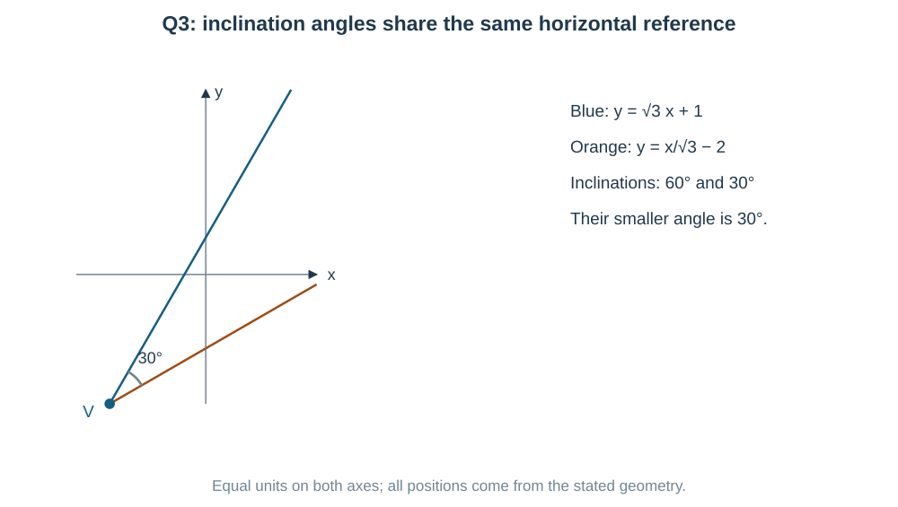

**Exam habit:** before using $y=mx+c$, ask whether the required line could be vertical. Q14 contains exactly that trap.

## Concept C03 — Different line forms store different information

A line equation describes **all points on the line**. A point lies on it only when its coordinates make the equation true.

| Information given | Convenient equation | Condition or meaning |
|---|---|---|
| Slope $m$, vertical intercept $c$ | $y=mx+c$ | nonvertical line |
| Point $(x_1,y_1)$, slope $m$ | $y-y_1=m(x-x_1)$ | nonvertical line |
| Two points | $(y-y_1)(x_2-x_1)=(x-x_1)(y_2-y_1)$ | different points; no slope division needed |
| Nonzero axis intercepts $a,b$ | $x/a+y/b=1$ | joins $(a,0)$ and $(0,b)$ |
| General form | $ax+by+c=0$ | $(a,b)\ne(0,0)$ |
| Distance $p$ from origin, unit normal angle $\alpha$ | $x\cos\alpha+y\sin\alpha=p$ | $p\ge0$; normal points from origin to the nearest point |

The **intercept** is the coordinate where the line cuts an axis. It is not the coefficient in the equation. In $x/6+y/9=1$, the intercepts are 6 and 9.

For $ax+by+c=0$, the vector $(a,b)$ is a **normal**: it is perpendicular to the line. A direction along the line is $(b,-a)$ because

$$
(a,b)\cdot(b,-a)=ab-ab=0.
$$

This explains many formulas below. Multiplying the whole equation by a nonzero number gives the same line.

**Parametric form:** a line through $(x_0,y_0)$ in nonzero direction $(u,v)$ is

$$
(x,y)=(x_0,y_0)+t(u,v),\qquad t\in\mathbb R.
$$

It includes vertical lines when $u=0$. If $u^2+v^2=1$, then $|t|$ is actual distance from the starting point. This is especially useful when a question specifies the direction in which distance is measured.

## Concept C04 — Parallel, coincident and perpendicular

Two different parallel lines have the same direction and never meet. Coincident lines are the **same set of points**.

For $L_i=a_ix+b_iy+c_i=0$:

$$
\begin{aligned}
\text{parallel directions: }&a_1b_2-a_2b_1=0,\\
\text{same line: }&(a_2,b_2,c_2)=\lambda(a_1,b_1,c_1),\quad\lambda\ne0,\\
\text{perpendicular: }&a_1a_2+b_1b_2=0.
\end{aligned}
$$

If the directions are parallel but the full triples are not proportional, the lines are parallel and distinct. Ratios such as $a_1/a_2=b_1/b_2=c_1/c_2$ are a short version **only when the denominators exist**.

For finite slopes, parallel directions give $m_1=m_2$; perpendicular directions give $m_1m_2=-1$. A horizontal line and a vertical line are perpendicular too, although their slopes cannot be multiplied.

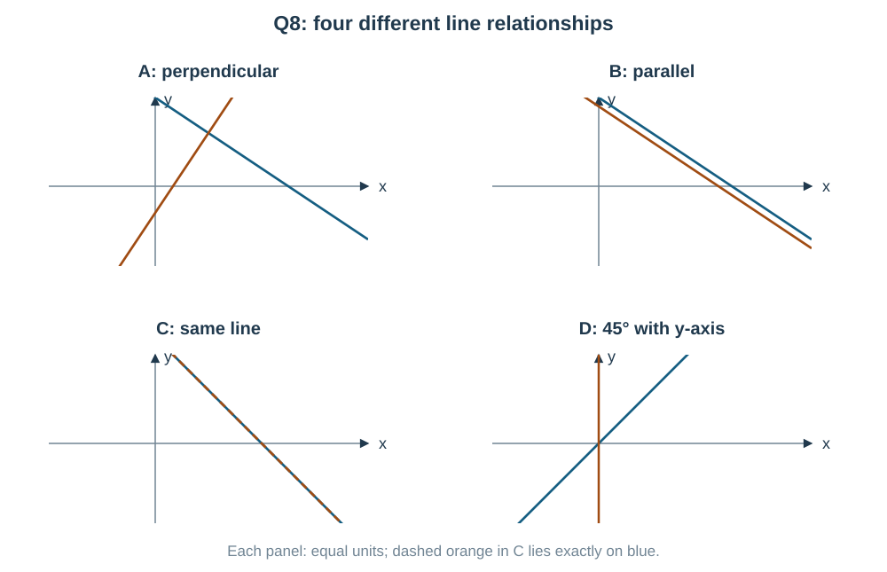

**Important for JEE Main:** coefficient tests are safer when a parameter can make a line vertical. Do not divide by an expression containing that parameter before checking its zero case.

## Concept C05 — The angle between two lines

Two intersecting lines create two supplementary angles: they add to $180^\circ$. Usually “angle between lines” means the smaller angle $\phi$, from $0^\circ$ to $90^\circ$.

For finite slopes,

$$
\boxed{\tan\phi=\left|\frac{m_1-m_2}{1+m_1m_2}\right|}.
$$

If $1+m_1m_2=0$, the angle is $90^\circ$; do not report an undefined angle merely because the tangent formula has zero denominator.

A division-safe vector version uses direction vectors $\mathbf d_1,\mathbf d_2$:

$$
\boxed{\cos\phi=\frac{|\mathbf d_1\cdot\mathbf d_2|}{|\mathbf d_1|\,|\mathbf d_2|}}.
$$

The absolute value chooses the smaller angle between infinite lines. For **rays**, their directions matter; use the actual directed vectors, not an automatic absolute value.

**Pattern:** an angle condition often gives **two** slopes. The lines may tilt in two directions relative to the given line. Keep both until the options or another condition selects one.

## Concept C06 — Intersection, concurrency and a family through one point

An intersection point satisfies both line equations. Solve them together. Three lines are **concurrent** when all three pass through the same finite point.

**Easy route:** find the first two lines' intersection, then substitute it into the third. If the first pair is parallel or coincident, handle that case separately.

For a nonparallel first pair, the determinant condition for three lines is

$$
\begin{vmatrix}
a_1&b_1&c_1\\a_2&b_2&c_2\\a_3&b_3&c_3
\end{vmatrix}=0.
$$

**Condition matters:** zero determinant alone can also describe three parallel lines, so it does not automatically prove a common finite point.

Every proper line through the intersection of two nonparallel lines $L_1=0,L_2=0$ can be written

$$
\lambda L_1+\mu L_2=0,\qquad(\lambda,\mu)\ne(0,0).
$$

The shorter $L_1+kL_2=0$ covers the family except the member $L_2=0$. At the common point both expressions are zero, so any combination stays zero.

**Fixed-point clue:** if a variable family is $kF(x,y)+G(x,y)=0$ for **every** $k$, then a fixed point must satisfy $F=0$ and $G=0$. Trying two convenient values of $k$ is another way to find it; verify the point in the full original family.

## Concept C07 — Distance to a line: shortest or in a chosen direction?

The shortest segment from a point to a line meets it at $90^\circ$. Its endpoint on the line is called the **foot of the perpendicular**.

For $P(x_0,y_0)$ and $ax+by+c=0$,

$$
\boxed{d_\perp=\frac{|ax_0+by_0+c|}{\sqrt{a^2+b^2}}}.
$$

Why divide by $\sqrt{a^2+b^2}$? The numerator is measured along the unnormalized normal $(a,b)$. Dividing by its length converts it into an actual distance. The absolute value makes distance nonnegative. The sign before taking modulus tells which side of an oriented line the point is on.

For **parallel** lines written with the **same** $a,b$,

$$
\boxed{d=\frac{|c_1-c_2|}{\sqrt{a^2+b^2}}}.
$$

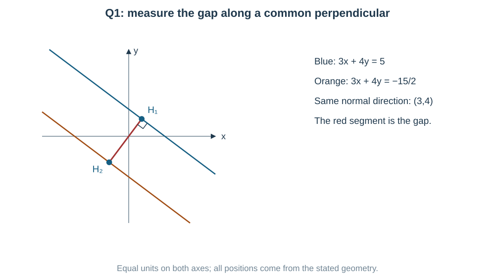

**Different question:** distance measured along a specified unit direction $\mathbf u=(u,v)$ means find where $P+t\mathbf u$ meets the line:

$$
t=-\frac{ax_0+by_0+c}{au+bv},\qquad d_{\mathbf u}=|t|.
$$

This requires $au+bv\ne0$. If it is zero, that direction is parallel to the line, so there is no meeting unless the starting point is already on it.

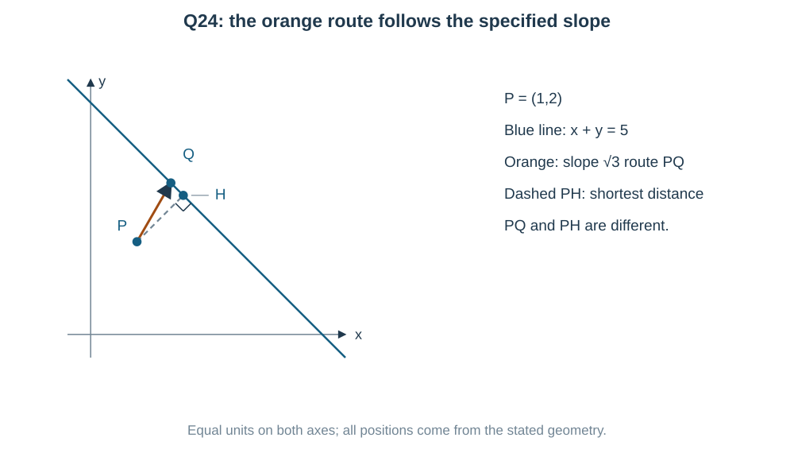

For the same reachable line, $d_{\mathbf u}\ge d_\perp$. Equality occurs when the chosen direction is normal to the line.

## Concept C08 — Projection and reflection use the same perpendicular

Let $D=ax_0+by_0+c$ and $N=a^2+b^2$. Starting at $P$, move along the normal until you reach the line:

$$
\boxed{H=\left(x_0-\frac{aD}{N},\ y_0-\frac{bD}{N}\right)}.
$$

Check: $aH_x+bH_y+c=D-D=0$. Also $P-H$ is parallel to $(a,b)$, so $PH$ is perpendicular to the line.

For the mirror image $P'$, keep moving by the same amount:

$$
\boxed{P'=2H-P
=\left(x_0-\frac{2aD}{N},\ y_0-\frac{2bD}{N}\right)}.
$$

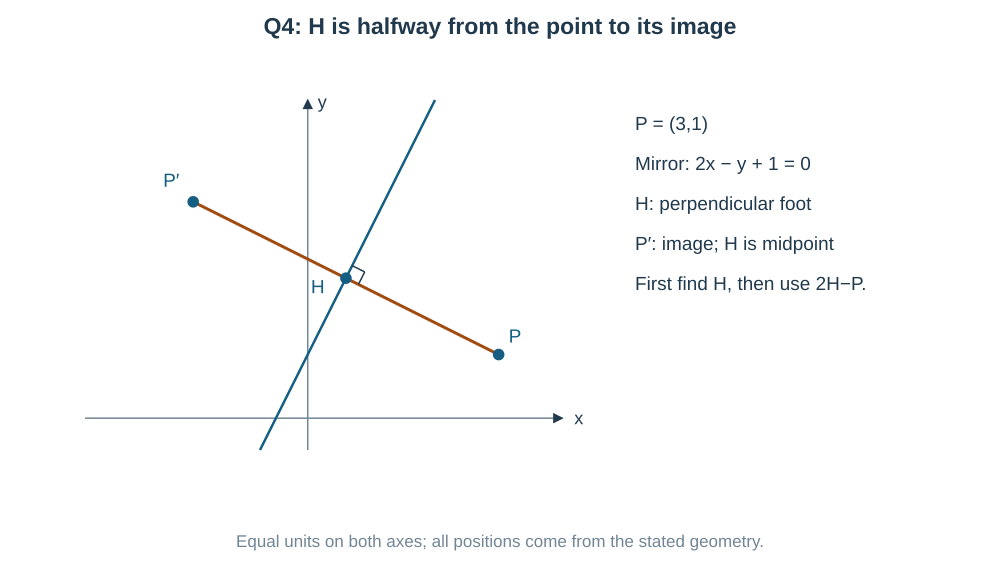

**Meaning before memorizing:** $H$ is the midpoint of $PP'$. Reflection is twice the perpendicular move, not once. Substituting into the foot formula only gives $H$, not the image.

## Concept C09 — Angle bisectors mean equal perpendicular distances

An angle bisector splits an angle into two equal angles. A point on either bisector is equally far from the two lines:

$$
\boxed{\frac{a_1x+b_1y+c_1}{\sqrt{a_1^2+b_1^2}}
=\pm\frac{a_2x+b_2y+c_2}{\sqrt{a_2^2+b_2^2}}}.
$$

This comes from equating **absolute perpendicular distances**, then considering the two sign cases.

Do not memorize “plus means acute” or “minus means origin.” Multiplying one line equation by $-1$ would swap those signs without changing its geometry.

If the desired angle sector contains a test point $P$ not on either line, evaluate the two signed normalized expressions there. Same signs mean their equality is the bisector inside that sector; opposite signs mean their sum is zero. Q13 shows this with the actual origin and an angle-sector diagram.

## Concept C10 — Triangle area and collinearity

For side movements $\mathbf u=B-A=(u_1,u_2)$ and $\mathbf v=C-A=(v_1,v_2)$,

$$
\boxed{\text{triangle area}=\frac12|u_1v_2-u_2v_1|}.
$$

The determinant measures the parallelogram area; the triangle is half of it. Its sign changes if we reverse the vertex order, so use the absolute value for ordinary area.

Equivalently,

$$
\Delta=\frac12|x_1(y_2-y_3)+x_2(y_3-y_1)+x_3(y_1-y_2)|.
$$

Three points are **collinear** when they lie on one straight line. Then the triangle has zero height and hence area zero. The determinant test also works when slopes are undefined.

For axis intercepts $a,b$, the right triangle has perpendicular legs $|a|,|b|$:

$$
\boxed{\Delta=\frac{|ab|}{2}}.
$$

The region $|x|/a+|y|/b\le1$ for $a,b>0$ is a diamond with diagonals $2a,2b$, so its area is $2ab$. Draw all four sign regions; modulus is not an instruction to keep only the first quadrant.

## Concept C11 — Triangle centres: first identify which lines meet

These triangle centres assume three noncollinear vertices. A collapsed triangle does not have the same centre construction.

| Centre | Meaning | How to find it with coordinates |
|---|---|---|
| Centroid $G$ | meeting of medians; a median joins a vertex to the opposite side's midpoint | average the three vertices; each median is divided in ratio $2:1$ from the vertex |
| Orthocentre $H$ | meeting of altitudes; an altitude is perpendicular to the opposite side | intersect two altitudes, using their starting vertices |
| Circumcentre $O_c$ | centre of the circle through all three vertices | intersect two perpendicular bisectors, or solve equal squared distances to the vertices |
| Incentre $I$ | centre of the circle touching all three sides | internal angle bisectors; equal positive distances to the sides |

**A median, an altitude and a perpendicular bisector are different lines.** An altitude starts at a vertex. A perpendicular bisector passes through a side's midpoint.

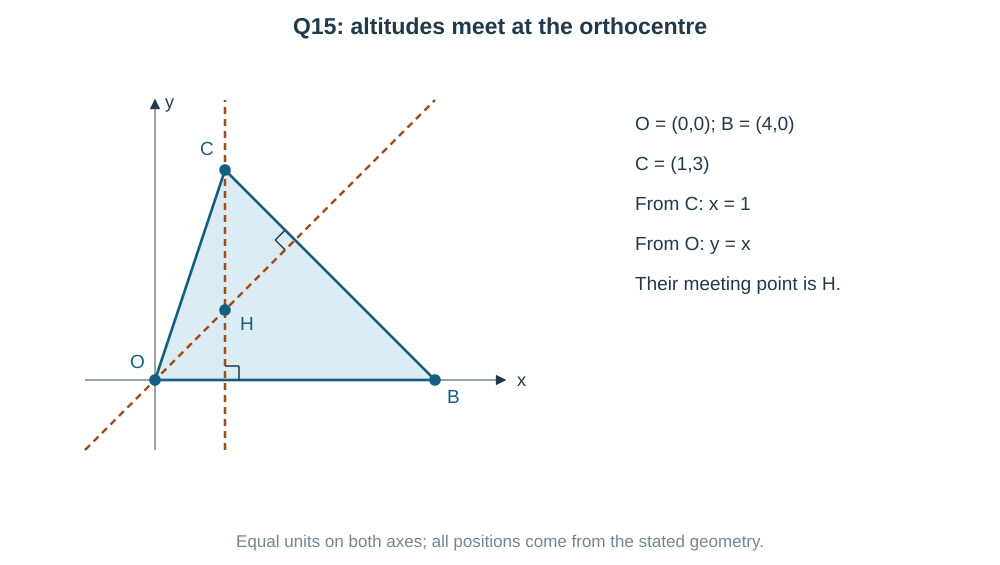

For vertices $A,B,C$ and opposite side lengths $a=BC,b=CA,c=AB$,

$$
I=\frac{aA+bB+cC}{a+b+c},\qquad
r_{\rm in}=\frac{\Delta}{s},\qquad s=\frac{a+b+c}{2}.
$$

$s$ is half the perimeter. The inradius formula follows by dividing the triangle into three smaller triangles, each with height $r_{\rm in}$.

For a right triangle with axis-aligned positive legs $p,q$ and hypotenuse $h$,

$$
r_{\rm in}=\frac{p+q-h}{2}.
$$

Its incentre is $(r_{\rm in},r_{\rm in})$ when the right-angle vertex is the origin and the legs lie on the positive axes.

Useful checks: the circumcentre of a right triangle is its hypotenuse midpoint; its orthocentre is its right-angle vertex. For a non-equilateral triangle,

$$
H=3G-2O_c.
$$

This is a coordinate/vector relation between its centres, useful when two are known. It also holds in the equilateral case, where all three coincide. Do not confuse $O_c$ with the coordinate origin.

**Supporting extra:** for side equations, the circumcentre can be found from squared-distance equalities; subtracting two such equalities cancels $x^2+y^2$ and gives a line. This connects the centre problem to the intersection methods already learned.

## Concept C12 — Locus: find every possible position, then check the reverse

A **locus** is the set of all positions allowed by a rule. Call the moving point $(x,y)$, translate the rule into equations and remove the temporary variables.

For a moving segment with $A=(a,0)$ and $B=(0,b)$:

$$
AB^2=a^2+b^2,\qquad
M=\left(\frac a2,\frac b2\right).
$$

For $AP:PB=2:3$, the section formula gives

$$
P=\left(\frac{3a}{5},\frac{2b}{5}\right).
$$

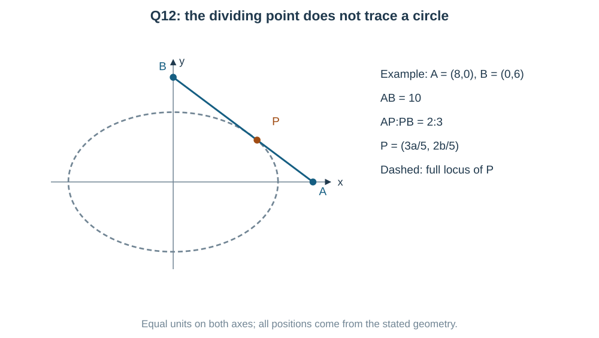

**Why not guess that the locus is a circle?** The endpoint contributions are weighted differently, so the horizontal and vertical ranges differ. Eliminating $a,b$ will reveal an ellipse.

**Important check:** algebra may add points where the original construction is impossible. If you multiply by $xy$, return to $x=0$ and $y=0$ afterwards. Q30's polynomial contains the origin, but the required nonzero axis-intercept segment cannot have that midpoint.

To prove a locus is complete, also go backwards: from an allowed $(x,y)$ satisfying the derived equation, reconstruct endpoints or parameters and check the original rule.

## Concept C13 — Minimum area: use the constraint before differentiating

For positive numbers $u,v$,

$$
\boxed{u+v\ge2\sqrt{uv}},
$$

with equality exactly when $u=v$. This is AM–GM: it follows from $(\sqrt u-\sqrt v)^2\ge0$.

If a line passes through a positive point $(p,q)$ and has positive intercepts $a,b$, then

$$
\frac pa+\frac qb=1.
$$

AM–GM gives

$$
1\ge2\sqrt{\frac{pq}{ab}}
\quad\Longrightarrow\quad
ab\ge4pq,\qquad
\boxed{\Delta_{\min}=2pq}.
$$

Equality requires $p/a=q/b=1/2$, so $a=2p,b=2q$. The fixed point is then the intercept segment's midpoint.

**Important for JEE Main:** this shortcut needs $p,q,a,b>0$. It is useful for minimum-area axis triangles. Without those sign conditions, the same inequality argument is not justified.

**Cauchy–Schwarz is also important for JEE Main:** for real $a,b,u,v$,

$$
\boxed{(au+bv)^2\le(a^2+b^2)(u^2+v^2)}.
$$

The difference is $(av-bu)^2\ge0$. Equality means $(u,v)$ is along $(a,b)$, including the appropriate zero cases.

For a unit direction, $u^2+v^2=1$, so $|au+bv|\le\sqrt{a^2+b^2}$. In the directed-distance formula from C07, this proves $d_{\mathbf u}\ge d_\perp$. **Meaning:** the normal direction gives the shortest route to the line. This connects an inequality, a vector projection and a geometric distance.

## Concept C14 — Reflection turns a bent path into a straight path

Across the $x$-axis, $(x,y)$ reflects to $(x,-y)$. For any point $P$ on the axis, $PA=PA'$, where $A'$ is the reflection of $A$.

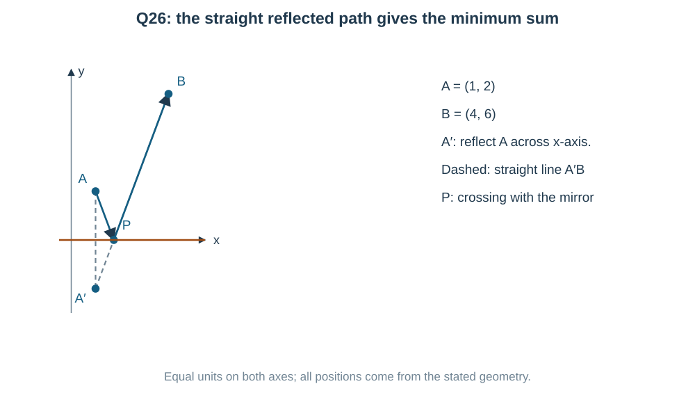

If $A,B$ are above the axis and $A'$ is below it,

$$
PA+PB=PA'+PB\ge A'B.
$$

This is the triangle inequality: a bent route cannot be shorter than the direct segment. Equality occurs when $A',P,B$ lie in that order on one straight segment. It meets the mirror because the endpoints are on opposite sides.

For a light ray, the angle of incidence equals the angle of reflection, each measured from the **normal** to the mirror. Reflecting one endpoint makes the incoming and outgoing pieces line up. Draw the actual ray arrows; extending a line without its direction can select the wrong point.

**When it helps:** a shortest sum of two distances via a straight mirror, or a reflected ray between two given points. If a mirror segment is restricted, check that the straight-path crossing lies on that allowed segment; otherwise an endpoint can be the minimum.

## Concept C15 — Shift the origin without moving the point

If the new origin is the old point $(h,k)$ and the axes keep the same direction, then

$$
\boxed{x=X+h,\quad y=Y+k},
\qquad
X=x-h,\quad Y=y-k.
$$

Capital letters describe coordinates measured from the **new** origin. The physical point stays in the same place.

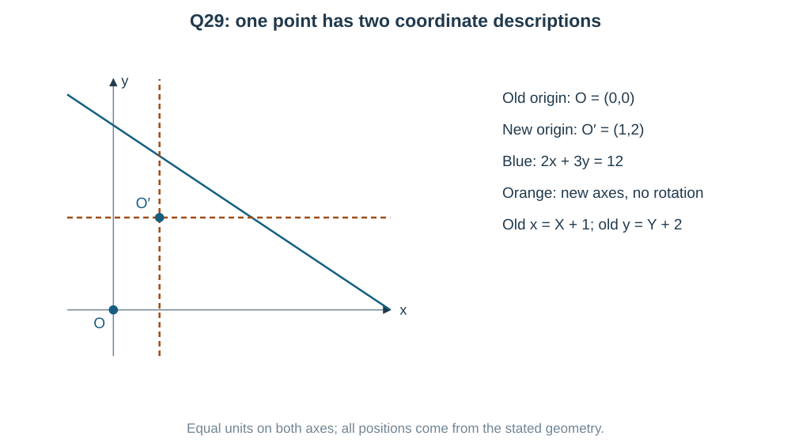

For example, the new origin itself has $(X,Y)=(0,0)$ but old coordinates $(x,y)=(h,k)$. This quick check tells you which signs to use. Substitute the old coordinates in terms of the new into the original equation.

## Last-minute formula recap

| Need | Recall | Essential condition |
|---|---|---|
| Distance $AB$ | $\sqrt{(\Delta x)^2+(\Delta y)^2}$ | actual coordinate differences |
| Internal section $AP:PB=m:n$ | $(nA+mB)/(m+n)$ | opposite weights |
| Slope | $\Delta y/\Delta x=\tan\theta$ | nonvertical |
| Point and slope | $y-y_1=m(x-x_1)$ | check vertical possibility |
| Axis intercepts | $x/a+y/b=1$ | $a,b\ne0$ |
| Direction/normal | $(b,-a)$ / $(a,b)$ for $ax+by+c=0$ | $(a,b)\ne(0,0)$ |
| Perpendicular lines | $a_1a_2+b_1b_2=0$ | works for vertical/horizontal |
| Parallel directions | $a_1b_2-a_2b_1=0$ | full coefficient multiples mean same line |
| Smaller angle | $\tan\phi=|(m_1-m_2)/(1+m_1m_2)|$ | zero denominator means $90^\circ$ |
| Family through intersection | $\lambda L_1+\mu L_2=0$ | proper line; first pair nonparallel |
| Perpendicular distance | $|ax_0+by_0+c|/\sqrt{a^2+b^2}$ | shortest distance |
| Parallel gap | $|c_1-c_2|/\sqrt{a^2+b^2}$ | same normalized $a,b$ |
| Foot $H$ | $P-D(a,b)/(a^2+b^2)$ | $D=ax_0+by_0+c$ |
| Image | $2H-P$ | foot is only halfway |
| Directed distance | $|D/(au+bv)|$ | $(u,v)$ unit; denominator nonzero |
| Bisectors | $L_1/\|\mathbf n_1\|=\pm L_2/\|\mathbf n_2\|$ | select angle sector by signs |
| Triangle area | $\tfrac12|\Delta x_1\Delta y_2-\Delta y_1\Delta x_2|$ | side movements from one vertex |
| Centroid / circumcentre / orthocentre | vertex average / equal vertex distances / intersect altitudes | do not interchange meanings |
| Inradius | $r=\Delta/s$ | $s$ half perimeter |
| Minimum positive-intercept triangle through $(p,q)$ | $\Delta_{\min}=2pq$, at $a=2p,b=2q$ | all quantities positive |
| Cauchy–Schwarz | $(au+bv)^2\le(a^2+b^2)(u^2+v^2)$ | equality for parallel vectors |
| Reflected shortest path | $PA+PB\ge A'B$ | equality crossing must be allowed |
| Origin shift | $x=X+h,\ y=Y+k$ | no rotation |

**Before calculating:** identify the point, the direction and what “distance”, “angle” or “locus” means in that question. Check the original construction after eliminating parameters.

## Worked solutions to the 30 PDF questions

Read the question first. Notice the pattern, choose a route, then calculate. Alternative methods below are fully visible.

### Question 1 — Match the coefficients before measuring the gap

**PDF page 81 | MCQ | Notes: C07**

The distance between the parallel lines $3x+4y-5=0$ and $6x+8y+15=0$ is

- (a) $\dfrac32$
- (b) $2$
- (c) $\dfrac52$
- (d) $\dfrac72$

**First make the two normal directions identical.** The second equation has twice the $x,y$ coefficients. Divide its **whole equation** by 2:

$$
3x+4y-5=0,\qquad 3x+4y+\frac{15}{2}=0.
$$

Their shortest separation is along their common normal $(3,4)$, whose length is 5:

$$
d=\frac{|15/2-(-5)|}{\sqrt{3^2+4^2}}
=\frac{25/2}{5}
=\boxed{\frac52;\quad\text{(c)}}.
$$

**Why subtracting 15 and $-5$ immediately is wrong:** those constants belonged to differently scaled equations. Line equations can be multiplied by a number without moving the line, so their scale must match first.

**Another check:** the points $H_1=(3/5,4/5)$ and $H_2=(-9/10,-6/5)$ lie on the respective lines. Their difference is $(3/2,2)$ along the normal, with length $5/2$.

---

### Question 2 — Equal intercepts mean the same number on both axes

**PDF page 81 | Numerical value | Notes: C03,C10**

A line through $(2,3)$ makes equal non-zero intercepts on the coordinate axes. The area (in square units) of the triangle it forms with the axes is ____.

**What do equal intercepts mean?** The line joins $A(a,0)$ and $B(0,a)$. Its equation is $x/a+y/a=1$, hence $x+y=a$.

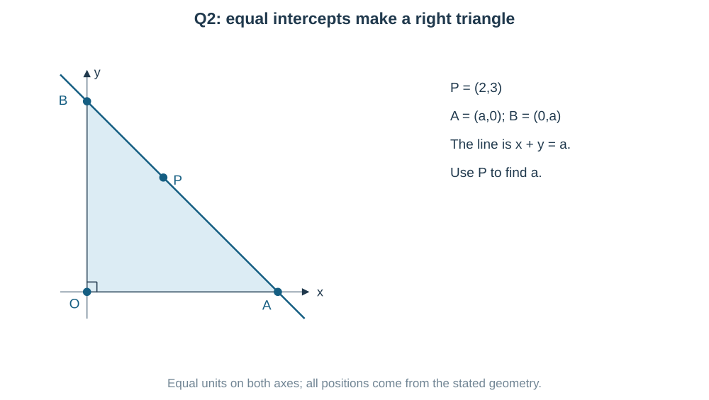

The point $(2,3)$ lies on it, so $a=2+3=5$. The two perpendicular legs along the axes both have length 5:

$$
\Delta=\frac12\cdot5\cdot5=\boxed{12.5\ \text{square units}}.
$$

**Check:** $x+y=5$ passes through $(2,3)$ and cuts the axes at $(5,0),(0,5)$.

**Another possible route:** equal positive-direction intercept coordinates give slope $-1$. Through $(2,3)$ this gives $y-3=-(x-2)$, hence the same $x+y=5$. The intercept form is shorter because it uses the given condition directly.

---

### Question 3 — A slope is the tangent of a line angle

**PDF page 81 | MCQ | Notes: C02,C05**

The acute angle between the lines $y=\sqrt3x+1$ and $y=\dfrac{x}{\sqrt3}-2$ is

- (a) $15^\circ$
- (b) $45^\circ$
- (c) $60^\circ$
- (d) $30^\circ$

**Read each slope as an angle with the horizontal.** $\tan60^\circ=\sqrt3$ and $\tan30^\circ=1/\sqrt3$. The constants $+1,-2$ move the lines without changing their directions.

So the acute angle is

$$
\boxed{60^\circ-30^\circ=30^\circ;\quad\text{(d)}}.
$$

**Another possible approach — the angle formula:**

$$
\tan\phi
=\left|\frac{\sqrt3-1/\sqrt3}{1+\sqrt3(1/\sqrt3)}\right|
=\frac1{\sqrt3}.
$$

For an acute angle this gives $\phi=30^\circ$. Subtracting the slopes themselves would not subtract the angles; slope is the **tangent** of the angle.

---

### Question 4 — The mirror line bisects the joining segment at a right angle

**PDF page 81 | MCQ | Notes: C08**

The image (reflection) of the point $(3,1)$ in the line $2x-y+1=0$ is

- (a) $\left(\dfrac95,-\dfrac{17}5\right)$
- (b) $\left(-\dfrac95,\dfrac{17}5\right)$
- (c) $\left(-\dfrac{17}5,\dfrac95\right)$
- (d) $\left(\dfrac35,\dfrac{11}5\right)$

**Picture first:** the mirror line passes through the midpoint $H$ of $PP'$, and $PP'$ is perpendicular to it. We need the full reflected point, not just the foot.

For $P=(3,1)$, $a=2,b=-1,c=1$:

$$
D=2(3)-1+1=6,\qquad a^2+b^2=5.
$$

The foot is

$$
H=(3,1)-\frac65(2,-1)=\left(\frac35,\frac{11}5\right).
$$

Continue the same perpendicular move once more:

$$
P'=2H-P
=\left(\frac65-3,\frac{22}5-1\right)
=\boxed{\left(-\frac95,\frac{17}5\right);\quad\text{(b)}}.
$$

**Check:** $2H_x-H_y+1=6/5-11/5+1=0$. Also $P'-P=(-24/5,12/5)$ is parallel to $(2,-1)$, the mirror's normal.

**Another possible approach:** among the options, test which point has its midpoint with $P$ on the mirror **and** its joining direction normal to the mirror. Testing only equal distances is insufficient: many points share a distance from a line.

---

### Question 5 — Concurrent means one common point

**PDF page 81 | MCQ | Notes: C06**

If the lines $x+2y-3=0$, $2x-y+4=0$ and $3x+ky+7=0$ are concurrent, then $k=$

- (a) $2$
- (b) $-2$
- (c) $-4$
- (d) $4$

**Concurrent means one common point.** The first two equations have no $k$, so use them to find that point before working with the third.

$$
x+2y=3,\qquad 2x-y=-4.
$$

Double the first and subtract the second: $5y=10$, so $y=2$ and $x=-1$.

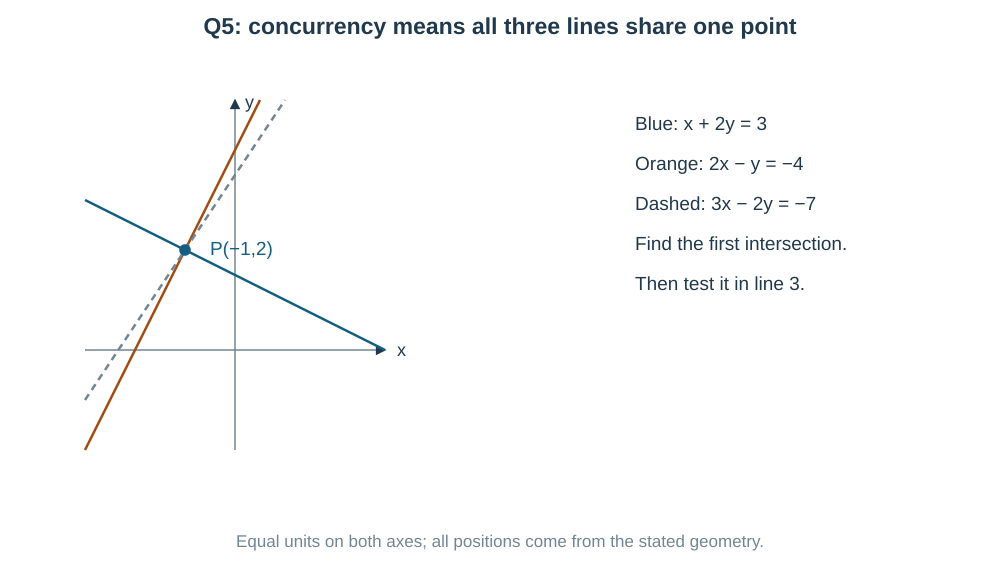

The third must pass through $(-1,2)$:

$$
3(-1)+2k+7=0
\quad\Longrightarrow\quad
2k+4=0
\quad\Longrightarrow\quad
\boxed{k=-2;\quad\text{(b)}}.
$$

**Check:** the three left sides at $(-1,2)$ are $0,0,0$ for $k=-2$.

**Another possible approach:** set the $3\times3$ coefficient determinant to zero. That is valid here because the first two lines are nonparallel. Solving their point first needs less expansion and makes the meaning of concurrency visible.

---

### Question 6 — Use two side movements to get triangle area

**PDF page 81 | MCQ | Notes: C01,C10**

The area (in square units) of the triangle with vertices $(-2,3)$, $(4,-1)$ and $(6,5)$ is

- (a) $11$
- (b) $33$
- (c) $44$
- (d) $22$

**Area needs two side movements from the same starting point.** Let $A=(-2,3)$, $B=(4,-1)$, $C=(6,5)$.

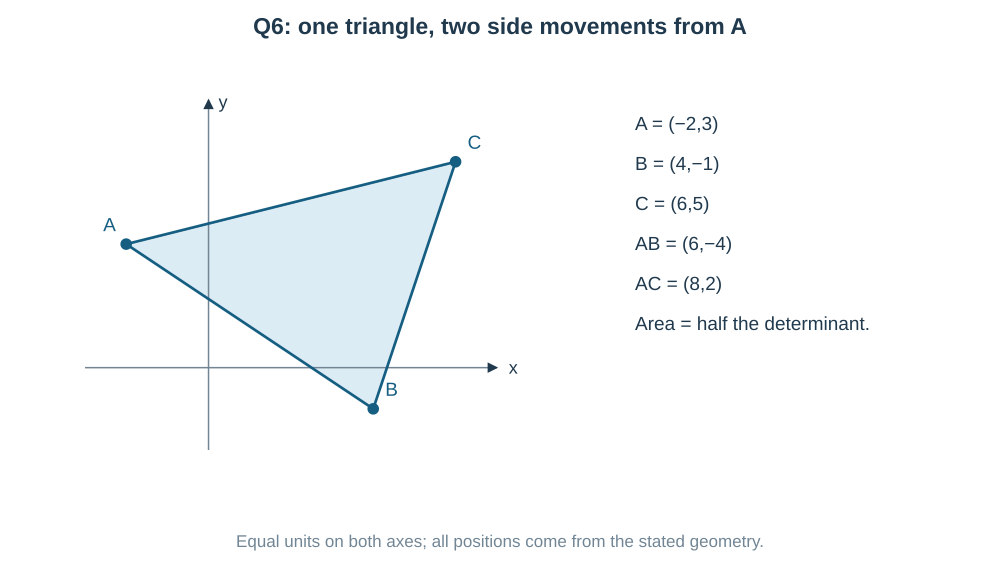

$$
\overrightarrow{AB}=(4+2,-1-3)=(6,-4),\qquad
\overrightarrow{AC}=(6+2,5-3)=(8,2).
$$

Their determinant is the signed parallelogram area. Take half its absolute value:

$$
\Delta=\frac12|6(2)-(-4)(8)|
=\frac12|12+32|
=\boxed{22;\quad\text{(d)}}.
$$

**Another possible approach — base times perpendicular height:** $AB=\sqrt{52}=2\sqrt{13}$, and its line is $2x+3y-5=0$. The distance of $C$ from it is

$$
h=\frac{|12+15-5|}{\sqrt{13}}=\frac{22}{\sqrt{13}}.
$$

Thus $\Delta=\tfrac12(2\sqrt{13})(22/\sqrt{13})=22$. This checks the determinant and connects it to the familiar area formula.

---

### Question 7 — Same line and parallel distinct are different cases

**PDF page 81 | MCQ | Notes: C04**

Statement I: The lines $x+2y=3$ and $2x+4y=6$ are parallel and distinct.

Statement II: Lines $a_1x+b_1y+c_1=0$ and $a_2x+b_2y+c_2=0$ coincide if $\dfrac{a_1}{a_2}=\dfrac{b_1}{b_2}=\dfrac{c_1}{c_2}$.

Choose the correct option.

- (a) Statement I is true but Statement II is false
- (b) Both Statement I and Statement II are true
- (c) Statement I is false but Statement II is true
- (d) Both Statement I and Statement II are false

**Do not confuse same direction with two different lines.**

$$
2x+4y=6\quad\Longrightarrow\quad x+2y=3.
$$

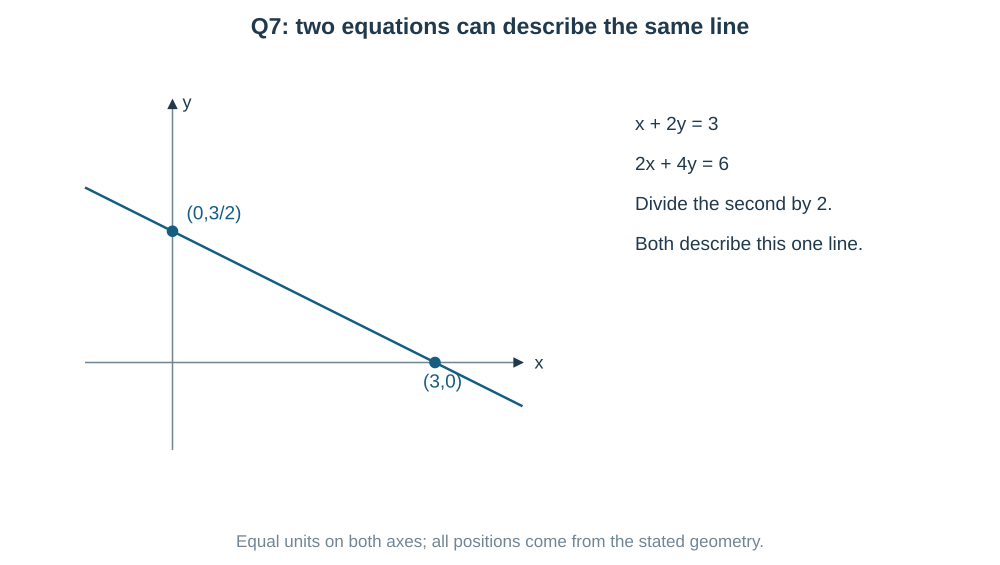

Both equations describe exactly the same line. Statement I says “parallel and distinct,” so it is **false**.

Statement II says all three coefficients have the same ratio. With its ratios defined and proper line equations, this means one whole equation is a nonzero multiple of the other. They coincide, so Statement II is **true**.

$$
\boxed{\text{I false, II true;\quad (c)}}.
$$

**Safe general version:** compare scalar multiples of $(a,b,c)$. For example, $x=3$ and $2x=6$ coincide, even though trying to divide their zero $y$ coefficients would give $0/0$. The geometric rule still works.

---

### Question 8 — Match directions and constant multiples

**PDF page 82 | MCQ | Notes: C04,C05**

Match List I (pair of lines) with List II (relation).

| List I | Pair | List II | Relation |
|---|---|---|---|
| A | $2x+3y=5$ and $3x-2y=1$ | P | Coincident |
| B | $2x+3y=5$ and $4x+6y=9$ | Q | Meet at an angle of $45^\circ$ |
| C | $x+y=2$ and $2x+2y=4$ | R | Parallel and distinct |
| D | $y=x$ and the $y$-axis | S | Perpendicular |

- (a) A–S, B–R, C–P, D–Q
- (b) A–R, B–S, C–P, D–Q
- (c) A–S, B–P, C–R, D–Q
- (d) A–Q, B–R, C–P, D–S

**Match the geometry, not just one coefficient.**

**A:** normals $(2,3)$ and $(3,-2)$ have dot product $6-6=0$. The lines are perpendicular: **S**.

**B:** divide $4x+6y=9$ by 2 to get $2x+3y=9/2$. It has the same normal as $2x+3y=5$, but a different constant. Parallel and distinct: **R**.

**C:** $2x+2y=4$ is twice $x+y=2$. Same line: **P**.

**D:** $y=x$ makes $45^\circ$ with the horizontal and therefore also $45^\circ$ with the vertical $y$-axis: **Q**.

$$
\boxed{\text{A–S,\ B–R,\ C–P,\ D–Q;\quad (a)}}.
$$

**Check the vertical case:** D cannot be handled by multiplying two finite slopes because the $y$-axis has no finite slope. The angle picture handles it directly.

---

### Question 9 — Build the line before measuring its perpendicular distance

**PDF page 82 | Numerical value | Notes: C03,C07**

The perpendicular distance of the point $(2,-3)$ from the line passing through $(1,1)$ and $(4,5)$ is ____ units.

**We need distance to a line, but the line is supplied by two points.** Build its equation first.

From $A=(1,1)$ to $B=(4,5)$ the movement is $(3,4)$. A perpendicular normal is $(4,-3)$:

$$
4(x-1)-3(y-1)=0
\quad\Longrightarrow\quad 4x-3y-1=0.
$$

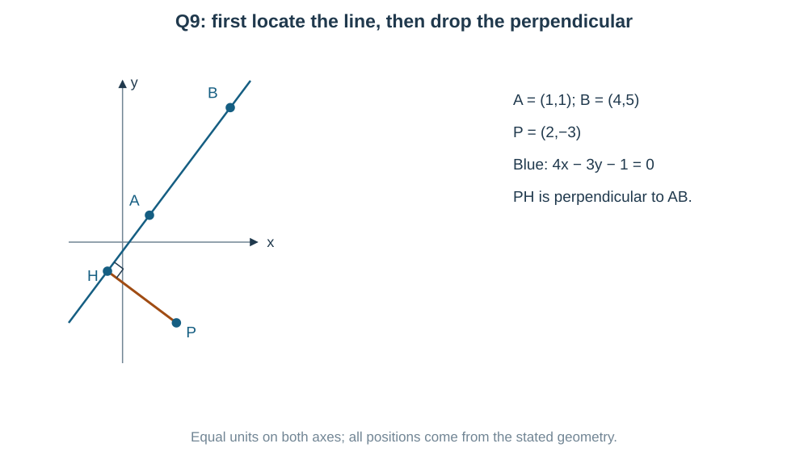

For $P=(2,-3)$,

$$
d=\frac{|4(2)-3(-3)-1|}{\sqrt{4^2+(-3)^2}}
=\frac{16}{5}
=\boxed{3.2}.
$$

**Check:** the foot is $H=(-14/25,-27/25)$. It satisfies $4H_x-3H_y-1=0$, and $P-H=(64/25,-48/25)$ is along the normal.

**Another possible approach:** the area of triangle $APB$ is $\tfrac12|(1,-4)\times(3,4)|=8$. Since $AB=5$, the height from $P$ is $2\Delta/AB=16/5$. Here the two-dimensional cross notation means the determinant, not a new in-plane vector.

---

### Question 10 — One point and one direction fix the required line

**PDF page 82 | MCQ | Notes: C04,C06**

The line through the intersection of $2x+y-5=0$ and $x-y+2=0$ and perpendicular to $3x+4y=7$ is

- (a) $4x-3y+5=0$
- (b) $4x+3y-13=0$
- (c) $3x+4y-15=0$
- (d) $3x-4y+9=0$

**The question gives two pieces:** a point to pass through, and a perpendicular direction. Find them separately.

Solve $2x+y=5$ and $x-y=-2$. Adding gives $3x=3$, so the point is $P=(1,3)$.

The reference line has normal $(3,4)$. A line perpendicular to it can use normal $(4,-3)$:

$$
4(x-1)-3(y-3)=0
\quad\Longrightarrow\quad
\boxed{4x-3y+5=0;\quad\text{(a)}}.
$$

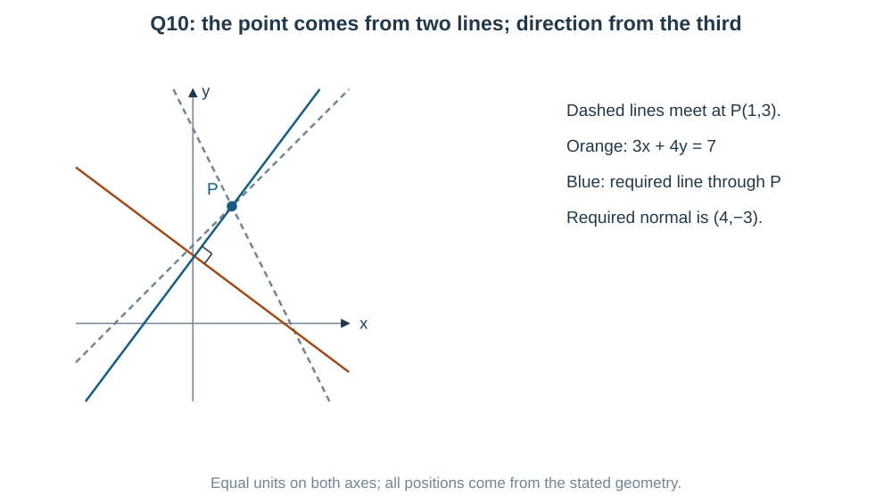

**Check:** at $(1,3)$ it gives $4-9+5=0$. The normal dot product is $3(4)+4(-3)=0$.

**Another possible approach — line family:**

$$
(2x+y-5)+\lambda(x-y+2)=0.
$$

Its normal is $(2+\lambda,1-\lambda)$. Perpendicularity to the reference normal requires $3(2+\lambda)+4(1-\lambda)=0$, so $\lambda=10$. The equation becomes $12x-9y+15=0$, the same answer.

---

### Question 11 — A ratio of intercepts is not a ratio of coefficients

**PDF page 82 | Numerical value | Notes: C03,C10**

A line through $(4,3)$ cuts the axes at intercepts in the ratio $2:3$ (both positive). The area (in square units) of the triangle formed with the axes is ____.

**The ratio is about intercept lengths.** Write the positive intercepts as $a=2k,b=3k$, with $k>0$.

$$
\frac{x}{2k}+\frac{y}{3k}=1.
$$

The point $(4,3)$ gives

$$
\frac4{2k}+\frac3{3k}=1
\quad\Longrightarrow\quad \frac3k=1
\quad\Longrightarrow\quad k=3.
$$

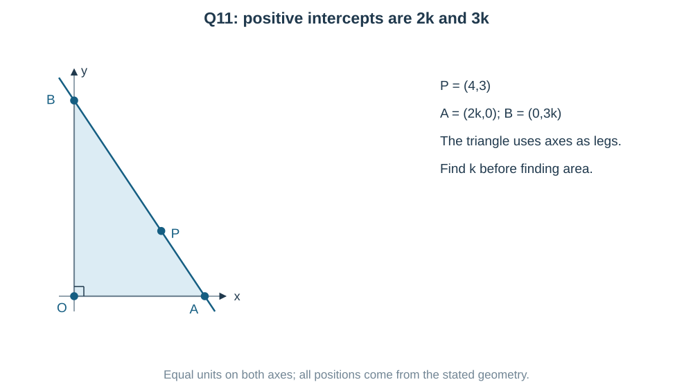

So the intercepts are 6 and 9:

$$
\boxed{\Delta=\frac12(6)(9)=27}.
$$

**Check:** $4/6+3/9=2/3+1/3=1$.

**Why setting the equation coefficients in ratio $2:3$ is wrong:** in $x/a+y/b=1$, the coefficients are $1/a,1/b$. Their ratio is the reverse intercept ratio.

---

### Question 12 — Write the moving endpoints before finding the locus

**PDF page 82 | MCQ | Notes: C01,C12**

A line segment $AB$ of length $10$ moves with $A$ on the $x$-axis and $B$ on the $y$-axis. The locus of the point $P$ on $AB$ with $AP:PB=2:3$ is

- (a) $9x^2+4y^2=144$
- (b) $4x^2+9y^2=144$
- (c) $4x^2+9y^2=36$
- (d) $x^2+y^2=100$

**A locus needs coordinates for the moving objects.** Let $A=(a,0)$, $B=(0,b)$. The rod's fixed length gives

$$
a^2+b^2=100.
$$

Because $AP:PB=2:3$, $P$ is $2/5$ of the way from $A$ to $B$:

$$
P=\frac{3A+2B}{5}
=\left(\frac{3a}{5},\frac{2b}{5}\right).
$$

Call $P=(x,y)$. Then $a=5x/3,b=5y/2$. Substitute into the fixed-length rule:

$$
\frac{25x^2}{9}+\frac{25y^2}{4}=100
\quad\Longrightarrow\quad
\boxed{4x^2+9y^2=144;\quad\text{(b)}}.
$$

**Visual check:** $|x|\le6$, $|y|\le4$, so the locus has different horizontal and vertical ranges. A circle would give equal ranges.

**Reverse check:** every point on this ellipse gives $a=5x/3,b=5y/2$ with $a^2+b^2=100$. Those endpoints reconstruct a valid rod and the required dividing point. No positive-quadrant restriction was given, so retain the full ellipse.

---

### Question 13 — Choose the angle sector before choosing a bisector sign

**PDF page 82 | MCQ | Notes: C09**

The equation of the bisector of the angle between the lines $3x-4y+7=0$ and $12x+5y-2=0$ that contains the origin is

- (a) $21x+77y-101=0$
- (b) $11x-3y+9=0$
- (c) $11x+3y+9=0$
- (d) $99x-27y-81=0$

**An angle bisector means equal perpendicular distances.** First normalize the two line expressions:

$$
f_1=\frac{3x-4y+7}{5},\qquad
f_2=\frac{12x+5y-2}{13}.
$$

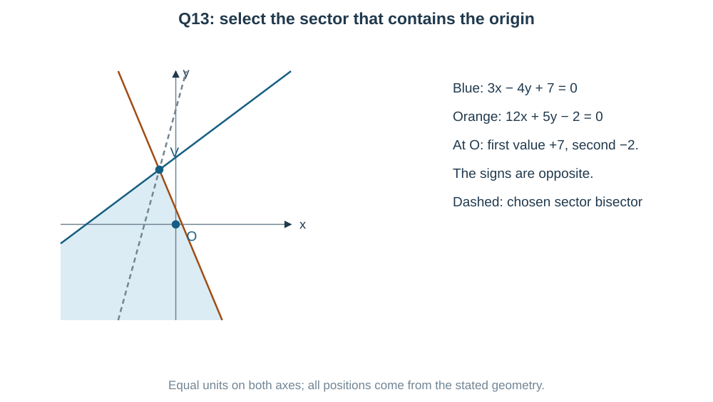

At the origin, $f_1=7/5>0$ but $f_2=-2/13<0$. The origin lies in the sector where the expressions have **opposite signs**. Equal distances within that sector therefore mean $f_1=-f_2$:

$$
13(3x-4y+7)+5(12x+5y-2)=0.
$$

Expand only now:

$$
99x-27y+81=0
\quad\Longrightarrow\quad
\boxed{11x-3y+9=0;\quad\text{(b)}}.
$$

**Check:** its direction bisects the two boundary rays of the shaded angle sector. It need not pass through the origin; the **angle sector**, not the bisector, contains the origin.

**Another view:** the other bisector comes from $f_1=f_2$ and is $21x+77y-101=0$, option (a). That line bisects the other pair of sectors. Equal distances alone give two lines; the origin condition tells us which one to select.

---

### Question 14 — A slope parameter misses vertical lines

**PDF page 82 | Numerical value | Notes: C02,C07**

The number of straight lines through $(2,3)$ whose perpendicular distance from the origin is $2$ is ____.

**A drawing helps us count what a slope formula could miss.** Lines at distance 2 from the origin touch the circle $x^2+y^2=4$. We want those passing through $(2,3)$.

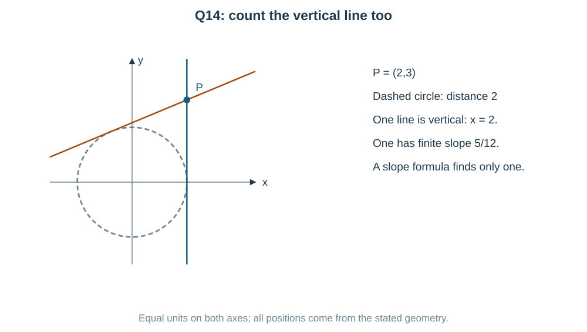

First check the vertical line: $x=2$ passes through $(2,3)$ and is 2 units from the origin. It counts.

Every nonvertical candidate is

$$
y-3=m(x-2)
\quad\Longrightarrow\quad
mx-y+3-2m=0.
$$

Its distance condition is

$$
\frac{|3-2m|}{\sqrt{m^2+1}}=2
\quad\Longrightarrow\quad
9-12m+4m^2=4m^2+4.
$$

Thus $m=5/12$, giving one additional line. Its constant term is $3-2m=13/6$, so substitution checks the positive distance 2.

$$
\boxed{\text{number of lines}=1+1=2}.
$$

**Another view:** $(2,3)$ is outside the radius-2 circle because its distance from the origin is $\sqrt{13}>2$. Two tangents can be drawn from it. The algebra above finds both, including the vertical one.

---

### Question 15 — An altitude starts at a vertex and is perpendicular to the opposite side

**PDF page 82 | MCQ | Notes: C11**

The orthocentre of the triangle with vertices $(0,0)$, $(4,0)$ and $(1,3)$ is

- (a) $(1,1)$
- (b) $(2,1)$
- (c) $(1,2)$
- (d) $\left(\dfrac53,1\right)$

**What is the orthocentre?** It is where the altitudes meet. An altitude starts at a vertex and is perpendicular to the opposite side.

The side from $(0,0)$ to $(4,0)$ is horizontal. The altitude from $(1,3)$ is vertical:

$$
x=1.
$$

The opposite side from $(4,0)$ to $(1,3)$ has slope $(3-0)/(1-4)=-1$. The altitude from $(0,0)$ has slope 1:

$$
y=x.
$$

Their intersection is

$$
\boxed{H=(1,1);\quad\text{(a)}}.
$$

**Check with the third altitude:** the side joining $(0,0),(1,3)$ has slope 3. The line from $(4,0)$ to $H$ has slope $(1-0)/(1-4)=-1/3$. Their product is $-1$, as required.

The centroid would be $(5/3,1)$, option (d). Averaging vertices finds a different centre, so the definition must come before the calculation.

---

### Question 16 — The line must have positive intercepts before minimizing area

**PDF page 83 | Numerical value | Notes: C13**

A variable line through $(1,2)$ meets the positive axes at $A$ and $B$. The minimum area (in square units) of triangle $OAB$ is ____.

**Area depends on two intercepts, but they are linked.** Let $A=(a,0)$, $B=(0,b)$ with $a,b>0$. Passing through $(1,2)$ means

$$
\frac1a+\frac2b=1.
$$

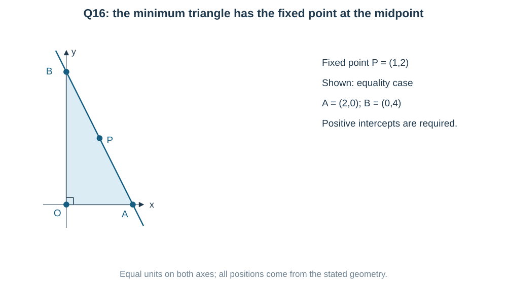

We need to minimize $ab/2$. Both fractions are positive, so AM–GM applies:

$$
1=\frac1a+\frac2b
\ge2\sqrt{\frac2{ab}}
\quad\Longrightarrow\quad ab\ge8.
$$

Hence $\Delta\ge4$. Equality occurs when $1/a=2/b=1/2$, giving $a=2,b=4$. These are valid positive intercepts through the given point, so the bound is attained:

$$
\boxed{\Delta_{\min}=4}.
$$

**Another possible approach — calculus:** $b=2a/(a-1)$ with $a>1$, so $\Delta=a^2/(a-1)$. Then

$$
\Delta'=\frac{a(a-2)}{(a-1)^2}.
$$

It is negative for $1<a<2$ and positive for $a>2$, so the minimum is at $a=2$, again 4. AM–GM is shorter here because the two positive reciprocal terms already add to 1.

---

### Question 17 — Unfold the reflected ray into a straight line

**PDF page 83 | MCQ | Notes: C14**

A ray of light from $(-1,2)$ strikes the $x$-axis and after reflection passes through $(5,4)$. The point of incidence is

- (a) $(2,0)$
- (b) $(3,0)$
- (c) $(1,0)$
- (d) $\left(\dfrac12,0\right)$

**Unfold the reflection.** Reflect the source $A=(-1,2)$ across the mirror $y=0$ to $A'=(-1,-2)$. A straight line from $A'$ to $B=(5,4)$ crosses the mirror at the required point.

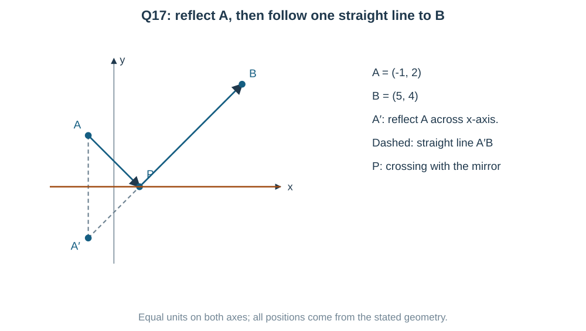

The slope of $A'B$ is

$$
\frac{4-(-2)}{5-(-1)}=1.
$$

Its line is $y+2=x+1$, or $y=x-1$. At the mirror $y=0$, $x=1$. Thus

$$
\boxed{P=(1,0);\quad\text{(c)}}.
$$

**Why this works:** $A$ and $A'$ make equal angles on opposite sides of the mirror. Straightness of $A'PB$ therefore gives equal incidence and reflection angles, measured from the vertical normal.

**Another check with directions:** incoming direction $P-A=(2,-2)$ becomes $(2,2)$ after reversing its vertical component. The outgoing direction $B-P=(4,4)$ is a positive multiple of $(2,2)$. This checks the ray direction as well as the line.

---

### Question 18 — Separate the changing coefficient from the fixed part

**PDF page 83 | MCQ | Notes: C06**

For every real $k$, the line $(2k+1)x+(k-3)y+(7-k)=0$ passes through the fixed point

- (a) $(2,-3)$
- (b) $(-2,3)$
- (c) $(3,-2)$
- (d) $(1,-2)$

**Source warning:** the printed equation and printed worked solution use different signs. For the question **as printed**, none of the four options is correct.

**Notice the repeated parameter $k$.** Group its terms carefully:

$$
(2k+1)x+(k-3)y+(7-k)
=k(2x+y-1)+(x-3y+7).
$$

A point fixed for **every** $k$ must make both brackets zero:

$$
2x+y-1=0,\qquad x-3y+7=0.
$$

From $y=1-2x$,

$$
x-3(1-2x)+7=0
\quad\Longrightarrow\quad7x+4=0.
$$

Thus

$$
\boxed{(x,y)=\left(-\frac47,\frac{15}7\right);\quad\text{no listed option}}.
$$

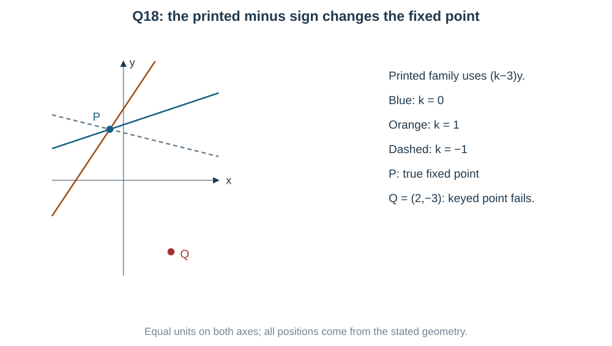

**Direct original-equation check:**

$$
(2k+1)\left(-\frac47\right)
+(k-3)\frac{15}7+(7-k)
=\frac{-8k-4+15k-45+49-7k}{7}=0.
$$

**Why the source gives (a):** its working changes $x-3y+7$ into $x+3y+7$. That corresponds to **$(k+3)y$**, and that different family does have fixed point $(2,-3)$. In the printed family, $(2,-3)$ gives 18 for every $k$, never zero.

**Another possible approach:** take $k=0$ and $k=1$ in the printed family. Intersect $x-3y+7=0$ with $3x-2y+6=0$ to get the same point. Then check it in the full family as above. Two members suggest the candidate; the full check proves it works for every $k$.

---

### Question 19 — Absolute values create four straight boundary pieces

**PDF page 83 | Numerical value | Notes: C10,C12**

The area (in square units) of the region enclosed by $|x|+|y|=4$ is ____.

**What does the modulus boundary look like?** In the first quadrant it is $x+y=4$. Reflect that segment across both axes.

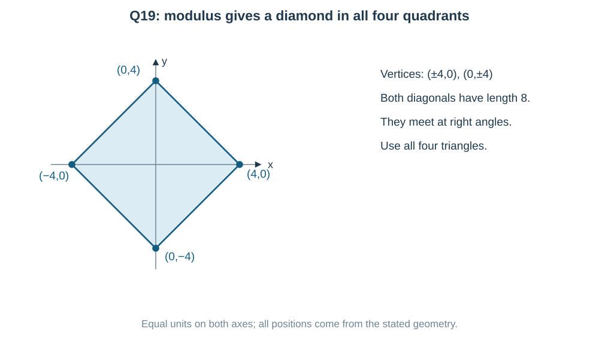

The four vertices are $(4,0),(0,4),(-4,0),(0,-4)$. Its perpendicular diagonals both have length 8:

$$
\boxed{\text{area}=\frac12\cdot8\cdot8=32}.
$$

**Another possible approach:** each quadrant contains one right triangle with legs 4 and 4, so

$$
4\left(\frac12\cdot4\cdot4\right)=32.
$$

**Check:** keeping only $x+y=4$ would describe one infinite line and would not enclose a region. The sign changes in $|x|,|y|$ create all four finite boundary pieces.

---

### Question 20 — A midpoint gives half of each axis intercept

**PDF page 83 | MCQ | Notes: C01,C03**

The line through $(3,4)$ whose segment between the coordinate axes is bisected at $(3,4)$ is

- (a) $3x+4y=25$
- (b) $4x+3y=24$
- (c) $4x+3y=12$
- (d) $3x+4y=24$

**A midpoint halves each endpoint coordinate.** Write the axis endpoints as $A=(a,0)$, $B=(0,b)$. Their midpoint is $(a/2,b/2)$.

Since that midpoint is $(3,4)$, we get $a=6,b=8$. Therefore

$$
\frac x6+\frac y8=1
\quad\Longrightarrow\quad
\boxed{4x+3y=24;\quad\text{(b)}}.
$$

**Check:** $(3,4)$ gives $12+12=24$, and the actual axis endpoints average to $(3,4)$.

**Another possible approach:** the direction from midpoint $(3,4)$ to $(6,0)$ is $(3,-4)$, so the slope is $-4/3$. Point-slope form $y-4=-(4/3)(x-3)$ gives the same equation. The midpoint interpretation supplies the endpoints more directly.

---

### Question 21 — An angle of 45 degrees gives two possible directions

**PDF page 83 | MCQ | Notes: C05**

Which of the following is the equation of a line through $(1,1)$ making an angle of $45^\circ$ with the line $y=2x$?

- (a) $x+3y-4=0$
- (b) $3x+y-4=0$
- (c) $x-y-2=0$
- (d) $x+y-2=0$

**A 45-degree condition can give two slopes.** If the unknown finite slope is $m$,

$$
\left|\frac{m-2}{1+2m}\right|=\tan45^\circ=1.
$$

The two sign cases give

$$
m-2=1+2m\Rightarrow m=-3,
\qquad
m-2=-1-2m\Rightarrow m=\frac13.
$$

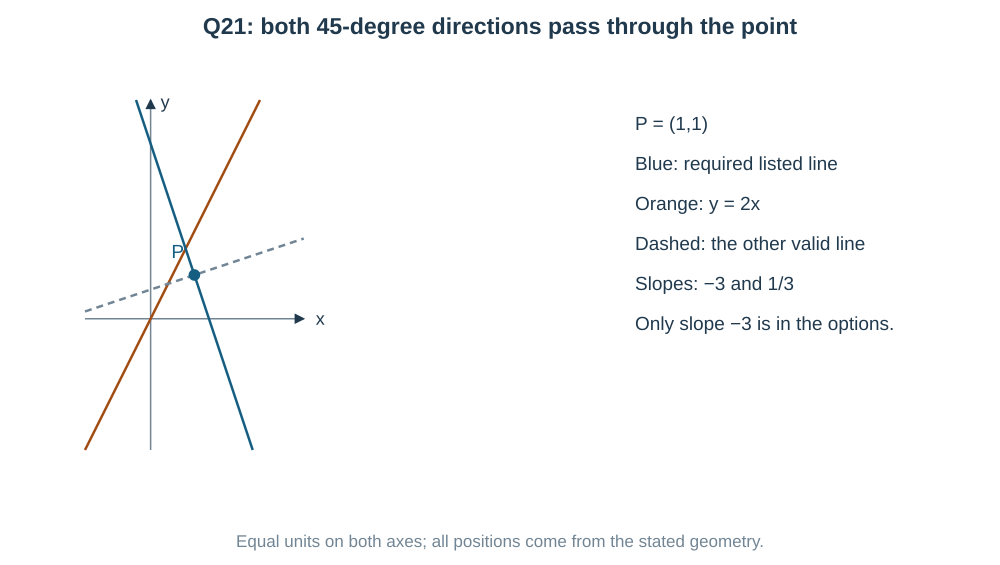

Through $(1,1)$, the slope $-3$ line is

$$
y-1=-3(x-1)
\quad\Longrightarrow\quad
\boxed{3x+y-4=0;\quad\text{(b)}}.
$$

The other is $y-1=(x-1)/3$, or $x-3y+2=0$, which is not listed. A vertical line makes angle $\tan^{-1}(1/2)$ with $y=2x$, so it is not a missing 45-degree case.

**Another possible route — test the options:** option (c) does not pass through $(1,1)$. For the others, test slopes in the angle formula. Option (b) gives $|-3-2|/|1-6|=1$. This is a safe option check because we check both the point and the angle.

---

### Question 22 — Check the meaning of each line statement

**PDF page 83 | MCQ | Notes: C02,C03,C04**

Consider the statements:

(i) $\dfrac x2+\dfrac y3=1$ and $3x+2y=6$ represent the same line.

(ii) The slope of $2x-3y=6$ is $2/3$.

(iii) The lines $x=3$ and $y=5$ are perpendicular.

(iv) The point $(1,1)$ lies on $2x+3y=6$.

The correct statements are

- (a) (i) and (ii) only
- (b) (i), (ii) and (iii) only
- (c) (ii), (iii) and (iv) only
- (d) (i), (ii), (iii) and (iv)

**Separate the four claims.**

**(i) True:** multiply $x/2+y/3=1$ by 6 to get $3x+2y=6$.

**(ii) True:** $2x-3y=6$ becomes $y=(2/3)x-2$, so slope $2/3$.

**(iii) True:** $x=3$ is vertical, while $y=5$ is horizontal. They are perpendicular.

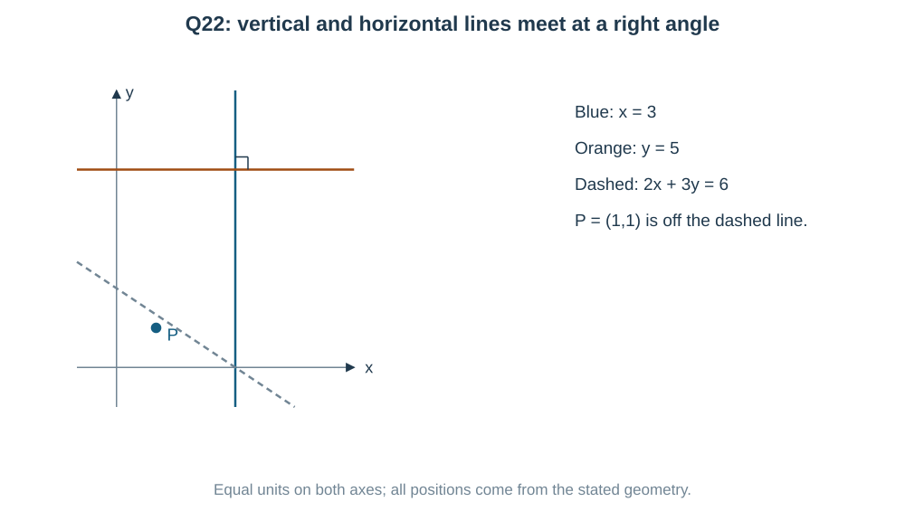

**(iv) False:** at $(1,1)$, $2x+3y=2+3=5\ne6$.

$$
\boxed{\text{(i), (ii), (iii) only;\quad (b)}}.
$$

**Fast check:** the vertical/horizontal case is handled geometrically. Trying to assign a finite slope to $x=3$ is unnecessary and invalid.

---

### Question 23 — Use coefficient perpendicularity to keep vertical cases safe

**PDF page 83 | Numerical value | Notes: C04**

If the lines $kx+2y-1=0$ and $4x+(k-9)y+3=0$ are perpendicular, then $k=$ ____.

**Use the normals to avoid dividing by a parameter.** The normal vectors are $(k,2)$ and $(4,k-9)$. Perpendicular lines have perpendicular normals, so their dot product is zero:

$$
4k+2(k-9)=0
\quad\Longrightarrow\quad6k=18
\quad\Longrightarrow\quad
\boxed{k=3}.
$$

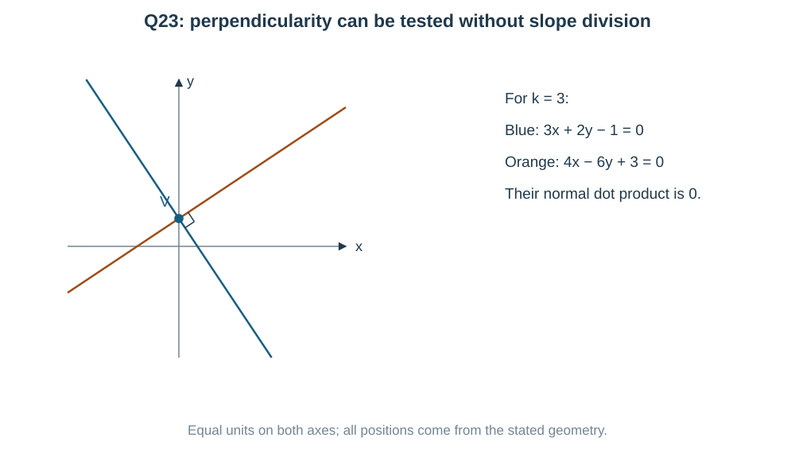

**Check:** at $k=3$, the slopes are $-3/2$ and $2/3$, whose product is $-1$.

**Another possible approach:** use $m_1=-k/2$, $m_2=-4/(k-9)$ and impose $m_1m_2=-1$. But first check $k=9$, where the second line is vertical. It would need the first line to be horizontal, which it is not. The coefficient-dot route handles that case automatically and is shorter.

---

### Question 24 — Distance in a given direction is not the shortest distance

**PDF page 83 | MCQ | Notes: C07**

The distance of the point $(1,2)$ from the line $x+y=5$, measured along a line of slope $\sqrt3$, is

- (a) $\sqrt2$
- (b) $2$
- (c) $2\sqrt3-2$
- (d) $4(\sqrt3+1)$

**Read “measured along a line of slope $\sqrt3$.”** This asks for the sloping distance $PQ$, not the shortest perpendicular distance $PH$.

A line of slope $\sqrt3$ has a unit direction

$$
\mathbf u=(\cos60^\circ,\sin60^\circ)
=\left(\frac12,\frac{\sqrt3}{2}\right).
$$

After travelling signed distance $t$ from $P=(1,2)$, we reach

$$
Q=\left(1+\frac t2,\ 2+\frac{\sqrt3\,t}{2}\right).
$$

It meets $x+y=5$ when

$$
3+\frac{(1+\sqrt3)t}{2}=5
\quad\Longrightarrow\quad
t=\frac4{1+\sqrt3}=2\sqrt3-2.
$$

Since this is positive,

$$
\boxed{PQ=2\sqrt3-2;\quad\text{(c)}}.
$$

**Check:** the shortest distance is $|1+2-5|/\sqrt2=\sqrt2$. Our answer $\approx1.464$ is larger, as it should be.

**Another possible approach:** use a nonunit step $Q=(1+s,2+\sqrt3s)$. Then $s=2/(1+\sqrt3)$. The step vector $(1,\sqrt3)$ has length 2, so the distance is $2|s|$, not $|s|$. Both parametrizations work if we track their meaning.

---

### Question 25 — The incenter is equally far from all three sides

**PDF page 83 | Numerical value | Notes: C11**

The line $12x+5y=60$ and the coordinate axes form a triangle. The distance of its incentre from the origin, rounded to two decimal places, is ____.

**First find the actual triangle.** The line cuts the axes at $A=(5,0)$ and $B=(0,12)$. The hypotenuse has length $\sqrt{5^2+12^2}=13$.

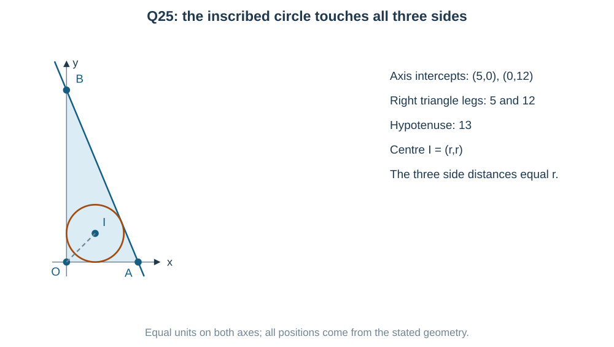

Let the inradius be $r$. The centre must be $(r,r)$ because it is distance $r$ from both positive axes. For a right triangle,

$$
r=\frac{5+12-13}{2}=2.
$$

So the incentre is $I=(2,2)$. Its distance from the origin is

$$
OI=\sqrt{2^2+2^2}=2\sqrt2
=2.828427\ldots
\quad\Longrightarrow\quad
\boxed{2.83}.
$$

**Another derivation of $r$:** area $\Delta=5\cdot12/2=30$ and semiperimeter $s=(5+12+13)/2=15$ give $r=\Delta/s=2$.

**Check all three sides:** $I$ is 2 units from both axes, and its distance from the sloping side is $|24+10-60|/13=2$. The answer requested is $OI$, not just the inradius 2.

---

### Question 26 — Reflect one endpoint to remove the bend in the path

**PDF page 84 | MCQ | Notes: C14**

For points $A(1,2)$ and $B(4,6)$, the minimum value of $PA+PB$ as $P$ varies on the $x$-axis is

- (a) $\sqrt{73}$
- (b) $5$
- (c) $9$
- (d) $\sqrt{65}$

**Directly minimizing two square roots would take extra work.** Reflect $A=(1,2)$ across the axis to $A'=(1,-2)$. For every allowed point $P$ on the axis, $PA=PA'$.

Thus

$$
PA+PB=PA'+PB\ge A'B.
$$

Now calculate only that one straight distance:

$$
A'B=\sqrt{(4-1)^2+(6+2)^2}
=\boxed{\sqrt{73};\quad\text{(a)}}.
$$

**Does equality actually occur?** The segment from $A'$ below the axis to $B$ above it crosses the axis. Parametrize it as $(1,-2)+t(3,8)$. At $y=0$, $t=1/4$, giving $P=(7/4,0)$. This is allowed, so the lower bound is attained.

**Check:** $A'P=A'B/4$ and $PB=3A'B/4$, so their sum is exactly $A'B$. Using $AB=5$ would ignore the condition that the path must visit the axis.

---

### Question 27 — Collinear means one straight line passes through all three points

**PDF page 84 | MCQ | Notes: C02,C10**

If the points $(1,2)$, $(k,8)$ and $(7,14)$ are collinear, then $k=$

- (a) $3$
- (b) $5$
- (c) $6$
- (d) $4$

**Collinear means all three points follow one line.** The first and last points give slope

$$
m=\frac{14-2}{7-1}=\frac{12}{6}=2.
$$

Through $(1,2)$, that line is $y-2=2(x-1)$, hence $y=2x$.

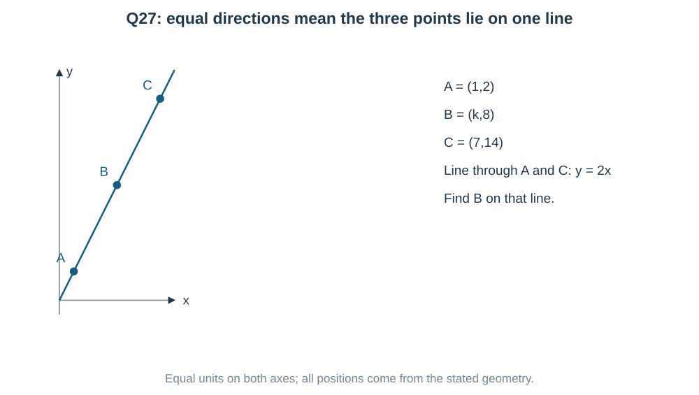

For the middle point $(k,8)$,

$$
8=2k\quad\Longrightarrow\quad
\boxed{k=4;\quad\text{(d)}}.
$$

**Another possible approach:** zero triangle area gives

$$
\begin{vmatrix}k-1&6\\6&12\end{vmatrix}
=12(k-1)-36=0,
$$

again $k=4$. This determinant route is useful when a slope denominator might be zero.

---

### Question 28 — The gap between opposite sides is the square side length

**PDF page 84 | MCQ | Notes: C07,C10**

Two opposite sides of a square lie on $4x+3y-10=0$ and $4x+3y+15=0$. The area (in square units) of the square is

- (a) $20$
- (b) $25$
- (c) $50$
- (d) $5$

**What is the side length of this square?** Opposite sides are parallel, and their perpendicular separation equals one side length.

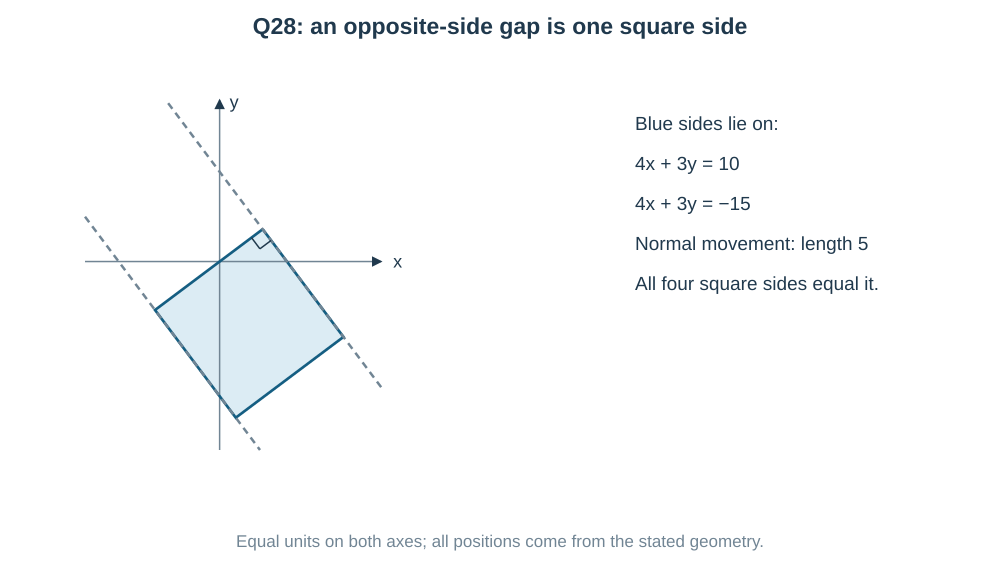

The $x,y$ coefficients already match:

$$
s=\frac{|15-(-10)|}{\sqrt{4^2+3^2}}
=\frac{25}{5}=5.
$$

The question asks for area:

$$
\boxed{s^2=25;\quad\text{(b)}}.
$$

**Check:** a 5-unit step along unit normal $(4/5,3/5)$ changes $4x+3y$ by 25, exactly the change from $-15$ to 10.

**Do not use a horizontal intercept gap as the side:** the shortest gap is perpendicular to the two sloping sides. A horizontal distance would measure a different segment.

---

### Question 29 — A new origin changes coordinates, not the actual line

**PDF page 84 | MCQ | Notes: C15**

The origin is shifted to $(1,2)$ without rotating the axes. The equation $2x+3y=12$ in terms of new coordinates $(X,Y)$ becomes

- (a) $2X+3Y=18$
- (b) $2X+3Y=4$
- (c) $2X+3Y=12$
- (d) $3X+2Y=4$

**A new origin changes the measuring start.** If its old coordinates are $(1,2)$, then a point with new coordinates $(X,Y)$ has old coordinates

$$
x=X+1,\qquad y=Y+2.
$$

Substitute into the old equation:

$$
2(X+1)+3(Y+2)=12
\quad\Longrightarrow\quad
2X+3Y+8=12.
$$

Therefore

$$
\boxed{2X+3Y=4;\quad\text{(b)}}.
$$

**Check with a real point:** $(6,0)$ lies on the old line. Its new coordinates are $(5,-2)$, and $2(5)+3(-2)=4$. This confirms the translation signs.

**Common trap:** $x=X-1$ would place the new origin at the old point $(-1,-2)$. Test $(X,Y)=(0,0)$ to catch that sign error.

---

### Question 30 — Eliminate the intercepts using midpoint coordinates

**PDF page 84 | MCQ | Notes: C12**

A variable line through $(2,3)$ meets the axes at $A$ and $B$. The locus of the midpoint of $AB$ is

- (a) $2x+3y=2xy$
- (b) $3x+2y=xy$
- (c) $x+y=2xy$
- (d) $3x+2y=2xy$

**The moving line passes through a fixed point; its midpoint is a different object.** Write $A=(a,0)$, $B=(0,b)$ and midpoint $M=(x,y)$. Then

$$
a=2x,\qquad b=2y.
$$

The fixed point $(2,3)$ lies on the intercept line:

$$
\frac2a+\frac3b=1
\quad\Longrightarrow\quad
\frac1x+\frac3{2y}=1.
$$

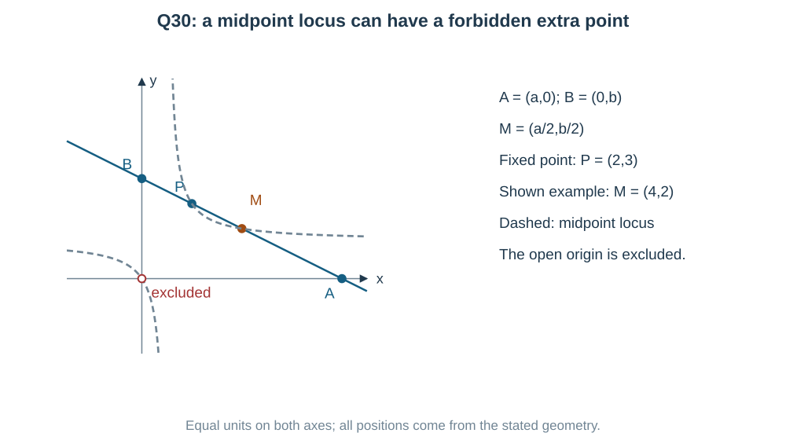

Multiplying by $2xy$ gives

$$
\boxed{3x+2y=2xy;\quad\text{intended option (d)}}.
$$

**Do not lose the construction's restrictions.** We used finite nonzero intercepts, so $x\ne0,y\ne0$. The polynomial happens to contain $(0,0)$, but that point would give $a=b=0$, not the required intercept segment. Its **exact locus excludes the origin**.

**Reverse check:** any nonzero $(x,y)$ on the equation gives endpoints $(2x,0),(0,2y)$. Dividing back by $2xy$ proves that their line passes through $(2,3)$. On the polynomial, setting either $x=0$ or $y=0$ forces both to be zero, so no other axis points need removal.

**Another view:** completing the product gives

$$
(x-1)\left(y-\frac32\right)=\frac32.
$$

It is a shifted hyperbola, with asymptotes $x=1,y=3/2$. This explains the two separate branches shown; the origin is still removed because of the original construction.

## Answer check

Read the qualifications in the solutions before using the key.

| Question | Answer | Question | Answer |
|---|---|---|---|
| 1 | (c) $5/2$ | 16 | $4$ |
| 2 | $12.5$ | 17 | (c) |
| 3 | (d) $30^\circ$ | 18 | None; $(-4/7,15/7)$ |
| 4 | (b) | 19 | $32$ |
| 5 | (b) $-2$ | 20 | (b) |
| 6 | (d) $22$ | 21 | (b) |
| 7 | (c) | 22 | (b) |
| 8 | (a) | 23 | $3$ |
| 9 | $3.2$ | 24 | (c) |
| 10 | (a) | 25 | $2.83$ |
| 11 | $27$ | 26 | (a) |
| 12 | (b) | 27 | (d) $4$ |
| 13 | (b) | 28 | (b) $25$ |
| 14 | $2$ | 29 | (b) |
| 15 | (a) | 30 | (d), excluding $(0,0)$ |

## After this chapter

Use the question's words to decide what to draw: a normal for shortest distance, an actual ray for reflection, a midpoint for an intercept locus, or an altitude for an orthocentre. Draw first, translate the picture into equations, and check the original conditions. All alternatives above are visible for the later booklet. The supplied questions are original JEE Main-style practice, not verified actual PYQs. Q18's sign/key defect and Q30's excluded point remain explicit.
