# Chapter 17 — Circles

**Kanna, keep finding the centre and drawing a radius. Most circle formulas come from one right triangle.**

Your overall target remains **200 marks**: Physics 60, Maths 60, Chemistry 80. First secure the centre, radius, diameter, chord and line-intersection ideas. Then connect tangency, two-circle geometry and the supporting source tools.

## Recent chapter weightage

| Year | Questions tagged Circle in the checked archive | Full-year paper shifts | Tagged questions per shift |
|---|---:|---:|---:|
| 2024 | 20 | 20 | 1.00 |
| 2025 | 10 | 19 | 0.53 |
| 2026 | 15 | 19 | 0.79 |
| Total | 45 | 58 | **0.78** |

These are distinct recent question IDs recounted in ExamSIDE's **Circle** category. The average is below one tagged question per shift; individual shifts differ. PYQSide combines conics, including circles, into one broader category with 48, 55 and 57 questions in these years. Those totals are not separate Circle counts and cannot be split or added here. This is a transparent archive recount, not independent classification of every original paper. The 2024 format offered more optional numerical questions. Evidence and source links are saved separately.

**Important for JEE Main:** the official unit explicitly names the standard/general circle equation, centre and radius, a circle from diameter endpoints, and intersections of a line with an origin-centred circle. Learn those core ideas first. Tangent/chord geometry supports many supplied questions. Pole–polar, radical centre, orthogonal circles and the director-circle name are supporting extensions in this PDF; we explain the needed results without treating each as a separately named official syllabus requirement.

## Concept C01 — A circle is a fixed distance from one fixed point

The fixed point is the **centre**, $C=(h,k)$. The fixed positive distance is the **radius**, $r$. Every point $P=(x,y)$ on the circle satisfies $CP=r$.

Using the distance formula and squaring,

$$
\boxed{(x-h)^2+(y-k)^2=r^2},\qquad r>0.
$$

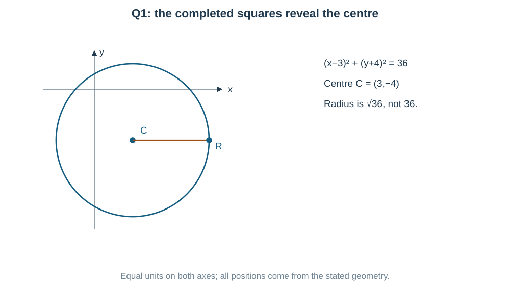

The **disc** includes the interior: $(x-h)^2+(y-k)^2\le r^2$. The circle itself is only the boundary.

Expand and compare:

$$
x^2+y^2+2gx+2fy+c=0
\quad\Longleftrightarrow\quad
(x+g)^2+(y+f)^2=g^2+f^2-c.
$$

Thus

$$
\boxed{C=(-g,-f),\qquad r^2=g^2+f^2-c}.
$$

**Why the centre signs reverse:** the horizontal square is $(x-h)^2=x^2-2hx+h^2$, so the $x$ coefficient is $-2h$.

Three cases matter:

- $r^2>0$: a real circle with positive radius.
- $r^2=0$: just the one point $(-g,-f)$, called a point circle.
- $r^2<0$: no real points, because two real squares cannot add to a negative number.

If the coefficients of $x^2,y^2$ are the same nonzero number $A$, divide the whole equation by $A$ first. A general quadratic with an $xy$ term or unequal squared coefficients is not automatically a circle in these rectangular coordinates.

Useful geometry:

$$
\text{diameter}=2r,\qquad
\text{circumference}=2\pi r,\qquad
\text{disc area}=\pi r^2.
$$

A point on the circle can be written $(h+r\cos\theta,k+r\sin\theta)$. Here $\theta$ is the direction of its radius; this parametrization is useful for plotting and angle questions.

## Concept C02 — Build a circle from the information given

**Centre and one boundary point:** substitute the point into $(x-h)^2+(y-k)^2=r^2$ to find $r^2$.

**Diameter endpoints $A(x_1,y_1),B(x_2,y_2)$:** the centre is their midpoint and the radius is $AB/2$. Equivalently,

$$
\boxed{(x-x_1)(x-x_2)+(y-y_1)(y-y_2)=0}.
$$

Why does the product formula work? The angle $APB$ is $90^\circ$ for a point $P$ on the circle with diameter $AB$. So $(P-A)\cdot(P-B)=0$, which expands into the displayed equation.

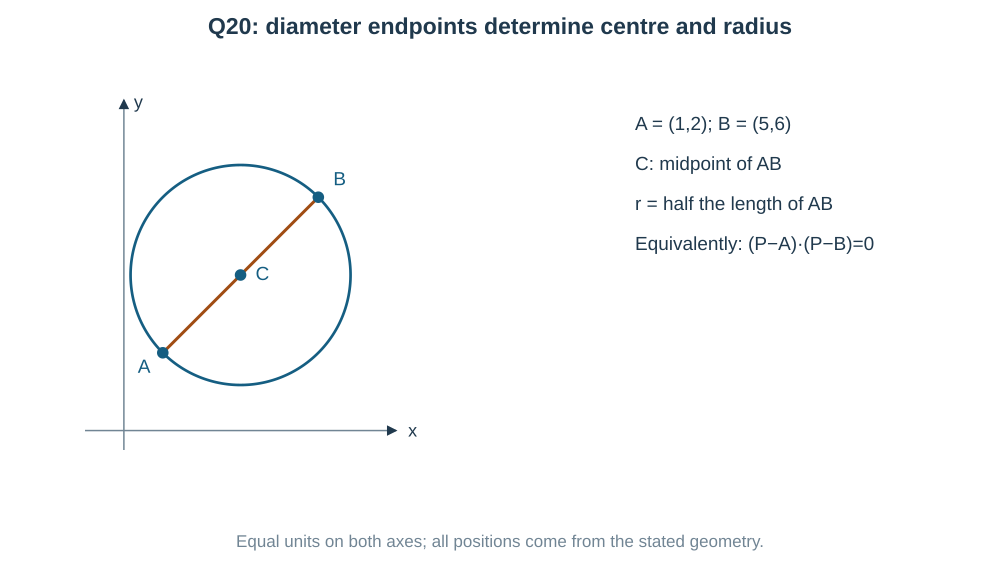

**Three noncollinear points:** substitute them into $x^2+y^2+2gx+2fy+c=0$ and solve the three linear equations for $g,f,c$. Such points determine one circle. Three distinct collinear points cannot lie on one nondegenerate circle.

**Centre on a given line:** combine that line with equal distances to known boundary points. Subtracting the two squared-distance equations cancels $h^2+k^2$ and produces another line, the perpendicular bisector.

**Passing through the origin:** substitution gives $c=0$. If its other positive axis intercepts are $a,b$, the circle is

$$
x^2+y^2-ax-by=0,\qquad
C=(a/2,b/2),\quad r=\frac{\sqrt{a^2+b^2}}2.
$$

The two nonzero axis endpoints form the diameter: their joining segment is opposite the right angle at the origin.

## Concept C03 — A point's power tells inside, on or outside

For $S(x,y)=x^2+y^2+2gx+2fy+c$, put $P=(x_0,y_0)$:

$$
\boxed{S(P)=CP^2-r^2}.
$$

So $S(P)<0$ means inside, $S(P)=0$ means on the circle, and $S(P)>0$ means outside.

This number is called the **power of the point**. It is a squared-length difference, not the ordinary distance from the circumference.

For an external point with tangent touching at $T$, the radius $CT$ is perpendicular to $PT$. Pythagoras gives

$$
\boxed{PT^2=CP^2-r^2=S(P),\qquad PT=\sqrt{S(P)}}.
$$

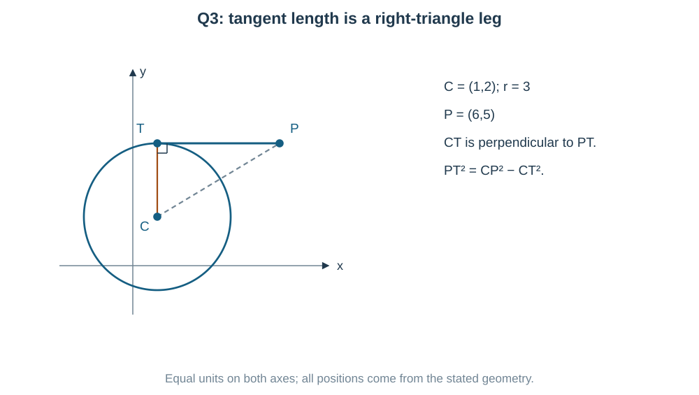

If a secant from an external point meets the circle at $A,B$, then $PA\cdot PB=S(P)$ with both ordinary distances taken along that ray. For an inside point, the two directed intersection distances have opposite signs; their product is negative, matching $S(P)$. Do not take a square root of a negative power and call it a real tangent length: no real tangents start inside the circle.

## Concept C04 — A line cuts, touches or misses a circle

Let $d$ be the **perpendicular** distance from the centre to a line.

| Compare | Geometry | Number of distinct intersections |
|---|---|---:|
| $d<r$ | cuts a chord | 2 |
| $d=r$ | tangent, meaning one touching point | 1 |
| $d>r$ | misses the circle | 0 |

For $ax+by+c=0$,

$$
d=\frac{|ah+bk+c|}{\sqrt{a^2+b^2}}.
$$

**Important for JEE Main:** this test works for sloping, vertical and horizontal lines.

If the line cuts a chord $AB$, its perpendicular foot $H$ from the centre is the chord's midpoint. The two right triangles $CHA,CHB$ have the same hypotenuse $r$ and common leg $CH$, so their remaining legs are equal:

$$
AH=BH=\sqrt{r^2-d^2},
\qquad
\boxed{AB=2\sqrt{r^2-d^2}}.
$$

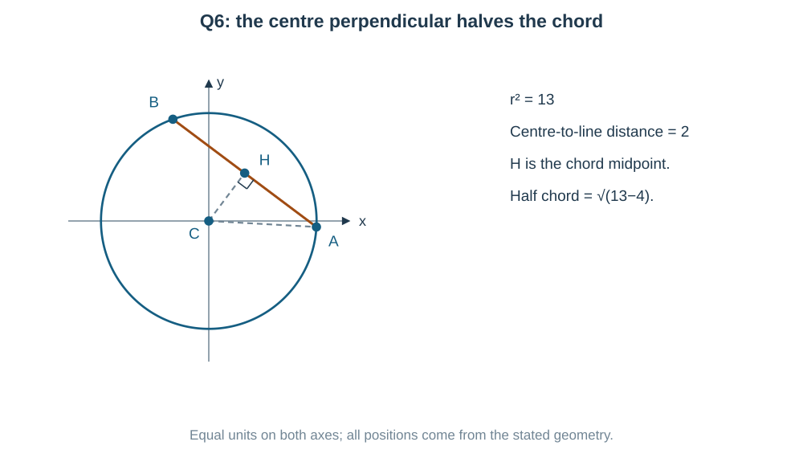

**To find intersection coordinates:** substitute the line into the circle to get a quadratic. Positive, zero and negative discriminants give two, one and no real intersection points. Handle a vertical line by substituting its fixed $x$ directly.

**Efficient coordinate construction:** if $H$ is the foot and $\mathbf u$ is a unit vector along the line, then

$$
A,B=H\pm\sqrt{r^2-d^2}\,\mathbf u.
$$

This finds both endpoints without expanding a quadratic. A chord cannot be longer than the diameter $2r$.

## Concept C05 — A tangent at a boundary point is normal to the radius

At a point $P$ on a circle, the tangent is perpendicular to $CP$. For an origin-centred circle and $P=(x_1,y_1)$,

$$
(x_1,y_1)\cdot(x-x_1,y-y_1)=0.
$$

Since $x_1^2+y_1^2=r^2$, this becomes

$$
\boxed{xx_1+yy_1=r^2}.
$$

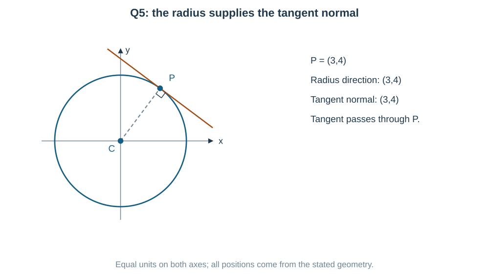

For centre $C=(h,k)$, use the shifted version

$$
\boxed{(x_1-h)(x-h)+(y_1-k)(y-k)=r^2}.
$$

For the general equation $S=0$, the same tangent can be written

$$
\boxed{T=xx_1+yy_1+g(x+x_1)+f(y+y_1)+c=0}.
$$

**Condition:** $P$ must lie on the circle for this to be its tangent **at** $P$. If $P$ is external, the same expression has a different meaning, taught in C12.

For an unknown finite slope $m$, write $y=mx+b$ and impose the centre-to-line distance $r$. This gives

$$
\boxed{b=k-mh\pm r\sqrt{1+m^2}}.
$$

The extra vertical tangents are $x=h\pm r$. Slope form does not include them.

## Concept C06 — Two tangents from an external point

Tangents from the same external point $P$ have equal lengths: both equal $\sqrt{CP^2-r^2}$. The right triangles $CAP,CBP$ have common hypotenuse $CP$ and equal radii $CA,CB$, so they are congruent. Thus $CP$ also bisects the angle at $P$.

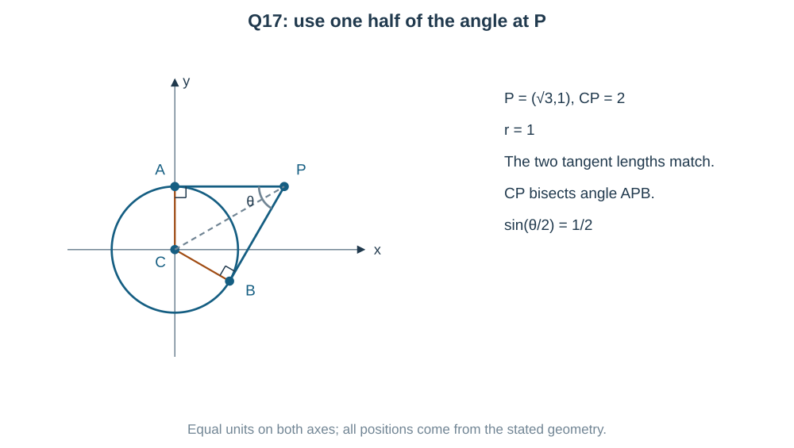

If $\theta=\angle APB$ is the angle between the **two tangent segments from $P$**,

$$
\boxed{\sin(\theta/2)=\frac r{CP}},\qquad CP>r.
$$

Infinite supporting lines also make the supplementary angle $180^\circ-\theta$. State which angle the question means; the picture with rays from $P$ removes the ambiguity.

The quadrilateral $CAPB$ is two right triangles:

$$
\boxed{\text{area}=r\sqrt{CP^2-r^2}}.
$$

If $\phi=\angle ACB$ is the smaller central angle between the contact radii, then $\phi+\theta=180^\circ$ for this quadrilateral.

**Perpendicular tangents:** when $\theta=90^\circ$, $CP^2=2r^2$. Their starting points form the **director circle**:

$$
\boxed{(x-h)^2+(y-k)^2=2r^2}.
$$

The name is a supporting source term. Its meaning is just the locus of points from which the tangent segments meet at $90^\circ$. The two right triangles are then isosceles, and the quadrilateral is a square.

## Concept C07 — Two-circle position decides the tangent count

Let the two positive radii be $r_1,r_2$, and let the centre distance be $d$. Compare $d$ with their sum and absolute difference.

| Position | Condition | Common tangent lines |
|---|---|---:|
| separate, outside each other | $d>r_1+r_2$ | 4 |
| touch externally | $d=r_1+r_2$ | 3 |
| cross at two points | $|r_1-r_2|<d<r_1+r_2$ | 2 |
| touch internally | $d=|r_1-r_2|>0$ | 1 |
| one strictly inside the other | $d<|r_1-r_2|$ | 0 |
| same centre, different radii | $d=0,\ r_1\ne r_2$ | 0 |
| identical circles | $d=0,\ r_1=r_2$ | infinitely many |

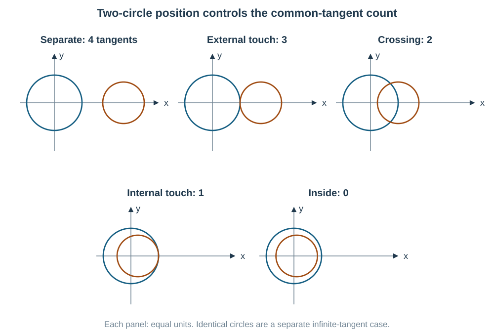

A **common tangent** touches both circles. At external contact, the two internal tangents merge into the one tangent at the touching point; this is why the count becomes 3. At internal contact, only the touching-point tangent remains.

**Pattern:** for external touching of a variable circle with radius $\rho$, write centre distance $r+\rho$. For internal touching, use $|r-\rho|$ and check which circle contains which.

## Concept C08 — Common tangent length comes from one right triangle

Here “length” means the distance **between the two touching points**, not the length of an infinite line.

For a direct common tangent, the centres are on the same side of the line. Their perpendicular radius offsets differ by $r_1-r_2$:

$$
\boxed{L_{\rm direct}=\sqrt{d^2-(r_1-r_2)^2}}.
$$

For a transverse/internal common tangent, the centres are on opposite sides. The perpendicular offsets add:

$$
\boxed{L_{\rm internal}=\sqrt{d^2-(r_1+r_2)^2}}.
$$

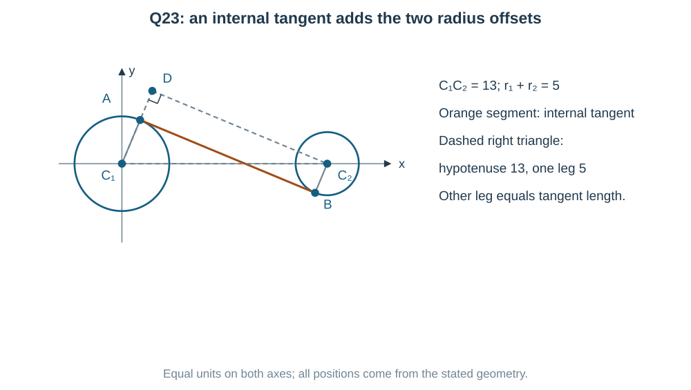

Use these only when the relevant tangent exists. A positive internal segment needs $d>r_1+r_2$; at external contact its limiting length is zero. The centre-to-centre distance $d$ is the hypotenuse, not the tangent segment.

## Concept C09 — Common chord, radical axis and a circle family

At a shared point of two circles $S_1=0,S_2=0$, both equations hold. Subtracting cancels $x^2+y^2$:

$$
\boxed{S_1-S_2=0}.
$$

If they intersect at two points, this is the **common chord's line**. Its direction is perpendicular to the line joining the centres.

More generally, $S_1=S_2$ means a point has the **same power** to both circles. This line is the **radical axis**, even when the circles do not meet. It need not contain real circle-intersection points. Concentric distinct circles have no finite radical-axis line.

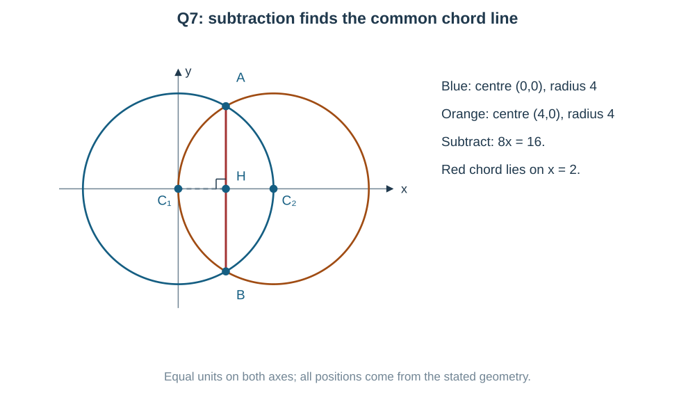

For three circles, intersect two independent radical axes to find the **radical centre**. Test the third power as a check. Some configurations have parallel or coincident axes, so a unique finite radical centre is not guaranteed in every imaginable case.

**Circle through common points of a circle $S=0$ and line $L=0$:**

$$
\boxed{S+\lambda L=0}.
$$

At a shared point both terms vanish for every $\lambda$. A further point fixes $\lambda$. This is useful when computing the common points would create unnecessary radicals.

For two circles normalized to the same squared coefficients, a full family through their common points can be written $\lambda S_1+\mu S_2=0$. To obtain a proper circle, require $\lambda+\mu\ne0$; when the squared coefficients cancel, the member is their radical-axis line instead.

## Concept C10 — Orthogonal circles: perpendicular tangents at a crossing

“Orthogonal” means the two circles cross with tangents at $90^\circ$. Rotating both tangent directions by $90^\circ$ gives their radii, so those radii are perpendicular too.

At a crossing $P$, triangle $C_1PC_2$ is right-angled at $P$:

$$
\boxed{C_1C_2^2=r_1^2+r_2^2}.
$$

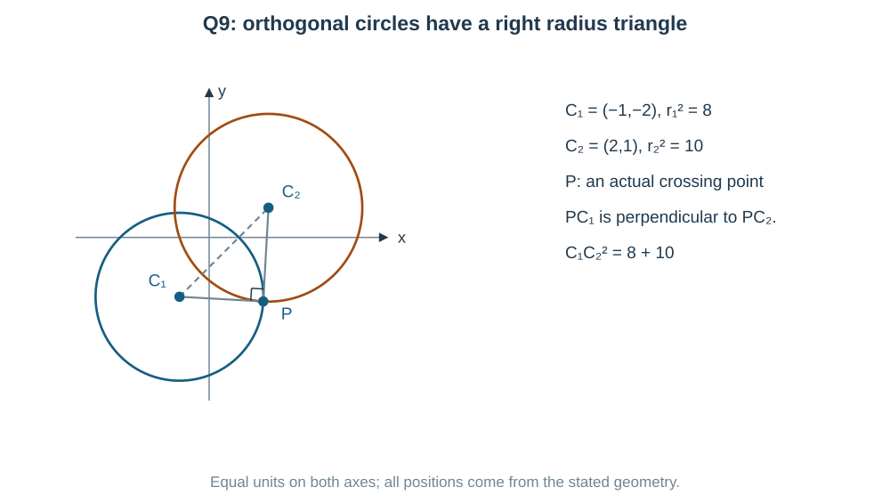

For $S_i=x^2+y^2+2g_ix+2f_iy+c_i=0$, expanding the same condition gives

$$
\boxed{2g_1g_2+2f_1f_2=c_1+c_2}.
$$

This is a supporting shortcut. The right-triangle meaning is safer than remembering an isolated coefficient identity. Positive radii together with $d^2=r_1^2+r_2^2$ place the centres between the internal and external touching limits, so actual crossings exist.

## Concept C11 — A chord's midpoint gives its perpendicular direction

If $M$ is the midpoint of a nonzero chord, the centre-to-midpoint line is perpendicular to the chord. For an origin-centred radius-$r$ circle and $M=(h,k)\ne(0,0)$,

$$
\boxed{hx+ky=h^2+k^2}.
$$

Why? $(h,k)$ is the chord's normal, and the line passes through $(h,k)$. Check that $h^2+k^2<r^2$ for a genuine nonzero chord.

If $M$ is the centre, many diameters share that midpoint; the displayed equation reduces to $0=0$ and cannot select one chord.

For a known chord endpoint $A$ and midpoint $M$, the other endpoint is $B=2M-A$. Substitute it into the circle equation to find a midpoint locus. This route automatically keeps track of endpoints.

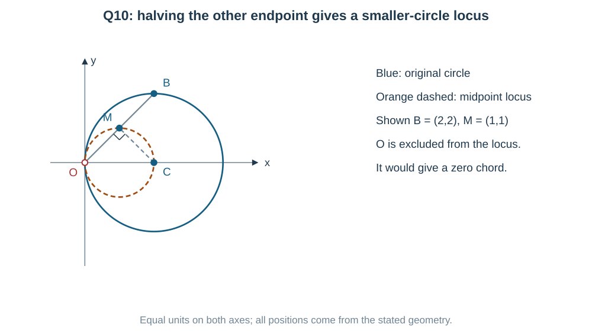

**Locus warning:** a derived equation can contain a zero-length chord's midpoint. Remove it if the original construction requires two different endpoints.

## Concept C12 — Chord of contact, polar and pole

These names are supporting source tools. Begin with the actual geometry.

From an external point $P=(x_1,y_1)$, draw two tangents touching the circle at $A,B$. The segment $AB$ is the **chord of contact**: it joins the two touching points, not the external point to the centre.

For $x^2+y^2=r^2$, the tangent at $A=(a,b)$ has equation $ax+by=r^2$. Since it passes through $P$,

$$
ax_1+by_1=r^2.
$$

So $A$ lies on $xx_1+yy_1=r^2$. The same argument holds for $B$, giving

$$
\boxed{\text{chord of contact: }xx_1+yy_1=r^2}.
$$

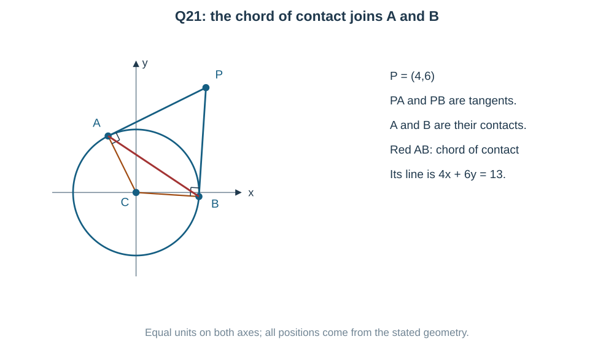

The same line formula, associated with a general point $P$ relative to the circle, is called its **polar**. The point is the **pole** of that line. When $P$ is external, the polar is the real chord-of-contact line. When $P$ is on the circle, it is its tangent. For an inside point other than the centre, the polar still exists algebraically but is not a chord joining real tangent contacts.

For an origin-centred circle and a line $ax+by=d$ with $d\ne0$,

$$
\boxed{\text{pole}=\left(\frac{r^2a}{d},\frac{r^2b}{d}\right)}.
$$

Compare coefficients after rewriting the line with right side $r^2$. A line through the centre has no finite pole in this formula; do not divide by $d=0$.

For a shifted circle, the polar of $P$ is $(x_1-h)(x-h)+(y_1-k)(y-k)=r^2$. In the general $S=0$ notation, it is $T=0$ from C05. State whether it represents a tangent or a contact chord before applying the same algebraic expression.

## Concept C13 — Axis intercepts and touching an axis

A circle touches the $x$-axis when the centre's vertical distance is its radius:

$$
|k|=r.
$$

It touches the $y$-axis when $|h|=r$. A circle in the first quadrant touching both axes therefore has centre $(r,r)$, with $r>0$.

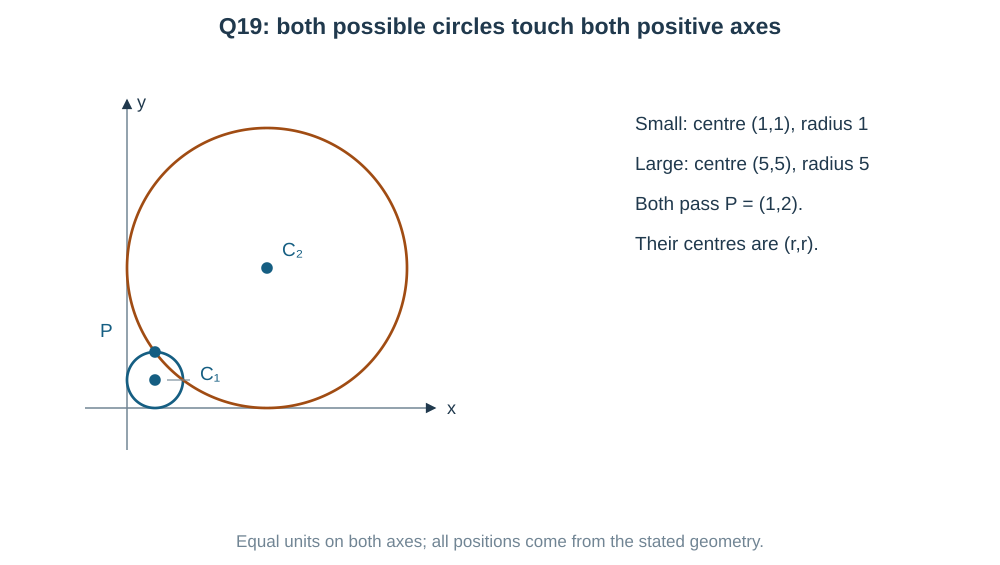

A circle touching the $x$-axis at $(a,0)$ has centre $(a,k)$ and radius $|k|$:

$$
(x-a)^2+(y-k)^2=k^2.
$$

Use a supplied boundary point to find $k$; do not assume the centre is above the axis until the data determines it.

**Intercept versus tangency:** an intercept on an axis is the chord cut by that axis. Put the other coordinate equal to zero and find both roots.

For $x^2+y^2+2gx+2fy+c=0$:

$$
\boxed{\text{$x$-axis chord length}=2\sqrt{g^2-c}},\qquad
\boxed{\text{$y$-axis chord length}=2\sqrt{f^2-c}},
$$

when the square-root inputs are positive. Zero means tangency; negative means no real intercept. These are chord lengths, not the coordinates of their endpoints.

## Concept C14 — Nearest and farthest points on a circle

Let $d=CP$ for a fixed point $P$. For a point $Q$ on the **circumference**,

$$
\boxed{PQ_{\max}=d+r,\qquad PQ_{\min}=|d-r|}.
$$

Both extremes lie on the line through $C,P$. If $P=C$, every circumference point has distance $r$.

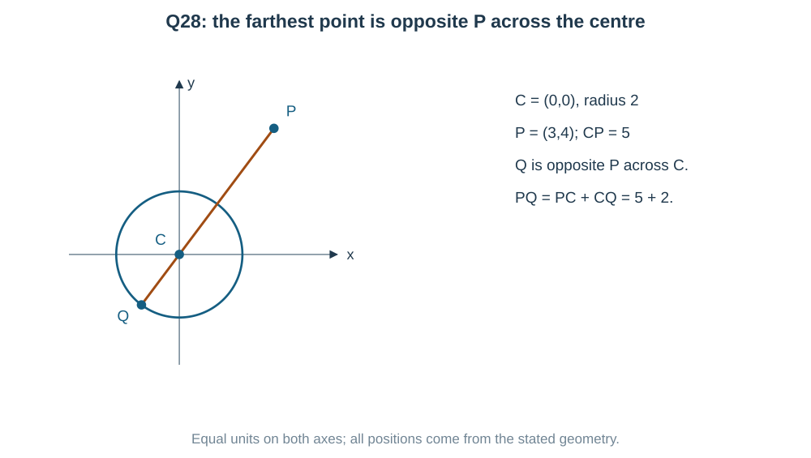

For $d>0$, the nearest point is $C+\frac r d(P-C)$, and the farthest is $C-\frac r d(P-C)$. The triangle inequality proves the upper bound $PQ\le PC+CQ=d+r$; the reverse triangle inequality proves the lower bound.

If the allowed set is the **filled disc**, the shortest distance is $\max(0,d-r)$, because an inside point itself is allowed. Read whether the question says circumference or disc.

**Another useful bound — Cauchy–Schwarz, important for JEE Main:** for real coordinates,

$$
(au+bv)^2\le(a^2+b^2)(u^2+v^2).
$$

The difference is $(av-bu)^2\ge0$, so the result follows from a square being nonnegative. Equality means the two coordinate pairs are parallel, including the appropriate zero cases. On $u^2+v^2=r^2$, it bounds a dot product by $r\sqrt{a^2+b^2}$. This is useful when a squared-distance expansion contains a linear expression such as $3x+4y$. Q28 shows the full connection to the opposite radius direction.

## Last-minute formula recap

| Need | Formula or clue | Condition |
|---|---|---|
| Centre and squared radius | $C=(-g,-f)$, $r^2=g^2+f^2-c$ | normalize squared coefficients first |
| Circle from diameter $A,B$ | $(P-A)\cdot(P-B)=0$ | $A\ne B$ |
| Boundary point check | $S(P)=CP^2-r^2$ | negative inside, zero on, positive outside |
| Tangent length | $\sqrt{S(P)}$ | real external point; zero on circle |
| Line-circle relation | compare centre distance $d$ with $r$ | perpendicular distance |
| Chord length | $2\sqrt{r^2-d^2}$ | $d<r$ |
| Tangent at a circle point | $(P-C)\cdot(X-C)=r^2$ | $P$ on circle |
| General tangent/polar expression | $T=xx_1+yy_1+g(x+x_1)+f(y+y_1)+c$ | interpret point position before naming it |
| Angle between tangent segments | $\sin(\theta/2)=r/CP$ | $CP>r$ |
| Tangent kite area | $r\sqrt{CP^2-r^2}$ | two real tangents |
| Perpendicular-tangent locus | $CP^2=2r^2$ | same centre, director radius $\sqrt2r$ |
| Two-circle positions | compare $d$ with $r_1+r_2$, $|r_1-r_2|$ | positive radii; identical case separate |
| Direct / internal common tangent length | $\sqrt{d^2-(r_1-r_2)^2}$ / $\sqrt{d^2-(r_1+r_2)^2}$ | relevant tangent exists |
| Common chord/radical axis | $S_1-S_2=0$ | normalized circles; a real common chord needs crossings |
| Circle through $S=0,L=0$ intersections | $S+\lambda L=0$ | another point fixes $\lambda$ |
| Orthogonal circles | $d^2=r_1^2+r_2^2$ | right angle at crossing |
| Chord with midpoint $M$ | $(M-C)\cdot(X-M)=0$ | $M\ne C$ and $CM<r$ |
| Pole of $ax+by=d$ for centred circle | $(r^2a/d,r^2b/d)$ | $d\ne0$ |
| Touch both positive axes | centre $(r,r)$ | first-quadrant circle |
| Axis intercept length | $2\sqrt{g^2-c}$ on $x$; $2\sqrt{f^2-c}$ on $y$ | real chord only |
| Circumference distance extremes | $|CP-r|$, $CP+r$ | distinguish circumference from filled disc |
| Cauchy–Schwarz bound | $(au+bv)^2\le(a^2+b^2)(u^2+v^2)$ | equality for parallel coordinate pairs |

**Before solving:** find the centre, find $r^2$, draw the needed radius, then decide whether you need a right triangle, a point substitution or subtraction of two equations. Do not calculate intersection coordinates if a chord length or equal-power line alone answers the question.

## Worked solutions to the 35 PDF questions

Read the question first. Notice the pattern, choose a route, then calculate. Alternative methods below are fully visible.

### Question 1 — Complete the squares to see the centre

**PDF page 86 | MCQ | Notes: C01**

The centre and radius of the circle $x^2+y^2-6x+8y-11=0$ are

- (a) $(-3,4)$ and $6$
- (b) $(3,-4)$ and $6$
- (c) $(3,-4)$ and $36$
- (d) $(3,-4)$ and $\sqrt{14}$

**The centre is easiest to see after completing squares.** Group the $x$ and $y$ terms:

$$
x^2-6x+y^2+8y=11.
$$

Add 9 and 16 to complete both squares:

$$
(x-3)^2+(y+4)^2=11+9+16=36.
$$

Compare with $(x-h)^2+(y-k)^2=r^2$:

$$
\boxed{C=(3,-4),\quad r=6;\quad\text{(b)}}.
$$

**Check:** moving 6 units right from the centre gives $(9,-4)$. Substitution into the original equation gives $81+16-54-32-11=0$.

**Another possible approach:** $g=-3,f=4,c=-11$, so $C=(-g,-f)=(3,-4)$ and $r=\sqrt{9+16+11}=6$. Completing squares explains the signs; coefficient reading is faster once that meaning is secure. The number 36 is $r^2$, not $r$.

---

### Question 2 — The three axis points form a right triangle

**PDF page 86 | MCQ | Notes: C02**

A circle passes through the origin and cuts off intercepts $4$ and $6$ on the $x$-axis and $y$-axis respectively (both positive). Its radius is

- (a) $\sqrt{52}$
- (b) $5$
- (c) $10$
- (d) $\sqrt{13}$

**Which three points are on the circle?** They are $O=(0,0)$, $A=(4,0)$, $B=(0,6)$. The two axis segments $OA,OB$ are perpendicular.

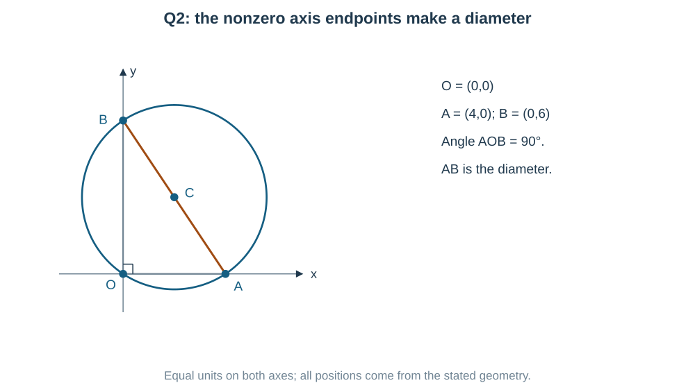

The side opposite a right angle in an inscribed triangle is a diameter. Thus

$$
AB=\sqrt{4^2+6^2}=\sqrt{52}=2\sqrt{13},
\qquad
\boxed{r=AB/2=\sqrt{13};\quad\text{(d)}}.
$$

**Another possible approach:** because the circle passes through the origin, write $x^2+y^2+2gx+2fy=0$. The other points give

$$
16+8g=0\Rightarrow g=-2,\qquad
36+12f=0\Rightarrow f=-3.
$$

So the centre is $(2,3)$ and $r^2=4+9=13$. Its squared distance from each of $O,A,B$ is 13, checking both the geometry and algebra.

---

### Question 3 — A tangent makes a right triangle with the radius

**PDF page 86 | Numerical value | Notes: C03,C06**

The length of the tangent drawn from the point $(6,5)$ to the circle $x^2+y^2-2x-4y-4=0$ is ____.

**A tangent length is one leg of a right triangle.** Complete squares to find the centre and radius:

$$
(x-1)^2+(y-2)^2=9.
$$

For $P=(6,5)$, $CP^2=(6-1)^2+(5-2)^2=34$. Since $34>9$, $P$ is external and real tangents exist.

At a contact $T$, $CT\perp PT$, so

$$
PT^2=CP^2-CT^2=34-9=25
\quad\Longrightarrow\quad
\boxed{PT=5}.
$$

**Another possible approach — point power:** substitute $P$ into the normalized circle expression:

$$
S(P)=36+25-12-20-4=25.
$$

The tangent length is $\sqrt{S(P)}=5$. The radius-right-triangle derivation explains why substituting into a circle equation gives a **squared** tangent length here.

---

### Question 4 — Tangency means centre-to-line distance equals radius

**PDF page 86 | MCQ | Notes: C04**

If the line $3x+4y=k$ ($k>0$) touches the circle $x^2+y^2=4$, then $k=$

- (a) $5$
- (b) $2$
- (c) $10$
- (d) $20$

**“Touches” means the line is exactly one radius from the centre.** The centre is $(0,0)$ and radius 2.

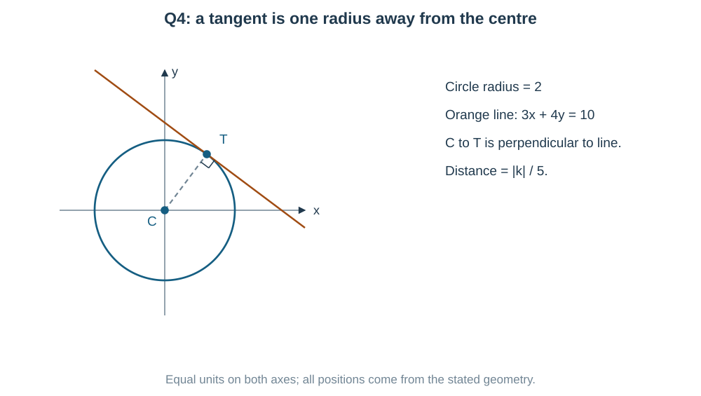

For $3x+4y-k=0$, the centre distance is

$$
d=\frac{|-k|}{\sqrt{3^2+4^2}}=\frac{|k|}{5}.
$$

Tangency requires $|k|/5=2$, so $k=\pm10$. The question gives $k>0$:

$$
\boxed{k=10;\quad\text{(c)}}.
$$

**Check:** its foot from the origin is $(6/5,8/5)$, which has squared distance $(36+64)/25=4$ and satisfies $3x+4y=10$.

**Another possible approach:** substitute $y=(k-3x)/4$ into $x^2+y^2=4$ and demand a repeated real root. This gives the same $k^2=100$, but uses more expansion than the centre-distance test.

---

### Question 5 — The tangent is perpendicular to the actual radius

**PDF page 86 | MCQ | Notes: C05**

The equation of the tangent to the circle $x^2+y^2=25$ at the point $(3,4)$ is

- (a) $4x+3y=25$
- (b) $3x-4y=25$
- (c) $3x+4y=25$
- (d) $3x+4y=5$

**Draw the radius to the given point.** $P=(3,4)$ lies on the circle because $3^2+4^2=25$. The radius direction is $(3,4)$, so this is the tangent's normal.

The line through $P$ with that normal is

$$
3(x-3)+4(y-4)=0
\quad\Longrightarrow\quad
\boxed{3x+4y=25;\quad\text{(c)}}.
$$

**Check:** the line passes through $(3,4)$ and its distance from the origin is $25/5=5$, the circle radius.

**Another possible approach:** differentiate $x^2+y^2=25$:

$$
2x+2yy'=0,\qquad y'(3,4)=-\frac34.
$$

Then $y-4=-(3/4)(x-3)$ gives the same line. The normal-vector route also works at vertical tangents, where dividing by $y=0$ would fail.

---

### Question 6 — The perpendicular from the centre halves a chord

**PDF page 86 | Numerical value | Notes: C04**

The line $3x+4y=10$ cuts the circle $x^2+y^2=13$ in a chord. The length of the chord is ____.

**The chord splits into two equal pieces at the perpendicular foot.** Let $H$ be the foot from the origin to $3x+4y=10$.

$$
CH=\frac{10}{5}=2,\qquad r^2=13.
$$

For a chord endpoint $A$, triangle $CHA$ is right:

$$
AH^2=CA^2-CH^2=13-4=9.
$$

So $AH=3$, and the full chord is

$$
\boxed{AB=2AH=6}.
$$

**Another possible approach — actual endpoints:** the foot is $H=(6/5,8/5)$ and a unit direction along the chord is $(4/5,-3/5)$. Hence

$$
A,B=H\pm3(4/5,-3/5)
=\left(\frac{18}5,-\frac15\right),\
\left(-\frac65,\frac{17}5\right).
$$

Each point satisfies the line and has $x^2+y^2=13$. Their distance is 6. This is a useful independent check when coordinates are also needed.

---

### Question 7 — Subtract circle equations to find their shared chord line

**PDF page 86 | MCQ | Notes: C09**

The length of the common chord of the circles $x^2+y^2=16$ and $x^2+y^2-8x=0$ is

- (a) $2\sqrt3$
- (b) $8$
- (c) $6$
- (d) $4\sqrt3$

**A shared point satisfies both circle equations.** Subtract them before finding coordinates:

$$
(x^2+y^2)-(x^2+y^2-8x)=16-0
\quad\Longrightarrow\quad x=2.
$$

On the first circle,

$$
4+y^2=16\quad\Longrightarrow\quad y=\pm2\sqrt3.
$$

The chord is vertical, so subtract its endpoint heights:

$$
\boxed{AB=2\sqrt3-(-2\sqrt3)=4\sqrt3;\quad\text{(d)}}.
$$

**Another possible approach:** both circles have radius 4, with centres $(0,0),(4,0)$. Their shared chord is halfway between the equal centres, so it is 2 units from either. The chord formula gives $2\sqrt{16-4}=4\sqrt3$.

**Check:** the result is positive and below the diameter 8. Subtracting the circle equations found a **line**, not the chord length itself.

---

### Question 8 — First decide how the two circles meet

**PDF page 86 | MCQ | Notes: C07**

The number of common tangents to the circles $x^2+y^2=4$ and $x^2+y^2-6x-8y+16=0$ is

- (a) $1$
- (b) $3$
- (c) $2$
- (d) $4$

**Count tangents only after classifying the circles.** The first has centre $(0,0)$, radius 2. For the second,

$$
(x-3)^2+(y-4)^2=9,
$$

so its centre is $(3,4)$ and radius 3. The centre distance is $d=\sqrt{9+16}=5$.

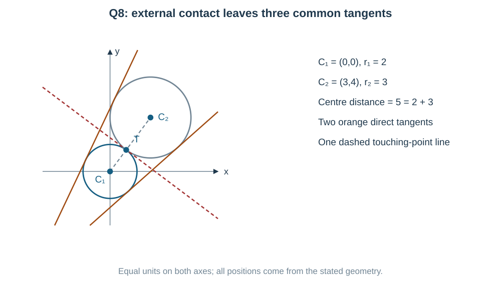

Since $d=r_1+r_2=2+3$, they touch **externally**. There are two common tangents around their outer sides and one at the contact point:

$$
\boxed{3\ \text{common tangents};\quad\text{(b)}}.
$$

**Why not four?** For two separate circles, two transverse tangents cross the gap. As the circles approach external contact, those two merge into one touching-point tangent. The outer two remain.

**Check:** the touching point is $(6/5,8/5)$ along the centre segment. Its line $3x+4y=10$ is distance 2 from the first centre and 3 from the second, confirming the extra shared tangent.

---

### Question 9 — Orthogonal circles have perpendicular radii at their crossing

**PDF page 86 | Numerical value | Notes: C10**

If the circles $x^2+y^2+2x+4y-3=0$ and $x^2+y^2-4x-2y+k=0$ are orthogonal, then $k=$ ____.

**Orthogonal means perpendicular tangents at a crossing.** The radii to that point are perpendicular as well, making a right triangle between the two centres.

For the first circle,

$$
C_1=(-1,-2),\qquad r_1^2=1+4+3=8.
$$

For the second,

$$
C_2=(2,1),\qquad r_2^2=4+1-k=5-k.
$$

Thus

$$
C_1C_2^2=3^2+3^2=18=r_1^2+r_2^2=8+5-k,
$$

giving

$$
\boxed{k=-5}.
$$

**Check:** $r_2^2=10>0$, and $\sqrt{18}$ lies strictly between $|\sqrt{10}-\sqrt8|$ and $\sqrt{10}+\sqrt8$, so actual crossings exist.

**Another possible approach:** use $2g_1g_2+2f_1f_2=c_1+c_2$. It gives $2(1)(-2)+2(2)(-1)=-3+k$, hence $-8=-3+k$ and $k=-5$. The geometric version makes the sign and meaning easier to remember.

---

### Question 10 — Midpoints of chords through one boundary point have a smaller-circle locus

**PDF page 86 | MCQ | Notes: C11**

The locus of the midpoints of the chords of the circle $x^2+y^2-4x=0$ that pass through the origin is

- (a) $x^2+y^2-4x=0$
- (b) $x^2+y^2-x=0$
- (c) $x^2+y^2-2x-4=0$
- (d) $x^2+y^2-2x=0$

**Use the endpoint–midpoint relation first.** One endpoint is $O=(0,0)$. If the midpoint is $M=(x,y)$, the other endpoint must be $B=(2x,2y)$.

Since $B$ lies on the original circle,

$$
(2x)^2+(2y)^2-4(2x)=0
\quad\Longrightarrow\quad
\boxed{x^2+y^2-2x=0;\quad\text{intended (d)}}.
$$

It is a circle with centre $(1,0)$ and radius 1. **Exclude $(0,0)$** from the exact locus of nonzero chords: it would give $B=O$, so the endpoints would not be different.

**Reverse check:** for any other point on the derived circle, $B=(2x,2y)$ is a distinct original boundary point. The segment $OB$ has midpoint $M$, so every retained locus point is attainable.

**Another geometric view:** original centre $C=(2,0)$ gives $CM\perp OM$ whenever $M\ne C$. Thus $(x-2,y)\cdot(x,y)=0$, the same equation. The exceptional case $M=C$ is valid too: it is the midpoint of the diameter joining $(0,0)$ and $(4,0)$.

---

### Question 11 — A pole is the point associated with a polar line

**PDF page 87 | MCQ | Notes: C12**

The pole of the line $3x+4y=8$ with respect to the circle $x^2+y^2=16$ is

- (a) $(6,8)$
- (b) $(3,4)$
- (c) $(8,6)$
- (d) $\left(2,\dfrac83\right)$

**First recall what a pole means.** For $x^2+y^2=r^2$, the point $P=(x_1,y_1)$ is associated with the polar line $xx_1+yy_1=r^2$. When $P$ is outside, that line joins its two tangent contacts.

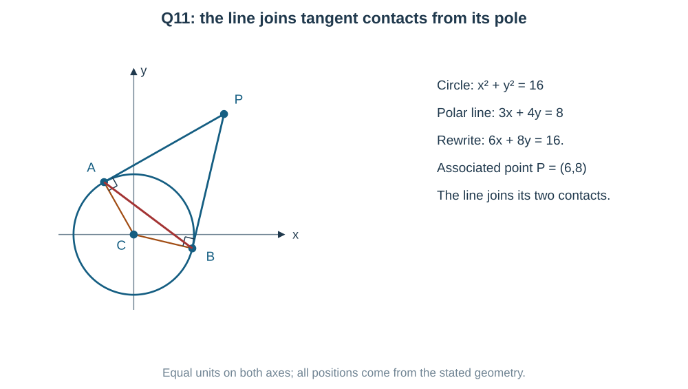

Here $r^2=16$. Rewrite the supplied line with right side 16:

$$
3x+4y=8
\quad\Longleftrightarrow\quad
6x+8y=16.
$$

Comparing with $xx_1+yy_1=16$ gives

$$
\boxed{P=(6,8);\quad\text{(a)}}.
$$

**Check:** $CP=10>4$, so the point is external and its polar genuinely meets the circle at two tangent contacts. The line's centre distance is $8/5<4$.

**Another view:** the pole lies along normal $(3,4)$, so write $P=\lambda(3,4)$. Its polar is $\lambda(3x+4y)=16$. On the given line the bracket is 8, hence $\lambda=2$ and $P=(6,8)$. Comparing coefficients directly is the shorter calculation.

---

### Question 12 — A zero squared radius gives one point

**PDF page 87 | MCQ | Notes: C01**

Statement I: The equation $x^2+y^2-2x-4y+5=0$ represents a point circle.

Statement II: The equation $x^2+y^2+2gx+2fy+c=0$ always represents a real circle of radius $\sqrt{g^2+f^2-c}$.

Choose the correct option.

- (a) Both Statement I and Statement II are false
- (b) Statement I is false but Statement II is true
- (c) Both Statement I and Statement II are true
- (d) Statement I is true but Statement II is false

**Complete squares instead of guessing from the general shape.**

$$
x^2+y^2-2x-4y+5
=(x-1)^2+(y-2)^2.
$$

Both squares can add to zero only when $x=1,y=2$. So Statement I is **true**: this is a point circle.

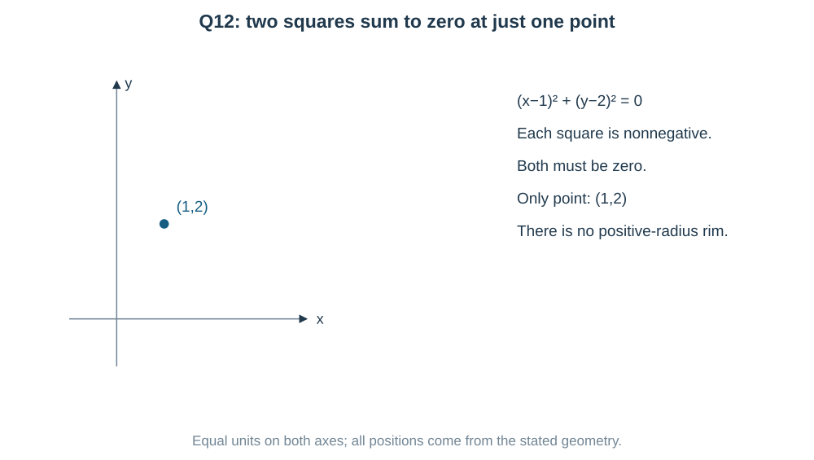

Statement II says **always**. But the squared radius $g^2+f^2-c$ may be positive, zero or negative. For example, $x^2+y^2+1=0$ has no real points. Thus Statement II is **false**.

$$
\boxed{\text{I true, II false;\quad (d)}}.
$$

**Check the distinction:** a formula containing a square root does not guarantee its input is nonnegative. Determine the real existence condition before naming a radius.

---

### Question 13 — Half the linear coefficients before using the radius formula

**PDF page 87 | MCQ | Notes: C01**

Match List I (circle) with List II (its radius).

| List I | Circle | List II | Radius |
|---|---|---|---|
| A | $x^2+y^2-2x-2y-2=0$ | P | $3$ |
| B | $x^2+y^2+6x-8y=0$ | Q | $5$ |
| C | $x^2+y^2-4x+2y-4=0$ | R | $\sqrt7$ |
| D | $x^2+y^2=7$ | S | $2$ |

- (a) A–P, B–Q, C–S, D–R
- (b) A–S, B–P, C–Q, D–R
- (c) A–R, B–Q, C–P, D–S
- (d) A–S, B–Q, C–P, D–R

**The coefficients are $2g,2f$, so halve them first.** Then use $r^2=g^2+f^2-c$.

| Circle | $g,f,c$ | $r^2$ | Radius and match |
|---|---|---|---|
| A | $-1,-1,-2$ | $1+1+2=4$ | $2$: S |
| B | $3,-4,0$ | $9+16=25$ | $5$: Q |
| C | $-2,1,-4$ | $4+1+4=9$ | $3$: P |
| D | $0,0,-7$ | $7$ | $\sqrt7$: R |

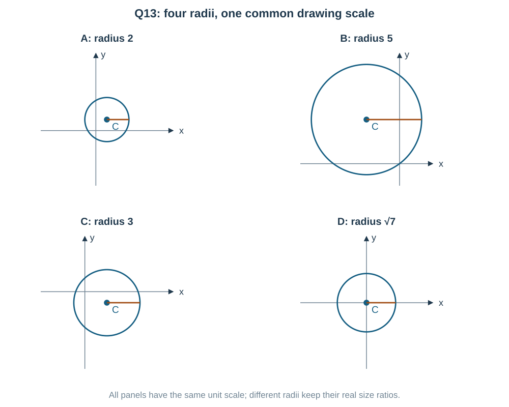

$$
\boxed{\text{A–S,\ B–Q,\ C–P,\ D–R;\quad (d)}}.
$$

**Another possible approach:** complete squares for each. For example, C becomes $(x-2)^2+(y+1)^2=9$, so radius 3. The table is faster after the general form is understood.

**Quick error check:** do not match a squared radius to a radius. A's radius is 2, not 4, and B's radius is 5, not 25.

---

### Question 14 — Use square values and symmetry to count lattice points

**PDF page 87 | MCQ | Notes: C01**

The number of points with integer coordinates lying on the circle $x^2+y^2=25$ is

- (a) $12$
- (b) $8$
- (c) $16$
- (d) $4$

**Integer coordinates mean we only need integer squares.** Since $x^2+y^2=25$, each coordinate is between $-5$ and 5.

The available nonnegative squares are $0,1,4,9,16,25$. The only pairs adding to 25 are

$$
0+25,\quad25+0,\quad9+16,\quad16+9.
$$

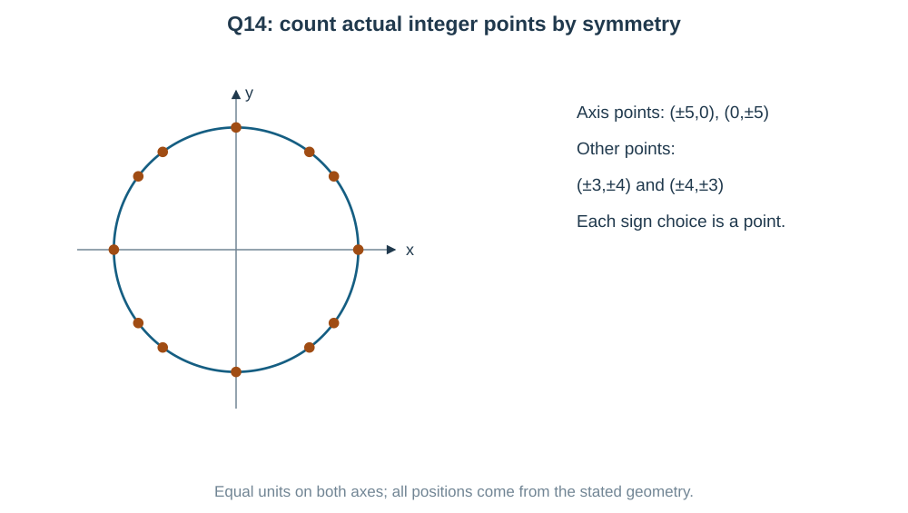

- Axis points $(\pm5,0),(0,\pm5)$ give **4** points.
- $(\pm3,\pm4)$ gives **4** sign combinations.
- $(\pm4,\pm3)$ gives another **4**.

$$
\boxed{4+4+4=12;\quad\text{(a)}}.
$$

**Why “four quadrants times three” needs care:** points on the axes belong to quadrant boundaries and can be counted twice. Count them separately as above.

**Check completeness:** every possible coordinate square has been listed, so no other integer pair can fit. A sampled picture alone would not prove that none were missed.

---

### Question 15 — Keep the two shared points without solving them first

**PDF page 87 | MCQ | Notes: C02,C09**

The circle passing through the points of intersection of $x^2+y^2=4$ and $x+y=2$ and through the origin is

- (a) $x^2+y^2-2x-2y+4=0$
- (b) $x^2+y^2+2x+2y=0$
- (c) $x^2+y^2-x-y=0$
- (d) $x^2+y^2-2x-2y=0$

**At the two shared points, both $S=x^2+y^2-4$ and $L=x+y-2$ are zero.** So every circle $S+\lambda L=0$ passes through them:

$$
x^2+y^2-4+\lambda(x+y-2)=0.
$$

The new circle also passes through the origin. Substitute $(0,0)$:

$$
-4-2\lambda=0\quad\Longrightarrow\quad\lambda=-2.
$$

Thus

$$
\boxed{x^2+y^2-2x-2y=0;\quad\text{(d)}}.
$$

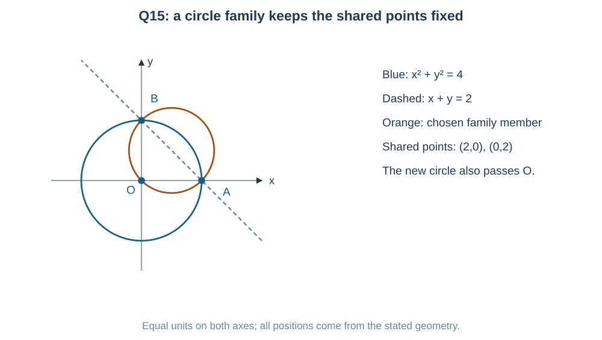

**Check:** it is $(x-1)^2+(y-1)^2=2$, a real circle through the origin.

**Another possible approach:** solve the original intersections. From $x+y=2$ and $x^2+y^2=4$, we get $xy=0$, so the points are $(2,0),(0,2)$. Together with the origin they form a right triangle. The new circle has diameter joining $(2,0),(0,2)$, hence centre $(1,1)$ and radius $\sqrt2$. Here both routes are short; the family method also works when the shared points would contain awkward radicals.

---

### Question 16 — Find tangent intercepts before finding the triangle area

**PDF page 87 | Numerical value | Notes: C05**

The area (in square units) of the triangle formed by the tangent to $x^2+y^2=25$ at $(3,4)$ and the coordinate axes, rounded to two decimal places, is ____.

**Find the tangent first, then the triangle.** The radius to $(3,4)$ gives tangent $3x+4y=25$.

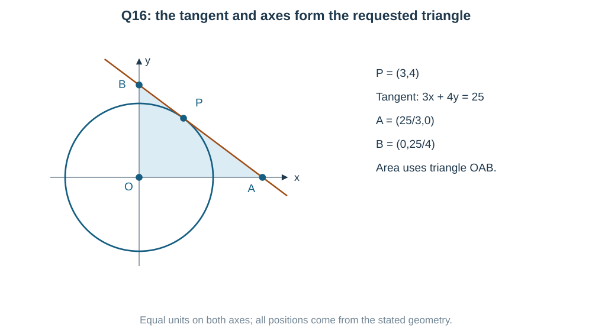

At $y=0$, the intercept is $a=25/3$. At $x=0$, it is $b=25/4$. Therefore

$$
\Delta=\frac12\cdot\frac{25}{3}\cdot\frac{25}{4}
=\frac{625}{24}
=26.041666\ldots.
$$

The requested two-decimal answer is

$$
\boxed{26.04}.
$$

**Why not use the radius 5 as a triangle side?** The requested triangle is bounded by the tangent and the **coordinate axes**, not by two radii. Its intercepts provide the perpendicular legs.

**Another check:** vertex coordinates $(0,0),(25/3,0),(0,25/4)$ give the same area by the determinant formula. Keep the fractions until the last rounding step.

---

### Question 17 — The centre line bisects the angle between equal tangents

**PDF page 87 | MCQ | Notes: C06**

The angle between the two tangents drawn from the point $(\sqrt3,1)$ to the circle $x^2+y^2=1$ is

- (a) $30^\circ$
- (b) $60^\circ$
- (c) $90^\circ$
- (d) $120^\circ$

**The two tangent segments make equal right triangles.** The point $P=(\sqrt3,1)$ is distance $CP=\sqrt{3+1}=2$ from the centre. The radius is 1.

Let $\theta=\angle APB$. Since $CP$ bisects it, one right triangle gives

$$
\sin(\theta/2)=\frac{CA}{CP}=\frac12.
$$

Here $0<\theta/2<90^\circ$, so $\theta/2=30^\circ$:

$$
\boxed{\theta=60^\circ;\quad\text{(b)}}.
$$

**Another possible approach:** one contact is $(0,1)$, giving tangent $y=1$. The other is $(\sqrt3/2,-1/2)$, and its tangent has slope $\sqrt3$. The rays from $P$ to these contacts make $60^\circ$.

**Angle check:** the infinite lines also form $120^\circ$ on their other side. The requested tangent-segment angle at $P$ is the one shown between the two actual rays, $60^\circ$.

---

### Question 18 — Split the quadrilateral into two right triangles

**PDF page 88 | MCQ | Notes: C06**

Tangents are drawn from $P(0,5)$ to the circle $x^2+y^2=9$, touching it at $A$ and $B$. The area (in square units) of quadrilateral $OAPB$ ($O$ the origin) is

- (a) $6$
- (b) $15$
- (c) $24$
- (d) $12$

**Split $OAPB$ along $OP$.** Each contact radius is perpendicular to its tangent. Thus $OAP$ and $OBP$ are right triangles.

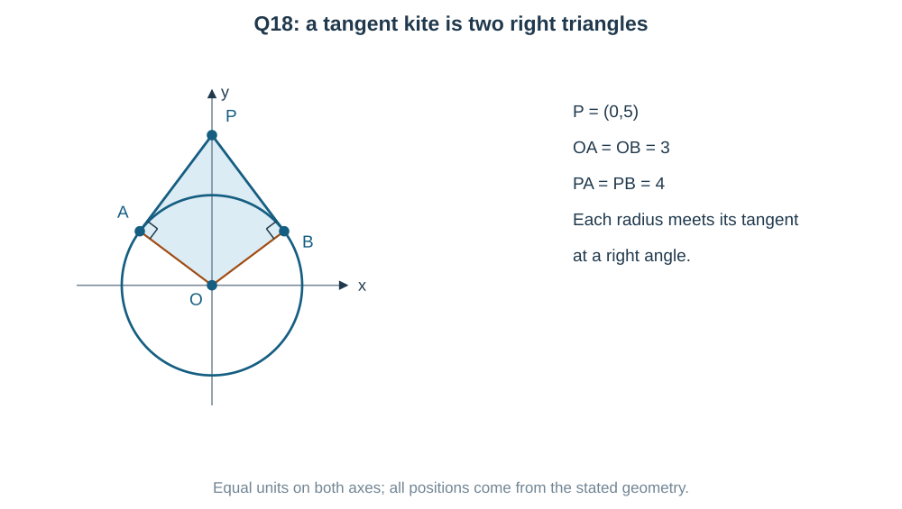

Since $OP=5$ and $OA=OB=3$,

$$
PA=PB=\sqrt{OP^2-OA^2}=\sqrt{25-9}=4.
$$

The total area is

$$
2\left(\frac12\cdot3\cdot4\right)
=\boxed{12;\quad\text{(d)}}.
$$

**Another possible approach — the diagonals:** the chord of contact is $5y=9$, so the contacts are $(\pm12/5,9/5)$ and $AB=24/5$. The diagonals $AB$ and $OP$ are perpendicular, so area $=\tfrac12(24/5)(5)=12$.

**Check:** $PA=4$ is a tangent length, not the chord $AB$. The two different segments appear in different valid area formulas.

---

### Question 19 — Touching both positive axes puts the centre at r comma r

**PDF page 88 | Numerical value | Notes: C13**

There are exactly two circles in the first quadrant touching both coordinate axes and passing through $(1,2)$. The sum of their radii is ____.

**Touching both positive axes fixes the centre's shape.** If the radius is $r>0$, the centre must be $(r,r)$.

The point $(1,2)$ lies on the circle, so

$$
(1-r)^2+(2-r)^2=r^2
\quad\Longrightarrow\quad
r^2-6r+5=0.
$$

Factor:

$$
(r-1)(r-5)=0.
$$

Both radii 1 and 5 are positive and give valid first-quadrant circles:

$$
\boxed{r_1+r_2=6}.
$$

**Another shorter exam step:** the quadratic's sum of roots is 6 by Vieta, so we need not calculate both roots just to answer the sum. Still check that both roots are positive and geometrically valid. Factoring here is easy and checks that condition.

For $r=5$, the squared distance from $(5,5)$ to $(1,2)$ is $16+9=25$; for $r=1$, it is $0+1=1$.

---

### Question 20 — The diameter midpoint is the centre

**PDF page 88 | MCQ | Notes: C02**

The equation of the circle having the line segment joining $(1,2)$ and $(5,6)$ as a diameter is

- (a) $x^2+y^2-6x-8y+7=0$
- (b) $x^2+y^2-6x+8y+17=0$
- (c) $x^2+y^2-6x-8y+17=0$
- (d) $x^2+y^2-3x-4y+17=0$

**A diameter's midpoint is the centre.**

$$
C=\left(\frac{1+5}{2},\frac{2+6}{2}\right)=(3,4).
$$

The squared diameter length is $4^2+4^2=32$. The squared radius is one **quarter** of that:

$$
r^2=\frac{32}{4}=8.
$$

Thus

$$
(x-3)^2+(y-4)^2=8
\quad\Longrightarrow\quad
\boxed{x^2+y^2-6x-8y+17=0;\quad\text{(c)}}.
$$

**Another possible approach — diameter product:**

$$
(x-1)(x-5)+(y-2)(y-6)=0.
$$

Expanding gives the same equation. This is the right-angle condition $(P-A)\cdot(P-B)=0$.

**Check:** both supplied endpoints satisfy the original expanded answer. The linear coefficients also reproduce the midpoint centre.

---

### Question 21 — A chord of contact joins the two tangent touching points

**PDF page 88 | MCQ | Notes: C05,C12**

The chord of contact of the tangents drawn from $(4,6)$ to the circle $x^2+y^2=13$ is

- (a) $4x+6y=26$
- (b) $2x+3y=13$
- (c) $4x+6y=13$
- (d) $6x+4y=13$

**What is a chord of contact?** Draw tangents from $P=(4,6)$ touching at $A,B$. The required line is **AB**, joining the contacts.

If $A=(a,b)$ lies on $x^2+y^2=13$, its tangent is $ax+by=13$. Because that tangent passes through $P$,

$$
4a+6b=13.
$$

The same is true for $B$, so both contacts lie on

$$
\boxed{4x+6y=13;\quad\text{(c)}}.
$$

**Check existence:** $OP^2=4^2+6^2=52>13$, so two tangents exist. The contact chord is only $13/\sqrt{52}=\sqrt{13}/2$ from the centre, less than its radius $\sqrt{13}$, so it cuts two actual boundary points.

**Common trap:** the external point itself need not lie on the contact chord. In fact $4(4)+6(6)=52\ne13$. Calling the formula a tangent “at $(4,6)$” would be wrong because that point is not on the circle.

---

### Question 22 — Perpendicular tangents form a square with the two radii

**PDF page 88 | MCQ | Notes: C06**

The locus of the point from which perpendicular tangents can be drawn to the circle $(x-1)^2+(y-2)^2=9$ is

- (a) $x^2+y^2-2x-4y-13=0$
- (b) $x^2+y^2-2x-4y-4=0$
- (c) $x^2+y^2-2x-4y-8=0$
- (d) $x^2+y^2-2x-4y+5=0$

**Perpendicular tangents give a square.** Let the tangents from a moving point $P$ touch at $A,B$. Each contact radius is perpendicular to its tangent. If the angle at $P$ is also $90^\circ$, the two radius–tangent triangles are isosceles and form a square of side $r$.

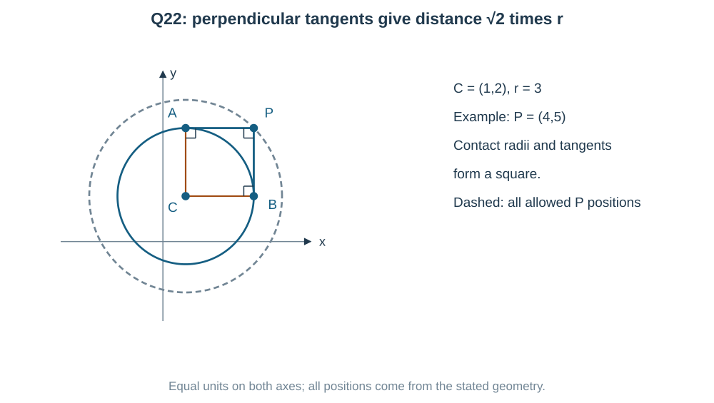

The given centre is $C=(1,2)$ and radius $r=3$. The square's diagonal $CP$ has squared length $2r^2=18$:

$$
(x-1)^2+(y-2)^2=18.
$$

Expand:

$$
\boxed{x^2+y^2-2x-4y-13=0;\quad\text{(a)}}.
$$

**Another possible approach:** set the tangent-segment angle $\theta=90^\circ$ in $\sin(\theta/2)=r/CP$. Since $\sin45^\circ=1/\sqrt2$, $CP=3\sqrt2$.

**Check:** every locus point is outside the original circle because $3\sqrt2>3$. Conversely, from any point at that centre distance, the same half-angle relation gives $90^\circ$, so the full circle is attained. This locus is called the director circle.

---

### Question 23 — Internal tangents use the sum of the radii

**PDF page 88 | Numerical value | Notes: C08**

Two circles have radii $3$ and $2$ and their centres are $13$ units apart. The length of a transverse (internal) common tangent is ____.

**Which common tangent?** “Transverse/internal” means the two centres lie on **opposite** sides of the tangent. Their perpendicular radius offsets add to $3+2=5$.

Translate one radius parallel to itself to form the dashed right triangle. Its hypotenuse is the centre distance 13. One leg is the radius sum 5, and the other is the tangent-contact length:

$$
L^2+5^2=13^2
\quad\Longrightarrow\quad
L=\sqrt{169-25}
=\boxed{12}.
$$

**Check existence:** $13>3+2$, so a real internal tangent exists.

**Why radius difference is wrong here:** $|3-2|=1$ belongs to a direct tangent with both centres on the same side. It would give $\sqrt{168}$ for a different segment.

**Coordinate check:** place centres at $(0,0),(13,0)$. The line $5x+12y=39$ is 3 units from the first centre and 2 from the second, on opposite sides. Its feet are $(15/13,36/13)$ and $(159/13,-24/13)$, whose separation is 12.

---

### Question 24 — The radical centre has equal powers to three circles

**PDF page 88 | MCQ | Notes: C03,C09**

The radical centre of the circles $x^2+y^2=4$, $x^2+y^2-4x=0$ and $x^2+y^2-4y=0$ is

- (a) $(2,2)$
- (b) $(1,1)$
- (c) $(1,2)$
- (d) $(2,1)$

**A radical centre means equal powers to three circles.** It does not mean a point lying on all their boundaries.

Write

$$
S_1=x^2+y^2-4,\quad
S_2=x^2+y^2-4x,\quad
S_3=x^2+y^2-4y.
$$

Equal first and second powers give $S_1-S_2=4x-4=0$, hence $x=1$. Equal first and third give $4y-4=0$, hence $y=1$.

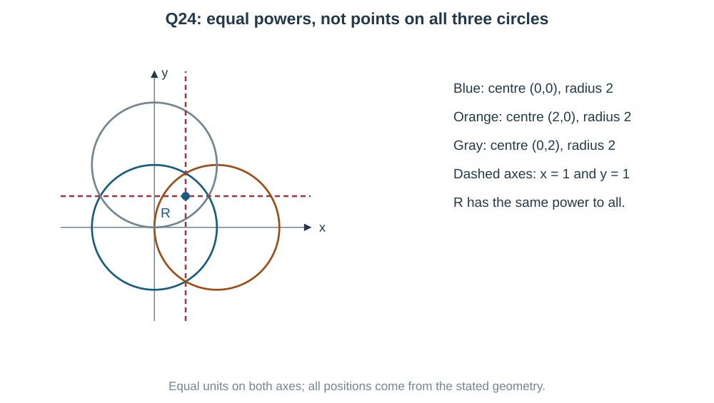

Therefore

$$
\boxed{R=(1,1);\quad\text{(b)}}.
$$

**Check all three original expressions:**

$$
S_1(1,1)=2-4=-2,\quad
S_2(1,1)=2-4=-2,\quad
S_3(1,1)=2-4=-2.
$$

The third radical axis is $x=y$, and $(1,1)$ lies on it too. This check confirms the equal-power meaning and prevents confusing the radical centre with an ordinary circle-intersection point.

---

### Question 25 — There are two parallel tangents on opposite sides

**PDF page 88 | Numerical value | Notes: C04**

The line $3x-4y+c=0$ touches the circle $x^2+y^2-2x-4y+1=0$ for two values of $c$. The product of these two values is ____.

**The two tangent lines are parallel, so use centre distance.** The circle is

$$
(x-1)^2+(y-2)^2=4,
$$

with centre $(1,2)$ and radius 2.

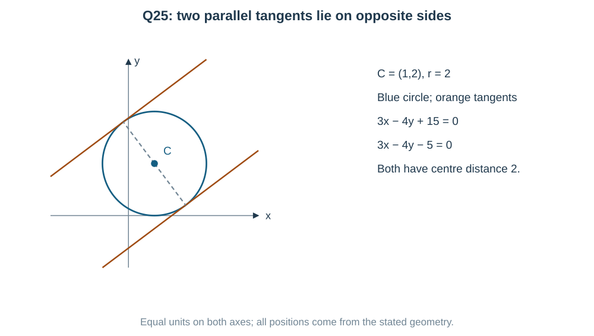

The line $3x-4y+c=0$ has distance

$$
\frac{|3(1)-4(2)+c|}{5}=\frac{|c-5|}{5}.
$$

Tangency gives $|c-5|=10$, so $c=15$ or $c=-5$:

$$
\boxed{c_1c_2=15(-5)=-75}.
$$

**Another shorter route for a product:** squaring gives $(c-5)^2=100$, or $c^2-10c-75=0$. Vieta gives the product directly as $-75$.

**Check:** for both values the centre distance is exactly 2. Squaring introduces no extra candidates here because the right side of the absolute-value equation is positive and both roots satisfy it.

---

### Question 26 — A centre is equally far from the two given boundary points

**PDF page 88 | Numerical value | Notes: C02**

A circle passes through $(0,0)$ and $(3,3)$ and its centre lies on the line $x-2y=0$. The square of its radius is ____.

**The centre is equally far from both given boundary points.** Call it $C=(h,k)$.

$$
h^2+k^2=(h-3)^2+(k-3)^2.
$$

Expanding cancels both squares, leaving $6h+6k=18$, or $h+k=3$. The given centre line says $h=2k$. Thus $3k=3$, so $C=(2,1)$.

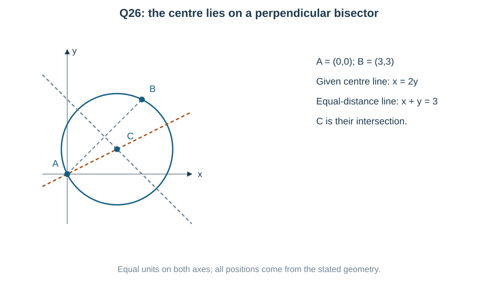

Using the boundary point $(0,0)$,

$$
\boxed{r^2=2^2+1^2=5}.
$$

**Check:** its squared distance to $(3,3)$ is $(2-3)^2+(1-3)^2=1+4=5$.

**Another possible approach:** the segment from $(0,0)$ to $(3,3)$ has midpoint $(3/2,3/2)$ and slope 1. Its perpendicular bisector is $y-3/2=-(x-3/2)$, or $x+y=3$. Intersecting it with $x=2y$ gives the same centre. The squared-distance subtraction explains that bisector algebraically.

---

### Question 27 — Parallel tangents keep the same normal

**PDF page 88 | MCQ | Notes: C04**

A tangent to $x^2+y^2=9$ which is parallel to the line $2x-y+5=0$ is

- (a) $2x-y+3\sqrt5=0$
- (b) $2x-y+9=0$
- (c) $2x-y+3=0$
- (d) $x-2y+3\sqrt5=0$

**Parallel lines keep the same normal.** Any candidate parallel to $2x-y+5=0$ has the form $2x-y+c=0$.

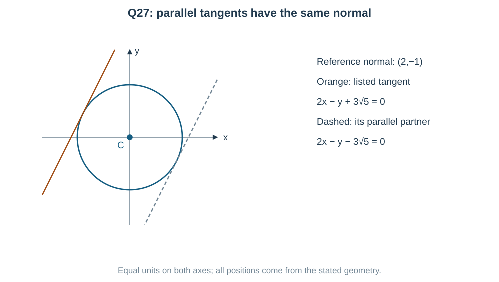

For the radius-3 circle centred at the origin,

$$
\frac{|c|}{\sqrt{2^2+(-1)^2}}=3
\quad\Longrightarrow\quad c=\pm3\sqrt5.
$$

The listed line with the correct direction and distance is

$$
\boxed{2x-y+3\sqrt5=0;\quad\text{(a)}}.
$$

**Check the options:** (b) has centre distance $9/\sqrt5\ne3$; (c) has distance $3/\sqrt5\ne3$. Option (d) is tangent to the circle but has a different normal $(1,-2)$, so it is not parallel to the given line.

The question asks for **a** tangent; the valid partner $2x-y-3\sqrt5=0$ need not appear among the options.

---

### Question 28 — The farthest point is on the opposite end of a radius

**PDF page 88 | Numerical value | Notes: C14**

The greatest distance of the point $(3,4)$ from a point on the circle $x^2+y^2=4$ is ____.

**The farthest circumference point is on the opposite side of the centre from $P$.** Here $P=(3,4)$, centre $C=(0,0)$ and radius 2.

$$
PC=\sqrt{3^2+4^2}=5.
$$

For any boundary point $Q$, the triangle inequality gives

$$
PQ\le PC+CQ=5+2=7.
$$

This upper bound is attained at

$$
Q=-\frac25(3,4)=\left(-\frac65,-\frac85\right).
$$

It lies on the circle because $36/25+64/25=4$. Therefore

$$
\boxed{PQ_{\max}=7}.
$$

**Another algebraic view — Cauchy–Schwarz, important for JEE Main:** for $Q=(x,y)$,

$$
PQ^2=25+4-2(3x+4y)=29-2(3x+4y).
$$

The useful bound comes from

$$
(3x+4y)^2\le(3^2+4^2)(x^2+y^2)=25\cdot4=100.
$$

Indeed, the difference is $(4x-3y)^2\ge0$. So $-10\le3x+4y\le10$, giving $PQ^2\le49$. Equality at the negative end occurs at the same $Q=(-6/5,-8/5)$. This connects a geometric extreme to a dot-product bound and shows why the opposite radius direction is optimal.

---

### Question 29 — A right central angle makes a square with the tangents

**PDF page 89 | MCQ | Notes: C06**

Tangents are drawn at the end points of a chord of the circle $x^2+y^2=9$ which subtends a right angle at the centre. The locus of their point of intersection is

- (a) $x^2+y^2=9$
- (b) $x^2+y^2=36$
- (c) $x^2+y^2=18$
- (d) $x^2+y^2=\dfrac92$

**Use the actual four right angles.** Let the contact points be $A,B$ and centre be $O$. The question gives $\angle AOB=90^\circ$. The radii also meet their tangents at $90^\circ$.

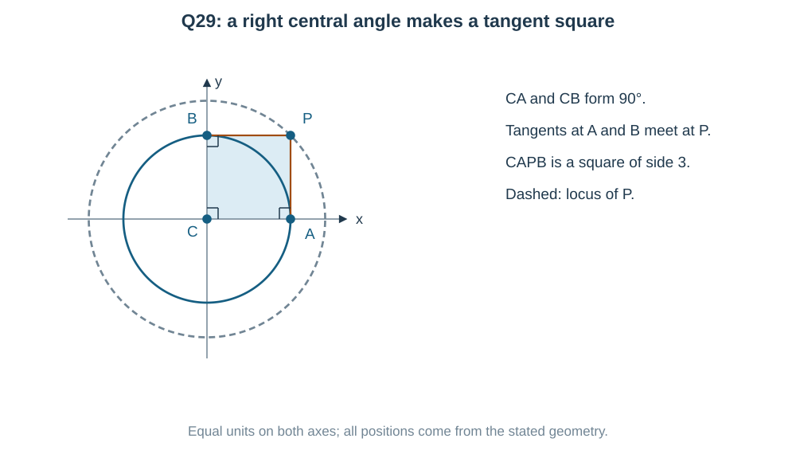

Thus the fourth angle at the tangent intersection $P$ is $90^\circ$. With equal adjacent radii $OA=OB=3$, $OAPB$ is a square of side 3. Its diagonal is

$$
OP=3\sqrt2.
$$

Rotating this configuration around the origin lets $P$ trace the full circle

$$
\boxed{x^2+y^2=18;\quad\text{(c)}}.
$$

**Another view:** $OP$ bisects the $90^\circ$ central angle. In one right triangle, $\cos45^\circ=3/OP$, so $OP=3\sqrt2$.

**Reverse check:** from every point at distance $3\sqrt2$, the two tangents form a square with the two radii, giving a $90^\circ$ contact central angle. This proves the full locus, not just one sample point.

---

### Question 30 — Equal fixed radii make equal centre distances

**PDF page 89 | MCQ | Notes: C07,C14**

A variable circle touches externally both the circles $x^2+y^2=1$ and $x^2+y^2-6x+8=0$. The locus of its centre is

- (a) $2x-3=0$
- (b) $x^2+y^2=4$
- (c) $x-3=0$
- (d) $2y-3=0$

**Find the fixed centres and radii first.** The first circle has centre $C_1=(0,0)$, radius 1. The second is

$$
(x-3)^2+y^2=1,
$$

so $C_2=(3,0)$ and its radius is also 1.

Let the variable circle have centre $P=(x,y)$ and positive radius $\rho$. External tangency gives

$$
PC_1=\rho+1,\qquad PC_2=\rho+1.
$$

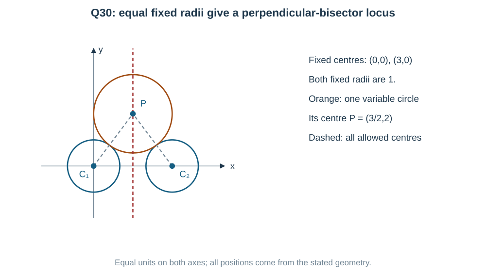

Thus $PC_1=PC_2$. Squaring and subtracting,

$$
x^2+y^2=(x-3)^2+y^2
\quad\Longrightarrow\quad
\boxed{2x-3=0;\quad\text{(a)}}.
$$

**Does every point on that line work?** At $P=(3/2,y)$ the shared distance is $\sqrt{9/4+y^2}\ge3/2$. Choose

$$
\rho=\sqrt{9/4+y^2}-1\ge\frac12>0.
$$

Then both original external-tangency conditions hold. So the entire perpendicular bisector is valid; there is no hidden missing interval.

**Pattern:** equal fixed radii let the unknown variable radius cancel. With unequal fixed radii, you would instead obtain a fixed difference of centre distances, a different locus.

---

### Question 31 — An axis intercept is a chord, not a radius

**PDF page 89 | Numerical value | Notes: C04,C13**

The length of the intercept made by the circle $x^2+y^2-6x+4y-12=0$ on the $y$-axis is ____.

**An intercept is the full chord cut by the axis.** On the $y$-axis, $x=0$, so the original circle becomes

$$
y^2+4y-12=0
\quad\Longrightarrow\quad
(y+6)(y-2)=0.
$$

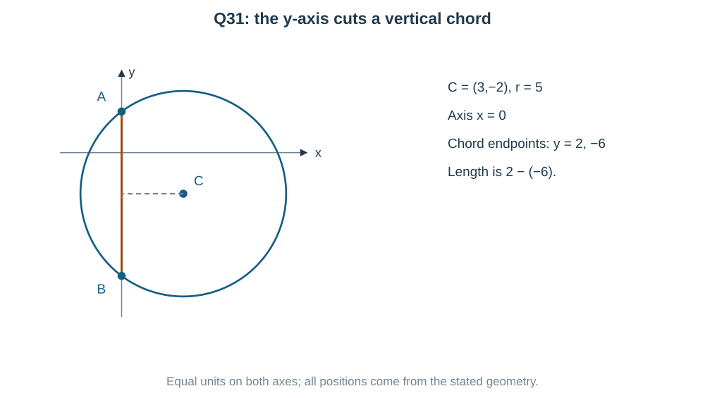

Its endpoints are $(0,2),(0,-6)$; hence

$$
\boxed{\text{length}=|2-(-6)|=8}.
$$

**Another possible approach:** complete squares to get centre $(3,-2)$ and radius 5. The centre distance to the $y$-axis is 3, so chord length $=2\sqrt{25-9}=8$.

**Check:** the midpoint is $(0,-2)$, exactly at the centre's height, as a vertical chord's midpoint should be. The endpoint coordinate 2 is not the chord length.

---

### Question 32 — Concentric circles share their centre

**PDF page 89 | MCQ | Notes: C01**

The equation of the circle concentric with $x^2+y^2-4x-6y-3=0$ and passing through $(6,7)$ is

- (a) $x^2+y^2-4x-6y-3=0$
- (b) $x^2+y^2-4x-6y-19=0$
- (c) $x^2+y^2-4x-6y+19=0$
- (d) $x^2+y^2-4x-6y-13=0$

**Concentric means same centre.** The given circle has centre $(2,3)$, so the required one must be

$$
(x-2)^2+(y-3)^2=R^2.
$$

The point $(6,7)$ gives

$$
R^2=(6-2)^2+(7-3)^2=16+16=32.
$$

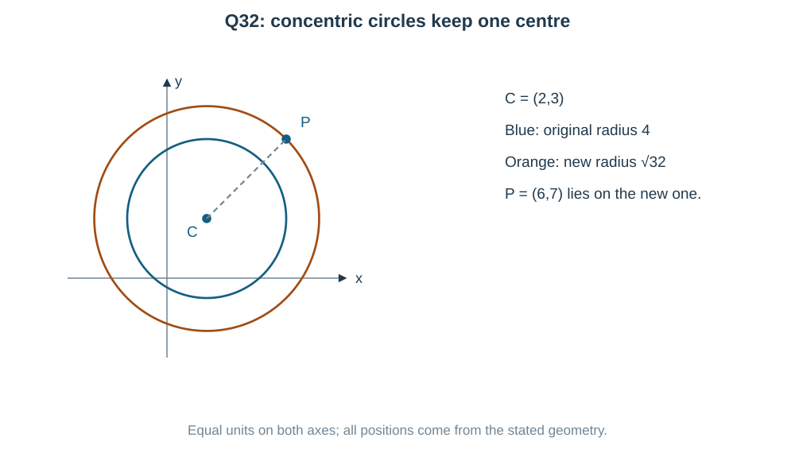

Expand:

$$
x^2+y^2-4x-6y+13=32
\quad\Longrightarrow\quad
\boxed{x^2+y^2-4x-6y-19=0;\quad\text{(b)}}.
$$

**Another shorter route:** keep the original linear coefficients and write $x^2+y^2-4x-6y+c=0$. Substituting $(6,7)$ gives $36+49-24-42+c=0$, so $c=-19$.

**Check:** the required radius is $\sqrt{32}$, different from the original radius 4. Same centre does not mean same circle.

---

### Question 33 — Tangency turns an unknown slope into a distance equation

**PDF page 89 | MCQ | Notes: C04,C05**

The slopes of the tangents drawn from the origin to the circle $x^2+y^2-8x-4y+16=0$ are

- (a) $0$ and $\dfrac34$
- (b) $0$ and $\dfrac43$
- (c) $\dfrac12$ and $2$
- (d) $\dfrac43$ and $-\dfrac43$

**We need tangent directions through one known point, the origin.** First complete squares:

$$
(x-4)^2+(y-2)^2=4.
$$

Thus $C=(4,2)$ and $r=2$. A nonvertical line through the origin is $y=mx$.

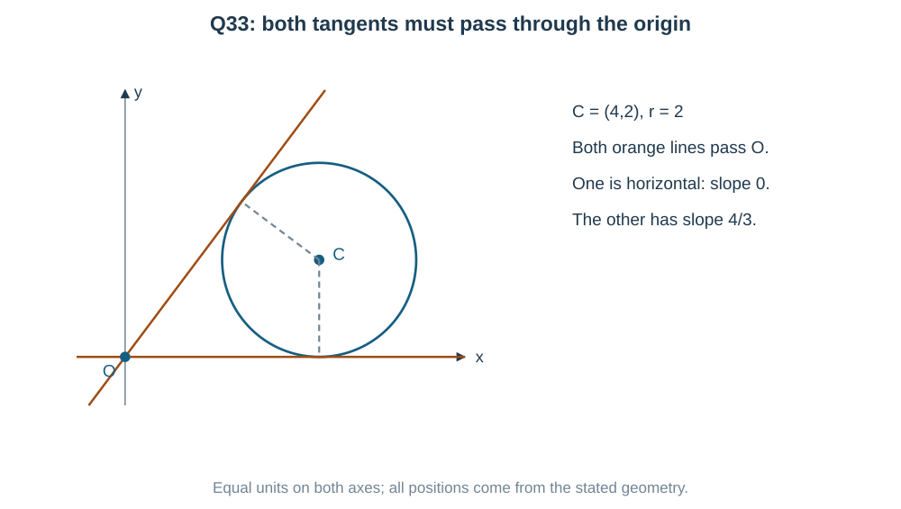

Tangency requires centre distance equal to 2:

$$
\frac{|4m-2|}{\sqrt{m^2+1}}=2.
$$

Squaring,

$$
16m^2-16m+4=4m^2+4
\quad\Longrightarrow\quad
4m(3m-4)=0.
$$

Therefore

$$
\boxed{m=0,\ \frac43;\quad\text{(b)}}.
$$

**Check for a missed vertical tangent:** the vertical line through the origin is $x=0$, whose centre distance is 4, not 2. It is not tangent.

**Another possible approach:** substitute $y=mx$ into the circle and set the quadratic discriminant to zero. It also gives $m(3m-4)=0$. The centre-distance route is shorter and makes the horizontal tangent $y=0$ easy to see.

---

### Question 34 — Use the completed-square picture to test each claim

**PDF page 89 | MCQ | Notes: C01,C03,C13**

For the circle $x^2+y^2-2x-4y-4=0$ consider:

(a) It passes through $(4,2)$.

(b) It touches the $y$-axis.

(c) The point $(1,2)$ lies inside it.

(d) Its intercept on the $x$-axis is $2\sqrt5$.

The correct statements are

- (a) (a) and (b) only
- (b) (a), (c) and (d) only
- (c) (b), (c) and (d) only
- (d) (a) and (d) only

**Complete squares once, then reuse the picture for all four statements.**

$$
(x-1)^2+(y-2)^2=9.
$$

So the centre is $C=(1,2)$, radius 3.

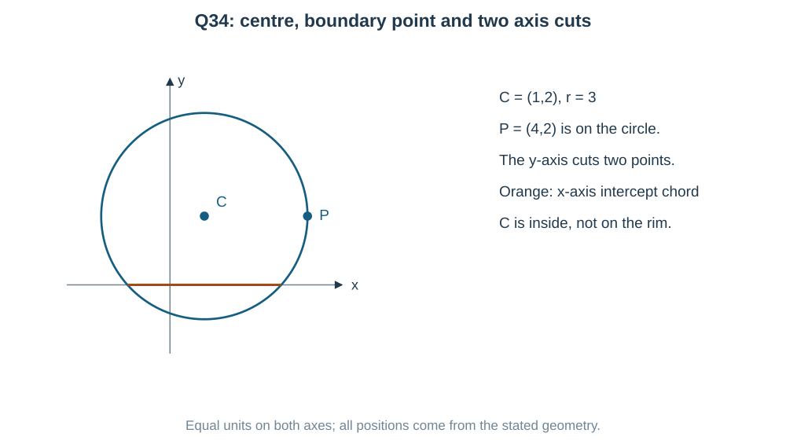

**(a) True:** $(4,2)$ is 3 units horizontally from the centre, so it is on the circle.

**(b) False:** the centre's distance from the $y$-axis is 1, less than 3. The axis cuts the circle in two points; it does not merely touch.

**(c) True:** $(1,2)$ is the centre, so its distance is 0, less than the positive radius.

**(d) True:** on the $x$-axis, $x^2-2x-4=0$, giving $x=1\pm\sqrt5$. Their gap is $2\sqrt5$.

$$
\boxed{\text{(a), (c), (d) only;\quad (b)}}.
$$

**Another check for (d):** the centre is 2 units above the $x$-axis, so its chord length is $2\sqrt{3^2-2^2}=2\sqrt5$. This checks the root-gap calculation geometrically.

---

### Question 35 — The radius to an axis touching point is perpendicular to that axis

**PDF page 89 | MCQ | Notes: C13**

A circle touches the $x$-axis at $(3,0)$ and passes through $(1,2)$. Its equation is

- (a) $x^2+y^2-6x-4y+9=0$
- (b) $x^2+y^2-6x-4y+13=0$
- (c) $x^2+y^2-6x+4y+9=0$
- (d) $x^2+y^2-3x-2y+9=0$

**The radius to an axis touching point is perpendicular to the axis.** Since the touching point is $T=(3,0)$, the centre must lie on the vertical line $x=3$. Write it as $C=(3,k)$.

Its radius is $|k|$, so the circle equation is

$$
(x-3)^2+(y-k)^2=k^2.
$$

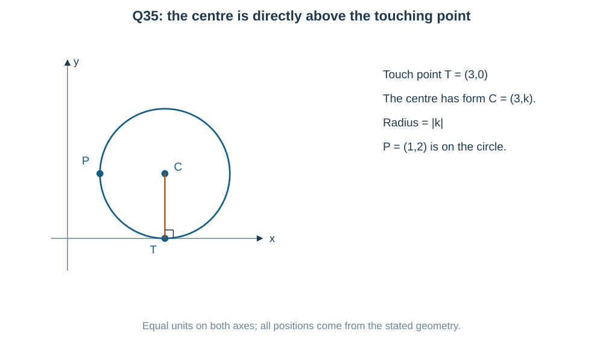

The supplied point $(1,2)$ gives

$$
(1-3)^2+(2-k)^2=k^2
\quad\Longrightarrow\quad
4+4-4k+k^2=k^2.
$$

Hence $k=2$. We did not need to assume the centre was above the axis; the data proves it.

$$
(x-3)^2+(y-2)^2=4
\quad\Longrightarrow\quad
\boxed{x^2+y^2-6x-4y+9=0;\quad\text{(a)}}.
$$

**Check both conditions:** putting $y=0$ gives $(x-3)^2=0$, so there is exactly the one touching point $(3,0)$. Substituting $(1,2)$ gives $4+0=4$ in the completed-square form.

## Answer check

Read the qualifications in the solutions before using the key.

| Question | Answer | Question | Answer |
|---|---|---|---|
| 1 | (b) | 19 | $6$ |
| 2 | (d) | 20 | (c) |
| 3 | $5$ | 21 | (c) |
| 4 | (c) $10$ | 22 | (a) |
| 5 | (c) | 23 | $12$ |
| 6 | $6$ | 24 | (b) |
| 7 | (d) | 25 | $-75$ |
| 8 | (b) $3$ | 26 | $5$ |
| 9 | $-5$ | 27 | (a) |
| 10 | (d), excluding $(0,0)$ | 28 | $7$ |
| 11 | (a) | 29 | (c) |
| 12 | (d) | 30 | (a) |
| 13 | (d) | 31 | $8$ |
| 14 | (a) $12$ | 32 | (b) |
| 15 | (d) | 33 | (b) |
| 16 | $26.04$ | 34 | (b) |
| 17 | (b) $60^\circ$ | 35 | (a) |
| 18 | (d) $12$ |  |  |

## After this chapter

Most routes begin with the same three steps: find the centre, find the squared radius and draw the needed radius or perpendicular. Use a direct geometric quantity when the question only asks for a length or count; find coordinates when they add information or provide a useful check. The original practice questions and their formats are preserved. Q10's nonzero-chord locus excludes the origin. All supporting methods and alternative views are visible for the later booklet.
