# Chapter 18 — Parabola

**Kanna, a parabola is a distance rule. Understand the focus and directrix first; the equation then has a picture.**

Your overall target remains **200 marks**: Physics 60, Maths 60, Chemistry 80. Standard forms, shifts, a point parameter, tangent recognition and simple distance/area models are useful first steps. The supplied normal-count example comes later; it does not require learning the general cubic formula.

## Recent chapter weightage

| Year | Questions tagged Parabola in the checked archive | Full-year paper shifts | Tagged questions per shift |
|---|---:|---:|---:|
| 2024 | 12 | 20 | 0.60 |
| 2025 | 17 | 19 | 0.89 |
| 2026 | 14 | 19 | 0.74 |
| Total | 43 | 58 | **0.74** |

These are distinct question IDs recounted in ExamSIDE's Parabola category. The mean is below one tagged question per shift; it does not predict your paper. PYQSide combines conics into a broader category with 48, 55 and 57 questions in these years. We cannot treat that as separate Parabola counts or split it without further classification. These are archive tags, not a fresh independent classification of every official paper. The 2024 format offered more optional numerical questions. Sources, saved pages and the recount are in the evidence folder.

**Important for JEE Main:** the official coordinate-geometry unit explicitly includes standard conic equations, including parabola. The core below explains those equations and their geometry. Tangent, normal, focal-chord, subnormal and other constructions are retained as supporting tools for this supplied PDF; each is not claimed as a separately named official syllabus topic. Priorities here are teaching judgments, not measured formula-frequency ranks.

## Concept C01 — Equal distance from a point and a line

Fix a point $F$, called the **focus**, and a line $d$, called the **directrix**. The focus is not on that line. A parabola consists of all points $P$ satisfying

$$
\boxed{PF=\text{perpendicular distance from }P\text{ to the directrix}}.
$$

The distance to a line always means the shortest, perpendicular segment. It is not a sloping segment chosen at will.

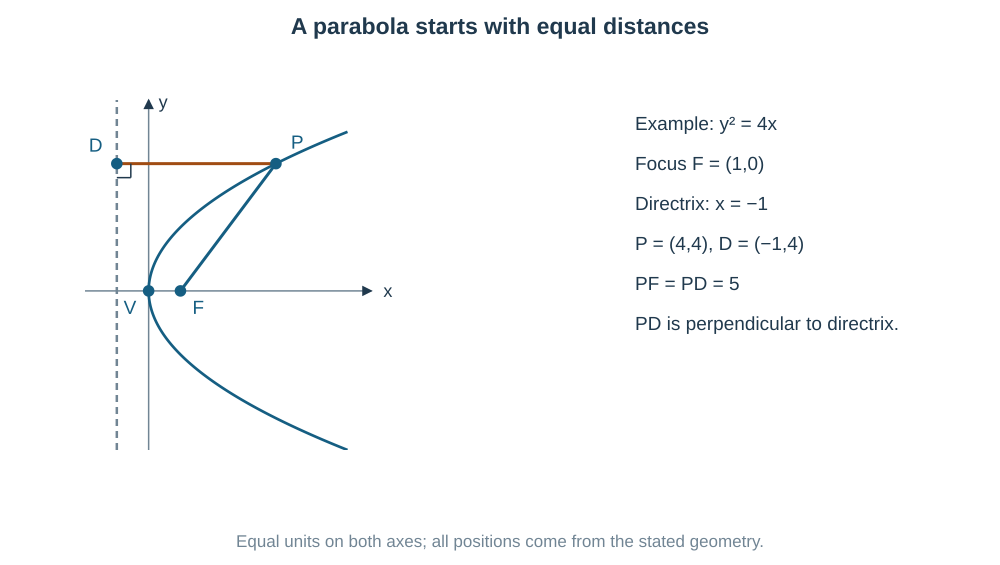

The **axis** is the line through the focus perpendicular to the directrix. The **vertex** is where the curve meets that axis. It lies halfway between the focus and the nearest point on the directrix.

For focus $(a,0)$ and directrix $x=-a$, with $a>0$, write $P=(x,y)$. Equal distances give

$$
\sqrt{(x-a)^2+y^2}=|x+a|.
$$

Both sides are nonnegative, so squaring is safe:

$$
(x-a)^2+y^2=(x+a)^2
\quad\Longrightarrow\quad
\boxed{y^2=4ax}.
$$

This equation forces $x\ge0$, so the parabola opens right. Its vertex is $(0,0)$ and axis is $y=0$.

The distance ratio $e=PF/PD$ is called **eccentricity**, where $D$ is the directrix foot. A parabola has $e=1$. It has no centre like a circle; its focus and vertex are different points.

## Concept C02 — Orientation and shifts: read the picture before the formula

In this table, $a>0$ is the **distance from vertex to focus**. Let the vertex be $V=(h,k)$.

| Opening | Equation | Focus | Directrix | Axis |
|---|---|---|---|---|
| right | $(y-k)^2=4a(x-h)$ | $(h+a,k)$ | $x=h-a$ | $y=k$ |
| left | $(y-k)^2=-4a(x-h)$ | $(h-a,k)$ | $x=h+a$ | $y=k$ |
| up | $(x-h)^2=4a(y-k)$ | $(h,k+a)$ | $y=k-a$ | $x=h$ |
| down | $(x-h)^2=-4a(y-k)$ | $(h,k-a)$ | $y=k+a$ | $x=h$ |

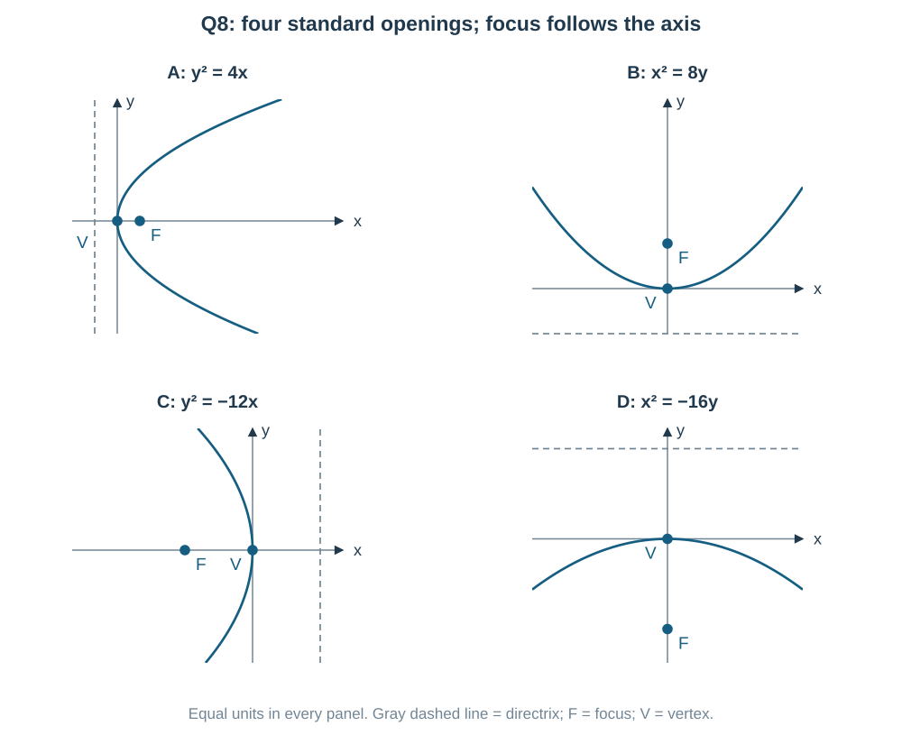

**Pattern:** the unsquared variable tells the opening direction; its sign chooses positive or negative. A squared $y$ means a horizontal axis. A squared $x$ means a vertical axis.

Complete squares before reading a shifted parabola. For example, $x^2+6x-12y+33=0$ becomes $(x+3)^2=12(y-2)$: vertex $(-3,2)$, opening up.

**For a quadratic graph $y=Ax^2+Bx+C$, $A\ne0$:**

$$
h=-\frac{B}{2A},\qquad k=C-\frac{B^2}{4A},\qquad
y-k=A(x-h)^2.
$$

Its signed focal parameter is $p=1/(4A)$. Thus focus $(h,k+p)$, directrix $y=k-p$, and positive focal length $|p|$. Positive $A$ opens up; negative $A$ opens down.

**Important for JEE Main:** the coefficient $A$ is not the focal length. A larger positive $A$ makes the parabola narrower and its focus closer to the vertex. Q29 uses $A=2$ but focal length $1/8$.

## Concept C03 — Focal distance and the latus rectum

For $y^2=4ax$ with $a>0$, the definition gives the focal distance

$$
\boxed{PF=x+a}.
$$

It is already a length, not a squared length. It is at least $a$, with equality at the vertex.

A **chord** joins two different curve points. A **focal chord** is a chord whose line passes through the focus. The **latus rectum** is the focal chord perpendicular to the axis.

For $y^2=4ax$, its line is $x=a$. Substitute:

$$
y^2=4a^2
\quad\Longrightarrow\quad
A=(a,2a),\quad B=(a,-2a).
$$

Therefore

$$
\boxed{\text{latus-rectum length}=4a}.
$$

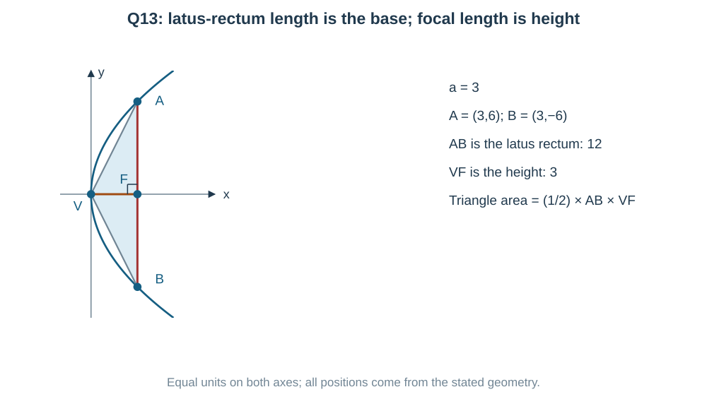

The vertex–latus-endpoints triangle has base $4a$, perpendicular height $a$, and area $2a^2$. For other orientations, rotate or shift the same geometry; the length is still $4a$.

**Exception to notice:** the axis itself passes through the focus but meets the parabola only at its vertex. It does not create a finite two-endpoint focal chord. Q7 tests this.

For translated right-opening $(y-k)^2=4a(x-h)$, the focal distance is $x-h+a$. For the other openings, use the distance to their stated directrix; do not copy $x+a$ to an upward or left-opening parabola.

## Concept C04 — A parameter labels a point and simplifies a chord

For $y^2=4ax$, every point is

$$
\boxed{P(t)=(at^2,2at)},\qquad t\in\mathbb R.
$$

Substitution checks it: $(2at)^2=4a(at^2)$. Positive $t$ gives the upper half, negative $t$ the lower half, and $t=0$ the vertex. A **parameter** is a number used to label a point; $t$ is not automatically an angle.

For two distinct parameters $t_1,t_2$, the chord is

$$
\boxed{(t_1+t_2)y=2x+2at_1t_2}.
$$

Check it at $P(t_1)$: the left side is $2at_1(t_1+t_2)$; the right side is $2at_1^2+2at_1t_2$, the same. The second endpoint works too.

If $t_1+t_2=0$, the chord is vertical. The equation still works without dividing. Otherwise its slope is $2/(t_1+t_2)$.

For the upward form $x^2=4ay$, swap the roles: $P(t)=(2at,at^2)$. For shifts, add the vertex coordinates after constructing the corresponding standard point.

## Concept C05 — Tangent: same direction at the touching point

A tangent gives the curve's local direction. At a nonvertex point $(x_1,y_1)$ of $y^2=4ax$,

$$
2yy'=4a\quad\Longrightarrow\quad y'=\frac{2a}{y}.
$$

Using point-slope form and $y_1^2=4ax_1$ gives

$$
\boxed{yy_1=2a(x+x_1)}.
$$

At $P(t)$ this becomes

$$
\boxed{ty=x+at^2}.
$$

The parameter form includes $t=0$, giving the vertical vertex tangent $x=0$. The derivative formula with division by $y$ must handle the vertex separately.

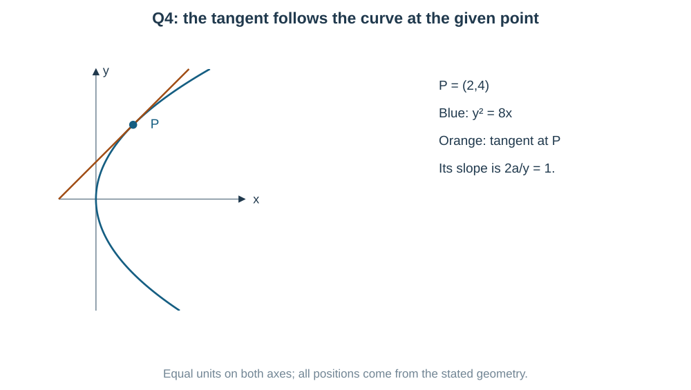

For a finite slope $m\ne0$, $t=1/m$ gives

$$
\boxed{y=mx+\frac am}.
$$

There is no finite horizontal tangent to the right-opening parabola. Its vertex tangent is vertical. For a general proper line $Ax+By+C=0$, substitution into the parabola yields the tangency condition

$$
\boxed{AC=aB^2}.
$$

To see why when $A\ne0$, substitute $x=-(By+C)/A$:

$$
Ay^2+4aBy+4aC=0.
$$

Its repeated-root condition is $16a^2B^2-16aAC=0$. The same condition includes $x=0$ and excludes horizontal lines.

**A trap specific to parabolas:** a line parallel to the axis can meet the curve at one finite point **without being tangent**. For example, $y=1$ cuts $y^2=4ax$ once, but its slope is 0 while the curve's slope there is $2a$. “Only one intersection” alone is not a safe tangent definition for an unbounded curve.

**Tangents from $(x_0,y_0)$:** put the point in the parameter tangent:

$$
\boxed{at^2-y_0t+x_0=0}.
$$

Every real root labels a contact point and a tangent, including a possible vertex tangent. Its discriminant is

$$
\boxed{D=y_0^2-4ax_0}.
$$

$D>0$ gives two distinct tangents, $D=0$ one, $D<0$ none. This is a safe count because the leading coefficient $a$ is nonzero.

When using finite slopes instead, the equation is $x_0m^2-y_0m+a=0$. It can become linear at $x_0=0$, so check the vertical member separately.

For a point on the directrix $x_0=-a$, the two finite tangent slopes have product $a/x_0=-1$. Thus the tangents are perpendicular. Q14 derives this in its actual data.

## Concept C06 — Focal chords connect opposite-sign parameters

Put focus $F=(a,0)$ into the chord equation from C04:

$$
0=2a+2at_1t_2
\quad\Longrightarrow\quad
\boxed{t_1t_2=-1}.
$$

So if one endpoint has $t\ne0$, the other has $-1/t$. Their ordinates have opposite signs, and the focus lies between the endpoints.

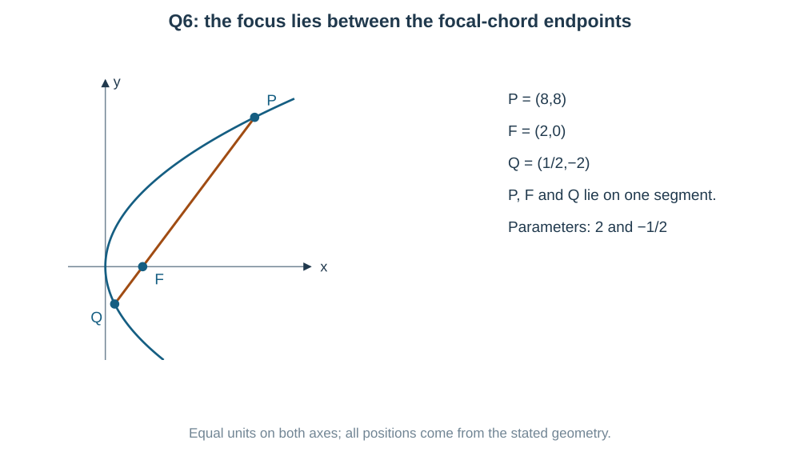

The focal distances of its two ends are

$$
s_1=a(1+t^2),\qquad s_2=a(1+t^{-2}).
$$

Add them to get the chord length:

$$
\boxed{L=a\left(t+\frac1t\right)^2}.
$$

Related useful identities are

$$
\boxed{\frac1{s_1}+\frac1{s_2}=\frac1a},\qquad
s_1s_2=aL.
$$

The reciprocal sum follows by replacing $s_2$ with $a(1+t^2)/t^2$. Use it when a question gives focal distances rather than endpoint coordinates. A genuine finite focal chord has $s_1,s_2>a$.

If the chord makes angle $\theta$ with the axis, with $\sin\theta\ne0$,

$$
\boxed{L=\frac{4a}{\sin^2\theta}}.
$$

Why? Its slope is $2/(t-1/t)$, so $4\cot^2\theta=(t-1/t)^2$. Then $L=a[(t-1/t)^2+4]=4a(1+\cot^2\theta)$.

**Important for JEE Main:** a focal chord is at least $4a$ long. The minimum occurs at $\theta=90^\circ$, the latus rectum. The excluded axis direction $\sin\theta=0$ has no finite second endpoint.

## Concept C07 — Normal, subnormal and counting normals

A **normal** is the line through a curve point perpendicular to its tangent. At $P(t)$, the tangent slope is $1/t$ when $t\ne0$, so the normal slope is $-t$.

$$
y-2at=-t(x-at^2)
\quad\Longrightarrow\quad
\boxed{y=-tx+2at+at^3}.
$$

It includes the vertex case $t=0$, giving the horizontal axis $y=0$. If the normal slope itself is called $m=-t$, the form is

$$
\boxed{y=mx-2am-am^3}.
$$

**Do not interchange $m$ and $t$ without the minus sign.**

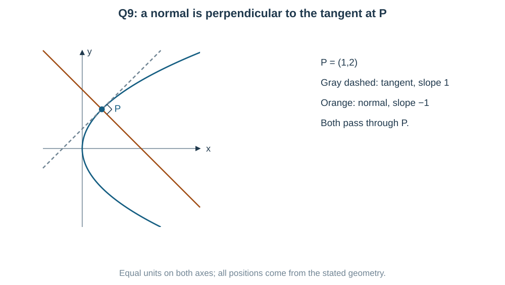

For normals passing through $(x_0,y_0)$, substitute that point:

$$
at^3+(2a-x_0)t-y_0=0.
$$

Each real root gives a normal. A cubic has at most three real roots. To count them in Q10, we show three separate intervals with sign changes. We do not need the long formula for cubic roots. A plotted crossing suggests the count; exact signs prove it.

**Subnormal:** from $P=(x_1,y_1)$, drop a perpendicular to the axis at $M=(x_1,0)$. Let the normal meet the axis at $N$. The **subnormal** is the axis segment $MN$, not the sloping segment $PN$.

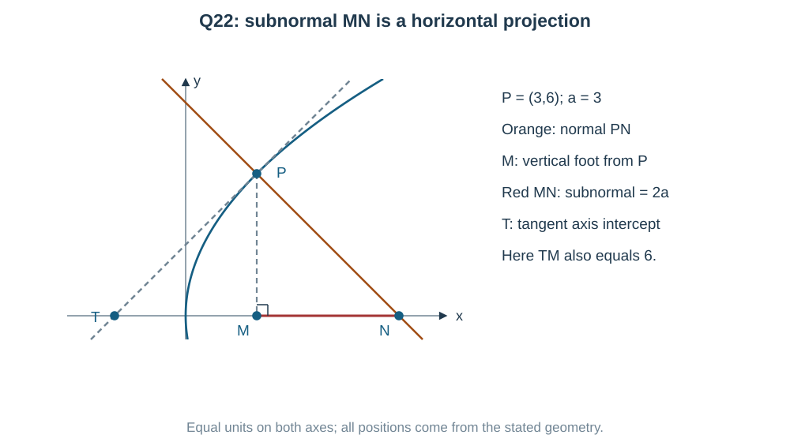

For a nonvertex point, the normal equation gives $N=(x_1+2a,0)$, so

$$
\boxed{MN=2a}.
$$

If $T$ is the tangent's axis intercept, $T=(-x_1,0)$, so the **subtangent** $TM=2x_1$. Only the subnormal stays constant as the point moves. In Q22 they happen to be equal because $x_1=a$.

The corresponding sloping lengths follow from the right triangles:

$$
PN=\sqrt{y_1^2+4a^2},\qquad PT=\sqrt{y_1^2+4x_1^2}.
$$

These projected-intercept constructions assume a nonvertex point. At the vertex, the normal is the axis itself, so it does not have one uniquely defined axis-intersection point $N$.

## Concept C08 — A chord midpoint need not be on the curve

Suppose the midpoint is $M=(h,k)$ and endpoints are $(h+u,k+v)$, $(h-u,k-v)$. Both endpoints obey $y^2=4ax$:

$$
(k+v)^2=4a(h+u),\qquad
(k-v)^2=4a(h-u).
$$

Subtract:

$$
4kv=8au\quad\Longrightarrow\quad kv=2au.
$$

So the line through the midpoint in direction $(u,v)$ is

$$
\boxed{k(y-k)=2a(x-h)}.
$$

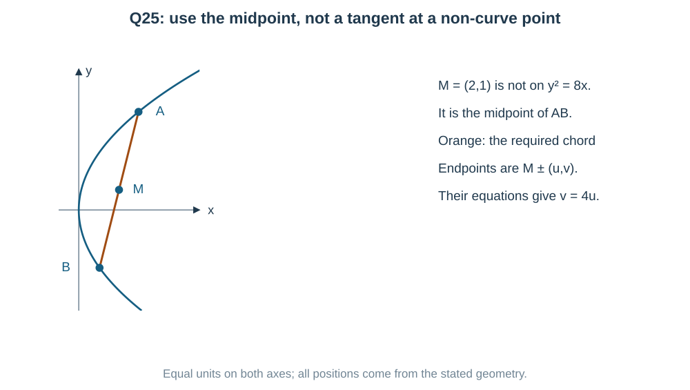

It also works for $k=0$, giving a vertical chord $x=h$. A nonzero real chord requires

$$
\boxed{4ah-k^2>0}.
$$

Indeed, for endpoint parameters $t_1,t_2$, that difference equals $a^2(t_1-t_2)^2$. Zero is a collapsed chord, not two different endpoints.

**Do not use the tangent-at-point formula at a midpoint without checking the curve equation.** Q25's $(2,1)$ has $1\ne8(2)$, so it is not a valid tangent contact point.

## Concept C09 — Feet from the focus lie on the vertex tangent

For $P(t)$, write its tangent as $x-ty+at^2=0$, with normal $(1,-t)$. From focus $F=(a,0)$, the perpendicular-foot formula from Straight Lines gives

$$
H=F-\frac{a+at^2}{1+t^2}(1,-t)
=(a,0)-a(1,-t).
$$

Thus

$$
\boxed{H=(0,at)}.
$$

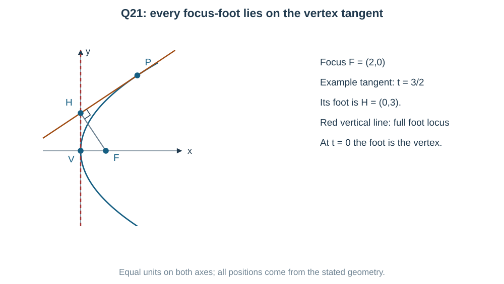

As $t$ runs over all real numbers, $at$ runs over all real heights. The complete foot locus is therefore $x=0$, the vertex tangent.

**Why parameter form matters:** $t=0$ gives the vertex tangent $x=0$ and foot $(0,0)$. Finite-slope form would miss that tangent unless checked separately.

For a shifted or rotated parabola, apply the same geometry: the feet lie on **its own vertex tangent**, not automatically on the original coordinate $y$-axis.

## Concept C10 — Distances: remove what you can using the curve relation

For a point on $y^2=4ax$, $x\ge0$. Use this equation before expanding many unknowns.

**To a line:** the point $P(t)=(at^2,2at)$ has distance from $Ax+By+C=0$

$$
\boxed{d(t)=\frac{|Aat^2+2aBt+C|}{\sqrt{A^2+B^2}}}.
$$

First check whether the numerator can be zero: an intersection would give minimum distance zero. If it never vanishes, determine its sign, complete the square and minimize its absolute value. Do not drop the modulus before checking the sign.

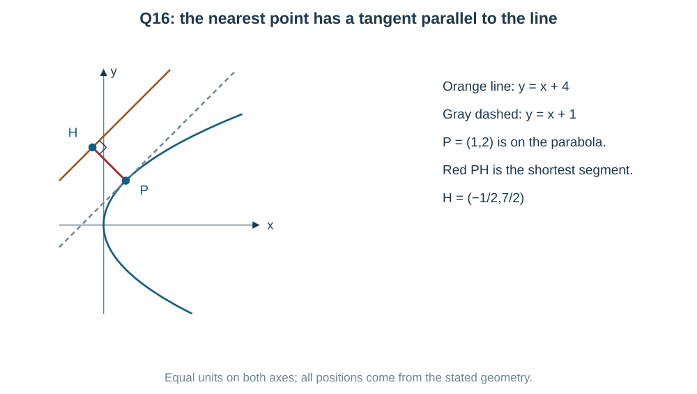

**To an axis point $(p,0)$:** replace $y^2$ directly:

$$
\begin{aligned}
D^2&=(x-p)^2+y^2\\
&=(x-p)^2+4ax\\
&=[x-(p-2a)]^2+4a(p-a),\qquad x\ge0.
\end{aligned}
$$

If $p>2a$, equality is possible at $x=p-2a>0$, giving two symmetric nearest points and $D_{\min}^2=4a(p-a)$. If $p\le2a$, the allowed minimum is at the vertex $x=0$, giving $D_{\min}^2=p^2$. At equality $p=2a$, the two candidate points merge into that one vertex.

**Important for JEE Main:** minimizing $D^2$ is equivalent to minimizing the nonnegative distance $D$, and avoids a square root. Respect $x\ge0$, and read whether the final question asks for $D$ or $D^2$.

## Concept C11 — A locus needs the original distances and a reverse check

For focus $F=(h,k)$ and directrix $Ax+By+C=0$, with $A^2+B^2>0$ and focus off the line, write

$$
\boxed{\sqrt{(x-h)^2+(y-k)^2}
=\frac{|Ax+By+C|}{\sqrt{A^2+B^2}}}.
$$

Both sides are nonnegative, so squaring preserves the equality. The denominator is essential: the raw line expression is not yet a distance.

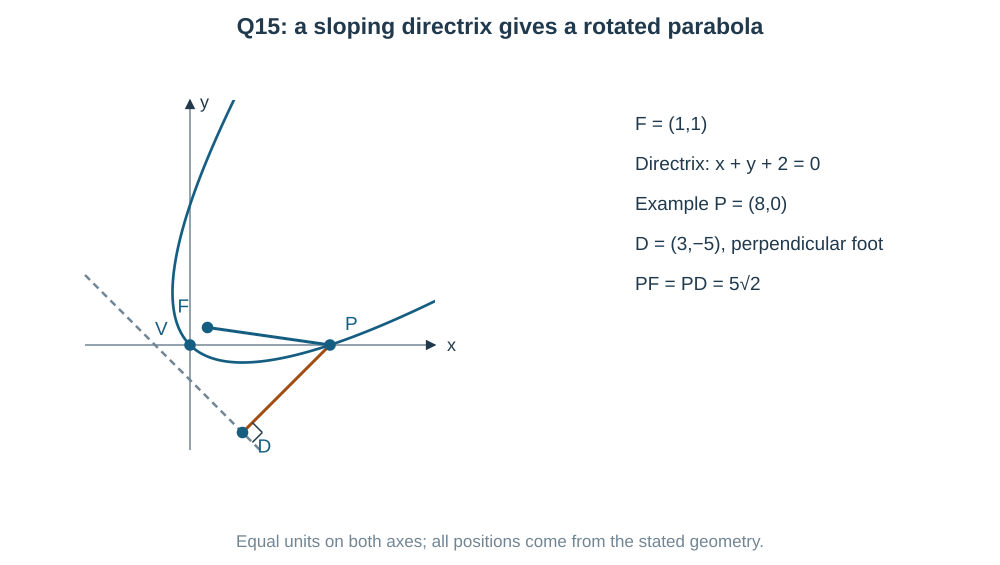

A sloping directrix usually produces a rotated parabola. You can derive its equation without learning a full rotation-formula method. A graph must use the actual rotated geometry, not an axis-aligned substitute.

**Midpoints from a fixed vertex:** if the vertex is $(0,0)$ and $M=(x,y)$, the other endpoint is $(2x,2y)$. Substitute that endpoint into the original parabola. Remove the vertex from the midpoint locus when a nonzero chord is required.

Always check the reverse: can each retained locus point reconstruct a valid original endpoint or distance equality?

## Concept C12 — Area: identify upper/lower or right/left boundaries

For $y^2=4ax$, the upper branch is $2\sqrt{ax}$ and lower branch is $-2\sqrt{ax}$.

With a closing vertical line $x=b>0$,

$$
\begin{aligned}
A&=\int_0^b\left[2\sqrt{ax}-(-2\sqrt{ax})\right]dx\\
&=\int_0^b4\sqrt{ax}\,dx
=\boxed{\frac83\sqrt a\,b^{3/2}}.
\end{aligned}
$$

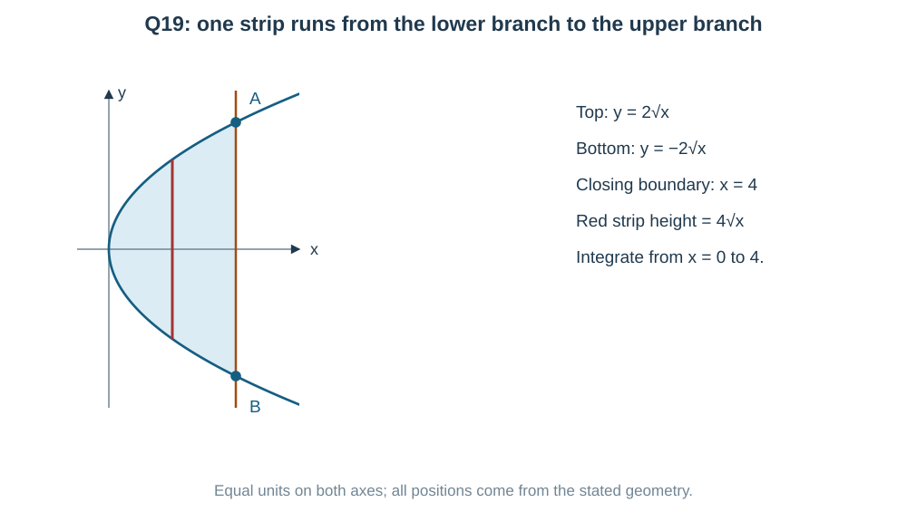

Alternatively, horizontal strips use right $x=b$ minus left $x=y^2/(4a)$, with $-2\sqrt{ab}\le y\le2\sqrt{ab}$.

For the line $y=mx$, $m\ne0$, meeting the vertex, the other intersection has $x=4a/m^2$, $y=4a/m$. The enclosed area is $8a^2/(3|m|^3)$. Rebuild it from strip widths if the formula is not familiar; Q20 shows both orientations for $a=m=1$.

**Two checks:** an ordinary area cannot be negative, and the endpoints must satisfy **both** boundary equations. A single branch or an arbitrary integration limit does not describe the requested region.

## Concept C13 — A useful connection: why a parabola focuses parallel rays

This is a geometric connection to reflection, not an extra formula you must learn for the supplied numerical questions.

From C09, the focus's foot on the tangent at $P(t)$ is $H=(0,at)$. Reflect the focus $F=(a,0)$ across that tangent:

$$
F'=2H-F=(-a,2at).
$$

This point lies on the directrix. It also has the same height as $P(t)=(at^2,2at)$, so $PF'$ is parallel to the axis.

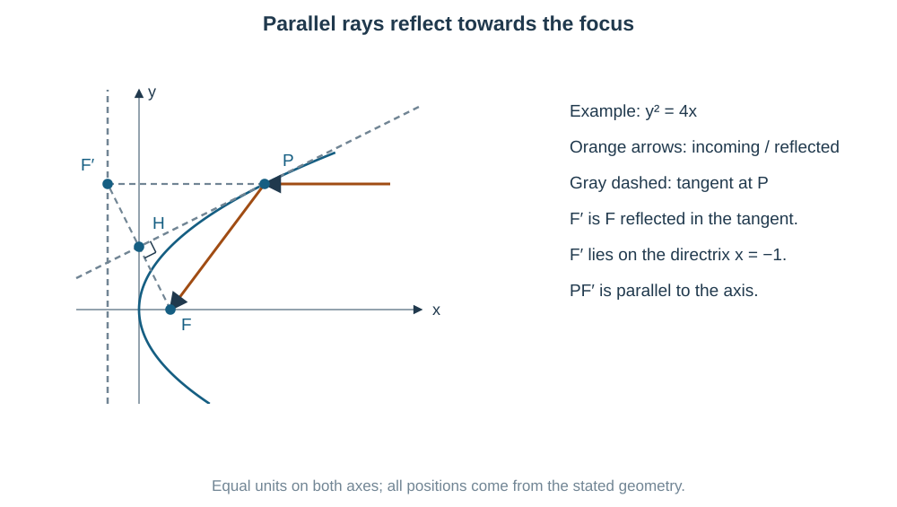

A mirror line makes equal angles with a segment and its reflection. Thus the tangent gives equal incidence/reflection angles between an incoming axis-parallel ray and the outgoing ray towards the focus. A ray sent from the focus reflects parallel to the axis in the reverse direction.

This joins three ideas already taught: **equal focus/directrix distances, the foot-of-perpendicular locus, and reflection in a straight line**. The picture uses the actual example $y^2=4x$, $P=(4,4)$, $F=(1,0)$, $H=(0,2)$ and $F'=(-1,4)$.

## Last-minute formula recap

| Pattern or need | Formula | Essential condition |
|---|---|---|
| Basic meaning | focus distance = perpendicular directrix distance | focus is off the directrix |
| Right-opening standard form | $y^2=4ax$: $F=(a,0)$, directrix $x=-a$ | $a>0$ |
| Left / up / down | $y^2=-4ax$ / $x^2=4ay$ / $x^2=-4ay$ | focus goes in the opening direction |
| Shift | replace $x,y$ by $x-h,y-k$ | vertex $(h,k)$ |
| Quadratic graph $y=Ax^2+Bx+C$ | vertex $(h,k)$; focus $(h,k+1/(4A))$ | $h=-B/(2A)$, $k=C-B^2/(4A)$ |
| Focal distance, right form | $x+a$ | not a squared distance |
| Latus rectum | endpoints $(a,\pm2a)$, length $4a$ | perpendicular focal chord |
| Parameter point | $(at^2,2at)$ | every real $t$, including 0 |
| Chord through $t_1,t_2$ | $(t_1+t_2)y=2x+2at_1t_2$ | distinct endpoints |
| Tangent at $(x_1,y_1)$ | $yy_1=2a(x+x_1)$ | point must be on the curve |
| Parameter tangent | $ty=x+at^2$ | includes vertical vertex tangent |
| Slope tangent | $y=mx+a/m$ | $m\ne0$; check vertical member separately |
| Line tangency condition | $AC=aB^2$ for $Ax+By+C=0$ | proper line |
| Tangents from $(x_0,y_0)$ | $at^2-y_0t+x_0=0$ | sign of $y_0^2-4ax_0$ gives 2/1/0 |
| Focal chord | $t_1t_2=-1$, $L=a(t+1/t)^2$ | $t\ne0$ |
| Focal chord angle | $L=4a/\sin^2\theta$ | finite chord, $\sin\theta\ne0$ |
| Focal distance pair | $1/s_1+1/s_2=1/a$ | same finite focal chord |
| Normal | $y=-tx+2at+at^3$ | slope $-t$ |
| Normal with slope $m$ | $y=mx-2am-am^3$ | $m=-t$ |
| Subnormal / subtangent | $2a$ / $2x_1$ | projected axis lengths at nonvertex point |
| Midpoint chord | $k(y-k)=2a(x-h)$ | $4ah-k^2>0$ for nonzero chord |
| Focus-to-tangent foot | $(0,at)$ | locus is vertex tangent $x=0$ |
| Point/line distance | use curve equation before minimizing | modulus and domain first |
| Area closed by $x=b$ | $(8/3)\sqrt a\,b^{3/2}$ | $b>0$; both branches |
| Area closed by $y=mx$ | $8a^2/(3|m|^3)$ | $m\ne0$ |

**Method habit:** identify the orientation, define the point, and write the condition that actually matches the question. A tangent point, normal point, chord midpoint and focus are different objects. Use one clear main route, then read the alternative view to strengthen the connection.

## Worked solutions to the 30 PDF questions

Read the question first. Notice the pattern, choose a route, then calculate. Alternative methods below are fully visible.

### Question 1 — The unsquared variable and its sign decide the opening

**PDF page 92 | MCQ | Notes: C01,C02**

The focus of the parabola $x^2=-8y$ is

- (a) $(0,2)$
- (b) $(-2,0)$
- (c) $(2,0)$
- (d) $(0,-2)$

**First read the direction.** In $x^2=-8y$, $x$ is squared and $y$ is unsquared. The axis is vertical. The minus sign makes the opening downward.

Compare with $x^2=-4ay$, where $a>0$:

$$
4a=8\quad\Longrightarrow\quad a=2.
$$

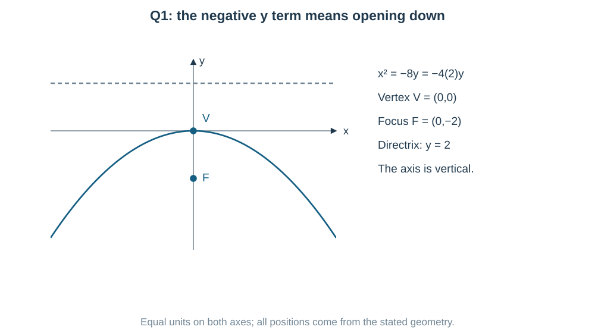

The vertex is $(0,0)$, and the focus is $a$ units below it:

$$
\boxed{F=(0,-2);\quad\text{(d)}}.
$$

**Check with the definition:** its directrix is $y=2$. The point $(4,-2)$ obeys $16=-8(-2)$; its focus distance is 4, and its perpendicular distance to $y=2$ is also 4. A focus on the $x$-axis would not match this vertical opening.

---

### Question 2 — The focus lies along the axis from the vertex

**PDF page 92 | MCQ | Notes: C02**

A parabola has vertex $(1,2)$ and focus $(3,2)$. Its equation is

- (a) $(y-2)^2=4(x-1)$
- (b) $(y-2)^2=8(x-1)$
- (c) $(x-1)^2=8(y-2)$
- (d) $(y-2)^2=8(x+1)$

**The vertex and focus tell the axis before the equation.** Both have height 2, so the axis is horizontal, $y=2$. The focus is to the right of the vertex, so the parabola opens right.

$$
a=VF=3-1=2.
$$

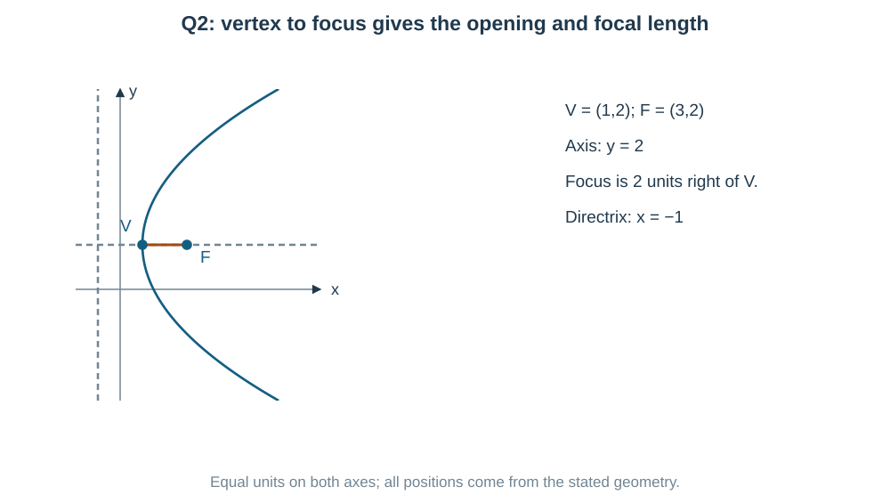

Use the shifted right-opening form:

$$
(y-k)^2=4a(x-h).
$$

With $(h,k)=(1,2)$ and $a=2$,

$$
\boxed{(y-2)^2=8(x-1);\quad\text{(b)}}.
$$

**Check:** its directrix is $x=1-2=-1$. The vertex $(1,2)$ is 2 units from both focus $(3,2)$ and that directrix. The focus lies in the opening direction.

**Fast option insight:** an equation with $(x-1)^2$ would have a vertical axis, so option (c) fails the axis test before any arithmetic.

---

### Question 3 — Complete the square before reading the latus rectum

**PDF page 92 | MCQ | Notes: C02,C03**

The length of the latus rectum of the parabola $x^2+6x-12y+33=0$ is

- (a) $12$
- (b) $6$
- (c) $3$
- (d) $24$

**Do not read $4a$ until the square is complete.**

$$
x^2+6x-12y+33=0
\quad\Longrightarrow\quad
(x+3)^2=12y-24=12(y-2).
$$

This opens up from vertex $(-3,2)$. Comparing with $(x-h)^2=4a(y-k)$ gives $4a=12$, $a=3$.

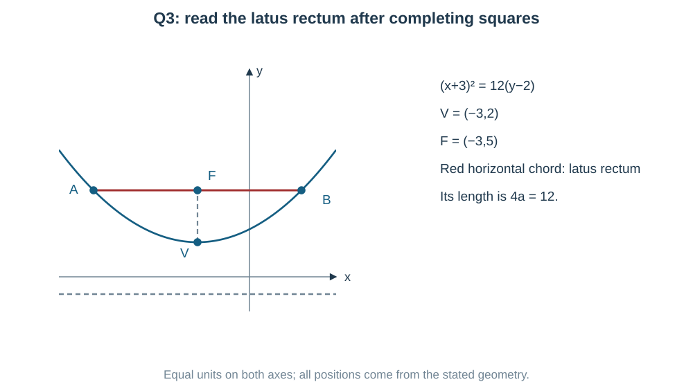

The latus rectum is the focal chord perpendicular to the axis, so its length is

$$
\boxed{4a=12;\quad\text{(a)}}.
$$

**Coordinate check:** the focus is $(-3,5)$. Put $y=5$ in the completed equation: $(x+3)^2=36$, giving endpoints $(-9,5),(3,5)$. Their horizontal separation is $3-(-9)=12$. The focal length 3 is not the requested chord length.

---

### Question 4 — The given point is on the parabola, so use a tangent there

**PDF page 92 | MCQ | Notes: C05**

The equation of the tangent to the parabola $y^2=8x$ at the point $(2,4)$ is

- (a) $x+y-6=0$
- (b) $2x-y=0$
- (c) $x-y+2=0$
- (d) $x-2y+6=0$

**First check that the supplied point is on the curve:** $4^2=8(2)=16$. Good, the tangent-at-point formula applies.

For $y^2=4ax$, here $a=2$:

$$
yy_1=2a(x+x_1)
\quad\Longrightarrow\quad
4y=4(x+2).
$$

Therefore

$$
\boxed{x-y+2=0;\quad\text{(c)}}.
$$

**Another possible approach — the derivative:** $2yy'=8$, so $y'=4/y=1$ at $(2,4)$. Then $y-4=x-2$ gives the same line.

**Check tangency:** substituting $y=x+2$ into $y^2=8x$ gives $(x+2)^2=8x$, or $(x-2)^2=0$. The repeated contact is precisely the given point.

---

### Question 5 — A repeated intersection is the tangency condition

**PDF page 92 | Numerical value | Notes: C05**

If the line $x-2y+c=0$ touches the parabola $y^2=8x$, then $c=$ ____.

**The line's slope is fixed; its intercept is unknown.** Rearrange:

$$
y=\frac12x+\frac c2.
$$

For $y^2=4ax$ with $a=2$, a finite-slope tangent is $y=mx+a/m$. At $m=1/2$, its intercept must be

$$
\frac am=\frac2{1/2}=4.
$$

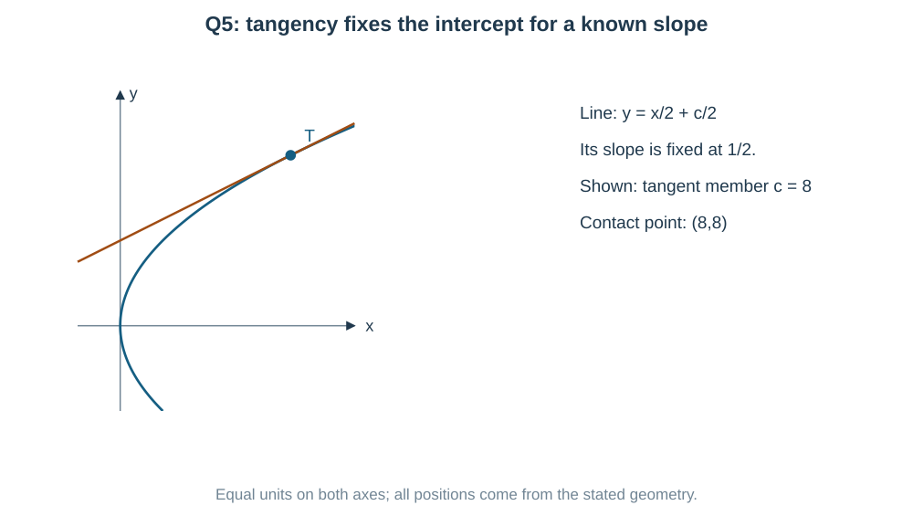

Thus $c/2=4$, giving

$$
\boxed{c=8}.
$$

**Another possible approach — repeated intersection:** substitute $x=2y-c$ into the parabola:

$$
y^2=16y-8c
\quad\Longrightarrow\quad
y^2-16y+8c=0.
$$

Tangency requires discriminant zero: $256-32c=0$, so $c=8$. Then the root is $y=8$, $x=8$, checking the actual contact point.

**Fast coefficient check:** for $Ax+By+C=0$, the tangent condition is $AC=aB^2$. Here $c=2(-2)^2=8$.

---

### Question 6 — A focal chord must pass through the focus

**PDF page 92 | Numerical value | Notes: C04,C06**

One end of a focal chord of $y^2=8x$ is $(8,8)$. The length of this focal chord is ____.

**A focal chord passes through the focus.** Here $4a=8$, so $a=2$ and $F=(2,0)$.

The given endpoint $P=(8,8)$ has $2at=8$, hence $t=2$. Its partner parameter must satisfy $tt_2=-1$, giving $t_2=-1/2$.

$$
Q=(at_2^2,2at_2)=\left(\frac12,-2\right).
$$

The full length is

$$
PQ=\sqrt{\left(8-\frac12\right)^2+(8+2)^2}
=\sqrt{\frac{225}{4}+100}
=\boxed{\frac{25}{2}=12.5}.
$$

**Another shorter approach — add focal distances:** the focus lies between the two ends, so

$$
PQ=PF+FQ=(8+2)+\left(\frac12+2\right)=10+\frac52=\frac{25}{2}.
$$

**A third useful check:** $L=a(t+1/t)^2=2(2+1/2)^2=25/2$. These agree because the focal-chord parameter identity and focal-distance definition describe the same geometry.

---

### Question 7 — A line through the focus can be the axis itself

**PDF page 92 | MCQ | Notes: C01,C03**

Statement I: Every line passing through the focus of a parabola meets the parabola in exactly two points.

Statement II: The axis of a parabola meets the parabola at exactly one point.

Choose the correct option.

- (a) Statement I is false but Statement II is true
- (b) Both Statement I and Statement II are true
- (c) Both Statement I and Statement II are false
- (d) Statement I is true but Statement II is false

**Look for an exception to “every line.”** The axis itself passes through the focus. On the representative parabola $y^2=4ax$, the axis is $y=0$:

$$
0=4ax\quad\Longrightarrow\quad x=0.
$$

It meets the parabola only at the vertex.

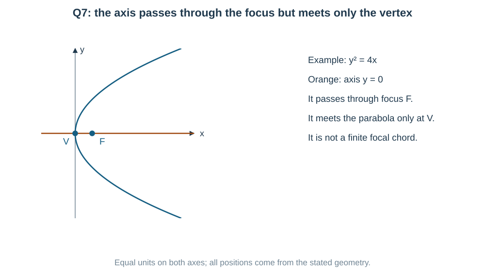

So Statement I is **false**. This same fact makes Statement II **true**.

$$
\boxed{\text{I false, II true;\quad (a)}}.
$$

**The useful distinction:** passing through the focus does not automatically create two finite endpoints. A focal **chord** requires those two distinct endpoints. Also, a single intersection with an unbounded curve does not automatically mean the line is tangent: the axis here is the vertex's **normal**, while its tangent is perpendicular to the axis.

---

### Question 8 — Read the focus along the opening direction

**PDF page 93 | MCQ | Notes: C02**

Match List I (parabola) with List II (its focus).

| List I | Parabola | List II | Focus |
|---|---|---|---|
| A | $y^2=4x$ | P | $(0,2)$ |
| B | $x^2=8y$ | Q | $(1,0)$ |
| C | $y^2=-12x$ | R | $(-3,0)$ |
| D | $x^2=-16y$ | S | $(0,-4)$ |

- (a) A–P, B–Q, C–R, D–S
- (b) A–Q, B–P, C–S, D–R
- (c) A–Q, B–P, C–R, D–S
- (d) A–R, B–P, C–Q, D–S

**For each form, identify the opening before placing the focus.**

| Case | Compare with a standard form | Focus | Match |
|---|---|---|---|
| A: $y^2=4x$ | right, $a=1$ | $(1,0)$ | Q |
| B: $x^2=8y$ | up, $a=2$ | $(0,2)$ | P |
| C: $y^2=-12x$ | left, $a=3$ | $(-3,0)$ | R |
| D: $x^2=-16y$ | down, $a=4$ | $(0,-4)$ | S |

$$
\boxed{\text{A–Q,\ B–P,\ C–R,\ D–S;\quad (c)}}.
$$

**Check:** every focus lies along its axis in the opening direction, at distance $a$ from the vertex. The coefficient is $4a$, not $a$. The dashed directrix lies the same distance on the opposite side of the vertex.

---

### Question 9 — A normal is perpendicular to the tangent at the same point

**PDF page 93 | MCQ | Notes: C07**

The equation of the normal to $y^2=4x$ at the point $(1,2)$ is

- (a) $x-y=-1$
- (b) $x+y=1$
- (c) $2x+y=4$
- (d) $x+y=3$

**A normal is perpendicular to the tangent at the same point.** Differentiate the curve:

$$
2yy'=4,\qquad y'=\frac2y.
$$

At $P=(1,2)$ the tangent slope is 1, so the normal slope is $-1$.

Through $(1,2)$,

$$
y-2=-(x-1)
\quad\Longrightarrow\quad
\boxed{x+y=3;\quad\text{(d)}}.
$$

**Check:** $(1,2)$ lies on both the parabola and normal, and tangent slope times normal slope is $1(-1)=-1$.

**Another possible approach:** $P=(at^2,2at)$ with $a=1$ gives $t=1$. The parameter normal $y=-tx+2at+at^3$ becomes $y=-x+3$. This is a quick exam form after its meaning is understood.

---

### Question 10 — Count real normal slopes without solving the cubic explicitly

**PDF page 93 | MCQ | Notes: C07**

The number of distinct normals that can be drawn to the parabola $y^2=4x$ from the point $(5,1)$ is

- (a) $1$
- (b) $3$
- (c) $2$
- (d) $0$

**We need a count, not the exact three slopes.** Let $m$ be a **normal's slope**, not the tangent parameter. For $a=1$, the normal family is

$$
y=mx-2m-m^3.
$$

Passing through $(5,1)$ gives

$$
1=5m-2m-m^3
\quad\Longrightarrow\quad
f(m)=m^3-3m+1=0.
$$

Trying the general cubic-root formula would create unnecessary calculation. Instead, find separate intervals containing roots:

$$
\begin{array}{c|rrrrr}
m&-2&-1&0&1&2\\\hline
f(m)&-1&3&1&-1&3
\end{array}
$$

The continuous polynomial changes sign on **three disjoint intervals**:

$$
(-2,-1),\qquad(0,1),\qquad(1,2).
$$

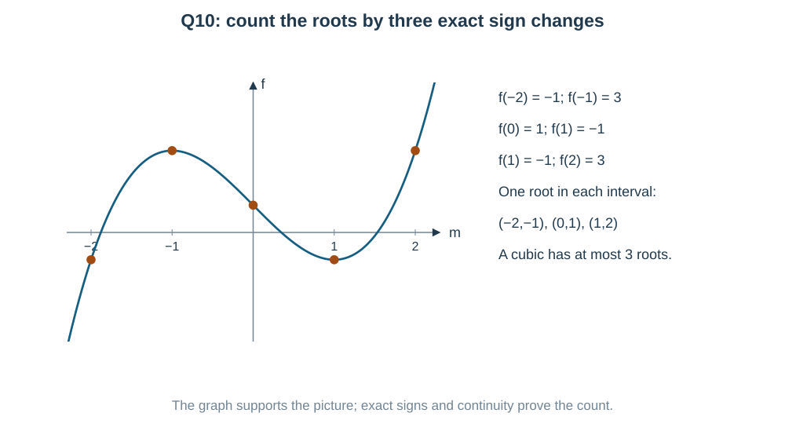

Each interval contains a real root. A cubic has at most three roots, so there are exactly three distinct slopes. Each different slope through the same point gives a different normal:

$$
\boxed{3;\quad\text{(b)}}.
$$

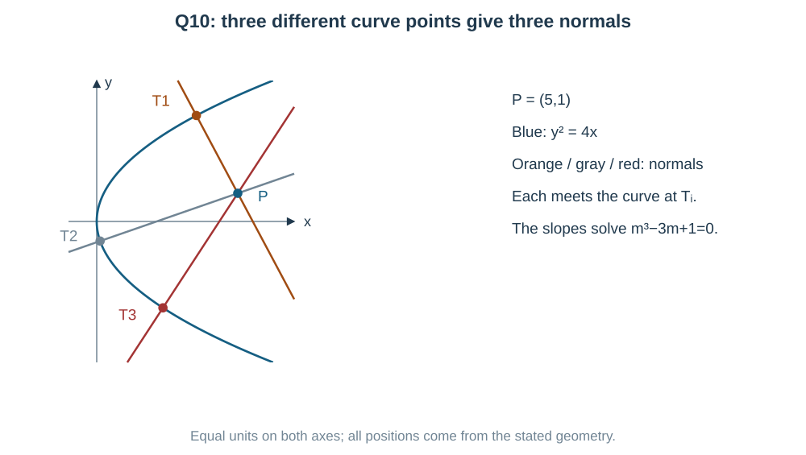

**Check that the family covers the possibilities:** every finite point on this right-opening parabola has normal slope $-t$, including slope 0 at the vertex. There is no omitted vertical normal.

**Another root-count view:** $f'(m)=3(m^2-1)$ gives turning inputs $-1,1$, where the values are 3 and $-1$. With the cubic tending to opposite infinities at the two ends, this also gives three crossings. The sign-interval route needs fewer prerequisites.

---

### Question 11 — Focal distance equals distance to the directrix

**PDF page 93 | Numerical value | Notes: C03**

A point on the parabola $y^2=16x$ is at a distance $10$ from the focus. The square of its ordinate is ____.

**The focus–directrix definition saves a square root.** Since $y^2=16x$, $a=4$, the focus is $(4,0)$ and the directrix is $x=-4$.

For any curve point, $x\ge0$, so its perpendicular distance to the directrix is $x+4$. This equals its focal distance.

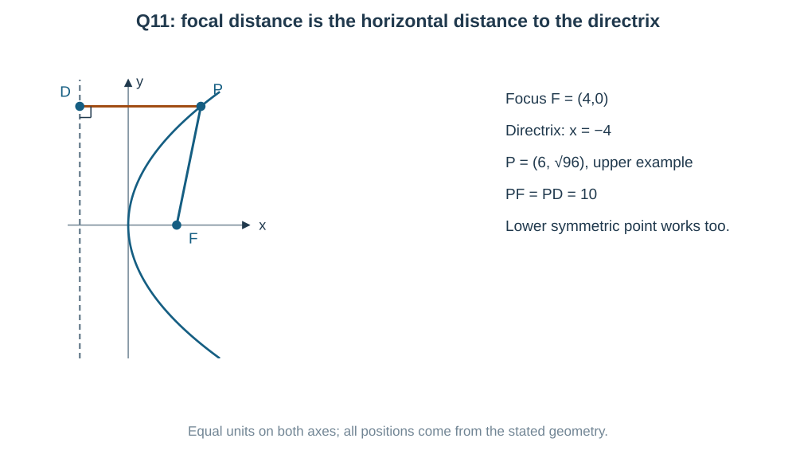

Thus

$$
x+4=10\quad\Longrightarrow\quad x=6.
$$

Now the parabola equation gives

$$
\boxed{y^2=16(6)=96}.
$$

**Both ordinates work:** $y=\pm\sqrt{96}$, and the question asks for their common square.

**Another possible approach:** write $(x-4)^2+y^2=100$ and replace $y^2$ by $16x$. Then

$$
(x-4)^2+16x=(x+4)^2=100.
$$

Because $x+4>0$, take $x+4=10$, not $-10$. The focus definition reaches that same relation immediately.

---

### Question 12 — Halve the moving endpoint to get the chord midpoint

**PDF page 93 | MCQ | Notes: C11**

The locus of the midpoints of chords of the parabola $y^2=8x$ drawn from its vertex is

- (a) $y^2=2x$
- (b) $y^2=16x$
- (c) $y^2=4x$
- (d) $x^2=4y$

**Translate a midpoint into its other endpoint.** The vertex is $V=(0,0)$. If $M=(x,y)$ is the midpoint of $VB$, then $B=(2x,2y)$.

The endpoint lies on $y^2=8x$:

$$
(2y)^2=8(2x)
\quad\Longrightarrow\quad
\boxed{y^2=4x;\quad\text{intended (c)}}.
$$

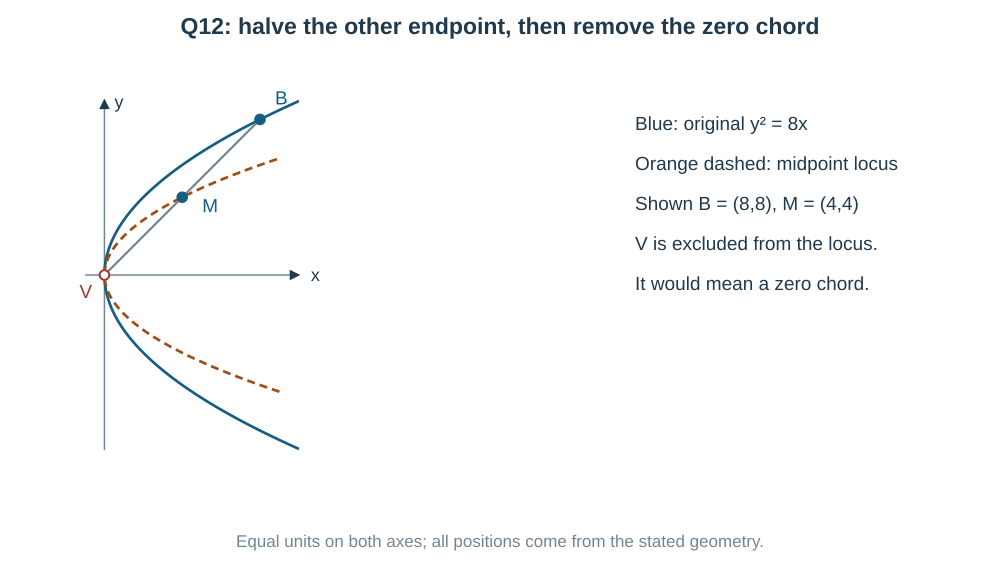

**Exact locus qualification:** exclude $(0,0)$ for nonzero chords. That midpoint would force $B=V$, giving no two-endpoint chord.

**Reverse check:** every other point on $y^2=4x$ produces a distinct $B=(2x,2y)$ satisfying the original parabola. Thus all retained points are attainable.

**Another view — parameter:** $B=(2t^2,4t)$ gives $M=(t^2,2t)$. Eliminating $t$ again gives $y^2=4x$. The excluded zero-length case is $t=0$.

---

### Question 13 — The latus rectum supplies a base perpendicular to the axis

**PDF page 93 | Numerical value | Notes: C03,C12**

The area (in square units) of the triangle formed by the vertex and the ends of the latus rectum of $y^2=12x$ is ____.

**The latus rectum is perpendicular to the axis, so it is a ready-made base.** For $y^2=12x$, $a=3$:

$$
V=(0,0),\quad F=(3,0),\quad A=(3,6),\quad B=(3,-6).
$$

The base is $AB=12$, and the perpendicular distance of $V$ to $x=3$ is 3:

$$
\boxed{\Delta=\frac12(12)(3)=18}.
$$

**Coordinate check:** half the absolute determinant of $(3,6)$ and $(3,-6)$ is $\tfrac12|-18-18|=18$.

**Pattern:** for the vertex and latus-rectum endpoints of $y^2=4ax$, area is always $\tfrac12(4a)a=2a^2$. Do not use $2a$ as the full base; that is only half the latus rectum.

---

### Question 14 — A point on the directrix gives perpendicular tangents

**PDF page 93 | MCQ | Notes: C05**

The angle between the two tangents drawn from $(-3,5)$ to the parabola $y^2=12x$ is

- (a) $60^\circ$
- (b) $45^\circ$
- (c) $90^\circ$
- (d) $30^\circ$

**Notice the point's $x$-coordinate:** $-3=-a$, because $4a=12$. It lies on the directrix. We will show why that makes the tangents perpendicular.

A finite-slope tangent is $y=mx+3/m$. At $P=(-3,5)$,

$$
5=-3m+\frac3m
\quad\Longrightarrow\quad
3m^2+5m-3=0.
$$

The discriminant is $25+36=61>0$, so there are two different real slopes. Their product is

$$
m_1m_2=\frac{-3}{3}=-1.
$$

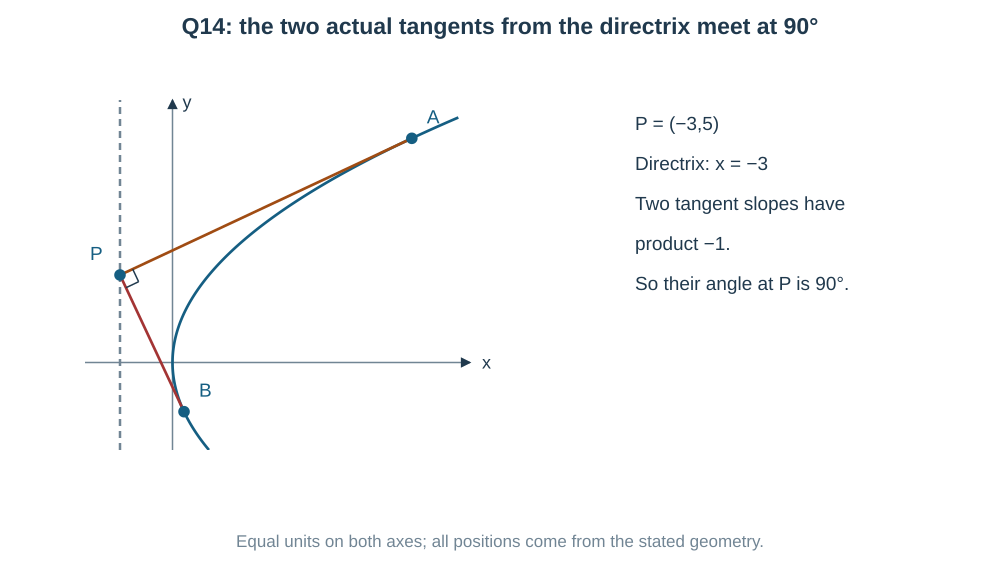

Therefore

$$
\boxed{90^\circ;\quad\text{(c)}}.
$$

**Why solve only the product?** The question asks for the angle. Calculating each radical slope separately adds work but gives no needed extra information.

**Connection:** for a general directrix point $(x_0,y_0)$ with $x_0=-a$, the tangent-slope equation $x_0m^2-y_0m+a=0$ has product $a/x_0=-1$. For a circle the perpendicular-tangent locus was a larger circle; for this parabola it is the directrix.

---

### Question 15 — Use perpendicular distance to the sloping directrix

**PDF page 93 | MCQ | Notes: C01,C11**

The locus of a point whose distance from $(1,1)$ equals its distance from the line $x+y+2=0$ is

- (a) $(x-y)^2=4(x+y)$
- (b) $(x-y)^2=8(x+y)$
- (c) $(x+y)^2=8(x-y)$
- (d) $(x-y)^2=8(x+y)+4$

**Start from actual distances.** A point $P=(x,y)$ must be equally far from $F=(1,1)$ and the line $x+y+2=0$:

$$
\sqrt{(x-1)^2+(y-1)^2}
=\frac{|x+y+2|}{\sqrt2}.
$$

Both sides are nonnegative, so square and multiply by 2:

$$
2[(x-1)^2+(y-1)^2]=(x+y+2)^2.
$$

Expand only enough to combine the matching terms:

$$
2x^2+2y^2-4x-4y+4
=x^2+y^2+2xy+4x+4y+4.
$$

The constants cancel, leaving

$$
x^2+y^2-2xy=8x+8y
\quad\Longrightarrow\quad
\boxed{(x-y)^2=8(x+y);\quad\text{(b)}}.
$$

**Notice the pattern:** $x^2+y^2-2xy$ is $(x-y)^2$. Recognizing that square reveals the neat form after the distance calculation.

**Check:** $(0,0)$ has distance $\sqrt2$ from both focus and directrix; it is the vertex. The sample point $(8,0)$ has distances $\sqrt{50}=5\sqrt2$ and $10/\sqrt2=5\sqrt2$.

**Another visual approach:** measure along the diagonal axis with $u=(x+y)/\sqrt2$, and across it with $v=(x-y)/\sqrt2$. These are unit directions at right angles. The focus becomes $(\sqrt2,0)$ and directrix $u=-\sqrt2$, so $v^2=4\sqrt2\,u$. Substituting $u,v$ gives the same equation. This explains why $x+y$ describes the opening direction.

---

### Question 16 — Minimize the distance expression before taking its square root

**PDF page 93 | Numerical value | Notes: C10**

The shortest distance between the line $x-y+4=0$ and the parabola $y^2=4x$, rounded to two decimal places, is ____.

**First check whether the line meets the parabola.** A curve point can be written $P=(t^2,2t)$, because $a=1$.

Its line expression is

$$
x-y+4=t^2-2t+4=(t-1)^2+3>0.
$$

So there is no intersection, and we can remove the absolute value in the point-to-line distance:

$$
d(t)=\frac{(t-1)^2+3}{\sqrt2}.
$$

The square is smallest at $t=1$, giving $P=(1,2)$ and

$$
d_{\min}=\frac3{\sqrt2}=2.121320\ldots
\quad\Longrightarrow\quad
\boxed{2.12}.
$$

**Check attainment:** the foot on the line is $H=(-1/2,7/2)$. It satisfies $x-y+4=0$, and $PH=\sqrt{(3/2)^2+(-3/2)^2}=3/\sqrt2$.

**Another geometric view — the parallel tangent:** the tangent at $P$ is $y=x+1$, parallel to $y=x+4$. Every parabola point satisfies $y-x-1=-(t-1)^2\le0$, so the whole curve is on the lower side of that tangent. The gap between the parallel lines is $3/\sqrt2$, reached at the contact point. This proves why the parallel-tangent view gives a global minimum here.

---

### Question 17 — The two focal-chord parameters multiply to minus one

**PDF page 94 | MCQ | Notes: C06**

One end of a focal chord of $y^2=4ax$ has parameter $t=3$. The parameter of the other end is

- (a) $\dfrac13$
- (b) $-3$
- (c) $3$
- (d) $-\dfrac13$

**A focal chord has a very specific parameter pattern.** From $(t_1+t_2)y=2x+2at_1t_2$, putting focus $(a,0)$ on the line gives

$$
0=2a(1+t_1t_2)
\quad\Longrightarrow\quad t_1t_2=-1.
$$

Since $t_1=3$,

$$
\boxed{t_2=-\frac13;\quad\text{(d)}}.
$$

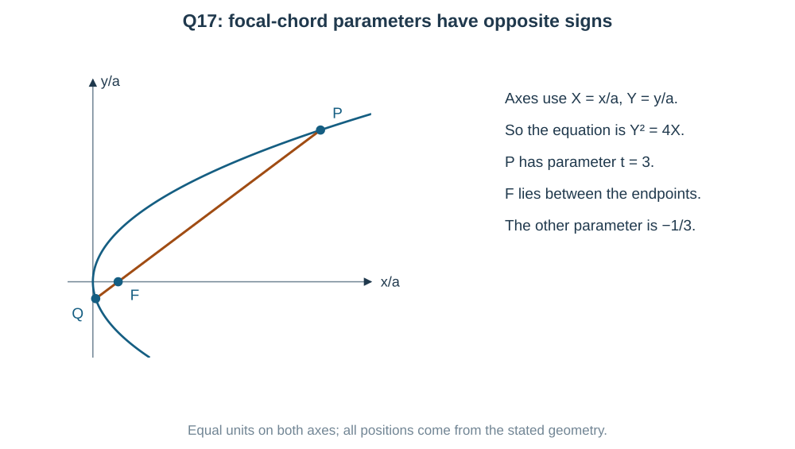

The opposite signs place the two endpoints on opposite sides of the axis.

**Another possible approach:** the first point is $(9a,6a)$, so its line with $(a,0)$ has slope $3/4$:

$$
y=\frac34(x-a).
$$

Substitute the generic point $(at^2,2at)$ and cancel nonzero $a$:

$$
8t=3t^2-3
\quad\Longrightarrow\quad
(t-3)(3t+1)=0.
$$

One root is the given endpoint; the other is $-1/3$. The focal-chord identity is the shorter exam route after this derivation is familiar.

---

### Question 18 — A common tangent must pass both tangency tests

**PDF page 94 | MCQ | Notes: C05**

A common tangent to the parabola $y^2=8x$ and the circle $x^2+y^2=2$ is

- (a) $x-y+4=0$
- (b) $x-y+2=0$
- (c) $x+y-2=0$
- (d) $2x-y+1=0$

**With options, test the easier curve first.** A tangent to the circle must be distance $\sqrt2$ from the origin.

For (a), that distance is $4/\sqrt2=2\sqrt2$, so reject it. For (d), it is $1/\sqrt5$, so reject it. Both (b) and (c) have distance $\sqrt2$, so the circle test alone cannot choose.

For parabola $y^2=8x$, $a=2$. Option (b) is $y=x+2$: slope 1 and intercept $2=a/1$, so it is a parabola tangent. Option (c) is $y=-x+2$: slope $-1$ would require intercept $a/m=-2$, so it fails.

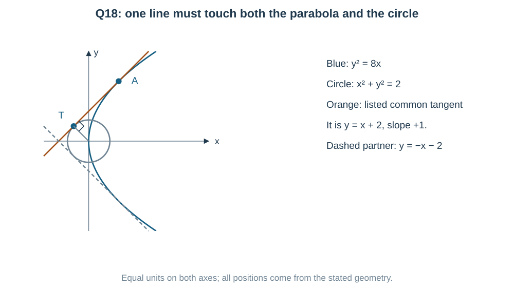

$$
\boxed{x-y+2=0;\quad\text{(b)}}.
$$

**Check actual contacts:** $(2,4)$ is the parabola contact; $(-1,1)$ is the circle contact. Both lie on $x-y+2=0$, and the circle radius at $(-1,1)$ is perpendicular to it.

**Another possible approach — find all common slopes:** a parabola tangent is $y=mx+2/m$, $m\ne0$. Its centre distance to the circle is

$$
\frac{|2/m|}{\sqrt{1+m^2}}=\sqrt2.
$$

Squaring gives

$$
m^4+m^2-2=0
\quad\Longrightarrow\quad
(m^2-1)(m^2+2)=0.
$$

The real slopes are $m=\pm1$. They give $y=x+2$ and $y=-x-2$. Only the first is listed. The vertex tangent $x=0$ cuts the circle, so it is not a missed common tangent.

**Source-working clarification:** the chosen line has slope **$+1$**. The source's working labels that line as the $m=-1$ case; that label is a typo.

---

### Question 19 — Both halves of the sideways parabola bound the area

**PDF page 94 | Numerical value | Notes: C12**

The area (in square units) bounded by the parabola $y^2=4x$ and the line $x=4$, rounded to two decimal places, is ____.

**This region uses both halves of the parabola.** At a fixed $x$, the upper point is $y=2\sqrt x$ and the lower point is $y=-2\sqrt x$.

The strip height is

$$
2\sqrt x-(-2\sqrt x)=4\sqrt x.
$$

The vertex is at $x=0$, and the closing line is $x=4$:

$$
A=\int_0^4 4\sqrt x\,dx
=4\left[\frac23x^{3/2}\right]_0^4
=\frac{64}{3}.
$$

Hence

$$
\boxed{A=21.33\ \text{square units}}
$$

to two decimal places.

**Another possible approach — horizontal strips:** the endpoints on $x=4$ have $y=\pm4$. At height $y$, right minus left is $4-y^2/4$:

$$
A=\int_{-4}^{4}\left(4-\frac{y^2}{4}\right)dy
=\frac{64}{3}.
$$

**Check:** the region lies inside an $8\times4$ rectangle, so $A<32$. Integrating only the upper half would incorrectly halve the answer.

---

### Question 20 — Choose the strip orientation that avoids unnecessary square roots

**PDF page 94 | MCQ | Notes: C12**

The area (in square units) of the region bounded by $y^2=4x$ and $y=x$ is

- (a) $\dfrac{16}3$
- (b) $\dfrac43$
- (c) $\dfrac83$
- (d) $4$

**Find the closing points before choosing limits.** The line is $x=y$. In the parabola equation,

$$
y^2=4y\quad\Longrightarrow\quad y=0\text{ or }4.
$$

So the intersections are $(0,0),(4,4)$. The enclosed region is on the upper branch.

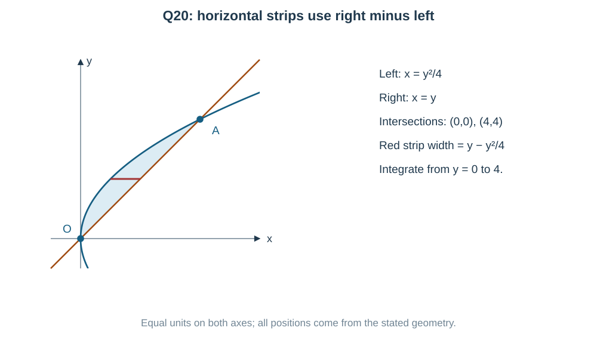

Horizontal strips are convenient: right $x=y$, left $x=y^2/4$. Thus

$$
A=\int_0^4\left(y-\frac{y^2}{4}\right)dy
=\left[\frac{y^2}{2}-\frac{y^3}{12}\right]_0^4
=8-\frac{16}{3}.
$$

$$
\boxed{A=\frac83;\quad\text{(c)}}.
$$

**Another possible approach — vertical strips:** upper $y=2\sqrt x$, lower $y=x$, for $0\le x\le4$:

$$
A=\int_0^4(2\sqrt x-x)\,dx
=\frac{32}{3}-8=\frac83.
$$

Both routes work. Horizontal strips avoid the square root here. Unlike Q19, the line closes only the upper lobe: using both parabola branches would describe a different region.

---

### Question 21 — The perpendicular feet lie on the vertex tangent

**PDF page 94 | MCQ | Notes: C09**

For the parabola $y^2=8x$, the locus of the foot of the perpendicular drawn from the focus to any tangent is

- (a) $x=0$
- (b) $x=-2$
- (c) $x=2$
- (d) $y^2=8x$

**A foot is the point reached by moving perpendicular to a line.** We need all such feet from the fixed focus, as the tangent moves.

Here $a=2$, focus $F=(2,0)$, and a tangent with parameter $t$ is

$$
x-ty+2t^2=0.
$$

Its normal is $(1,-t)$. Evaluating at the focus gives $2+2t^2=2(1+t^2)$. Therefore the perpendicular foot is

$$
H=(2,0)-\frac{2(1+t^2)}{1+t^2}(1,-t)
=\boxed{(0,2t)}.
$$

Every foot has $x=0$. Conversely, any height $y$ is obtained by choosing $t=y/2$. Thus the complete locus is

$$
\boxed{x=0;\quad\text{(a)}}.
$$

**Check the exceptional tangent:** $t=0$ gives the vertical vertex tangent $x=0$ and foot $(0,0)$. It is included. A finite-slope-only derivation could miss this foot.

The focus lies at $x=2$, the directrix is $x=-2$, and the foot locus is the **vertex tangent** $x=0$. These three different vertical lines should not be confused.

---

### Question 22 — Subnormal is an axis segment, not the sloping normal

**PDF page 94 | MCQ | Notes: C07**

The length of the subnormal at the point $(3,6)$ of the parabola $y^2=12x$ is

- (a) $3$
- (b) $12$
- (c) $6$
- (d) $2$

**What is the subnormal?** Drop a vertical from $P=(3,6)$ to the axis at $M=(3,0)$. Let the normal meet the axis at $N$. The requested length is $MN$ along the axis.

For $y^2=12x$, differentiation gives $y'=6/y$. At $P$, the tangent slope is 1, so the normal slope is $-1$:

$$
y-6=-(x-3)\quad\Longrightarrow\quad x+y=9.
$$

At $y=0$, $N=(9,0)$. Hence

$$
\boxed{MN=9-3=6;\quad\text{(c)}}.
$$

**Fast exam version:** $4a=12$ gives $a=3$; the subnormal at a nonvertex point is $2a=6$.

**Check the meaning:** $PN=\sqrt{6^2+6^2}=6\sqrt2$, which is longer. That is the normal's sloping segment, not the subnormal. The tangent meets the axis at $T=(-3,0)$; here its subtangent $TM$ happens to be 6 too, but it is a different segment.

---

### Question 23 — The normal can meet the curve at another point

**PDF page 94 | MCQ | Notes: C07**

The normal at $(1,2)$ to the parabola $y^2=4x$ meets the parabola again at the point

- (a) $(9,6)$
- (b) $(9,-6)$
- (c) $(4,-4)$
- (d) $(1,-2)$

**The normal is a line, so it may cross the curve again.** At $(1,2)$, the tangent slope is 1 and the normal is $x+y=3$, as in Q9.

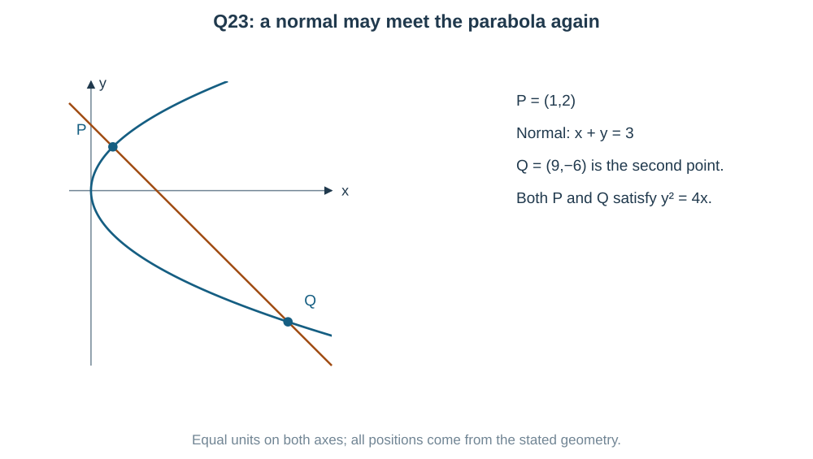

Write $x=3-y$ and substitute into $y^2=4x$:

$$
y^2=4(3-y)
\quad\Longrightarrow\quad
y^2+4y-12=0
\quad\Longrightarrow\quad
(y-2)(y+6)=0.
$$

The root $y=2$ gives the original point. The other root is $y=-6$, so $x=3-(-6)=9$:

$$
\boxed{Q=(9,-6);\quad\text{(b)}}.
$$

**Check both original conditions:** $(-6)^2=4(9)=36$, and $9+(-6)=3$. Option $(9,6)$ lies on the parabola but not on this normal; checking only the curve would be insufficient.

**Parameter connection:** the second point has parameter $t=y/2=-3$, while the first has $t=1$. The normal equation, rather than a focal-chord rule, determines that partner. Their product is not $-1$, because this chord is not a focal chord.

---

### Question 24 — Find a before reading the latus-rectum length

**PDF page 94 | Numerical value | Notes: C03**

If the parabola $y^2=4ax$ passes through $(4,-8)$, then length of its latus rectum is ____.

**Use the supplied point to find $a$ first.**

$$
(-8)^2=4a(4)
\quad\Longrightarrow\quad
64=16a
\quad\Longrightarrow\quad a=4.
$$

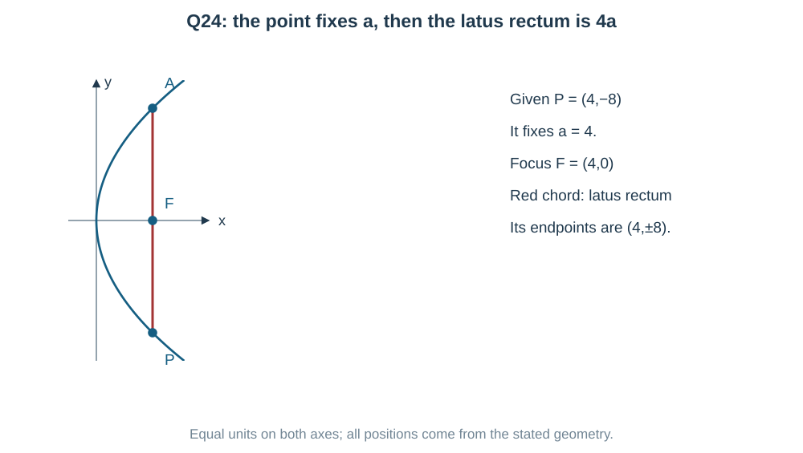

The latus rectum has full length $4a$:

$$
\boxed{4a=16}.
$$

**Coordinate check:** its line passes through focus $(4,0)$ and is $x=4$. Substitution gives $y^2=64$, so its endpoints are $(4,8),(4,-8)$. Their separation is 16.

**Do not infer opening direction from the negative ordinate:** upper and lower points belong to the same right-opening parabola. The sign of the unsquared $x$ coefficient, not the chosen point's $y$ sign, decides the opening.

---

### Question 25 — A chord midpoint need not lie on the parabola

**PDF page 94 | MCQ | Notes: C08**

The equation of the chord of the parabola $y^2=8x$ whose midpoint is $(2,1)$ is

- (a) $4x+y-9=0$
- (b) $x-4y+2=0$
- (c) $4x-y-1=0$
- (d) $4x-y-7=0$

**Do not use a tangent formula at the midpoint.** The point $(2,1)$ is not on $y^2=8x$, since $1\ne16$. We need a chord with two endpoints placed equally around it.

Write the endpoints as

$$
A=(2+u,1+v),\qquad B=(2-u,1-v).
$$

Both lie on the curve:

$$
(1+v)^2=8(2+u),\qquad
(1-v)^2=8(2-u).
$$

Subtract to remove the matching squares:

$$
4v=16u\quad\Longrightarrow\quad v=4u.
$$

Thus the chord direction has slope 4 and passes through $(2,1)$:

$$
y-1=4(x-2)
\quad\Longrightarrow\quad
\boxed{4x-y-7=0;\quad\text{(d)}}.
$$

**Fast exam version:** the midpoint-chord formula is $k(y-k)=2a(x-h)$. With $a=2,h=2,k=1$, it gives the same line directly.

**Independent endpoint check:** substituting $y=4x-7$ gives endpoints

$$
\left(2\pm\frac{\sqrt{15}}4,\ 1\pm\sqrt{15}\right).
$$

Both satisfy the parabola and their midpoint is $(2,1)$. Their existence also agrees with $4ah-k^2=16-1=15>0$.

---

### Question 26 — Square the distance and keep both symmetric minimizing points

**PDF page 94 | Numerical value | Notes: C10**

The square of the minimum distance of the point $(6,0)$ from the parabola $y^2=4x$ is ____.

**The question asks for distance squared, so avoid an unnecessary square root.** For any curve point $(x,y)$,

$$
D^2=(x-6)^2+y^2.
$$

The parabola gives $y^2=4x$ and $x\ge0$. Substitute before differentiating:

$$
D^2=(x-6)^2+4x=x^2-8x+36=(x-4)^2+20.
$$

The square is at least zero, and $x=4$ is allowed. Hence

$$
\boxed{D_{\min}^2=20}.
$$

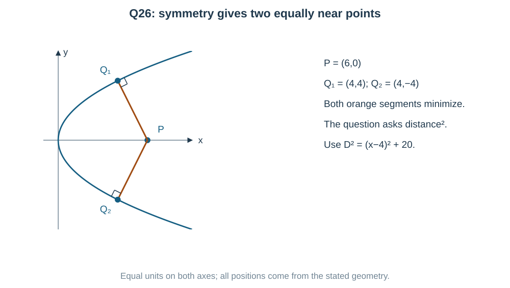

**Keep both points:** at $x=4$, $y=\pm4$. Each gives $D^2=(4-6)^2+16=20$. There is no unique nearest point.

**Another possible approach — parameter and derivative:** with $(x,y)=(t^2,2t)$,

$$
D^2=t^4-8t^2+36,\qquad
\frac d{dt}D^2=4t(t^2-4).
$$

Candidates are $t=0,\pm2$, with values 36, 20, 20. Since $D^2\to\infty$ as $|t|\to\infty$, the smallest is 20. Completing the square is shorter and proves the global lower bound immediately.

**Geometric check:** each shortest segment is normal to the parabola at its endpoint, as the small right-angle marks show.

---

### Question 27 — This parabola opens upward, so use the vertical form

**PDF page 94 | MCQ | Notes: C02,C05**

The tangent to the parabola $x^2=4y$ at the point $(4,4)$ is

- (a) $2x-y-4=0$
- (b) $2x+y-12=0$
- (c) $x-2y+4=0$
- (d) $x-y=0$

**Notice the orientation:** $x^2=4y$ opens upward. The tangent formula must match this form.

Differentiate:

$$
2x=4y'\quad\Longrightarrow\quad y'=\frac x2.
$$

At $(4,4)$, slope is 2. Therefore

$$
y-4=2(x-4)
\quad\Longrightarrow\quad
\boxed{2x-y-4=0;\quad\text{(a)}}.
$$

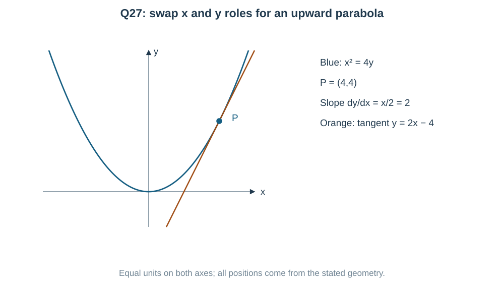

**Fast formula view:** for $x^2=4ay$, the tangent is $xx_1=2a(y+y_1)$. Here it gives $4x=2(y+4)$, the same equation.

**Check:** substitute $y=2x-4$ into the original curve:

$$
x^2=4(2x-4)\quad\Longrightarrow\quad(x-4)^2=0.
$$

**Why copying the sideways formula fails:** $yy_1=2a(x+x_1)$ belongs to $y^2=4ax$, not this upward form. The derivative route automatically respects which variable is squared.

---

### Question 28 — The tangent-slope quadratic tells how many real tangents exist

**PDF page 95 | MCQ | Notes: C05**

The number of tangents that can be drawn from the point $(1,3)$ to the parabola $y^2=4x$ is

- (a) $0$
- (b) $1$
- (c) $2$
- (d) $3$

**Count real tangent contacts rather than guessing from a sketch.** The tangent at parameter $t$ to $y^2=4x$ is $ty=x+t^2$.

For it to pass through $(1,3)$,

$$
3t=1+t^2
\quad\Longrightarrow\quad
t^2-3t+1=0.
$$

Its discriminant is $9-4=5>0$, so there are two distinct real parameters, hence two distinct tangent lines:

$$
\boxed{2;\quad\text{(c)}}.
$$

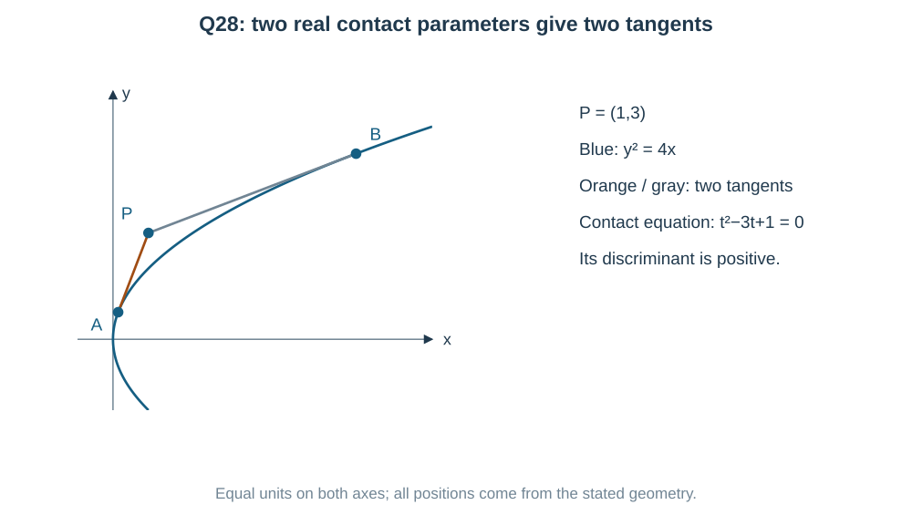

**Check:** the parameters are $(3\pm\sqrt5)/2$, both real. Neither is zero, so neither line is the vertical vertex tangent. The source point has $y^2-4x=9-4=5>0$, agreeing with the two-tangent criterion.

The graph helps visualize the two contacts, but the positive discriminant establishes their exact count.

---

### Question 29 — The coefficient of x squared is not the focal length

**PDF page 95 | MCQ | Notes: C02**

The focus of the parabola $y=2x^2-4x+3$ is

- (a) $\left(1,\dfrac98\right)$
- (b) $\left(1,\dfrac78\right)$
- (c) $\left(1,\dfrac92\right)$
- (d) $\left(\dfrac98,1\right)$

**Complete the square and compare with the standard form.**

$$
y=2x^2-4x+3
=2(x-1)^2+1.
$$

So the vertex is $(1,1)$, and

$$
(x-1)^2=\frac12(y-1)=4a(y-1).
$$

Thus $4a=1/2$ and $a=1/8$, not 2.

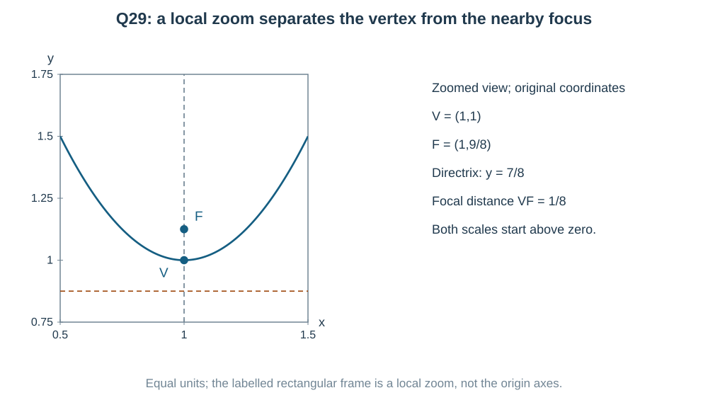

The parabola opens up, so move $1/8$ above the vertex:

$$
\boxed{F=\left(1,1+\frac18\right)=\left(1,\frac98\right);\quad\text{(a)}}.
$$

**Why the diagram is zoomed:** the focus is only $0.125$ units above the vertex. The frame labels show original coordinates; its edges are not the coordinate-origin axes.

**Check with the directrix:** it is $y=1-1/8=7/8$, equally far below the vertex. At the curve point $(3/2,3/2)$, the focal distance is

$$
\sqrt{(1/2)^2+(3/8)^2}=\frac58,
$$

matching its directrix distance $3/2-7/8=5/8$.

**Fast general-form view:** for $y=A(x-h)^2+k$, focus is $(h,k+1/(4A))$. With $A=2,h=k=1$, it gives the same answer.

---

### Question 30 — A circle on a diameter uses half that diameter as its radius

**PDF page 95 | MCQ | Notes: C03**

The equation of the circle described on the latus rectum of the parabola $y^2=8x$ as diameter is

- (a) $x^2+y^2-4x+4=0$
- (b) $x^2+y^2-4x-4=0$
- (c) $x^2+y^2-4x-12=0$
- (d) $x^2+y^2+4x-12=0$

**Find the diameter that the question actually names.** For $y^2=8x$, $a=2$. Its latus rectum lies on $x=2$ and has endpoints

$$
A=(2,4),\qquad B=(2,-4).
$$

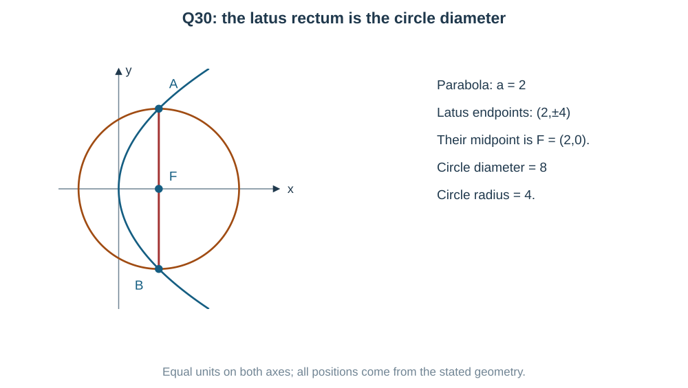

Their midpoint is $(2,0)$ and their separation is 8. Hence the required circle has centre $(2,0)$ and radius 4:

$$
(x-2)^2+y^2=16
\quad\Longrightarrow\quad
\boxed{x^2+y^2-4x-12=0;\quad\text{(c)}}.
$$

**Another possible approach — diameter formula from Circles:**

$$
(x-2)(x-2)+(y-4)(y+4)=0.
$$

It expands into the same equation.

**Check the three different lengths:** focal length $a=2$, latus-rectum diameter $4a=8$, circle radius $2a=4$. Using the focal length as the circle radius would answer a different construction.

## Answer check

Read the qualifications in the solutions before using the key.

| Question | Answer | Question | Answer |
|---|---|---|---|
| 1 | (d) | 16 | $2.12$ |
| 2 | (b) | 17 | (d) |
| 3 | (a) $12$ | 18 | (b) |
| 4 | (c) | 19 | $21.33$ |
| 5 | $8$ | 20 | (c) |
| 6 | $12.5$ | 21 | (a) |
| 7 | (a) | 22 | (c) |
| 8 | (c) | 23 | (b) |
| 9 | (d) | 24 | $16$ |
| 10 | (b) $3$ | 25 | (d) |
| 11 | $96$ | 26 | $20$ |
| 12 | (c), excluding the vertex | 27 | (a) |
| 13 | $18$ | 28 | (c) $2$ |
| 14 | (c) | 29 | (a) |
| 15 | (b) | 30 | (c) |

## After this chapter

Start with the focus, directrix, vertex and opening. Then decide whether the moving object is a curve point, tangent contact, normal contact or chord midpoint. Keep those roles separate. Use exact algebra to support the picture, check the original conditions and retain all valid symmetric points. All alternative views above are plain visible content for the later booklet. The supplied questions are original JEE Main-style practice, not verified actual PYQs. Nonzero-chord midpoint loci exclude their collapsed vertex.
