# Chapter 19 — Ellipse

**Kanna, begin with two fixed points and one fixed total distance. The ellipse equation describes that picture.**

Your overall target remains **200 marks**: Physics 60, Maths 60, Chemistry 80. First learn the axis lengths, foci, eccentricity, directrices and latus rectum. Then connect tangents, normals and maximum/minimum questions to the same picture.

## Recent chapter weightage

| Year | Questions tagged Ellipse in the checked archive | Full-year paper shifts | Tagged questions per shift |
|---|---:|---:|---:|
| 2024 | 8 | 20 | 0.40 |
| 2025 | 18 | 19 | 0.95 |
| 2026 | 15 | 19 | 0.79 |
| Total | 41 | 58 | **0.71** |

These are distinct question IDs recounted in ExamSIDE's separate Ellipse category. PYQSide combines conics into one broader category, with 48, 55 and 57 questions in these years. Those are not separate Ellipse counts; we cannot split them without classifying their questions. These are archive tags, not a fresh independent classification of every official paper. The 2024 format offered more optional numerical questions. The evidence folder retains sources and the recount.

An average below one does not mean the chapter cannot appear in your shift. Learn the basic geometry first; it also helps in mixed-conic questions. This is revision guidance, not a prediction or measured formula-frequency ranking.

**Important for JEE Main:** the current official coordinate-geometry unit explicitly includes standard equations of conics, including ellipse. Tangent, normal, director-circle and other constructions below are supporting tools for the supplied PDF. They are not each claimed as a separately named official syllabus requirement.

## Concept C01 — An ellipse keeps the sum of two distances fixed

Fix two points $F_1,F_2$, called **foci**. A moving point $P$ belongs to the ellipse when

$$
\boxed{PF_1+PF_2=2a}.
$$

Here $2a$ is a fixed positive length, greater than $F_1F_2$. Imagine a loose string with its ends at the foci. Pull it tight with a pencil. The pencil can move, but the two string lengths still add to the same total.

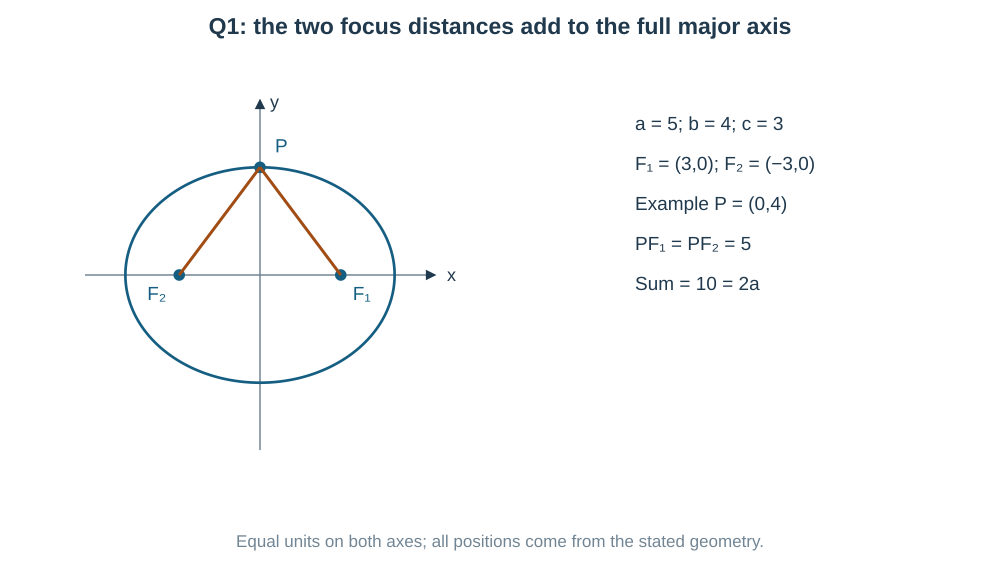

Put the centre halfway between the foci, at $O=(0,0)$. Write the foci as $(c,0),(-c,0)$, where $c>0$.

The farthest right and left points are $(a,0),(-a,0)$. Their joining segment is the **major axis**, length $2a$. Halfway across the top is $(0,b)$. Its two focal distances are equal, so each is $a$:

$$
\sqrt{c^2+b^2}=a
\quad\Longrightarrow\quad
\boxed{c^2=a^2-b^2}.
$$

Thus $a>b>0$. The **minor axis** joins $(0,b),(0,-b)$ and has length $2b$.

The corresponding equation is

$$
\boxed{\frac{x^2}{a^2}+\frac{y^2}{b^2}=1}.
$$

The curve has $-a\le x\le a$ and $-b\le y\le b$. At $x=a$, $y=0$; at $x=0$, $y=\pm b$. These quick checks connect the denominators to the actual axis endpoints.

## Concept C02 — Read the larger denominator and complete squares first

We use $a$ for the **semi-major** length and $b$ for the **semi-minor** length. So $a>b>0$, even when the longer axis is vertical.

| Major-axis direction | Equation at centre $(h,k)$ | Foci | Major-axis ends |
|---|---|---|---|
| horizontal | $\dfrac{(x-h)^2}{a^2}+\dfrac{(y-k)^2}{b^2}=1$ | $(h\pm c,k)$ | $(h\pm a,k)$ |
| vertical | $\dfrac{(x-h)^2}{b^2}+\dfrac{(y-k)^2}{a^2}=1$ | $(h,k\pm c)$ | $(h,k\pm a)$ |

**Pattern:** the larger denominator is under the coordinate along the longer axis. The coefficient in an unnormalized equation can be misleading.

For example,

$$
4x^2+y^2=16
\quad\Longrightarrow\quad
\frac{x^2}{4}+\frac{y^2}{16}=1.
$$

The major axis is vertical: $a=4,b=2$, not the reverse.

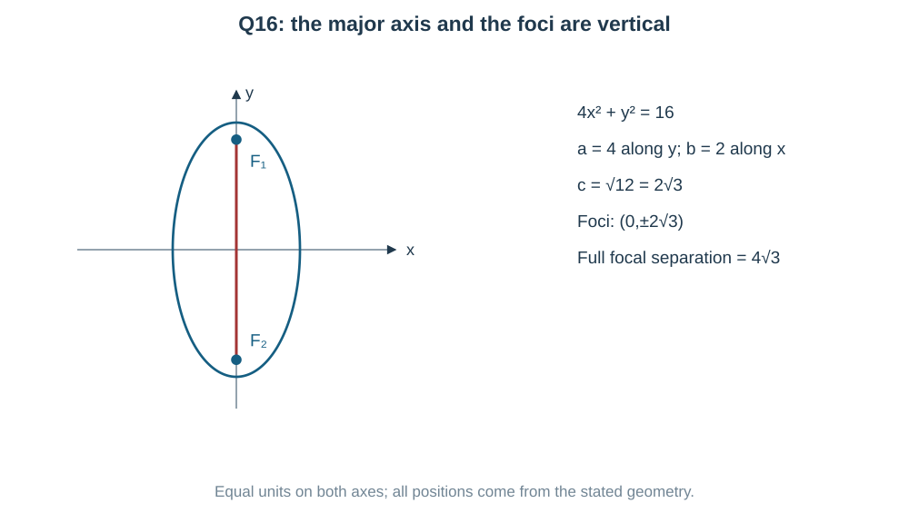

For a general axis-aligned quadratic, group the $x$ and $y$ terms, complete both squares and then divide to make the right side 1. Check that both squared denominators are positive; otherwise the equation may not describe a real ellipse.

The filled area is

$$
\boxed{A=\pi ab}.
$$

One way to see it: a unit disc has area $\pi$. Stretch horizontal distances by $a$ and vertical distances by $b$. Every small area is multiplied by $ab$. This gives an ellipse, though this unequal stretch does **not** preserve angles.

## Concept C03 — Eccentricity and directrices

**Eccentricity** compares the centre-to-focus distance with the semi-major length:

$$
\boxed{e=\frac ca=\sqrt{1-\frac{b^2}{a^2}}}.
$$

For a noncircular ellipse, $0<e<1$. The foci lie inside the major-axis ends because $c<a$. If $b$ gets close to $a$, $e$ gets close to 0 and the ellipse gets close to a circle. If $b/a$ becomes small, $e$ gets close to 1 and the ellipse becomes long and narrow.

A horizontal ellipse also obeys the **focus–directrix rule**:

$$
\boxed{PF=e\,PD},
$$

where $D$ is the perpendicular foot on the corresponding directrix. For focus $(c,0)$, that line is $x=a/e$; for focus $(-c,0)$, it is $x=-a/e$.

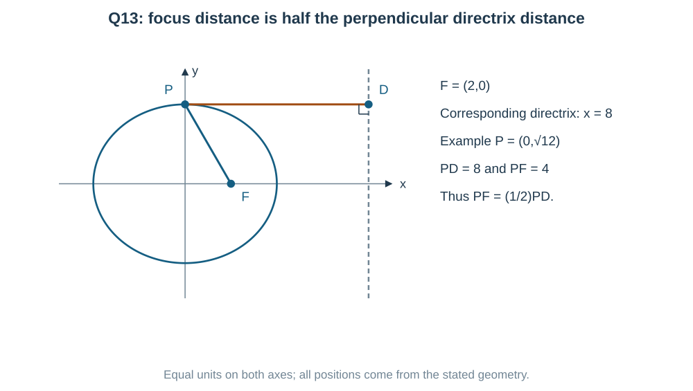

At centre $(h,k)$, horizontal directrices are $x=h\pm a/e$; vertical directrices are $y=k\pm a/e$. The distance between the directrices is $2a/e$, while the distance between foci is $2ae$. They are different lengths.

**Important for JEE Main:** match a focus with its corresponding directrix. The focus and centre are different points. Do not use the focus as the centre of a circle.

For a circle, $e=0$ and both foci merge at the centre. The finite-directrix formulas containing $1/e$ do not apply at $e=0$.

## Concept C04 — Focal distances and the full latus rectum

For the horizontal ellipse and right focus $F_1=(c,0)$,

$$
\boxed{PF_1=a-ex},\qquad
\boxed{PF_2=a+ex},\quad F_2=(-c,0).
$$

Why are they so short? Their sum is $2a$. Their squared difference is

$$
PF_2^2-PF_1^2=(x+c)^2-(x-c)^2=4cx.
$$

Factor the left side as $(PF_2-PF_1)(PF_2+PF_1)$. Since the sum is $2a$, their difference is $2cx/a=2ex$. Adding/subtracting the sum and difference gives the two formulas.

Both are positive. The smallest distance to a fixed focus is $a-c=a(1-e)$, reached at the near major-axis end. The largest is $a+c=a(1+e)$, reached at the opposite end.

A **focal chord** has two curve endpoints and passes through a focus. The **latus rectum** is the focal chord perpendicular to the major axis.

For the right focus, put $x=c=ae$:

$$
\frac{c^2}{a^2}+\frac{y^2}{b^2}=1
\quad\Longrightarrow\quad
y=\pm\frac{b^2}{a}.
$$

Therefore

$$
\boxed{\text{endpoints}=\left(c,\pm\frac{b^2}{a}\right)},\qquad
\boxed{\text{full latus-rectum length}=\frac{2b^2}{a}}.
$$

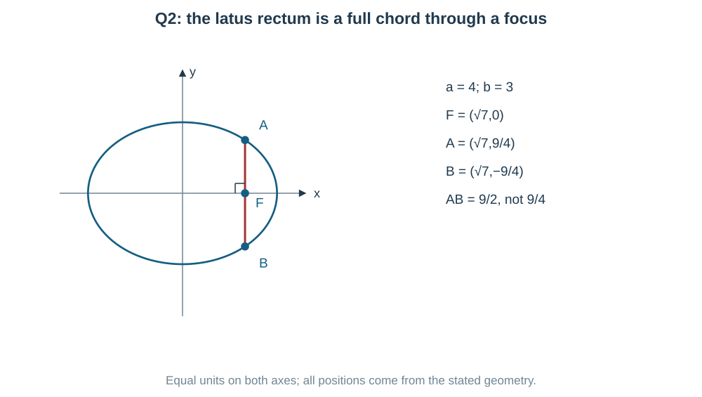

**Important for JEE Main:** $b^2/a$ is a **half** chord length. $2b$ is the full minor-axis length. Many wrong options mix these with the full latus rectum.

## Concept C05 — The eccentric angle labels a point

For a horizontal ellipse,

$$
\boxed{P=(a\cos\theta,b\sin\theta)}.
$$

Substitution gives $\cos^2\theta+\sin^2\theta=1$, so this always lies on the ellipse. As $\theta$ runs through one full turn, it covers the whole curve.

Why call it an **eccentric angle**? Draw the auxiliary circle of radius $a$. On that circle take $U=(a\cos\theta,a\sin\theta)$. Keep its $x$-coordinate and shorten its height by the ratio $b/a$. This produces $P$.

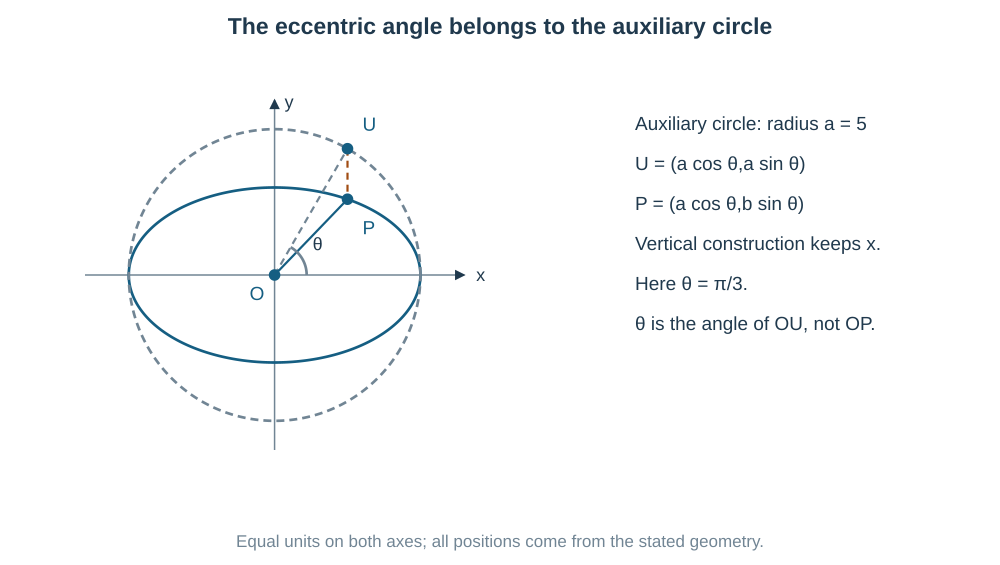

The angle $\theta$ belongs to $OU$. It is generally **not** the angle made by $OP$ with the $x$-axis. If that polar angle is $\phi$, then, when the ratios are defined,

$$
\tan\phi=\frac{b}{a}\tan\theta.
$$

For a vertical ellipse use $(b\cos\theta,a\sin\theta)$. For a shifted ellipse add its centre coordinates.

**Use the parameter when** the question gives an angle, asks for a moving tangent, or contains products of ellipse coordinates. The familiar identity $\sin^2\theta+\cos^2\theta=1$ often replaces a longer elimination.

## Concept C06 — Tangent: the curve's direction at one point

A tangent follows the curve's local direction at the touching point. At a curve point $(x_1,y_1)$, differentiating gives

$$
\frac{2x}{a^2}+\frac{2y}{b^2}y'=0
\quad\Longrightarrow\quad
y'=-\frac{b^2x}{a^2y}\quad(y\ne0).
$$

Using this slope and the curve equation gives

$$
\boxed{\frac{xx_1}{a^2}+\frac{yy_1}{b^2}=1}.
$$

This point formula also works at the axis ends, where the divided slope formula may fail. At $(a,0)$ the tangent is $x=a$; at $(0,b)$ it is $y=b$.

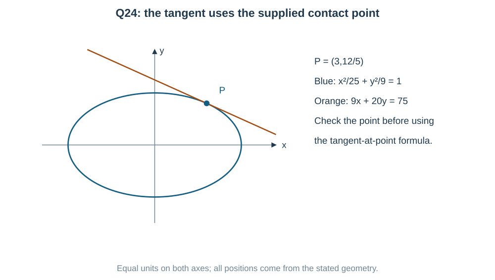

At parameter $\theta$,

$$
\boxed{\frac{x\cos\theta}{a}+\frac{y\sin\theta}{b}=1}.
$$

For a finite slope $m$, write the line as $y=mx+c_0$. Its tangency condition is

$$
\boxed{c_0^2=a^2m^2+b^2}.
$$

There are two parallel tangents with intercepts $\pm\sqrt{a^2m^2+b^2}$. This family also includes horizontal tangents, $m=0$; vertical ones need $x=\pm a$ separately.

For a proper line $Ax+By+C=0$, the coordinate-independent coefficient test is

$$
\boxed{C^2=a^2A^2+b^2B^2}.
$$

You can derive it by substituting the line into the ellipse and requiring a repeated intersection. It includes vertical and horizontal lines.

**Check first:** a formula for a tangent **at** a point requires that point to be on the ellipse. An external point instead gives two contacts, as in C10.

## Concept C07 — Normal: a line perpendicular to the tangent

At $P=(x_1,y_1)$, a normal points in direction

$$
\boxed{\left(\frac{x_1}{a^2},\frac{y_1}{b^2}\right)}.
$$

Why? The tangent equation has those two coefficients. They give a perpendicular direction, just as for a straight line $Ax+By=C$. The normal passes through $P$:

$$
(x,y)=(x_1,y_1)+t\left(\frac{x_1}{a^2},\frac{y_1}{b^2}\right).
$$

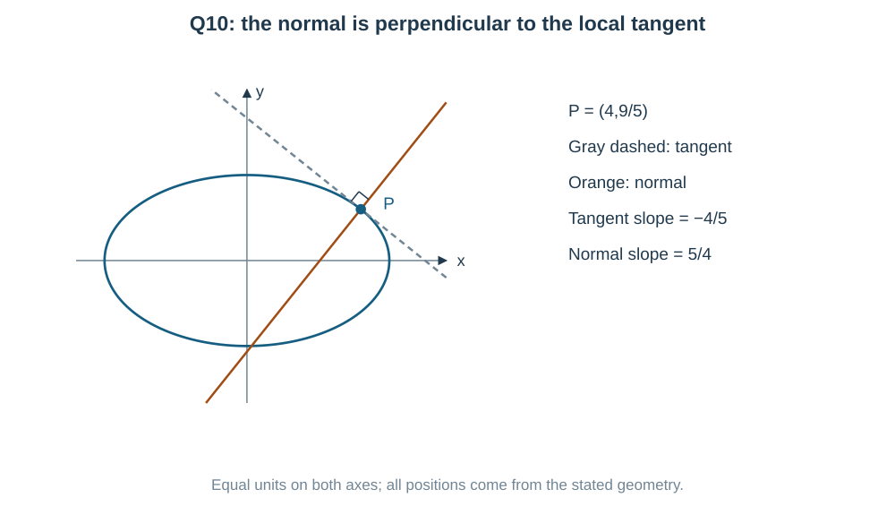

When $x_1y_1\ne0$, an equivalent useful form is

$$
\boxed{\frac{a^2x}{x_1}-\frac{b^2y}{y_1}=a^2-b^2}.
$$

The normal slope is $a^2y_1/(b^2x_1)$ when $x_1\ne0$. At a major-axis end the normal is the major axis. At a minor-axis end it is the minor axis.

**Important distinction:** an ellipse's normal does not usually pass through its centre. A radius-to-contact direction is automatically normal for a circle, but not for a general ellipse. Here the normal direction is $(x_1/a^2,y_1/b^2)$, rather than $(x_1,y_1)$.

## Concept C08 — Perpendicular distances from the foci to a tangent

This question is about two shortest segments from fixed foci to a **line**. It is different from the two segments joining a curve point to its foci.

For any tangent,

$$
\boxed{d_1d_2=b^2},
$$

where $d_1,d_2$ are the perpendicular distances from the two foci.

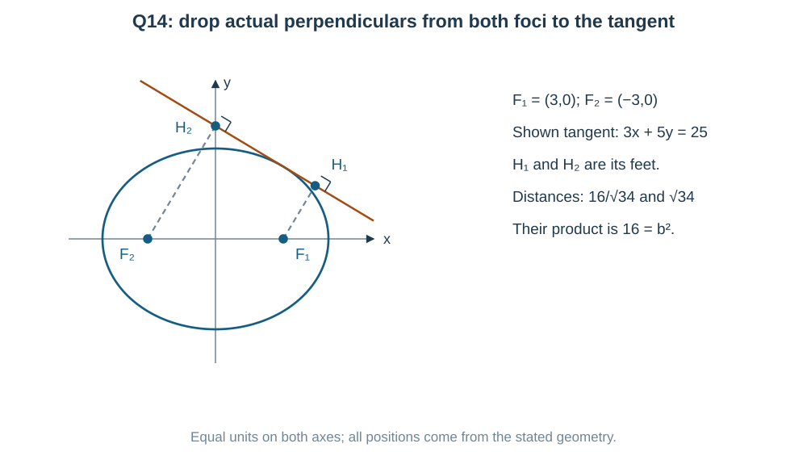

Here is a short reason. A unit normal is a perpendicular direction arrow of length 1. Write the tangent as $n_xx+n_yy=h$, choosing that unit normal, so $n_x^2+n_y^2=1$ and $h>0$. From C06,

$$
h^2=a^2n_x^2+b^2n_y^2.
$$

The foci are $(\pm c,0)$ and lie on the centre's side of the tangent, so their distances are $h-cn_x$ and $h+cn_x$. Multiply:

$$
\begin{aligned}
d_1d_2&=h^2-c^2n_x^2\\
&=(a^2-c^2)n_x^2+b^2n_y^2\\
&=b^2(n_x^2+n_y^2)=b^2.
\end{aligned}
$$

No angle needs to be calculated. Use this when the wording specifically says **perpendicular distances to a tangent**.

## Concept C09 — Chord with a given midpoint

Let $M=(h,k)$ be the midpoint and let endpoints be $(h+u,k+v),(h-u,k-v)$. Substitute both in the ellipse and subtract. The matching squares cancel:

$$
\frac{hu}{a^2}+\frac{kv}{b^2}=0.
$$

So the direction $(u,v)$ is perpendicular to $(h/a^2,k/b^2)$. The chord line is

$$
\boxed{\frac{hx}{a^2}+\frac{ky}{b^2}
=\frac{h^2}{a^2}+\frac{k^2}{b^2}}.
$$

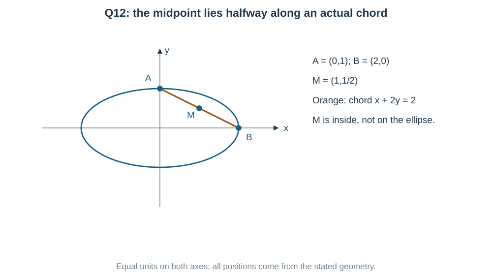

For a noncentral midpoint, a real nonzero chord needs

$$
\frac{h^2}{a^2}+\frac{k^2}{b^2}<1.
$$

Equality gives a collapsed chord on the boundary; a value greater than 1 gives no such real chord. If $M=(0,0)$, every diameter has that midpoint, so there is no unique chord and the displayed equation reduces to $0=0$.

**Pattern to remember:** a midpoint formula has the midpoint's own quadratic value on the right. Replacing it by 1 would wrongly treat the midpoint as a tangent contact.

## Concept C10 — Chord of contact from an external point

From an external point $Q=(x_0,y_0)$, draw two tangents touching at $A,B$. The segment $AB$ is the **chord of contact**.

The tangent at $A=(x_1,y_1)$ passes through $Q$, so

$$
\frac{x_0x_1}{a^2}+\frac{y_0y_1}{b^2}=1.
$$

The second contact obeys the same equation. Therefore their common line is

$$
\boxed{\frac{x_0x}{a^2}+\frac{y_0y}{b^2}=1}.
$$

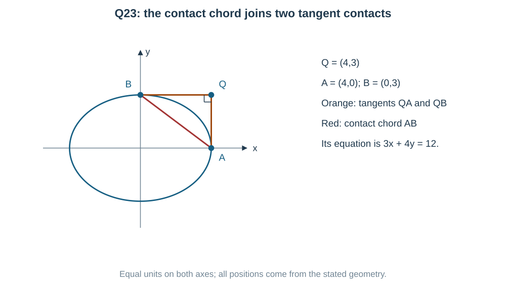

The same-looking expression means different things depending on the role of $(x_0,y_0)$:

| Position of the given point | Meaning |
|---|---|
| $x_0^2/a^2+y_0^2/b^2=1$ | one tangent at that point |
| $x_0^2/a^2+y_0^2/b^2>1$ | two real tangents; their contact chord |
| $x_0^2/a^2+y_0^2/b^2<1$ | inside; no real tangents from it |

Do not confuse this contact chord with the chord having $(x_0,y_0)$ as its **midpoint**.

## Concept C11 — Perpendicular tangents and the director circle

A **director circle** is the locus of the intersection point of two perpendicular tangents.

Take $Q=(x_0,y_0)$. A finite-slope tangent through it has intercept $c_0=y_0-mx_0$. Put this into C06:

$$
(y_0-mx_0)^2=a^2m^2+b^2,
$$

or

$$
(x_0^2-a^2)m^2-2x_0y_0m+(y_0^2-b^2)=0.
$$

For two finite slopes to be perpendicular their product must be $-1$:

$$
\frac{y_0^2-b^2}{x_0^2-a^2}=-1
\quad\Longrightarrow\quad
\boxed{x_0^2+y_0^2=a^2+b^2}.
$$

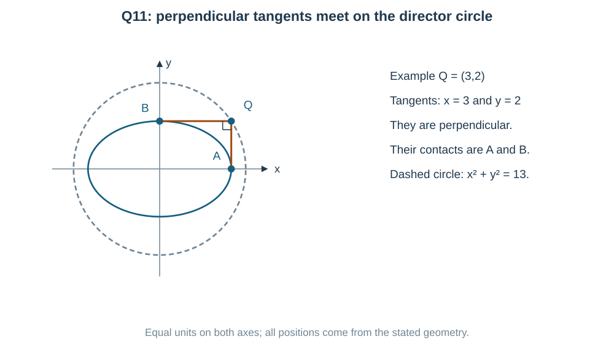

The vertical/horizontal pairs are included too: at $(\pm a,\pm b)$, tangents $x=\pm a$ and $y=\pm b$ meet at $90^\circ$. These points complete the cases omitted by dividing by $x_0^2-a^2$.

This circle has centre at the ellipse's centre and radius $\sqrt{a^2+b^2}$. It is not the ellipse itself.

## Concept C12 — Maximum/minimum: use the ellipse's own constraint

For a first-quadrant point $(x,y)$, define

$$
X=\frac xa,\qquad Y=\frac yb.
$$

Then $X^2+Y^2=1$, with $X,Y\ge0$.

**Important for JEE Main — AM–GM and Cauchy–Schwarz.** They turn this constraint into a useful bound:

$$
(X-Y)^2\ge0
\quad\Longrightarrow\quad
2XY\le X^2+Y^2=1.
$$

Equivalently, AM–GM on $X^2,Y^2$ gives $XY\le1/2$. Equality requires $X=Y=1/\sqrt2$.

Cauchy–Schwarz says the square of a dot product cannot exceed the product of squared lengths:

$$
(uX+vY)^2\le(u^2+v^2)(X^2+Y^2).
$$

Here all symbols are real. For example, $(X+Y)^2\le2$, with equality at $X=Y$. For a linear target on the ellipse,

$$
\boxed{|px+qy|\le\sqrt{a^2p^2+b^2q^2}}.
$$

This follows by using the two pairs $(ap,bq)$ and $(X,Y)$. Equality means those pairs point in the same or opposite direction. This helps with largest/smallest linear expressions and tangent support lines.

**Largest rectangle parallel to the axes:** its four vertices are $(\pm x,\pm y)$, so

$$
A_R=4xy=4abXY\le\boxed{2ab}.
$$

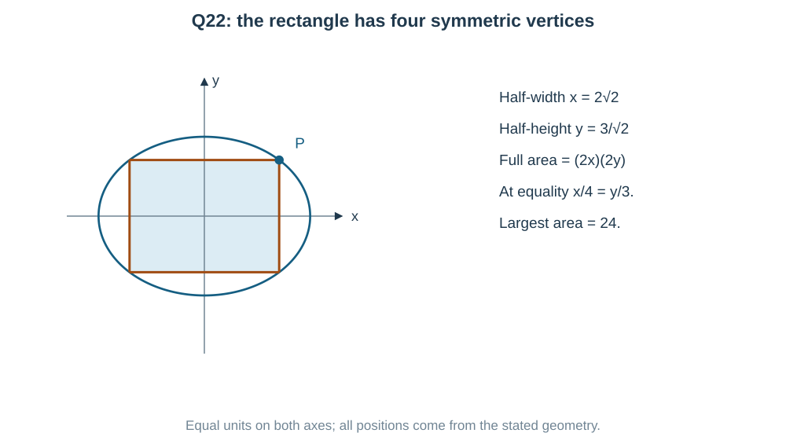

**Smallest intercept triangle from a tangent:** at $(a\cos\theta,b\sin\theta)$ its finite intercepts are

$$
A=\left(\frac a{\cos\theta},0\right),\qquad
B=\left(0,\frac b{\sin\theta}\right).
$$

Ordinary area is positive, so

$$
A_T=\frac{ab}{2|\sin\theta\cos\theta|}
=\frac{ab}{|\sin2\theta|}\ge\boxed{ab}.
$$

Equality needs $|\sin2\theta|=1$. Exclude $\sin\theta=0$ or $\cos\theta=0$: those tangents do not give a finite two-intercept triangle.

Notice how the same normalized-coordinate product gives a **maximum** for the rectangle and a **minimum** for its reciprocal in the triangle problem. Decide what quantity is actually being optimized.

## Concept C13 — Build an ellipse from a locus condition

A **locus** is the set of all points satisfying the stated condition.

For two foci separated by $2c$:

- a fixed distance sum $2a>2c$ gives a nondegenerate ellipse;
- sum $2c$ gives the focal line segment, not a genuine ellipse;
- sum smaller than $2c$ gives no point, by the triangle inequality.

For a focus and a line, start with

$$
\sqrt{(x-f_x)^2+(y-f_y)^2}
=e\,\frac{|Ax+By+C|}{\sqrt{A^2+B^2}},
\quad 0<e<1.
$$

The focus must be off the directrix and the line must be proper. Both sides are nonnegative, so squaring is safe. Complete squares to find the **centre** and axis lengths. Check a point in the original distance rule afterward.

**Useful order:** identify the axis from the foci; find $a$ from a distance sum or $c/e$; then find $b^2=a^2-c^2$. Guessing an equation from only one focus loses needed information.

## Last-minute formula recap

The horizontal formulas below use $a>b>0$, $c^2=a^2-b^2$, $e=c/a$. Swap coordinates for a vertical major axis; shift by the actual centre when needed.

| Need or clue | Formula | Condition or trap |
|---|---|---|
| Standard ellipse | $x^2/a^2+y^2/b^2=1$ | larger denominator is along major axis |
| Axes / foci | lengths $2a,2b$; foci $(\pm c,0)$ | focal separation $2c$, not $c$ |
| Eccentricity | $e=c/a=\sqrt{1-b^2/a^2}$ | noncircular ellipse: $0<e<1$ |
| Directrices | $x=\pm a/e$ | pair with corresponding focus; $e\ne0$ |
| Focal sum | $PF_1+PF_2=2a$ | fixed sum exceeds focal separation |
| Right/left focal distances | $a-ex,\ a+ex$ | right focus $(c,0)$ / left focus $(-c,0)$ |
| Least / greatest focal distance | $a-c,\ a+c$ | attained at major-axis ends |
| Latus rectum | endpoints $(c,\pm b^2/a)$; full length $2b^2/a$ | do not give only a half chord |
| Ellipse area | $\pi ab$ | both semi-axis lengths |
| Parameter point | $(a\cos\theta,b\sin\theta)$ | $\theta$ is eccentric, not generally polar angle |
| Tangent at a curve point | $xx_1/a^2+yy_1/b^2=1$ | point must satisfy ellipse |
| Parameter tangent | $x\cos\theta/a+y\sin\theta/b=1$ | covers axis ends |
| Slope tangency | $y=mx+c_0$, $c_0^2=a^2m^2+b^2$ | vertical members separate |
| General-line tangency | $C^2=a^2A^2+b^2B^2$ | proper line $Ax+By+C=0$ |
| Normal direction | $(x_1/a^2,y_1/b^2)$ | perpendicular to tangent at same point |
| Normal equation | $a^2x/x_1-b^2y/y_1=a^2-b^2$ | use only if $x_1y_1\ne0$ |
| Focus-to-tangent distances | $d_1d_2=b^2$ | distances perpendicular to line |
| Midpoint chord | $hx/a^2+ky/b^2=h^2/a^2+k^2/b^2$ | noncentral interior midpoint |
| Contact chord from outside | $x_0x/a^2+y_0y/b^2=1$ | $x_0^2/a^2+y_0^2/b^2>1$ |
| Director circle | $x^2+y^2=a^2+b^2$ | perpendicular tangent intersections |
| Largest axis-parallel rectangle | $2ab$ | normalized coordinates have equal magnitudes |
| Smallest finite intercept triangle | $ab$ | both intercepts finite and nonzero |
| Linear-expression bound | $|px+qy|\le\sqrt{a^2p^2+b^2q^2}$ | Cauchy–Schwarz; check equality |

**Recall habit:** find the centre and the two axis lengths first. Then name the object: focus, tangent point, normal point, midpoint or external point. Similar-looking formulas can describe different objects.

## Worked solutions to the 25 PDF questions

Read the question first. Notice the pattern, choose a route, then calculate. Alternative methods below are fully visible.

### Question 1 — Eccentricity measures the focal separation compared with the major axis

**PDF page 97 | MCQ | Notes: C01,C03**

The eccentricity of the ellipse $\dfrac{x^2}{25}+\dfrac{y^2}{16}=1$ is

- (a) $\dfrac45$
- (b) $\dfrac34$
- (c) $\dfrac35$
- (d) $\dfrac9{25}$

**First read the two lengths.** The larger denominator is 25, so the major axis is horizontal:

$$
a=5,\qquad b=4.
$$

The focus is $c$ units from the centre, with $c^2=a^2-b^2$:

$$
c^2=25-16=9,\qquad c=3.
$$

Eccentricity is a ratio of those lengths:

$$
\boxed{e=\frac ca=\frac35;\quad\text{(c)}}.
$$

**Check:** it must lie between 0 and 1. The value $9/25$ is $e^2$, not $e$.

---

### Question 2 — Normalize the equation before reading the axis lengths

**PDF page 97 | MCQ | Notes: C02,C04**

The length of the latus rectum of the ellipse $9x^2+16y^2=144$ is

- (a) $\dfrac92$
- (b) $\dfrac94$
- (c) $\dfrac{32}3$
- (d) $6$

**Normalize first.** The coefficients 9 and 16 are not the squared semiaxes. Divide the whole equation by 144:

$$
\frac{x^2}{16}+\frac{y^2}{9}=1.
$$

Thus $a=4,b=3$. The latus rectum is the full chord through a focus perpendicular to the major axis:

$$
\boxed{L=\frac{2b^2}{a}=\frac{2(9)}4=\frac92;\quad\text{(a)}}.
$$

**Coordinate check:** $c=\sqrt7$. At $x=\sqrt7$, the equation gives $y=\pm9/4$. Their separation is $9/4-(-9/4)=9/2$.

---

### Question 3 — The foci fix the axis and the given point fixes the minor end

**PDF page 97 | MCQ | Notes: C01,C02**

The equation of the ellipse with foci at $(\pm3,0)$ and passing through the point $(0,4)$ is

- (a) $\dfrac{x^2}{16}+\dfrac{y^2}{25}=1$
- (b) $\dfrac{x^2}{25}+\dfrac{y^2}{9}=1$
- (c) $\dfrac{x^2}{9}+\dfrac{y^2}{16}=1$
- (d) $\dfrac{x^2}{25}+\dfrac{y^2}{16}=1$

**Use the distance-sum meaning.** At the given point $P=(0,4)$, both focus distances are

$$
\sqrt{3^2+4^2}=5.
$$

So $PF_1+PF_2=10=2a$, giving $a=5$. The foci are 3 units from the origin, so $c=3$.

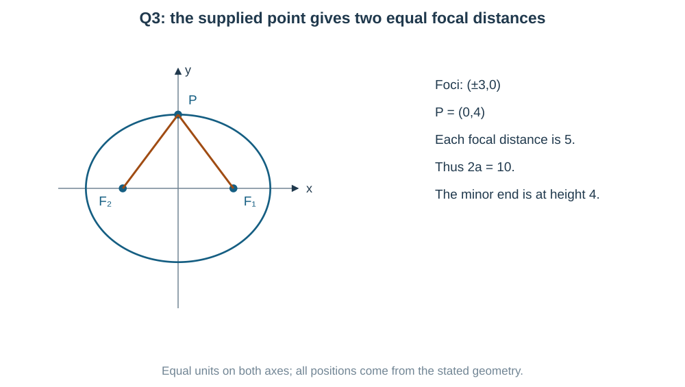

$$
b^2=a^2-c^2=25-9=16.
$$

The foci are horizontal, so the equation is

$$
\boxed{\frac{x^2}{25}+\frac{y^2}{16}=1;\quad\text{(d)}}.
$$

**Another possible approach:** symmetry makes $(0,4)$ the upper minor-axis end, so $b=4$. Then $a^2=b^2+c^2=16+9=25$ directly. Both routes work; the focal-sum route also explains why this is an ellipse.

**Check:** substituting $(0,4)$ gives 1, and its foci are $(\pm\sqrt{25-16},0)=(\pm3,0)$.

---

### Question 4 — Translate the two named lengths into formulas

**PDF page 97 | MCQ | Notes: C03,C04**

If the length of the latus rectum of an ellipse is half of its minor axis, its eccentricity is

- (a) $\dfrac12$
- (b) $\dfrac1{\sqrt2}$
- (c) $\dfrac{\sqrt3}2$
- (d) $\dfrac{\sqrt3}4$

**Name both lengths before comparing.** The full minor axis is $2b$. Half of it is $b$. The full latus rectum is $2b^2/a$.

$$
\frac{2b^2}{a}=b.
$$

Since $b>0$, divide by $b$:

$$
\frac ba=\frac12.
$$

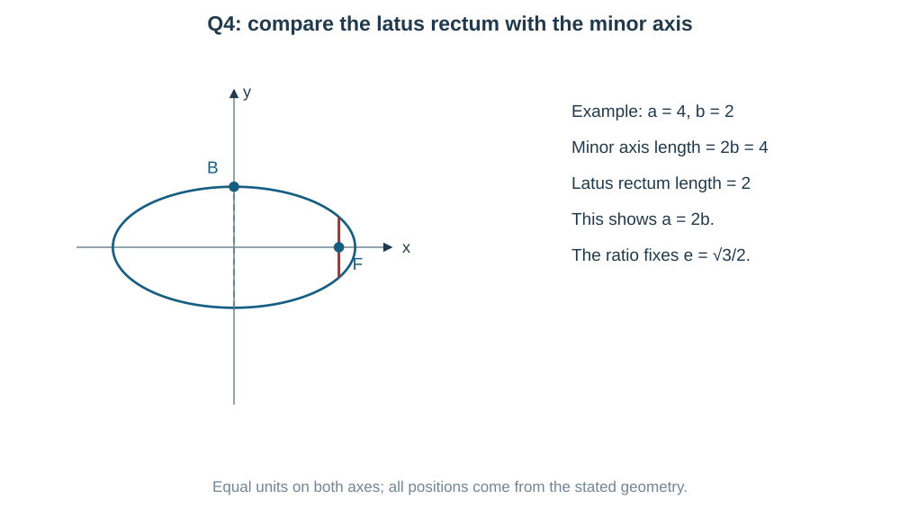

Now

$$
e^2=1-\frac{b^2}{a^2}=1-\frac14=\frac34,
\qquad
\boxed{e=\frac{\sqrt3}{2};\quad\text{(c)}}.
$$

**Check:** only the ratio $b/a$ is fixed. There is no need to invent numerical axis lengths. The diagram's $a=4,b=2$ is one example with that ratio.

---

### Question 5 — A fixed tangent slope determines the intercept size

**PDF page 97 | Numerical value | Notes: C06**

If the line $y=x+c$ is tangent to the ellipse $\dfrac{x^2}{9}+\dfrac{y^2}{4}=1$, then $c^2=$ ____.

**The slope is known: $m=1$.** For the source ellipse, $a^2=9,b^2=4$. A tangent $y=mx+c$ must satisfy

$$
c^2=a^2m^2+b^2.
$$

Therefore

$$
\boxed{c^2=9(1)^2+4=13}.
$$

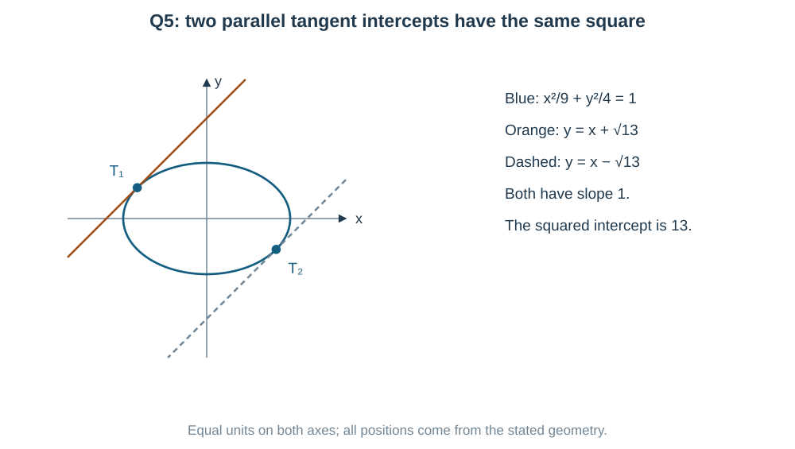

There are two possible intercepts, $c=\pm\sqrt{13}$, but the requested square is the same.

**Another possible approach — repeated intersection:** substitute $y=x+c$:

$$
4x^2+9(x+c)^2=36
\quad\Longrightarrow\quad
13x^2+18cx+9c^2-36=0.
$$

For tangency its discriminant is zero:

$$
324c^2-52(9c^2-36)=0
\quad\Longrightarrow\quad
144(13-c^2)=0.
$$

This gives the same $c^2=13$ and shows why a repeated root is the correct condition.

---

### Question 6 — The sum of focal distances is the major-axis length

**PDF page 97 | MCQ | Notes: C01**

For any point $P$ on the ellipse $4x^2+9y^2=36$, the sum of its distances from the two foci is

- (a) $3$
- (b) $9$
- (c) $12$
- (d) $6$

**The question asks for a sum of focal distances.** That is the definition $PF_1+PF_2=2a$.

Normalize:

$$
4x^2+9y^2=36
\quad\Longrightarrow\quad
\frac{x^2}{9}+\frac{y^2}{4}=1.
$$

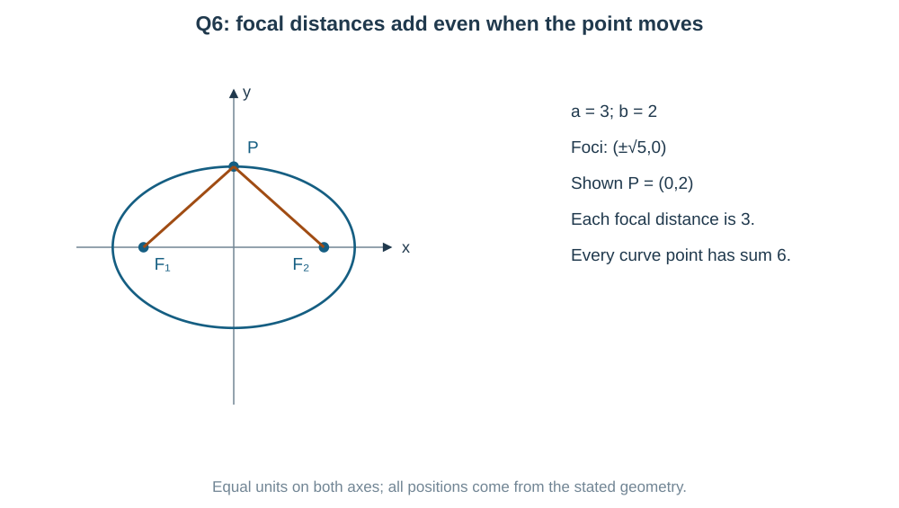

Here $a=3$, so

$$
\boxed{PF_1+PF_2=6;\quad\text{(d)}}.
$$

**Check at a simple point:** $P=(0,2)$ and foci $(\pm\sqrt5,0)$ give each distance $\sqrt{5+4}=3$. Finding a general moving point would create work that the fixed-sum definition already avoids.

---

### Question 7 — Minimize an actual finite intercept triangle

**PDF page 97 | Numerical value | Notes: C05,C12**

A tangent at a variable point of the ellipse $\dfrac{x^2}{16}+\dfrac{y^2}{9}=1$ meets the coordinate axes at $A$ and $B$. The minimum area of triangle $OAB$ ($O$ the origin) is ____.

**First draw what the area belongs to.** It is triangle $OAB$, formed by the axes and a tangent. It is not an area inside the ellipse.

Take its contact as $P=(4\cos\theta,3\sin\theta)$. The tangent is

$$
\frac{x\cos\theta}{4}+\frac{y\sin\theta}{3}=1.
$$

Putting $y=0$ and $x=0$ gives intercepts $4/\cos\theta$ and $3/\sin\theta$.

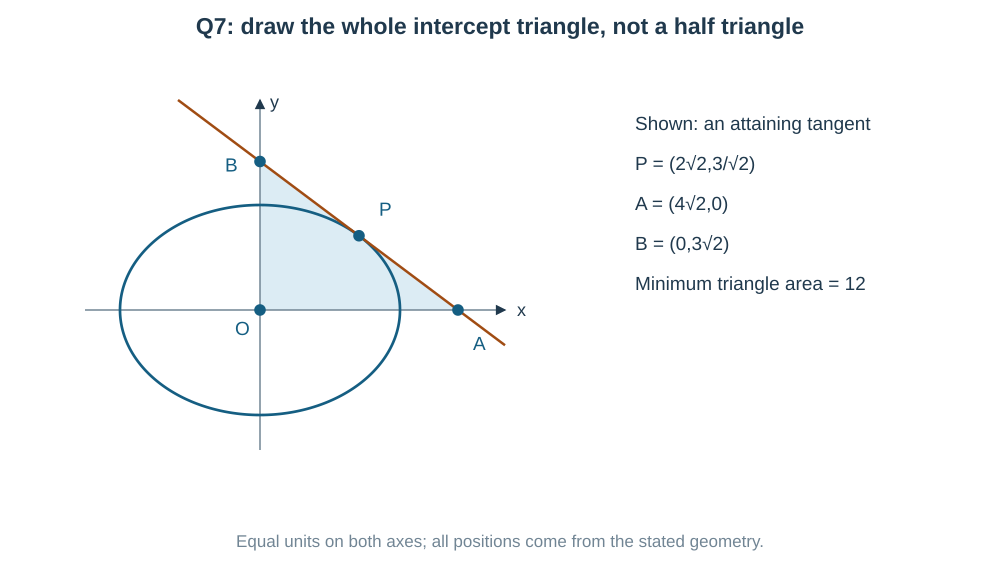

Use the absolute value because ordinary area is positive in every quadrant:

$$
\Delta=\frac12\left|\frac4{\cos\theta}\frac3{\sin\theta}\right|
=\frac{12}{|\sin2\theta|}\ge12.
$$

Equality is possible at $\theta=\pi/4$, giving

$$
P=\left(2\sqrt2,\frac3{\sqrt2}\right),\quad
A=(4\sqrt2,0),\quad B=(0,3\sqrt2).
$$

Thus

$$
\boxed{\Delta_{\min}=12}.
$$

**Another possible approach — AM–GM on the intercepts:** write the tangent as $x/p+y/q=1$, with finite nonzero $p,q$. Its tangency condition is

$$
\frac{16}{p^2}+\frac9{q^2}=1.
$$

AM–GM gives $1\ge2\sqrt{144/(p^2q^2)}=24/|pq|$, so $|pq|/2\ge12$. Equality gives $|p|=4\sqrt2,|q|=3\sqrt2$.

The parameter route is easier to picture. The intercept route is useful if the question already gives intercepts. Axis-end tangents have a missing/infinite intercept and do not make a finite triangle; they cannot be used to claim area zero.

---

### Question 8 — Focal half-separation and eccentricity give the semi-major axis

**PDF page 97 | Numerical value | Notes: C02,C03**

An ellipse has foci $(\pm3,0)$ and eccentricity $\dfrac35$. If its area is $k\pi$, then $k=$ ____.

**The given focal coordinate is $c$, not $a$.** From foci $(\pm3,0)$, $c=3$. Since $e=c/a=3/5$,

$$
a=\frac ce=\frac3{3/5}=5.
$$

Then

$$
b^2=a^2-c^2=25-9=16,\qquad b=4.
$$

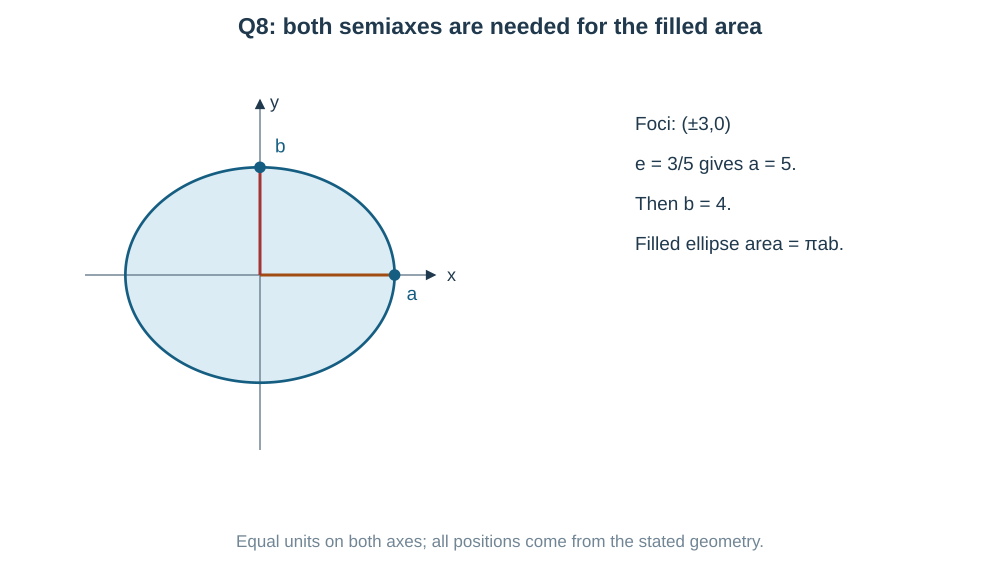

$$
A=\pi ab=20\pi
\quad\Longrightarrow\quad
\boxed{k=20}.
$$

**Check:** $c/a=3/5$ and $a^2-b^2=9$ reproduce both givens.

---

### Question 9 — A fixed sum of distances is an ellipse definition

**PDF page 97 | MCQ | Notes: C01,C13**

The locus of a point $P$ such that the sum of its distances from $(4,0)$ and $(-4,0)$ is $10$ is

- (a) $\dfrac{x^2}{25}+\dfrac{y^2}{16}=1$
- (b) $\dfrac{x^2}{25}+\dfrac{y^2}{9}=1$
- (c) $\dfrac{x^2}{9}+\dfrac{y^2}{25}=1$
- (d) $\dfrac{x^2}{100}+\dfrac{y^2}{36}=1$

**A fixed sum of distances to two fixed points suggests an ellipse.** The foci are $(\pm4,0)$, so the centre is the origin and $c=4$.

$$
2a=10\quad\Longrightarrow\quad a=5,\qquad
b^2=a^2-c^2=25-16=9.
$$

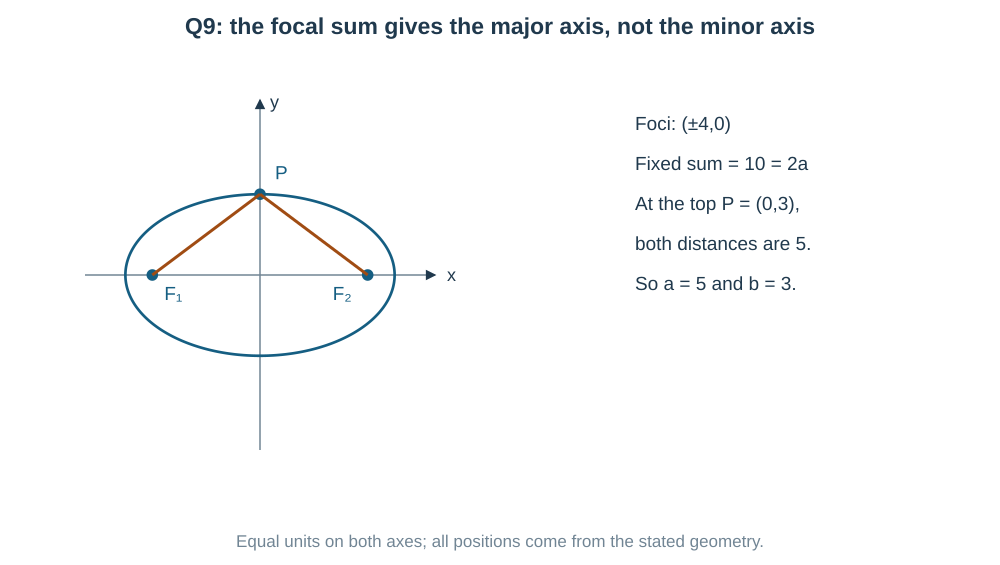

Therefore

$$
\boxed{\frac{x^2}{25}+\frac{y^2}{9}=1;\quad\text{(b)}}.
$$

**Check the existence condition:** the sum 10 is greater than the focal separation 8. At $(0,3)$, both distances are 5; at $(5,0)$ they are 1 and 9. The same total is obtained in both cases.

---

### Question 10 — A normal stands perpendicular to the tangent at the same point

**PDF page 98 | MCQ | Notes: C07**

The equation of the normal to the ellipse $\dfrac{x^2}{25}+\dfrac{y^2}{9}=1$ at the point $\left(4,\dfrac95\right)$ is

- (a) $25x-20y=64$
- (b) $4x+5y=25$
- (c) $25x+20y=136$
- (d) $20x-25y=35$

**A normal means perpendicular to the tangent at this point.** First verify that the point belongs to the ellipse:

$$
\frac{4^2}{25}+\frac{(9/5)^2}{9}
=\frac{16}{25}+\frac9{25}=1.
$$

Differentiate the curve:

$$
y'=-\frac{9x}{25y}.
$$

At $(4,9/5)$, the tangent slope is $-4/5$. Thus the normal slope is $5/4$.

$$
y-\frac95=\frac54(x-4)
\quad\Longrightarrow\quad
\boxed{25x-20y=64;\quad\text{(a)}}.
$$

**Another possible approach — normal direction:** the tangent's perpendicular direction is

$$
\left(\frac4{25},\frac{9/5}{9}\right)
=\left(\frac4{25},\frac15\right),
$$

which has slope $5/4$. This avoids differentiating again once the tangent-normal connection is familiar.

**Check:** the point gives $100-36=64$, and the two slopes multiply to $-1$. The centre-to-point direction has slope $9/20$, so assuming the normal is a radius would be wrong.

---

### Question 11 — Perpendicular tangents trace the director circle

**PDF page 98 | MCQ | Notes: C11**

The locus of the point of intersection of perpendicular tangents to the ellipse $\dfrac{x^2}{9}+\dfrac{y^2}{4}=1$ is

- (a) $x^2+y^2=5$
- (b) $x^2+y^2=36$
- (c) $x^2+y^2=25$
- (d) $x^2+y^2=13$

**The moving point is outside the ellipse, where the two tangents meet.** This locus is called the director circle. Its radius squared is the sum of the squared semiaxes.

For $a^2=9,b^2=4$,

$$
\boxed{x^2+y^2=9+4=13;\quad\text{(d)}}.
$$

**Why that sum appears:** for an intersection $(h,k)$, the finite tangent slopes satisfy

$$
(h^2-9)m^2-2hkm+(k^2-4)=0.
$$

Perpendicular slopes have product $-1$, so $k^2-4=-(h^2-9)$, giving $h^2+k^2=13$.

**Check the vertical case:** $(3,2)$ has tangents $x=3$ and $y=2$. Their angle is $90^\circ$, and $3^2+2^2=13$. Thus a slope division must not accidentally remove this valid point.

---

### Question 12 — A chord midpoint is not a tangent point

**PDF page 98 | MCQ | Notes: C09**

The equation of the chord of the ellipse $\dfrac{x^2}{4}+y^2=1$ whose midpoint is $\left(1,\dfrac12\right)$ is

- (a) $x+2y=2$
- (b) $x-2y=0$
- (c) $x+4y=3$
- (d) $2x+y=\dfrac52$

**The midpoint is inside the ellipse.** Its quadratic value is $1/4+1/4=1/2$, not 1. So using a tangent-at-point formula would answer the wrong question.

Let the endpoints be

$$
A=\left(1+u,\frac12+v\right),\qquad
B=\left(1-u,\frac12-v\right).
$$

Put both in $x^2/4+y^2=1$ and subtract:

$$
\frac{(1+u)^2-(1-u)^2}{4}
+\left(\frac12+v\right)^2-\left(\frac12-v\right)^2=0.
$$

This becomes $u+2v=0$. Thus their joining line through the midpoint obeys

$$
(x-1)+2\left(y-\frac12\right)=0.
$$

$$
\boxed{x+2y=2;\quad\text{(a)}}.
$$

**Fast exam version:** the midpoint-chord formula gives $x/4+y/2=1/2$, the same line.

**Check:** $(0,1)$ and $(2,0)$ lie on the original ellipse and selected line. Their midpoint is exactly the given one.

---

### Question 13 — Write the focus-directrix distance rule before expanding

**PDF page 98 | MCQ | Notes: C03,C13**

The focus of an ellipse is $(2,0)$, the corresponding directrix is $x=8$ and the eccentricity is $\dfrac12$. The ellipse is

- (a) $\dfrac{x^2}{12}+\dfrac{y^2}{16}=1$
- (b) $\dfrac{x^2}{64}+\dfrac{y^2}{48}=1$
- (c) $\dfrac{x^2}{16}+\dfrac{y^2}{12}=1$
- (d) $\dfrac{x^2}{4}+\dfrac{y^2}{3}=1$

**Start with distances, not a guessed centred equation.** For $P=(x,y)$, the focus distance equals half the perpendicular distance to $x=8$:

$$
\sqrt{(x-2)^2+y^2}=\frac12|x-8|.
$$

Both sides are nonnegative. Square:

$$
4[(x-2)^2+y^2]=(x-8)^2.
$$

Expanding gives

$$
4x^2-16x+16+4y^2=x^2-16x+64.
$$

Notice that the linear terms cancel. Hence

$$
3x^2+4y^2=48
\quad\Longrightarrow\quad
\boxed{\frac{x^2}{16}+\frac{y^2}{12}=1;\quad\text{(c)}}.
$$

**Another possible approach — locate the centre on the axis:** if its $x$-coordinate is $h$, the right focus/directrix give

$$
h+ae=2,\qquad h+\frac ae=8,\qquad e=\frac12.
$$

Subtract: $a(2-1/2)=6$, so $a=4,h=0$ and $b^2=a^2(1-e^2)=12$. This route is shorter after the focus/directrix geometry is understood; the distance rule works directly from the definition.

**Check:** at $(0,\sqrt{12})$, focus distance is 4 and directrix distance is 8, giving the required ratio $1/2$.

---

### Question 14 — Focus-to-tangent perpendicular distances are different from focal lengths

**PDF page 98 | Numerical value | Notes: C08**

The product of the perpendicular distances from the two foci of the ellipse $\dfrac{x^2}{25}+\dfrac{y^2}{16}=1$ to any tangent is ____.

**Read “perpendicular distances to a tangent.”** We drop one shortest segment from each focus to the moving line. These are not the focal distances from a point on the ellipse.

For an ellipse, their product is $b^2$, so here

$$
\boxed{d_1d_2=16}.
$$

**Why this works for every tangent:** take a unit normal $(n_x,n_y)$ and write its line as $n_xx+n_yy=h$. Here $h^2=25n_x^2+16n_y^2$ and foci are $(\pm3,0)$. Thus

$$
d_1d_2=(h-3n_x)(h+3n_x)
=h^2-9n_x^2=16(n_x^2+n_y^2)=16.
$$

The last equality uses unit length: $n_x^2+n_y^2=1$.

**Numerical geometry check:** the sample tangent $3x+5y=25$ touches at $(3,16/5)$. The focus-to-line distances are $16/\sqrt{34}$ and $34/\sqrt{34}$, whose product is 16. One sample checks the arithmetic; the preceding identity establishes the all-tangent result.

---

### Question 15 — Use eccentricity as a ratio before the latus-rectum condition

**PDF page 98 | Numerical value | Notes: C03,C04**

An ellipse $\dfrac{x^2}{a^2}+\dfrac{y^2}{b^2}=1$ $(a>b)$ has eccentricity $\dfrac12$ and latus rectum of length $3$. Then $a^2+b^2=$ ____.

**Use eccentricity to connect the two unknown semiaxes.**

$$
e^2=1-\frac{b^2}{a^2}=\frac14
\quad\Longrightarrow\quad
b^2=\frac34a^2.
$$

The latus rectum gives a second condition:

$$
\frac{2b^2}{a}=3
\quad\Longrightarrow\quad
\frac{2(3a^2/4)}a=3
\quad\Longrightarrow\quad
\frac32a=3.
$$

So $a=2,b^2=3$.

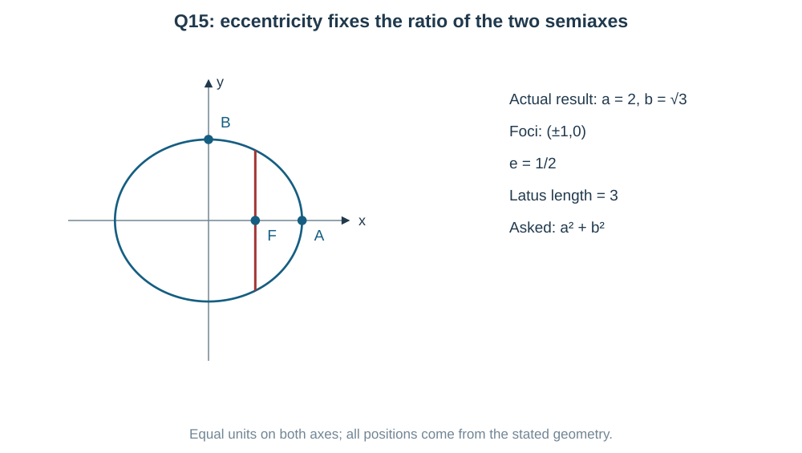

$$
\boxed{a^2+b^2=4+3=7}.
$$

**Check:** $e=\sqrt{1-3/4}=1/2$, and $2b^2/a=6/2=3$. Guessing one axis length would not use both independent givens.

---

### Question 16 — The larger denominator sets the major-axis direction

**PDF page 98 | MCQ | Notes: C02,C03**

The distance between the foci of the ellipse $4x^2+y^2=16$ is

- (a) $4$
- (b) $4\sqrt3$
- (c) $2\sqrt3$
- (d) $8$

**Look at the larger denominator after normalization:**

$$
\frac{x^2}{4}+\frac{y^2}{16}=1.
$$

The major axis is along $y$, with $a=4,b=2$. Therefore

$$
c^2=16-4=12,\qquad c=2\sqrt3.
$$

The two foci are $(0,\pm2\sqrt3)$, so their distance is

$$
\boxed{2c=4\sqrt3;\quad\text{(b)}}.
$$

**Check:** a single centre-to-focus distance is only half the requested distance. The result is less than the major-axis length 8, as it should be.

---

### Question 17 — Test each tangent against its own ellipse

**PDF page 98 | MCQ | Notes: C06**

Statement I: The line $y=x+5$ touches the ellipse $\dfrac{x^2}{16}+\dfrac{y^2}{9}=1$.

Statement II: The line $y=x+4$ touches the ellipse $\dfrac{x^2}{9}+\dfrac{y^2}{4}=1$.

Choose the correct option.

- (a) Both Statement I and Statement II are true
- (b) Statement I is false but Statement II is true
- (c) Statement I is true but Statement II is false
- (d) Both Statement I and Statement II are false

**Test the two statements separately.** A tangent of slope 1 needs $c^2=a^2+b^2$ for its own ellipse.

For I:

$$
5^2=25=16+9,
$$

so it is **true**.

For II:

$$
4^2=16\ne9+4=13,
$$

so it is **false**.

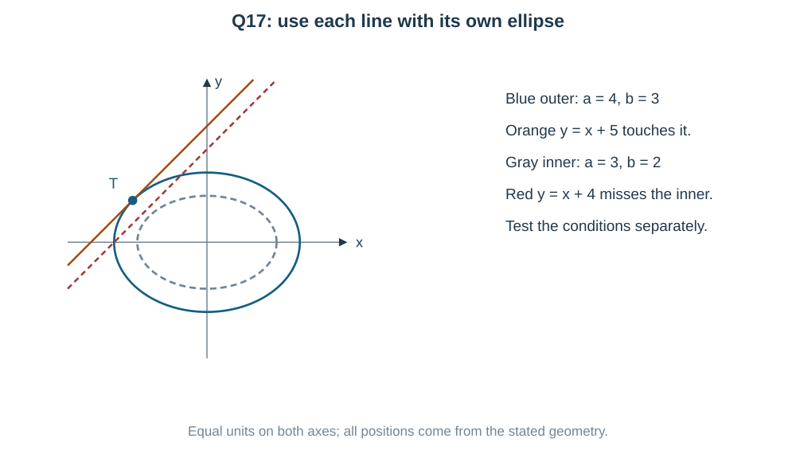

$$
\boxed{\text{I true, II false;\quad (c)}}.
$$

**Another possible check:** in I, $y=x+5$ gives $(5x+16)^2=0$ after substitution, a repeated contact. In II, substitution gives $13x^2+72x+108=0$, whose discriminant is $-432<0$; that line does not even meet its ellipse.

The tangent condition is faster here, while direct substitution explains the geometry independently.

---

### Question 18 — Read each major denominator before calculating eccentricity

**PDF page 99 | MCQ | Notes: C03**

Match List I (ellipse) with List II (eccentricity).

| List I | Ellipse | List II | Eccentricity |
|---|---|---|---|
| A | $\dfrac{x^2}{25}+\dfrac{y^2}{9}=1$ | P | $\dfrac12$ |
| B | $\dfrac{x^2}{169}+\dfrac{y^2}{144}=1$ | Q | $\dfrac5{13}$ |
| C | $\dfrac{x^2}{9}+\dfrac{y^2}{4}=1$ | R | $\dfrac45$ |
| D | $\dfrac{x^2}{4}+\dfrac{y^2}{3}=1$ | S | $\dfrac{\sqrt5}3$ |

- (a) A–P, B–Q, C–R, D–S
- (b) A–R, B–Q, C–S, D–P
- (c) A–R, B–S, C–Q, D–P
- (d) A–Q, B–R, C–S, D–P

**For each row, calculate $c^2=a^2-b^2$ first, then divide the length $c$ by $a$.**

| Case | $c$ | $e=c/a$ | Match |
|---|---|---|---|
| A | $\sqrt{25-9}=4$ | $4/5$ | R |
| B | $\sqrt{169-144}=5$ | $5/13$ | Q |
| C | $\sqrt{9-4}=\sqrt5$ | $\sqrt5/3$ | S |
| D | $\sqrt{4-3}=1$ | $1/2$ | P |

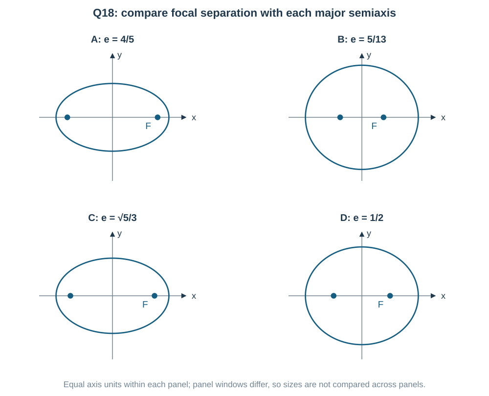

$$
\boxed{\text{A–R,\ B–Q,\ C–S,\ D–P;\quad (b)}}.
$$

**Check:** all four values are between 0 and 1. Panel windows differ, so compare the printed ratio $c/a$, rather than apparent overall sizes across panels.

---

### Question 19 — Check every named quantity and distinguish full from half length

**PDF page 99 | MCQ | Notes: C03,C04,C11**

For the ellipse $\dfrac{x^2}{25}+\dfrac{y^2}{9}=1$ consider:

(i) its eccentricity is $\dfrac45$;

(ii) its latus rectum has length $\dfrac95$;

(iii) its directrices are $x=\pm\dfrac{25}4$;

(iv) its director circle is $x^2+y^2=34$.

Choose the correct statements.

- (a) (i), (ii) and (iii) only
- (b) (ii), (iii) and (iv) only
- (c) (i), (ii), (iii) and (iv)
- (d) (i), (iii) and (iv) only

**Find the common base quantities once:** $a=5,b=3,c=\sqrt{25-9}=4$.

Then check each statement:

$$
e=\frac45 \quad\text{so (i) is true}.
$$

$$
L=\frac{2b^2}{a}=\frac{18}{5}\ne\frac95
\quad\text{so (ii) is false}.
$$

The claimed $9/5$ is only the height of one latus endpoint above the axis.

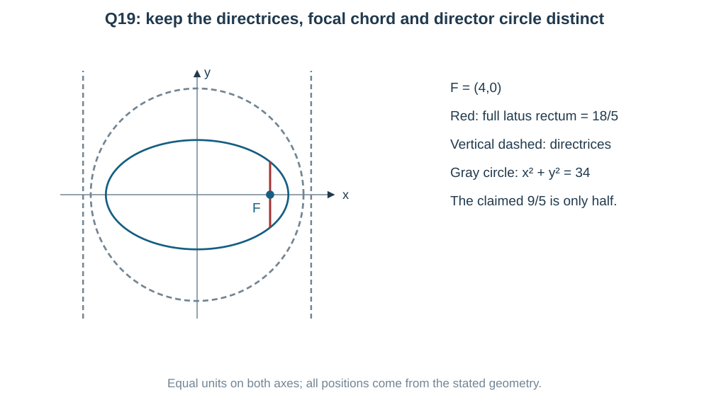

$$
x=\pm\frac ae=\pm\frac{25}4
\quad\text{so (iii) is true}.
$$

$$
x^2+y^2=a^2+b^2=34
\quad\text{so (iv) is true}.
$$

$$
\boxed{\text{(i), (iii), (iv);\quad (d)}}.
$$

**Check:** the directrices are outside the ellipse's vertices, since $25/4>5$. The director circle is also outside the ellipse but is a different curve, not a pair of vertical lines.

---

### Question 20 — The nearest focus distance is the gap to the near vertex

**PDF page 99 | Numerical value | Notes: C04**

The distance between the foci of an ellipse is $10$ and the least distance of a point of the ellipse from a focus is $2$. If $b$ is the semi-minor axis, then $b^2=$ ____.

**The focal separation is $2c$, not $c$.**

$$
2c=10\quad\Longrightarrow\quad c=5.
$$

The closest ellipse point to the right focus is the near vertex. Their gap is $a-c$:

$$
a-c=2\quad\Longrightarrow\quad a=7.
$$

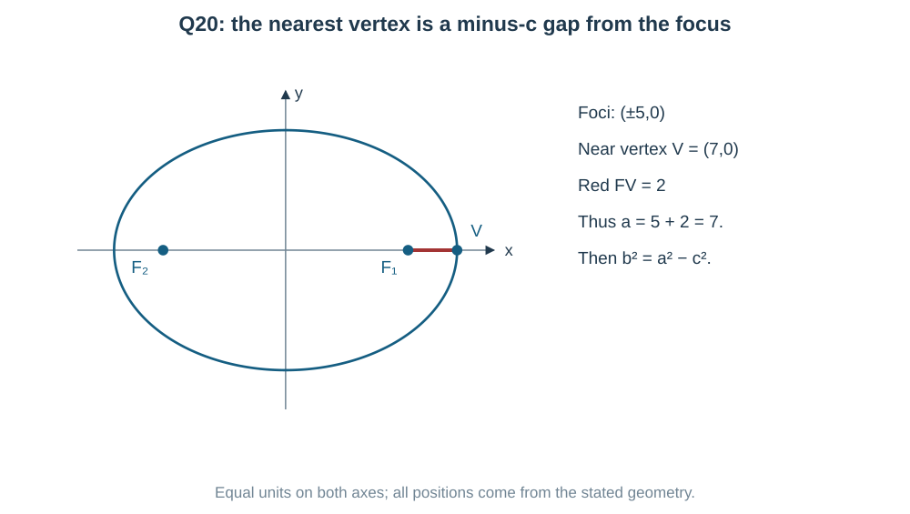

Therefore

$$
\boxed{b^2=a^2-c^2=49-25=24}.
$$

**Why the vertex is the nearest point:** $PF=a-ex$, and on the ellipse $x\le a$. This expression is smallest at $x=a$, giving $a-ea=a-c$. The picture is supported by the full domain bound.

---

### Question 21 — Use the normal condition to obtain only the target combination

**PDF page 99 | Numerical value | Notes: C07**

Let the normal at the upper end $(ae,b^2/a)$ of the latus rectum of the ellipse $\dfrac{x^2}{a^2}+\dfrac{y^2}{b^2}=1$ pass through the end $(0,-b)$ of the minor axis. Then $\dfrac1{e^2}-e^2=$ ____.

**First understand the line condition.** The normal at $P=(ae,b^2/a)$ is perpendicular to its tangent and passes through $B=(0,-b)$. We need only the combination $1/e^2-e^2$, not the value of $e$ itself.

The normal formula gives

$$
\frac{a^2x}{ae}-\frac{b^2y}{b^2/a}=a^2-b^2
\quad\Longrightarrow\quad
\frac{ax}{e}-ay=a^2e^2.
$$

Put $B=(0,-b)$ on this normal:

$$
ab=a^2e^2\quad\Longrightarrow\quad b=ae^2.
$$

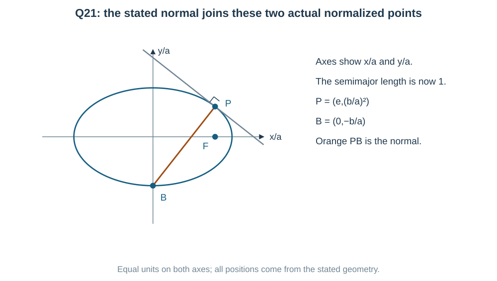

Now compare two ways of writing $b^2/a^2$:

$$
\frac{b^2}{a^2}=e^4,\qquad
\frac{b^2}{a^2}=1-e^2.
$$

Thus

$$
e^4+e^2=1.
$$

**Did you notice the target pattern?** Divide by $e^2>0$. This produces $1/e^2$ directly:

$$
e^2+1=\frac1{e^2}
\quad\Longrightarrow\quad
\boxed{\frac1{e^2}-e^2=1}.
$$

Solving a quadratic for $e^2$ is valid but longer, because the question wants this combination only.

**Another possible approach — direction of the normal:** at $P$, its direction is $(e/a,1/a)$, proportional to $(e,1)$. The vector from $B$ to $P$ is $(ae,b^2/a+b)$. Matching these directions gives $b^2/a+b=a$, or with $r=b/a>0$, $r^2+r=1$. Since $r^2=1-e^2$, this gives $r=e^2$ and the same target identity. The formula route is shorter after C07; the direction route explains the condition geometrically.

---

### Question 22 — Maximize the actual rectangle using the normalized ellipse relation

**PDF page 99 | Numerical value | Notes: C12**

The area of the largest rectangle, with sides parallel to the axes, that can be inscribed in the ellipse $\dfrac{x^2}{16}+\dfrac{y^2}{9}=1$ is ____.

**A rectangle parallel to the axes has four symmetric vertices.** Write the first-quadrant one as $(x,y)$. Its width is $2x$ and height is $2y$, so area is $4xy$.

From the ellipse,

$$
\left(\frac x4\right)^2+\left(\frac y3\right)^2=1.
$$

Let $X=x/4,Y=y/3$. Then $X,Y\ge0$, and $(X-Y)^2\ge0$ gives $2XY\le X^2+Y^2=1$.

$$
A=4(4X)(3Y)=48XY\le24.
$$

Equality is attainable at $X=Y=1/\sqrt2$, so

$$
x=2\sqrt2,\qquad y=\frac3{\sqrt2},
\qquad
\boxed{A_{\max}=24}.
$$

**Another possible approach — the parameter:** $(x,y)=(4\cos\theta,3\sin\theta)$ gives

$$
A=48\sin\theta\cos\theta=24\sin2\theta\le24
$$

in the first quadrant. Equality at $\theta=\pi/4$ gives the same rectangle. This is the same geometry expressed through a familiar trig identity.

**Check:** substitute the equality point into the ellipse: $8/16+(9/2)/9=1/2+1/2=1$. The full area is $4xy$, not $xy$.

---

### Question 23 — The chord of contact joins two tangent contacts

**PDF page 99 | MCQ | Notes: C10**

The chord of contact of the tangents drawn from $(4,3)$ to the ellipse $\dfrac{x^2}{16}+\dfrac{y^2}{9}=1$ is

- (a) $3x+4y=12$
- (b) $4x+3y=12$
- (c) $3x+4y=25$
- (d) $3x-4y=0$

**The chord joins the two contacts, not the external point to the centre.** Here the external point is $Q=(4,3)$.

For contacts $(x,y)$, the tangent there must pass through $Q$:

$$
\frac{4x}{16}+\frac{3y}{9}=1.
$$

Therefore

$$
\boxed{3x+4y=12;\quad\text{(a)}}.
$$

**Another geometric approach:** the ellipse has vertical tangent $x=4$ at $A=(4,0)$ and horizontal tangent $y=3$ at $B=(0,3)$. They meet at the supplied $Q$. The line through $A,B$ is

$$
\frac x4+\frac y3=1,
$$

giving the same answer. This special placement makes the geometry especially quick.

**Check:** both contacts satisfy the selected chord and ellipse. $Q$ itself does not lie on that chord; it lies on the two tangents.

---

### Question 24 — The tangent-at-point formula needs an actual curve point

**PDF page 99 | MCQ | Notes: C06**

The equation of the tangent to $\dfrac{x^2}{25}+\dfrac{y^2}{9}=1$ at the point $\left(3,\dfrac{12}5\right)$ is

- (a) $9x-20y=75$
- (b) $9x+20y=75$
- (c) $20x+9y=75$
- (d) $3x+4y=25$

**Check the point before writing its tangent:**

$$
\frac{3^2}{25}+\frac{(12/5)^2}{9}
=\frac9{25}+\frac{16}{25}=1.
$$

Now use $xx_1/25+yy_1/9=1$:

$$
\frac{3x}{25}+\frac{4y}{15}=1.
$$

Multiply by 75:

$$
\boxed{9x+20y=75;\quad\text{(b)}}.
$$

**Another possible approach:** the derivative is $y'=-9x/(25y)$. At the point, it is $-9/20$. Then $y-12/5=-(9/20)(x-3)$ gives the same line.

**Check:** the point gives $27+48=75$; the derivative agrees with the line slope.

---

### Question 25 — An eccentric angle labels the point through cosine and sine

**PDF page 100 | MCQ | Notes: C04,C05**

Let $P$ be the point with eccentric angle $\dfrac\pi3$ on $\dfrac{x^2}{25}+\dfrac{y^2}{9}=1$ and $F=(4,0)$ a focus. Then $PF=$

- (a) $7$
- (b) $4$
- (c) $5$
- (d) $3$

**An eccentric angle gives coordinates through cosine and sine.** It is not generally the angle of $OP$.

Here $a=5,b=3,\theta=\pi/3$, so

$$
P=\left(5\cos\frac\pi3,3\sin\frac\pi3\right)
=\left(\frac52,\frac{3\sqrt3}{2}\right).
$$

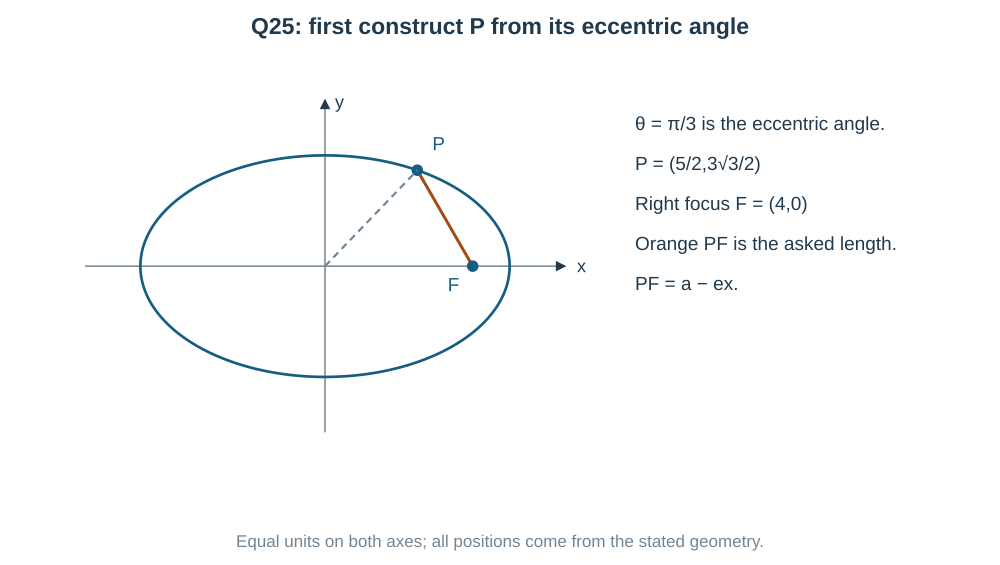

Use the distance formula to the supplied focus $(4,0)$:

$$
PF^2=\left(\frac52-4\right)^2+
\left(\frac{3\sqrt3}{2}\right)^2
=\frac94+\frac{27}4=9.
$$

Thus

$$
\boxed{PF=3;\quad\text{(d)}}.
$$

**Another shorter approach — focal distance:** $c=4$, so $e=4/5$. For the right focus,

$$
PF=a-ex=5-\frac45\cdot\frac52=3.
$$

The coordinate route checks the geometry directly; the focal-distance formula is faster once the correct focus and $x$-coordinate are identified.

## Answer check

Read the qualifications in the solutions before using the key.

| Question | Answer | Question | Answer |
|---|---|---|---|
| 1 | (c) | 14 | $16$ |
| 2 | (a) | 15 | $7$ |
| 3 | (d) | 16 | (b) |
| 4 | (c) | 17 | (c) |
| 5 | $13$ | 18 | (b) |
| 6 | (d) | 19 | (d) |
| 7 | $12$ | 20 | $24$ |
| 8 | $20$ | 21 | $1$ |
| 9 | (b) | 22 | $24$ |
| 10 | (a) | 23 | (a) |
| 11 | (d) | 24 | (b) |
| 12 | (a) | 25 | (d) |
| 13 | (c) |  |  |

## After this chapter

Keep the roles clear: the centre gives symmetry, the foci give the distance sum, a tangent follows the curve, a normal is perpendicular to that tangent, and a midpoint lies halfway along a chord. Rebuild a formula from its picture when recall is uncertain. All alternatives are fully visible for the later booklet. The source questions are original JEE Main-style practice, not verified actual PYQs.
