# Chapter 20 — Hyperbola

**Kanna, an ellipse keeps a sum fixed. A hyperbola keeps the size of a difference fixed. This change creates two open branches.**

Your overall target remains **200 marks**: Physics 60, Maths 60, Chemistry 80. Begin with orientation, foci, eccentricity and asymptotes. Then use the same geometry for tangents, distances and loci.

## Recent chapter weightage

| Year | Questions tagged Hyperbola in the checked archive | Full-year paper shifts | Tagged questions per shift |
|---|---:|---:|---:|
| 2024 | 11 | 20 | 0.55 |
| 2025 | 9 | 19 | 0.47 |
| 2026 | 13 | 19 | 0.68 |
| Total | 33 | 58 | **0.57** |

These are distinct question IDs recounted in ExamSIDE's separate Hyperbola category. PYQSide combines conics into a broader category with 48, 55 and 57 questions in these years. Those are not separate Hyperbola totals and have not been split arbitrarily. These are archive tags, not a fresh independent classification of every official paper. The 2024 format offered more optional numerical questions. Saved sources and the recount are in the evidence folder.

A mean below one is not a prediction for your shift. Standard forms and mixed-conic connections are sensible first revision targets. The priorities here are teaching judgments, not measured formula-frequency ranks.

**Important for JEE Main:** the current official coordinate-geometry unit explicitly includes standard conic equations. Extra tangent, normal, director-circle and chord tools below support the supplied practice questions; each is not claimed as a separately named official syllabus requirement.

## Concept C01 — A fixed difference gives two branches

Fix foci $F_1=(c,0),F_2=(-c,0)$. A point $P$ is on the hyperbola when

$$
\boxed{|PF_1-PF_2|=2a},\qquad 0<a<c.
$$

The modulus means **the positive size of the difference**. One distance is larger, but the difference can have either sign before taking modulus. That is why the full locus includes both branches.

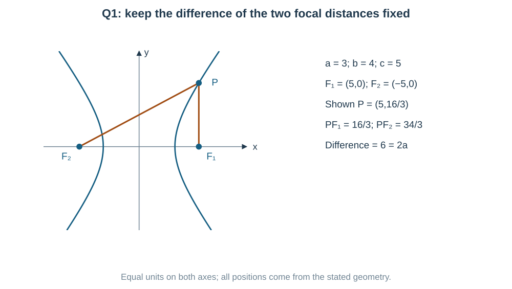

The centre is the midpoint of the foci. The nearest curve points to the centre are the **vertices** $(\pm a,0)$. The line segment joining them is the **transverse axis**, length $2a$.

For a hyperbola we use

$$
\boxed{c^2=a^2+b^2},\qquad
\boxed{\frac{x^2}{a^2}-\frac{y^2}{b^2}=1},
\quad a,b>0.
$$

Here $b$ is a second shape length. Unlike an ellipse, we do **not** require $a>b$. The segment joining $(0,\pm b)$ is the **conjugate axis**, length $2b$; those endpoints do not lie on this hyperbola.

**Compare the signs:** ellipse: $c^2=a^2-b^2$ and a plus in its equation. Hyperbola: $c^2=a^2+b^2$ and a minus in its equation. The foci are beyond the vertices, because $c>a$.

## Concept C02 — The positive term decides the opening

| Opening direction | Equation at centre $(h,k)$ | Vertices | Foci |
|---|---|---|---|
| left/right | $\dfrac{(x-h)^2}{a^2}-\dfrac{(y-k)^2}{b^2}=1$ | $(h\pm a,k)$ | $(h\pm c,k)$ |
| up/down | $\dfrac{(y-k)^2}{a^2}-\dfrac{(x-h)^2}{b^2}=1$ | $(h,k\pm a)$ | $(h,k\pm c)$ |

**Important for JEE Main:** make the right side 1 first. Then the **positive squared term** gives the transverse direction. Do not use an ellipse's “larger denominator” rule here.

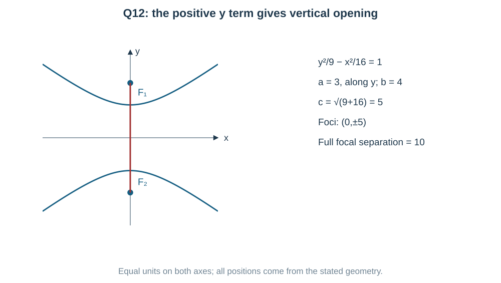

For the horizontal form, $|x-h|\ge a$. For the vertical form, $|y-k|\ge a$. A centre is a symmetry point, not a point on the hyperbola.

Complete squares to locate a shifted centre. For example, grouping $9x^2-18x$ gives $9(x-1)^2-9$; grouping $-16y^2-32y$ gives $-16(y+1)^2+16$. Keep the minus sign outside the whole square.

## Concept C03 — Eccentricity, foci and directrices

$$
\boxed{e=\frac ca=\sqrt{1+\frac{b^2}{a^2}}>1}.
$$

The focus is farther from the centre than the corresponding vertex. The corresponding focus–directrix rule is again

$$
\boxed{PF=e\,PD},
$$

where $PD$ is the perpendicular distance to the directrix. For the right/left foci $(\pm c,0)$, the matching directrices are

$$
\boxed{x=\pm\frac ae=\pm\frac{a^2}{c}}.
$$

They lie between the centre and the vertices, because $a/e<a$. For a vertical hyperbola they are $y=\pm a/e$. Shift each with the centre when needed.

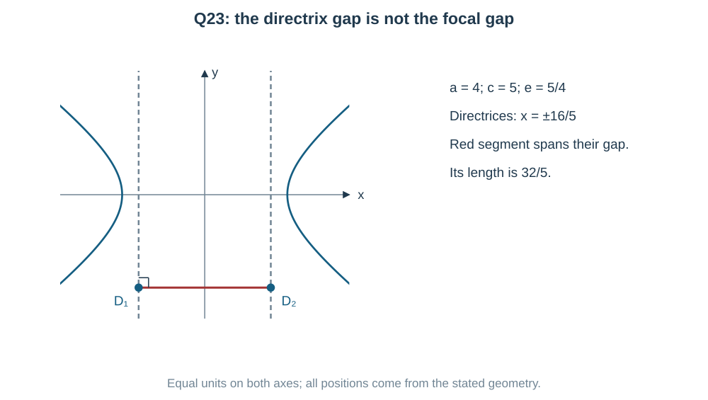

The focal separation is $2c=2ae$. The directrix separation is $2a/e$. These are different.

**Use the clue carefully:** foci $(\pm5,0)$ give $c=5$, while vertices $(\pm3,0)$ give $a=3$. After finding $a,c$, use $b^2=c^2-a^2$, not an ellipse's subtraction order.

## Concept C04 — Focal distances and latus rectum

For a point on the **right branch**, $x\ge a$:

$$
\boxed{PF_{\rm right}=ex-a},\qquad
\boxed{PF_{\rm left}=ex+a}.
$$

Their difference is $2a$, as required. On the left branch the roles reverse. For both branches, safe absolute-value forms are

$$
\boxed{PF_{\rm right}=|ex-a|},\qquad
\boxed{PF_{\rm left}=|ex+a|}.
$$

For example, the right directrix is $x=a/e$. On the right branch its distance is $x-a/e$, so multiplying by $e$ gives $ex-a$. The focal-distance formula comes from the actual distance rule.

The latus rectum is a chord through a focus, perpendicular to the transverse axis. Put $x=c$ in the horizontal equation:

$$
\frac{c^2}{a^2}-\frac{y^2}{b^2}=1
\quad\Longrightarrow\quad
y=\pm\frac{b^2}{a}.
$$

Hence

$$
\boxed{\text{endpoints}=\left(c,\pm\frac{b^2}{a}\right)},\qquad
\boxed{L=\frac{2b^2}{a}}.
$$

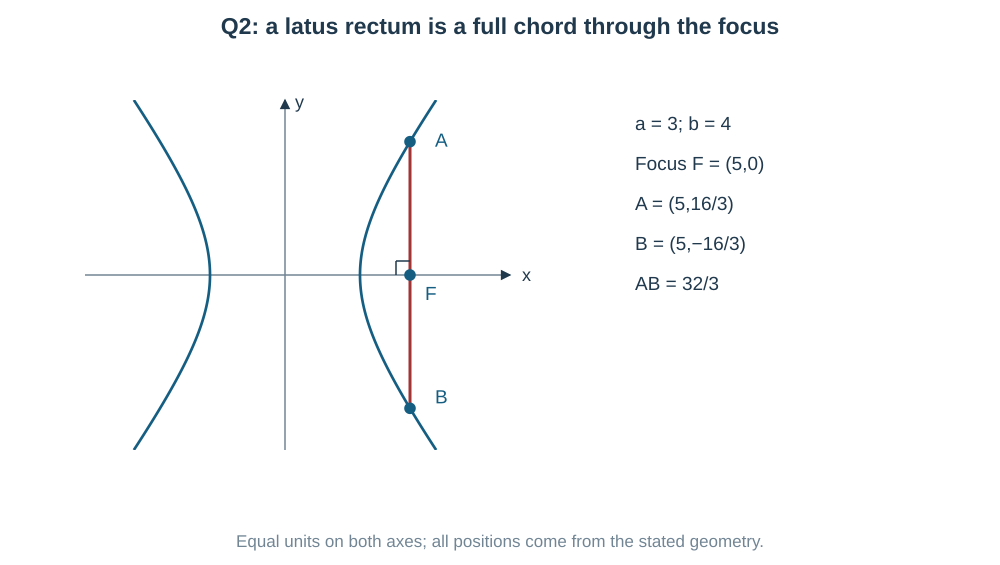

The form of this length matches the ellipse formula, but the relation among $a,b,c$ is different. The full length is twice $b^2/a$.

## Concept C05 — An asymptote is a line the branch approaches

Far from the centre, the terms $x^2/a^2$ and $y^2/b^2$ are large. Their difference remains 1. The nearby straight-line directions come from dropping only that constant in the equation:

$$
\frac{x^2}{a^2}-\frac{y^2}{b^2}=0
\quad\Longrightarrow\quad
\boxed{y=\pm\frac ba x}.
$$

These lines are the **asymptotes**. The perpendicular distance of the branch from one of them tends to zero as the point moves far along that branch.

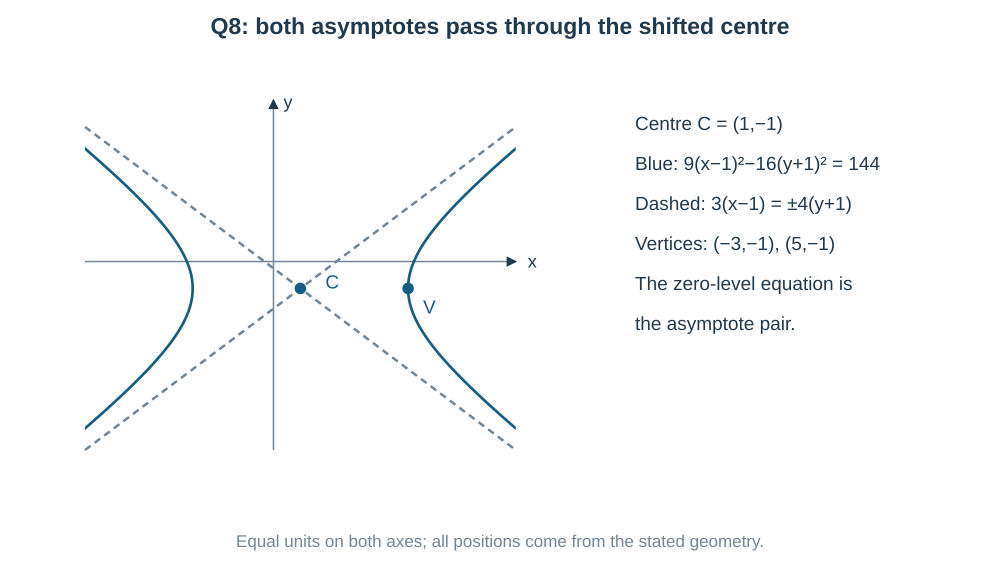

For a horizontal shifted hyperbola:

$$
\boxed{y-k=\pm\frac ba(x-h)}.
$$

For a vertical one, use $y-k=\pm(a/b)(x-h)$. Both asymptotes pass through the **centre**, not through a focus.

**Why they are approached:** for the upper right branch,

$$
y=\frac ba\sqrt{x^2-a^2},
$$

so its vertical gap from $y=(b/a)x$ is

$$
\frac ba\left(x-\sqrt{x^2-a^2}\right)
=\frac{ab}{x+\sqrt{x^2-a^2}}\longrightarrow0.
$$

The actual asymptote never meets this hyperbola at a finite point: substituting its equation would give $0=1$. It is not a tangent touching somewhere very far away.

**Angle cue:** if one asymptote makes angle $\alpha=\tan^{-1}(b/a)$ with $+x$, the two sectors have angles $2\alpha$ and $180^\circ-2\alpha$. The smaller is the acute angle when they are not perpendicular.

$$
\tan\theta_{\rm acute}=\left|\frac{2ab}{a^2-b^2}\right|\quad(a\ne b).
$$

If $a=b$, the asymptotes are perpendicular and the smaller angle is $90^\circ$. Draw which angle is being asked before choosing its supplement.

## Concept C06 — Conjugate and rectangular hyperbolas

The **conjugate hyperbola** of

$$
\frac{x^2}{a^2}-\frac{y^2}{b^2}=1
$$

is

$$
\boxed{\frac{y^2}{b^2}-\frac{x^2}{a^2}=1}.
$$

The transverse length becomes $b$, and the other length becomes $a$. Its focal distance is still $\sqrt{a^2+b^2}$, but its foci are vertical. The two hyperbolas have the same asymptote pair.

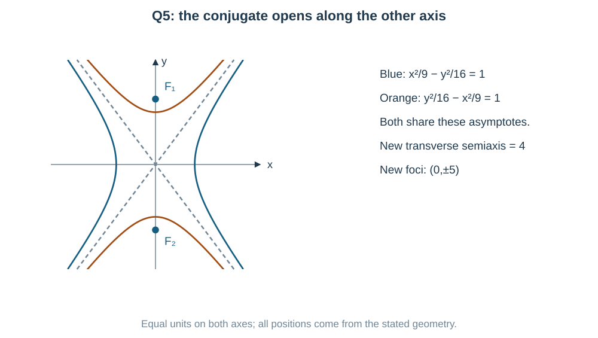

If their eccentricities are $e,e'$, then

$$
e=\frac{\sqrt{a^2+b^2}}a,\qquad
e'=\frac{\sqrt{a^2+b^2}}b,\qquad
\boxed{\frac1{e^2}+\frac1{e'^2}=1}.
$$

A **rectangular hyperbola** has perpendicular asymptotes. In this axis-aligned form that means $a=b$, so

$$
\boxed{e=\sqrt2}.
$$

“Rectangular” describes the right angle between asymptotes. It does not mean the curve is a rectangle.

## Concept C07 — Why the transverse axis of $xy=K$ is sloping

For $K\ne0$, the coordinate axes are asymptotes of $xy=K$, so they are perpendicular. It is a rectangular hyperbola.

For $K>0$, its branches are in quadrants I and III. Use actual perpendicular diagonal directions:

$$
u=\frac{x+y}{\sqrt2},\qquad v=\frac{x-y}{\sqrt2}.
$$

Both directions have unit length. Since $xy=(u^2-v^2)/2$,

$$
xy=K
\quad\Longrightarrow\quad
\frac{u^2}{2K}-\frac{v^2}{2K}=1.
$$

Thus the transverse semiaxis is $\sqrt{2K}$ and

$$
\boxed{\text{transverse-axis length}=2\sqrt{2K}}.
$$

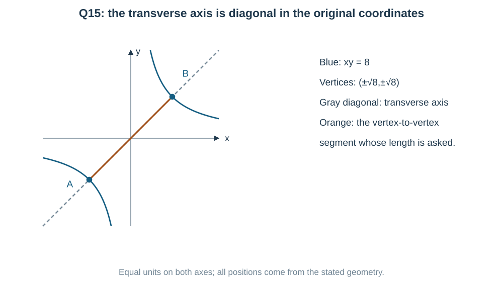

Its original-coordinate vertices are $(\pm\sqrt K,\pm\sqrt K)$ with matching signs. If $K<0$, the branches are in II and IV, and the length is $2\sqrt{2|K|}$. At $K=0$, the equation describes two axes, not a nondegenerate hyperbola.

A convenient parameter for $xy=K$ is $(t,K/t)$, $t\ne0$. Its tangent at $(x_1,y_1)$ is

$$
\boxed{xy_1+yx_1=2K}.
$$

## Concept C08 — Tangents and normals at finite points

For $x^2/a^2-y^2/b^2=1$, the tangent at a verified curve point $(x_1,y_1)$ is

$$
\boxed{\frac{xx_1}{a^2}-\frac{yy_1}{b^2}=1}.
$$

The minus sign belongs to the hyperbola. Differentiation gives $y'=b^2x/(a^2y)$ when $y\ne0$, and the tangent formula follows from point-slope form.

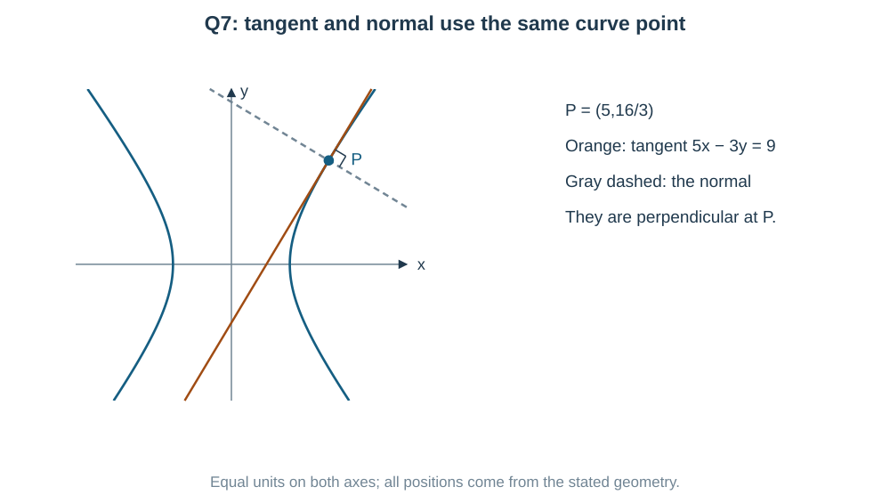

A normal is perpendicular to that tangent. Its direction is $(x_1/a^2,-y_1/b^2)$. When $x_1y_1\ne0$, its equation is

$$
\boxed{\frac{a^2x}{x_1}+\frac{b^2y}{y_1}=a^2+b^2}.
$$

At vertices $(\pm a,0)$, the tangents are vertical and the normals are the horizontal axis. Handle these directly instead of dividing by zero.

For a finite-slope line $y=mx+c_0$,

$$
\boxed{c_0^2=a^2m^2-b^2>0}
$$

is the finite-contact tangency condition. The strict inequality matters. If the right side is zero, then $c_0=0$ and $m=\pm b/a$: the line is an asymptote, with no finite contact.

For a general proper line $Ax+By+C=0$, the equivalent test is

$$
\boxed{C^2=a^2A^2-b^2B^2>0}.
$$

This also includes the vertical vertex tangents. Substitution and a repeated-root discriminant give this equation; the strict positive condition removes the asymptote degeneration.

**Important for JEE Main:** a zero algebraic discriminant is not enough if the intersection polynomial loses its quadratic term. Check that the proposed line actually has a finite contact point.

## Concept C09 — A parameter makes a moving point satisfy the curve

The identity $\sec^2\theta-\tan^2\theta=1$ suggests

$$
\boxed{P=(a\sec\theta,b\tan\theta)},\qquad\cos\theta\ne0.
$$

Substitution verifies the equation. Positive $\sec\theta$ gives the right branch and negative $\sec\theta$ the left branch.

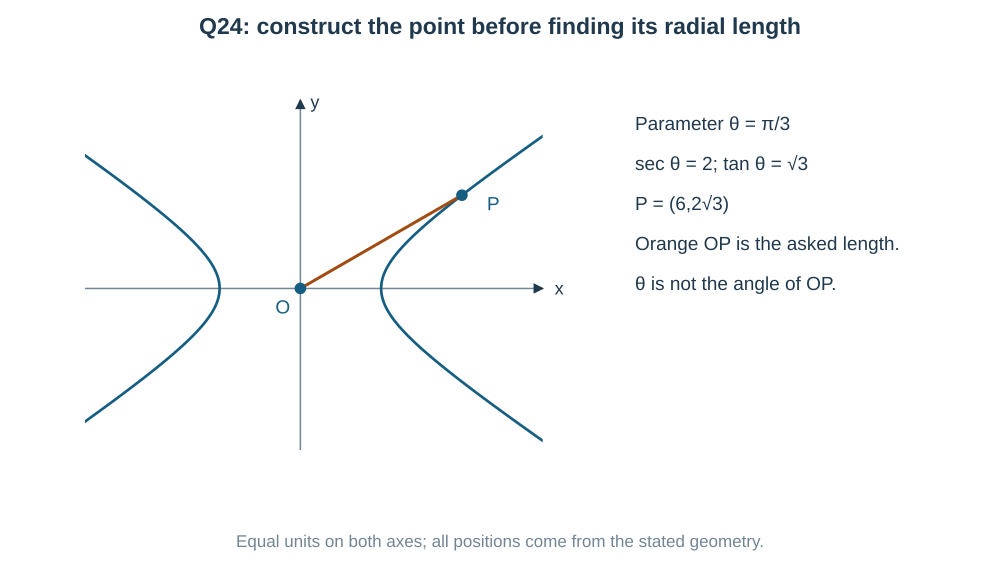

This $\theta$ is a parameter, **not generally the angle of $OP$**. In fact,

$$
\frac yx=\frac ba\sin\theta.
$$

Use the coordinates from the stated parameter before measuring a distance or an angle.

The parameter tangent is

$$
\boxed{\frac{x\sec\theta}{a}-\frac{y\tan\theta}{b}=1}.
$$

It includes vertices when $\tan\theta=0$. A shifted curve needs its centre coordinates added.

## Concept C10 — A midpoint chord needs real endpoint checks

For midpoint $M=(h,k)$, set endpoints $(h+u,k+v),(h-u,k-v)$ and subtract their hyperbola equations:

$$
\frac{hu}{a^2}-\frac{kv}{b^2}=0.
$$

The chord line is therefore

$$
\boxed{\frac{hx}{a^2}-\frac{ky}{b^2}
=\frac{h^2}{a^2}-\frac{k^2}{b^2}}.
$$

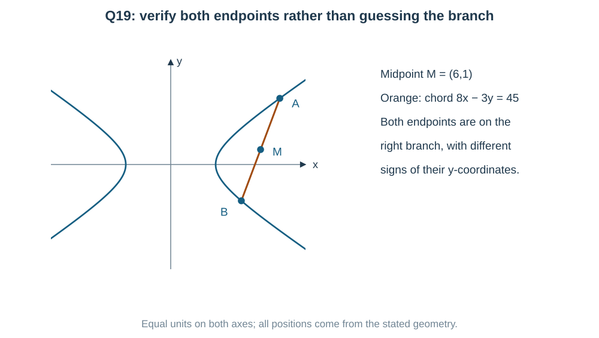

A midpoint is not necessarily on the curve. Do not replace the right side by 1 without checking.

For a proposed noncentral midpoint, verify that this line really meets the hyperbola at two distinct real points. A necessary line equation alone does not prove a real chord exists. For the centre, it becomes $0=0$ and does not select a unique chord. Some lines through the centre do not meet the hyperbola at all.

**Contact chord connection:** if real tangents from an external point $(h,k)$ touch at two finite points, their contact chord is $hx/a^2-ky/b^2=1$. This uses the external point's role, not its role as a midpoint. Asymptote candidates must not be counted as finite contacts.

## Concept C11 — Two different products of perpendicular distances

**From the foci to a tangent:** the product is

$$
\boxed{d_1d_2=b^2}.
$$

To see it, write a genuine tangent as $Ax+By+C=0$. Its distances from $(\pm c,0)$ multiply to

$$
\frac{|C+cA|\,|C-cA|}{A^2+B^2}
=\frac{|C^2-c^2A^2|}{A^2+B^2}.
$$

Use $C^2=a^2A^2-b^2B^2$ and $c^2=a^2+b^2$:

$$
C^2-c^2A^2=-b^2(A^2+B^2).
$$

Its absolute value gives $b^2$. The raw signed product is negative; **lengths** have a positive product.

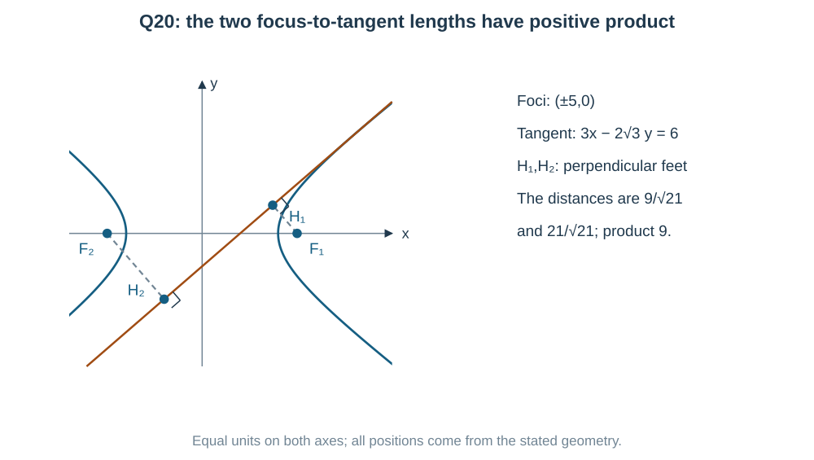

**From a curve point to the two asymptotes:** write them as $bx-ay=0$ and $bx+ay=0$. The two line-normal lengths are both $\sqrt{a^2+b^2}$:

$$
\begin{aligned}
d_+d_-&=\frac{|bx-ay|\,|bx+ay|}{a^2+b^2}\\
&=\frac{|b^2x^2-a^2y^2|}{a^2+b^2}
=\boxed{\frac{a^2b^2}{a^2+b^2}}.
\end{aligned}
$$

The last equality uses the original hyperbola equation, multiplied by $a^2b^2$.

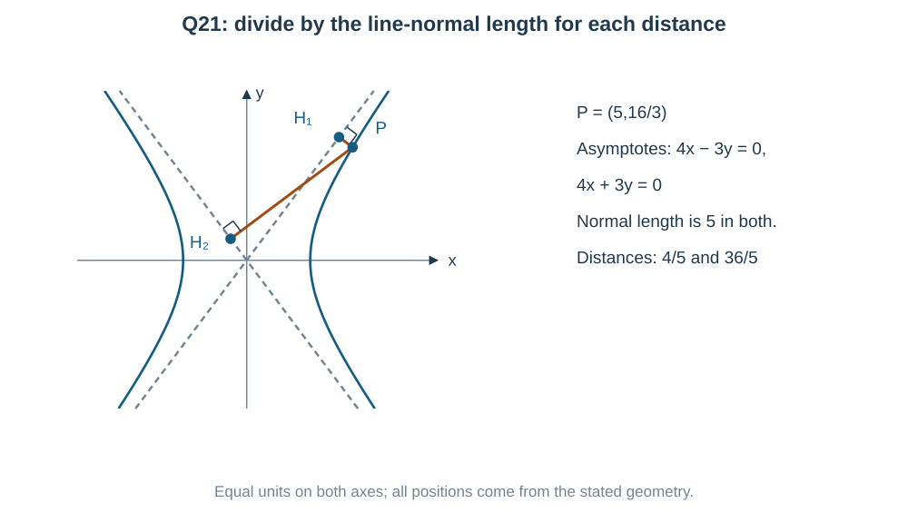

**Recognition:** “from the foci to a tangent” and “from a curve point to the asymptotes” name different constructions. Read the starting points and target lines before choosing either formula.

## Concept C12 — Perpendicular tangents and a director-circle qualification

For an intersection point $(h,k)$, a tangent slope satisfies

$$
(k-mh)^2=a^2m^2-b^2,
$$

so

$$
(h^2-a^2)m^2-2hkm+(k^2+b^2)=0.
$$

Perpendicular finite slopes have product $-1$, giving the conventional **director-circle equation**

$$
\boxed{h^2+k^2=a^2-b^2}.
$$

When $a>b$, its radius is $\sqrt{a^2-b^2}$.

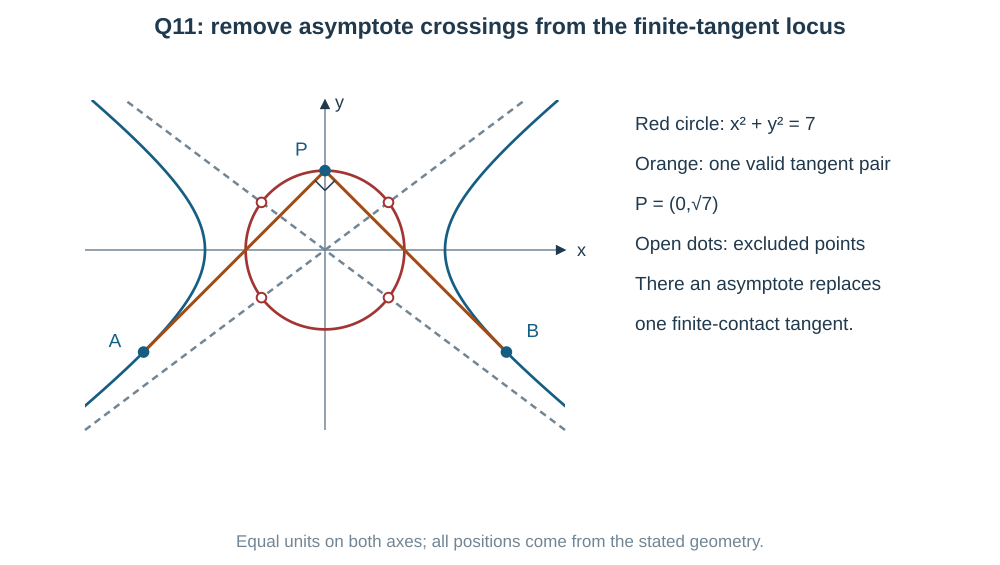

**Exact finite-contact condition:** exclude the four places where this circle crosses the two asymptotes. At such a point, one algebraic slope candidate gives $c_0=0$, so it is an asymptote, not a tangent touching at a finite point. Q11 preserves the conventional MCQ answer and explicitly shows these excluded points.

For $a=b$, the formal equation shrinks to the centre, but the two algebraic lines there are asymptotes. There is no pair of finite perpendicular tangents. For $a<b$, the formal radius squared is negative, so again there is no real such pair.

This is a supporting source construction. Learn the tangent/asymptote distinction first, instead of treating the director-circle formula as an unrestricted rule.

## Concept C13 — Connect the locus to its exact geometric condition

For foci separated by $2c$, a fixed absolute difference $d$:

- gives a nondegenerate hyperbola when $0<d<2c$;
- gives the perpendicular bisector when $d=0$;
- gives the two outer focal-axis rays, including the foci, when $d=2c$;
- gives no point when $d>2c$, by the triangle inequality.

For a focus and a proper directrix line, begin with $PF=e\,PD$, using the perpendicular line-distance denominator. For $e>1$ this gives a hyperbola when the focus is off the line. Check the original nonnegative distances after squaring.

**A right angle at the moving point gives another useful view.** If $PF_1\perp PF_2$, then the point lies on the circle with $F_1F_2$ as diameter. A dot product means multiply matching direction components and add; it is zero for two perpendicular directions:

$$
(\mathbf P-\mathbf F_1)\cdot(\mathbf P-\mathbf F_2)=0.
$$

For foci $(\pm c,0)$, this reduces to

$$
\boxed{x^2+y^2=c^2}.
$$

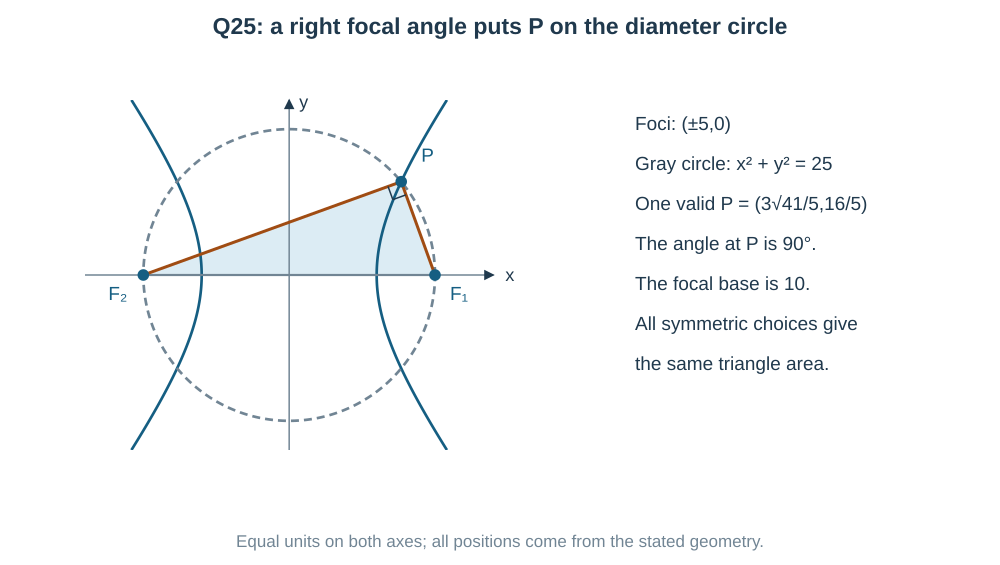

Now combine that circle with the hyperbola, or combine the right-triangle identity with the fixed focal difference. Choose the version that directly produces the quantity asked.

**Cauchy–Schwarz connection — important for JEE Main:** $|ux+vy|\le\sqrt{u^2+v^2}\sqrt{x^2+y^2}$ bounds a projection when the radial length is fixed, as on this circle. A hyperbola alone is unbounded, so do not copy an ellipse's finite global maximum without a new constraint. For example, $x$ has no largest value on its right branch.

## Last-minute formula recap

Unless stated otherwise, use the horizontal form with $a,b>0$, $c^2=a^2+b^2$, $e=c/a>1$. Swap coordinates for vertical opening and shift by the actual centre.

| Clue or need | Formula | Condition or trap |
|---|---|---|
| Standard equation | $x^2/a^2-y^2/b^2=1$ | positive term sets transverse direction |
| Vertices / foci | $(\pm a,0)$ / $(\pm c,0)$ | $a$ need not exceed $b$ |
| Axes | transverse $2a$; conjugate $2b$ | conjugate endpoints are not on this curve |
| Eccentricity | $e=\sqrt{1+b^2/a^2}$ | $e>1$ |
| Directrices | $x=\pm a/e$ | full separation $2a/e$ |
| Focal difference | $|PF_1-PF_2|=2a$ | both branches; $a<c$ |
| Right-branch focal distances | $ex-a,\ ex+a$ | right focus / left focus; $x\ge a$ |
| Both-branch focal distances | $|ex-a|,\ |ex+a|$ | retain absolute values |
| Latus rectum | full length $2b^2/a$ | endpoints $(c,\pm b^2/a)$ |
| Asymptotes | $y=\pm(b/a)x$ | through centre; no finite contact |
| Shifted asymptotes | $y-k=\pm(b/a)(x-h)$ | horizontal transverse axis |
| Acute asymptote angle | $\tan\theta=|2ab/(a^2-b^2)|$ | $a=b$ separately gives $90^\circ$ |
| Conjugate | $y^2/b^2-x^2/a^2=1$ | new transverse semiaxis is $b$ |
| Conjugate eccentricities | $1/e^2+1/e'^2=1$ | same asymptotes, different foci |
| Rectangular hyperbola | $a=b,\ e=\sqrt2$ | perpendicular asymptotes |
| $xy=K$ transverse length | $2\sqrt{2|K|}$ | $K\ne0$; rotated axes |
| $xy=K$ tangent | $xy_1+yx_1=2K$ | actual curve point |
| Parameter | $(a\sec\theta,b\tan\theta)$ | $\cos\theta\ne0$; not generally polar angle |
| Tangent at curve point | $xx_1/a^2-yy_1/b^2=1$ | preserve the minus sign |
| Slope tangency | $c_0^2=a^2m^2-b^2>0$ | equality0 gives an asymptote |
| General-line tangency | $C^2=a^2A^2-b^2B^2>0$ | proper line $Ax+By+C=0$ |
| Normal direction | $(x_1/a^2,-y_1/b^2)$ | perpendicular at same point |
| Normal equation | $a^2x/x_1+b^2y/y_1=a^2+b^2$ | $x_1y_1\ne0$; vertices separately |
| Midpoint chord | $hx/a^2-ky/b^2=h^2/a^2-k^2/b^2$ | verify two real distinct endpoints |
| Contact chord | $hx/a^2-ky/b^2=1$ | two real finite contacts required |
| Focus-to-tangent distances | $d_1d_2=b^2$ | perpendicular lengths; use modulus |
| Point-to-asymptote distances | $d_+d_-=a^2b^2/(a^2+b^2)$ | point on original hyperbola |
| Conventional director circle | $x^2+y^2=a^2-b^2$ | for finite contacts: $a>b$, omit asymptote crossings |
| Right focal triangle | $x^2+y^2=c^2$ | angle $F_1PF_2=90^\circ$ |

**Method habit:** identify the branch, line and kind of distance. A tangent has a finite contact; an asymptote is a limiting guide. Algebra must keep that geometric difference.

## Worked solutions to the 25 PDF questions

Read the question first. Notice the pattern, choose a route, then calculate. Alternative methods below are fully visible.

### Question 1 — Hyperbola eccentricity uses a sum of squared semiaxes

**PDF page 102 | MCQ | Notes: C01,C03**

The eccentricity of the hyperbola $\dfrac{x^2}{9}-\dfrac{y^2}{16}=1$ is

- (a) $\dfrac54$
- (b) $\dfrac43$
- (c) $\dfrac53$
- (d) $\dfrac{25}9$

**The positive term is $x^2/9$, so the transverse semiaxis is $a=3$.** The other shape length is $b=4$. A hyperbola has $c^2=a^2+b^2$:

$$
c^2=9+16=25,\qquad c=5.
$$

Thus

$$
\boxed{e=\frac ca=\frac53;\quad\text{(c)}}.
$$

**Check:** a hyperbola must have $e>1$. The option $25/9$ is $e^2$, not $e$. Using an ellipse's minus sign would give a negative $c^2$ here.

---

### Question 2 — Normalize before reading the latus rectum

**PDF page 102 | MCQ | Notes: C02,C04**

The length of the latus rectum of the hyperbola $16x^2-9y^2=144$ is

- (a) $\dfrac{32}3$
- (b) $\dfrac92$
- (c) $\dfrac{16}3$
- (d) $8$

**Divide by 144 before reading the lengths:**

$$
\frac{x^2}{9}-\frac{y^2}{16}=1,
\qquad a=3,\quad b=4.
$$

The latus rectum is a full chord through a focus, perpendicular to the transverse axis:

$$
\boxed{L=\frac{2b^2}{a}=\frac{32}3;\quad\text{(a)}}.
$$

**Coordinate check:** the right focus is $(5,0)$. At $x=5$, the original equation gives $y=\pm16/3$. Their separation is $32/3$. The larger denominator belongs to $b^2$ here; it does not decide the transverse direction.

---

### Question 3 — Foci and eccentricity give the transverse semiaxis

**PDF page 102 | MCQ | Notes: C02,C03**

The hyperbola having foci at $(\pm5,0)$ and eccentricity $\dfrac54$ is

- (a) $\dfrac{x^2}{9}-\dfrac{y^2}{16}=1$
- (b) $\dfrac{x^2}{25}-\dfrac{y^2}{16}=1$
- (c) $\dfrac{x^2}{16}+\dfrac{y^2}{9}=1$
- (d) $\dfrac{x^2}{16}-\dfrac{y^2}{9}=1$

**Foci give $c=5$; eccentricity gives the ratio $c/a$.**

$$
\frac ca=\frac54
\quad\Longrightarrow\quad
a=4.
$$

Then

$$
b^2=c^2-a^2=25-16=9.
$$

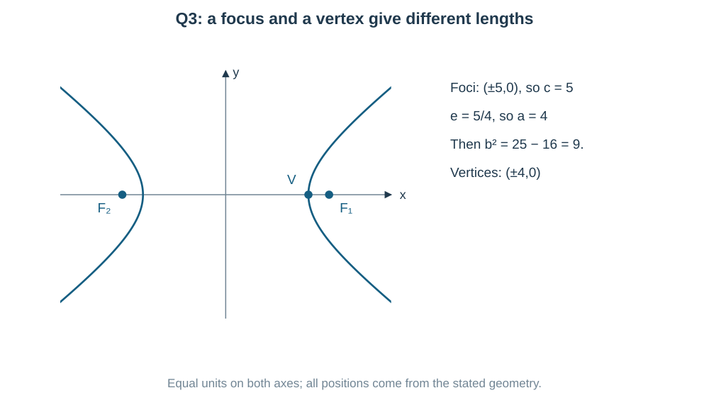

Since the foci lie on the $x$-axis,

$$
\boxed{\frac{x^2}{16}-\frac{y^2}{9}=1;\quad\text{(d)}}.
$$

**Check:** $e=\sqrt{1+9/16}=5/4$, and $c=\sqrt{16+9}=5$. Option (c) has a plus sign, so it is an ellipse, not the required hyperbola.

---

### Question 4 — Compare full lengths rather than half-lengths

**PDF page 102 | Numerical value | Notes: C04,C06**

For a hyperbola $\dfrac{x^2}{a^2}-\dfrac{y^2}{b^2}=1$, the length of the latus rectum equals the length of the transverse axis. Then $e^2=$ ____.

**Both named quantities are full lengths.** Latus rectum $=2b^2/a$ and transverse axis $=2a$:

$$
\frac{2b^2}{a}=2a
\quad\Longrightarrow\quad b^2=a^2.
$$

With $a,b>0$, this means $a=b$.

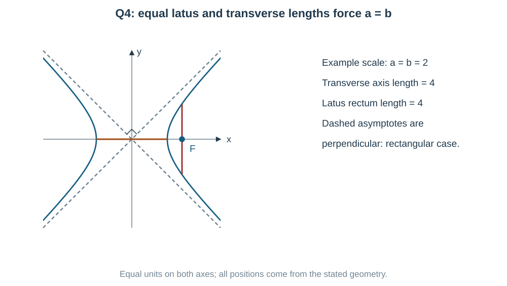

Therefore

$$
\boxed{e^2=1+\frac{b^2}{a^2}=2}.
$$

**Geometric connection:** equal $a,b$ give asymptote slopes $\pm1$, so the asymptotes are perpendicular. This is the rectangular-hyperbola case. The requested answer is $e^2=2$, not $e=\sqrt2$.

---

### Question 5 — The conjugate swaps the two axis roles

**PDF page 102 | MCQ | Notes: C06**

The eccentricity of the conjugate hyperbola of $\dfrac{x^2}{9}-\dfrac{y^2}{16}=1$ is

- (a) $\dfrac53$
- (b) $\dfrac43$
- (c) $\dfrac54$
- (d) $\dfrac34$

**First write the conjugate, rather than reusing the original eccentricity.**

$$
\frac{y^2}{16}-\frac{x^2}{9}=1.
$$

It opens vertically, so its transverse semiaxis is 4. Its focal distance is still $\sqrt{16+9}=5$.

$$
\boxed{e'=\frac54;\quad\text{(c)}}.
$$

**Another quick approach:** the original $e=5/3$ and $1/e^2+1/e'^2=1$ give

$$
\frac1{e'^2}=1-\frac9{25}=\frac{16}{25},
$$

so $e'=5/4$. Writing the conjugate first is safer when the axis roles are not familiar.

---

### Question 6 — Finite tangent slope and intercept must satisfy the contact condition

**PDF page 102 | Numerical value | Notes: C08**

If the line $y=2x+c$ touches the hyperbola $\dfrac{x^2}{9}-\dfrac{y^2}{4}=1$, then $c^2=$ ____.

**The line's slope is fixed at 2.** For a finite tangent to $x^2/9-y^2/4=1$,

$$
c^2=a^2m^2-b^2=9(2)^2-4.
$$

Hence

$$
\boxed{c^2=32}.
$$

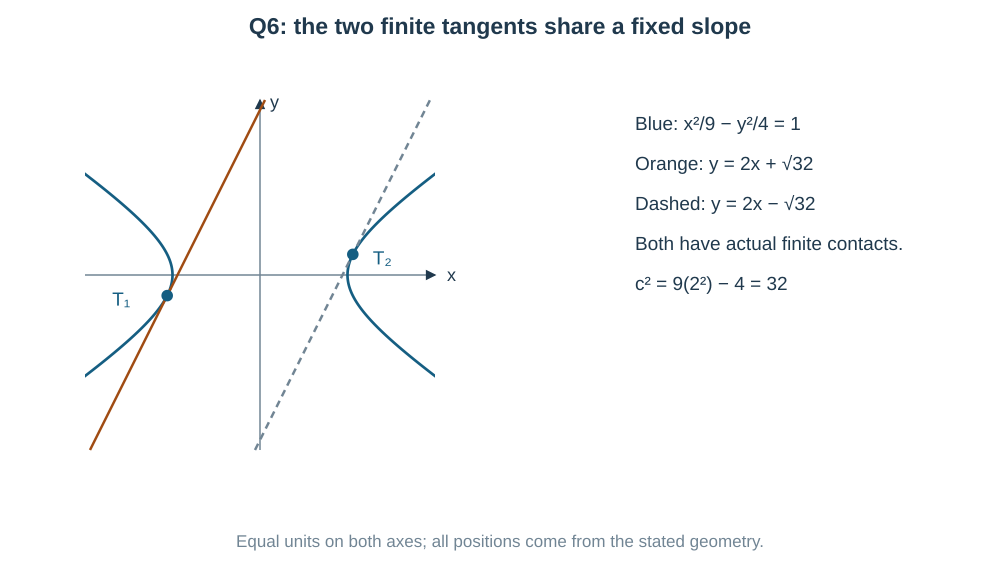

The positive value means real finite contacts exist; $c=\pm\sqrt{32}$ gives the two parallel tangents.

**Another possible approach — repeated intersection:** substituting $y=2x+c$ gives

$$
32x^2+36cx+9c^2+36=0.
$$

The discriminant is $144(c^2-32)$. Setting it to zero gives the same result. The leading coefficient is 32, so no quadratic term has disappeared and the repeated root is a genuine finite contact.

---

### Question 7 — Check a curve point before applying its tangent formula

**PDF page 102 | MCQ | Notes: C08**

The equation of the tangent to $\dfrac{x^2}{9}-\dfrac{y^2}{16}=1$ at the point $\left(5,\dfrac{16}3\right)$ is

- (a) $5x+3y=41$
- (b) $4x-3y=4$
- (c) $3x-5y=-1$
- (d) $5x-3y=9$

**First verify the point:**

$$
\frac{25}{9}-\frac{(16/3)^2}{16}
=\frac{25}{9}-\frac{16}{9}=1.
$$

The tangent-at-point formula now applies:

$$
\frac{5x}{9}-\frac{(16/3)y}{16}=1
\quad\Longrightarrow\quad
\frac{5x}{9}-\frac y3=1.
$$

$$
\boxed{5x-3y=9;\quad\text{(d)}}.
$$

**Another possible approach:** differentiate $x^2/9-y^2/16=1$:

$$
y'=\frac{16x}{9y}.
$$

At the point it is $5/3$. Thus $y-16/3=(5/3)(x-5)$ gives the same line.

**Check:** $25-16=9$. The dashed auxiliary normal has slope $-3/5$, perpendicular to the tangent's $5/3$; a normal is a different line.

---

### Question 8 — Translate to the centre before drawing the asymptote pair

**PDF page 102 | MCQ | Notes: C05**

The combined equation of the asymptotes of the hyperbola $9x^2-16y^2-18x-32y-151=0$ is

- (a) $9x^2-16y^2-18x-32y+7=0$
- (b) $9x^2-16y^2-18x-32y-7=0$
- (c) $9x^2-16y^2-18x+32y-7=0$
- (d) $9x^2+16y^2+18x-32y-7=0$

**Find the centre before guessing the asymptotes.** Complete both squares:

$$
9[(x-1)^2-1]-16[(y+1)^2-1]-151=0.
$$

Thus

$$
9(x-1)^2-16(y+1)^2=144.
$$

The centre is $(1,-1)$. The asymptote pair uses the same squared terms with zero on the right:

$$
9(x-1)^2-16(y+1)^2=0.
$$

Expand:

$$
\boxed{9x^2-16y^2-18x-32y-7=0;\quad\text{(b)}}.
$$

**Another possible approach:** factor first:

$$
[3(x-1)-4(y+1)][3(x-1)+4(y+1)]=0.
$$

The two lines are $3x-4y-7=0$ and $3x+4y+1=0$. Multiplying gives the selected pair.

**Check:** both lines pass through $(1,-1)$. Changing only the constant in the original equation without locating the centre risks the wrong sign.

---

### Question 9 — Distinguish the acute angle from its supplementary angle

**PDF page 102 | Numerical value | Notes: C03,C05**

The eccentricity of a hyperbola is $2$. The acute angle (in degrees) between its asymptotes is ____.

**Eccentricity tells the asymptote slope ratio:**

$$
e^2=1+\frac{b^2}{a^2}=4
\quad\Longrightarrow\quad
\frac ba=\sqrt3.
$$

So the asymptotes have slopes $\pm\sqrt3$. They make angles $60^\circ$ and $120^\circ$ with the positive $x$-axis.

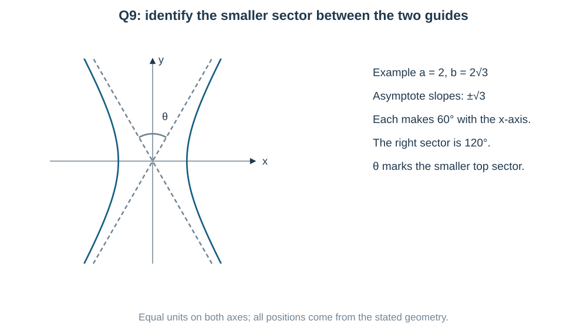

The smaller angle between those directions is

$$
\boxed{120^\circ-60^\circ=60^\circ}.
$$

**Another possible approach:** the acute angle $\theta$ satisfies

$$
\tan\theta=\left|\frac{2\sqrt3}{1-3}\right|=\sqrt3.
$$

Since the question says **acute**, select $\theta=60^\circ$, not its supplement $120^\circ$. The drawing helps choose the sector; the slope calculation fixes its exact size.

---

### Question 10 — A fixed absolute difference of focal distances gives both branches

**PDF page 103 | MCQ | Notes: C01,C13**

The locus of a point $P$ such that $|PF_1-PF_2|=6$, where $F_1=(5,0)$, $F_2=(-5,0)$, is

- (a) $\dfrac{x^2}{9}-\dfrac{y^2}{16}=1$
- (b) $\dfrac{x^2}{16}-\dfrac{y^2}{9}=1$
- (c) $\dfrac{x^2}{9}+\dfrac{y^2}{16}=1$
- (d) $\dfrac{x^2}{36}-\dfrac{y^2}{25}=1$

**An absolute focal-distance difference is the hyperbola definition.**

$$
2a=6\quad\Longrightarrow\quad a=3.
$$

The foci are $(\pm5,0)$, so $c=5$. Therefore

$$
b^2=c^2-a^2=25-9=16.
$$

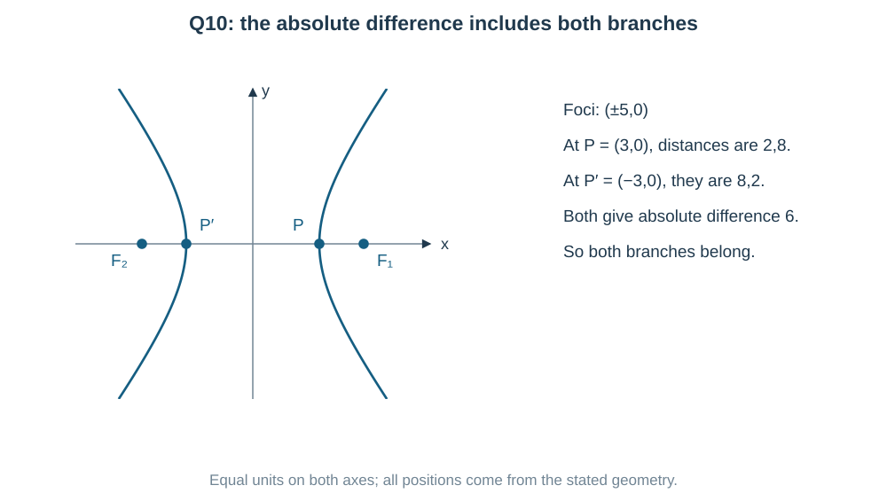

$$
\boxed{\frac{x^2}{9}-\frac{y^2}{16}=1;\quad\text{(a)}}.
$$

**Check the definition at both vertices:** at $(3,0)$ the distances are 2 and 8; at $(-3,0)$ they are 8 and 2. In both cases their absolute difference is 6. The focal separation is 10, greater than the requested difference, so the nondegenerate locus is possible.

---

### Question 11 — Perpendicular tangents give a director circle with finite-contact exclusions

**PDF page 103 | MCQ | Notes: C12**

The locus of the point of intersection of perpendicular tangents to $\dfrac{x^2}{16}-\dfrac{y^2}{9}=1$ is

- (a) $x^2+y^2=25$
- (b) $x^2+y^2=12$
- (c) $x^2+y^2=9$
- (d) $x^2+y^2=7$

**Start with the usual director-circle result, then check what “tangent” means here.** For the hyperbola, $a^2=16,b^2=9$. The conventional equation for perpendicular tangent intersections is

$$
\boxed{x^2+y^2=16-9=7;\quad\text{intended (d)}}.
$$

**Why this equation appears:** a tangent through $(h,k)$ gives

$$
(h^2-16)m^2-2hkm+(k^2+9)=0.
$$

For perpendicular finite slopes, their product is $-1$:

$$
\frac{k^2+9}{h^2-16}=-1
\quad\Longrightarrow\quad h^2+k^2=7.
$$

**Check a genuine pair:** at $P=(0,\sqrt7)$, the lines $y=x+\sqrt7$ and $y=-x+\sqrt7$ have slopes $1,-1$ and satisfy the finite tangent condition $7=16-9>0$.

**Exact finite-contact qualification:** remove the four points where this circle crosses the asymptotes $y=\pm3x/4$:

$$
\left(\pm\frac{4\sqrt7}{5},\ \pm\frac{3\sqrt7}{5}\right),
$$

with independent sign choices. At one of these points, one slope candidate gives an intercept zero. That line is an asymptote and never touches the hyperbola at a finite point. The source uses the conventional circle equation; the exact locus of intersections of two finite-contact perpendicular tangents is this circle **without those four points**.

This exception is why we keep the strict condition $c_0^2=16m^2-9>0$, rather than counting every algebraic candidate as a tangent.

---

### Question 12 — The positive term decides the transverse axis

**PDF page 103 | MCQ | Notes: C02**

The distance between the foci of the hyperbola $\dfrac{y^2}{9}-\dfrac{x^2}{16}=1$ is

- (a) $10$
- (b) $5$
- (c) $8$
- (d) $2\sqrt7$

**The positive term is $y^2/9$, so this hyperbola opens vertically.** Its transverse semiaxis is $a=3$, and the other shape length is $b=4$.

$$
c^2=a^2+b^2=9+16=25,\qquad c=5.
$$

The foci are $(0,\pm5)$, so their separation is

$$
\boxed{2c=10;\quad\text{(a)}}.
$$

**Check:** the transverse axis is only 6 units long. The foci lie beyond its ends, so the focal separation must be larger than 6.

---

### Question 13 — Vertices give a and eccentricity gives c

**PDF page 103 | Numerical value | Notes: C03,C04**

A hyperbola has vertices at $(\pm3,0)$ and eccentricity $2$. The length of its latus rectum is ____.

**Vertices give $a$, while eccentricity connects $a$ to $c$.**

$$
a=3,\qquad c=ae=3(2)=6.
$$

Then

$$
b^2=c^2-a^2=36-9=27.
$$

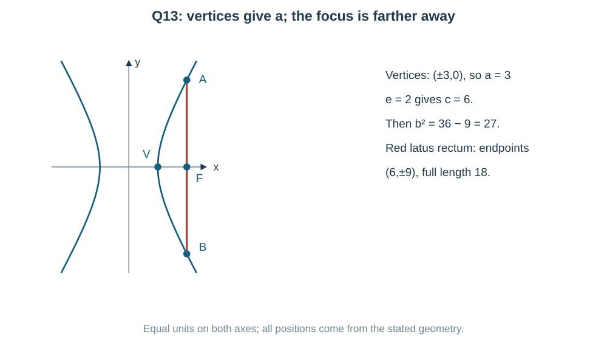

$$
\boxed{L=\frac{2b^2}{a}=\frac{54}{3}=18}.
$$

**Coordinate check:** at focus abscissa $x=6$, $x^2/9-y^2/27=1$ gives $y=\pm9$, a full separation of 18. The given vertices are not the foci.

---

### Question 14 — Use the actual focus named in the question

**PDF page 103 | MCQ | Notes: C04**

The point $(8,3\sqrt3)$ lies on $\dfrac{x^2}{16}-\dfrac{y^2}{9}=1$. Its distance from the focus $(5,0)$ is

- (a) $14$
- (b) $8$
- (c) $6$
- (d) $10$

**The point and the required focus are both known.** Direct distance is already short:

$$
PF=\sqrt{(8-5)^2+(3\sqrt3)^2}
=\sqrt{9+27}
=\boxed{6;\quad\text{(c)}}.
$$

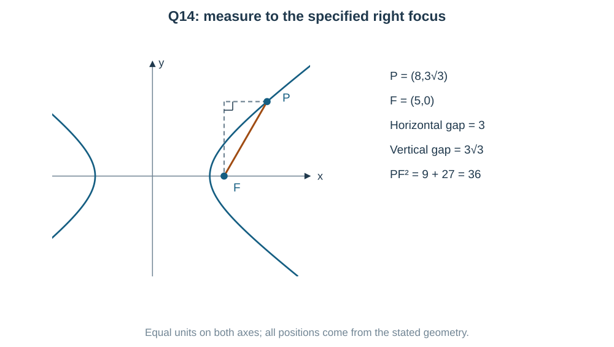

**Another possible approach — focal distance on the right branch:** $a=4,c=5$, so $e=5/4$. The right-focus distance is

$$
ex-a=\frac54(8)-4=6.
$$

**Check:** the given point obeys $64/16-27/9=4-3=1$. Using $ex+a$ would measure the distance to the **other** focus, giving 14 rather than the requested distance.

---

### Question 15 — The transverse axis of xy8 is rotated

**PDF page 103 | Numerical value | Notes: C07**

The length of the transverse axis of the rectangular hyperbola $xy=8$ is ____.

**The coordinate axes are the asymptotes of $xy=8$. The transverse axis is a diagonal.** We cannot read 8 as a squared horizontal semiaxis.

Use perpendicular diagonal coordinates

$$
u=\frac{x+y}{\sqrt2},\qquad v=\frac{x-y}{\sqrt2}.
$$

Since $u^2-v^2=2xy=16$,

$$
\frac{u^2}{16}-\frac{v^2}{16}=1.
$$

Thus its transverse semiaxis is 4 and

$$
\boxed{2a=8}.
$$

**Another geometric approach — locate the nearest points to the centre:** along the positive branch,

$$
x^2+y^2\ge2xy=16,
$$

with equality at $x=y=\sqrt8$. The opposite vertex is $(-\sqrt8,-\sqrt8)$. Each is 4 units from the origin, so the full transverse length is 8. This AM–GM view is shorter if a rotation formula is unfamiliar.

**Check:** both vertices have product 8 and their direct separation is $\sqrt{(2\sqrt8)^2+(2\sqrt8)^2}=8$.

---

### Question 16 — A rectangular hyperbola has perpendicular asymptotes

**PDF page 103 | MCQ | Notes: C06,C08**

Statement I: The eccentricity of a rectangular hyperbola is $\sqrt2$.

Statement II: The line $y=x$ touches the hyperbola $\dfrac{x^2}{4}-\dfrac{y^2}{3}=1$.

Choose the correct option.

- (a) Statement I is true but Statement II is false
- (b) Both Statement I and Statement II are true
- (c) Statement I is false but Statement II is true
- (d) Both Statement I and Statement II are false

**Check each statement from its meaning.**

A rectangular hyperbola has perpendicular asymptotes. Their slopes are $\pm b/a$, so perpendicularity requires $a=b$. Therefore

$$
e=\sqrt{1+b^2/a^2}=\sqrt2.
$$

Statement I is **true**.

For II, substitute $y=x$ into its own hyperbola:

$$
\frac{x^2}{4}-\frac{x^2}{3}=1
\quad\Longrightarrow\quad
-\frac{x^2}{12}=1.
$$

There is no real solution, so the line does not meet the curve and cannot be tangent.

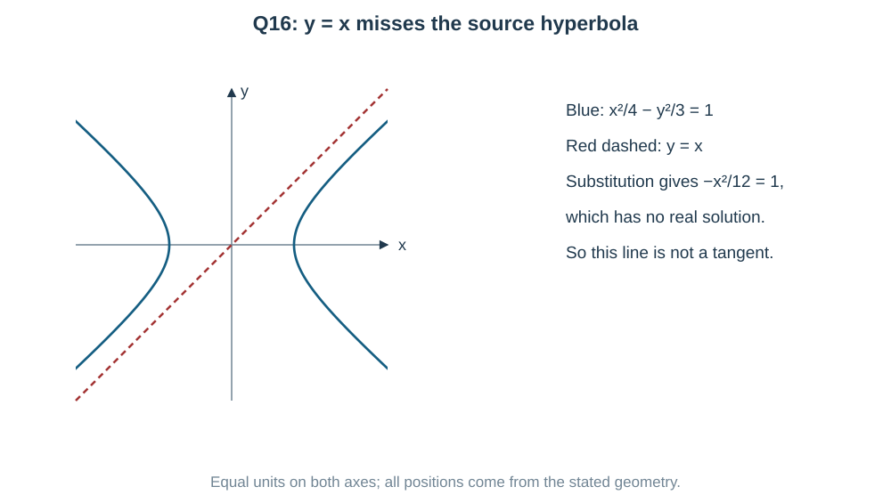

$$
\boxed{\text{I true, II false;\quad (a)}}.
$$

**Fast tangent-condition check:** here $m=1,c_0=0$, but $a^2m^2-b^2=4-3=1\ne0$. Direct substitution is the clearer first explanation.

---

### Question 17 — Use the positive-denominator transverse length in every eccentricity

**PDF page 103 | MCQ | Notes: C03,C06**

Match List I (hyperbola) with List II (eccentricity).

| List I | Hyperbola | List II | Eccentricity |
|---|---|---|---|
| A | $\dfrac{x^2}{9}-\dfrac{y^2}{16}=1$ | P | $\sqrt2$ |
| B | $\dfrac{x^2}{16}-\dfrac{y^2}{9}=1$ | Q | $2$ |
| C | $x^2-y^2=1$ | R | $\dfrac53$ |
| D | $\dfrac{x^2}{4}-\dfrac{y^2}{12}=1$ | S | $\dfrac54$ |

- (a) A–S, B–R, C–P, D–Q
- (b) A–R, B–S, C–Q, D–P
- (c) A–R, B–P, C–S, D–Q
- (d) A–R, B–S, C–P, D–Q

**The positive term's denominator gives $a^2$ every time.** Do not choose the larger denominator automatically.

| Case | $a,b$ | $e=\sqrt{1+b^2/a^2}$ | Match |
|---|---|---|---|
| A | $3,4$ | $5/3$ | R |
| B | $4,3$ | $5/4$ | S |
| C | $1,1$ | $\sqrt2$ | P |
| D | $2,\sqrt{12}$ | $2$ | Q |

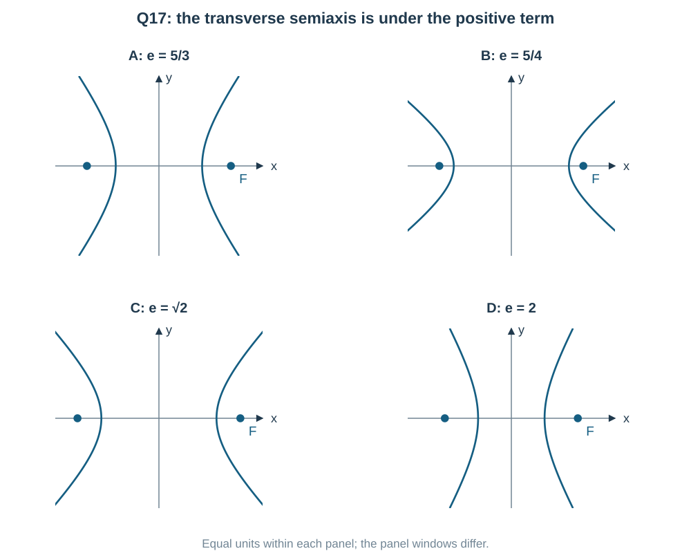

$$
\boxed{\text{A–R,\ B–S,\ C–P,\ D–Q;\quad (d)}}.
$$

**Check:** each value exceeds 1; C has equal shape lengths and therefore perpendicular asymptotes. A and B are conjugates, explaining their exchanged $3,4$ transverse lengths.

---

### Question 18 — Keep focal distance, directrix and asymptote ratios separate

**PDF page 104 | MCQ | Notes: C03,C05**

For the hyperbola $\dfrac{x^2}{9}-\dfrac{y^2}{16}=1$ consider:

(i) the foci are $(\pm5,0)$;

(ii) the directrices are $x=\pm\dfrac95$;

(iii) the asymptotes are $y=\pm\dfrac34x$;

(iv) the length of the conjugate axis is $8$.

Choose the correct statements.

- (a) (i), (ii) and (iv) only
- (b) (i), (iii) and (iv) only
- (c) (ii), (iii) and (iv) only
- (d) (i), (ii) and (iii) only

**Find $a,b,c$ once:** $a=3,b=4,c=\sqrt{9+16}=5$, so $e=5/3$.

- (i) Foci $(\pm5,0)$: **true**.
- (ii) Directrices $x=\pm a/e=\pm9/5$: **true**.
- (iii) Asymptotes should be $y=\pm(b/a)x=\pm4x/3$, rather than $\pm3x/4$: **false**.
- (iv) Conjugate-axis length is $2b=8$: **true**.

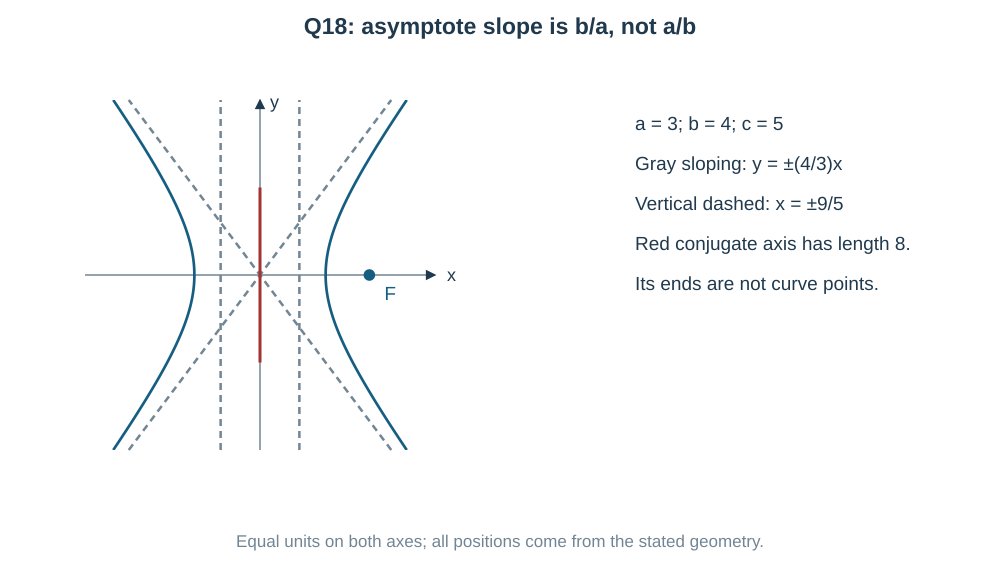

$$
\boxed{\text{(i), (ii), (iv);\quad (a)}}.
$$

**Check the slope without memorizing:** setting the right side of $x^2/9-y^2/16=1$ to zero gives $16x^2=9y^2$, hence $y/x=\pm4/3$. This exposes the reciprocal-slope trap directly.

---

### Question 19 — A chord midpoint is not a tangent contact

**PDF page 104 | MCQ | Notes: C10**

The equation of the chord of $\dfrac{x^2}{9}-\dfrac{y^2}{4}=1$ whose midpoint is $(6,1)$ is

- (a) $8x+3y=51$
- (b) $8x-3y=45$
- (c) $3x-8y=10$
- (d) $4x-3y=21$

**A midpoint is not automatically on the curve.** Here its quadratic value is $36/9-1/4=15/4$, not 1.

Let the endpoints be $A=(6+u,1+v)$ and $B=(6-u,1-v)$. Subtract their curve equations:

$$
\frac{(6+u)^2-(6-u)^2}{9}
-\frac{(1+v)^2-(1-v)^2}{4}=0.
$$

This gives

$$
\frac{24u}{9}-v=0
\quad\Longrightarrow\quad v=\frac83u.
$$

Thus the chord through $(6,1)$ has slope $8/3$:

$$
y-1=\frac83(x-6)
\quad\Longrightarrow\quad
\boxed{8x-3y=45;\quad\text{(b)}}.
$$

**Fast exam version:** $hx/9-ky/4=h^2/9-k^2/4$ gives $2x/3-y/4=15/4$, the same line.

**Check that real endpoints exist:** substitution gives

$$
(x-6)^2=\frac{33}{20}.
$$

So the endpoints are

$$
\left(6\pm\sqrt{\frac{33}{20}},
\ 1\pm\frac83\sqrt{\frac{33}{20}}\right).
$$

Their midpoint is $(6,1)$ and both have positive $x$; their opposite ordinate signs do not mean opposite branches.

---

### Question 20 — Perpendicular focus-to-tangent distances have a fixed product

**PDF page 104 | Numerical value | Notes: C11**

The product of the perpendicular distances from the two foci of the hyperbola $\dfrac{x^2}{16}-\dfrac{y^2}{9}=1$ to any tangent is ____.

**The starting points are the two foci; the target is a tangent line.** We need two perpendicular lengths, not the two focal distances from a curve point.

The product equals $b^2$. Here $b^2=9$, so

$$
\boxed{d_1d_2=9}.
$$

**Why this remains constant:** take a proper tangent $Ax+By+C=0$. It satisfies $C^2=16A^2-9B^2$, while the foci are $(\pm5,0)$. Multiply the two line-distance formulas:

$$
\begin{aligned}
d_1d_2&=\frac{|C+5A|\,|C-5A|}{A^2+B^2}\\
&=\frac{|C^2-25A^2|}{A^2+B^2}
=\frac{|-9(A^2+B^2)|}{A^2+B^2}=9.
\end{aligned}
$$

**Check an actual tangent:** $3x-2\sqrt3\,y=6$ touches at $(8,3\sqrt3)$. Its distances from the foci are $9/\sqrt{21}$ and $21/\sqrt{21}$, giving product 9. The modulus is needed because the foci lie on opposite sides of this tangent.

---

### Question 21 — Convert each asymptote expression into a true perpendicular distance

**PDF page 104 | Numerical value | Notes: C11**

For any point on the hyperbola $\dfrac{x^2}{9}-\dfrac{y^2}{16}=1$, the product of its perpendicular distances from the two asymptotes is ____ (answer to 2 decimal places).

**These target lines are the two asymptotes, not a tangent.** From $x^2/9-y^2/16=1$, they are

$$
4x-3y=0,\qquad4x+3y=0.
$$

For a curve point $(x,y)$, their perpendicular distances are

$$
d_1=\frac{|4x-3y|}{5},\qquad d_2=\frac{|4x+3y|}{5}.
$$

**Did you notice the matching factors?** Multiplying produces a difference of squares:

$$
d_1d_2=\frac{|(4x-3y)(4x+3y)|}{25}
=\frac{|16x^2-9y^2|}{25}.
$$

The original hyperbola, multiplied by 144, gives $16x^2-9y^2=144$. Therefore

$$
\boxed{d_1d_2=\frac{144}{25}=5.76}.
$$

**Another possible approach:** use $a^2b^2/(a^2+b^2)=9(16)/25=5.76$ after recognizing this exact construction. The factorization route explains why that result is constant.

**Check:** at $(5,16/3)$ the two distances are $4/5$ and $36/5$, whose product is $144/25$.

---

### Question 22 — Common foci fix c rather than the two semiaxes

**PDF page 104 | Numerical value | Notes: C03,C13**

The foci of the ellipse $\dfrac{x^2}{25}+\dfrac{y^2}{9}=1$ are also the foci of a hyperbola of eccentricity $2$. If the hyperbola is $\dfrac{x^2}{a^2}-\dfrac{y^2}{b^2}=1$, then $b^2=$ ____.

**Use the ellipse first to find the common foci.** For $x^2/25+y^2/9=1$,

$$
c^2=25-9=16,\qquad c=4.
$$

The hyperbola shares those foci, but has its own eccentricity $e=2$:

$$
a=\frac ce=\frac42=2.
$$

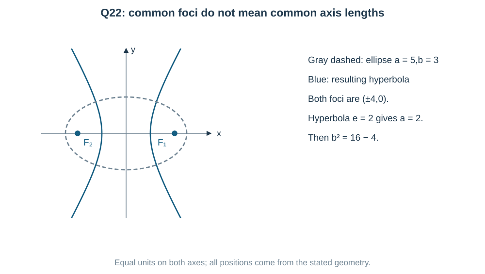

For the hyperbola,

$$
c^2=a^2+b^2
\quad\Longrightarrow\quad
\boxed{b^2=16-4=12}.
$$

**Check:** $\sqrt{a^2+b^2}/a=\sqrt{4+12}/2=2$. Copying the ellipse's $a=5$ into the hyperbola would ignore its stated eccentricity.

---

### Question 23 — Directrix separation is twice a over e

**PDF page 104 | MCQ | Notes: C03**

The distance between the two directrices of the hyperbola $\dfrac{x^2}{16}-\dfrac{y^2}{9}=1$ is

- (a) $\dfrac{32}5$
- (b) $\dfrac{16}5$
- (c) $\dfrac85$
- (d) $\dfrac{25}8$

**Find one directrix location, then take the full gap.** Here $a=4,b=3,c=5$, so $e=5/4$.

$$
x=\pm\frac ae=\pm\frac4{5/4}=\pm\frac{16}5.
$$

Therefore

$$
\boxed{\frac{16}5-\left(-\frac{16}5\right)=\frac{32}5;\quad\text{(a)}}.
$$

**Check:** these directrices lie inside the vertex locations $\pm4$. The focal gap is 10, a different length.

---

### Question 24 — A secant–tangent parameter is not the polar angle

**PDF page 104 | MCQ | Notes: C09**

The distance from the origin of the point with parameter $\theta=\dfrac\pi3$, i.e. $(a\sec\theta,b\tan\theta)$, on $\dfrac{x^2}{9}-\dfrac{y^2}{4}=1$ is

- (a) $6$
- (b) $4\sqrt3$
- (c) $8$
- (d) $2\sqrt{13}$

**The question gives a parameter formula, so construct the point first.** Here $a=3,b=2$ and

$$
\sec\frac\pi3=2,\qquad\tan\frac\pi3=\sqrt3.
$$

Thus $P=(6,2\sqrt3)$.

$$
OP=\sqrt{6^2+(2\sqrt3)^2}
=\sqrt{36+12}
=\boxed{4\sqrt3;\quad\text{(b)}}.
$$

**Check:** $36/9-12/4=4-3=1$. The polar slope of $OP$ is $\sqrt3/3$, whereas $\tan(\pi/3)=\sqrt3$. This confirms that the given parameter is not the actual polar angle.

---

### Question 25 — A right angle at P gives a circle on the focal segment

**PDF page 104 | MCQ | Notes: C04,C13**

$P$ is a point on $\dfrac{x^2}{9}-\dfrac{y^2}{16}=1$ with foci $F_1,F_2$ such that $PF_1\perp PF_2$. The area of $\triangle PF_1F_2$ is

- (a) $12$
- (b) $8$
- (c) $24$
- (d) $16$

**Combine two different clues.** Being on the hyperbola gives a fixed focal-distance difference. The right angle at $P$ gives a right-triangle relation.

Here $a=3,b=4,c=5$. Let $u=PF_1$ and $v=PF_2$, both positive lengths. Then

$$
|u-v|=2a=6,\qquad
u^2+v^2=(F_1F_2)^2=(2c)^2=100.
$$

We need triangle area $\tfrac12uv$. There is no need to solve for each length.

**Notice the pattern:** $(u-v)^2=u^2+v^2-2uv$. Substituting the known square and sum gives

$$
36=100-2uv
\quad\Longrightarrow\quad uv=32.
$$

Therefore

$$
\boxed{\Delta=\frac12uv=16;\quad\text{(d)}}.
$$

**Another possible approach — circle plus hyperbola:** the right-angle condition places $P$ on the circle with foci as diameter endpoints:

$$
x^2+y^2=25.
$$

Combine this with $16x^2-9y^2=144$. Substituting $x^2=25-y^2$ gives

$$
400-25y^2=144
\quad\Longrightarrow\quad
y^2=\frac{256}{25}.
$$

The focal base is 10 and perpendicular height is $|y|=16/5$. Thus $\Delta=\tfrac12(10)(16/5)=16$.

The first route is shorter because it finds the requested product directly. The second gives the actual geometry: $x^2=369/25$, and the four sign choices produce four symmetric points with the same area.

## Answer check

Read the qualifications in the solutions before using the key.

| Question | Answer | Question | Answer |
|---|---|---|---|
| 1 | (c) | 14 | (c) |
| 2 | (a) | 15 | $8$ |
| 3 | (d) | 16 | (a) |
| 4 | $2$ | 17 | (d) |
| 5 | (c) | 18 | (a) |
| 6 | $32$ | 19 | (b) |
| 7 | (d) | 20 | $9$ |
| 8 | (b) | 21 | $5.76$ |
| 9 | $60$ | 22 | $12$ |
| 10 | (a) | 23 | (a) |
| 11 | Intended (d); finite-contact exclusions apply | 24 | (b) |
| 12 | (a) | 25 | (d) |
| 13 | $18$ |  |  |

## After this chapter

Keep the ellipse and hyperbola sign changes connected to their distance meanings. Check which axis is transverse, whether a line has a finite contact, and whether a distance is measured perpendicularly. A graph builds the picture; original equations check the exact claim. All alternatives are fully visible for the later booklet. The supplied questions are original JEE Main-style practice, not verified actual PYQs.
