# Chapter 21 — Three Dimensional Geometry

**Kanna, coordinates tell where a point is. A direction tells how to move. A plane is one flat sheet. Keep these three ideas separate.**

Your target remains **200 marks**: Physics 60, Maths 60, Chemistry 80. Learn line directions, projections, intersections and shortest distances first. The source's plane and sphere questions are also solved in full.

## Recent chapter weightage

| Year | Questions tagged 3D Geometry in the checked archive | Full-year paper shifts | Tagged questions per shift |
|---|---:|---:|---:|
| 2024 | 40 | 20 | 2.00 |
| 2025 | 35 | 19 | 1.84 |
| 2026 | 32 | 19 | 1.68 |
| Total | 107 | 58 | **1.84** |

These are distinct question IDs recounted in ExamSIDE's separate 3D Geometry category. No saved recent IDs overlap its Vector Algebra category. PYQSide's Class 12 3D category gives 41, 33 and 32 in these years, and its separate introductory Class 11 category gives 1, 1 and 0. Those differently partitioned counts are not silently merged. The 2024 format offered more optional numerical questions. Sources and the recount are saved in the evidence folder.

These are archive tags, not a new independent classification of every official paper. A mean around 1.84 does not promise two questions in your shift. It supports giving the named line/distance core a good share of revision time; this is not a measured formula-frequency ranking.

**Important for JEE Main:** the current official 3D unit names coordinates, distance and section formula, direction ratios/cosines, angles between intersecting lines, line equations, skew lines, shortest distance and its equation. Plane and sphere constructions in this PDF are retained as **supporting source topics**, with their full explanations. The small vector tools below are taught here so you need not depend on a later chapter.

**How to read the drawings:** a spatial view shows how objects sit in 3D, but a projected right angle may look sloping. A **true section** is a flat view inside the actual 3D space, with equal units. Its axes $u,v$ name directions in that section; they are not automatically the original $x,y$ axes.

## Concept C01 — A point and a movement are different objects

Take three mutually perpendicular axes, $x,y,z$. A point $P=(x,y,z)$ records its signed positions along them. A negative coordinate means the opposite direction along that axis.

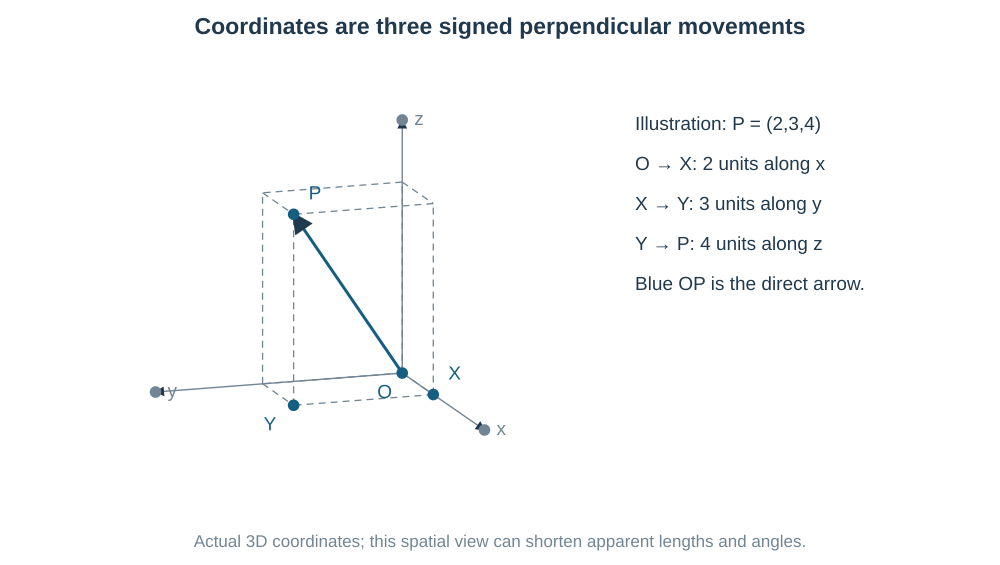

If $A=(x_1,y_1,z_1)$ and $B=(x_2,y_2,z_2)$, the movement from $A$ to $B$ is

$$
\boxed{\overrightarrow{AB}=B-A
=(x_2-x_1,\ y_2-y_1,\ z_2-z_1)}.
$$

**Destination minus start.** A vector is an arrow with a length and direction; its components are its three signed axis movements. For $\mathbf v=(v_x,v_y,v_z)$,

$$
\boxed{|\mathbf v|=\sqrt{v_x^2+v_y^2+v_z^2}}.
$$

This is Pythagoras in three perpendicular directions. It gives

$$
\boxed{AB=\sqrt{(x_2-x_1)^2+(y_2-y_1)^2+(z_2-z_1)^2}}.
$$

The midpoint is $(A+B)/2$. If $AP:PB=m:n$ internally, with $m,n>0$,

$$
\boxed{P=\frac{nA+mB}{m+n}}.
$$

The coefficient of $B$ is larger when $P$ is farther from $A$. For external division, use $(mB-nA)/(m-n)$, with $m\ne n$, and check the actual side. These operations act on each coordinate.

For a triangle, centroid $G=(A+B+C)/3$. It is the average of the three vertex positions.

## Concept C02 — Direction ratios and direction cosines

A line direction can be represented by any nonzero arrow $\mathbf d=(a,b,c)$. Its components are **direction ratios**, often shortened to DRs. Multiplying all three by one nonzero number gives the same line direction. The zero vector cannot describe a line.

To give the arrow length 1, divide all components by its length:

$$
\boxed{(l,m,n)=\frac{(a,b,c)}{\sqrt{a^2+b^2+c^2}}}.
$$

These are **direction cosines**, or DCs, because

$$
l=\cos\alpha,\qquad m=\cos\beta,\qquad n=\cos\gamma,
$$

where $\alpha,\beta,\gamma$ are the angles with the positive axes. Each is a signed axis projection of a unit arrow.

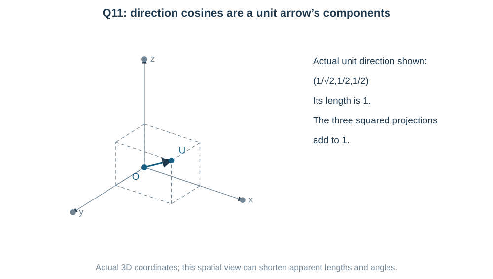

By Pythagoras,

$$
\boxed{l^2+m^2+n^2=1},
\qquad
\boxed{\sin^2\alpha+\sin^2\beta+\sin^2\gamma=2}.
$$

The second follows by replacing each sine square by $1-\cos^2$. Do not make the direction cosines themselves add to 1.

Reversing an arrow changes **all three** DC signs. An undirected line admits both choices. An acute direction angle has positive cosine; an obtuse one has negative cosine. If a problem gives only squared cosines, use its angle condition to choose the sign.

If a line is equally inclined to the positive axes with all three acute angles, its DCs are all $1/\sqrt3$. Equal absolute inclinations can allow independent component signs; read the wording.

## Concept C03 — Dot product: compare directions and measure a projection

For two vectors,

$$
\boxed{\mathbf u\cdot\mathbf v=u_xv_x+u_yv_y+u_zv_z
=|\mathbf u||\mathbf v|\cos\theta}.
$$

The input is two arrows; the result is **one number**. Multiply matching components and add. It measures how much the two directions point along each other.

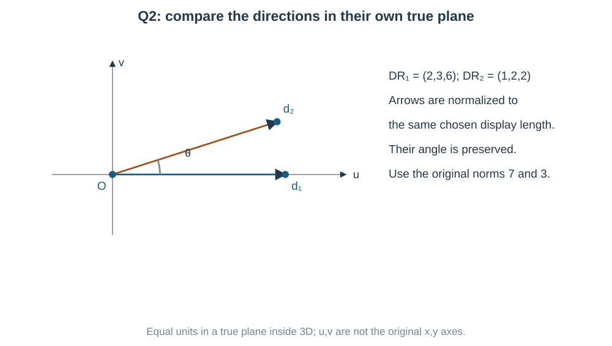

For nonzero vectors:

$$
\boxed{\cos\theta=\frac{\mathbf u\cdot\mathbf v}{|\mathbf u||\mathbf v|}}.
$$

Positive dot means an acute directed angle, zero means perpendicular, and negative dot means obtuse. For the smaller angle between two undirected lines, use the absolute numerator.

The signed scalar projection of $\mathbf w$ along a unit direction $\hat{\mathbf d}$ is $\mathbf w\cdot\hat{\mathbf d}$. Its absolute value is a projection **length**. Projection on the $z$-axis is the signed change in $z$; its length is $|\Delta z|$.

**Important for JEE Main — Cauchy–Schwarz:**

$$
\boxed{|\mathbf u\cdot\mathbf v|\le|\mathbf u||\mathbf v|}.
$$

A projection cannot be longer than the whole arrow. Equality requires parallel directions, including the reversed direction. It also checks that a proposed cosine lies between $-1$ and 1.

For example, $(1,1,1)\cdot(x,y,z)=x+y+z$ gives

$$
(x+y+z)^2\le3(x^2+y^2+z^2),
$$

with equality when $x=y=z$. Use this for bounds and equal-direction cases, with signs checked.

## Concept C04 — Cross product gives a perpendicular vector

For two nonparallel arrows drawn from the same start, their plane is the flat sheet containing both. Their cross product

$$
\boxed{\mathbf n=\mathbf u\times\mathbf v}
$$

is **another vector**, pointing perpendicular to that sheet. Thus it is perpendicular to both original arrows:

$$
\boxed{\mathbf n\cdot\mathbf u=0,\qquad
\mathbf n\cdot\mathbf v=0}.
$$

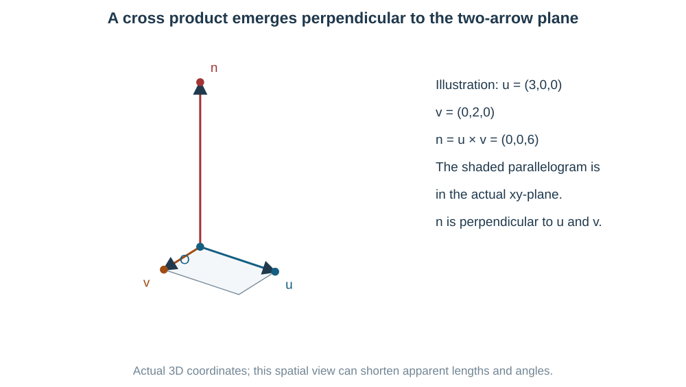

Use the right-hand rule: curl your right-hand fingers from $\mathbf u$ towards $\mathbf v$ through the smaller angle. Your thumb gives the cross-product direction. Reversing the order reverses the vector.

Its magnitude is

$$
\boxed{|\mathbf u\times\mathbf v|=|\mathbf u||\mathbf v|\sin\theta}.
$$

This is the parallelogram area: base $|\mathbf u|$ times perpendicular height $|\mathbf v|\sin\theta$.

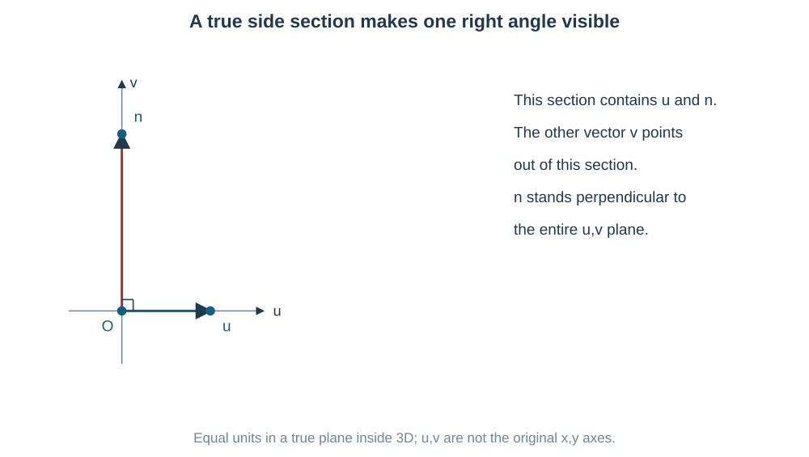

In components,

$$
\boxed{\mathbf u\times\mathbf v=
(u_yv_z-u_zv_y,\ u_zv_x-u_xv_z,\ u_xv_y-u_yv_x)}.
$$

The middle component is the easy sign trap. Check the result by dotting with **both** original vectors.

Parallel inputs give the zero vector. It has no defined direction; do not divide by its length to get a unit normal.

**A third vector tests height above the sheet.** If $\mathbf w$ also starts at that common point,

$$
\boxed{\mathbf w\cdot(\mathbf u\times\mathbf v)}
$$

is the signed volume of the corresponding box with sloping sides. Its absolute value is a volume. It is zero when the third vector makes no height above the first two vectors’ sheet. The three vectors are then **coplanar**, meaning they fit in one flat sheet.

For point geometry, form differences from **one actual common point** before using this test. Position arrows from the origin need not describe the plane through the given points.

## Concept C05 — A line is a fixed point plus a moving multiple of a direction

If a line passes through $A=(x_0,y_0,z_0)$ and has direction $\mathbf d=(a,b,c)\ne0$, every point is

$$
\boxed{\mathbf r=A+t\mathbf d},\qquad t\in\mathbb R.
$$

Here $\mathbf r$ is the position of the moving point. In coordinates,

$$
\boxed{x=x_0+at,\qquad y=y_0+bt,\qquad z=z_0+ct}.
$$

The same $t$ controls all three coordinate movements. It is not generally the distance travelled: the movement length is $|t||\mathbf d|$.

When $abc\ne0$, the symmetric form is

$$
\boxed{\frac{x-x_0}{a}=\frac{y-y_0}{b}=\frac{z-z_0}{c}}.
$$

If a direction component is zero, that coordinate stays fixed. Write, for example, $x=x_0$; do not divide by zero.

A line through distinct $A,B$ uses direction $B-A$. To test three distinct points for collinearity, check that $B-A$ and $C-A$ are scalar multiples.

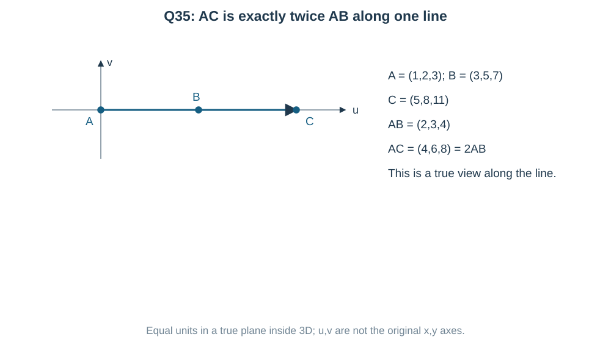

**Important for JEE Main:** two different lines need two independent parameters, say $s,t$. Equal coordinate values at an intersection do not mean the parameters must be equal. Solve and check all three coordinates.

## Concept C06 — Resolve an arrow along a line and perpendicular to it

Let a line be $A+t\mathbf d$, and let $P$ be any point. Write the movement from the anchor to the point:

$$
\mathbf w=P-A.
$$

We split it into an along-line part and a remaining perpendicular part:

$$
\boxed{\mathbf w=\mathbf w_\parallel+\mathbf w_\perp}.
$$

$$
\boxed{\mathbf w_\parallel=
\frac{\mathbf w\cdot\mathbf d}{|\mathbf d|^2}\mathbf d},
\qquad
\boxed{\mathbf w_\perp=\mathbf w-\mathbf w_\parallel}.
$$

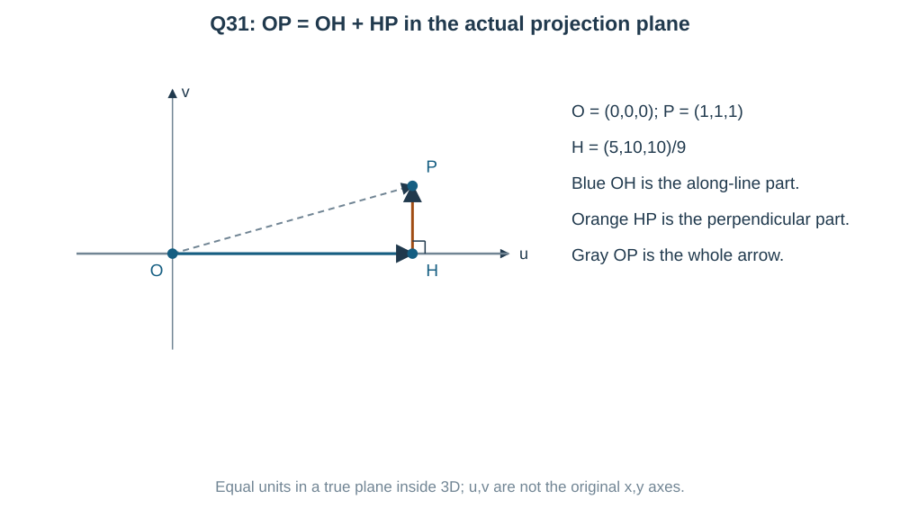

Why choose that coefficient? If $\mathbf w_\perp=\mathbf w-t\mathbf d$ must be perpendicular to $\mathbf d$, then

$$
(\mathbf w-t\mathbf d)\cdot\mathbf d=0
\quad\Longrightarrow\quad
t=\frac{\mathbf w\cdot\mathbf d}{|\mathbf d|^2}.
$$

So the perpendicular foot is $H=A+\mathbf w_\parallel$, and

$$
\boxed{d(P,\text{line})=|\mathbf w_\perp|
=\frac{|\mathbf w\times\mathbf d|}{|\mathbf d|}}.
$$

The cross-product formula divides a parallelogram area by its base to obtain the perpendicular height. The cross-product **vector** is normal to the plane of $\mathbf w,\mathbf d$; it is not the perpendicular remainder $\mathbf w_\perp$ in that plane.

Another useful form from Pythagoras is

$$
\boxed{d^2=|\mathbf w|^2-\frac{(\mathbf w\cdot\mathbf d)^2}{|\mathbf d|^2}}.
$$

Use this when only distance squared is asked. The direction must be nonzero.

## Concept C07 — Intersecting, parallel and skew are different

Two lines can:

- intersect at one point;
- be distinct and parallel;
- coincide, describing the same complete line;
- be **skew**: nonparallel, but not meeting because they do not lie in one plane.

For $L_1=A+s\mathbf u$, $L_2=B+t\mathbf v$:

1. Check $\mathbf u\times\mathbf v$.
2. If it is zero, directions are parallel. If $(B-A)\times\mathbf u=0$ too, the lines coincide; otherwise they are distinct parallel lines.
3. If it is nonzero, check

$$
\boxed{(B-A)\cdot(\mathbf u\times\mathbf v)}.
$$

Zero means coplanar; nonparallel coplanar lines intersect. A nonzero value means skew.

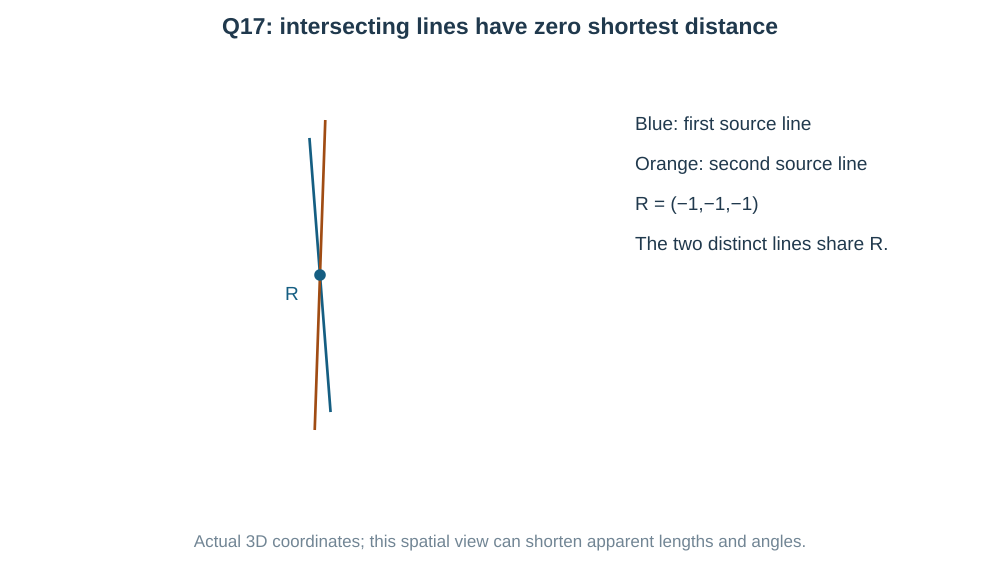

**Intersection method:** solve $A+s\mathbf u=B+t\mathbf v$. Two coordinate equations give candidates; the third confirms or rejects them. Merely solving two coordinates can produce a false intersection in space.

## Concept C08 — The shortest connector between skew lines

Let $P$ lie on $L_1$ and $Q$ on $L_2$. For the shortest joining segment, moving either endpoint along its line must not make that segment shorter. The connector is perpendicular to **both** directions.

The cross product $\mathbf n=\mathbf u\times\mathbf v$ gives exactly this common perpendicular direction.

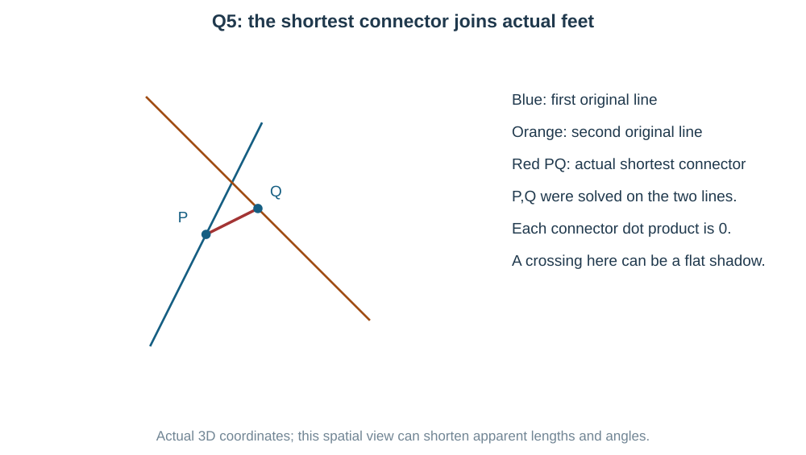

A crossing in the spatial picture can be only a crossing of the lines’ flat shadows. It does not prove the actual 3D lines meet. The true sections below show their real perpendicular separation.

Take $\mathbf w=B-A$. Its component along the unit normal is the separation:

$$
\boxed{d=\frac{|(B-A)\cdot(\mathbf u\times\mathbf v)|}
{|\mathbf u\times\mathbf v|}}.
$$

The numerator is a box volume; the denominator is the base parallelogram area. Volume divided by base area gives height.

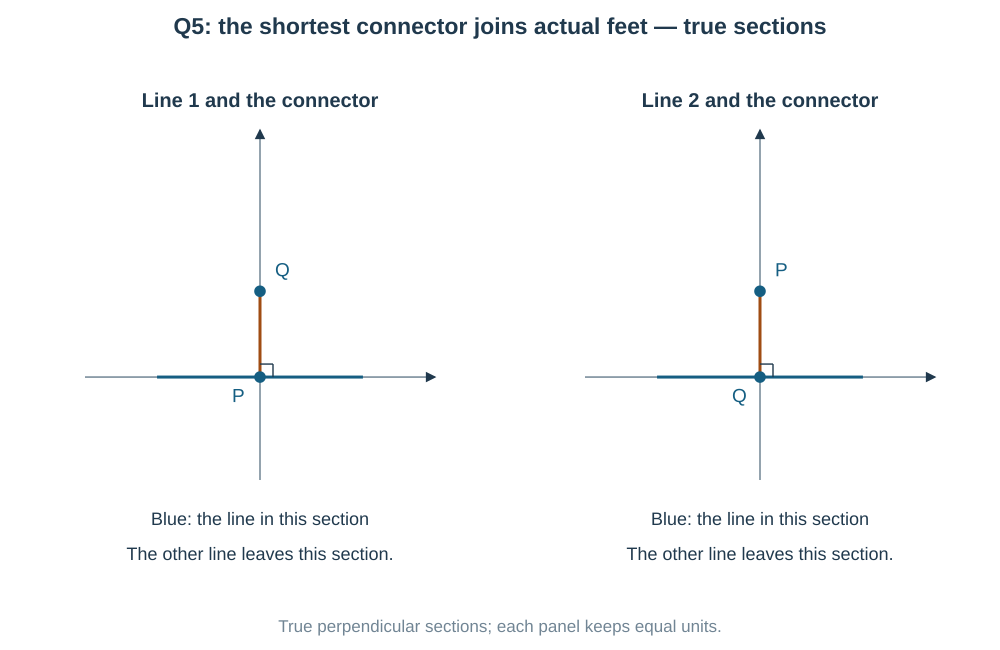

**Its equation needs the actual feet.** Put

$$
P=A+s\mathbf u,\qquad Q=B+t\mathbf v.
$$

Solve the two linear conditions

$$
(Q-P)\cdot\mathbf u=0,\qquad(Q-P)\cdot\mathbf v=0.
$$

Then a common-perpendicular line is

$$
\boxed{\mathbf r=P+\lambda(\mathbf u\times\mathbf v)}.
$$

Using an arbitrary anchor instead of $P$ gives the correct **direction** but generally the wrong common-perpendicular **line**.

For Q5, the feet are $P=(22,44,44)/9$ and $Q=(32,34,49)/9$. A common-perpendicular equation is

$$
\boxed{\mathbf r=\left(\frac{22}9,\frac{44}9,\frac{44}9\right)
+\lambda(2,-2,1)}.
$$

It meets the second line when $\lambda=5/9$. Its foot-to-foot length is $5/3$.

**Parallel case:** if $\mathbf u\times\mathbf v=0$, the skew formula has a zero denominator. Use point-to-line distance:

$$
\boxed{d=\frac{|(B-A)\times\mathbf u|}{|\mathbf u|}}.
$$

For intersecting lines the distance is zero. The common perpendicular direction still exists for nonparallel directions, but the shortest segment has collapsed to the intersection point.

## Concept C09 — Supporting topic: a plane is one flat sheet

A plane is an infinite flat sheet. A drawing shows only a patch of it. A **normal** is a nonzero direction standing straight out of that sheet.

If the plane passes through $A$ and has normal $\mathbf n=(a,b,c)$, every in-plane movement $\mathbf r-A$ is perpendicular to $\mathbf n$:

$$
\boxed{\mathbf n\cdot(\mathbf r-A)=0}.
$$

This expands into

$$
\boxed{ax+by+cz+d=0},
$$

with $(a,b,c)\ne(0,0,0)$. The first three coefficients give the normal direction; $d$ locates the sheet.

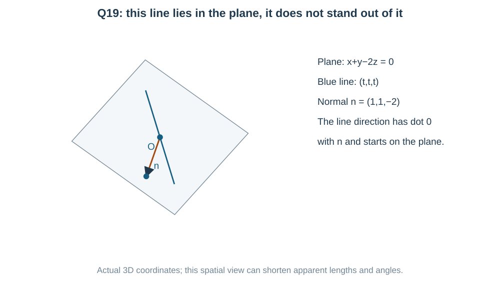

**A point is on the plane** if its coordinates make the expression zero. A **direction lies along the plane** if its dot product with the normal is zero. These are separate tests.

For finite nonzero axis intercepts $p,q,r$,

$$
\boxed{\frac xp+\frac yq+\frac zr=1}.
$$

The intercept points are $(p,0,0),(0,q,0),(0,0,r)$. A missing coordinate term means parallel to that coordinate-axis direction, not a zero intercept.

## Concept C10 — Supporting topic: construct a plane from its directions

**Three noncollinear points:** first make two movements from the same point:

$$
\mathbf u=B-A,\qquad\mathbf v=C-A.
$$

Then $\mathbf n=\mathbf u\times\mathbf v$ stands perpendicular to their sheet:

$$
\boxed{(\mathbf r-A)\cdot[(B-A)\times(C-A)]=0}.
$$

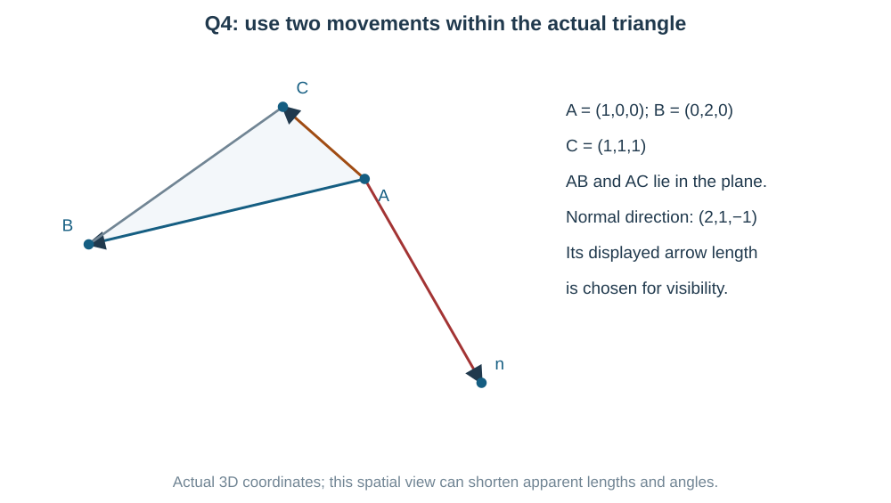

If the cross product is zero, the three points are collinear and do not select one unique plane.

**Through a line and another point:** use the line direction and the movement from its anchor to the point as the two in-plane directions. Check that they are independent.

**Parallel to a known plane:** keep its normal and use the given new point to find the constant.

**Perpendicular to two planes:** the new normal must be perpendicular to both old normals, so it is proportional to $\mathbf n_1\times\mathbf n_2$, when that cross product is nonzero.

**Contains direction $\mathbf d$ and is perpendicular to a plane with normal $\mathbf n_0$:** the new normal is perpendicular to both $\mathbf d$ and $\mathbf n_0$. Use their cross product, then substitute an actual point on the contained line.

If the two required perpendicular directions are parallel, their cross product is zero; the data may allow more than one plane. Do not call a zero vector a valid normal.

**Plane family through a common line:** if $L_1=0,L_2=0$ are two nonparallel intersecting planes, every plane through their intersection line has form

$$
\boxed{\alpha L_1+\beta L_2=0},\qquad(\alpha,\beta)\ne(0,0).
$$

At every common-line point both expressions vanish. A further point fixes the coefficient ratio. Writing $L_1+\lambda L_2=0$ is convenient, but check the member $L_2=0$ separately if it could be required.

## Concept C11 — Supporting topic: angles involving planes

**Two planes:** rotate two flat sheets around their common line. Their normals rotate through the same angle. The smaller plane angle therefore comes from their normal directions:

$$
\boxed{\cos\theta=
\frac{|\mathbf n_1\cdot\mathbf n_2|}
{|\mathbf n_1||\mathbf n_2|}}.
$$

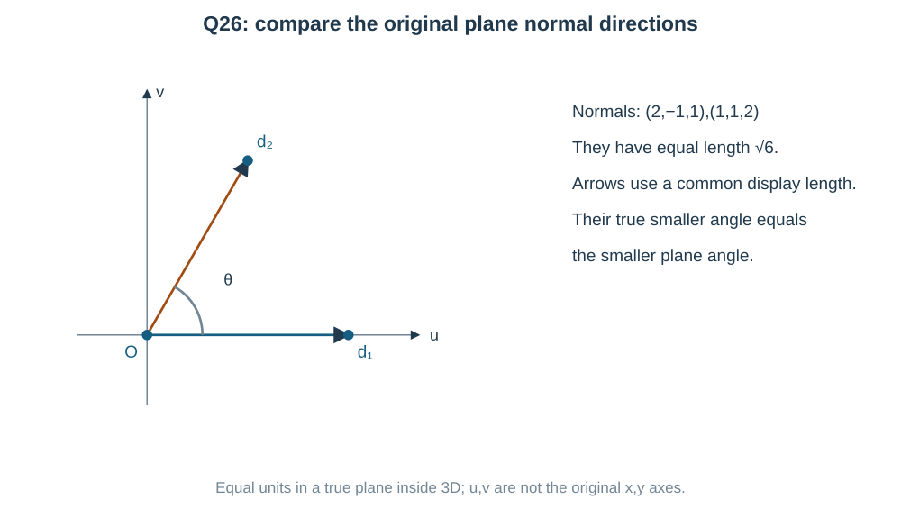

Parallel planes have parallel normals. Perpendicular planes have zero normal dot product.

**A line and a plane:** the plane angle is measured between the line and its projection along the sheet. The normal stands at $90^\circ$ to that sheet. Thus line–plane angle $\theta$ and the corresponding line–normal angle are complementary:

$$
\boxed{\sin\theta=
\frac{|\mathbf d\cdot\mathbf n|}
{|\mathbf d||\mathbf n|}},\qquad0\le\theta\le90^\circ.
$$

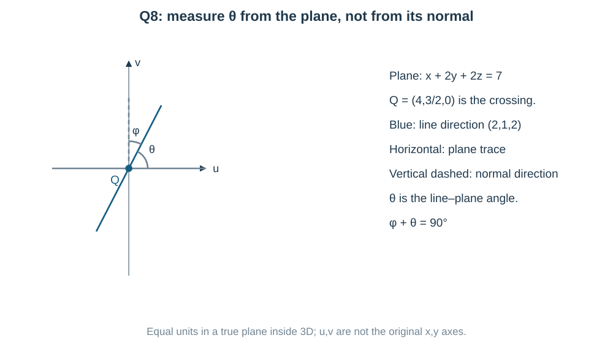

**Three separate cases:**

- $\mathbf d$ parallel to $\mathbf n$: the line is perpendicular to the plane.
- $\mathbf d\cdot\mathbf n=0$: its direction lies along the plane. Check an anchor point next.
- If that anchor is on the plane, the whole line is **contained**. If it is off the plane, line and plane are disjoint and parallel.

**Source wording note:** Q32 uses “parallel” to mean direction-parallel. Its intended value makes the line contained in the plane. Under the stricter meaning “parallel and disjoint,” that wording would have no solution.

## Concept C12 — Supporting topic: point-to-plane distance, foot and plane image

Write $f(P)=ax_0+by_0+cz_0+d$ for $P=(x_0,y_0,z_0)$ and normal $\mathbf n=(a,b,c)$. The raw value changes if the equation is multiplied, so divide by normal length:

$$
\boxed{D=\frac{|f(P)|}{\sqrt{a^2+b^2+c^2}}}.
$$

The perpendicular foot moves only in the normal direction:

$$
\boxed{H=P-\frac{f(P)}{|\mathbf n|^2}\mathbf n}.
$$

Why? Put $H=P-t\mathbf n$ on the plane. Then $f(H)=f(P)-t|\mathbf n|^2=0$, giving the coefficient.

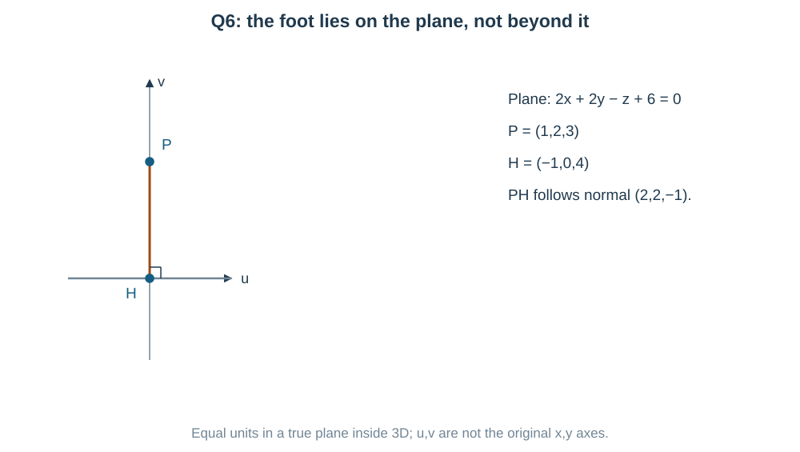

For reflection in the plane, the foot is the midpoint of the object–image segment:

$$
\boxed{P'=2H-P
=P-\frac{2f(P)}{|\mathbf n|^2}\mathbf n}.
$$

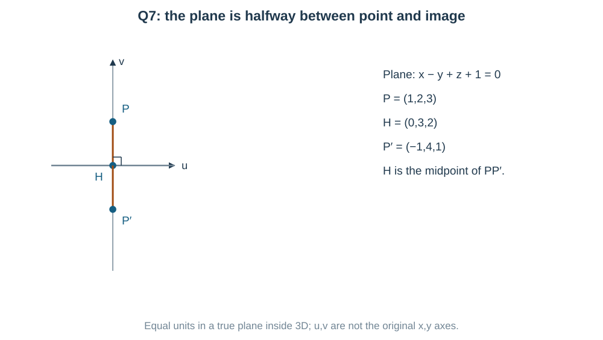

**Parallel planes:** first express them with exactly the same normal coefficients:

$$
\mathbf n\cdot\mathbf r=k_1,\qquad
\mathbf n\cdot\mathbf r=k_2.
$$

Then

$$
\boxed{D=\frac{|k_2-k_1|}{|\mathbf n|}}.
$$

Do not subtract constants before normalizing proportional equations. Equal constants alone do not mean equal planes when their other coefficients differ.

## Concept C13 — Supporting topic: distance in a specified direction

“Measured parallel to $\mathbf d$” asks for the sloping segment from $P$ to the plane in that direction. It need not be the shortest distance.

Put $Q=P+t\mathbf d$ on the plane:

$$
f(P)+t\,\mathbf n\cdot\mathbf d=0.
$$

If $\mathbf n\cdot\mathbf d\ne0$,

$$
\boxed{t=-\frac{f(P)}{\mathbf n\cdot\mathbf d}},
\qquad
\boxed{PQ=|t||\mathbf d|}.
$$

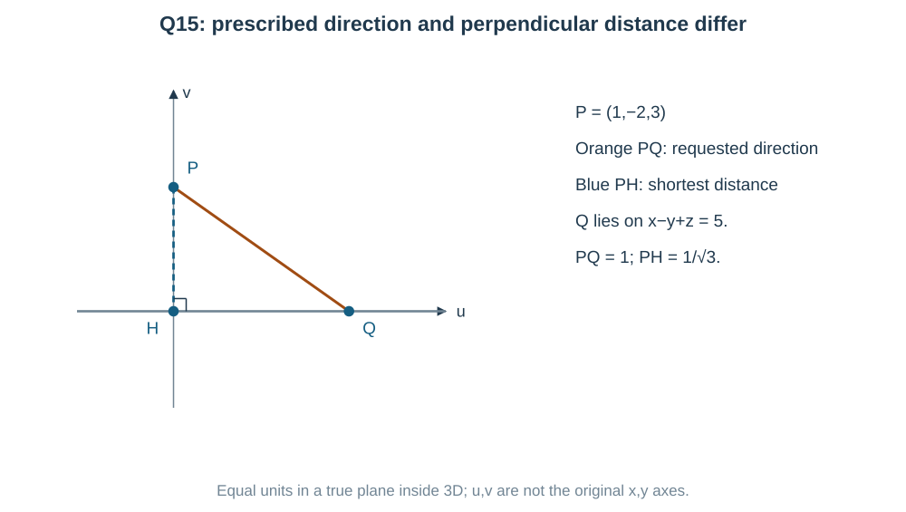

If $\mathbf n\cdot\mathbf d=0$ and $P$ is off the plane, that direction never reaches it. If $P$ is already on the plane, the minimum distance to the plane is zero; along a contained line every point remains on it.

**Important method cue:** the point-to-plane formula answers a shortest-distance question. It cannot automatically replace a requested directional distance.

## Concept C14 — Supporting topic: reflection in a line in space

First find the perpendicular foot $H$ on the line, using C06. Then

$$
\boxed{P'=2H-P}.
$$

Geometrically, this is a half-turn, $180^\circ$, around the line. The along-line component stays the same; every perpendicular component reverses.

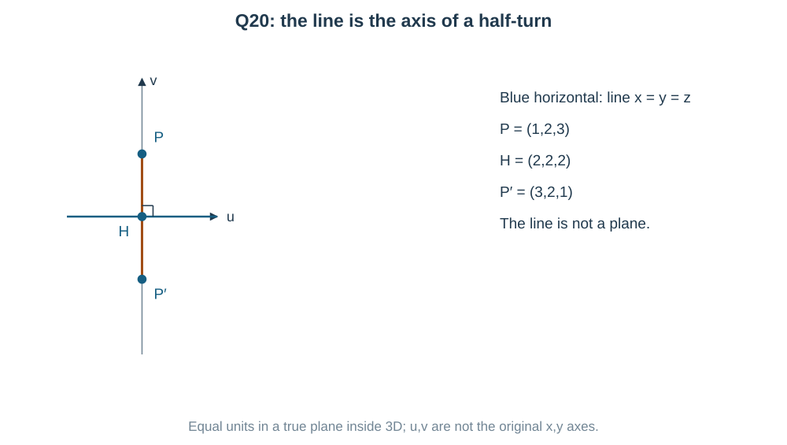

It differs from reflection in a plane. A plane reflection reverses one normal direction; a line half-turn reverses the whole part perpendicular to the axis. The formulas look similar because in both cases $H$ is the midpoint, but **the foot is found on a different object**.

## Concept C15 — Supporting topic: line–plane intersections and division ratios

For line $A+t\mathbf d$ and plane $f=0$, substitution gives

$$
f(A)+t\,\mathbf n\cdot\mathbf d=0.
$$

This is the same equation used for directional distance. Use its parameter to calculate **all three** intersection coordinates.

If $\mathbf n\cdot\mathbf d=0$, either there is no intersection or the entire line is contained; check $f(A)$.

For a segment $P=A+t(B-A)$, the plane expression changes linearly:

$$
f(P)=(1-t)f(A)+tf(B).
$$

Set this to zero. When $f(A)\ne f(B)$,

$$
\boxed{t=\frac{f(A)}{f(A)-f(B)}}.
$$

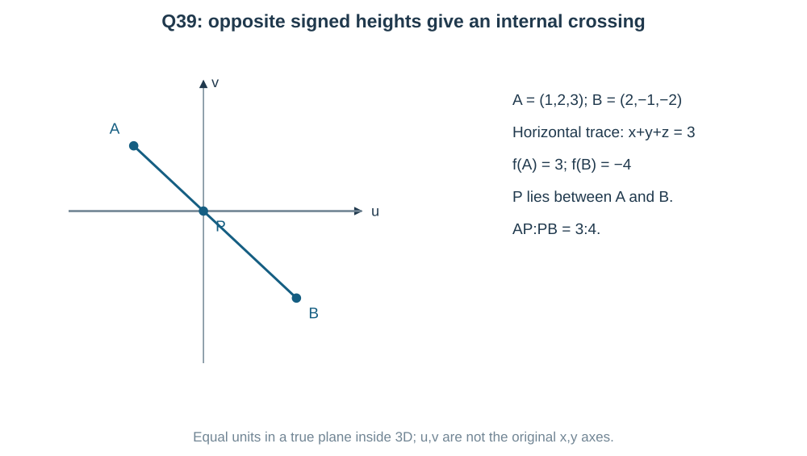

- $0<t<1$: internal division; $AP:PB=t:(1-t)$.
- $t<0$ or $t>1$: intersection on the extended line, giving external division.
- Opposite nonzero signs of $f(A),f(B)$ guarantee an internal crossing.

The ratio can also be written $|f(A)|:|f(B)|$ for an internal crossing. These are proportional signed perpendicular heights, not necessarily the segment lengths themselves.

## Concept C16 — Triangle area and tetrahedron volume

Three points form a triangle. From one shared vertex,

$$
\boxed{\Delta=\frac12|(B-A)\times(C-A)|}.
$$

The cross-product magnitude is the parallelogram area; the triangle is half of it.

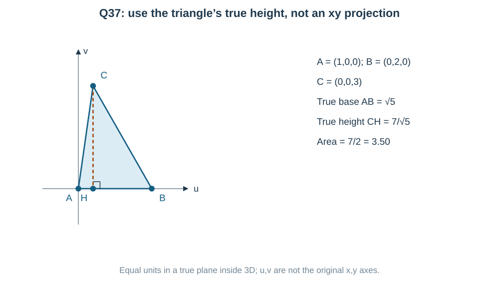

A **tetrahedron** has a triangular base and one vertex off that base plane. Its volume is

$$
V=\frac13(\text{base triangle area})(\text{perpendicular height}).
$$

Combining half of a parallelogram with one third of the height factor gives

$$
\boxed{V=\frac16|(D-A)\cdot[(B-A)\times(C-A)]|}.
$$

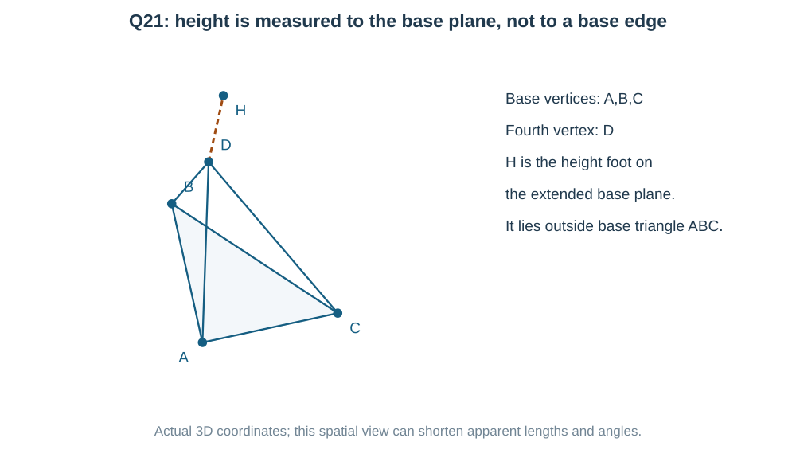

The sign of a triple product records orientation; volume is nonnegative, so take its absolute value. A zero triple product means zero volume and coplanar points. Do not use three position vectors alone unless the common base vertex really is the origin.

**Another triangle route:** choose a base and calculate its perpendicular height in the triangle's own plane. If the triangle is equilateral, use $\sqrt3\,s^2/4$. A triangle's $xy$ shadow generally has a different area.

## Concept C17 — Supporting topic: sphere means a fixed distance from a centre

A sphere is the set of points at one fixed radius $R>0$ from a centre $C=(h,k,l)$:

$$
\boxed{(x-h)^2+(y-k)^2+(z-l)^2=R^2}.
$$

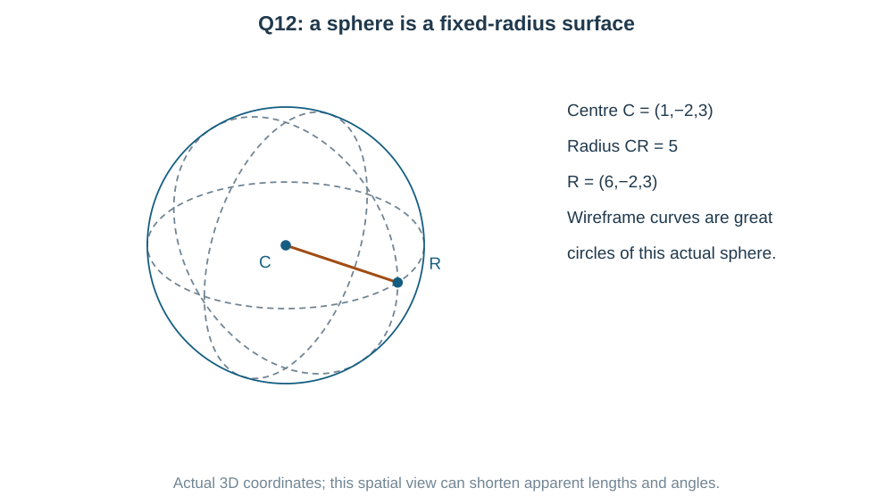

For

$$
x^2+y^2+z^2+2ux+2vy+2wz+d=0,
$$

complete three squares:

$$
\boxed{C=(-u,-v,-w)},\qquad
\boxed{R^2=u^2+v^2+w^2-d}.
$$

Positive $R^2$ gives a real sphere, zero gives one point, negative gives no real point. The radius is $\sqrt{R^2}$, not $R^2$.

At a sphere point $P$, the radius $P-C$ is normal to the tangent plane. This connection follows from the distance definition, but the supplied sphere question only needs centre and radius.

## Last-minute formula recap

All directions and plane normals used below must be nonzero. A dot product gives a number; a cross product gives a vector.

| Need or clue | Formula | Essential condition |
|---|---|---|
| Point-to-point movement | $\overrightarrow{AB}=B-A$ | destination minus start |
| Distance | $AB=|B-A|$ | three-dimensional Pythagoras |
| Internal section $m:n$ | $P=(nA+mB)/(m+n)$ | $m,n>0$ |
| DCs from DRs | $\mathbf d/|\mathbf d|$ | opposite signs together reverse direction |
| Direction-angle identity | $\cos^2\alpha+\cos^2\beta+\cos^2\gamma=1$ | sine-square sum is 2 |
| Vector angle | $\cos\theta=(\mathbf u\cdot\mathbf v)/(|\mathbf u||\mathbf v|)$ | absolute numerator for smaller line angle |
| Perpendicular directions | $\mathbf u\cdot\mathbf v=0$ | both nonzero |
| Parallel directions | $\mathbf u\times\mathbf v=0$ | zero vector cannot define a direction |
| Perpendicular to both | $\mathbf u\times\mathbf v$ | inputs nonparallel for nonzero result |
| Line | $\mathbf r=A+t\mathbf d$ | zero component means fixed coordinate |
| Line foot | $H=A+\{(P-A)\cdot\mathbf d/|\mathbf d|^2\}\mathbf d$ | perpendicular component is $P-H$ |
| Point-to-line distance | $|(P-A)\times\mathbf d|/|\mathbf d|$ | area divided by base |
| Nonparallel coplanarity | $(B-A)\cdot(\mathbf u\times\mathbf v)=0$ | then lines intersect |
| Skew distance | $|(B-A)\cdot(\mathbf u\times\mathbf v)|/|\mathbf u\times\mathbf v|$ | denominator nonzero |
| Common perpendicular | $\mathbf r=P+\lambda(\mathbf u\times\mathbf v)$ | find actual foot $P$ first |
| Parallel-line distance | $|(B-A)\times\mathbf u|/|\mathbf u|$ | do not use zero skew denominator |
| Plane through point | $\mathbf n\cdot(\mathbf r-A)=0$ | supporting plane topic |
| Plane through three points | $(\mathbf r-A)\cdot[(B-A)\times(C-A)]=0$ | three noncollinear points |
| Plane intercepts | $x/p+y/q+z/r=1$ | finite nonzero intercepts |
| Plane family | $\alpha L_1+\beta L_2=0$ | intersecting planes; coefficients not both 0 |
| Plane angle | $\cos\theta=|\mathbf n_1\cdot\mathbf n_2|/(|\mathbf n_1||\mathbf n_2|)$ | normals determine smaller angle |
| Line–plane angle | $\sin\theta=|\mathbf d\cdot\mathbf n|/(|\mathbf d||\mathbf n|)$ | angle measured to plane, not normal |
| Direction along plane | $\mathbf d\cdot\mathbf n=0$ | anchor test separates contained/disjoint |
| Plane distance | $|f(P)|/|\mathbf n|$ | shortest perpendicular distance |
| Plane foot | $H=P-f(P)\mathbf n/|\mathbf n|^2$ | substitute to verify $f(H)=0$ |
| Plane reflection | $P'=2H-P$ | $H$ is foot on plane |
| Parallel-plane distance | $|k_2-k_1|/|\mathbf n|$ | same normal coefficients first |
| Directional plane distance | $|f(P)||\mathbf d|/|\mathbf n\cdot\mathbf d|$ | nonzero denominator |
| Line reflection | $P'=2H-P$ | $H$ is foot on line; axial half-turn |
| Segment-plane parameter | $t=f(A)/(f(A)-f(B))$ | denominator nonzero; check internal/external |
| Triangle area | $\tfrac12|(B-A)\times(C-A)|$ | actual triangle, not its shadow |
| Tetrahedron volume | $\tfrac16|(D-A)\cdot[(B-A)\times(C-A)]|$ | common vertex and absolute value |
| Sphere centre/radius | $(-u,-v,-w)$; $R^2=u^2+v^2+w^2-d$ | equation has linear terms $2ux,2vy,2wz$ |

**Recognition habit:** name the objects first. Point-to-line, point-to-plane, directional distance and skew-line distance are different questions. Choose the formula from the geometry, and check the actual point, foot or intersection in the original equations.

## Worked solutions to the 40 PDF questions

Read the question first. Notice the pattern, choose a route, then calculate. Alternative methods below are fully visible.

### Question 1 — Direction means the movement from the first point to the second

**PDF page 106 | MCQ | Notes: C01,C02**

The direction cosines of the line joining the points $(1,2,3)$ and $(3,-2,7)$ are

- (a) $\dfrac13,\dfrac23,\dfrac23$
- (b) $\dfrac12,-\dfrac12,\dfrac12$
- (c) $\dfrac13,-\dfrac23,\dfrac23$
- (d) $\dfrac23,-\dfrac13,\dfrac23$

**First make the movement from the first point to the second.** Coordinates of a point tell its position; they are not automatically the direction of the joining line.

$$
\overrightarrow{AB}=(3-1,-2-2,7-3)=(2,-4,4).
$$

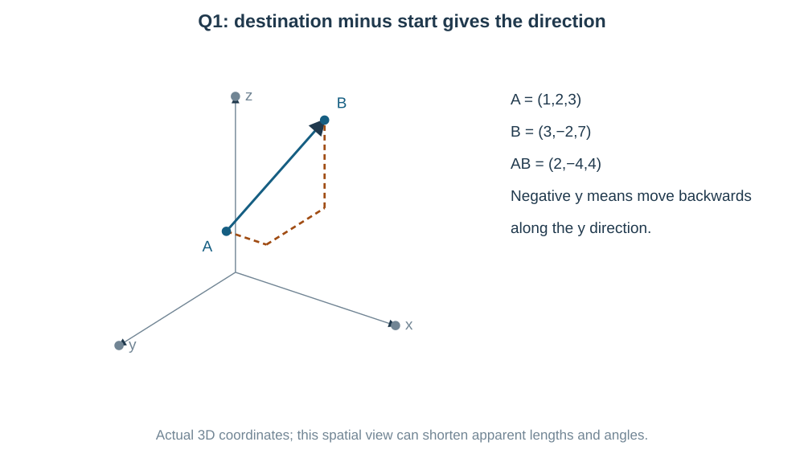

The movement length is

$$
|\overrightarrow{AB}|=\sqrt{4+16+16}=6.
$$

A direction cosine is a component of the **unit** direction arrow. Divide each component by 6:

$$
\boxed{(l,m,n)=\left(\frac13,-\frac23,\frac23\right);
\quad\text{(c)}}.
$$

**Check:** $1/9+4/9+4/9=1$. Going from $B$ to $A$ reverses all three signs and describes the same undirected line. Reversing just the negative sign would change the direction.

---

### Question 2 — An angle compares normalized directions

**PDF page 106 | MCQ | Notes: C03**

The cosine of the angle between lines with direction ratios $(2,3,6)$ and $(1,2,2)$ is

- (a) $\dfrac{20}{21}$
- (b) $\dfrac47$
- (c) $\dfrac{20}{23}$
- (d) $\dfrac23$

**The question asks for an angle between directions. That suggests a dot product.** It returns a number measuring how much the arrows point along each other:

$$
\mathbf u\cdot\mathbf v
=|\mathbf u||\mathbf v|\cos\theta.
$$

Here $\mathbf u=(2,3,6)$ and $\mathbf v=(1,2,2)$. Their lengths are 7 and 3:

$$
\mathbf u\cdot\mathbf v=2+6+12=20.
$$

Thus the smaller line angle satisfies

$$
\boxed{\cos\theta=\frac{|20|}{7\cdot3}=\frac{20}{21};
\quad\text{(a)}}.
$$

**Why not cross product here?** Its magnitude would give $\sin\theta$, followed by an extra step to find the cosine. The dot product gives the requested quantity directly. The result is close to 1, matching the small angle between these directions.

---

### Question 3 — Perpendicular distance uses the plane normal length

**PDF page 106 | MCQ | Notes: C12**

The distance of the point $(1,2,3)$ from the plane $2x-2y+z=5$ is

- (a) $\dfrac23$
- (b) $\dfrac49$
- (c) $\dfrac83$
- (d) $\dfrac43$

**A point-to-plane distance is the shortest segment, standing perpendicular to the sheet.** The coefficients of the plane give its normal, $\mathbf n=(2,-2,1)$.

Write the plane with zero on one side:

$$
f(x,y,z)=2x-2y+z-5.
$$

At $P=(1,2,3)$,

$$
f(P)=2-4+3-5=-4,\qquad
|\mathbf n|=\sqrt{4+4+1}=3.
$$

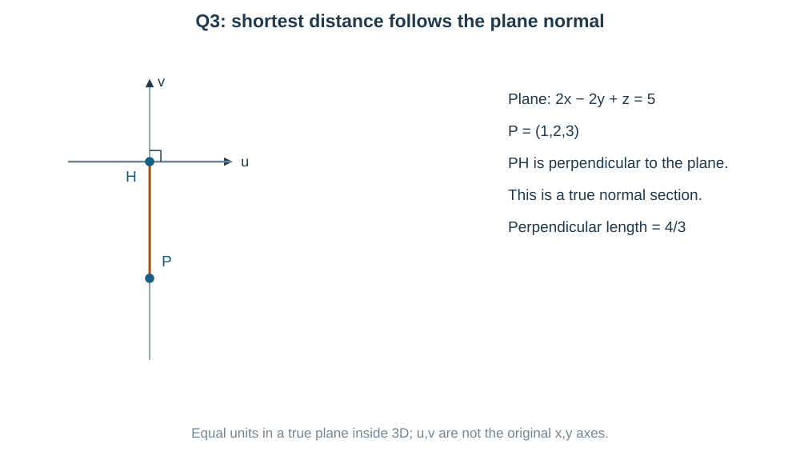

$$
\boxed{D=\frac{|f(P)|}{|\mathbf n|}=\frac43;
\quad\text{(d)}}.
$$

**Why divide by 3?** Multiplying a plane equation by 2 doubles its raw value at $P$, but cannot double a geometric distance. Dividing by normal length removes that scale.

**Geometric check:** the foot is

$$
H=P-\frac{f(P)}{|\mathbf n|^2}\mathbf n
=\left(\frac{17}9,\frac{10}9,\frac{31}9\right).
$$

It satisfies $2x-2y+z=5$, and $PH=4/3$.

---

### Question 4 — Three noncollinear points give two movements within a plane

**PDF page 106 | MCQ | Notes: C04,C09,C10**

The equation of the plane passing through $(1,0,0)$, $(0,2,0)$ and $(1,1,1)$ is

- (a) $x+2y-z=1$
- (b) $2x+y+z=2$
- (c) $2x+y-z=2$
- (d) $x+y-z=1$

**We need a plane through three points. Start with two movements inside that plane.** Choose $A=(1,0,0)$ as their common start:

$$
\overrightarrow{AB}=(-1,2,0),\qquad
\overrightarrow{AC}=(0,1,1).
$$

Their cross product is a vector standing perpendicular to both movements:

$$
\mathbf n=\overrightarrow{AB}\times\overrightarrow{AC}
=(2,1,-1).
$$

A movement from $A$ to any point $(x,y,z)$ of the same sheet must have zero dot product with this normal:

$$
(2,1,-1)\cdot(x-1,y,z)=0.
$$

Therefore

$$
\boxed{2x+y-z=2;\quad\text{(c)}}.
$$

**Why use differences?** The given points need not form a plane through the origin. $B-A$ and $C-A$ are actual sides of their own triangle, so they always lie in the required plane.

**Another possible approach — use the options:** substitute all three points in each proposed plane. Option (c) works for all three. This is quick in an MCQ; the cross-product construction also works when no options are given.

---

### Question 5 — A shortest connector between skew lines is perpendicular to both

**PDF page 106 | MCQ | Notes: C08**

The shortest distance between the lines $\dfrac x1=\dfrac y2=\dfrac z2$ and $\dfrac{x-2}{2}=\dfrac{y-3}{1}=\dfrac{z-7}{-2}$ is

- (a) $\dfrac43$
- (b) $\dfrac73$
- (c) $\dfrac59$
- (d) $\dfrac53$

**The shortest connector must stand perpendicular to both line directions.** A cross product gives that direction. Read

$$
A=(0,0,0),\quad\mathbf u=(1,2,2),\qquad
B=(2,3,7),\quad\mathbf v=(2,1,-2).
$$

Then

$$
\mathbf n=\mathbf u\times\mathbf v=(-6,6,-3),
\qquad|\mathbf n|=9.
$$

The arbitrary anchor-to-anchor movement is $B-A=(2,3,7)$. Its **component along the common normal** gives the separation:

$$
d=\frac{|(B-A)\cdot\mathbf n|}{|\mathbf n|}
=\frac{|-12+18-21|}{9}.
$$

$$
\boxed{d=\frac53;\quad\text{(d)}}.
$$

**Read the spatial picture carefully:** on paper the lines may look as if they cross. Those are their flat pictures. The actual lines are at different heights there and never meet. The true sections below show the real perpendicular separation.

**Why not use $AB$?** Those two anchor points were given only to locate the lines. They need not be the closest pair. Taking the normal projection removes their along-line offsets.

**Another possible approach — find the actual feet.** Write

$$
P=s(1,2,2),\qquad Q=(2,3,7)+t(2,1,-2).
$$

Impose $\overrightarrow{PQ}\cdot\mathbf u=0$ and $\overrightarrow{PQ}\cdot\mathbf v=0$:

$$
22-9s=0,\qquad-7+9t=0.
$$

So

$$
P=\frac19(22,44,44),\qquad
Q=\frac19(32,34,49).
$$

Their difference $(10,-10,5)/9$ has length $5/3$. This method is longer for distance alone, but also gives the common-perpendicular equation:

$$
\boxed{\mathbf r=\frac19(22,44,44)+\lambda(2,-2,1)}.
$$

It reaches $Q$ at $\lambda=5/9$. This also practises the official core topic “shortest distance and its equation.”

---

### Question 6 — The perpendicular foot moves along the plane normal

**PDF page 106 | MCQ | Notes: C12**

The foot of the perpendicular from the point $(1,2,3)$ to the plane $2x+2y-z+6=0$ is

- (a) $(3,4,2)$
- (b) $(-1,0,4)$
- (c) $(0,1,3)$
- (d) $(-1,0,-4)$

**A foot is a point, not just a distance.** Move from $P=(1,2,3)$ along the normal $\mathbf n=(2,2,-1)$ until reaching the plane.

$$
f(P)=2+4-3+6=9,\qquad|\mathbf n|^2=9.
$$

Therefore

$$
H=P-\frac{f(P)}{|\mathbf n|^2}\mathbf n
=(1,2,3)-(2,2,-1).
$$

$$
\boxed{H=(-1,0,4);\quad\text{(b)}}.
$$

**Check both requirements:** $2(-1)+2(0)-4+6=0$, so $H$ is on the plane. Also $\overrightarrow{PH}=(-2,-2,1)=-\mathbf n$, so the joining segment is perpendicular to the plane.

**Another possible approach:** put $H=P+t\mathbf n=(1+2t,2+2t,3-t)$ in the plane. It gives $9+9t=0$, hence $t=-1$ and the same foot. This is the reasoning behind the compact foot formula.

---

### Question 7 — A plane reflection puts the foot halfway between object and image

**PDF page 106 | MCQ | Notes: C12**

The image of the point $(1,2,3)$ in the plane $x-y+z+1=0$ is

- (a) $(-1,4,1)$
- (b) $(0,3,2)$
- (c) $(1,-2,3)$
- (d) $(-1,4,5)$

**Picture the point and its image on opposite sides of the plane.** The perpendicular foot $H$ is halfway between them.

For $\mathbf n=(1,-1,1)$,

$$
f(P)=1-2+3+1=3,\qquad|\mathbf n|^2=3.
$$

The foot is

$$
H=(1,2,3)-(1,-1,1)=(0,3,2).
$$

Since $H=(P+P')/2$,

$$
P'=2H-P=(0,6,4)-(1,2,3).
$$

$$
\boxed{P'=(-1,4,1);\quad\text{(a)}}.
$$

**Pattern to remember:** foot first, then **twice the foot minus the original point**. In one step,

$$
P'=P-\frac{2f(P)}{|\mathbf n|^2}\mathbf n.
$$

**Check:** $f(P')=-3$, the opposite sign with the same magnitude. The midpoint is $H$, which satisfies the plane equation.

---

### Question 8 — The angle with a plane is complementary to the angle with its normal

**PDF page 106 | MCQ | Notes: C11**

If $\theta$ is the angle between the line $\dfrac{x-1}{2}=\dfrac y1=\dfrac{z+3}{2}$ and the plane $x+2y+2z=7$, then $\sin\theta=$

- (a) $\dfrac19$
- (b) $\dfrac49$
- (c) $\dfrac{2\sqrt2}3$
- (d) $\dfrac89$

**Notice the angle is with the plane, not with its normal.** The line direction is $\mathbf d=(2,1,2)$; the plane normal is $\mathbf n=(1,2,2)$.

The dot-product formula directly gives the cosine of the line–normal angle $\phi$:

$$
\cos\phi=\frac{|\mathbf d\cdot\mathbf n|}
{|\mathbf d||\mathbf n|}
=\frac{|2+2+4|}{3\cdot3}=\frac89.
$$

The sheet and its normal are perpendicular. Hence

$$
\theta+\phi=90^\circ,\qquad
\sin\theta=\cos\phi.
$$

$$
\boxed{\sin\theta=\frac89;\quad\text{(d)}}.
$$

**Why the usual cosine substitution would go wrong:** it would call $8/9$ the cosine of the *plane* angle, while it belongs to the complementary normal angle. Decide which angle the question names before using the dot product.

**Another view — projection lengths:** a direction segment of length 3 has normal-component length $|\mathbf d\cdot\mathbf n|/|\mathbf n|=8/3$. In the section's right triangle, opposite side divided by hypotenuse gives $\sin\theta=(8/3)/3$.

---

### Question 9 — A plane family keeps the common intersection line

**PDF page 107 | MCQ | Notes: C10**

The plane through the line of intersection of $x+y+z=1$ and $2x-y+3z=4$ and passing through $(1,2,0)$ is

- (a) $4x+y+5z=6$
- (b) $x+2y-z=5$
- (c) $3x+5z=4$
- (d) $4x-y+5z=2$

**Notice “through the line of intersection.”** At each point of that line, both expressions below are zero:

$$
L_1=x+y+z-1,\qquad L_2=2x-y+3z-4.
$$

So $L_1+\lambda L_2=0$ also passes through the same whole line. Now use the extra point $(1,2,0)$:

$$
2+\lambda(-4)=0
\quad\Longrightarrow\quad\lambda=\frac12.
$$

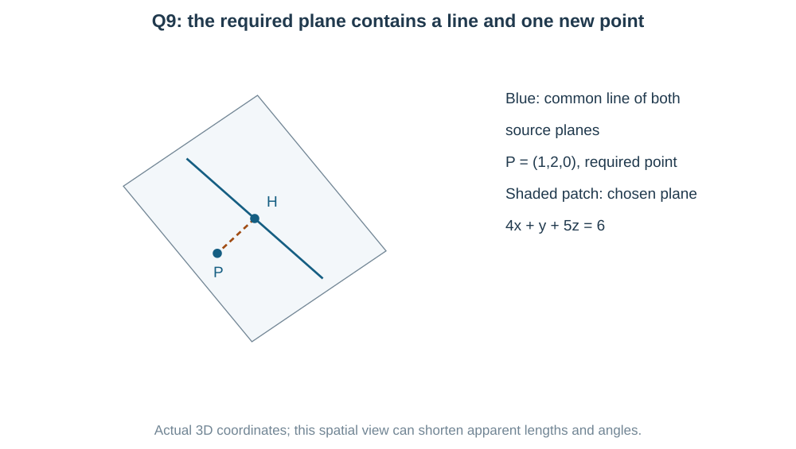

Multiply by 2 and combine:

$$
2(x+y+z-1)+(2x-y+3z-4)=0.
$$

$$
\boxed{4x+y+5z=6;\quad\text{(a)}}.
$$

**Check:** $(1,2,0)$ gives $4+2=6$. Every common-line point works because the answer is $2L_1+L_2=0$.

**Another possible approach — construct from two directions:** a common-line point is $H=(1,-1/2,1/2)$ and its direction is $\mathbf d=(4,-1,-3)$. The movement to the extra point is $P-H=(0,5/2,-1/2)$. Their cross product is $(8,2,10)$, proportional to $(4,1,5)$, the same plane normal. The family method is shorter because it keeps the common line automatically.

---

### Question 10 — Coplanarity needs the offset as well as the directions

**PDF page 107 | Numerical value | Notes: C07**

The lines $\dfrac{x-1}{2}=\dfrac{y-2}{3}=\dfrac{z-3}{4}$ and $\dfrac{x-2}{1}=\dfrac{y-3}{k}=\dfrac{z-4}{3}$ are coplanar. Then $k=$ ____.

**Coplanar means the two lines fit in one flat sheet.** Two direction vectors alone are not enough to check this: the offset between the lines matters too.

Take

$$
A=(1,2,3),\ B=(2,3,4),\quad
\mathbf u=(2,3,4),\ \mathbf v=(1,k,3).
$$

The offset is $B-A=(1,1,1)$. Compute

$$
\mathbf u\times\mathbf v=(9-4k,-2,2k-3).
$$

Zero height above the directions' sheet means

$$
(B-A)\cdot(\mathbf u\times\mathbf v)
=9-4k-2+2k-3=4-2k=0.
$$

$$
\boxed{k=2}.
$$

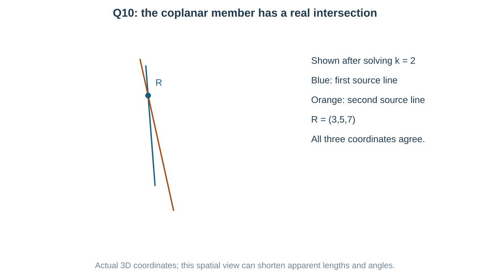

**Another possible approach — use intersection coordinates.** These directions are never parallel because the first and third component ratios, $2/1$ and $4/3$, differ. Coplanarity therefore requires an intersection.

Write points as $(1+2s,2+3s,3+4s)$ and $(2+t,3+kt,4+3t)$. Equality of $x,z$ gives

$$
2s-t=1,\qquad4s-3t=1
\quad\Longrightarrow\quad s=t=1.
$$

Then equality of $y$ gives $5=3+k$, so $k=2$. Both lines meet at $(3,5,7)$. The intersection approach is particularly quick with these numbers.

---

### Question 11 — The three direction-cosine squares add to one

**PDF page 107 | MCQ | Notes: C02**

A line makes angles $45^\circ$ with the $x$-axis and $60^\circ$ with the $y$-axis. If it makes an acute angle $\gamma$ with the $z$-axis, then $\gamma=$

- (a) $30^\circ$
- (b) $45^\circ$
- (c) $60^\circ$
- (d) $90^\circ$

**Three perpendicular axis projections of a unit arrow have squared lengths adding to 1.** Use

$$
\cos^2 45^\circ+\cos^2 60^\circ+\cos^2\gamma=1.
$$

Hence

$$
\frac12+\frac14+\cos^2\gamma=1
\quad\Longrightarrow\quad\cos^2\gamma=\frac14.
$$

The equation gives $\cos\gamma=\pm1/2$. The question says **acute**, so choose the positive value:

$$
\boxed{\gamma=60^\circ;\quad\text{(c)}}.
$$

**Why not add the angles to $90^\circ$?** In 3D these are angles with three different axes, not two angles in one right triangle. It is their cosine **squares** that obey the Pythagoras relation.

---

### Question 12 — Complete three squares to read a sphere

**PDF page 107 | Numerical value | Notes: C17**

The radius of the sphere $x^2+y^2+z^2-2x+4y-6z-11=0$ is ____.

**Did you notice one square and one linear term for each coordinate?** That pattern suggests completing three squares:

$$
(x^2-2x)+(y^2+4y)+(z^2-6z)=11.
$$

Use

$$
x^2-2x=(x-1)^2-1,\quad
y^2+4y=(y+2)^2-4,\quad
z^2-6z=(z-3)^2-9.
$$

Therefore

$$
(x-1)^2+(y+2)^2+(z-3)^2=11+1+4+9=25.
$$

This is the squared distance from $C=(1,-2,3)$:

$$
\boxed{r=\sqrt{25}=5}.
$$

**Check:** $(6,-2,3)$ is 5 units from the centre and satisfies the original equation. The number 25 is the radius **squared**.

**Another quick approach:** in $x^2+y^2+z^2+2ux+2vy+2wz+d=0$, use $r^2=u^2+v^2+w^2-d$. Here $(u,v,w,d)=(-1,2,-3,-11)$, so $r^2=25$. Completing squares explains that shortcut.

---

### Question 13 — Parallel planes have a common normal direction

**PDF page 107 | Numerical value | Notes: C12**

The distance between the parallel planes $2x+2y-z=3$ and $2x+2y-z=9$ is ____.

**Both planes already have exactly the same left side.** Their common normal is $\mathbf n=(2,2,-1)$, of length 3.

Changing the right side from 3 to 9 changes the normal-coordinate value by 6. Divide by the normal length:

$$
\boxed{D=\frac{|9-3|}{\sqrt{4+4+1}}=\frac63=2}.
$$

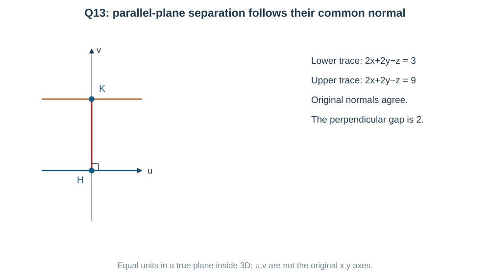

**Another possible approach — choose a point:** $H=(1,1,1)$ lies on the first plane. Its distance from the second is

$$
\frac{|2+2-1-9|}{3}=2.
$$

**Important condition:** if one plane equation had been multiplied by a different factor, first make the normal coefficients equal. Subtracting unmatched constants would not measure the gap.

---

### Question 14 — Intercept form turns the three axis cuts into one plane

**PDF page 107 | MCQ | Notes: C09,C12**

The perpendicular distance of the origin from the plane making intercepts $1,2,3$ on the coordinate axes is

- (a) $\dfrac76$
- (b) $\dfrac67$
- (c) $\dfrac6{11}$
- (d) $\dfrac1{\sqrt{14}}$

**Axis intercepts tell where the plane cuts each axis.** The three points are $(1,0,0),(0,2,0),(0,0,3)$:

$$
\frac x1+\frac y2+\frac z3=1
\quad\Longrightarrow\quad6x+3y+2z=6.
$$

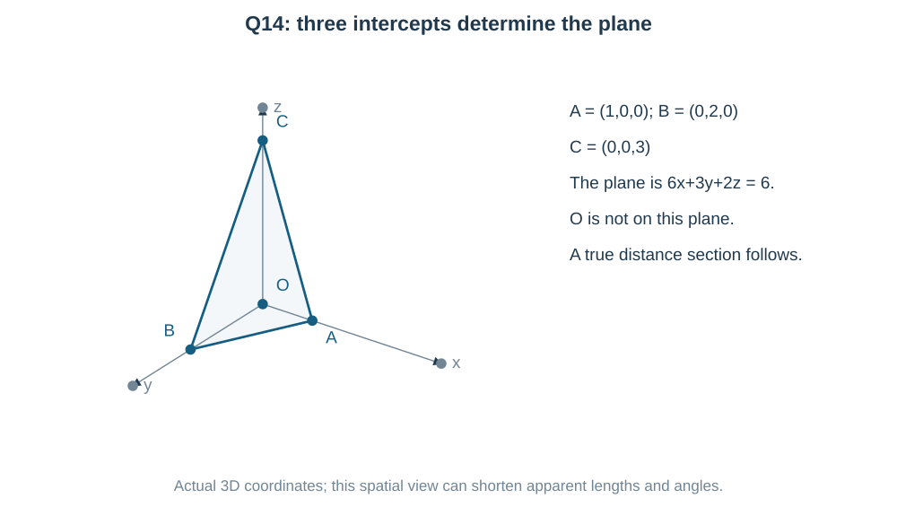

The normal is $(6,3,2)$, with length 7. From the origin,

$$
\boxed{D=\frac{|0-6|}{7}=\frac67;\quad\text{(b)}}.
$$

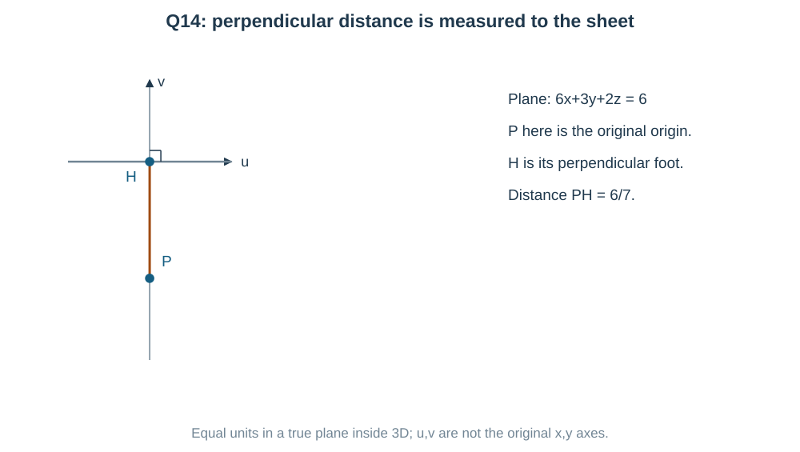

**Why not choose the smallest intercept, 1?** That is a distance along the $x$-axis. The shortest segment goes along the plane normal and can be shorter.

**Another possible approach:** keep intercept form. Its normal is $(1,1/2,1/3)$, so

$$
D=\frac1{\sqrt{1+1/4+1/9}}=\frac67.
$$

Both equations represent the same sheet; the distance is unchanged by scaling.

---

### Question 15 — Distance in a specified direction is not shortest distance

**PDF page 107 | Numerical value | Notes: C13**

The distance of the point $(1,-2,3)$ from the plane $x-y+z=5$, measured parallel to the line $\dfrac x2=\dfrac y3=\dfrac z{-6}$, is ____.

**Pause at “measured parallel to the line.”** We must travel in direction $\mathbf d=(2,3,-6)$ until reaching the plane. The ordinary perpendicular-distance formula measures a different segment.

Starting at $P=(1,-2,3)$, write

$$
Q=P+t\mathbf d=(1+2t,-2+3t,3-6t).
$$

Put this moving point on $x-y+z=5$:

$$
(1+2t)-(-2+3t)+(3-6t)=5
\quad\Longrightarrow\quad6-7t=5.
$$

So $t=1/7$, giving

$$
Q=\left(\frac97,-\frac{11}7,\frac{15}7\right).
$$

**The parameter is not itself a length.** A full step $\mathbf d$ has length

$$
|\mathbf d|=\sqrt{4+9+36}=7.
$$

Thus

$$
\boxed{PQ=|t||\mathbf d|=\frac17(7)=1}.
$$

**Compare the other distance:** the shortest perpendicular distance is

$$
PH=\frac{|1-(-2)+3-5|}{\sqrt3}=\frac1{\sqrt3}.
$$

It is smaller than 1, as the picture suggests. It would answer a different question.

**Reusable shortcut from this reasoning:**

$$
D_{\text{along }\mathbf d}
=\frac{|f(P)|\,|\mathbf d|}{|\mathbf n\cdot\mathbf d|}
=\frac{1\cdot7}{7}=1.
$$

This requires $\mathbf n\cdot\mathbf d\ne0$ so the chosen travel direction actually reaches the plane.

---

### Question 16 — A cross product gives a direction perpendicular to both given directions

**PDF page 107 | MCQ | Notes: C04**

The line through $(1,2,3)$ perpendicular to both lines with direction ratios $(1,2,3)$ and $(3,2,1)$ is

- (a) $\dfrac{x-1}{1}=\dfrac{y-2}{-2}=\dfrac{z-3}{1}$
- (b) $\dfrac{x-1}{1}=\dfrac{y-2}{2}=\dfrac{z-3}{1}$
- (c) $\dfrac{x-1}{1}=\dfrac{y-2}{1}=\dfrac{z-3}{-2}$
- (d) $\dfrac{x-1}{2}=\dfrac{y-2}{-1}=\dfrac{z-3}{1}$

**We want one direction perpendicular to two given directions.** That is exactly what a cross product produces:

$$
(1,2,3)\times(3,2,1)=(-4,8,-4)
=-4(1,-2,1).
$$

Use the simpler proportional direction $(1,-2,1)$. Through $P=(1,2,3)$,

$$
\boxed{\frac{x-1}{1}=\frac{y-2}{-2}=\frac{z-3}{1};
\quad\text{(a)}}.
$$

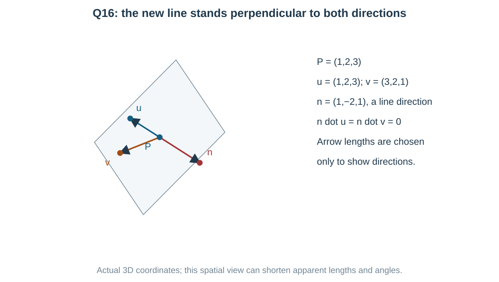

**Check before accepting the cross-product signs:**

$$
(1,-2,1)\cdot(1,2,3)=1-4+3=0,
$$

$$
(1,-2,1)\cdot(3,2,1)=3-4+1=0.
$$

**Another possible approach:** let the unknown direction be $(l,m,n)$. Perpendicularity gives

$$
l+2m+3n=0,\qquad3l+2m+n=0.
$$

Subtract to get $l=n$, then $m=-2n$. Choose $n=1$. This explains the result without needing a cross-product calculation.

---

### Question 17 — An actual intersection makes the shortest distance zero

**PDF page 107 | MCQ | Notes: C07,C08**

Statement I: The lines $\dfrac{x-1}{2}=\dfrac{y-2}{3}=\dfrac{z-3}{4}$ and $\dfrac{x-2}{3}=\dfrac{y-3}{4}=\dfrac{z-4}{5}$ intersect.

Statement II: The shortest distance between these two lines is $\dfrac1{\sqrt6}$.

Choose the correct option.

- (a) Both Statement I and Statement II are true
- (b) Statement I is false but Statement II is true
- (c) Both Statement I and Statement II are false
- (d) Statement I is true but Statement II is false

**Check intersection before calculating a nonzero shortest distance.** If two lines meet, their closest separation is already zero.

Use different parameters:

$$
L_1:(1+2s,2+3s,3+4s),\qquad
L_2:(2+3t,3+4t,4+5t).
$$

Their first two coordinates give

$$
2s-3t=1,\qquad3s-4t=1.
$$

Elimination gives $s=t=-1$. Check the third coordinate:

$$
3+4(-1)=-1=4+5(-1).
$$

So the lines meet at $(-1,-1,-1)$. Statement I is true. Their shortest distance is $0$, so Statement II is false:

$$
\boxed{\text{Statement I true, Statement II false; (d)}}.
$$

**Another check:** with $\mathbf u=(2,3,4)$, $\mathbf v=(3,4,5)$, their cross product is $(-1,2,-1)$. The offset $(1,1,1)$ has zero dot product with it, confirming zero shortest distance. The parameter method also tells us *where* they meet.

---

### Question 18 — Match each wording to its own kind of projection or distance

**PDF page 108 | MCQ | Notes: C01,C03,C11,C12**

Match List I with List II.

| List I | Quantity | List II | Value |
|---|---|---|---|
| A | Distance of $(2,3,6)$ from the origin | P | $1$ |
| B | Distance of $(1,1,1)$ from $2x+3y+6z=18$ | Q | $7$ |
| C | Length of the projection of the segment joining $(1,2,3)$ and $(3,-2,7)$ on the $z$-axis | R | $4$ |
| D | Cosine of the angle between planes $x+y+z=1$ and $x-y+z=3$ | S | $\dfrac13$ |

- (a) A–Q, B–P, C–S, D–R
- (b) A–P, B–Q, C–R, D–S
- (c) A–Q, B–P, C–R, D–S
- (d) A–R, B–P, C–Q, D–S

**These four wordings name four different geometric objects.** Do not use one distance formula for all four.

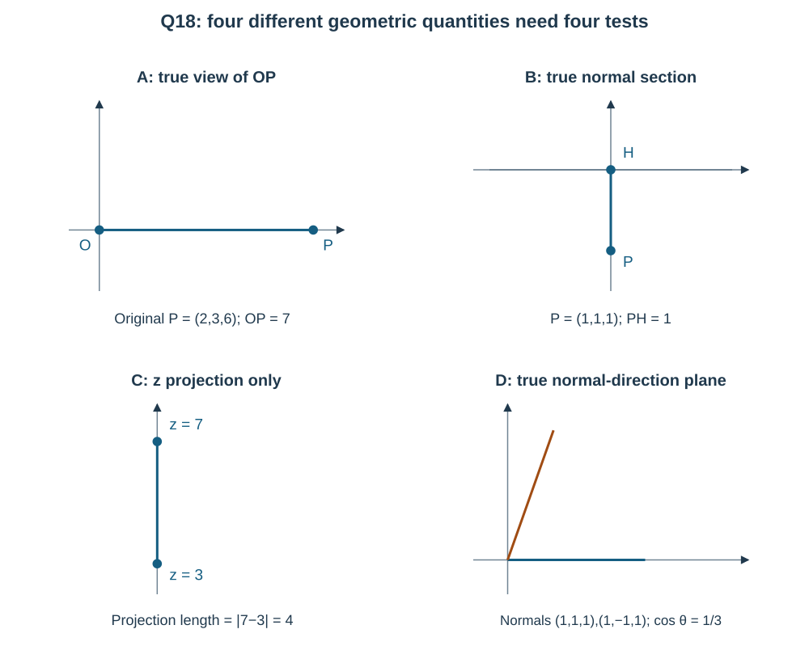

**A — point to origin:** all three coordinate movements contribute:

$$
OA=\sqrt{2^2+3^2+6^2}=\sqrt{49}=7.
$$

Thus A matches Q.

**B — point to plane:** normal length $\sqrt{2^2+3^2+6^2}=7$:

$$
D=\frac{|2+3+6-18|}{7}=\frac77=1.
$$

Thus B matches P.

**C — projection on the $z$-axis:** only the change in $z$ remains when we look at that axis:

$$
\text{projection length}=|7-3|=4.
$$

Thus C matches R. The whole segment length is 6, but its $z$ projection is only 4.

**D — angle between planes:** compare normals $(1,1,1)$ and $(1,-1,1)$:

$$
\cos\theta=\frac{|1-1+1|}{\sqrt3\sqrt3}=\frac13.
$$

Thus D matches S:

$$
\boxed{\text{A–Q, B–P, C–R, D–S; (c)}}.
$$

**Exam habit:** first underline “origin,” “plane,” “projection on an axis,” or “angle.” That noun tells you which object to build.

---

### Question 19 — A line in a plane is different from a line perpendicular to it

**PDF page 108 | MCQ | Notes: C02,C09,C11**

Consider the following statements.

(a) The direction cosines of the $x$-axis are $(1,0,0)$.

(b) A line with direction ratios $(1,2,3)$ has direction cosines $\left(\dfrac1{\sqrt{14}},\dfrac2{\sqrt{14}},\dfrac3{\sqrt{14}}\right)$ (or their negatives).

(c) The planes $2x+y-z=4$ and $x-y+z=0$ are perpendicular.

(d) The line $x=y=z$ is perpendicular to the plane $x+y-2z=0$.

Choose the correct statements.

- (a) (a), (b), (c) and (d)
- (b) (a), (b) and (d) only
- (c) (b), (c) and (d) only
- (d) (a), (b) and (c) only

**Test the statements one by one; distinguish a plane's normal from a direction lying in the plane.**

**(a)** The positive $x$-axis has unit direction $(1,0,0)$. This is the conventional orientation used in the statement. True.

**(b)** The length of $(1,2,3)$ is $\sqrt{14}$. Dividing by it gives the listed direction cosines; reversing all signs gives the same undirected line. True.

**(c)** The plane normals are $\mathbf n_1=(2,1,-1)$ and $\mathbf n_2=(1,-1,1)$:

$$
\mathbf n_1\cdot\mathbf n_2=2-1-1=0.
$$

The normals, and hence the planes, are perpendicular. True.

**(d)** The line $x=y=z$ has direction $\mathbf d=(1,1,1)$. The plane normal is $\mathbf n=(1,1,-2)$:

$$
\mathbf d\cdot\mathbf n=1+1-2=0.
$$

This says the line direction is **perpendicular to the normal**, so it runs **along the sheet**. It does not stand out of the sheet.

Indeed every line point $(t,t,t)$ satisfies $t+t-2t=0$: the whole line lies in the plane. Statement (d) is false.

$$
\boxed{\text{(a), (b), (c) only; (d)}}.
$$

**Another quick test for (d):** a line perpendicular to a plane must have direction proportional to its normal. $(1,1,1)$ is not proportional to $(1,1,-2)$.

---

### Question 20 — Reflection in a line reverses the perpendicular part

**PDF page 108 | MCQ | Notes: C14**

The image of the point $(1,2,3)$ in the line $\dfrac x1=\dfrac y1=\dfrac z1$ is

- (a) $(2,2,2)$
- (b) $(3,2,1)$
- (c) $(1,2,3)$
- (d) $(-1,2,5)$

**First understand “image in a line” in 3D.** Here it means a $180^\circ$ turn about the line as an axis. The along-line part stays fixed, and the perpendicular part reverses.

The axis has points $H=(t,t,t)$. Its direction is $\mathbf d=(1,1,1)$. To find the perpendicular foot from $P=(1,2,3)$, require

$$
(P-H)\cdot\mathbf d=(1-t)+(2-t)+(3-t)=0.
$$

So $t=2$ and $H=(2,2,2)$.

The image is the same distance beyond $H$:

$$
P'=2H-P=(4,4,4)-(1,2,3).
$$

$$
\boxed{P'=(3,2,1);\quad\text{(b)}}.
$$

**Check:** $H$ is the midpoint of $P,P'$, and $\overrightarrow{HP}=(-1,0,1)$ has zero dot product with $(1,1,1)$. So it is the perpendicular part that reversed.

**Another quick approach:** the projection coefficient is $(P\cdot\mathbf d)/|\mathbf d|^2=6/3=2$. This gives the same $H$ immediately. Do not treat the line itself as a plane mirror; the motion here is the axial half-turn just described.

---

### Question 21 — Tetrahedron volume uses movements from one shared vertex

**PDF page 108 | Numerical value | Notes: C04,C16**

The volume of the tetrahedron with vertices $(1,1,1)$, $(2,3,4)$, $(3,1,2)$ and $(4,5,6)$ is ____ cubic units.

**A tetrahedron is a pyramid with a triangular base.** Its volume is one third of base area times perpendicular height. We can obtain both from movements starting at one vertex.

Choose $A=(1,1,1)$:

$$
\overrightarrow{AB}=(1,2,3),\quad
\overrightarrow{AC}=(2,0,1),\quad
\overrightarrow{AD}=(3,4,5).
$$

The base normal is

$$
\mathbf n=\overrightarrow{AB}\times\overrightarrow{AC}
=(2,5,-4).
$$

Its length is the base **parallelogram** area. The scalar triple product is the corresponding sloping box volume:

$$
\overrightarrow{AD}\cdot\mathbf n
=6+20-20=6.
$$

A tetrahedron has one sixth of that box's volume:

$$
\boxed{V=\frac16|6|=1\text{ cubic unit}}.
$$

**Why the factor $1/6$?** The triangle base has half the parallelogram area, and the pyramid has one third of the prism volume. Thus $(1/2)(1/3)=1/6$.

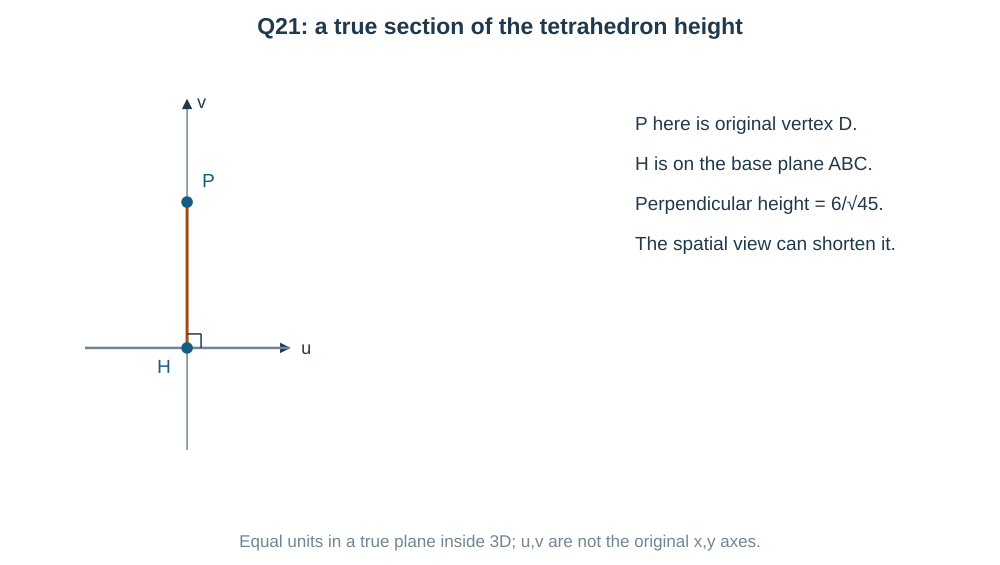

**Another possible approach — keep area and height separate:**

$$
\Delta_{ABC}=\frac{\sqrt{45}}2,\qquad
h=\frac{|\overrightarrow{AD}\cdot\mathbf n|}{|\mathbf n|}
=\frac6{\sqrt{45}}.
$$

$$
V=\frac13\Delta_{ABC}h
=\frac13\cdot\frac{\sqrt{45}}2\cdot\frac6{\sqrt{45}}=1.
$$

The perpendicular foot need not lie inside the base triangle. Distance to its **plane** still gives the pyramid height.

**Avoid this trap:** taking a triple product of the three position vectors $B,C,D$ would build from the origin. The actual shared vertex here is $A$, so subtract $A$ first.

---

### Question 22 — A parallel plane keeps the normal but changes the constant

**PDF page 108 | MCQ | Notes: C09,C10**

The plane through $(1,2,3)$ parallel to the plane $2x-3y+z=7$ is

- (a) $2x-3y+z-1=0$
- (b) $2x-3y+z=7$
- (c) $x-2y+3z=6$
- (d) $2x-3y+z+1=0$

**Parallel planes keep the same normal direction.** Start with the required form

$$
2x-3y+z=k.
$$

Use the new point $(1,2,3)$:

$$
k=2(1)-3(2)+3=-1.
$$

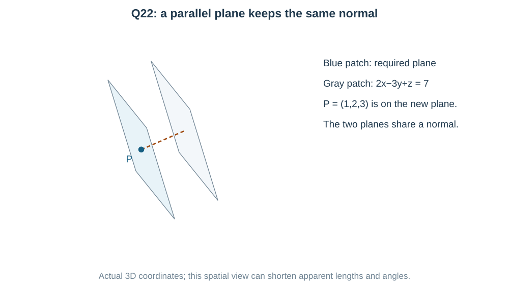

Therefore

$$
\boxed{2x-3y+z+1=0;\quad\text{(d)}}.
$$

**Check the sign:** $2-6+3+1=0$. Option (a), with $-1$ on the left, gives $-2$ at the point and fails.

**Another possible approach:** use point–normal form directly:

$$
2(x-1)-3(y-2)+(z-3)=0.
$$

It expands to the same answer. The normal gives orientation; the new point fixes position.

---

### Question 23 — Parallel to the z-axis means the plane contains a vertical direction

**PDF page 108 | MCQ | Notes: C09,C10**

The plane passing through $(1,0,0)$ and $(0,1,0)$ and parallel to the $z$-axis is

- (a) $x+y+z=1$
- (b) $x-y=1$
- (c) $x+y=1$
- (d) $z=1$

**Visualize lifting the segment joining $(1,0,0)$ and $(0,1,0)$ vertically.** The resulting sheet runs parallel to the $z$-axis. Changing $z$ alone keeps a point in it.

So the plane equation has no $z$ term:

$$
ax+by=d.
$$

At $(1,0,0)$ we get $a=d$; at $(0,1,0)$ we get $b=d$. A nonzero plane normal requires this common value to be nonzero. Divide by it:

$$
\boxed{x+y=1;\quad\text{(c)}}.
$$

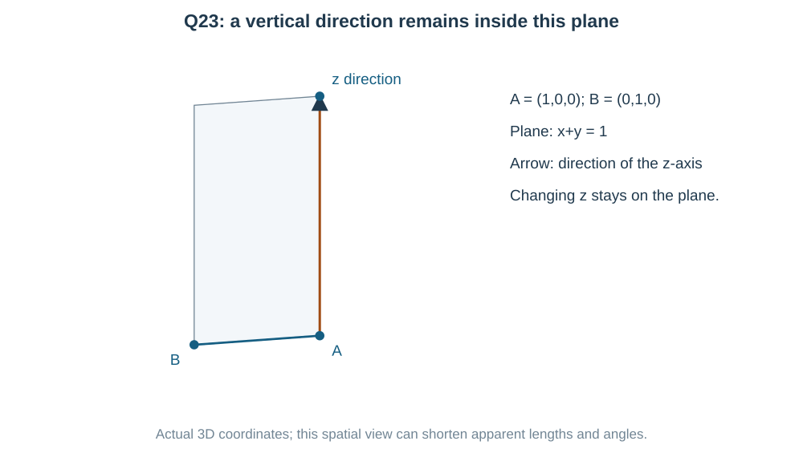

**Another possible approach:** the plane contains directions

$$
\overrightarrow{AB}=(-1,1,0),\qquad\mathbf k=(0,0,1).
$$

Their cross product is $(1,1,0)$, the plane normal. Point–normal form through $(1,0,0)$ gives $(x-1)+y=0$.

**Connection:** zero $z$ coefficient means the normal has zero $z$ component; the vertical direction is perpendicular to that normal and lies along the sheet.

---

### Question 24 — A triangle in space still has base and perpendicular height

**PDF page 108 | MCQ | Notes: C16**

The area of the triangle with vertices $(1,0,0)$, $(0,1,0)$ and $(0,0,1)$ is

- (a) $\dfrac{\sqrt2}2$
- (b) $\dfrac{\sqrt3}2$
- (c) $\dfrac12$
- (d) $\sqrt3$

**The triangle is tilted in space.** Its area is still half base times perpendicular height. The magnitude of a cross product gives the full parallelogram area.

From $A=(1,0,0)$:

$$
\overrightarrow{AB}=(-1,1,0),\qquad
\overrightarrow{AC}=(-1,0,1).
$$

$$
\overrightarrow{AB}\times\overrightarrow{AC}=(1,1,1).
$$

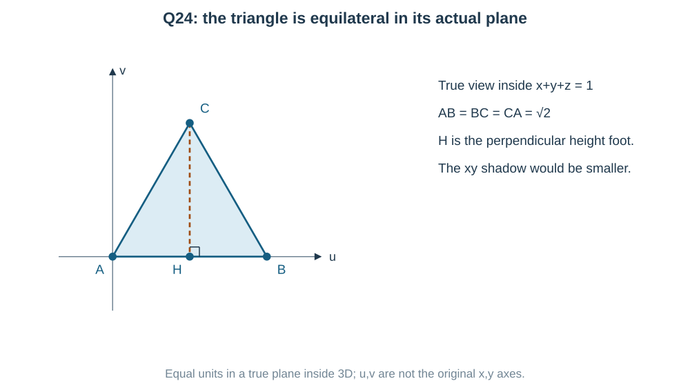

Thus

$$
\boxed{\Delta=\frac12\sqrt{1+1+1}
=\frac{\sqrt3}{2};\quad\text{(b)}}.
$$

**Another possible approach — recognize the shape:** each pair of vertices is $\sqrt2$ apart. The triangle is equilateral:

$$
\Delta=\frac{\sqrt3}{4}(\sqrt2)^2=\frac{\sqrt3}{2}.
$$

That route is especially quick here. Dropping all $z$ coordinates would give only the triangle's shadow, whose area is different.

---

### Question 25 — Compute the requested multiple after finding shortest distance

**PDF page 109 | Numerical value | Notes: C08**

Let $d$ be the shortest distance between the lines $\dfrac x1=\dfrac y2=\dfrac z2$ and $\dfrac{x-3}{2}=\dfrac{y-4}{1}=\dfrac{z+5}{-2}$. Then $3d=$ ____.

**The requested quantity is $3d$. Keep that last step visible.** The line directions are $\mathbf u=(1,2,2)$ and $\mathbf v=(2,1,-2)$, and their anchor offset is $\mathbf w=(3,4,-5)$.

$$
\mathbf u\times\mathbf v=(-6,6,-3),\qquad
|\mathbf u\times\mathbf v|=9.
$$

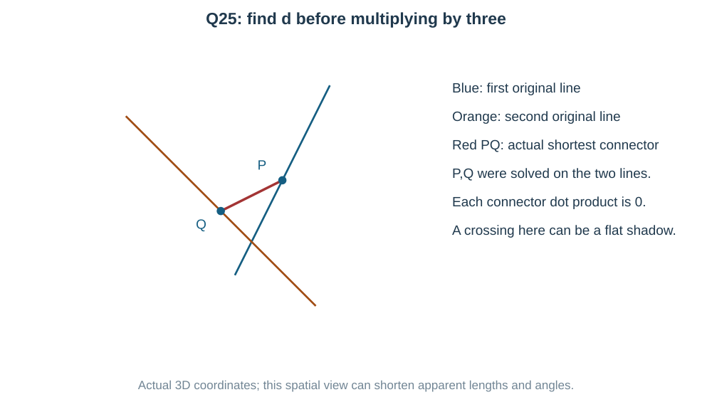

The offset component along the common normal gives

$$
d=\frac{|\mathbf w\cdot(\mathbf u\times\mathbf v)|}{9}
=\frac{|-18+24+15|}{9}
=\frac73.
$$

Therefore

$$
\boxed{3d=7}.
$$

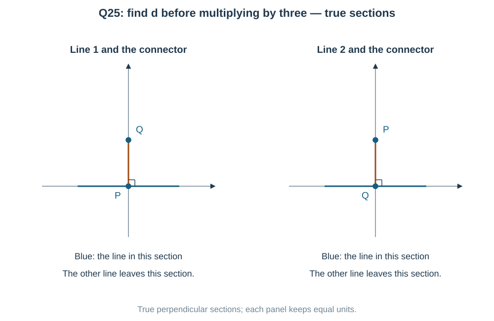

**Another possible approach — actual closest points:** the perpendicularity conditions give

$$
P=\frac19(1,2,2),\qquad
Q=\frac19(-13,16,-5).
$$

Here $P=(1/9)\mathbf u$ and $Q=(3,4,-5)-(20/9)\mathbf v$, so they really lie on the two lines. Their connector is

$$
Q-P=\frac19(-14,14,-7).
$$

Its dot product with each line direction is zero and its length is $21/9=7/3$. This confirms the projection calculation. It also gives a common-perpendicular line:

$$
\mathbf r=\frac19(1,2,2)+\lambda(2,-2,1),
$$

which reaches $Q$ at $\lambda=-7/9$.

---

### Question 26 — The angle between planes comes from their normal directions

**PDF page 109 | MCQ | Notes: C11**

The angle between the planes $2x-y+z=6$ and $x+y+2z=7$ is

- (a) $30^\circ$
- (b) $45^\circ$
- (c) $60^\circ$
- (d) $90^\circ$

**A plane does not have one preferred direction within its sheet.** Use its normal to compare its orientation with another plane.

$$
\mathbf n_1=(2,-1,1),\qquad\mathbf n_2=(1,1,2).
$$

$$
\mathbf n_1\cdot\mathbf n_2=2-1+2=3,\qquad
|\mathbf n_1|=|\mathbf n_2|=\sqrt6.
$$

The smaller plane angle is

$$
\cos\theta=\frac{|3|}{\sqrt6\sqrt6}=\frac12,
\qquad
\boxed{\theta=60^\circ;\quad\text{(c)}}.
$$

**Why do the constants 6 and 7 not appear?** They locate the sheets. Moving a plane parallel to itself changes its constant but not its orientation or its angle with another plane.

**Another interpretation:** divide each normal by $\sqrt6$ to make unit arrows, then dot them. Their dot product $1/2$ is the cosine directly.

---

### Question 27 — One line parameter gives all three intersection coordinates

**PDF page 109 | Numerical value | Notes: C05,C15**

The line $\dfrac{x-1}{2}=\dfrac{y+1}{3}=\dfrac{z-2}{4}$ meets the plane $2x+y-z=5$ at the point $(\alpha,\beta,\gamma)$. Then $\alpha+\beta+\gamma=$ ____.

**One point on a line has one shared parameter.** Set all three symmetric ratios equal to $t$:

$$
x=1+2t,\qquad y=-1+3t,\qquad z=2+4t.
$$

Put this point in the plane:

$$
2(1+2t)+(-1+3t)-(2+4t)=5.
$$

So

$$
-1+3t=5\quad\Longrightarrow\quad t=2.
$$

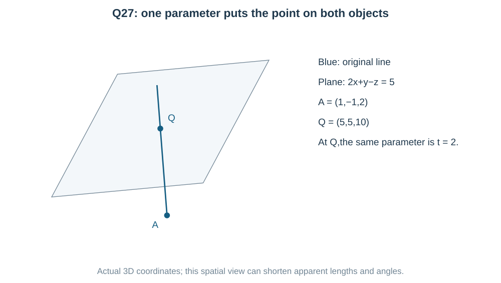

Thus $(\alpha,\beta,\gamma)=(5,5,10)$ and

$$
\boxed{\alpha+\beta+\gamma=20}.
$$

**Another quick step once $t$ is known:** the coordinate sum along the line is

$$
x+y+z=(1-1+2)+(2+3+4)t=2+9t.
$$

At $t=2$ it is 20, without separately writing all coordinates. **Check:** the full point gives $2(5)+5-10=5$.

---

### Question 28 — Two different line parameters can reach the same point

**PDF page 109 | MCQ | Notes: C07**

The point of intersection of the lines $\dfrac{x-1}{2}=\dfrac{y-2}{3}=\dfrac{z-3}{4}$ and $\dfrac{x-2}{3}=\dfrac{y-3}{4}=\dfrac{z-4}{5}$ is

- (a) $(-1,-1,-1)$
- (b) $(1,1,1)$
- (c) $(3,5,7)$
- (d) $(-1,-1,1)$

**Two lines need two parameters.** Write

$$
(1+2s,2+3s,3+4s)=(2+3t,3+4t,4+5t).
$$

The $x,y$ equations are

$$
2s-3t=1,\qquad3s-4t=1.
$$

Eliminating $s$ gives $t=-1$, and then $s=-1$.

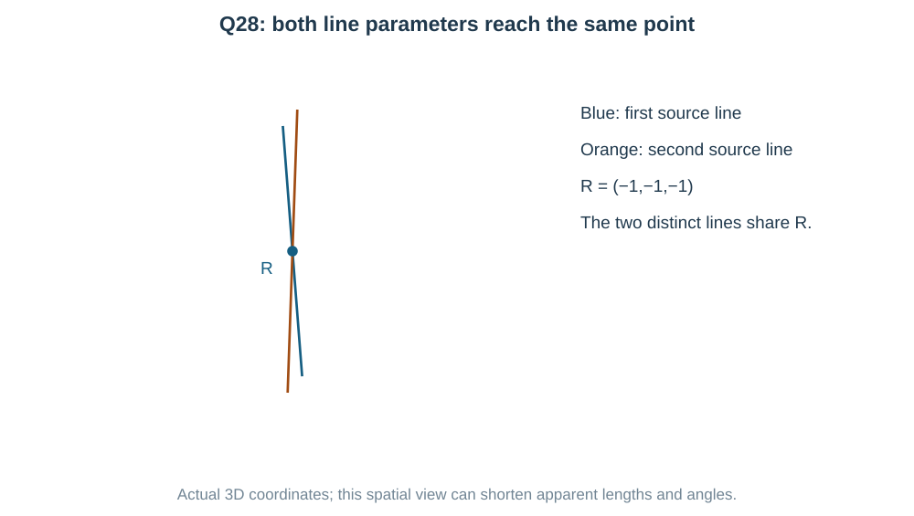

Check $z$ too:

$$
3+4(-1)=4+5(-1)=-1.
$$

Therefore

$$
\boxed{(-1,-1,-1);\quad\text{(a)}}.
$$

**Why check all three?** In space, two lines can have matching $x,y$ coordinates but different heights $z$. That would be a meeting of their shadows, not an actual intersection.

**Another possible approach — use the MCQ options:** substitute a candidate point into all three ratios of each line. For $(-1,-1,-1)$ all ratios equal $-1$ on both lines. Here the two solved parameters happen to be equal; that was a result, not an assumption.

---

### Question 29 — The common line direction is perpendicular to both plane normals

**PDF page 109 | MCQ | Notes: C04,C10**

The direction ratios of the line of intersection of the planes $x+y+z=1$ and $2x-y+3z=2$ are

- (a) $(4,1,-3)$
- (b) $(2,-1,3)$
- (c) $(1,-2,1)$
- (d) $(4,-1,-3)$

**Imagine the two sheets meeting along a crease.** The crease direction runs along both planes, so it is perpendicular to both normals:

$$
\mathbf n_1=(1,1,1),\qquad\mathbf n_2=(2,-1,3).
$$

Their cross product gives that shared direction:

$$
\mathbf d=\mathbf n_1\times\mathbf n_2
=\bigl(3-(-1),\ 2-3,\ -1-2\bigr)
=(4,-1,-3).
$$

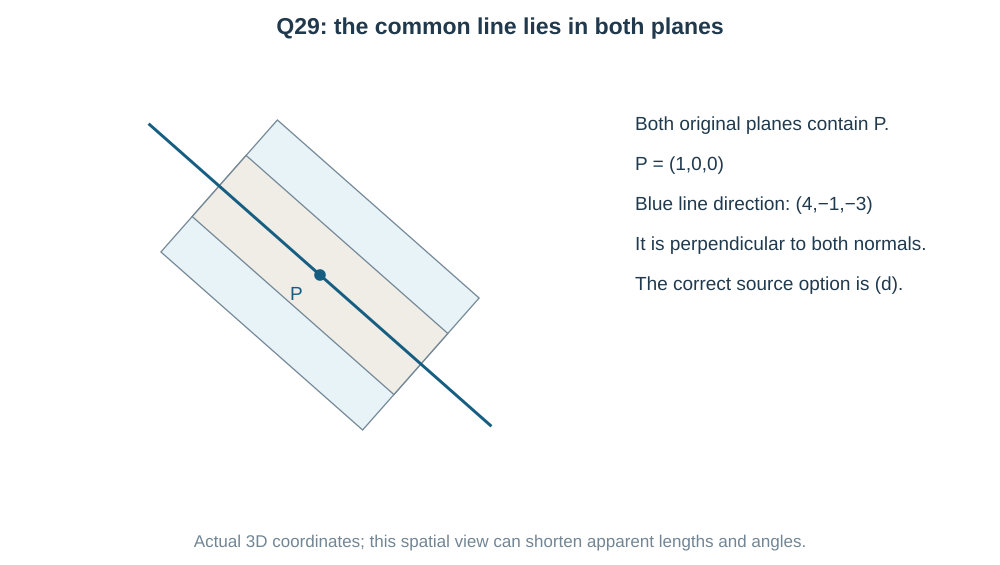

$$
\boxed{(4,-1,-3);\quad\text{(d)}}.
$$

**Check both normals:**

$$
4-1-3=0,\qquad8+1-9=0.
$$

The minus sign in the middle component matters: option (a) has $+1$ and fails.

**Another possible approach:** let the direction be $(p,q,r)$. In-plane movement gives

$$
p+q+r=0,\qquad2p-q+3r=0.
$$

Add to get $3p+4r=0$. Choose $p=4,r=-3$, then $q=-1$. These equations explain why the cross product is useful.

---

### Question 30 — Equal intercepts share one signed length

**PDF page 109 | Numerical value | Notes: C09**

A plane passes through $(1,2,3)$ and makes equal intercepts on the three coordinate axes. The sum of its three intercepts is ____.

**Equal intercepts suggest intercept form with the same denominator.** Let each signed intercept be $a\ne0$:

$$
\frac xa+\frac ya+\frac za=1
\quad\Longrightarrow\quad x+y+z=a.
$$

Since $(1,2,3)$ lies on the plane,

$$
a=1+2+3=6.
$$

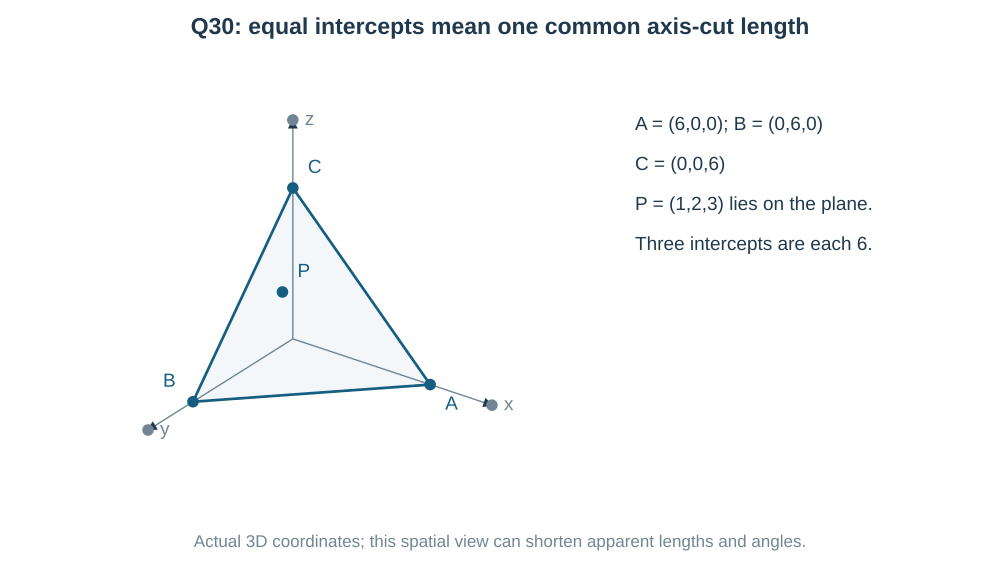

Each intercept is 6, so the requested **sum** is

$$
\boxed{6+6+6=18}.
$$

**Check:** on the $x$-axis, $y=z=0$ gives $x=6$, and similarly for the other axes. The value 6 is one intercept, not their sum.

**Useful connection:** the axis-cut triangle's centroid is $(2,2,2)$. The given point $(1,2,3)$ is another point on the plane; it was not stated to be the centroid. Q33 will use that extra centroid condition.

---

### Question 31 — Drop a perpendicular to the line rather than measuring to its anchor

**PDF page 109 | MCQ | Notes: C06**

The distance of $(1,1,1)$ from the line $\dfrac x1=\dfrac y2=\dfrac z2$ is

- (a) $\dfrac{\sqrt2}9$
- (b) $\dfrac13$
- (c) $\dfrac{\sqrt2}3$
- (d) $\sqrt2$

**We need the shortest distance to a whole line.** The distance from $P$ to the origin is not enough; the closest point of the line need not be its anchor.

Let $O=(0,0,0)$ and $\mathbf d=(1,2,2)$. Resolve the actual arrow $\overrightarrow{OP}=(1,1,1)$ **along the line and perpendicular to it**:

$$
\overrightarrow{OP}=\overrightarrow{OH}+\overrightarrow{HP},
\qquad\overrightarrow{OH}=t\mathbf d,\qquad
\overrightarrow{HP}\cdot\mathbf d=0.
$$

The last condition gives

$$
((1,1,1)-t(1,2,2))\cdot(1,2,2)=0
\quad\Longrightarrow\quad5-9t=0.
$$

Hence

$$
H=\left(\frac59,\frac{10}9,\frac{10}9\right),\qquad
\overrightarrow{HP}=\frac19(4,-1,-1).
$$

The required length is

$$
\boxed{HP=\frac{\sqrt{16+1+1}}9
=\frac{\sqrt2}{3};\quad\text{(c)}}.
$$

**Another possible approach — area divided by base:**

$$
|\overrightarrow{OP}\times\mathbf d|=|(0,-1,1)|=\sqrt2,
\qquad
D=\frac{\sqrt2}{|\mathbf d|}=\frac{\sqrt2}3.
$$

This is shorter for the length alone. The cross-product vector stands out of the triangle's plane; it is **not** the in-plane remainder $\overrightarrow{HP}$.

**A third useful view — Pythagoras:**

$$
HP^2=OP^2-OH^2
=3-\frac{(\overrightarrow{OP}\cdot\mathbf d)^2}{|\mathbf d|^2}
=3-\frac{25}9=\frac29.
$$

Choose this route when the question asks only for distance squared.

---

### Question 32 — A direction-parallel line may lie in the plane

**PDF page 109 | Numerical value | Notes: C11,C15**

If the line $\dfrac{x-1}{2}=\dfrac{y-2}{k}=\dfrac{z-3}{4}$ is parallel to the plane $2x+y+z=7$, then $k=$ ____.

**First separate direction from position.** The line direction is $\mathbf d=(2,k,4)$ and the plane normal is $\mathbf n=(2,1,1)$.

For the direction to run along the sheet,

$$
\mathbf d\cdot\mathbf n=4+k+4=0.
$$

So the source's intended value is

$$
\boxed{k=-8\quad\text{(direction-parallel)}}.
$$

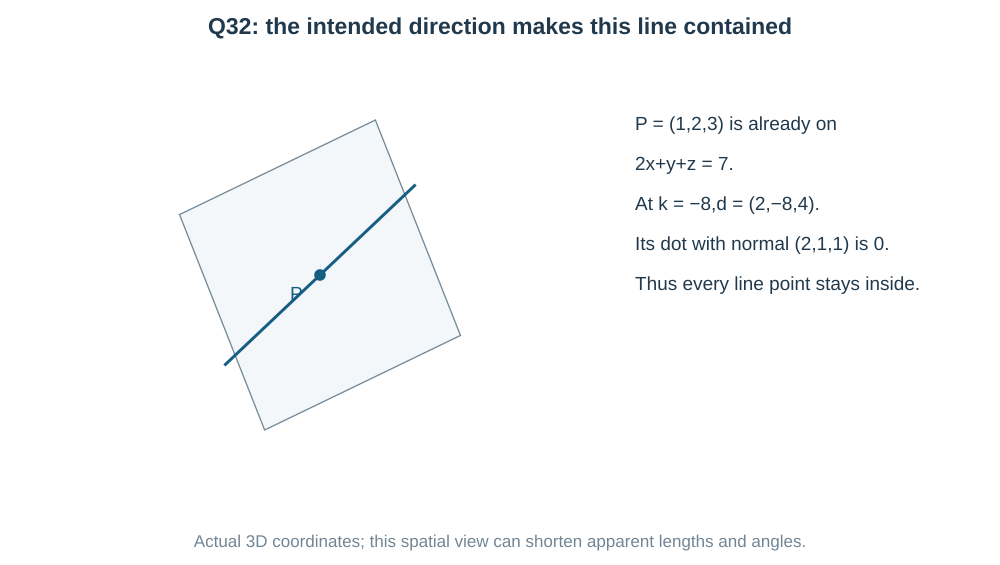

**Now check the anchor point, as we must.** The line passes through $(1,2,3)$, and

$$
2(1)+2+3=7.
$$

That point is already on the plane. At $k=-8$ every point of the line is on it:

$$
2(1+2t)+(2-8t)+(3+4t)=7.
$$

**Wording qualification:** this value makes the line **contained in the plane**. The PDF uses “parallel” for a direction along the plane. If “parallel” is required to mean **disjoint**, there is no value of $k$: the fixed anchor lies on the plane for every $k$.

**Another possible approach:** substitute the general line point first:

$$
2x+y+z=7+(k+8)t.
$$

It stays constant exactly when $k=-8$, and that constant is 7. This one expression reveals both the intended answer and the contained-line qualification.

---

### Question 33 — A centroid gives one third of each axis intercept

**PDF page 109 | MCQ | Notes: C01,C09**

A plane meets the coordinate axes at $A,B,C$ and the centroid of triangle $ABC$ is $(1,2,3)$. The plane is

- (a) $x+2y+3z=14$
- (b) $6x+3y+2z=6$
- (c) $3x+6y+9z=18$
- (d) $6x+3y+2z=18$

**Notice “centroid of the axis-cut triangle.”** If the intercepts are $a,b,c$, the vertices are

$$
A=(a,0,0),\quad B=(0,b,0),\quad C=(0,0,c).
$$

The centroid averages their coordinates:

$$
G=\left(\frac a3,\frac b3,\frac c3\right)=(1,2,3).
$$

Therefore $(a,b,c)=(3,6,9)$.

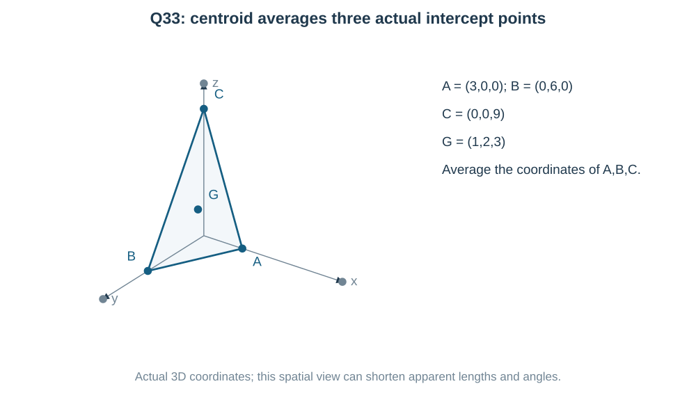

Use intercept form:

$$
\frac x3+\frac y6+\frac z9=1.
$$

Multiplying by 18 gives

$$
\boxed{6x+3y+2z=18;\quad\text{(d)}}.
$$

**Why not make the intercepts $1,2,3$?** Those are centroid coordinates. Each is one third of the corresponding axis intercept.

**Another possible approach — use the options:** read each plane's three intercepts, divide them by 3 and compare with $(1,2,3)$. Merely checking that the point lies on the proposed plane is necessary but not sufficient: many planes pass through that point.

---

### Question 34 — A normal perpendicular to two normals comes from their cross product

**PDF page 109 | MCQ | Notes: C04,C10,C11**

The plane through $(1,2,3)$ perpendicular to the planes $x+y+z=0$ and $x-y+2z=0$ is

- (a) $3x+y-2z+1=0$
- (b) $3x-y-2z+5=0$
- (c) $3x-y-2z-5=0$
- (d) $x+3y-2z-1=0$

**The required sheet is perpendicular to two given sheets.** Its normal must therefore be perpendicular to both given normals:

$$
\mathbf n_1=(1,1,1),\qquad\mathbf n_2=(1,-1,2).
$$

A suitable normal is

$$
\mathbf N=\mathbf n_1\times\mathbf n_2=(3,-1,-2).
$$

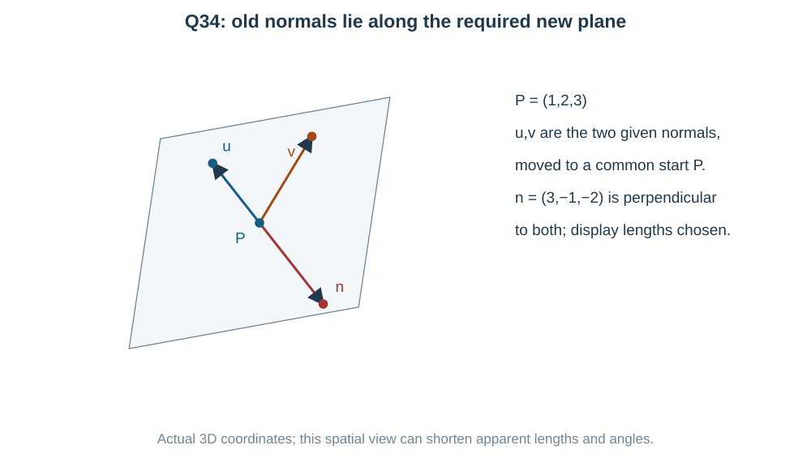

Through $(1,2,3)$, the plane is

$$
3(x-1)-(y-2)-2(z-3)=0.
$$

Thus

$$
\boxed{3x-y-2z+5=0;\quad\text{(b)}}.
$$

**Check the orientation and position separately:**

$$
\mathbf N\cdot\mathbf n_1=3-1-2=0,\qquad
\mathbf N\cdot\mathbf n_2=3+1-4=0.
$$

At $(1,2,3)$ the equation gives $3-2-6+5=0$.

**Another possible approach:** let $\mathbf N=(a,b,c)$. Solve $a+b+c=0$ and $a-b+2c=0$, then choose the proportional solution $(3,-1,-2)$. A dot product tests perpendicularity; a cross product constructs a direction satisfying two such tests at once.

---

### Question 35 — Collinear points give proportional movement arrows

**PDF page 110 | MCQ | Notes: C01,C05**

Statement I: The points $A(1,2,3)$, $B(3,5,7)$ and $C(5,8,11)$ are collinear.

Statement II: Three points $A,B,C$ are collinear if and only if $\overrightarrow{AB}$ is parallel to $\overrightarrow{AC}$.

Choose the correct option.

- (a) Statement I is true but Statement II is false
- (b) Both statements are true and Statement II is the correct explanation of Statement I
- (c) Both statements are true but Statement II is not the correct explanation of Statement I
- (d) Statement I is false but Statement II is true

**Look for proportional coordinate movements before using a determinant.**

$$
\overrightarrow{AB}=(3-1,5-2,7-3)=(2,3,4),
$$

$$
\overrightarrow{AC}=(5-1,8-2,11-3)=(4,6,8)
=2\overrightarrow{AB}.
$$

Starting at $A$, the movement to $C$ is exactly twice the movement to $B$, with the same direction. So all three distinct points lie on one straight line. Statement I is true.

Statement II is the same geometric test in words: for distinct points, parallel $\overrightarrow{AB}$ and $\overrightarrow{AC}$ put them on the same line through $A$. It is true and explains Statement I.

$$
\boxed{\text{Both true; II explains I; (b)}}.
$$

**Another quick check:** $B=(A+C)/2$, so $B$ is the midpoint of $AC$. This immediately proves collinearity here.

If points coincide, a movement can be the zero vector, which has no defined direction. The stated parallel-vector test is being used here for the actual **distinct** points.

---

### Question 36 — A containing direction must be perpendicular to the new plane normal

**PDF page 110 | MCQ | Notes: C10,C11**

The equation of the plane containing the line $\dfrac{x-1}{1}=\dfrac{y-2}{2}=\dfrac{z-3}{3}$ and perpendicular to the plane $x+y+z=2$ is

- (a) $x-2y+z=0$
- (b) $x+2y-z=2$
- (c) $x-2y+z=2$
- (d) $2x-y-z=-3$

**We must meet two orientation conditions and one position condition.**

The plane contains the line direction $\mathbf d=(1,2,3)$, so its normal $\mathbf N$ must satisfy

$$
\mathbf N\cdot\mathbf d=0.
$$

It is perpendicular to the plane with normal $\mathbf n_0=(1,1,1)$, so also

$$
\mathbf N\cdot\mathbf n_0=0.
$$

Choose a cross product:

$$
\mathbf d\times\mathbf n_0=(-1,2,-1).
$$

Use the reversed direction $\mathbf N=(1,-2,1)$ for simpler signs.

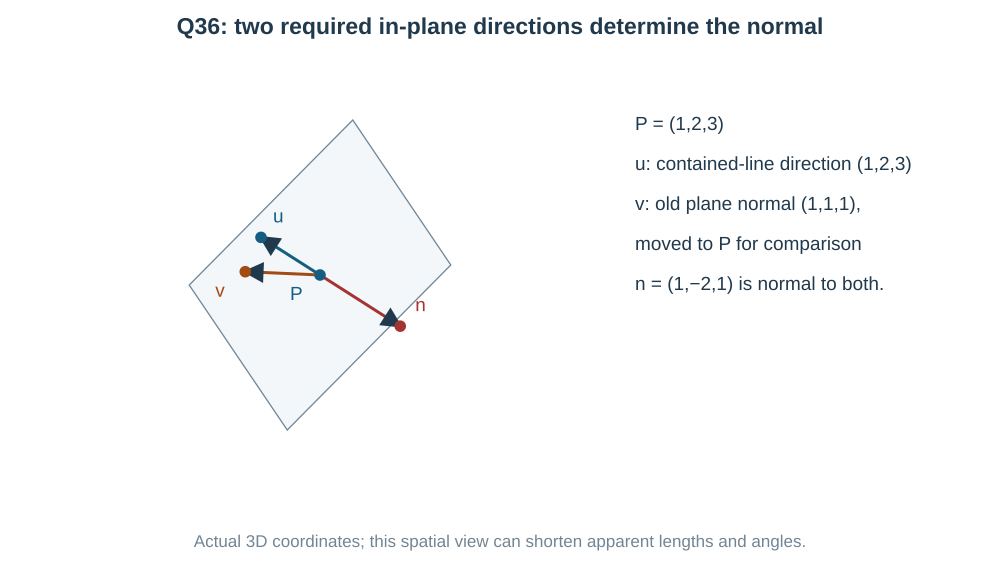

The given line passes through $(1,2,3)$. Thus

$$
(x-1)-2(y-2)+(z-3)=0,
$$

or

$$
\boxed{x-2y+z=0;\quad\text{(a)}}.
$$

**Check the whole contained line:** $(x,y,z)=(1+t,2+2t,3+3t)$ gives $1+t-4-4t+3+3t=0$. Checking just the anchor would not establish containment.

**Another possible approach:** write the unknown normal $(a,b,c)$ and solve $a+2b+3c=0$, $a+b+c=0$. Then use the line's anchor to find the plane constant. It is the same reasoning without the cross-product shortcut.

---

### Question 37 — Use the actual spatial triangle rather than its xy shadow

**PDF page 110 | Numerical value | Notes: C16**

The area of the triangle with vertices $(1,0,0)$, $(0,2,0)$ and $(0,0,3)$ is ____ square units (to 2 decimal places).

**A 3D triangle's shadow on the $xy$-plane does not give its true area.** Keep all three coordinate changes:

$$
\overrightarrow{AB}=(-1,2,0),\qquad
\overrightarrow{AC}=(-1,0,3).
$$

Their cross product is

$$
\overrightarrow{AB}\times\overrightarrow{AC}=(6,3,2).
$$

The parallelogram area is $\sqrt{36+9+4}=7$. The triangle has half that area:

$$
\boxed{\Delta=\frac72=3.50\text{ square units}}.
$$

**Another possible approach — base and height:** $AB=\sqrt5$. The perpendicular foot from $C$ to $AB$ is $H=(4/5,2/5,0)$:

$$
\overrightarrow{HC}=\left(-\frac45,-\frac25,3\right),\qquad
CH=\sqrt{\frac{16}{25}+\frac4{25}+9}=\frac7{\sqrt5}.
$$

Its dot product with $AB=(-1,2,0)$ is zero. So

$$
\Delta=\frac12(AB)(CH)=\frac12\sqrt5\frac7{\sqrt5}=\frac72.
$$

The projected $xy$ triangle has area 1; it is only a shadow. The true section in the diagram uses a plane inside 3D so its altitude and lengths remain correct.

---

### Question 38 — Replace sine squares with one minus cosine squares

**PDF page 110 | Numerical value | Notes: C02**

If a line makes angles $\alpha,\beta,\gamma$ with the coordinate axes, then $\sin^2\alpha+\sin^2\beta+\sin^2\gamma=$ ____.

**Did you notice three sine squares, but the line-angle identity uses cosine squares?** Replace each sine square by $1-\cos^2$:

$$
\begin{aligned}
\sin^2\alpha+\sin^2\beta+\sin^2\gamma
&=(1-\cos^2\alpha)+(1-\cos^2\beta)+(1-\cos^2\gamma)\\
&=3-(\cos^2\alpha+\cos^2\beta+\cos^2\gamma).
\end{aligned}
$$

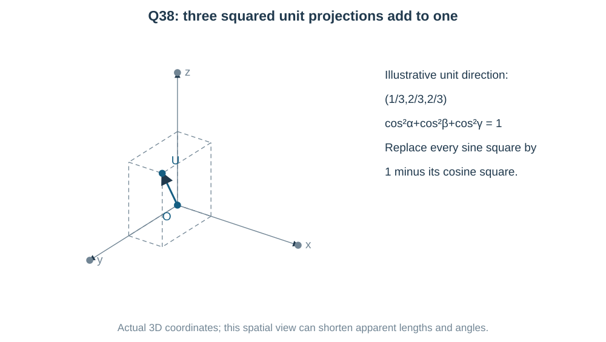

For a unit direction arrow, its three component squares add to 1. Therefore

$$
\boxed{\sin^2\alpha+\sin^2\beta+\sin^2\gamma=3-1=2}.
$$

**Pattern to carry forward:** when a requested expression uses the partner of a familiar identity, change its form first. We do not need to find $\alpha,\beta,\gamma$ separately.

**Another geometric view:** $\sin^2\alpha=m^2+n^2$, $\sin^2\beta=n^2+l^2$, and $\sin^2\gamma=l^2+m^2$. Adding counts each direction-cosine square twice, giving $2(l^2+m^2+n^2)=2$. A numerical example can illustrate this but would not prove it for every line.

---

### Question 39 — Opposite plane signs mean an internal division

**PDF page 110 | MCQ | Notes: C15**

The plane $x+y+z=3$ divides the line segment joining $A(1,2,3)$ and $B(2,-1,-2)$ in the ratio

- (a) $4:3$ internally
- (b) $3:4$ externally
- (c) $1:2$ internally
- (d) $3:4$ internally

**First check which sides of the plane contain the endpoints.** Put $f(x,y,z)=x+y+z-3$:

$$
f(A)=1+2+3-3=3,\qquad
f(B)=2-1-2-3=-4.
$$

The signs are opposite. The segment crosses the plane **internally**.

Write a point of the segment as $P=A+t(B-A)$, with $0\le t\le1$. Since $f$ is linear along a line,

$$
f(P)=(1-t)f(A)+tf(B)
=3(1-t)-4t=3-7t.
$$

The crossing has $f(P)=0$, so $t=3/7$. Hence

$$
\boxed{AP:PB=t:(1-t)=3:4\text{ internally};\quad\text{(d)}}.
$$

**Why do the endpoint values give a length ratio?** They are signed normal distances multiplied by the same normal length. Along this one straight segment, each subsegment has the same inclination to the plane. Their lengths are therefore proportional to those perpendicular distances.

**Another possible approach — section formula:** for internal ratio $m:n$,

$$
P=\frac{nA+mB}{m+n},\qquad
f(P)=\frac{3n-4m}{m+n}.
$$

Setting it to zero gives $m:n=3:4$. The actual point is

$$
P=\frac{4A+3B}{7}=\left(\frac{10}7,\frac57,\frac67\right),
$$

and its coordinate sum is 3.

---

### Question 40 — A disjoint parallel line has one constant distance from the plane

**PDF page 110 | MCQ | Notes: C11,C12**

The distance between the line through $(1,2,3)$ with direction ratios $(1,-1,0)$ and the plane $x+y+z=12$ is

- (a) $2\sqrt3$
- (b) $\sqrt3$
- (c) $6$
- (d) $4\sqrt3$

**Check parallelism before taking one point's distance as the distance of the whole line.** The direction is $\mathbf d=(1,-1,0)$; the plane normal is $\mathbf n=(1,1,1)$:

$$
\mathbf d\cdot\mathbf n=1-1+0=0.
$$

So the line runs along the sheet. Its anchor $P=(1,2,3)$ has coordinate sum 6, not 12, so the line is off the plane and disjoint from it.

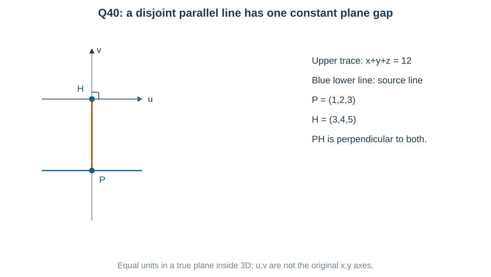

Every point on the line is $(1+t,2-t,3)$, with sum 6. Thus every line point has the same plane distance:

$$
\boxed{D=\frac{|6-12|}{\sqrt3}=2\sqrt3;
\quad\text{(a)}}.
$$

**Why that first check matters:** if the line crossed the plane, the line-to-plane distance would be zero even when the anchor's distance was positive.

**Another possible approach — construct the connector:** from $P$, move along $\mathbf n$ to $H=P+s(1,1,1)$. Requiring sum 12 gives $6+3s=12$, so $s=2$ and $H=(3,4,5)$. The normal segment has length $|2(1,1,1)|=2\sqrt3$. It is perpendicular to the plane and to the line direction.

## Answer check

Read the qualifications in the solutions before using the key.

| Question | Answer | Question | Answer |
|---|---|---|---|
| 1 | (c) | 21 | $1$ |
| 2 | (a) | 22 | (d) |
| 3 | (d) | 23 | (c) |
| 4 | (c) | 24 | (b) |
| 5 | (d) | 25 | $7$ |
| 6 | (b) | 26 | (c) |
| 7 | (a) | 27 | $20$ |
| 8 | (d) | 28 | (a) |
| 9 | (a) | 29 | (d) |
| 10 | $2$ | 30 | $18$ |
| 11 | (c) | 31 | (c) |
| 12 | $5$ | 32 | Intended $-8$; the line is contained in the plane |
| 13 | $2$ | 33 | (d) |
| 14 | (b) | 34 | (b) |
| 15 | $1$ | 35 | (b) |
| 16 | (a) | 36 | (a) |
| 17 | (d) | 37 | $3.50$ |
| 18 | (c) | 38 | $2$ |
| 19 | (d) | 39 | (d) |
| 20 | (b) | 40 | (a) |

## After this chapter

Before calculating, identify the object: point, movement, line direction, plane normal, projection, or shortest connector. Draw the needed segment. Check an actual point and a direction separately. Use independent parameters for two lines, and check all three coordinates. All alternate explanations remain visible for the later printed booklet. The supplied problems are JEE Main-style practice, not verified actual PYQs.
