# Vectors — JEE Main revision guide

*See the idea. Understand the equation. Then solve.*

> **For Kanna | Review draft 3 | 28 October 2026**  
> Read the notes first. Then solve the 35 questions in the same order as the supplied PDF.  
> The small examples inside the notes teach the ideas. The numbered questions later are the PDF questions. Useful alternative methods are at the end of each solution and are fully visible. Read them after the main explanation.

## Recent chapter weightage — why this chapter deserves revision

**Kanna’s goal:** move from about $120/300$ to $200/300$. Subject targets: Physics $60$, Maths $60$, Chemistry $80$.

**Vectors alone averaged about $1.5$ questions per Paper 1 over 2024–2026 in the two checked chapter archives.** The latest two-year average is about $1.2$–$1.3$. Three Dimensional Geometry is a separate chapter in this count.

| Exam year | Paper 1 shifts in the comparison | ExamSIDE / ExamGOAL: Vectors questions | Mean per paper | PYQSide cross-check: questions | Mean per paper |
|---|---:|---:|---:|---:|---:|
| 2024 | $20$ | $38$ | $1.90$ | $37$ | $1.85$ |
| 2025 | $19$ | $22$ | $1.16$ | $23$ | $1.21$ |
| 2026 | $19$ | $24$ | $1.26$ | $25$ | $1.32$ |
| Three years together | $58$ | $84$ | $1.45$ | $85$ | $1.47$ |

We calculated each mean as chapter questions divided by papers. For example, $84/58\approx1.45$. We checked the archives’ published chapter counts; this is **archive-based weightage, not an independent recount of every original paper or an NTA chapter-wise statistic**. The two archives differ slightly in the questions they include. Their overall message is similar: roughly one-and-a-half Vectors questions per paper across these three years. One actual paper can have a different count.

**What should you do with this information?** Keep Vectors in your Maths revision plan. First make dot product, projection, cross product, and lengths of sums dependable. These ideas also help in 3D Geometry and Physics. Then practise their combinations. A difficult identity should get time after these foundations. This is the teaching priority for the $60$-mark Maths target; it is not a promise of fixed chapter marks.

**A comparison caution:** 2024 offered $30$ Maths questions with an optional numerical section; 2025–2026 used $25$ compulsory Maths questions. The table counts questions offered in a paper. So we show the two-year figure as well and do not directly turn the three-year average into guaranteed marks.

## Chapter scope

This chapter teaches vectors, components, direction, addition, dot product, projection, cross product, areas, and the connections needed to solve the supplied questions.

The official JEE Main 2027 Vector Algebra unit names vectors and scalars, addition, components in two and three dimensions, and scalar and vector products. Direction cosines and the section formula also connect with its Three Dimensional Geometry unit. We teach these connections here because this practice chapter uses them.

**Extra tools used by this PDF:** scalar triple product, vector triple product, volume, and coplanarity. Triple products are not separately named in the official Vector Algebra unit. They are explained here as combinations of dot and cross products, so you can understand and solve this PDF. The more involved identity question is marked for a second reading.

## Fast-start strategy

Learn in this order: arrows and components → dot product → projection → cross product → combinations of these ideas.

For every new idea, ask: **What is it? What does the picture mean? What comes out: a number or a vector? Why does the formula fit?**

An **Important for JEE Main** label tells you where an idea helps in solving exam-level questions. It is a teaching priority. Exact chapter counts are shown separately in the opening weightage table.

## Formula and concept bank

### Concept C01 — A vector is an arrow with size and direction

**Important for JEE Main.** This tells you whether the answer must be a number or an arrow.

**Start here.** “Walk 5 metres” tells only a distance. “Move 5 metres east” also tells a direction.

A **scalar** is described by a number and its unit, when a unit is needed. Examples: mass, time, temperature, speed, and work. A scalar can be negative; negative work is still a scalar.

A **vector** has magnitude and direction and follows vector-addition rules. Examples: displacement, velocity, and force. **Magnitude** means size or length. It is never negative.

We write a vector as $\mathbf a$ or $\overrightarrow{AB}$. The arrow $\overrightarrow{AB}$ starts at $A$ and ends at $B$. Its magnitude is $|\mathbf a|$ or $|\overrightarrow{AB}|$.

**Important difference:** $\mathbf a$ is the whole arrow. $|\mathbf a|$ is one nonnegative number. For example, a displacement arrow can point west, while its length is still positive.

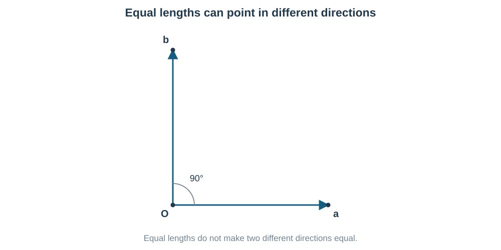

**Read the picture:** these arrows have the same size, but they are different vectors because their directions differ.

Two free vectors are equal when their lengths and directions are equal. You may slide an arrow without turning or stretching it when doing vector algebra. In a torque question, the point where the force acts also matters; keep its position vector.

### Concept C02 — Components are instructions for moving along the axes

**Important for JEE Main.** Components let you calculate dots, crosses, lengths, and unknown coordinates.

**Start here.** The three coordinate directions are at right angles to one another:

- $\hat{\mathbf i}$: one unit along the positive $x$-axis.
- $\hat{\mathbf j}$: one unit along the positive $y$-axis.
- $\hat{\mathbf k}$: one unit along the positive $z$-axis.

Thus

$$
\mathbf a=a_x\hat{\mathbf i}+a_y\hat{\mathbf j}+a_z\hat{\mathbf k}
\quad\text{can also be written as}\quad (a_x,a_y,a_z).
$$

For example, $\mathbf a=3\hat{\mathbf i}-2\hat{\mathbf j}+\hat{\mathbf k}$ means move $3$ units in the positive $x$ direction, $2$ in the negative $y$ direction, and $1$ in the positive $z$ direction.

The numbers $a_x,a_y,a_z$ are **scalar components**. The arrows $a_x\hat{\mathbf i},a_y\hat{\mathbf j},a_z\hat{\mathbf k}$ are **vector components**.

The components can be negative. The length cannot:

$$
|\mathbf a|=\sqrt{a_x^2+a_y^2+a_z^2}.
$$

**Why?** Apply Pythagoras first in the $xy$-plane and then with the $z$ component. In two dimensions, put $a_z=0$.

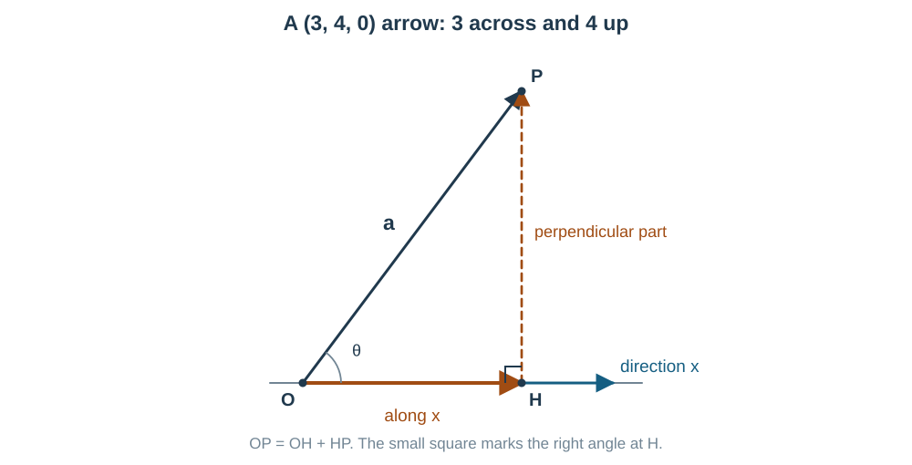

**Read the drawing:** $OH$ is the movement along $x$, and $HP$ is the movement along $y$. The original arrow $OP$ is their sum. Its length comes from the right triangle.

**Tiny example:** $(3,4,0)$ has length $\sqrt{9+16}=5$, not $3+4=7$. The two component arrows point in different directions, so their lengths cannot usually be added.

### Concept C03 — Zero, negative, parallel, and unit vectors

**Important for JEE Main.** Use these ideas in unit-vector, parallel, and perpendicular-direction questions.

**Start here.**

- **Zero vector:** $\mathbf0=(0,0,0)$. Its magnitude is zero and it has no definite direction.
- **Negative vector:** $-\mathbf a$ has the same length as $\mathbf a$ and the opposite direction.
- **Parallel or collinear vectors:** nonzero vectors along the same line direction, including opposite directions. One is a scalar multiple of the other: $\mathbf a=\lambda\mathbf b$.
- **Perpendicular vectors:** nonzero vectors making a right angle.
- **Coplanar vectors:** vectors whose arrows can lie in one plane when drawn from a common starting point. A plane is a flat surface, like an unlimited sheet of paper. **Non-coplanar** means they cannot all lie in one plane.
- **Unit vector:** a vector of length $1$. It gives direction without carrying the original length.

For $\mathbf a\ne\mathbf0$, the unit vector along $\mathbf a$ is

$$
\hat{\mathbf a}=\frac{\mathbf a}{|\mathbf a|}.
$$

**Why divide?** Dividing an arrow by its positive length makes its new length $1$ and keeps its direction. For $(3,4,0)$, the unit vector is $(3/5,4/5,0)$.

A vector of length $L>0$ along $\mathbf a$ is $L\mathbf a/|\mathbf a|$. In the opposite direction it is $-L\mathbf a/|\mathbf a|$.

Multiplying by a real number $\lambda$ gives

$$
|\lambda\mathbf a|=|\lambda|\,|\mathbf a|.
$$

A positive multiplier keeps direction; a negative multiplier reverses it. You cannot find a unit vector along the zero vector because division by zero is undefined.

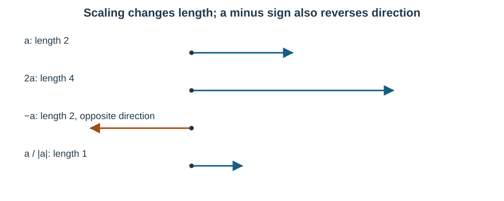

**Read the four rows:** compare length and direction separately. A minus sign reverses the arrow; dividing by a positive length does not.

Making a nonzero vector into a unit vector in the same direction is called **normalizing** it.

**Parallel check:** comparing component ratios works only when the denominators are nonzero. Comparing $\mathbf a=\lambda\mathbf b$ component by component is safer when a component is zero.

### Concept C04 — Position tells where; displacement tells the change

**Important for JEE Main.** Use destination minus start for side vectors and displacements.

Let $O$ be the origin. If $A$ has position vector $\mathbf a$ and $B$ has position vector $\mathbf b$, then

$$
\overrightarrow{OA}=\mathbf a,\qquad
\overrightarrow{OB}=\mathbf b,\qquad
\overrightarrow{AB}=\mathbf b-\mathbf a.
$$

**Reason:** to move from $A$ to $B$, undo the movement from $O$ to $A$, then make the movement from $O$ to $B$.

For $A(x_1,y_1,z_1)$ and $B(x_2,y_2,z_2)$,

$$
\overrightarrow{AB}=(x_2-x_1,y_2-y_1,z_2-z_1),\qquad
AB=|\mathbf b-\mathbf a|.
$$

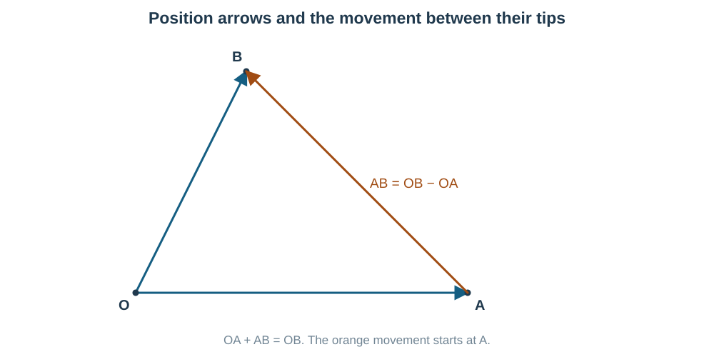

**Read the drawing:** the blue arrows locate $A$ and $B$ from $O$. The orange arrow is the movement between their tips. It starts at $A$, so it is $\overrightarrow{AB}$, not $\overrightarrow{OB}$.

**Recall:** destination minus starting point. Reversing the order reverses the arrow, but keeps the distance unchanged.

### Concept C05 — Addition joins movements; subtraction reverses one movement

**Important for JEE Main.** Use this when arrows add to a known vector or to zero.

To add two vectors, put the tail of the second at the head of the first. Draw the answer from the first starting point to the final endpoint. This sum is also called the **resultant**. The joining rule is the **triangle law**.

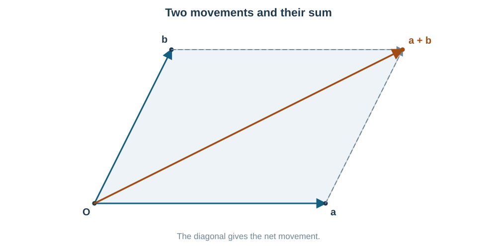

**Read the drawing:** start with the blue arrow $\mathbf a$. From its tip, follow the dashed copy of $\mathbf b$. The diagonal reaches the same final point. Thus the diagonal is $\mathbf a+\mathbf b$.

In components, add or subtract matching coordinates:

$$
(a_x,a_y,a_z)\pm(b_x,b_y,b_z)
=(a_x\pm b_x,a_y\pm b_y,a_z\pm b_z).
$$

Addition obeys $\mathbf a+\mathbf b=\mathbf b+\mathbf a$ and $(\mathbf a+\mathbf b)+\mathbf c=\mathbf a+(\mathbf b+\mathbf c)$. Subtraction means $\mathbf a-\mathbf b=\mathbf a+(-\mathbf b)$.

If the two arrows start together, the diagonal of their parallelogram gives their sum.

The same drawing gives the **parallelogram law**: keep both original arrows starting together, complete the opposite sides, and draw the diagonal. We have only moved copies of the arrows; we have not changed their lengths or directions.

Around a closed triangle,

$$
\overrightarrow{AB}+\overrightarrow{BC}+\overrightarrow{CA}=\mathbf0.
$$

**Why?** You finish where you started, so the net movement is zero. A zero sum does not mean each individual vector is zero.

### Concept C06 — A linear combination mixes arrows using number multipliers

**Important for JEE Main.** Useful for unknown coefficients and combining given vector equations.

An expression such as $2\mathbf a-3\mathbf b+\mathbf c$ is a **linear combination**. Multiply each arrow by its number, then add.

Two vectors are equal exactly when all their matching components are equal. For example,

$$
\alpha(1,1,0)+\beta(0,1,1)+\gamma(1,0,1)=(3,5,4)
$$

gives

$$
\alpha+\gamma=3,\quad \alpha+\beta=5,\quad \beta+\gamma=4.
$$

**Exam clue:** if only $\alpha+\beta+\gamma$ is asked, adding these equations may save work.

**Independent directions:** if $\mathbf a,\mathbf b,\mathbf c$ are non-coplanar, no one can be built from the other two. Then coefficients in this set are unique. Do not compare coefficients of arbitrary named vectors unless their independence is known. Comparing coefficients of $\hat{\mathbf i},\hat{\mathbf j},\hat{\mathbf k}$ is always valid.

### Concept C07 — Direction cosines tell how an arrow points along the axes

**Important for JEE Main.** Use this for angles with coordinate axes; it also supports 3D Geometry.

For a nonzero vector $\mathbf a=(a_x,a_y,a_z)$, let $\alpha,\beta,\gamma$ be its angles with the **positive** $x,y,z$ axes. Define

$$
l=\cos\alpha=\frac{a_x}{|\mathbf a|},\qquad
m=\cos\beta=\frac{a_y}{|\mathbf a|},\qquad
n=\cos\gamma=\frac{a_z}{|\mathbf a|}.
$$

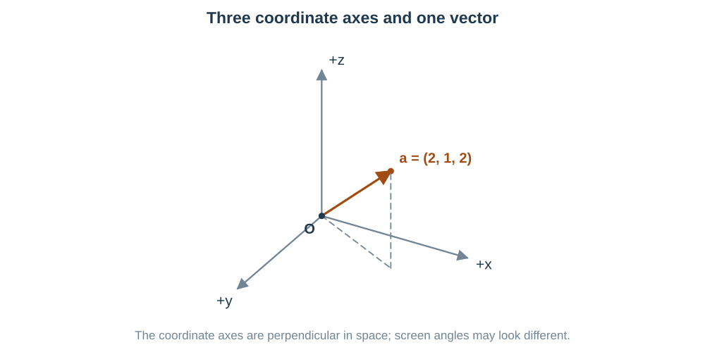

**Read the picture:** the arrow has one direction in space, but it makes an angle with each positive coordinate axis. We measure those three angles in 3D; their apparent screen angles are not the measurements.

They are called **direction cosines**. They are the components of the unit vector along $\mathbf a$:

$$
\hat{\mathbf a}=l\hat{\mathbf i}+m\hat{\mathbf j}+n\hat{\mathbf k},
\qquad l^2+m^2+n^2=1.
$$

**Why does the sum equal $1$?** Divide $a_x^2+a_y^2+a_z^2=|\mathbf a|^2$ by $|\mathbf a|^2$.

**Direction ratios** are any nonzero triple proportional to $(a_x,a_y,a_z)$. Their squares need not add to $1$. Normalize them to get direction cosines. Multiplying all three ratios by a negative number reverses the vector direction.

**Trap:** finding $\cos^2\gamma=1/4$ gives $\cos\gamma=\pm1/2$. Use “acute” or the component sign to choose. Acute means less than $90^\circ$; its cosine is positive.

### Concept C08 — The dot product measures alignment and gives a number

**Important for JEE Main.** The main tool for angles, perpendicularity, and projection.

**Start here.** Place the tails of two nonzero vectors together. Let $\theta$ be the angle between them, with $0\le\theta\le\pi$.

Imagine the signed shadow of $\mathbf a$ along the direction of $\mathbf b$. The shadow is $|\mathbf a|\cos\theta$. Multiply it by $|\mathbf b|$:

$$
\boxed{\mathbf a\cdot\mathbf b=|\mathbf a|\,|\mathbf b|\cos\theta}.
$$

This is the **dot product** or **scalar product**. Its answer is a scalar, not an arrow.

In components,

$$
\boxed{\mathbf a\cdot\mathbf b=a_xb_x+a_yb_y+a_zb_z}.
$$

**Connect the two forms:** same-axis unit vectors have dot product $1$; different-axis unit vectors have dot product $0$, because they are perpendicular. Expanding the two component expressions therefore leaves only matching-coordinate products.

$$
\hat{\mathbf i}\cdot\hat{\mathbf i}
=\hat{\mathbf j}\cdot\hat{\mathbf j}
=\hat{\mathbf k}\cdot\hat{\mathbf k}=1,
\qquad
\hat{\mathbf i}\cdot\hat{\mathbf j}
=\hat{\mathbf j}\cdot\hat{\mathbf k}
=\hat{\mathbf k}\cdot\hat{\mathbf i}=0.
$$

For nonzero inputs, an **acute** angle is less than $90^\circ$, a **right** angle equals $90^\circ$, and an **obtuse** angle is between $90^\circ$ and $180^\circ$.

| Angle | Dot-product sign | Meaning |
|---|---|---|
| Acute | Positive | The arrows point partly along each other. |
| Right angle | Zero | Neither has a component along the other. |
| Obtuse | Negative | They point partly against each other. |

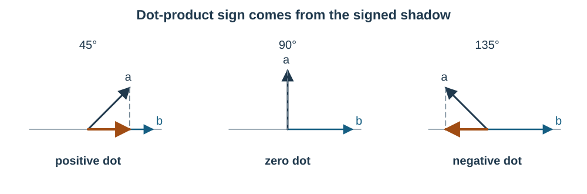

**Read the three views:** the orange shadow points along $\mathbf b$, becomes zero, then points against $\mathbf b$. This explains the three dot-product signs.

Thus

$$
\mathbf a\perp\mathbf b\iff\mathbf a\cdot\mathbf b=0
\quad\text{for nonzero }\mathbf a,\mathbf b.
$$

**Important:** a zero dot product can also occur when an input is zero. It does not force an input to be zero. For example, $\hat{\mathbf i}\cdot\hat{\mathbf j}=0$ although both are nonzero.

Useful rules:

$$
\mathbf a\cdot\mathbf a=|\mathbf a|^2,\qquad
\mathbf a\cdot\mathbf b=\mathbf b\cdot\mathbf a,
$$

$$
\mathbf a\cdot(\lambda\mathbf b+\mu\mathbf c)
=\lambda(\mathbf a\cdot\mathbf b)+\mu(\mathbf a\cdot\mathbf c).
$$

The last rule means we can open a dot product across a sum, multiplying each term separately.

**Choose dot product when:** the question gives an angle, perpendicularity, projection, or work; or when a squared length must be expanded.

### Formula F01 — Angle between two nonzero vectors

**Important for JEE Main.** Use the angle formula for nonzero vectors and the inequality below for bounds.

Rearrange the dot-product definition:

$$
\boxed{\cos\theta=\frac{\mathbf a\cdot\mathbf b}{|\mathbf a|\,|\mathbf b|}}.
$$

This formula needs both vectors to be nonzero. The angle between directed vectors can be obtuse. For the smaller angle between two unoriented lines, use the absolute value of the numerator instead.

Useful values:

| $\theta$ | $0^\circ$ | $30^\circ$ | $45^\circ$ | $60^\circ$ | $90^\circ$ | $120^\circ$ | $180^\circ$ |
|---|---|---|---|---|---|---|---|
| Radians | $0$ | $\pi/6$ | $\pi/4$ | $\pi/3$ | $\pi/2$ | $2\pi/3$ | $\pi$ |
| $\cos\theta$ | $1$ | $\sqrt3/2$ | $1/\sqrt2$ | $1/2$ | $0$ | $-1/2$ | $-1$ |
| $\sin\theta$ | $0$ | $1/2$ | $1/\sqrt2$ | $\sqrt3/2$ | $1$ | $\sqrt3/2$ | $0$ |

**Check:** the computed cosine must lie between $-1$ and $1$. Equivalently,

$$
|\mathbf a\cdot\mathbf b|\le|\mathbf a|\,|\mathbf b|.
$$

**Important for JEE Main — Cauchy–Schwarz inequality.** Use it when a question asks for a largest or smallest value and gives fixed lengths or a sum of squares. It puts a limit on how large a dot product can be. This importance label describes its use in solving questions; it is not a frequency count.

For nonzero vectors, equality means they point along the same line. The dot product is largest when they point the same way and smallest when they point opposite ways.

The same idea works for ordinary real numbers:

$$
(px+qy)^2\le(p^2+q^2)(x^2+y^2).
$$

**Did you notice the pattern?** On the left, numbers are multiplied in pairs and then added. On the right are their two sums of squares. Think of $(p,q)$ and $(x,y)$ as two vectors. This is the same dot-product bound written in components.

**Small example:** if $x^2+y^2=1$, find the largest value of $3x+4y$. Match $(p,q)=(3,4)$ to the formula:

$$
(3x+4y)^2\le(3^2+4^2)(x^2+y^2)=25,
\qquad -5\le3x+4y\le5.
$$

Can the upper value actually happen? Yes: choose $x=3/5$, $y=4/5$. Then the two direction pairs point the same way, $x^2+y^2=1$, and $3x+4y=5$. So the maximum is $5$. The opposite pair gives the minimum $-5$.

**Another possible approach — write a square that cannot be negative.**

$$
25(x^2+y^2)-(3x+4y)^2=(4x-3y)^2\ge0.
$$

This proves the same bound without naming the inequality. Remember to check that the equality choice is allowed by the question's other conditions. A bound that cannot be reached is not the actual maximum.

### Formula F02 — Expand a squared length by dotting the vector with itself

**Important for JEE Main.** Use this when a question gives lengths of sums or asks for pairwise dots.

**Important for JEE Main — spotting a length-of-sum pattern.** A vector does not have an ordinary real-number square. We use its **squared magnitude**: the vector dotted with itself. Start with the number identity you already know:

$$
(x+y)^2=x^2+y^2+2xy.
$$

For vectors, the matching identity uses lengths and dot products:

$$
|\mathbf a+\mathbf b|^2
=(\mathbf a+\mathbf b)\cdot(\mathbf a+\mathbf b)
=|\mathbf a|^2+|\mathbf b|^2+2\mathbf a\cdot\mathbf b.
$$

Similarly,

$$
|\mathbf a-\mathbf b|^2=|\mathbf a|^2+|\mathbf b|^2-2\mathbf a\cdot\mathbf b,
$$

$$
|p\mathbf a+q\mathbf b|^2
=p^2|\mathbf a|^2+q^2|\mathbf b|^2+2pq\,\mathbf a\cdot\mathbf b.
$$

Here $p,q$ are real numbers. A negative coefficient is allowed; it reverses that arrow and changes the sign of the pair term accordingly. If the inputs are unit vectors, their squared lengths are $1$, but their dot product is $\cos\theta$, not automatically zero.

For three vectors,

$$
\begin{aligned}
|\mathbf a+\mathbf b+\mathbf c|^2
={}&|\mathbf a|^2+|\mathbf b|^2+|\mathbf c|^2\\
&+2(\mathbf a\cdot\mathbf b+\mathbf b\cdot\mathbf c+\mathbf c\cdot\mathbf a).
\end{aligned}
$$

**See where the pairs come from.** In the three-vector expansion, we get both $\mathbf a\cdot\mathbf b$ and $\mathbf b\cdot\mathbf a$. They are equal, so together they give $2\mathbf a\cdot\mathbf b$. The same happens for the other two pairs. These products of different terms are called **cross terms** here; they are dot products, not cross products.

**Pattern to remember:** if the question asks for $\mathbf a\cdot\mathbf b+\mathbf b\cdot\mathbf c+\mathbf c\cdot\mathbf a$ and gives the lengths plus $\mathbf a+\mathbf b+\mathbf c$, try $|\mathbf a+\mathbf b+\mathbf c|^2$. The expansion contains exactly the three pairs you need. Q18 shows every step.

**Connection:** if the vectors are mutually perpendicular, each pairwise dot product is zero. Then squared lengths add by Pythagoras. Without perpendicularity, keep the pairwise dot products.

Two useful consequences:

$$
(\mathbf a+\mathbf b)\cdot(\mathbf a-\mathbf b)
=|\mathbf a|^2-|\mathbf b|^2,
$$

$$
|\mathbf a+\mathbf b|^2+|\mathbf a-\mathbf b|^2
=2(|\mathbf a|^2+|\mathbf b|^2).
$$

So the sum and difference are perpendicular when both are nonzero and $|\mathbf a|=|\mathbf b|$. Think of the perpendicular diagonals of a rhombus.

Also,

$$
\big||\mathbf a|-|\mathbf b|\big|
\le |\mathbf a+\mathbf b|
\le |\mathbf a|+|\mathbf b|.
$$

The largest sum length occurs when the arrows point the same way; the smallest when they point opposite ways.

### Concept C09 — Projection is the part of one vector along another direction

**Important for JEE Main.** Use this for shadows, along/perpendicular parts, and distance from a line.

**Start here.** Think of dropping a perpendicular from an arrow's tip onto a line. The movement along the line is its projection; the leftover movement is perpendicular to the line.

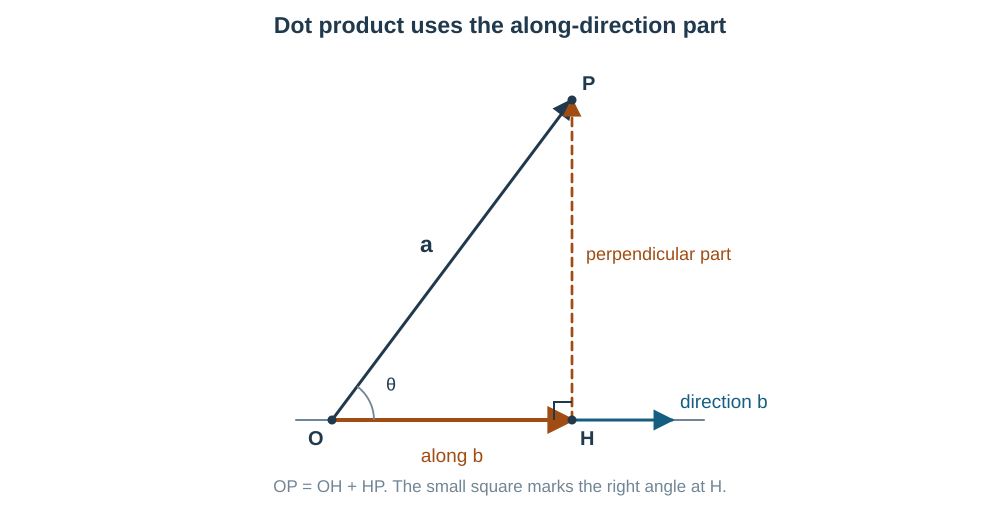

**Read the drawing:** $OP$ is the original vector. The line $OH$ is the chosen direction. The little square at $H$ means $HP$ is perpendicular to $OH$. Thus $OH$ is the along-line part and $HP$ is the perpendicular part. This example uses $\mathbf a=(3,4,0)$ and a horizontal $\mathbf b$; a 3D problem can also be viewed in the plane of its two vectors.

**What are we doing here?** We are resolving $\mathbf a$ **along $\mathbf b$ and perpendicular to $\mathbf b$**. The word resolution means splitting one arrow into chosen directions. We choose these directions because the question asks about $\mathbf b$.

$$
\overrightarrow{OP}=\overrightarrow{OH}+\overrightarrow{HP}
\quad\Longrightarrow\quad
\boxed{\mathbf a=\mathbf a_{\parallel}+\mathbf a_{\perp}}.
$$

The along-arrow must be a multiple $\lambda\mathbf b$. The leftover must be perpendicular to $\mathbf b$:

$$
(\mathbf a-\lambda\mathbf b)\cdot\mathbf b=0
\quad\Longrightarrow\quad
\lambda=\frac{\mathbf a\cdot\mathbf b}{|\mathbf b|^2}.
$$

This gives the formulas below. The picture is drawn in the plane of the two vectors with $\mathbf b$ horizontal; it need not match the original xyz axes.

For $\mathbf b\ne\mathbf0$, there are three different things a question may ask:

**1. Signed scalar projection of $\mathbf a$ on $\mathbf b$ — a number:**

$$
\boxed{s=\frac{\mathbf a\cdot\mathbf b}{|\mathbf b|}=|\mathbf a|\cos\theta}.
$$

Its sign says whether the shadow points along or against $\mathbf b$. If only the **length** of the projection is asked, use $|s|$.

**2. Vector projection — an arrow:** multiply that signed length by the unit vector along $\mathbf b$:

$$
\boxed{\mathbf a_{\parallel}
=\frac{\mathbf a\cdot\mathbf b}{|\mathbf b|^2}\mathbf b}.
$$

**3. Perpendicular component — the leftover arrow:**

$$
\boxed{\mathbf a_{\perp}=\mathbf a-\mathbf a_{\parallel}},
\qquad \mathbf a_{\perp}\cdot\mathbf b=0.
$$

Since the two parts are perpendicular, Pythagoras gives

$$
\boxed{|\mathbf a_{\perp}|^2
=|\mathbf a|^2-\frac{(\mathbf a\cdot\mathbf b)^2}{|\mathbf b|^2}}.
$$

**Tiny example:** take $\mathbf a=(3,4,0)$ and $\mathbf b=(2,0,0)$. Then $\mathbf a\cdot\mathbf b=6$, $|\mathbf b|=2$, so the scalar projection is $3$. The vector projection is $(3,0,0)$, and the perpendicular part is $(0,4,0)$. Their squared lengths add: $3^2+4^2=5^2$.

**Trap:** in “projection of $\mathbf a$ on $\mathbf b$,” divide by the length of the vector **after “on.”** Scalar projection and vector projection have different denominators and different kinds of answers.

### Concept C10 — Cross product creates a vector perpendicular to both inputs

**Important for JEE Main.** The main tool for normal directions and areas.

**Read this slowly the first time.** In three dimensions, the cross product of $\mathbf a$ and $\mathbf b$ is a vector:

$$
\mathbf c=\mathbf a\times\mathbf b.
$$

For non-parallel inputs drawn from the same point, the two arrows determine a plane. The new arrow points perpendicular to that plane. Therefore it is perpendicular to each original arrow. A vector perpendicular to a plane is called a **normal** to that plane.

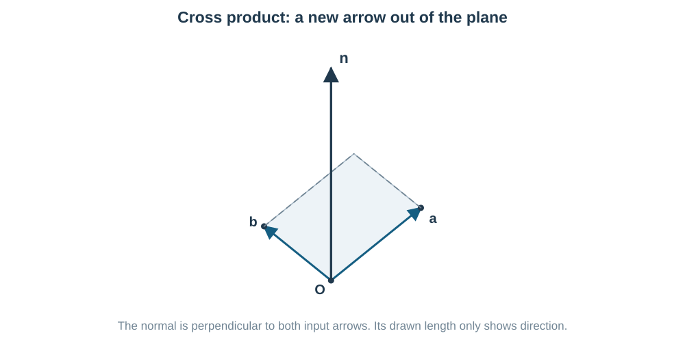

**Read the drawing:** the blue arrows lie along the sheet. The new dark arrow stands straight out of it. Its length here only indicates direction; the size formula comes next.

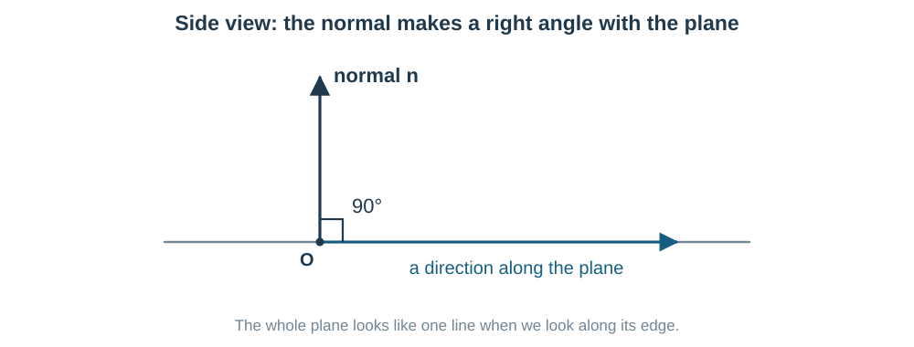

**Read this side view:** look along the edge of the sheet. The sheet looks like one line. The normal stands at $90^\circ$ to it. This makes the right angle clear even when the perspective picture is harder to read.

**Picture:** draw $\mathbf a$ rightwards and $\mathbf b$ upwards on a page. Then $\mathbf a\times\mathbf b$ points out of the page towards you.

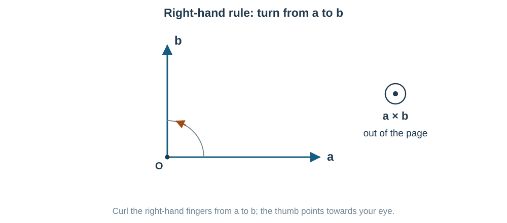

*The two arrows are in the page. The dot inside a circle, $\odot$, means an arrow coming towards your eye. A cross inside a circle, $\otimes$, means an arrow going into the page. These are direction symbols, not multiplication signs in this picture.*

There are two opposite directions perpendicular to a plane. **The right-hand rule chooses one:** curl your right-hand fingers from the first vector towards the second through the smaller angle. The thumb gives the cross-product direction. For the page example, turning from right to up gives a thumb towards you.

Because $\mathbf c$ is perpendicular to both inputs,

$$
(\mathbf a\times\mathbf b)\cdot\mathbf a=0,
\qquad
(\mathbf a\times\mathbf b)\cdot\mathbf b=0.
$$

These equations follow from the picture and the dot-product rule for a right angle. They also hold algebraically when the cross product is zero.

**Magnitude:** if $\theta$ is the angle between nonzero inputs,

$$
\boxed{|\mathbf a\times\mathbf b|
=|\mathbf a|\,|\mathbf b|\sin\theta}.
$$

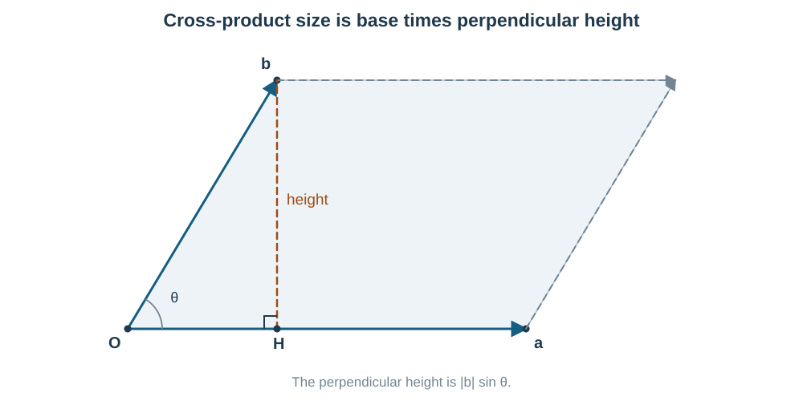

**Read the area drawing:** drop a perpendicular from the tip of $\mathbf b$ to the line of $\mathbf a$. That perpendicular is the height. The small square marks $90^\circ$.

**Why sine?** The parallelogram on the two arrows has base $|\mathbf a|$ and perpendicular height $|\mathbf b|\sin\theta$. Its area is their product. The cross-product magnitude is that area. The cross-product arrow gives the orientation of the plane as well.

**Check the picture in special cases:** parallel arrows make a flat parallelogram, so the answer is $\mathbf0$. Perpendicular arrows give the largest area for fixed lengths. Reversing the order preserves area and reverses direction:

$$
\mathbf b\times\mathbf a=-(\mathbf a\times\mathbf b).
$$

If an input is zero, the result is also zero. A zero cross product has no definite direction, and parallel inputs do not determine one unique plane.

**Choose cross product when:** you need a perpendicular direction, an area, or the moment of a force. For nonzero inputs, $\mathbf a\times\mathbf b=\mathbf0$ means they are parallel or antiparallel.

### Formula F03 — Calculate a cross product without losing the middle sign

**Important for JEE Main.** Use this calculation after deciding that cross product is the right tool.

First understand the basis directions using the right-hand rule:

$$
\hat{\mathbf i}\times\hat{\mathbf j}=\hat{\mathbf k},\qquad
\hat{\mathbf j}\times\hat{\mathbf k}=\hat{\mathbf i},\qquad
\hat{\mathbf k}\times\hat{\mathbf i}=\hat{\mathbf j}.
$$

The order cycles as $\hat{\mathbf i}\to\hat{\mathbf j}\to\hat{\mathbf k}\to\hat{\mathbf i}$. Reversing a pair gives a minus sign. The cross product of any basis vector with itself is $\mathbf0$ because the two inputs are parallel.

For components, the determinant is a calculation arrangement:

$$
\mathbf a\times\mathbf b=
\begin{vmatrix}
\hat{\mathbf i}&\hat{\mathbf j}&\hat{\mathbf k}\\
a_x&a_y&a_z\\
b_x&b_y&b_z
\end{vmatrix}.
$$

Here is the expansion in full:

$$
\boxed{\mathbf a\times\mathbf b
=(a_yb_z-a_zb_y)\hat{\mathbf i}
-(a_xb_z-a_zb_x)\hat{\mathbf j}
+(a_xb_y-a_yb_x)\hat{\mathbf k}}.
$$

**What does a small determinant mean?** For two rows, $\begin{vmatrix}p&q\\r&s\end{vmatrix}=ps-qr$. In the cross-product arrangement, delete the first row and the column of the component you are finding. Use signs plus, minus, plus across the top. The minus belongs to the whole middle bracket.

Cross product also opens across a sum:

$$
\mathbf a\times(\mathbf b+\mathbf c)
=\mathbf a\times\mathbf b+\mathbf a\times\mathbf c.
$$

Number multipliers can be taken out: $(p\mathbf a)\times(q\mathbf b)=pq(\mathbf a\times\mathbf b)$. A negative multiplier can therefore reverse the result.

It is not commutative. It is also not associative: brackets in a repeated cross product matter.

**Best check:** dot the result with each input. Both results must be zero. This detects many sign errors.

### Formula F04 — Dot and cross are connected by the same angle

**Important for JEE Main.** Especially useful when lengths and a dot are given but components are not.

**Start here.** The dot product uses cosine; the cross-product magnitude uses sine. Since $\sin^2\theta+\cos^2\theta=1$,

$$
\boxed{|\mathbf a\times\mathbf b|^2
=|\mathbf a|^2|\mathbf b|^2-(\mathbf a\cdot\mathbf b)^2}.
$$

This is often called **Lagrange's identity**. It remains true when an input is zero.

**Choose this when:** lengths and a dot product are given, but components are not. You can find the cross-product magnitude without finding the angle. If a squared magnitude is asked, stop before taking a square root.

**One more useful connection — a dot of two cross products.** When each side of a dot product is itself a cross product, this identity replaces it with ordinary dots:

$$
(\mathbf a\times\mathbf b)\cdot(\mathbf c\times\mathbf d)
=(\mathbf a\cdot\mathbf c)(\mathbf b\cdot\mathbf d)
-(\mathbf a\cdot\mathbf d)(\mathbf b\cdot\mathbf c).
$$

It works for any vectors in 3D, including zero vectors. Taking $\mathbf c=\mathbf a$ and $\mathbf d=\mathbf b$ gives the squared cross-product identity above. Learn the simpler size identity first; use this wider form when the question actually contains a dot of two crosses.

### Formula F05 — Perpendicular vectors and areas

**Important for JEE Main.** Use this for area and for directions perpendicular to two arrows.

For non-parallel $\mathbf a,\mathbf b$, both unit normals are

$$
\boxed{\pm\frac{\mathbf a\times\mathbf b}{|\mathbf a\times\mathbf b|}}.
$$

**Why two?** Both opposite arrows are perpendicular to the same plane. If a question specifies the direction of $\mathbf a\times\mathbf b$, use its order; if it asks for “a unit vector perpendicular to both,” either sign can qualify.

For adjacent side vectors $\mathbf a,\mathbf b$,

$$
\boxed{\text{Parallelogram area}=|\mathbf a\times\mathbf b|},\qquad
\boxed{\text{Triangle area}=\frac12|\mathbf a\times\mathbf b|}.
$$

If **vertices** $A,B,C$ are given, first make two sides from one vertex:

$$
\boxed{\text{Area of }ABC
=\frac12\big|(\mathbf b-\mathbf a)\times(\mathbf c-\mathbf a)\big|}.
$$

**Trap:** $\mathbf b\times\mathbf c$ uses arrows from the origin, so it generally gives the wrong triangle when the vertex $A$ is not the origin.

**Connection — three collinear points.** If $A,B,C$ lie on one straight line, the side arrows $\overrightarrow{AB},\overrightarrow{AC}$ are parallel or one is zero. Their cross is zero:

$$
A,B,C\text{ are collinear}
\iff\overrightarrow{AB}\times\overrightarrow{AC}=\mathbf0.
$$

The triangle area is then zero. This is the area formula's zero case, not a separate rule to memorize.

**If diagonals are given instead:** for a parallelogram with diagonal vectors $\mathbf p,\mathbf q$,

$$
\text{Area}=\frac12|\mathbf p\times\mathbf q|.
$$

**Why the half here?** For side vectors $\mathbf a,\mathbf b$, the diagonal vectors can be taken as $\mathbf p=\mathbf a+\mathbf b$ and $\mathbf q=\mathbf a-\mathbf b$. Expanding gives $\mathbf p\times\mathbf q=-2\mathbf a\times\mathbf b$. Taking magnitudes explains the factor $1/2$. Check whether the given arrows are **sides or diagonals** before choosing the area formula.

### Concept C11 — Dividing a segment means taking a weighted position

**Important for JEE Main.** Use this for dividing points and coordinate-plane crossings.

Suppose $P$ lies between $A$ and $B$, and $AP:PB=m:n$, where $m,n>0$. The fraction of the journey from $A$ to $B$ is $m/(m+n)$. Therefore

$$
\mathbf p=\mathbf a+\frac{m}{m+n}(\mathbf b-\mathbf a)
=\boxed{\frac{n\mathbf a+m\mathbf b}{m+n}}.
$$

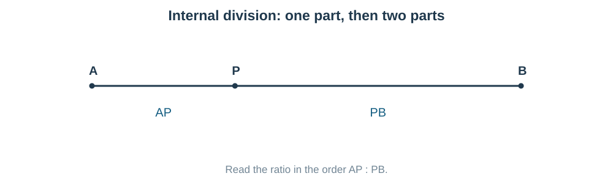

Here the drawing shows the example $AP:PB=1:2$. The two segment lengths really have that ratio.

**Remember the weights:** the multiplier of $\mathbf a$ is the opposite segment's number $n$. If $m$ is small compared with $n$, $P$ is close to $A$, so its formula should give more weight to $\mathbf a$.

For external division in the positive length ratio $AP:PB=m:n$,

$$
\mathbf p=\frac{m\mathbf b-n\mathbf a}{m-n},\qquad m\ne n.
$$

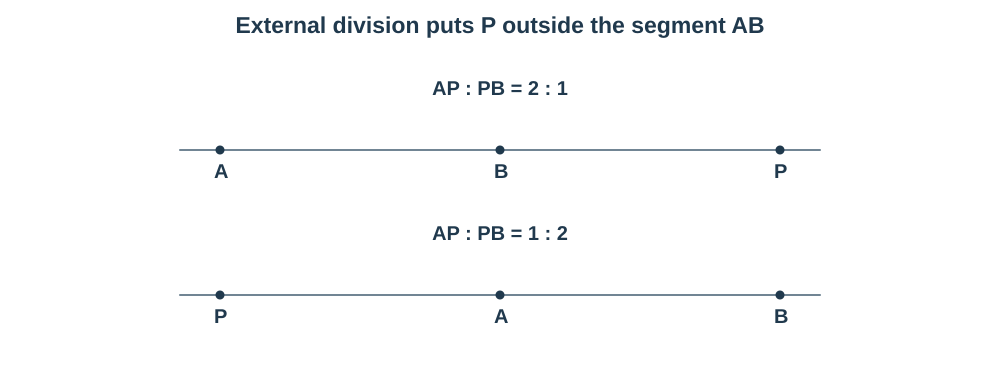

**Read the two examples:** $P$ is not between $A$ and $B$. The ratio still compares the positive distances $AP$ and $PB$.

Here $P$ lies outside the segment. For positive lengths, $m>n$ places it beyond $B$; $m<n$ places it beyond $A$.

Useful special cases:

$$
\text{Midpoint}=\frac{\mathbf a+\mathbf b}{2},\qquad
\text{Triangle centroid}=\frac{\mathbf a+\mathbf b+\mathbf c}{3}.
$$

A **centroid** is the balance point of a uniform triangle. Its position is the average of the three vertex positions. For four vertices of a tetrahedron, the centroid is their position-vector sum divided by $4$.

**Coordinate-plane clue:** on the $xy$-plane, $z=0$; on the $yz$-plane, $x=0$; on the $xz$-plane, $y=0$. Apply the section formula to that coordinate first. There is no need to calculate every coordinate just to find a ratio.

### Concept C12 — An angle bisector shares the angle equally

**Important for JEE Main.** Use this when equal-angle directions or angle-bisector points are asked.

Suppose two nonzero, non-collinear vectors $\mathbf a,\mathbf b$ start together. A bisector lies in their plane and makes equal angles with the two arrows. In three dimensions, equal angles alone do not ensure that a direction lies in that plane.

To compare **directions fairly**, first give both arrows the same length. Make them unit vectors:

$$
\mathbf u=\frac{\mathbf a}{|\mathbf a|},\qquad
\mathbf v=\frac{\mathbf b}{|\mathbf b|}.
$$

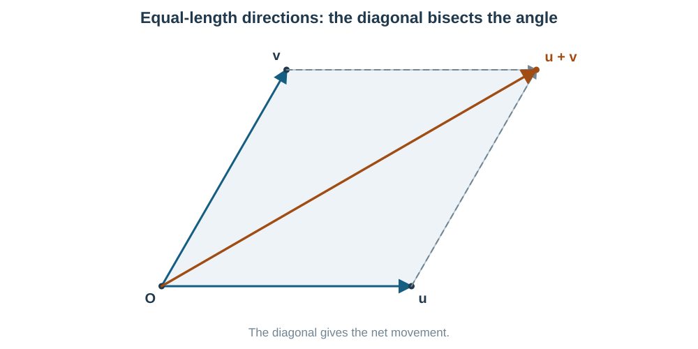

**Read the drawing:** the two side arrows have equal length. The orange diagonal lies midway between their directions.

Now $\mathbf u$ and $\mathbf v$ form equal sides of a rhombus. Its sum diagonal splits the inside angle equally. Thus

$$
\boxed{\text{Internal bisector direction: }\mathbf u+\mathbf v},\qquad
\boxed{\text{External bisector direction: }\mathbf u-\mathbf v}.
$$

Normalize again if a **unit** bisector is asked. When $|\mathbf a|=|\mathbf b|$, the internal direction can be taken as $\mathbf a+\mathbf b$. With unequal lengths, adding the original arrows generally does not bisect the angle.

**Connection:** $(\mathbf u+\mathbf v)\cdot(\mathbf u-\mathbf v)=1-1=0$, so these two bisector directions are perpendicular.

**Useful lengths for unit inputs:** if their angle is $\theta$, with $0\le\theta\le\pi$,

$$
|\mathbf u+\mathbf v|=\sqrt{2+2\cos\theta}=2\cos\frac\theta2,
\qquad
|\mathbf u-\mathbf v|=\sqrt{2-2\cos\theta}=2\sin\frac\theta2.
$$

These come from the squared-sum and squared-difference formulas in F02 and the half-angle identities. The square-root forms work even if you have forgotten the half-angle forms. For non-collinear inputs, dividing the sum or difference by its displayed length gives the corresponding unit bisector.

For the internal bisector of angle $BAC$ meeting $BC$ at $D$, the angle-bisector theorem gives $BD:DC=AB:AC$. The section formula then gives

$$
\mathbf d=\frac{AC\,\mathbf b+AB\,\mathbf c}{AB+AC}.
$$

Opposite directions give $\mathbf u+\mathbf v=\mathbf0$, so that expression cannot specify an internal unit bisector. Do not normalize a zero sum or difference.

### Concept C13 — A normal helps us test volume and coplanarity

**PDF support tool.** First picture a flat sheet. Two non-parallel arrows along it determine its plane. Their cross product makes a normal — a vector standing straight out of the sheet.

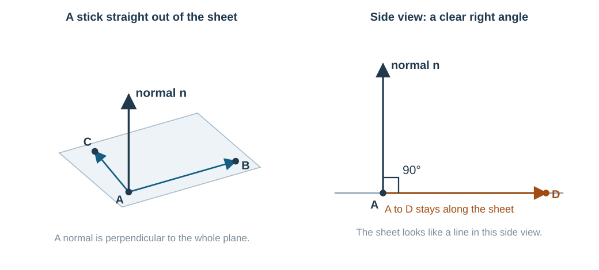

**Read the side view:** an arrow along the sheet makes $90^\circ$ with the normal. An arrow with a part above or below the sheet has a nonzero part in the normal direction.

Now take three arrows $\mathbf a,\mathbf b,\mathbf c$ starting at one corner of a box. Let $\mathbf b,\mathbf c$ form the base.

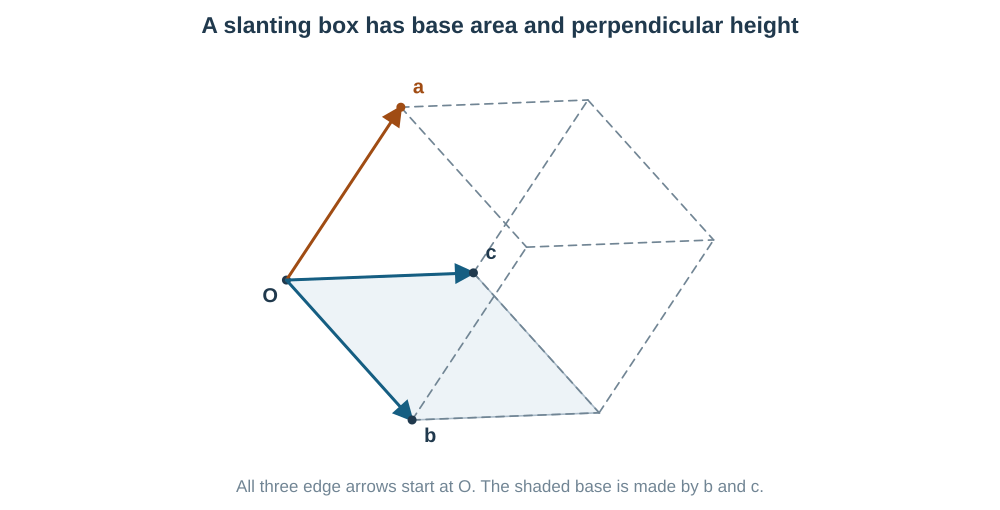

**Read the box:** $\mathbf b\times\mathbf c$ is perpendicular to the shaded base, and its size is the base area. Only the perpendicular part of the third edge $\mathbf a$ gives the height.

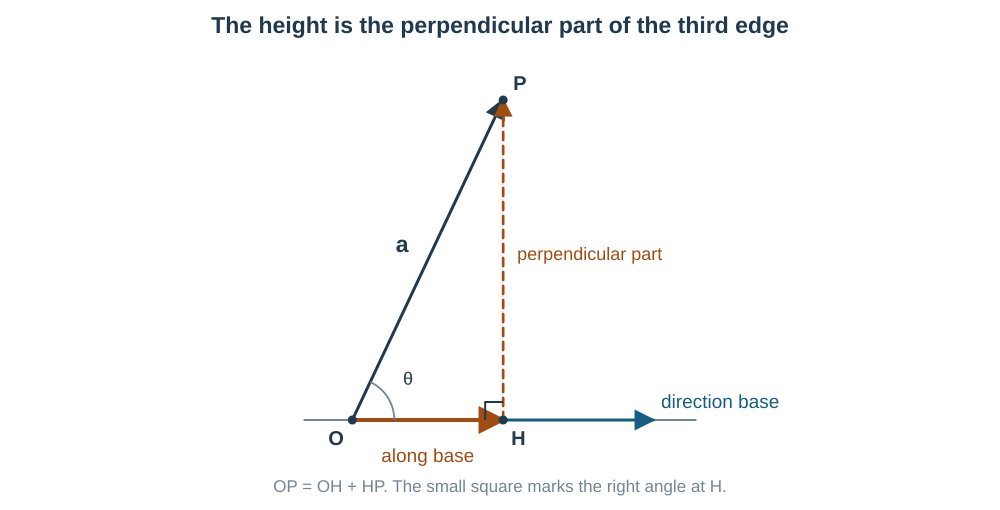

In this side-plane view, $OH$ stays along the base and $HP$ is the perpendicular height. The full slanting edge $OP$ is longer than the height.

The **scalar triple product** combines those two jobs:

$$
\boxed{[\mathbf a\,\mathbf b\,\mathbf c]
=\mathbf a\cdot(\mathbf b\times\mathbf c)}.
$$

First the cross product gives base area and its normal direction. Then the dot product uses the signed height part of $\mathbf a$. The result is a **number**: signed base area times height.

For three edges starting together,

$$
\boxed{V_{\text{parallelepiped}}=|[\mathbf a\,\mathbf b\,\mathbf c]|},
\qquad
\boxed{V_{\text{tetrahedron}}=\frac16|[\mathbf a\,\mathbf b\,\mathbf c]|}.
$$

A parallelepiped is a possibly slanting box. A tetrahedron is a triangular pyramid. For that pyramid, the triangular base contributes a factor $1/2$ and the pyramid volume rule contributes $1/3$. Their product is $1/6$. Use absolute value for an ordinary nonnegative volume. For tetrahedron $ABCD$, first form three edges from $A$:

$$
V_{ABCD}=\frac16\left|
\overrightarrow{AB}\cdot
(\overrightarrow{AC}\times\overrightarrow{AD})\right|.
$$

**Coplanar vectors.** Three arrows are coplanar when they can all lie along one sheet. Their box has zero height, so

$$
\boxed{\text{Three vectors are coplanar}
\iff [\mathbf a\,\mathbf b\,\mathbf c]=0}.
$$

If two of the vectors are parallel, their cross is already zero. Those two vectors and any third vector can fit in some plane, so the zero-product test still works.

**Coplanar points.** For four points $A,B,C,D$, make movements starting at $A$:

$$
\mathbf u=\overrightarrow{AB},\quad
\mathbf v=\overrightarrow{AC},\quad
\mathbf w=\overrightarrow{AD}.
$$

When the first two directions are not parallel, $\mathbf n=\mathbf u\times\mathbf v$ is a nonzero normal. The last movement stays in the sheet when $\mathbf n\cdot\mathbf w=0$:

$$
\boxed{(\overrightarrow{AB}\times\overrightarrow{AC})
\cdot\overrightarrow{AD}=0}.
$$

This is also the general four-point coplanarity test. If $A,B,C$ lie on one line, these first two arrows give a zero cross product; the four points are still coplanar, but this cross does not give a unique plane normal. Choose a non-parallel pair when you need an actual normal.

**Why subtract coordinates first?** A position arrow starts at the origin. The origin need not be on the sheet containing our four points. Movements such as $B-A$ start at a known point on the sheet and describe its sides. Q35 builds this idea slowly with four drawings.

**Calculation form.** The same scalar triple product is a number determinant:

$$
[\mathbf a\,\mathbf b\,\mathbf c]
=\begin{vmatrix}
a_x&a_y&a_z\\b_x&b_y&b_z\\c_x&c_y&c_z
\end{vmatrix}.
$$

Use signs plus, minus, plus across the first row. In an ordinary $2\times2$ determinant, $\begin{vmatrix}p&q\\r&s\end{vmatrix}=ps-qr$.

The following properties are useful:

$$
[\mathbf a\,\mathbf b\,\mathbf c]
=[\mathbf b\,\mathbf c\,\mathbf a]
=[\mathbf c\,\mathbf a\,\mathbf b].
$$

These are **cyclic shifts**: move the first item to the end without changing the circular order. The signed volume stays the same. Swapping just two entries reverses the sign:

$$
[\mathbf b\,\mathbf a\,\mathbf c]=-[\mathbf a\,\mathbf b\,\mathbf c].
$$

A repeated entry gives zero because the arrows cannot make a three-dimensional box. The product distributes over addition in each entry. For example,

$$
[\mathbf a\,\mathbf b\,(\mathbf a+\mathbf b)]
=[\mathbf a\,\mathbf b\,\mathbf a]+[\mathbf a\,\mathbf b\,\mathbf b]=0.
$$

For Q32, two extra identities are useful. Put $S=[\mathbf a\,\mathbf b\,\mathbf c]$:

$$
[\mathbf a+\mathbf b,\mathbf b+\mathbf c,\mathbf c+\mathbf a]=2S,
$$

$$
[\mathbf a\times\mathbf b,\mathbf b\times\mathbf c,\mathbf c\times\mathbf a]=S^2.
$$

Their reasons are shown in Q32. Learn the volume meaning and basic sign rules first; read that identity proof on a second pass.

### Concept C14 — Vector triple product: work from the brackets

**PDF support tool.** In $\mathbf a\times(\mathbf b\times\mathbf c)$, the inner cross product makes a vector. The outer cross product makes another vector. The final answer is a **vector**, unlike the scalar triple product.

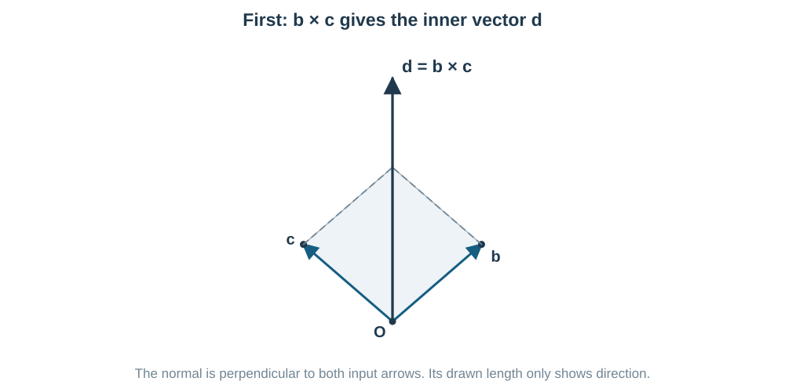

**First picture:** call the inner result $\mathbf d=\mathbf b\times\mathbf c$. It is one new arrow. Now treat that arrow as the second input of the next cross product.

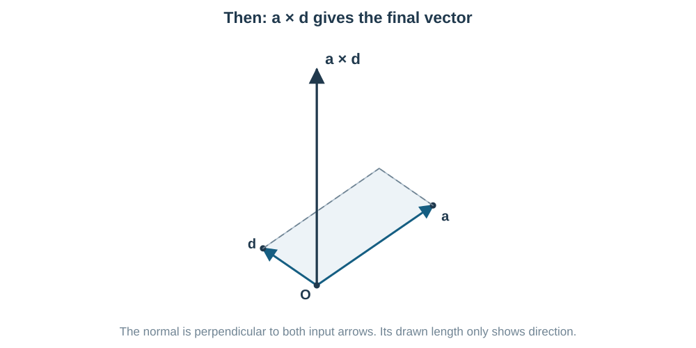

**Second picture:** cross $\mathbf a$ with $\mathbf d$. The final arrow is perpendicular to these two inputs. The drawings use different views for the two operations; the symbol $\mathbf d$ names the same inner vector.

The inner result is perpendicular to the plane of $\mathbf b,\mathbf c$. The outer result is perpendicular to that normal and also to $\mathbf a$. When $\mathbf b,\mathbf c$ are non-parallel, the outer result lies in their plane, so it can be written using $\mathbf b$ and $\mathbf c$:

$$
\boxed{\mathbf a\times(\mathbf b\times\mathbf c)
=\mathbf b(\mathbf a\cdot\mathbf c)-\mathbf c(\mathbf a\cdot\mathbf b)}.
$$

**Memory cue with meaning:** the answer uses the two inner vectors. The first inner vector comes first, multiplied by the dot product of the remaining pair. The second term is subtracted. This is often called the BAC–CAB rule.

For the other bracket placement,

$$
\boxed{(\mathbf a\times\mathbf b)\times\mathbf c
=\mathbf b(\mathbf a\cdot\mathbf c)-\mathbf a(\mathbf b\cdot\mathbf c)}.
$$

These expressions are generally different. Never move the brackets as if cross products were ordinary number multiplication. For a small component question, doing the inner cross product first is also a sound method.

**A useful combined constraint:** if $\mathbf a\ne\mathbf0$, $\mathbf a\times\mathbf x=\mathbf b$, and $\mathbf a\cdot\mathbf x=d$, then

$$
\mathbf a\times\mathbf b
=\mathbf a\times(\mathbf a\times\mathbf x)
=d\mathbf a-|\mathbf a|^2\mathbf x,
$$

so

$$
\boxed{\mathbf x=\frac{d\mathbf a-\mathbf a\times\mathbf b}{|\mathbf a|^2}}.
$$

**Existence check:** $\mathbf a\cdot\mathbf b=0$ is necessary; the given cross-product result must be perpendicular to $\mathbf a$. The formula above is a solution when that condition holds. Q27 shows how the two given constraints fix different parts of the unknown vector.

### Formula F06 — Distance to a line is the leftover perpendicular part

**Important for JEE Main.** Use this for point-to-line distance and minimum-length questions.

Let a line pass through a point with position vector $\mathbf a$ and have nonzero direction vector $\mathbf d$. For a point $P$ with position vector $\mathbf p$, put $\mathbf r=\mathbf p-\mathbf a$.

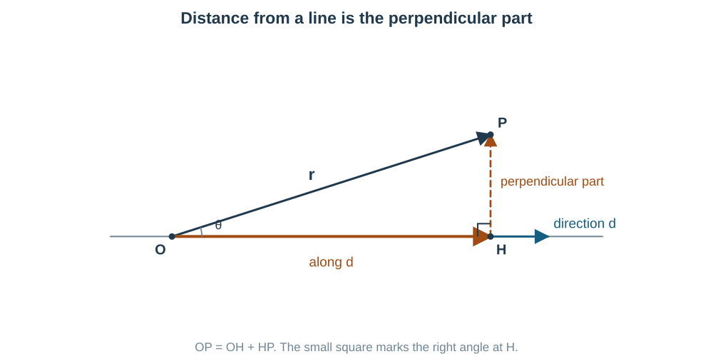

**Read the picture:** $O$ stands for our chosen point on the line, $OP$ is $\mathbf r$, and $HP$ is the shortest distance. For a line not through the origin, shift the starting point to any known point on that line; the right-triangle idea stays the same.

The shortest distance is the magnitude of the part of $\mathbf r$ perpendicular to the line:

$$
\boxed{D=\frac{|\mathbf r\times\mathbf d|}{|\mathbf d|}
=\sqrt{|\mathbf r|^2-\frac{(\mathbf r\cdot\mathbf d)^2}{|\mathbf d|^2}}}.
$$

**Why the cross-product form?** The parallelogram area is both $|\mathbf r\times\mathbf d|$ and base $|\mathbf d|$ times perpendicular height $D$. Divide area by base. For a line through the origin, $\mathbf r=\mathbf p$.

**Connection to a minimum:** adding any real multiple of $\mathbf b\ne\mathbf0$ changes only the part along $\mathbf b$. It cannot change the perpendicular part of $\mathbf a$. Therefore

$$
\boxed{\min_{t\in\mathbb R}|\mathbf a+t\mathbf b|
=\sqrt{|\mathbf a|^2-\frac{(\mathbf a\cdot\mathbf b)^2}{|\mathbf b|^2}}
=\frac{|\mathbf a\times\mathbf b|}{|\mathbf b|}},
$$

attained at

$$
t=-\frac{\mathbf a\cdot\mathbf b}{|\mathbf b|^2}.
$$

This minimum formula assumes $t$ can be any real number. If $t$ is restricted to an interval, check whether this value lies inside it; otherwise check the endpoints. If $\mathbf b=\mathbf0$, the length is always $|\mathbf a|$.

### Formula F07 — Work uses the along-motion part; torque uses the perpendicular effect

These applications appear in this Maths PDF.

For a **constant force** $\mathbf F$ acting through displacement $\mathbf s$,

$$
\boxed{W=\mathbf F\cdot\mathbf s}.
$$

**Why dot?** Only the force component along the displacement contributes to work. The output is a scalar. Work can be positive, negative, or zero. Find displacement as final position minus initial position. In SI units, newtons times metres gives joules.

For force $\mathbf F$ applied at position vector $\mathbf r$ measured from the chosen origin,

$$
\boxed{\boldsymbol\tau=\mathbf r\times\mathbf F}.
$$

**Why cross?** Turning effect depends on the perpendicular separation from the force's line of action. Its magnitude is $|\mathbf r||\mathbf F|\sin\theta$. Its direction gives the turning axis using the right-hand rule. The output is a vector. Torque has SI unit newton metre.

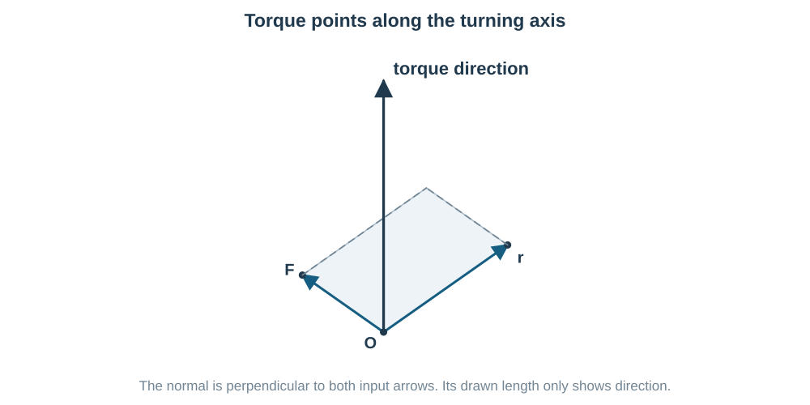

**Read the picture:** position and force are the two side directions; torque is the normal. This is a direction diagram, not a drawing of a particular solid object.

**Trap:** the order is position cross force. If the question asks $|\boldsymbol\tau|^2$, square and add its components; do not take a square root.

### Concept C15 — Equal dot products do not let you cancel a vector

**Important for JEE Main.** Useful for true/false statements and deciding what a product equality really tells us.

From $\mathbf a\cdot\mathbf b=\mathbf a\cdot\mathbf c$, we get

$$
\mathbf a\cdot(\mathbf b-\mathbf c)=0.
$$

This says the difference has zero component along $\mathbf a$. It can still have a perpendicular component.

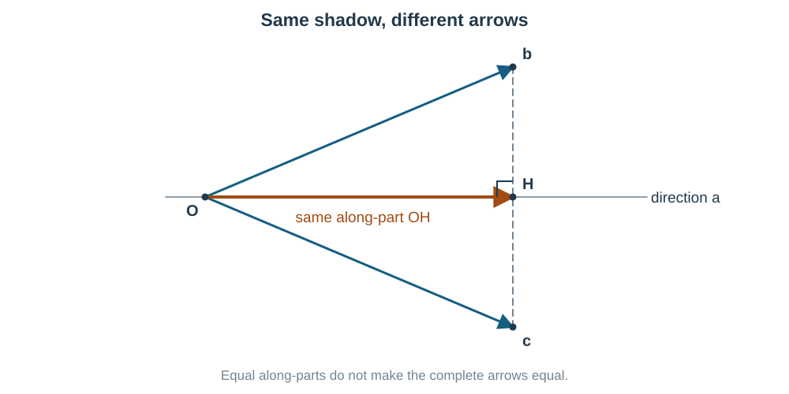

**Read the picture:** $\mathbf b=(2,1,0)$ and $\mathbf c=(2,-1,0)$ share the same shadow $OH$ along $\mathbf a=(1,0,0)$. Their dots with $\mathbf a$ are both $2$, although the whole arrows differ.

Equal cross products alone also do not allow cancellation. If $\mathbf a\ne\mathbf0$ and $\mathbf a\times\mathbf b=\mathbf a\times\mathbf c$, then the difference is parallel to $\mathbf a$ or zero.

**Both conditions together** force $\mathbf b=\mathbf c$: a nonzero difference cannot be both parallel and perpendicular to the same nonzero vector. Q33 develops this fully.

### Concept C16 — Choose a picture, a graph, or an expansion

**Important for JEE Main — learning how to choose the route.** Before calculating, ask: “What does this expression look like? Which picture or identity contains the thing I need?”

**1. When you see cosine, think of an along-direction part.** If an arrow has length $r$ and makes angle $\theta$ with a chosen positive direction, its signed projection along that direction is $r\cos\theta$. A positive cosine puts the shadow in the chosen direction. A negative cosine puts it on the opposite side. That is why the force projection in Q19 gives negative work.

**2. When you see sine, look for a perpendicular height.** For two arrows, the height above one arrow's line is $r\sin\theta$, where $r$ is the other arrow's length and $0\le\theta\le\pi$. This is why cross-product magnitude contains sine and measures parallelogram area. The projection triangle in C09 and Q14 shows the along-part and perpendicular part together.

For an acute-angle projection triangle,

$$
\cos\theta=\frac{\text{along-part length}}{\text{original length}},
\qquad
\sin\theta=\frac{\text{perpendicular-part length}}{\text{original length}}.
$$

If the angle is obtuse, the **signed** along-part becomes negative. Its ordinary length is still positive. A unit-circle or sine/cosine graph is another useful view in trigonometry questions, especially for signs, ranges, periods, and repeated solutions.

**3. When a real number is inside modulus bars, think of distance.**

$$
|x|=\begin{cases}x,&x\ge0,\\-x,&x<0.\end{cases}
$$

It is the distance of $x$ from zero on a number line. The graph is a V:

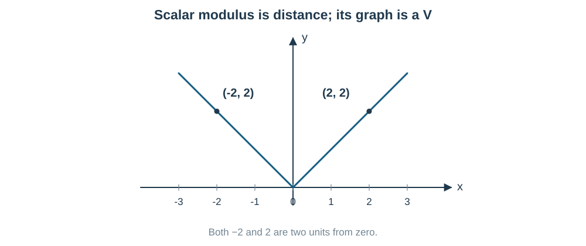

**Read the graph:** both $x=2$ and $x=-2$ have height $2$ because both are two units from zero. Here the plotted points lie exactly on the two straight pieces; this V is not a sine curve or an approximation of a curved function.

Likewise, $|x-h|$ is distance from the number $h$. In other chapters, an equation such as $|x-h|=k$ with $k\ge0$ means points at distance $k$ from $h$. Thinking of distance can be easier than opening many cases immediately.

**4. When a vector is inside bars, think of arrow length.** For $\mathbf v=(v_x,v_y,v_z)$,

$$
|\mathbf v|=\sqrt{v_x^2+v_y^2+v_z^2}.
$$

A vector is not a positive or negative real number, so do not apply the scalar sign cases to the whole vector. Also, $|\mathbf a+\mathbf b|$ is generally not $|\mathbf a|+|\mathbf b|$. Direction matters. In Q34, $|\mathbf a+t\mathbf b|$ is a distance from the origin while the endpoint moves on a line. This picture suggests a shortest perpendicular distance.

**5. Expand when the expansion contains the target.** In Q18, the three requested pairwise dots appear inside $|\mathbf a+\mathbf b+\mathbf c|^2$. In Q16, plus and minus make the mixed dots cancel. In Q34, the expanded squared length becomes $3(t+2)^2+2$, so its minimum can be read without calculus.

**6. Do not expand more than the question needs.** In Q28, solving all three coefficients works, but adding the coordinate equations finds just their sum. In Q27, finding the whole unknown vector works, but resolution finds just its length. A good route uses the given information and produces the requested quantity with fewer extra steps.

**A route is better here only if we can say why.** If direct substitution works cleanly, use it. If a graph, a geometric picture, grouping, or an expansion reduces the work, show the clue that makes it useful. A valid longer method is still valid; knowing why another method is shorter builds judgment.

## Prioritized question models

This is a method-choice map, ordered for learning. It is not a frequency ranking. Follow the PDF's order when solving the numbered questions.

| What you see | What should click | Notes to revisit |
|---|---|---|
| Projection of one vector on another | Along-direction shadow; decide scalar or vector | C08–C09 |
| A perpendicular direction or area | Cross product; direction and size are different | C10, F03–F05 |
| Lengths and dot product, but no components | Use the dot–cross identity | F04 |
| A zero sum or a length of a sum | Square it; keep every cross term | C05, F02 |
| A point dividing a segment | Weighted position; use the useful coordinate | C11 |
| Volume or coplanarity | Base area times signed height | C13 |
| Nested cross products | Keep brackets; do inside first or expand correctly | C14 |
| Distance from a line or a free real parameter | The perpendicular part is what remains | C09, F06 |
| A statement saying “always” | Look for a proof or a valid counterexample | C15, Q10, Q33 |

## Last-minute checklist

This is the compact recall section. Read it after understanding the explanations above.

| Need | Recall | Condition or trap |
|---|---|---|
| Length | $|\mathbf a|=\sqrt{a_x^2+a_y^2+a_z^2}$ | Length is a nonnegative number. |
| Unit direction | $\mathbf a/|\mathbf a|$ | $\mathbf a\ne\mathbf0$ |
| Movement from $A$ to $B$ | $\mathbf b-\mathbf a$ | Destination minus start. |
| Direction cosines | $l^2+m^2+n^2=1$ | Keep signs of the components. |
| Dot product | $\mathbf a\cdot\mathbf b=\sum a_ib_i=|\mathbf a||\mathbf b|\cos\theta$ | Output is a scalar. |
| Angle | $\cos\theta=(\mathbf a\cdot\mathbf b)/(|\mathbf a||\mathbf b|)$ | Both inputs nonzero. |
| Perpendicularity | $\mathbf a\cdot\mathbf b=0$ | Nonzero inputs for a right-angle interpretation. |
| Signed scalar projection on $\mathbf b$ | $(\mathbf a\cdot\mathbf b)/|\mathbf b|$ | Divide by the vector after “on.” |
| Vector projection on $\mathbf b$ | $\mathbf b(\mathbf a\cdot\mathbf b)/|\mathbf b|^2$ | $\mathbf b\ne\mathbf0$ |
| Perpendicular part | $\mathbf a-\operatorname{proj}_{\mathbf b}\mathbf a$ | Its dot with $\mathbf b$ is zero. |
| Cross-product size | $|\mathbf a\times\mathbf b|=|\mathbf a||\mathbf b|\sin\theta$ | Output of the cross product itself is a vector. |
| Cross-product direction | Perpendicular to both; right-hand rule | Order reversal gives a minus sign. |
| Parallelism | $\mathbf a\times\mathbf b=\mathbf0$ | Also true if an input is zero. |
| Dot–cross connection | $|\mathbf a\times\mathbf b|^2=|\mathbf a|^2|\mathbf b|^2-(\mathbf a\cdot\mathbf b)^2$ | Do not square a squared length again. |
| Triangle from vertices | $\tfrac12|(\mathbf b-\mathbf a)\times(\mathbf c-\mathbf a)|$ | First make sides. |
| Internal division $AP:PB=m:n$ | $(n\mathbf a+m\mathbf b)/(m+n)$ | Opposite weights. |
| Internal bisector | $\mathbf a/|\mathbf a|+\mathbf b/|\mathbf b|$ | Normalize inputs first. |
| Scalar triple product | $[\mathbf a\,\mathbf b\,\mathbf c]=\mathbf a\cdot(\mathbf b\times\mathbf c)$ | Number; cyclic same, one swap opposite. |
| Box / tetrahedron volume | $|[\mathbf a\,\mathbf b\,\mathbf c]|$ / $|[\mathbf a\,\mathbf b\,\mathbf c]|/6$ | Three edges from one vertex. |
| Four coplanar points | $[\mathbf b-\mathbf a,\mathbf c-\mathbf a,\mathbf d-\mathbf a]=0$ | Use difference vectors. |
| Vector triple product | $\mathbf a\times(\mathbf b\times\mathbf c)=\mathbf b(\mathbf a\cdot\mathbf c)-\mathbf c(\mathbf a\cdot\mathbf b)$ | Brackets matter; output is a vector. |
| Distance to a line | $|\mathbf r\times\mathbf d|/|\mathbf d|$ | $\mathbf r$ starts at a point on the line. |
| Minimum of $|\mathbf a+t\mathbf b|$ | $\sqrt{|\mathbf a|^2-(\mathbf a\cdot\mathbf b)^2/|\mathbf b|^2}$ | Real unrestricted $t$; $\mathbf b\ne\mathbf0$. |
| Cauchy–Schwarz | $|\mathbf a\cdot\mathbf b|\le|\mathbf a||\mathbf b|$ | Equality when one vector is a multiple of the other, or either is zero. Check the equality choice is allowed. |
| Squared weighted sum | $|p\mathbf a+q\mathbf b|^2=p^2|\mathbf a|^2+q^2|\mathbf b|^2+2pq\,\mathbf a\cdot\mathbf b$ | Keep the angle-dependent pair term. |
| Three-vector squared sum | $|\mathbf a+\mathbf b+\mathbf c|^2=\sum|\mathbf a|^2+2(\mathbf a\cdot\mathbf b+\mathbf b\cdot\mathbf c+\mathbf c\cdot\mathbf a)$ | A zero sum can determine the requested pairwise dots. |
| Sum dotted with difference | $(\mathbf a+\mathbf b)\cdot(\mathbf a-\mathbf b)=|\mathbf a|^2-|\mathbf b|^2$ | The mixed dots cancel. |
| Possible sum lengths | $\big||\mathbf a|-|\mathbf b|\big|\le|\mathbf a+\mathbf b|\le|\mathbf a|+|\mathbf b|$ | Useful for a range check. |
| External division | $(m\mathbf b-n\mathbf a)/(m-n)$ | $m,n>0$ and $m\ne n$; $P$ lies outside $AB$. |
| Midpoint / centroid | $(\mathbf a+\mathbf b)/2$ / $(\mathbf a+\mathbf b+\mathbf c)/3$ | The centroid formula is for a triangle. |
| Bisector unit-input lengths | $|\mathbf u+\mathbf v|=2\cos(\theta/2)$, $|\mathbf u-\mathbf v|=2\sin(\theta/2)$ | Unit inputs, $0\le\theta\le\pi$. |
| Parallelogram diagonals | $A=\tfrac12|\mathbf p\times\mathbf q|$ | These inputs are diagonals, not adjacent sides. |
| Work / torque | $\mathbf F\cdot\mathbf s$ / $\mathbf r\times\mathbf F$ | Work scalar; torque vector. |

**Three final checks:** Did I answer a number or a vector as asked? Is a square root needed? Did I use the required nonzero and direction conditions?

## Worked solutions to the 35 PDF questions

Read the meaning and picture first. Then follow the calculation. After trying a question, use its check. Read an alternative method when the main idea is clear; all alternatives are fully visible.

### Question 1 — Projection on a vector

**PDF page 113 | MCQ | Notes: C08–C09**

The projection of $\mathbf a=\hat{\mathbf i}+2\hat{\mathbf j}+3\hat{\mathbf k}$ on $\mathbf b=2\hat{\mathbf i}-\hat{\mathbf j}+\hat{\mathbf k}$ is:

- (a) $\sqrt6/2$
- (b) $3/\sqrt{14}$
- (c) $1/2$
- (d) $\sqrt6$

**Understand the picture.** A projection is the shadow of one arrow along a chosen direction. Here we want the shadow of $\mathbf a$ along $\mathbf b$. The question asks for a number, so we need the **scalar projection**, not the whole projection arrow.

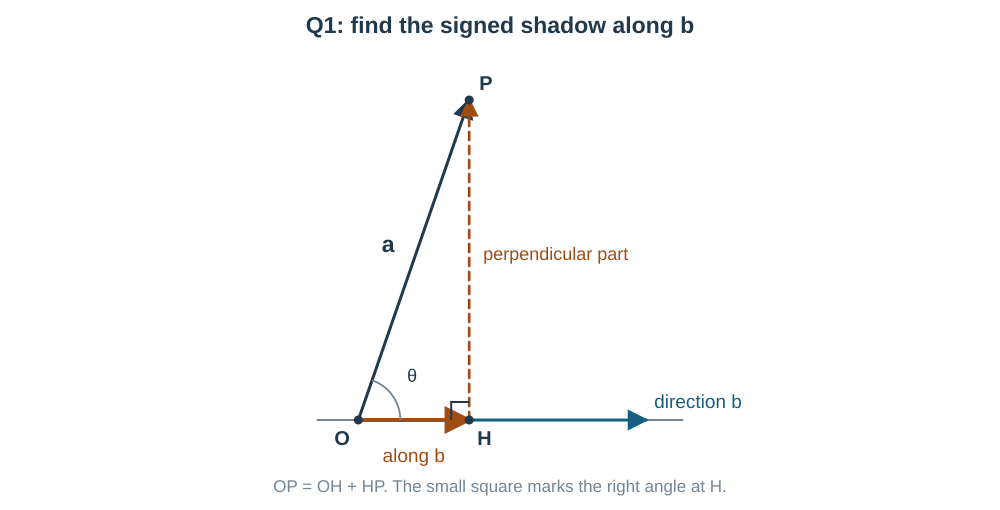

Read $OP$ as $\mathbf a$. The line through $O,H$ is the direction of $\mathbf b$. The shadow is $OH$; $HP$ is the leftover part.

**Choose the method.** The shadow formula is $|\mathbf a|\cos\theta$. We do not know $\theta$ yet. But the dot product already contains this cosine:

$$
\mathbf a\cdot\mathbf b=|\mathbf a||\mathbf b|\cos\theta
\quad\Longrightarrow\quad
s=\frac{\mathbf a\cdot\mathbf b}{|\mathbf b|}.
$$

So we can find the shadow without finding the angle first.

**Solution.**

$$
\mathbf a\cdot\mathbf b=1(2)+2(-1)+3(1)=3,
\qquad |\mathbf b|=\sqrt{4+1+1}=\sqrt6.
$$

$$
\boxed{s=\frac3{\sqrt6}=\frac{\sqrt6}{2}}
\qquad\text{option (a).}
$$

**Check.** The dot is positive, so the shadow points along $\mathbf b$. Its length is smaller than $|\mathbf a|=\sqrt{14}$, as a shadow must be.

#### Another possible approach or useful connection

**Another possible approach — make the projection arrow first.**

$$
\mathbf a_{\parallel}=\frac3{6}(2,-1,1)
=(1,-1/2,1/2).
$$

Its length is $\sqrt{1+1/4+1/4}=\sqrt6/2$. This works here because the projection is positive. For a negative projection, the arrow's length gives the positive size; the signed scalar projection is negative. The direct scalar formula needs less work for this question.

### Question 2 — Parallelogram area

**PDF page 113 | MCQ | Notes: C10, F03, F05**

The area of the parallelogram whose adjacent sides are $2\hat{\mathbf i}+\hat{\mathbf j}-\hat{\mathbf k}$ and $\hat{\mathbf i}+3\hat{\mathbf j}+2\hat{\mathbf k}$ is:

- (a) $5\sqrt2$
- (b) $15$
- (c) $\sqrt{35}$
- (d) $5\sqrt3$

**Understand the picture.** Adjacent sides meet at one corner. Together, the two arrows make a parallelogram — a slanting rectangle with opposite sides parallel.

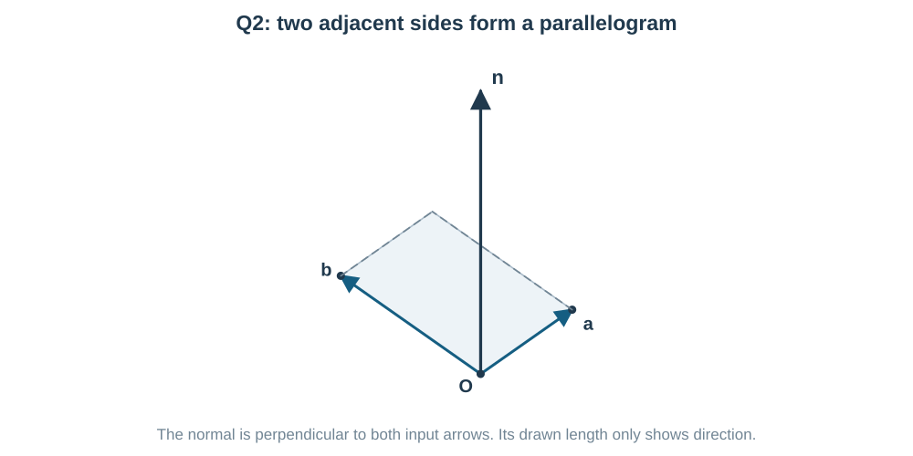

The normal points out of the side plane. Its direction is useful in other questions; **here we need its size**, because cross-product size equals the parallelogram's area.

**Why this method?** We could use base times height, but the height is not given. Cross product finds base times perpendicular height directly from the components:

$$
A=|\mathbf a\times\mathbf b|.
$$

**Solution.** Write $\mathbf a=(2,1,-1)$ and $\mathbf b=(1,3,2)$. Calculate the three cross-product components:

$$
\begin{aligned}
n_x&=1(2)-(-1)(3)=5,\\
n_y&=(-1)(1)-2(2)=-5,\\
n_z&=2(3)-1(1)=5.
\end{aligned}
$$

Thus $\mathbf a\times\mathbf b=(5,-5,5)$ and

$$
\boxed{A=\sqrt{5^2+(-5)^2+5^2}=\sqrt{75}=5\sqrt3}
\quad\text{option (d).}
$$

**Check.** The result is an area, so it is a nonnegative number. Do not stop at the vector $(5,-5,5)$.

#### Another possible approach or useful connection

**Another possible approach — use the dot–cross connection.**

$$
|\mathbf a|^2=6,\quad |\mathbf b|^2=14,\quad
\mathbf a\cdot\mathbf b=2+3-2=3.
$$

$$
A^2=6(14)-3^2=75,\qquad A=5\sqrt3.
$$

This route is also short and avoids cross-product signs. Use whichever calculation you can do more accurately.

### Question 3 — Volume of a slanting box

**PDF page 113 | Numerical value | Notes: C13**

Find the volume of the parallelepiped with coterminous edges $\hat{\mathbf i}+2\hat{\mathbf j}-\hat{\mathbf k}$, $2\hat{\mathbf i}+\hat{\mathbf j}+3\hat{\mathbf k}$, and $-\hat{\mathbf j}+4\hat{\mathbf k}$.

**Understand the object.** A parallelepiped is a box that may lean sideways. “Coterminous” means that the three given edge arrows start at the same corner.

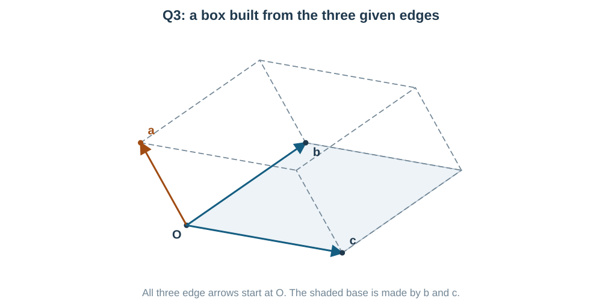

A box has volume **base area times perpendicular height**. The third edge's full length is not always the height: a slanting edge has an along-base part too.

**Connect the products.** Let the given arrows be $\mathbf a,\mathbf b,\mathbf c$, in that order. First $\mathbf b\times\mathbf c$ gives a normal whose size is the base area. Dotting $\mathbf a$ with this normal uses the height part of $\mathbf a$:

$$
V=|\mathbf a\cdot(\mathbf b\times\mathbf c)|.
$$

The absolute value makes the volume positive.

**Solution.**

$$
\mathbf b\times\mathbf c
=(2,1,3)\times(0,-1,4)=(7,-8,-2).
$$

$$
\mathbf a\cdot(\mathbf b\times\mathbf c)
=(1,2,-1)\cdot(7,-8,-2)=7-16+2=-7.
$$

$$
\boxed{V=|-7|=7}.
$$

**Check.** The negative sign tells us about the order of the arrows, not a negative physical volume.

#### Another possible approach or useful connection

**Another possible approach — a number determinant.**

$$
V=\left|\begin{vmatrix}1&2&-1\\2&1&3\\0&-1&4\end{vmatrix}\right|
=|7-16+2|=7.
$$

This is the same base-and-height calculation written compactly. A tetrahedron would need an extra factor $1/6$; this question asks for the whole box.

### Question 4 — A unit vector perpendicular to both

**PDF page 113 | MCQ | Notes: C03, C10, F03, F05**

A unit vector perpendicular to both $\hat{\mathbf i}+2\hat{\mathbf j}+2\hat{\mathbf k}$ and $2\hat{\mathbf i}+\hat{\mathbf j}-2\hat{\mathbf k}$ is:

- (a) $(-2\hat{\mathbf i}+2\hat{\mathbf j}-\hat{\mathbf k})/3$
- (b) $(2\hat{\mathbf i}+2\hat{\mathbf j}-\hat{\mathbf k})/3$
- (c) $(2\hat{\mathbf i}-2\hat{\mathbf j}-\hat{\mathbf k})/3$
- (d) $(-2\hat{\mathbf i}+\hat{\mathbf j}+2\hat{\mathbf k})/3$

**Understand the two requirements.** We need an arrow that is perpendicular to both given arrows, **and** has length $1$. These are two separate jobs.

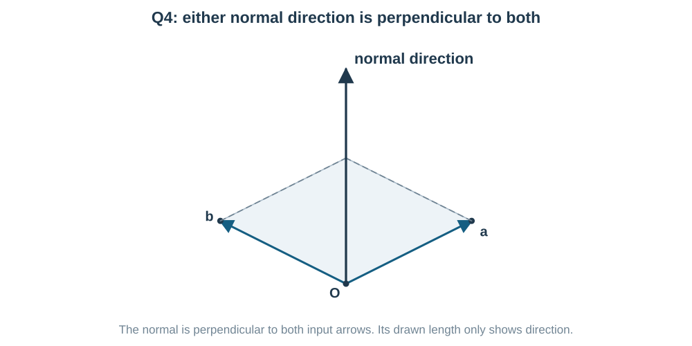

A cross product does the first job: it gives a normal to their plane. Dividing that nonzero answer by its length does the second job.

**Solution.** Put $\mathbf a=(1,2,2)$ and $\mathbf b=(2,1,-2)$.

$$
\mathbf a\times\mathbf b
=\big(2(-2)-2(1),\;2(2)-1(-2),\;1(1)-2(2)\big)
=(-6,6,-3).
$$

Its length is $\sqrt{36+36+9}=9$. Therefore one unit normal is

$$
\frac{\mathbf a\times\mathbf b}{|\mathbf a\times\mathbf b|}
=\frac{(-6,6,-3)}9
=\boxed{\frac{(-2,2,-1)}3},
\quad\text{option (a).}
$$

**Check both jobs.** Let $\mathbf u=(-2,2,-1)/3$.

$$
|\mathbf u|^2=\frac{4+4+1}{9}=1,
\quad
\mathbf u\cdot\mathbf a=\frac{-2+4-2}{3}=0,
\quad
\mathbf u\cdot\mathbf b=\frac{-4+2+2}{3}=0.
$$

The opposite vector $-\mathbf u$ is also a unit normal. The wording asks for **a** unit vector, so either direction would qualify if offered.

#### Another possible approach or useful connection

**Another possible approach — check the options.** Each proposed answer is already a vector. Test its length and its two dot products. Option (a) passes all three checks above. This can save time in an MCQ; for a numerical or written answer, constructing the cross product is more reusable.

### Question 5 — Angle from a dot product

**PDF page 113 | MCQ | Notes: C08, F01**

The angle between $\hat{\mathbf i}+\hat{\mathbf j}$ and $\hat{\mathbf j}+\hat{\mathbf k}$ is:

- (a) $\pi/6$
- (b) $\pi/4$
- (c) $\pi/2$
- (d) $\pi/3$

**Understand the angle.** Slide the two arrows so their tails meet. The angle asked is between their directions, not between separate coordinate axes.

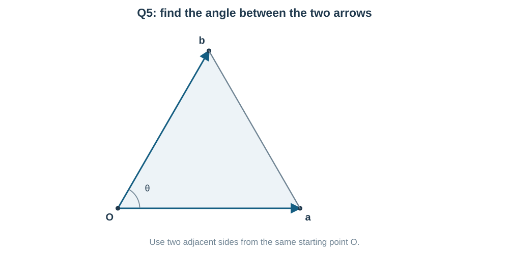

**Why dot product?** It contains the cosine of exactly this angle:

$$
\cos\theta=\frac{\mathbf a\cdot\mathbf b}{|\mathbf a||\mathbf b|}.
$$

**Solution.**

$$
\mathbf a=(1,1,0),\quad\mathbf b=(0,1,1),
\quad \mathbf a\cdot\mathbf b=1.
$$

$$
|\mathbf a|=|\mathbf b|=\sqrt2,
\qquad
\cos\theta=\frac1{\sqrt2\sqrt2}=\frac12.
$$

$$
\boxed{\theta=60^\circ=\pi/3}
\qquad\text{option (d).}
$$

**Check.** The dot is positive, so the angle must be acute. A zero dot, not a missing component, would give $90^\circ$.

#### Another possible approach or useful connection

**Another possible approach — the triangle between the tips.** The arrows each have length $\sqrt2$, and their tip-to-tip difference is $(1,0,-1)$, also of length $\sqrt2$. All three sides are equal, so the triangle is equilateral and the included angle is $60^\circ$. This geometric check works especially neatly because the three lengths match.

### Question 6 — A zero sum connects three lengths

**PDF page 113 | MCQ | Notes: C05, F02**

Let $|\mathbf a|=3$, $|\mathbf b|=5$, $|\mathbf c|=7$, and $\mathbf a+\mathbf b+\mathbf c=\mathbf0$. The angle between $\mathbf a$ and $\mathbf b$ is:

- (a) $\pi/6$
- (b) $2\pi/3$
- (c) $\pi/3$
- (d) $\pi/2$

**Read the zero sum as a movement.** The equation $\mathbf a+\mathbf b+\mathbf c=\mathbf0$ says that the three movements can return to the start. Move $\mathbf c$ to the other side:

$$
\mathbf a+\mathbf b=-\mathbf c
\quad\Longrightarrow\quad
|\mathbf a+\mathbf b|=|\mathbf c|=7.
$$

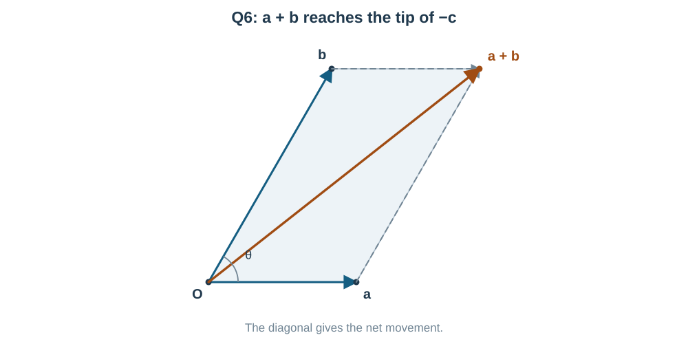

**Did you notice the pattern?** We now know the lengths of two arrows **and their sum**. Squaring the sum introduces their dot product, and that dot product contains the angle we need:

$$
|\mathbf a+\mathbf b|^2
=|\mathbf a|^2+|\mathbf b|^2
+2|\mathbf a||\mathbf b|\cos\theta.
$$

We cannot find the angle from the three lengths by treating them as three unrelated arrows. The zero sum is the connection that makes the formula usable.

**Solution.**

$$
7^2=3^2+5^2+2(3)(5)\cos\theta,
$$

$$
49=34+30\cos\theta
\quad\Longrightarrow\quad
\cos\theta=\frac{15}{30}=\frac12.
$$

$$
\boxed{\theta=\pi/3}
\qquad\text{option (c).}
$$

**Check.** The sum length $7$ lies between $|5-3|=2$ and $5+3=8$, so it is possible.

#### Another possible approach or useful connection

**Another possible approach — cosine rule in the closed triangle.** Its side lengths are $3,5,7$. The angle inside the triangle between the length-$3$ and length-$5$ sides has cosine $(9+25-49)/30=-1/2$, so it is $120^\circ$. But at that corner one side arrow is reversed. The angle between the original vectors is $180^\circ-120^\circ=60^\circ$. The squared-sum route avoids this angle-reversal trap.

### Question 7 — Cross-product size without components

**PDF page 113 | Numerical value | Notes: F04**

If $|\mathbf a|=3$, $|\mathbf b|=4$, and $\mathbf a\cdot\mathbf b=6$, find $|\mathbf a\times\mathbf b|^2$.

**Understand what is given.** We know two lengths and one dot product. We do not know components, so trying to calculate a cross product component by component cannot start.

**Notice the shared angle.** Dot uses cosine and cross-product size uses sine. Their squares connect through $\sin^2\theta+\cos^2\theta=1$:

$$
|\mathbf a\times\mathbf b|^2
=|\mathbf a|^2|\mathbf b|^2-(\mathbf a\cdot\mathbf b)^2.
$$

**Solution.**

$$
|\mathbf a\times\mathbf b|^2
=3^2(4^2)-6^2=144-36=\boxed{108}.
$$

**Check.** A squared length cannot be negative. Also, the question asks for the square, so stop at $108$.

#### Another possible approach or useful connection

**Another possible approach — find the angle first.** Here $\cos\theta=6/(3\cdot4)=1/2$, so $\theta=60^\circ$. Then $|\mathbf a\times\mathbf b|=12\sin60^\circ=6\sqrt3$, whose square is $108$. This works, but the identity reaches the requested square directly.

### Question 8 — Coplanarity fixes a parameter

**PDF page 113 | MCQ | Notes: C13**

If $2\hat{\mathbf i}-\hat{\mathbf j}+\hat{\mathbf k}$, $\hat{\mathbf i}+2\hat{\mathbf j}-3\hat{\mathbf k}$, and $3\hat{\mathbf i}+\lambda\hat{\mathbf j}+5\hat{\mathbf k}$ are coplanar, then $\lambda$ equals:

- (a) $4$
- (b) $-4$
- (c) $-2$
- (d) $2$

**Understand “coplanar.”** Draw the three arrows from one point. They must all lie along one flat sheet. We can use the first two known arrows to find a normal — an arrow standing straight out of that sheet.

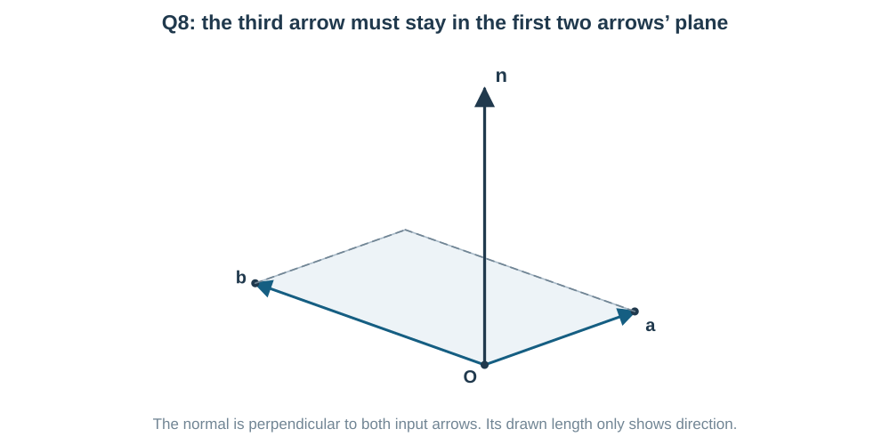

Call the vectors $\mathbf a,\mathbf b,\mathbf c$, in their printed order. The first two are not parallel. So $\mathbf n=\mathbf a\times\mathbf b$ is a nonzero normal.

For $\mathbf c$ to stay along the sheet, it must make a right angle with $\mathbf n$:

$$
\mathbf n\cdot\mathbf c=0.
$$

That explains **why we combine a cross product and a dot product**.

**Solution.**

$$
\mathbf n=(2,-1,1)\times(1,2,-3)=(1,7,5).
$$

$$
(1,7,5)\cdot(3,\lambda,5)=0
\quad\Longrightarrow\quad
3+7\lambda+25=0.
$$

$$
7\lambda=-28
\quad\Longrightarrow\quad
\boxed{\lambda=-4},
\qquad\text{option (b).}
$$

**Check.** For $(3,-4,5)$, the dot is $3-28+25=0$.

#### Another possible approach or useful connection

**Another possible approach — build the third arrow from the first two.** If $\mathbf c=r\mathbf a+s\mathbf b$, the $x,z$ components give $2r+s=3$ and $r-3s=5$. Solving gives $r=2,s=-1$. Then $\mathbf c=2\mathbf a-\mathbf b=(3,-4,5)$. This is another way to express “stays in the same plane.”

### Question 9 — Internal division

**PDF page 113 | MCQ | Notes: C11**

The position vector of the point dividing the join of $A(2,-1,3)$ and $B(5,2,-3)$ internally in the ratio $1:2$ is:

- (a) $(7\hat{\mathbf i}+\hat{\mathbf j}-3\hat{\mathbf k})/2$
- (b) $3\hat{\mathbf i}+\hat{\mathbf j}+\hat{\mathbf k}$
- (c) $3\hat{\mathbf i}+\hat{\mathbf k}$
- (d) $4\hat{\mathbf i}+\hat{\mathbf j}-\hat{\mathbf k}$

**Understand the ratio.** “Internally” means $P$ lies between $A$ and $B$. The order $1:2$ means $AP:PB=1:2$, so $P$ is one-third of the way from $A$ to $B$.

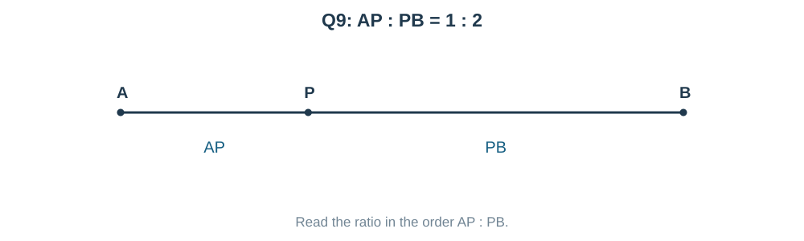

**Why this route?** We can follow the journey directly instead of memorizing which position vector gets which weight:

$$
\mathbf p=\mathbf a+\frac13(\mathbf b-\mathbf a).
$$

**Solution.**

$$
\mathbf b-\mathbf a=(5,2,-3)-(2,-1,3)=(3,3,-6).
$$

$$
\mathbf p=(2,-1,3)+\frac13(3,3,-6)
=(2,-1,3)+(1,1,-2)=(3,0,1).
$$

$$
\boxed{\mathbf p=3\hat{\mathbf i}+\hat{\mathbf k}}
\qquad\text{option (c).}
$$

**Check.** $\overrightarrow{AP}=(1,1,-2)$ and $\overrightarrow{PB}=(2,2,-4)=2\overrightarrow{AP}$. Their lengths are in the required ratio $1:2$.

#### Another possible approach or useful connection

**Another possible approach — section formula.**

$$
\mathbf p=\frac{2\mathbf a+\mathbf b}{3}
=\frac{2(2,-1,3)+(5,2,-3)}3=(3,0,1).
$$

The larger weight goes with $A$ because $P$ is closer to $A$.

### Question 10 — An identity and a false zero-product rule

**PDF page 114 | MCQ | Notes: C08, F04**

Statement I: $|\mathbf a\times\mathbf b|^2=|\mathbf a|^2|\mathbf b|^2-(\mathbf a\cdot\mathbf b)^2$ for any two vectors.

Statement II: If $\mathbf a\cdot\mathbf b=0$, then either $\mathbf a=\mathbf0$ or $\mathbf b=\mathbf0$.

- (a) Both statements are true.
- (b) Statement I is false; Statement II is true.
- (c) Both statements are false.
- (d) Statement I is true; Statement II is false.

**Understand the trap.** For ordinary real numbers, $xy=0$ forces one factor to be zero. A dot product is a different operation. It can be zero because **two nonzero arrows are perpendicular**.

**Check Statement I.** Dot and cross use cosine and sine of the same angle:

$$
|\mathbf a|^2|\mathbf b|^2-(\mathbf a\cdot\mathbf b)^2
=|\mathbf a|^2|\mathbf b|^2(1-\cos^2\theta)
=|\mathbf a\times\mathbf b|^2.
$$

This proves I for nonzero inputs. If either input is zero, both sides are zero too. So I is true.

**Check Statement II.** Try two familiar perpendicular unit arrows:

$$
\mathbf a=\hat{\mathbf i},\quad\mathbf b=\hat{\mathbf j},
\quad\mathbf a\cdot\mathbf b=0.
$$

Neither arrow is zero. This is a **counterexample**: one valid case that breaks an “always” statement. So II is false.

**Answer and check:** $\boxed{\text{(d)}}$. We proved the first claim generally and disproved the second with a valid example.

#### Another possible approach or useful connection

**Another possible approach — components for I.** Expanding the three squared cross-product components gives exactly

$$
(a_x^2+a_y^2+a_z^2)(b_x^2+b_y^2+b_z^2)
-(a_xb_x+a_yb_y+a_zb_z)^2.
$$

This proves the same identity, including zero inputs, but takes more algebra. The sine–cosine connection is easier to remember.

### Question 11 — A sum stays in the same plane

**PDF page 114 | MCQ | Notes: C05–C06, C13**

Assertion A: For any two vectors $\mathbf a,\mathbf b$, $[\mathbf a\,\mathbf b\,\mathbf a+\mathbf b]=0$.

Reason R: The scalar triple product of three coplanar vectors is zero.

- (a) A and R are true, but R is not the correct explanation of A.
- (b) A is true, but R is false.
- (c) A is false, but R is true.
- (d) A and R are true, and R is the correct explanation of A.

**Understand the picture before the notation.** Two arrows drawn from one point can be placed on a flat sheet. Their sum is the parallelogram diagonal, so it stays on that sheet too.

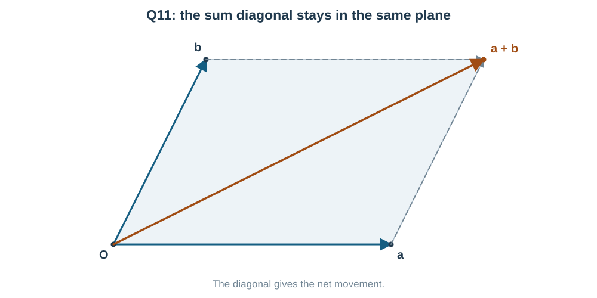

The bracket $[\mathbf a\,\mathbf b\,\mathbf c]$ means the scalar triple product $\mathbf a\cdot(\mathbf b\times\mathbf c)$. Its absolute value is a box volume.

Three arrows lying along one sheet cannot make a box with height. Their triple product is zero. Apply that to $\mathbf a,\mathbf b,\mathbf a+\mathbf b$:

$$
[\mathbf a\,\mathbf b\,(\mathbf a+\mathbf b)]=0.
$$

So A is true. R is also true, and it gives the reason for A.

**Answer and check:** $\boxed{\text{(d)}}$. Even if $\mathbf a,\mathbf b$ are parallel, all three fit in a plane and the triple product is still zero.

#### Another possible approach or useful connection

**Another possible approach — open the last entry.**

$$
[\mathbf a\,\mathbf b\,(\mathbf a+\mathbf b)]
=[\mathbf a\,\mathbf b\,\mathbf a]+[\mathbf a\,\mathbf b\,\mathbf b]=0+0.
$$

Each term repeats an arrow, so it has zero volume. The algebra agrees with the flat-sheet picture.

### Question 12 — Translate equations into geometry

**PDF page 114 | MCQ | Notes: C03, C08, C10, C13**

Match List I with List II. All vectors are nonzero.

| List I | Equation |
|---|---|
| A | $\mathbf a\cdot\mathbf b=0$ |
| B | $\mathbf a\times\mathbf b=\mathbf0$ |
| C | $[\mathbf a\,\mathbf b\,\mathbf c]=0$ |
| D | $\mathbf a\cdot\mathbf a=1$ |

List II: I. Coplanar vectors; II. $\mathbf a$ is a unit vector; III. Perpendicular vectors; IV. Parallel vectors.

- (a) A–III, B–IV, C–I, D–II
- (b) A–IV, B–III, C–I, D–II
- (c) A–III, B–IV, C–II, D–I
- (d) A–I, B–IV, C–III, D–II

**Recognize what each operation tells us.** The zero or the one is not enough by itself. First read the operation before it.

**Solution.**

- **A is a dot product.** For nonzero inputs, $\mathbf a\cdot\mathbf b=|\mathbf a||\mathbf b|\cos\theta=0$ gives $\cos\theta=0$. The angle is $90^\circ$: **III, perpendicular**.
- **B is a cross product.** Its size is $|\mathbf a||\mathbf b|\sin\theta$. A zero result with nonzero inputs gives $\sin\theta=0$: the arrows are along the same line, in the same or opposite direction. **IV, parallel**.
- **C is a scalar triple product.** Zero signed volume means the three arrows can lie on one sheet: **I, coplanar**.
- **D is the dot of an arrow with itself.** $\mathbf a\cdot\mathbf a=|\mathbf a|^2=1$, so $|\mathbf a|=1$: **II, unit vector**.

$$
\boxed{\text{A–III,\quad B–IV,\quad C–I,\quad D–II}}
\qquad\text{option (a).}
$$

**Check.** The question says the vectors are nonzero. We used that condition when translating zero products into directions.

#### Another possible approach or useful connection

**Another possible approach — eliminate options early.** A dot product of zero means perpendicular here, so A–III removes (b) and (d). B must match parallel, B–IV, which removes (c). This reaches (a) quickly. Still review C and D to make sure you understand all four connections.

### Question 13 — A nested cross product

**PDF page 114 | Numerical value | Notes: C14**

If $\mathbf a=\hat{\mathbf i}+2\hat{\mathbf j}+3\hat{\mathbf k}$, $\mathbf b=\hat{\mathbf i}+\hat{\mathbf j}$, $\mathbf c=\hat{\mathbf j}+\hat{\mathbf k}$, and $\mathbf a\times(\mathbf b\times\mathbf c)=x\hat{\mathbf i}+y\hat{\mathbf j}+z\hat{\mathbf k}$, find $x+y+z$.

**Read the brackets as two operations.** In $\mathbf a\times(\mathbf b\times\mathbf c)$, first cross $\mathbf b$ with $\mathbf c$. That makes a vector. Then cross $\mathbf a$ with that new vector. The final answer is also a vector.

**Choose the beginner-friendly route.** We have small components, so doing the inner operation first is easy. We must not remove the brackets: cross product is not ordinary multiplication.

**Solution.**

$$
\mathbf b\times\mathbf c=(1,1,0)\times(0,1,1)=(1,-1,1).
$$

Now cross with $\mathbf a=(1,2,3)$:

$$
\begin{aligned}
\mathbf a\times(1,-1,1)
&=\big(2(1)-3(-1),\;3(1)-1(1),\;1(-1)-2(1)\big)\\
&=(5,2,-3).
\end{aligned}
$$

Thus $x=5,y=2,z=-3$, and

$$
\boxed{x+y+z=5+2-3=4}.
$$

**Check.** The final vector must be perpendicular to $\mathbf a$ and to the inner result:

$$
(5,2,-3)\cdot(1,2,3)=0,\qquad
(5,2,-3)\cdot(1,-1,1)=0.
$$

#### Another possible approach or useful connection

**Another possible approach — the vector triple-product identity.**

$$
\mathbf a\times(\mathbf b\times\mathbf c)
=\mathbf b(\mathbf a\cdot\mathbf c)-\mathbf c(\mathbf a\cdot\mathbf b).
$$

Here $\mathbf a\cdot\mathbf c=5$ and $\mathbf a\cdot\mathbf b=3$, so the answer is $5(1,1,0)-3(0,1,1)=(5,2,-3)$. This saves a cross calculation once the identity is familiar.

### Question 14 — The part perpendicular to a vector

**PDF page 114 | Numerical value | Notes: C09**

Find the square of the magnitude of the component of $\mathbf a=3\hat{\mathbf i}+\hat{\mathbf j}+2\hat{\mathbf k}$ perpendicular to $\mathbf b=\hat{\mathbf i}+2\hat{\mathbf j}-\hat{\mathbf k}$. Give the answer correct to two decimal places.

**What does “the component perpendicular to $\mathbf b$” mean?** Imagine the arrow $\mathbf a$ going from $O$ to $P$. Drop a perpendicular from $P$ to the line in direction $\mathbf b$, meeting it at $H$.

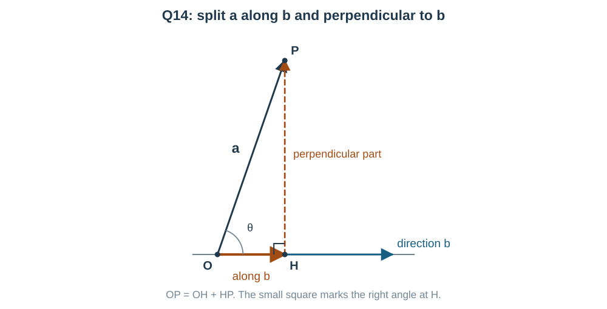

The whole journey is $O\to H\to P$. So the arrows satisfy

$$
\underbrace{\overrightarrow{OP}}_{\mathbf a}
=\underbrace{\overrightarrow{OH}}_{\mathbf a_{\parallel}}
+\underbrace{\overrightarrow{HP}}_{\mathbf a_{\perp}}.
$$

We are **resolving $\mathbf a$ along $\mathbf b$ and perpendicular to $\mathbf b$**. “Resolving” means splitting the arrow into these two chosen directions.

**Build the answer rather than guessing a formula.** The along-part is some multiple $k\mathbf b$. The leftover must be perpendicular to $\mathbf b$:

$$
\mathbf a_{\perp}=\mathbf a-k\mathbf b,
\qquad(\mathbf a-k\mathbf b)\cdot\mathbf b=0.
$$

Opening the dot gives

$$
\mathbf a\cdot\mathbf b-k|\mathbf b|^2=0
\quad\Longrightarrow\quad
k=\frac{\mathbf a\cdot\mathbf b}{|\mathbf b|^2}.
$$

**Solution.** With $\mathbf a=(3,1,2)$ and $\mathbf b=(1,2,-1)$,

$$
\mathbf a\cdot\mathbf b=3+2-2=3,\qquad
|\mathbf b|^2=1+4+1=6,\qquad k=\frac12.
$$

Thus

$$
\mathbf a_{\parallel}=\tfrac12(1,2,-1)=(1/2,1,-1/2),
$$

$$
\mathbf a_{\perp}=(3,1,2)-(1/2,1,-1/2)=(5/2,0,5/2).
$$

The question wants the **square of the length** of this leftover arrow:

$$
|\mathbf a_{\perp}|^2=(5/2)^2+0^2+(5/2)^2
=\frac{25}{2}=\boxed{12.50}.
$$

**Check the picture with equations.**

$$
\mathbf a_{\perp}\cdot\mathbf b
=\frac52(1)+0(2)+\frac52(-1)=0.
$$

So the computed leftover really is perpendicular to $\mathbf b$. Adding the two parts also returns $\mathbf a$.

**Important distinction.** The raw vector $\mathbf a\times\mathbf b$ points out of the picture's plane. Our leftover $\mathbf a_{\perp}$ lies in the picture's plane. They are different arrows.

#### Another possible approach or useful connection

**Another possible approach — Pythagoras after the picture is clear.** The small square at $H$ gives a right triangle:

$$
|\mathbf a|^2=|\mathbf a_{\parallel}|^2+|\mathbf a_{\perp}|^2.
$$

The along-length squared is $(\mathbf a\cdot\mathbf b)^2/|\mathbf b|^2$. Therefore

$$
|\mathbf a_{\perp}|^2=14-\frac{3^2}{6}
=14-\frac32=\frac{25}{2}.
$$

**This is the shorter exam route** because only a squared length is asked. We calculated the actual parts first to understand what the subtraction means.

A cross-product route also works for the size: $\mathbf a\times\mathbf b=(-5,5,5)$, so $|\mathbf a_{\perp}|^2=75/6=12.50$. Divide cross-product area squared by base length squared; do not use the cross-product vector itself as the leftover.

### Question 15 — Internal angle bisector

**PDF page 114 | MCQ | Notes: C12**

A vector along the internal bisector of the angle between $2\hat{\mathbf i}+2\hat{\mathbf j}+\hat{\mathbf k}$ and $\hat{\mathbf i}+2\hat{\mathbf j}+2\hat{\mathbf k}$ is:

- (a) $\hat{\mathbf i}+\hat{\mathbf j}+\hat{\mathbf k}$
- (b) $\hat{\mathbf i}+\hat{\mathbf j}$
- (c) $\hat{\mathbf i}-\hat{\mathbf k}$
- (d) $3\hat{\mathbf i}+4\hat{\mathbf j}+3\hat{\mathbf k}$

**Understand a bisector.** It is a direction inside the angle that makes equal angles with the two given arrows. First compare directions using equal-length arrows. Otherwise the longer arrow pulls an ordinary sum towards itself.

**Check the lengths here.**

$$
|\mathbf a|=\sqrt{4+4+1}=3,\qquad
|\mathbf b|=\sqrt{1+4+4}=3.
$$

They are already equal. Their sum points along the internal bisector.

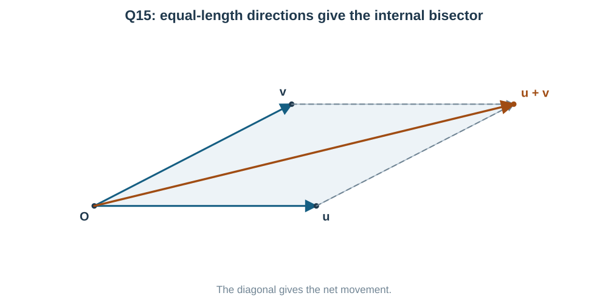

In the picture, $\mathbf u=\mathbf a/3$ and $\mathbf v=\mathbf b/3$. Their sum points in the same direction as $\mathbf a+\mathbf b$.

**Solution.**

$$
\mathbf a+\mathbf b=(2,2,1)+(1,2,2)=(3,4,3).
$$

$$
\boxed{3\hat{\mathbf i}+4\hat{\mathbf j}+3\hat{\mathbf k}}
\qquad\text{option (d).}
$$

The question asks for a vector **along** the bisector, so we do not need to make it unit length.

**Check.** Let $\mathbf w=(3,4,3)$. Then $\mathbf w\cdot\mathbf a=17=\mathbf w\cdot\mathbf b$. Since $|\mathbf a|=|\mathbf b|$, the two angle cosines are equal. Also $\mathbf w$ lies between the two directions.

#### Another possible approach or useful connection

**Another useful view — the general formula.**

$$
\frac{\mathbf a}{|\mathbf a|}+\frac{\mathbf b}{|\mathbf b|}
=\frac{\mathbf a+\mathbf b}{3}.
$$

It is a positive multiple of option (d). Use this normalized-input formula when the original lengths are unequal.

### Question 16 — Perpendicular sum and difference

**PDF page 114 | Numerical value | Notes: F02**

Let $\mathbf a=\lambda\hat{\mathbf i}+\hat{\mathbf j}+2\hat{\mathbf k}$ and $\mathbf b=\hat{\mathbf i}+2\hat{\mathbf j}+3\hat{\mathbf k}$. If $\mathbf a+\mathbf b$ is perpendicular to $\mathbf a-\mathbf b$, find the positive value of $\lambda$.

**Notice the plus-and-minus pattern.** We are told that the sum is perpendicular to the difference. Turn “perpendicular” into a zero dot product:

$$
(\mathbf a+\mathbf b)\cdot(\mathbf a-\mathbf b)=0.
$$

Before substituting all components, open the brackets:

$$
|\mathbf a|^2-\mathbf a\cdot\mathbf b
+\mathbf b\cdot\mathbf a-|\mathbf b|^2=0.
$$

The middle two terms cancel because $\mathbf a\cdot\mathbf b=\mathbf b\cdot\mathbf a$. So we only need

$$
|\mathbf a|^2=|\mathbf b|^2.
$$

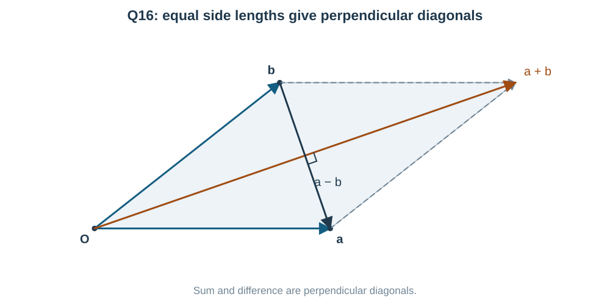

**Solution.**

$$
\lambda^2+1+4=1+4+9
\quad\Longrightarrow\quad
\lambda^2=9.
$$

Both $3$ and $-3$ satisfy this square equation. The question asks for the positive value:

$$
\boxed{\lambda=3}.
$$

**Check.** At $\lambda=3$, the sum is $(4,3,5)$ and the difference is $(2,-1,-1)$. Their dot is $8-3-5=0$.

#### Another possible approach or useful connection

**Another possible approach — use components immediately.**

$$
(\lambda+1,3,5)\cdot(\lambda-1,-1,-1)
=\lambda^2-1-3-5=\lambda^2-9=0.
$$

This is also short. The bracket pattern explains the cancellation and is useful when components are not given.

### Question 17 — Triangle area from three vertices

**PDF page 114 | MCQ | Notes: C04, F05**

The area of the triangle with vertices $A(1,1,1)$, $B(1,2,3)$, $C(2,3,1)$ is:

- (a) $\sqrt{21}$
- (b) $\sqrt{17}/2$
- (c) $\sqrt{21}/2$
- (d) $21/2$

**Understand what the coordinates describe.** These are three **points**, not two side arrows. To find an area, first make two movements from the same vertex, $A$.

$$
\overrightarrow{AB}=B-A,\qquad\overrightarrow{AC}=C-A.
$$

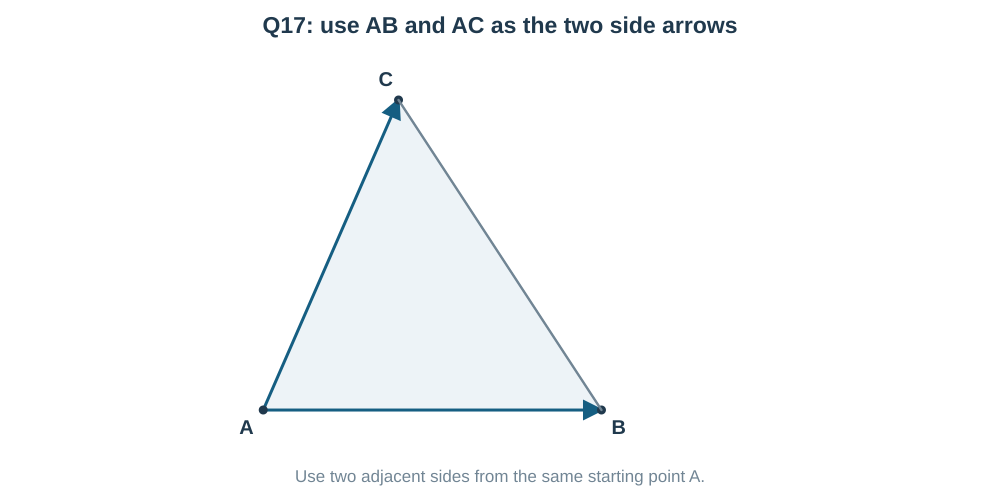

**Why cross product, then half?** The two side arrows make a parallelogram. Its diagonal cuts it into two equal triangles. Thus

$$
A_{\triangle}=\frac12|\overrightarrow{AB}\times\overrightarrow{AC}|.
$$

**Solution.**

$$
\overrightarrow{AB}=(0,1,2),\qquad
\overrightarrow{AC}=(1,2,0).
$$

$$
\overrightarrow{AB}\times\overrightarrow{AC}=(-4,2,-1).
$$

$$
\boxed{A_{\triangle}=\frac12\sqrt{16+4+1}
=\frac{\sqrt{21}}2}
\qquad\text{option (c).}
$$

**Check.** The normal has zero dot with both sides: $2-2=0$ and $-4+4=0$. The extra half is needed because this is a triangle.

#### Another possible approach or useful connection

**Another possible approach — use the side lengths and their dot.**

$$
|\overrightarrow{AB}|^2=5,\quad
|\overrightarrow{AC}|^2=5,\quad
\overrightarrow{AB}\cdot\overrightarrow{AC}=2.
$$

So $4A_\triangle^2=5(5)-2^2=21$, giving the same answer. Using the raw position vectors $B,C$ would describe a triangle with the origin as its starting vertex, which is not the given triangle.

### Question 18 — Three unit vectors add to zero

**PDF page 114 | Numerical value | Notes: F02**

If $\mathbf a,\mathbf b,\mathbf c$ are unit vectors with $\mathbf a+\mathbf b+\mathbf c=\mathbf0$, find $\mathbf a\cdot\mathbf b+\mathbf b\cdot\mathbf c+\mathbf c\cdot\mathbf a$.

**Did you notice this familiar pattern?** The target is

$$
S=\mathbf a\cdot\mathbf b+\mathbf b\cdot\mathbf c+\mathbf c\cdot\mathbf a.
$$

Compare it with the number identity

$$
(x+y+z)^2=x^2+y^2+z^2+2(xy+yz+zx).
$$

The same three pairs appear! For vectors, use the **squared length of the sum**, not an ordinary vector square:

$$
|\mathbf a+\mathbf b+\mathbf c|^2
=(\mathbf a+\mathbf b+\mathbf c)\cdot(\mathbf a+\mathbf b+\mathbf c).
$$

**Why is this useful here?** We know that the sum is zero, and we know all three lengths are $1$. This expansion uses exactly those givens and contains exactly the target $S$. Finding three separate angles first would add work.

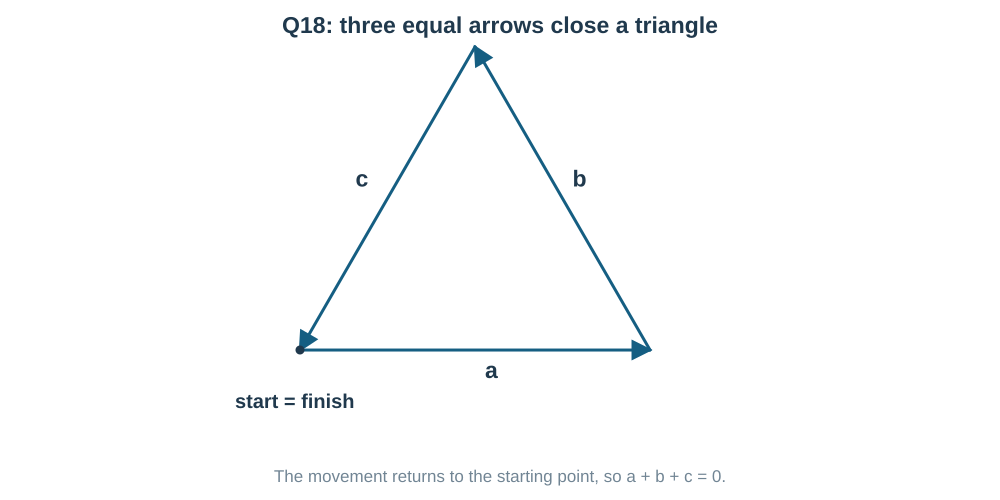

The arrows return to the starting point. That is the movement meaning of the given zero sum.

**Solution.** Open the dot product:

$$
\begin{aligned}
|\mathbf a+\mathbf b+\mathbf c|^2
={}&|\mathbf a|^2+|\mathbf b|^2+|\mathbf c|^2\\
&+\mathbf a\cdot\mathbf b+\mathbf b\cdot\mathbf a\\
&+\mathbf b\cdot\mathbf c+\mathbf c\cdot\mathbf b\\
&+\mathbf c\cdot\mathbf a+\mathbf a\cdot\mathbf c.
\end{aligned}
$$

Each pair occurs twice. Since dot product does not change when we reverse its order,

$$
|\mathbf a+\mathbf b+\mathbf c|^2
=|\mathbf a|^2+|\mathbf b|^2+|\mathbf c|^2+2S.
$$

Now use the givens:

$$
0=1+1+1+2S
\quad\Longrightarrow\quad
2S=-3
\quad\Longrightarrow\quad
\boxed{S=-\frac32}.
$$

**Pattern to remember.** A given vector sum plus a target made of pairwise dots should make you try the squared length of that sum.

**Check.** The sum is negative because the arrows partly oppose one another; three unit arrows pointing together could not add to zero.

#### Another possible approach or useful connection

**Another possible approach — find each pair from the third arrow.**

$$
\mathbf a+\mathbf b=-\mathbf c
\quad\Longrightarrow\quad
1=1+1+2\mathbf a\cdot\mathbf b.
$$

Thus $\mathbf a\cdot\mathbf b=-1/2$. The same reasoning with the other pairs gives $-1/2$ each, so their sum is $-3/2$. Their common-tail angles are $120^\circ$; the inside angles of the closed equilateral triangle are $60^\circ$. One arrow reverses at a triangle corner, which explains the difference. The whole-sum expansion is faster when only the sum of pairs is asked.

### Question 19 — Work done by a force

**PDF page 114 | MCQ | Notes: C04, F07**

A force $\mathbf F=3\hat{\mathbf i}-2\hat{\mathbf j}+5\hat{\mathbf k}$ acts on a particle and displaces it from $(1,1,1)$ to $(3,2,0)$. The work done, in the supplied consistent units, is:

- (a) $1$
- (b) $5$
- (c) $-1$
- (d) $-3$

**First find the actual movement.** The force is given, but the work uses displacement — the movement from the initial point to the final point:

$$
\mathbf s=(3,2,0)-(1,1,1)=(2,1,-1).
$$

**Why dot product?** Only the force part along the movement contributes to work. The dot product multiplies this signed along-part by the movement length.

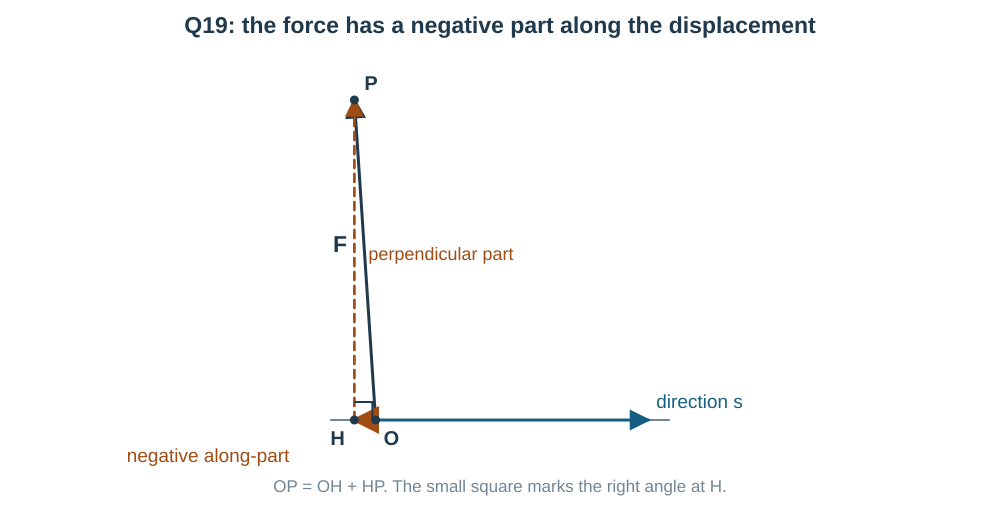

In this view, the line points along $\mathbf s$ and the arrow $OP$ represents $\mathbf F$. Its shadow lies on the opposite side of $O$.

**Solution.** For the constant force,

$$
W=\mathbf F\cdot\mathbf s
=(3,-2,5)\cdot(2,1,-1)=6-2-5=\boxed{-1},
$$

so the answer is **option (c)**.

**Check the sign.** Negative work means this force acts partly against the net displacement. A force's magnitude alone cannot tell us that.

#### Another possible approach or useful connection

**See the same method another way — coordinate contributions.** The $x$ contribution is $3(2)=6$, the $y$ contribution is $(-2)(1)=-2$, and the $z$ contribution is $5(-1)=-5$. Their sum is $-1$. This explains the component meaning of the dot product. Using force times distance without an angle or projection would miss the directions.

### Question 20 — Torque about the origin

**PDF page 115 | Numerical value | Notes: F03, F07**

A force $\mathbf F=2\hat{\mathbf i}-\hat{\mathbf j}+\hat{\mathbf k}$ acts at a point with position vector $\mathbf r=\hat{\mathbf i}+2\hat{\mathbf j}+3\hat{\mathbf k}$. Find the square of the magnitude of its moment, or torque, about the origin.

**Understand torque.** A force can turn an object about an origin. The arrow $\mathbf r$ goes from that origin to the point where the force acts. The turning effect is

$$
\boldsymbol\tau=\mathbf r\times\mathbf F.
$$

It is a vector along the turning axis, perpendicular to the plane of $\mathbf r,\mathbf F$.

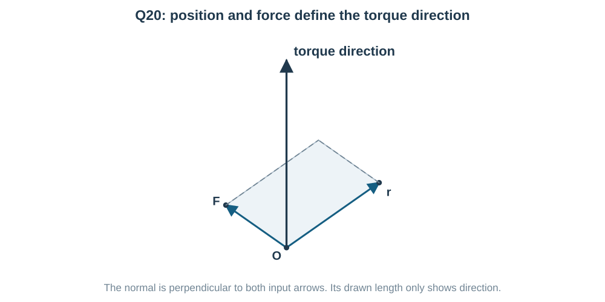

Read the diagram's first side as $\mathbf r$ and its second side as $\mathbf F$. The normal's drawn length only shows direction.

**Why not a dot product?** Dot would give the along-direction contribution used in work. Torque depends on the perpendicular lever arm, so its size contains sine and uses a cross product.

**Solution.**

$$
\boldsymbol\tau=(1,2,3)\times(2,-1,1)=(5,5,-5).
$$

The question asks for its squared magnitude:

$$
\boxed{|\boldsymbol\tau|^2=5^2+5^2+(-5)^2=75}.
$$

**Check.** $(5,5,-5)\cdot(1,2,3)=0$ and $(5,5,-5)\cdot(2,-1,1)=0$, as the normal picture requires. In SI units, torque has unit $\mathrm{N\,m}$; its square has unit $(\mathrm{N\,m})^2$.

#### Another possible approach or useful connection

**Another possible approach — calculate only the size.**

$$
|\mathbf r|^2=14,\quad|\mathbf F|^2=6,\quad
\mathbf r\cdot\mathbf F=2-2+3=3.
$$

$$
|\boldsymbol\tau|^2=14(6)-3^2=75.
$$

This is especially convenient when a squared size is asked and the torque direction is not needed.

### Question 21 — Length of a weighted sum

**PDF page 115 | MCQ | Notes: F02**

If $\mathbf a,\mathbf b$ are unit vectors inclined at $60^\circ$, then $|2\mathbf a+3\mathbf b|$ equals:

- (a) $5$
- (b) $\sqrt{13}$
- (c) $\sqrt7$
- (d) $\sqrt{19}$

**Understand the two arrows being added.** The original arrows have unit length, but $2\mathbf a$ has length $2$ and $3\mathbf b$ has length $3$. Multiplying by positive numbers keeps their angle at $60^\circ$.

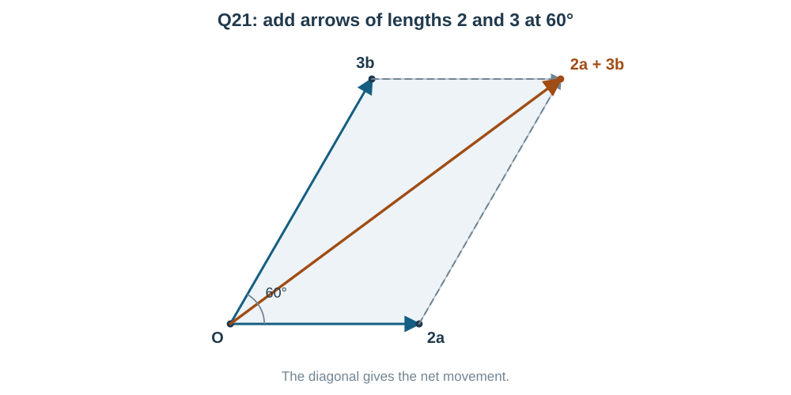

**Why not add the lengths?** $2+3=5$ would be the sum length if both arrows pointed exactly the same way. Here the angle is $60^\circ$, so we must keep the angle term.

**Solution.** Since $\mathbf a,\mathbf b$ are unit,

$$
\mathbf a\cdot\mathbf b=1(1)\cos60^\circ=\frac12.
$$

Expand the squared length:

$$
\begin{aligned}
|2\mathbf a+3\mathbf b|^2
&=4|\mathbf a|^2+9|\mathbf b|^2+12\mathbf a\cdot\mathbf b\\
&=4+9+12(1/2)=19.
\end{aligned}
$$

The requested quantity is a length, so take the square root:

$$
\boxed{|2\mathbf a+3\mathbf b|=\sqrt{19}}
\qquad\text{option (d).}
$$

**Source clarification and check.** The printed working stops at the squared value $19$. The keyed option correctly gives $\sqrt{19}$. Also $1\le\sqrt{19}\le5$, the allowed range for adding lengths $2$ and $3$.

#### Another possible approach or useful connection

**Another possible approach — choose convenient axes.** Put $\mathbf a=(1,0)$ and $\mathbf b=(1/2,\sqrt3/2)$ in their plane. Then $2\mathbf a+3\mathbf b=(7/2,3\sqrt3/2)$, whose length squared is $49/4+27/4=19$. This draws the same diagonal using coordinates.

### Question 22 — Three perpendicular directions

**PDF page 115 | MCQ | Notes: F02**

If $\mathbf a,\mathbf b,\mathbf c$ are mutually perpendicular unit vectors, then $|\mathbf a+2\mathbf b+3\mathbf c|^2$ equals:

- (a) $6$
- (b) $14$
- (c) $36$
- (d) $12$

**Understand “mutually perpendicular.”** Each pair makes a right angle. So all pairwise dot products are zero. The three weighted arrow lengths are $1,2,3$.

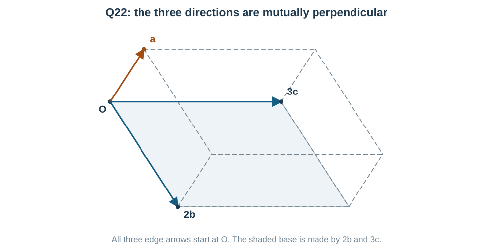

Read the first, second and third edges as $\mathbf a,2\mathbf b,3\mathbf c$. The perspective view shows a 3D box; its screen angles need not look like $90^\circ$.

**Solution.** Pythagoras in three perpendicular directions gives

$$
|\mathbf a+2\mathbf b+3\mathbf c|^2
=1^2+2^2+3^2=\boxed{14},
$$

so the answer is **option (b)**.

**Check.** We can add squared lengths only because the directions are perpendicular. Unit length alone would not remove the dot terms.

#### Another possible approach or useful connection

**Another useful view — expand the dot.**

$$
\begin{aligned}
|\mathbf a+2\mathbf b+3\mathbf c|^2
={}&1+4+9\\
&+4\mathbf a\cdot\mathbf b
+12\mathbf b\cdot\mathbf c+6\mathbf a\cdot\mathbf c.
\end{aligned}
$$

All three pair terms vanish. This is the algebra behind the 3D Pythagoras picture.

### Question 23 — A segment meets the xy-plane

**PDF page 115 | Numerical value | Notes: C11**

The line joining $A(1,2,3)$ and $B(4,5,-6)$ meets the $xy$-plane at a point dividing $AB$ internally in the ratio $m:n$, in lowest terms. If $m:n=k:1$, find $k$.

**Understand the plane clue.** Every point on the $xy$-plane has $z=0$. We only need a division ratio, so we can use the $z$ coordinate alone.

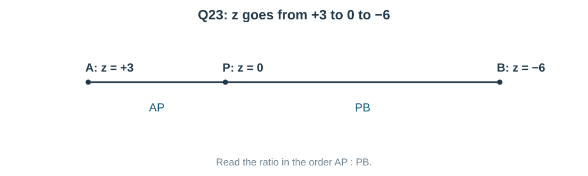

The height drops from $3$ to $-6$, a total drop of $9$. It reaches zero after a drop of $3$. So the point $P$ is $3/9=1/3$ of the journey from $A$ to $B$.

**Solution.**

$$
AP:PB=\frac13:\frac23=1:2.
$$

The question writes the same ratio as $k:1$. Divide both parts by $2$:

$$
1:2=\frac12:1
\quad\Longrightarrow\quad
\boxed{k=\frac12=0.5}.
$$

**Check.** The one-third point is $(1,2,3)+\frac13(3,3,-9)=(2,3,0)$, which really is on the $xy$-plane.

#### Another possible approach or useful connection

**Another possible approach — section formula for z.** If $AP:PB=m:n$, then

$$
z_P=\frac{3n-6m}{m+n}=0
\quad\Longrightarrow\quad
n=2m.
$$

Thus $m:n=1:2$. Calculating $x_P,y_P$ first would work, but it is extra work for a ratio question.

### Question 24 — Direction cosines and the sign of a root

**PDF page 115 | MCQ | Notes: C07**

A vector makes angles $60^\circ$ and $45^\circ$ with the positive $x$- and $y$-axes, respectively, and an acute angle $\gamma$ with the $z$-axis. Then $\gamma$ is:

- (a) $30^\circ$
- (b) $45^\circ$
- (c) $60^\circ$
- (d) $90^\circ$

**Understand direction cosines.** They are the components of a unit arrow, so their squares add to $1$:

$$
\cos^2\alpha+\cos^2\beta+\cos^2\gamma=1.
$$

We know the angles with the positive $x,y$ axes. Their cosines are $1/2$ and $1/\sqrt2$.

**Solution.**

$$
\frac14+\frac12+\cos^2\gamma=1
\quad\Longrightarrow\quad
\cos^2\gamma=\frac14.
$$

Do not drop the sign choice:

$$
\cos\gamma=\pm\frac12.
$$

The word **acute** means $0^\circ<\gamma<90^\circ$, where cosine is positive. Therefore

$$
\cos\gamma=\frac12
\quad\Longrightarrow\quad
\boxed{\gamma=60^\circ},
\qquad\text{option (c).}
$$

**Check.** $1/4+1/2+1/4=1$. Without the acute-angle condition, $120^\circ$ would also give this squared cosine.

#### Another possible approach or useful connection

**Another useful view — reconstruct the unit direction.** Its components are $(1/2,1/\sqrt2,n)$. Its length condition gives $n^2=1/4$; the acute $z$ angle requires $n>0$, hence $n=1/2$. This is the same equation seen as a unit-vector length.

### Question 25 — Expand carefully; the source has two correct choices

**PDF page 115 | MCQ in source | Notes: C10, F03**

If $\mathbf a\times\mathbf b=\mathbf c\times\mathbf d$ and $\mathbf a\times\mathbf c=\mathbf b\times\mathbf d$, then:

- (a) $\mathbf a-\mathbf d$ is perpendicular to $\mathbf b-\mathbf c$.
- (b) $\mathbf a-\mathbf d=\mathbf b-\mathbf c$.
- (c) $\mathbf a-\mathbf d$ is parallel to $\mathbf b-\mathbf c$.
- (d) $\mathbf a+\mathbf d$ is parallel to $\mathbf b+\mathbf c$.

**Understand the pattern — look for the sums and differences in the options.** We have two cross-product equalities. Cross product opens over addition and subtraction, so try expanding the products of the pairs named in (c) and (d):

$$
(\mathbf a-\mathbf d)\times(\mathbf b-\mathbf c),\qquad
(\mathbf a+\mathbf d)\times(\mathbf b+\mathbf c).
$$

Each expansion produces terms from the givens. But some appear in reverse order. Use $\mathbf d\times\mathbf b=-\mathbf b\times\mathbf d$ before cancelling.

We must check both pairs. A “single correct” label does not make a second valid conclusion false. This source question actually has that problem.

**Solution.** First test option (c):

$$
\begin{aligned}
(\mathbf a-\mathbf d)\times(\mathbf b-\mathbf c)
&=\mathbf a\times\mathbf b-\mathbf a\times\mathbf c
 -\mathbf d\times\mathbf b+\mathbf d\times\mathbf c\\
&=\mathbf c\times\mathbf d-\mathbf b\times\mathbf d
 +\mathbf b\times\mathbf d-\mathbf c\times\mathbf d\\
&=\mathbf0.
\end{aligned}
$$

For nonzero difference vectors, this proves (c). But test (d) as well:

$$
\begin{aligned}
(\mathbf a+\mathbf d)\times(\mathbf b+\mathbf c)
&=\mathbf a\times\mathbf b+\mathbf a\times\mathbf c
 +\mathbf d\times\mathbf b+\mathbf d\times\mathbf c\\
&=\mathbf c\times\mathbf d+\mathbf b\times\mathbf d
 -\mathbf b\times\mathbf d-\mathbf c\times\mathbf d\\
&=\mathbf0.
\end{aligned}
$$

For nonzero sum vectors, this also proves (d).

**Verified conclusion: both (c) and (d) follow in their nonzero cases. This is not a valid single-correct MCQ as printed.** The source key lists only (c). It also leaves zero sums or differences possible; in such cases a direction-based statement about the zero vector needs care. The always-valid conclusions are the two zero-cross-product equations proved above.

**Concrete check:** choose $\mathbf a=(1,1,0)$, $\mathbf d=(1,0,0)$, $\mathbf b=(2,3,0)$, $\mathbf c=(2,-1,0)$. Both givens hold. The differences are $(0,1,0)$ and $(0,4,0)$, while the sums are $(2,1,0)$ and $(4,2,0)$. Both pairs are nonzero and parallel. Thus the ambiguity remains even without zero vectors.

**Lesson:** a printed answer key does not replace reasoning. Do not memorize this question as having only (c).

**Method lesson.** Stopping as soon as option (c) works would hide the defect in this single-correct question. Test the sum pair too: it makes option (d) work as well. Both general equations are needed to diagnose the source correctly.

#### Another possible approach or useful connection

**Another possible approach — add and subtract the given equations before opening the options.** Adding gives

$$
\mathbf a\times(\mathbf b+\mathbf c)
=(\mathbf b+\mathbf c)\times\mathbf d
=-\mathbf d\times(\mathbf b+\mathbf c).
$$

Move the last term to the left: $(\mathbf a+\mathbf d)\times(\mathbf b+\mathbf c)=\mathbf0$. Subtracting the original equations gives $(\mathbf a-\mathbf d)\times(\mathbf b-\mathbf c)=\mathbf0$. This shorter grouping finds the same two conclusions and again exposes the source defect.

### Question 26 — Dot and cross share one angle

**PDF page 115 | Numerical value | Notes: F04**

If $|\mathbf a|=2$, $|\mathbf b|=3$, and $\mathbf a\cdot\mathbf b=3\sqrt3$, find $|\mathbf a\times\mathbf b|$.

**Notice the data shape.** We have lengths and a dot product, but no components. That points to the dot–cross identity, which calculates the cross-product **size** without constructing its direction.

**Solution.**

$$
|\mathbf a\times\mathbf b|^2
=|\mathbf a|^2|\mathbf b|^2-(\mathbf a\cdot\mathbf b)^2
=2^2(3^2)-(3\sqrt3)^2=36-27=9.
$$

This time the question asks for the length, not its square:

$$
\boxed{|\mathbf a\times\mathbf b|=3}.
$$

**Check.** The maximum possible cross size is $|\mathbf a||\mathbf b|=6$. Our answer $3$ lies in the allowed range.

#### Another possible approach or useful connection

**Another possible approach — see the angle.** $\cos\theta=(3\sqrt3)/6=\sqrt3/2$, so $\theta=30^\circ$. Then $|\mathbf a\times\mathbf b|=6\sin30^\circ=3$. The identity is shorter; the angle route helps you see the geometry.

### Question 27 — Combine a cross constraint with a dot constraint

**PDF page 115 | Numerical value | Notes: C09, C14**

Let $\mathbf a=\hat{\mathbf i}+\hat{\mathbf j}+\hat{\mathbf k}$ and $\mathbf b=\hat{\mathbf j}-\hat{\mathbf k}$. A vector $\mathbf c$ satisfies $\mathbf a\times\mathbf c=\mathbf b$ and $\mathbf a\cdot\mathbf c=3$. Find $3|\mathbf c|^2$.

**Understand what the two givens tell us.** We want the length of the unknown arrow $\mathbf c$. Split it into a part along $\mathbf a$ and a part perpendicular to $\mathbf a$:

$$
\mathbf c=\mathbf c_{\parallel}+\mathbf c_{\perp}.
$$

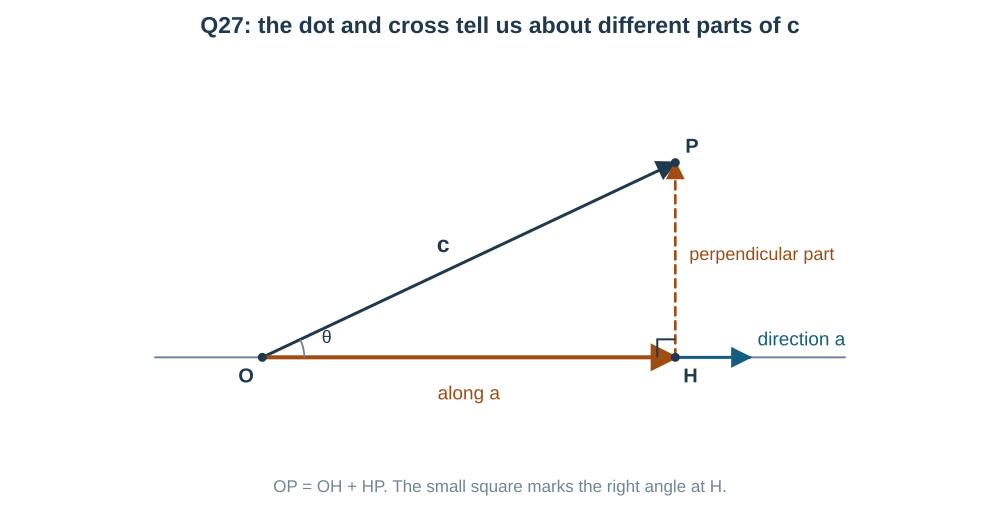

In this picture, $OP$ is $\mathbf c$, $OH$ is $\mathbf c_{\parallel}$, and $HP$ is $\mathbf c_{\perp}$.

**Which given controls which part?**

- $\mathbf a\cdot\mathbf c=3$ measures the signed along-$\mathbf a$ part.
- $\mathbf a\times\mathbf c=\mathbf b$ has size $|\mathbf a|\,|\mathbf c_{\perp}|$. The parallel part adds nothing to the cross product, because crossing parallel arrows gives zero.

So these are not two unrelated facts. They tell us about the two sides of the same right triangle.

**Choose the route.** We could solve for all three components of $\mathbf c$. But the target is only $3|\mathbf c|^2$. Finding the two component **lengths** is enough.

**Solution.**

$$
|\mathbf a|^2=1+1+1=3,\qquad
|\mathbf b|^2=0+1+1=2.
$$

The along-part is

$$
\mathbf c_{\parallel}
=\frac{\mathbf a\cdot\mathbf c}{|\mathbf a|^2}\mathbf a
=\frac33\mathbf a=\mathbf a,
\qquad|\mathbf c_{\parallel}|^2=3.
$$

For the perpendicular part, take the squared sizes in the cross equation:

$$
|\mathbf b|^2=|\mathbf a|^2|\mathbf c_{\perp}|^2
\quad\Longrightarrow\quad
|\mathbf c_{\perp}|^2=\frac23.
$$

Now use the right angle in the drawing:

$$
|\mathbf c|^2=|\mathbf c_{\parallel}|^2+|\mathbf c_{\perp}|^2
=3+\frac23=\frac{11}{3}.
$$

$$
\boxed{3|\mathbf c|^2=11}.
$$

**Short exam version, once the picture is clear.** The dot–cross identity combines those two parts immediately:

$$
|\mathbf a|^2|\mathbf c|^2
=|\mathbf a\times\mathbf c|^2+(\mathbf a\cdot\mathbf c)^2
=2+9=11.
$$

Since $|\mathbf a|^2=3$, its left side is exactly the target. **This is the shortest route here.**

**Check.** $\mathbf a\cdot\mathbf b=0$, as required: the cross-product output must be perpendicular to $\mathbf a$.

#### Another possible approach or useful connection

**Another possible approach — solve components.** Write $\mathbf c=(x,y,z)$. Then

$$
(1,1,1)\times(x,y,z)=(z-y,\;x-z,\;y-x)=(0,1,-1).
$$

So $y=z$ and $x=z+1$. The dot condition gives $x+y+z=3$, hence $3z+1=3$. Therefore

$$
\mathbf c=(5/3,2/3,2/3),
\qquad
3|\mathbf c|^2=3\frac{25+4+4}{9}=11.
$$

This also verifies the full vector. Use it when components are asked; the length identity avoids finding extra information in this question.

### Question 28 — Add component equations before solving them

**PDF page 115 | Numerical value | Notes: C06**

If $\mathbf d=3\hat{\mathbf i}+5\hat{\mathbf j}+4\hat{\mathbf k}$ is written as

$$
\mathbf d=\alpha(\hat{\mathbf i}+\hat{\mathbf j})
+\beta(\hat{\mathbf j}+\hat{\mathbf k})
+\gamma(\hat{\mathbf i}+\hat{\mathbf k}),
$$

find $\alpha+\beta+\gamma$.

**Notice the target before solving.** We need $\alpha+\beta+\gamma$, not the three separate numbers. Write matching coordinate equations first:

$$
\alpha+\gamma=3,\qquad
\alpha+\beta=5,\qquad
\beta+\gamma=4.
$$

**Did you see the pattern?** In the three left sides together, each unknown appears exactly twice. Adding them will give twice the sum we want.

**Solution.**

$$
2\alpha+2\beta+2\gamma=3+5+4=12.
$$

$$
\boxed{\alpha+\beta+\gamma=6}.
$$

**Why this is the efficient route.** Solving three equations separately is valid, but it finds extra values that the question does not ask for.

**Check.** The three coordinate totals add to $12$, and each basis pair contributes twice its coefficient; the requested sum must be half of $12$.

#### Another possible approach or useful connection

**Another possible approach — solve each coefficient.** Add the first two equations and subtract the third to get $2\alpha=4$, so $\alpha=2$. Then $\beta=3,\gamma=1$. Their sum is $6$. This is a useful check and the right route if individual coefficients are requested.

### Question 29 — Basis vectors used as vertex positions

**PDF page 115 | MCQ | Notes: C04, F05**

The area of the triangle whose vertices have position vectors $\hat{\mathbf i}$, $\hat{\mathbf j}$, and $\hat{\mathbf k}$ is:

- (a) $1/2$
- (b) $\sqrt3$
- (c) $\sqrt2/2$
- (d) $\sqrt3/2$

**Turn the position vectors into points.** The vertices are $A=(1,0,0)$, $B=(0,1,0)$, and $C=(0,0,1)$ — the three unit tips on the coordinate axes.

Their triangle does not use the origin as a vertex. First make sides from $A$:

$$
\overrightarrow{AB}=(-1,1,0),\qquad
\overrightarrow{AC}=(-1,0,1).
$$

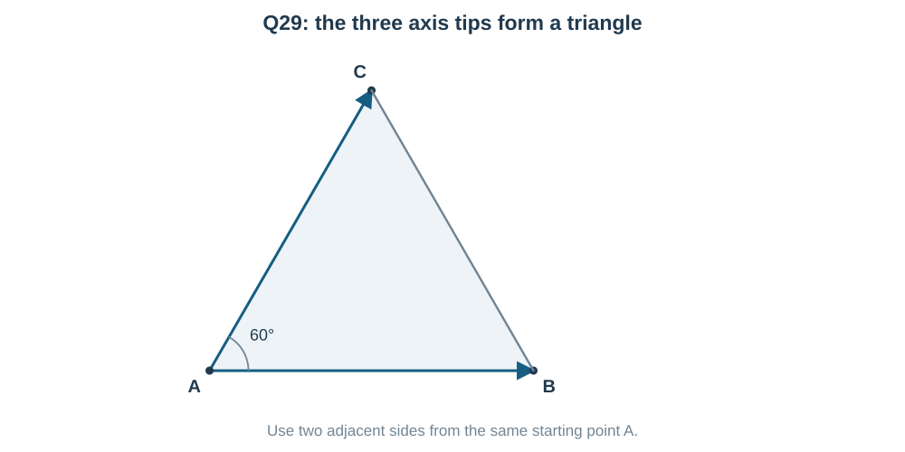

**Solution.**

$$
\overrightarrow{AB}\times\overrightarrow{AC}=(1,1,1),
$$

$$
\boxed{A_{\triangle}=\frac12\sqrt{1+1+1}=\frac{\sqrt3}{2}},
\qquad\text{option (d).}
$$

**Check.** Using $\frac12|\hat{\mathbf i}\times\hat{\mathbf j}|=1/2$ would give the area of triangle $OAB$. That is a different triangle. The destination-minus-start step prevents this mistake.

#### Another possible approach or useful connection

**Another possible approach — recognize an equilateral triangle.** Each pair of vertices is $\sqrt2$ apart. Thus the triangle is equilateral, with area $(\sqrt3/4)(\sqrt2)^2=\sqrt3/2$. This is the shortest route if you notice the three equal distances.

### Question 30 — Perpendicular distance from a line

**PDF page 115 | MCQ | Notes: F06**

The perpendicular distance of $(1,1,2)$ from the line through the origin in the direction $\hat{\mathbf i}+2\hat{\mathbf j}+2\hat{\mathbf k}$ is:

- (a) $5/3$
- (b) $\sqrt5/9$
- (c) $\sqrt5/3$
- (d) $\sqrt5$

**Understand “distance from a line.”** The shortest segment from a point to a line meets the line at $90^\circ$. Let $P$ be the given point and $H$ that foot on the line.

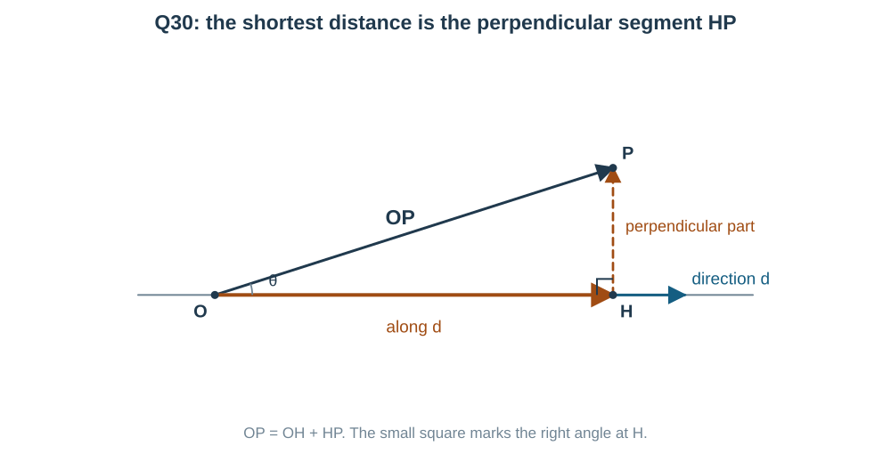

Here the line passes through the origin $O$, so $\mathbf r=\overrightarrow{OP}=(1,1,2)$. Its direction is $\mathbf d=(1,2,2)$.

**Why this method?** We need only the length $HP$, not every coordinate of $H$. Resolve $\mathbf r$ along $\mathbf d$ and perpendicular to $\mathbf d$. Pythagoras removes the along-part:

$$
D^2=|\mathbf r|^2-\frac{(\mathbf r\cdot\mathbf d)^2}{|\mathbf d|^2}.
$$

**Solution.**

$$
|\mathbf r|^2=6,\quad|\mathbf d|^2=9,\quad
\mathbf r\cdot\mathbf d=1+2+4=7.
$$

$$
D^2=6-\frac{49}{9}=\frac59
\quad\Longrightarrow\quad
\boxed{D=\frac{\sqrt5}{3}},
\qquad\text{option (c).}
$$

**Check.** The foot has position $\mathbf h=(7/9)\mathbf d$. Then $(\mathbf r-\mathbf h)\cdot\mathbf d=7-(7/9)9=0$, so the remaining segment really is perpendicular.

#### Another possible approach or useful connection

**Another possible approach — area divided by base.**

$$
\mathbf r\times\mathbf d=(-2,0,1),
\qquad D=\frac{|\mathbf r\times\mathbf d|}{|\mathbf d|}
=\frac{\sqrt5}{3}.
$$

The numerator is a parallelogram area. Dividing it by the base length leaves its height, which is the required distance. Do not divide by $|\mathbf r|$; the chosen base is the line direction $\mathbf d$.

### Question 31 — A short sum can mean an obtuse angle

**PDF page 116 | MCQ | Notes: F02**

If $\mathbf a,\mathbf b$ are unit vectors and $|\mathbf a+\mathbf b|=1$, the angle between them is:

- (a) $120^\circ$
- (b) $60^\circ$
- (c) $90^\circ$
- (d) $150^\circ$

**Understand the short sum.** Both arrows have length $1$, but their sum also has length $1$. They cannot point the same way, because that would give a sum length of $2$. They must partly oppose one another.

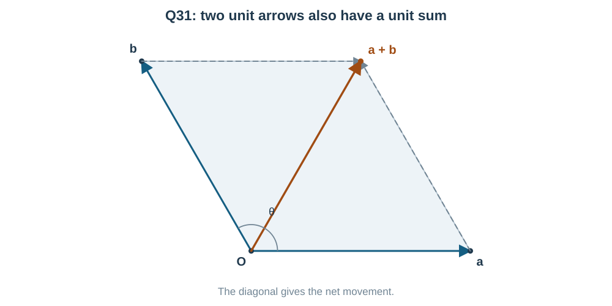

**Recognize the length-of-sum pattern.** Squaring the known sum brings in the angle:

$$
|\mathbf a+\mathbf b|^2
=|\mathbf a|^2+|\mathbf b|^2+2|\mathbf a||\mathbf b|\cos\theta.
$$

**Solution.**

$$
1=1+1+2\cos\theta
\quad\Longrightarrow\quad
\cos\theta=-\frac12.
$$

$$
\boxed{\theta=120^\circ}
\qquad\text{option (a).}
$$

**Check.** A negative cosine means an obtuse angle, matching the partly opposing arrows in the picture.

#### Another possible approach or useful connection

**Another possible approach — half-angle size.** For two unit arrows, $|\mathbf a+\mathbf b|=2\cos(\theta/2)$. Thus $\cos(\theta/2)=1/2$, giving $\theta/2=60^\circ$ and $\theta=120^\circ$. The squared-sum route is safer if the half-angle result is not familiar.

### Question 32 — Understand the triple-product identities

**PDF page 116 | MCQ | Notes: C13–C14 | Second reading after the foundations**

Let $\mathbf a,\mathbf b,\mathbf c$ be non-coplanar vectors. Consider:

$$
\begin{aligned}
\text{(i)}\quad &[\mathbf a+\mathbf b,\mathbf b+\mathbf c,\mathbf c+\mathbf a]
=2[\mathbf a\,\mathbf b\,\mathbf c],\\
\text{(ii)}\quad &[\mathbf a\times\mathbf b,\mathbf b\times\mathbf c,\mathbf c\times\mathbf a]
=[\mathbf a\,\mathbf b\,\mathbf c]^2,\\
\text{(iii)}\quad &[\mathbf a\,\mathbf b\,\mathbf c]=[\mathbf c\,\mathbf a\,\mathbf b],\\
\text{(iv)}\quad &[\mathbf a\,\mathbf b\,\mathbf c]=[\mathbf b\,\mathbf a\,\mathbf c].
\end{aligned}
$$

The correct statements are:

- (a) (i) and (ii) only
- (b) (i), (ii), and (iii) only
- (c) (ii), (iii), and (iv) only
- (d) (i), (iii), and (iv) only

**Understand the pattern — separate the familiar sign rules from the longer identities.** Write $S=[\mathbf a\,\mathbf b\,\mathbf c]$. Non-coplanar means the three arrows do not lie in one plane, so their signed volume is not zero:

$$
S\ne0.
$$

Now inspect (iii) and (iv). In (iii), the order goes around the same cycle. In (iv), two entries are exchanged. We know

$$
[\mathbf c\,\mathbf a\,\mathbf b]=S,\qquad
[\mathbf b\,\mathbf a\,\mathbf c]=-S.
$$

Since $S\ne0$, $S$ and $-S$ are different. That settles those two statements. For (i), open the sums and remove repeated-entry terms. For (ii), do the inner cross product first. The solution shows these steps rather than asking you to memorize them.

**Short exam route using these options.** Statement (iii) is true and (iv) is false. Option (a) leaves out the true statement (iii). Options (c) and (d) include the false statement (iv). Only **(b)** remains. For this single-correct MCQ, that is enough to select the answer quickly.

The working below also checks (i) and (ii), so we understand why the full set in (b) is correct.

**Solution.** Put $S=[\mathbf a\,\mathbf b\,\mathbf c]\ne0$.

**(i):** choose one term from each of the three sums. Each sum has two choices, so there are $2\times2\times2=8$ terms:

$$
\begin{aligned}
&[\mathbf a\,\mathbf b\,\mathbf c]+[\mathbf a\,\mathbf b\,\mathbf a]
+[\mathbf a\,\mathbf c\,\mathbf c]+[\mathbf a\,\mathbf c\,\mathbf a]\\
&+[\mathbf b\,\mathbf b\,\mathbf c]+[\mathbf b\,\mathbf b\,\mathbf a]
+[\mathbf b\,\mathbf c\,\mathbf c]+[\mathbf b\,\mathbf c\,\mathbf a].
\end{aligned}
$$

For example, $[\mathbf a\,\mathbf b\,\mathbf a]=0$ because the first and third arrows repeat. Six terms have such a repetition and vanish. The two remaining terms are

$$
[\mathbf a\,\mathbf b\,\mathbf c]+[\mathbf b\,\mathbf c\,\mathbf a]=S+S=2S.
$$

Thus (i) is true.

**(ii):** the outer expression is a scalar triple product. Evaluate its inner cross product using BAC–CAB:

$$
\begin{aligned}
(\mathbf b\times\mathbf c)\times(\mathbf c\times\mathbf a)
&=\mathbf c\big((\mathbf b\times\mathbf c)\cdot\mathbf a\big)
 -\mathbf a\big((\mathbf b\times\mathbf c)\cdot\mathbf c\big)\\
&=S\mathbf c-\mathbf a(0)=S\mathbf c.
\end{aligned}
$$

Now dot with the first entry:

$$
[\mathbf a\times\mathbf b,\mathbf b\times\mathbf c,\mathbf c\times\mathbf a]
=(\mathbf a\times\mathbf b)\cdot(S\mathbf c)=S^2.
$$

Thus (ii) is true. **(iii)** is true because cyclic order is unchanged. **(iv)** is false because one swap gives $-S$, and $S\ne0$.

**Answer: $\boxed{\text{(b)}}$.** Check: taking $\mathbf a=\hat{\mathbf i}$, $\mathbf b=\hat{\mathbf j}$, $\mathbf c=\hat{\mathbf k}$ gives $S=1$, while the swapped product is $-1$. Such a check can disprove (iv); the general reasoning above proves the true identities.

**Method lesson.** Checking the basis vectors can disprove a bad identity, but one successful example cannot prove a general identity. Use distribution, determinant rules, and the bracket formula for the positive claims.

#### Another possible approach or useful connection

**Another possible approach for (i) — use a coefficient determinant.** Each new arrow is a combination of $\mathbf a,\mathbf b,\mathbf c$. The coefficient rows are $(1,1,0)$, $(0,1,1)$, $(1,0,1)$. Thus

$$
[\mathbf a+\mathbf b,\mathbf b+\mathbf c,\mathbf c+\mathbf a]
=\begin{vmatrix}1&1&0\\0&1&1\\1&0&1\end{vmatrix}S
=2S.
$$

This uses the determinant rule for how volume changes under linear combinations. The direct expansion is safer if that rule is new to you. For (ii), the cross-product proof above is the method to learn; one numerical example alone would not prove the identity.

### Question 33 — When can we conclude two vectors are equal?

**PDF page 116 | MCQ | Notes: C15**

Let $\mathbf a\ne\mathbf0$.

Statement I: $\mathbf a\cdot\mathbf b=\mathbf a\cdot\mathbf c$ implies $\mathbf b=\mathbf c$.

Statement II: $\mathbf a\cdot\mathbf b=\mathbf a\cdot\mathbf c$ and $\mathbf a\times\mathbf b=\mathbf a\times\mathbf c$ together imply $\mathbf b=\mathbf c$.

- (a) Both statements are true.
- (b) Statement I is true; Statement II is false.
- (c) Statement I is false; Statement II is true.
- (d) Both statements are false.

**Understand what a dot product can miss.** Equal dots with $\mathbf a$ mean equal along-$\mathbf a$ parts. The arrows can still differ sideways.

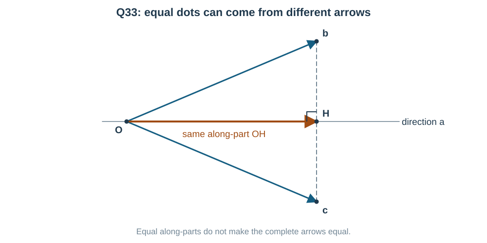

**Statement I.** Choose $\mathbf a=(1,0,0)$, $\mathbf b=(2,1,0)$ and $\mathbf c=(2,-1,0)$. Then

$$
\mathbf a\cdot\mathbf b=2=\mathbf a\cdot\mathbf c,
\qquad\mathbf b\ne\mathbf c.
$$

So I is false. We cannot cancel a dotted vector as if it were an ordinary nonzero number.

**Statement II.** Put $\mathbf v=\mathbf b-\mathbf c$. The two givens become

$$
\mathbf a\cdot\mathbf v=0,\qquad
\mathbf a\times\mathbf v=\mathbf0.
$$

If $\mathbf v$ were nonzero, the first equation would make it perpendicular to $\mathbf a$. The second would make it parallel to $\mathbf a$. A nonzero arrow cannot do both. Therefore

$$
\mathbf v=\mathbf0
\quad\Longrightarrow\quad
\mathbf b=\mathbf c.
$$

So II is true, and the answer is $\boxed{\text{(c)}}$.

**Check the needed condition.** The question says $\mathbf a\ne\mathbf0$. Without it, both products would be zero for every $\mathbf b,\mathbf c$, and the conclusion would fail.

#### Another possible approach or useful connection

**Another possible approach — prove II with one identity.**

$$
|\mathbf a|^2|\mathbf v|^2
=(\mathbf a\cdot\mathbf v)^2+|\mathbf a\times\mathbf v|^2=0.
$$

Because $|\mathbf a|^2>0$, we get $|\mathbf v|^2=0$, hence $\mathbf v=\mathbf0$. This combines the along and perpendicular information in one equation.

### Question 34 — Minimum length: remove the along-direction part

**PDF page 116 | MCQ | Notes: F06**

For real $t$, the minimum value of

$$
\left|(\hat{\mathbf i}+2\hat{\mathbf j}+3\hat{\mathbf k})
+t(\hat{\mathbf i}+\hat{\mathbf j}+\hat{\mathbf k})\right|
$$

is:

- (a) $\sqrt3$
- (b) $\sqrt2$
- (c) $2$
- (d) $1$

**Understand what changes when t changes.** Write the expression as $|\mathbf a+t\mathbf b|$, where $\mathbf a=(1,2,3)$ and $\mathbf b=(1,1,1)$. Adding $t\mathbf b$ moves the arrow tip along a line in direction $\mathbf b$.

Split $\mathbf a$ along $\mathbf b$ and perpendicular to $\mathbf b$:

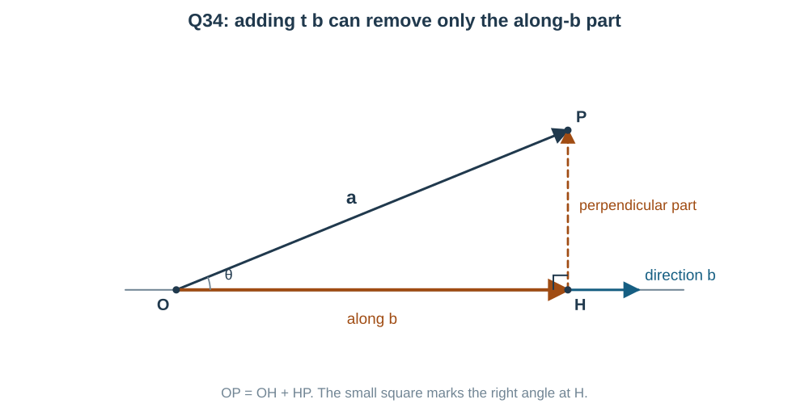

Read $OH$ as $\mathbf a_{\parallel}$ and $HP$ as $\mathbf a_{\perp}$. The slider $t\mathbf b$ can cancel $OH$. It cannot cancel $HP$, because $HP$ points at a right angle to $\mathbf b$.

**Why this is a minimum.** The two parts are perpendicular, so

$$
|\mathbf a+t\mathbf b|^2
=|\mathbf a_{\perp}|^2+|\mathbf a_{\parallel}+t\mathbf b|^2.
$$

The second term is never negative. Since $t$ may be any real number, we can make it zero. The shortest possible arrow is therefore the perpendicular part.

**Solution.**

$$
\mathbf a\cdot\mathbf b=6,\qquad|\mathbf b|^2=3,
\qquad\mathbf a_{\parallel}=\frac63\mathbf b=2\mathbf b.
$$

Choose $t=-2$ to remove it:

$$
\mathbf a-2\mathbf b=(1,2,3)-(2,2,2)=(-1,0,1).
$$

Thus

$$
\boxed{\min|\mathbf a+t\mathbf b|=\sqrt{1+0+1}=\sqrt2},
\qquad\text{option (b).}
$$

**Check.** $(-1,0,1)\cdot(1,1,1)=0$, so the shortest arrow is perpendicular to the allowed sliding direction.

#### Another possible approach or useful connection

**Another possible approach — expand and complete the square.**

$$
\begin{aligned}
|\mathbf a+t\mathbf b|^2
&=(1+t)^2+(2+t)^2+(3+t)^2\\
&=3t^2+12t+14\\
&=3(t+2)^2+2.
\end{aligned}
$$

The square is at least zero, so the smallest squared length is $2$, attained at $t=-2$. Take the square root to answer the question.

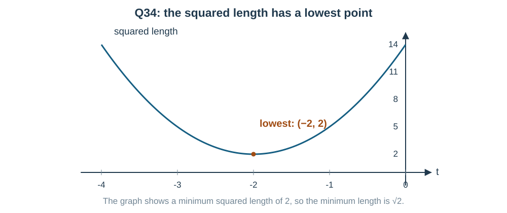

This is an equally good exam route. A graph of $y=3(t+2)^2+2$ is an upward parabola with lowest point $(-2,2)$. That graph shows why the minimum exists. We expanded because the expansion becomes a square plus a constant; calculus would add work here.

### Question 35 — Four points in one plane

**PDF page 116 | MCQ | Notes: C04, C13**

The points $A(1,2,3)$, $B(2,3,5)$, $C(3,1,2)$, and $D(\lambda,3,4)$ are coplanar. Then $\lambda$ equals:

- (a) $1$
- (b) $-1$
- (c) $0$
- (d) $2$

#### 1. What are we trying to find?

First, the word **coplanar** means **on the same flat plane**.

Think of a flat sheet of paper. Imagine that it keeps going beyond its edges. This is our picture of a plane.

The three known points $A,B,C$ lie on one such sheet. We must choose $\lambda$ so that $D$ also lies on that sheet.

**Read the picture:** on the left, all four points share the sheet. On the right, $D$ has a gap above it, so those four points are not coplanar.

The first three drawings explain the idea. We will use the actual coordinates in the calculation and in the final check drawing.

In $D(\lambda,3,4)$, only the first coordinate is unknown. So we need to find **where $D$ must be in the $x$ direction**.

#### 2. Use movements that start at A

Choose $A$ as our common starting point. It is already on the sheet.

The movement from $A$ to $B$ stays along the sheet. The movement from $A$ to $C$ also stays along the sheet. For the correct value of $\lambda$, the movement from $A$ to $D$ must stay along it too.

**Read the arrows:** each one starts at the same dot, $A$. The arrow to $D$ is dashed so you can follow it separately.

The symbol $\overrightarrow{AB}$ means **the movement from $A$ to $B$**. Find it by subtracting the starting coordinates from the destination coordinates:

$$
\overrightarrow{AB}=(2-1,\;3-2,\;5-3)=(1,1,2).
$$

What do these numbers say? Starting at $A$, increase $x$ by $1$, increase $y$ by $1$, and increase $z$ by $2$. You arrive at $B$.

Do the same for the other two movements:

$$
\overrightarrow{AC}=(3-1,\;1-2,\;2-3)=(2,-1,-1),
$$

$$
\overrightarrow{AD}=(\lambda-1,\;3-2,\;4-3)
=(\lambda-1,1,1).
$$

**Why start them all at $A$?** We are describing movements along the sheet through $A,B,C$. Using the same starting point makes those movements easy to compare. We could use another one of the known points instead, but then all three arrows would need to start there.

#### 3. Imagine a stick standing straight out of the sheet

Suppose a stick stands straight out of this flat sheet. It makes a right angle with every direction along the sheet.

A vector pointing in this direction is called a **normal vector**. Here, “normal” means **perpendicular to the plane**. Perpendicular means a $90^\circ$ angle.

**Read the two views:** the left view shows the sheet tilted towards us. The right view looks along its edge, so the sheet looks like a line. That side view makes the right angle easy to see.

Now ask: **how can we make this perpendicular direction from the two known arrows along the sheet?**

This is the job of a **cross product**. Crossing two non-parallel vectors gives a vector perpendicular to both, and therefore perpendicular to their plane.

Our two known side vectors are not parallel: $(1,1,2)$ and $(2,-1,-1)$ are not multiples of each other. So we can use

$$
\boxed{\mathbf n=\overrightarrow{AB}\times\overrightarrow{AC}}.
$$

Here $\mathbf n$ is the normal — our “stick direction.” We need its direction for this test; we do not need to turn it into a unit vector.

#### 4. What must be true if D is on the sheet?

Look at the side view again.

If $D$ is on the sheet, then $\overrightarrow{AD}$ runs along the sheet. It must make a right angle with the stick direction $\mathbf n$.

A dot product tells us about the angle between two vectors:

$$
\mathbf n\cdot\overrightarrow{AD}
=|\mathbf n|\,|\overrightarrow{AD}|\cos90^\circ=0.
$$

So the condition we need is

$$
\boxed{\mathbf n\cdot\overrightarrow{AD}=0}.
$$

**Now our two operations have clear jobs:**

- Cross product makes the stick direction from two known arrows in the sheet.
- Dot product checks whether the arrow to $D$ makes a right angle with that stick.

That is the plan. We can now put in the numbers.

#### 5. Calculate the normal, then find lambda

We already found the two side arrows:

$$
\mathbf n=(1,1,2)\times(2,-1,-1).
$$

Here is the component rule. If $\mathbf u=(u_x,u_y,u_z)$ and $\mathbf v=(v_x,v_y,v_z)$, then the vector $\mathbf n=\mathbf u\times\mathbf v$ has these three components:

$$
\begin{aligned}
n_x&=u_yv_z-u_zv_y,\\
n_y&=u_zv_x-u_xv_z,\\
n_z&=u_xv_y-u_yv_x.
\end{aligned}
$$

Here the first vector supplies the $u$ values and the second supplies the $v$ values. Substitute one component at a time:

$$
\begin{aligned}
n_x&=1(-1)-2(-1)=-1+2=1,\\
n_y&=2(2)-1(-1)=4+1=5,\\
n_z&=1(-1)-1(2)=-1-2=-3.
\end{aligned}
$$

Therefore

$$
\mathbf n=(1,5,-3).
$$

**A useful check before continuing:** does this arrow really make right angles with our two side arrows?

$$
\mathbf n\cdot\overrightarrow{AB}=1(1)+5(1)+(-3)(2)=0,
$$

$$
\mathbf n\cdot\overrightarrow{AC}=1(2)+5(-1)+(-3)(-1)=0.
$$

Yes. Our calculated normal matches the picture.

Now use the test for $D$:

$$
(1,5,-3)\cdot(\lambda-1,1,1)=0.
$$

Multiply matching components and add:

$$
1(\lambda-1)+5(1)+(-3)(1)=0,
$$

$$
\lambda-1+5-3=0
\quad\Longrightarrow\quad
\lambda+1=0.
$$

$$
\boxed{\lambda=-1}
\qquad\text{Answer: option (b).}
$$

#### 6. Check the answer with the actual points

Put $\lambda=-1$. Then $D=(-1,3,4)$, so

$$
\overrightarrow{AD}=(-2,1,1).
$$

Did you notice something useful? Compare it with $\overrightarrow{AC}=(2,-1,-1)$:

$$
\boxed{\overrightarrow{AD}=-\overrightarrow{AC}}.
$$

So starting at $A$, the journey to $D$ is the same length as the journey to $C$, but in the opposite direction. The points $C,A,D$ lie on one straight line, with $A$ between $C$ and $D$.

**This final drawing uses the actual coordinates.** It looks straight at the plane through the points. The labels keep the original three-dimensional coordinates; the drawing does not claim that this sheet is the original $xy$-plane.

Because the whole line through $A$ and $C$ lies in the sheet, this $D$ lies in it too. This agrees with the answer.

#### 7. What should you recognize next time?

When a question says **four points are coplanar**, picture **one flat sheet containing all four points**.

Then think:

1. Choose one known point as the start.
2. Make three movement arrows from it.
3. Cross two known arrows to find a normal.
4. Dot that normal with the third arrow and set the result to zero.

**Why this route fits this question:** the normal uses only known numbers. The final dot product gives one equation in the one unknown, $\lambda$.

**A common mix-up:** the coordinates of $A$ tell us where $A$ is. The vector $\overrightarrow{AB}$ tells us how to move from $A$ to $B$. Those are different things.

If we use $(1,2,3)$ as an arrow, it starts at the origin $O=(0,0,0)$ and ends at $A$. But the question does not say that $O$ lies on our sheet. So that arrow need not run along the sheet. This is why we first subtract coordinates: $\overrightarrow{AB}$ and $\overrightarrow{AC}$ start at a point on the sheet and run along it.

#### The short exam version

Read this after the picture and reasoning make sense:

$$
\begin{aligned}
\overrightarrow{AB}&=(1,1,2),\\
\overrightarrow{AC}&=(2,-1,-1),\\
\overrightarrow{AD}&=(\lambda-1,1,1).
\end{aligned}
$$

$$
\overrightarrow{AB}\times\overrightarrow{AC}=(1,5,-3).
$$

$$
(1,5,-3)\cdot(\lambda-1,1,1)=0
\;\Longrightarrow\;
\lambda+1=0
\;\Longrightarrow\;
\boxed{\lambda=-1}.
$$

#### Another possible approach or useful connection

#### Another possible approach — make the third movement from the first two

**Optional second reading.** Understand the normal method first.

Two non-parallel directions along a flat sheet are enough to describe any movement along that sheet. So if $D$ is in the plane, we can write

$$
\overrightarrow{AD}=r\overrightarrow{AB}+s\overrightarrow{AC},
$$

where $r,s$ are numbers telling us how much of each movement to use.

With our side vectors, this says

$$
(\lambda-1,1,1)=r(1,1,2)+s(2,-1,-1).
$$

Compare the $y$ and $z$ components first. They contain no $\lambda$:

$$
r-s=1,\qquad 2r-s=1.
$$

Subtract the first equation from the second: $r=0$. Then $s=-1$.

Thus $\overrightarrow{AD}=-\overrightarrow{AC}$. Compare their $x$ components:

$$
\lambda-1=-2
\quad\Longrightarrow\quad
\boxed{\lambda=-1}.
$$

**Which method should Kanna use?** The normal method gives a clear geometric test that can be reused. This second route is short here because the two equations without $\lambda$ are very easy. It gives another way to see the same sheet: a movement along it can be built from two known side directions.

#### Three things to explain back

Before moving on, try saying these in your own words:

- Why did we make all the arrows start at $A$?
- What does the normal vector look like in the picture?
- Why must its dot product with $\overrightarrow{AD}$ be zero?

If those three answers make sense, the final formula has a picture and a reason behind it.

## Answer check

Use this only after attempting the questions. A choice label refers to the original PDF option order.

| Question | Verified answer | Question | Verified answer | Question | Verified answer |
|---|---|---|---|---|---|
| 1 | (a) $\sqrt6/2$ | 13 | $4$ | 25 | Both (c) and (d); defective single-correct item |
| 2 | (d) $5\sqrt3$ | 14 | $12.50$ | 26 | $3$ |
| 3 | $7$ | 15 | (d) $3\hat{\mathbf i}+4\hat{\mathbf j}+3\hat{\mathbf k}$ | 27 | $11$ |
| 4 | (a) $(-2\hat{\mathbf i}+2\hat{\mathbf j}-\hat{\mathbf k})/3$ | 16 | $3$ | 28 | $6$ |
| 5 | (d) $\pi/3$ | 17 | (c) $\sqrt{21}/2$ | 29 | (d) $\sqrt3/2$ |
| 6 | (c) $\pi/3$ | 18 | $-3/2$ | 30 | (c) $\sqrt5/3$ |
| 7 | $108$ | 19 | (c) $-1$ | 31 | (a) $120^\circ$ |
| 8 | (b) $-4$ | 20 | $75$ | 32 | (b) (i), (ii), (iii) |
| 9 | (c) $3\hat{\mathbf i}+\hat{\mathbf k}$ | 21 | (d) $\sqrt{19}$ | 33 | (c) I false, II true |
| 10 | (d) I true, II false | 22 | (b) $14$ | 34 | (b) $\sqrt2$ |
| 11 | (d) A and R true; R explains A | 23 | $0.5$ | 35 | (b) $-1$ |
| 12 | (a) A–III, B–IV, C–I, D–II | 24 | (c) $60^\circ$ | — | — |

## PYQ coverage audit

**This pilot fully covers the 35 Vector Algebra practice questions in the supplied PDF.** They are original JEE Main-style questions according to that PDF, not actual PYQs.

The official 2027 syllabus was checked on 28 October 2026. For exam context, the complete Mathematics section of the official NTA paper dated 2 April 2026, Shift 1, was visually inspected. Two relevant items were identified: Q14 combines weighted vector lengths and an angle constraint; Q15 combines perpendicular directions with a perpendicular foot on a line. They support the connections taught here. Their original text is not reproduced in this guide.

The opening weightage table uses the published 2024–2026 counts from two named archives and shows their disagreement. Those statistics were not independently rebuilt from every official paper. The earlier official-paper check is representative, **not an exhaustive 2020–2026 PYQ audit**. No formula-frequency or “most repeated” ranking is claimed. The chapter's teaching order follows prerequisite ideas and the supplied practice set.

## Offline research record

- Supplied *Maths Predicted V1.pdf*: chapter 22, Vector Algebra; questions on printed PDF pages 113–116; key on page 116; source solutions continue through page 118. All 35 questions were checked against page images and solved independently.
- NTA, *Syllabus for JEE (Main) 2027*, Mathematics Units 11 and 12: checked on 28 October 2026 for the official scope and related geometry topics.
- NTA, *B Tech 2nd Apr 2026 Shift 1*, Mathematics Q14, question ID 69112114, and Q15, question ID 69112115: checked against the official paper images. Used for method context, not for frequency claims.
- NCERT, Class XII Mathematics Part II, Chapter 10, *Vector Algebra*, reprint 2026–27: consulted for scope and terminology. Explanations, diagrams, and worked solutions here are independently written.
- ExamSIDE / ExamGOAL, Vector Algebra chapter statistics, accessed 28 October 2026: published counts for 2024–2026 are 38, 22, 24. These are archive chapter labels, not official NTA classifications.
- PYQSide, Vector Algebra 2024–2026 chapter statistics, accessed 28 October 2026: published counts are 37, 23, 25 across 20, 19, 19 papers. Its total is 85 questions over 58 papers. The opening table preserves the disagreement rather than concealing it.
- NTA, notice dated 17 October 2024 on discontinuing optional Section B selection from 2025: checked to explain why 2024 offered-question averages require care when compared with later years.

**Review status:** full Vectors revision using the approved Question 35 teaching approach. Notes explain meanings before formulas; solutions connect pictures, patterns, equations, calculations, and checks. Local SVG geometry replaces the earlier flowchart drawings. Useful alternatives are fully visible. The Maths chapter review set is complete; printed PDF production remains a later stage.

