# Chapter 23 — Probability

**Kanna, probability asks: among the outcomes we are allowed to consider, how much chance belongs to the outcomes we want?** First decide what can happen. Then decide what the question wants. Calculate only after these two are clear.

Your preparation target is **200 marks**: Physics 60, Maths 60, Chemistry 80. For this chapter, build a reliable sample space, understand “given,” and separate independent trials from draws that change a bag.

## Recent chapter weightage

| Year | Questions tagged Probability in the checked archive | Full-year paper shifts | Tagged questions per shift |
|---|---:|---:|---:|
| 2024 | 26 | 20 | 1.30 |
| 2025 | 21 | 19 | 1.11 |
| 2026 | 19 | 19 | 1.00 |
| Total | 66 | 58 | **1.14** |

These are distinct recent question IDs recounted in ExamSIDE's Probability category. PYQSide splits Probability into Class 11 and Class 12. Its two rows give combined counts 26, 22 and 19; the 2025 total differs by one. We use the named ExamSIDE category consistently. The 2024 papers offered more optional numerical questions. Detailed sources, IDs and the disagreement are saved separately.

This is an archive-tag recount, not a new classification of every official paper or a measured formula-frequency ranking. A mean of 1.14 does not promise a question in every shift.

**Important for JEE Main:** the current official unit includes event probability, addition and multiplication rules, Bayes' theorem and random-variable distributions. The notes teach the counting, conditioning, independence, expectation and binomial tools needed to use them. Recent archive examples include bag transfers, reverse-condition questions, committees and random-variable moments. The suggested study order is a teaching judgment.

## Concept C01 — Outcome, sample space and event

An **experiment** is the action: toss a coin, throw dice or draw cards. An **outcome** is one complete result of that action. The **sample space** $S$ is the set of all allowed outcomes. An **event** $A$ is the group of outcomes that satisfy a condition.

For one coin, $S=\{H,T\}$. For two tosses,

$$
S=\{HH,HT,TH,TT\}.
$$

“Exactly one head” is the event $\{HT,TH\}$. It contains two outcomes.

If all elementary outcomes have the **same chance**, then

$$
\boxed{P(A)=\frac{n(A)}{n(S)}}.
$$

Here $n(A)$ counts favourable outcomes, and $n(S)$ counts all possible outcomes. Probability has no unit. It lies between 0 and 1:

$$
\boxed{0\le P(A)\le1,\qquad P(S)=1,\qquad P(\varnothing)=0}.
$$

**Why “equally likely” matters:** the three labels “zero heads,” “one head,” “two heads” are not equally likely. They contain 1, 2 and 1 of the four fair-coin sequences. Giving each label probability $1/3$ would be wrong.

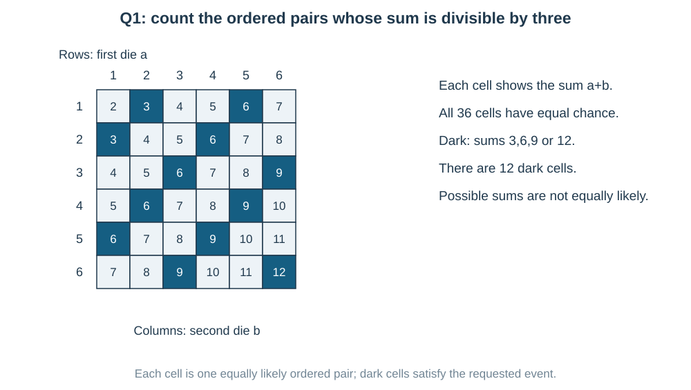

For two fair independent dice, use ordered pairs $(a,b)$, with $a,b\in\{1,\ldots,6\}$. Think of the dice as first and second, or red and blue:

$$
n(S)=6\cdot6=36.
$$

The outcomes $(2,5)$ and $(5,2)$ are different. The sum 7 has six outcomes, while sum 2 has only one. **Sums are not equally likely.**

Ordinary school problems model separate fair tosses/dice as independent. Birth weekdays are usually modelled as independent and equally likely across seven days. These are assumptions of the question model, not facts about every real situation.

## Concept C02 — Counting: choose a consistent type of outcome

**Multiplication principle:** if a first choice has $a$ possibilities and, for each, a second choice has $b$ possibilities, the pair has $ab$ possibilities. For independent fair trials this also builds equally likely sequences.

Factorial means

$$
n!=n(n-1)\cdots2\cdot1,\qquad0!=1.
$$

For $r$ objects from $n$ distinct objects:

$$
\boxed{{}^nP_r=\frac{n!}{(n-r)!}}
\quad\text{if order matters},
\qquad
\boxed{\binom nr=\frac{n!}{r!(n-r)!}}
\quad\text{if only the group matters}.
$$

A committee has no first, second or third seat. Use combinations. A recorded draw sequence has positions, so order matters.

**Important consistency check:** count numerator and denominator in the same way. For two aces from a 52-card pack,

$$
\frac{4\cdot3}{52\cdot51}
=\frac{\binom42}{\binom{52}2}.
$$

Each unordered pair has two orders, so the factor 2 cancels. Mixing $\binom42$ with $52\cdot51$ would count only one side without order.

For repeated letters with total count $N$ and repeated multiplicities $n_1,n_2,\ldots$,

$$
\boxed{\text{distinct arrangements}=\frac{N!}{n_1!n_2!\cdots}}.
$$

Swapping two identical letters does not make a new visible word. If some letters must stay together, treat that group as **one block**, then count the arrangements of the block and remaining objects. Include the internal arrangements only if its letters can produce different internal orders.

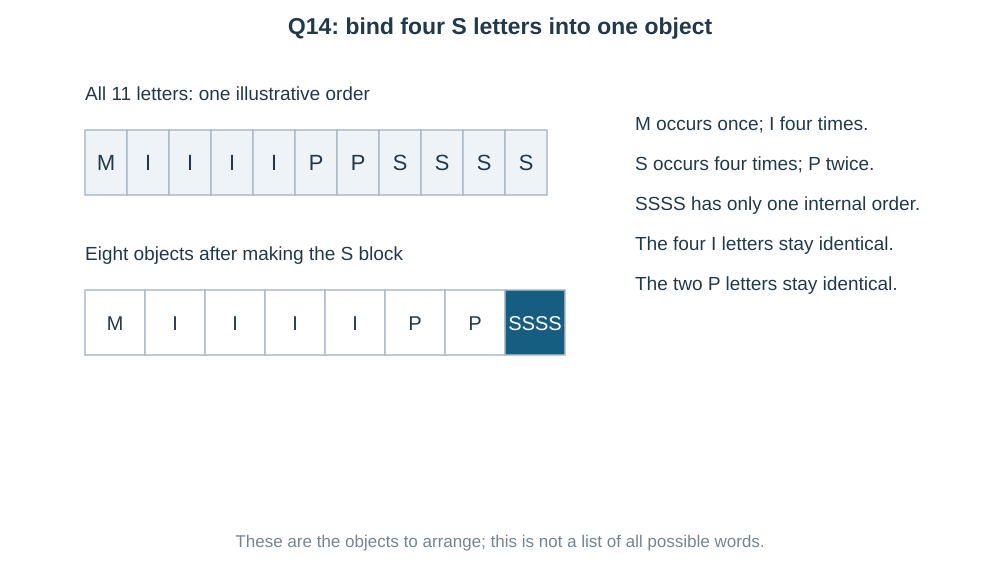

**A shorter pattern sometimes avoids the whole word count.** The four S positions form a uniformly selected four-position subset of eleven positions. Consecutive four-position subsets can start in eight places. Hence the same probability is $8/\binom{11}4$. This works because every S-position subset leaves the same number of arrangements of the other letters.

## Concept C03 — Translate AND, OR, NOT and “exactly one”

An apostrophe means “not”: $A'$ is the **complement** of $A$.

| Words | Event notation | Meaning |
|---|---|---|
| A and B | $A\cap B$ | both conditions hold |
| A or B | $A\cup B$ | at least one holds; both are allowed |
| A but not B | $A\cap B'$ | A alone |
| Neither A nor B | $A'\cap B'$ | both fail |
| Not both | $(A\cap B)'$ | everything except their common part |
| Exactly one | $(A\cap B')\cup(A'\cap B)$ | one occurs and the other fails |

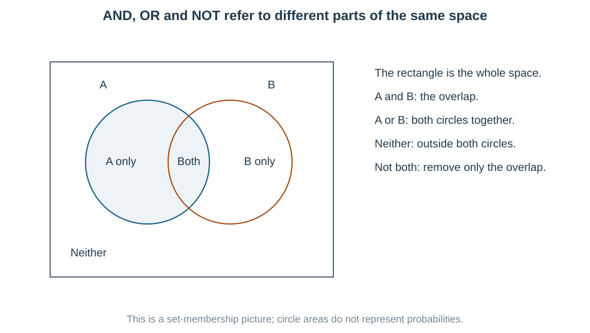

The whole sample space splits into four nonoverlapping pieces:

$$
A\cap B',\quad A\cap B,\quad A'\cap B,\quad A'\cap B'.
$$

Their probabilities add to 1. Use that picture when the wording contains several complements.

**Important for JEE Main — De Morgan's laws:**

$$
\boxed{A'\cap B'=(A\cup B)'},\qquad
\boxed{A'\cup B'=(A\cap B)'}.
$$

To have **neither**, we must be outside the whole union. To have **not both**, we remove only the overlap. Q4 and Q35 deliberately ask these different things.

## Concept C04 — Addition rule: correct the double count

When we add $P(A)+P(B)$, every outcome in both events is counted twice. Remove one copy:

$$
\boxed{P(A\cup B)=P(A)+P(B)-P(A\cap B)}.
$$

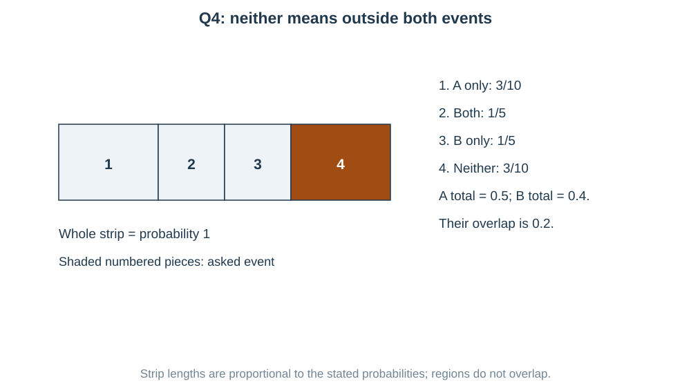

For Q4, $P(A)=0.5$, $P(B)=0.4$, overlap $=0.2$. Then A alone is $0.3$, B alone is $0.2$, both is $0.2$, and neither is $0.3$.

If $A,B$ are **mutually exclusive**, they cannot occur together, so $A\cap B=\varnothing$. Only then does the rule reduce to $P(A\cup B)=P(A)+P(B)$.

Other useful forms:

$$
\boxed{P(A\text{ alone})=P(A)-P(A\cap B)},
$$

$$
\boxed{P(\text{exactly one})=P(A)+P(B)-2P(A\cap B)},
$$

$$
\boxed{P(\text{neither})=1-P(A)-P(B)+P(A\cap B)}.
$$

For three events, subtract the three pair overlaps, then restore the part removed too often:

$$
\boxed{\begin{aligned}
P(A\cup B\cup C)
={}&P(A)+P(B)+P(C)\\
&-P(A\cap B)-P(B\cap C)-P(C\cap A)
+P(A\cap B\cap C).
\end{aligned}}
$$

**Bounds that catch impossible data:**

$$
\boxed{\max(0,P(A)+P(B)-1)\le P(A\cap B)
\le\min(P(A),P(B))}.
$$

An overlap cannot exceed either whole event. Also the union cannot exceed 1. Check these before accepting event probabilities.

## Concept C05 — Conditional probability: change the allowed space

$P(A\mid B)$ is read “probability of A, **given B**.” We now know B happened. Outcomes outside B are no longer possible for this question.

Inside the remaining space B, the outcomes that also satisfy A are $A\cap B$. Therefore

$$
\boxed{P(A\mid B)=\frac{P(A\cap B)}{P(B)}},
\qquad P(B)>0.
$$

For equally likely elementary outcomes, this is

$$
\boxed{P(A\mid B)=\frac{n(A\cap B)}{n(B)}}.
$$

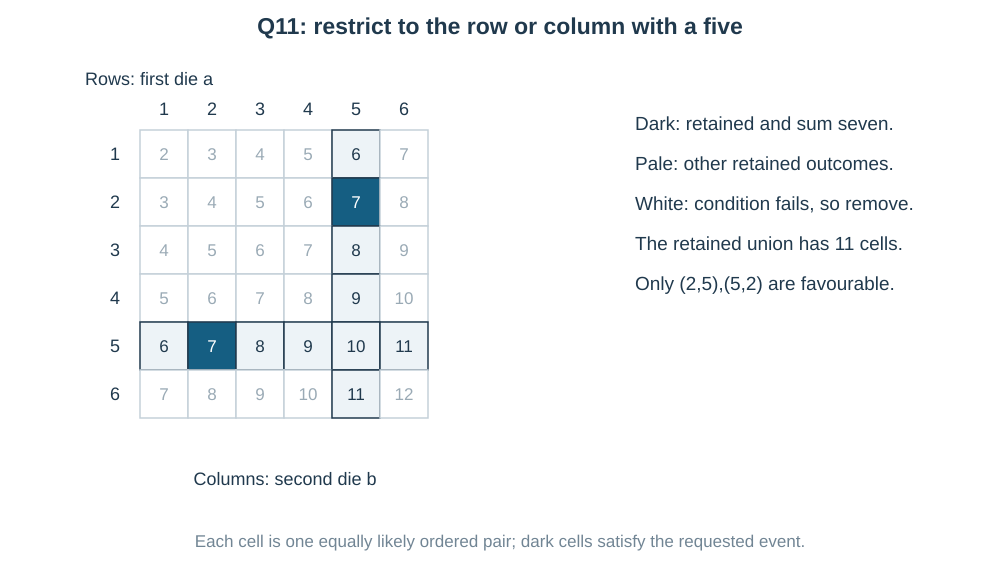

In that figure, “at least one 5” keeps one row and one column. The cell $(5,5)$ belongs to both, so there are $6+6-1=11$ possible cells. Only $(2,5),(5,2)$ also have sum 7. The answer is $2/11$.

**Do not keep the old denominator 36.** That would calculate the chance that the condition and target both happen before any information is given.

Also,

$$
P(A\mid B)\ne P(B\mid A)\quad\text{in general}.
$$

For a card, $P(\text{king}\mid\text{face card})=4/12=1/3$, while $P(\text{face card}\mid\text{king})=1$.

**Important question-reading habit:** “at least one die is 5” and “the first die is 5” describe different remaining spaces. A special observation or reporting procedure can also change the condition. Use exactly the information stated.

## Concept C06 — Multiplication rule and changing bags

Rearrange the conditional formula:

$$
\boxed{P(A\cap B)=P(A)P(B\mid A)
=P(B)P(A\mid B)}.
$$

The chance of a two-step path is “chance of reaching the first step” times “chance of the next step **after that first step**.”

For three ordered steps,

$$
\boxed{P(A\cap B\cap C)=P(A)P(B\mid A)P(C\mid A\cap B)}.
$$

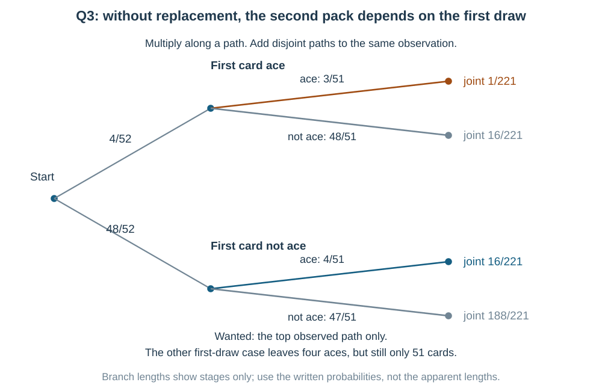

**Without replacement:** after an ace is drawn, the pack has 51 cards and only 3 aces. Thus

$$
P(\text{two aces})=\frac4{52}\frac3{51}.
$$

Using $(4/52)^2$ would describe replacement, not this experiment.

**With replacement and fresh random mixing:** put the first ball back. Both colour probabilities return to their original values, and the draws are modelled as independent:

$$
P(RR)=P(R)^2.
$$

Write the updated contents beside each path when the bag changes. The word “and” tells us to use a joint event; it does **not** give permission to multiply unchanged probabilities without checking dependence.

## Concept C07 — Independent is different from mutually exclusive

**Independent:** knowing A happened does not change B's chance. When the conditioning event has positive probability,

$$
P(B\mid A)=P(B).
$$

The general product test is

$$
\boxed{P(A\cap B)=P(A)P(B)}.
$$

This definition also handles zero-probability events without dividing by zero.

**Mutually exclusive:** A and B cannot happen together, so $P(A\cap B)=0$. If both have positive probability, then $P(A)P(B)>0$. The independence equation fails.

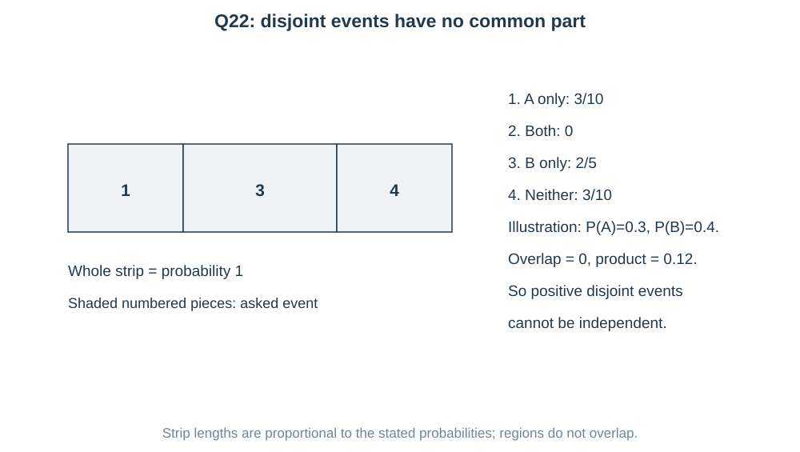

For one die, “even” and “odd” are mutually exclusive. Once “even” happens, “odd” becomes impossible. That is a change of chance, not independence.

For two separate fair tosses, “first is H” and “second is H” are independent. They can also happen together as HH. Independence does **not** mean no common outcomes.

If A and B are independent, their complements are independent in all pairs:

$$
\boxed{\begin{aligned}
P(A\cap B')&=P(A)[1-P(B)],\\
P(A'\cap B)&=[1-P(A)]P(B),\\
P(A'\cap B')&=[1-P(A)][1-P(B)].
\end{aligned}}
$$

For more than two events, full independence requires every relevant subset's joint probability to equal the product of its individual probabilities. Pairwise independence alone is not enough.

**Small example:** in two fair tosses, let A mean first H, B mean second H, and C mean both tosses show the same face. Each event has probability $1/2$ and each pair intersection has probability $1/4$. But the three-event intersection is $\{HH\}$, with probability $1/4$, not $1/8$. So they are pairwise independent, not mutually independent.

## Concept C08 — “At least one” often suggests the complement

“At least one success” allows 1, 2, 3, … successes. The only excluded case is **zero** successes:

$$
\boxed{P(\text{at least one})=1-P(\text{none})}.
$$

If $n$ trials are independent and have the same success probability $p$, write $q=1-p$:

$$
\boxed{P(\text{none})=q^n,\qquad
P(\text{at least one})=1-q^n}.
$$

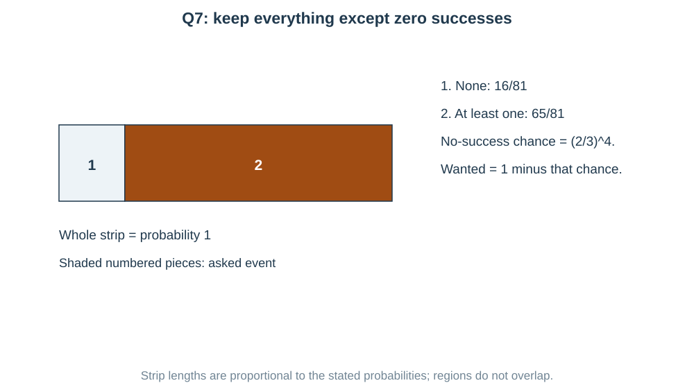

**Why not multiply $np$?** Different success events can happen together. Adding their probabilities then double-counts those outcomes. For example, five fair tosses do not give a probability $5/2$ of at least one head.

For independent trials with different probabilities $p_1,\ldots,p_n$,

$$
\boxed{P(\text{at least one})=1-\prod_{i=1}^n(1-p_i)}.
$$

Here $\prod$ means multiply all the listed factors. Do not use one binomial probability $p$ when different shooters have different accuracies.

For a threshold $0<\alpha<1$,

$$
1-q^n\ge\alpha
\quad\Longleftrightarrow\quad
q^n\le1-\alpha.
$$

When $0<q<1$, logarithms give

$$
n\ge\frac{\log(1-\alpha)}{\log q}.
$$

Both logarithms are negative. The least integer is the next allowed whole number; verify it and the preceding integer. With powers of 2, direct comparison is often easier than logarithms.

## Concept C09 — Total probability and Bayes: follow all routes to the observation

Suppose one of several nonoverlapping cases $H_1,\ldots,H_k$ must happen. They form a **partition**: exactly one case occurs.

An observed event E can happen through any of them:

$$
\boxed{P(E)=\sum_{i=1}^kP(H_i)P(E\mid H_i)}.
$$

Here $\sum$ means add the terms. Each term is the chance of one complete route, $H_i$ and then E. The routes are disjoint, so we add them.

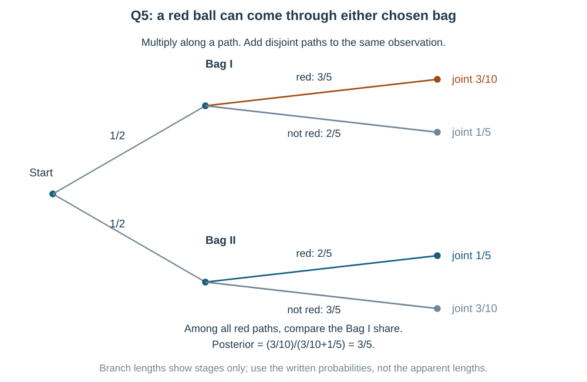

**Now reverse the question.** We have seen E. What fraction of the E outcomes came through case $H_j$?

$$
\boxed{P(H_j\mid E)=
\frac{P(H_j)P(E\mid H_j)}
{\sum_iP(H_i)P(E\mid H_i)}},
\qquad P(E)>0.
$$

This is **Bayes' theorem — important for JEE Main**. Use it when the effect is known and the question asks which source or cause produced it: a red ball and its bag, a defect and its machine, or a positive test and the original group.

The numerator is the desired route. The denominator includes **all routes to the observation**, not just the desired one.

**Natural-frequency view:** imagine 10 equally weighted bag-draw opportunities in Q5. Five use Bag I and five use Bag II. The model gives three red outcomes from Bag I and two from Bag II. Among the five red outcomes, three came from I. The answer is $3/5$. This is a counting representation of the probability model, not a claim that every ten real draws give exactly these counts.

**Base-rate lesson:** a very large starting group can produce more observed outcomes even with a smaller within-group rate.

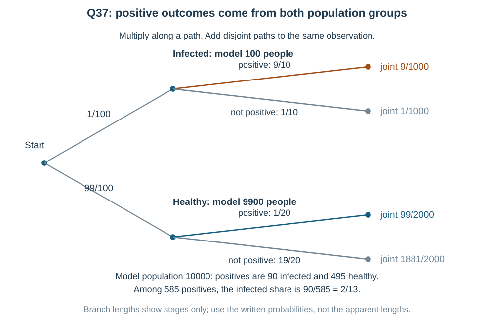

For Q37, a model population of 10,000 gives 100 infected and 9,900 healthy people. Positives are 90 and 495 respectively. Among all $585$ positives,

$$
P(\text{infected}\mid+)=\frac{90}{585}=\frac2{13}.
$$

The given $90\%$ is $P(+\mid\text{infected})$, a different conditional probability. The starting $1\%$ cannot be ignored.

## Concept C10 — Transfer problems: first branch, then update

A transferred ball can change both the colour count and the total size of the receiving urn. Do not replace a random transfer by one guessed colour.

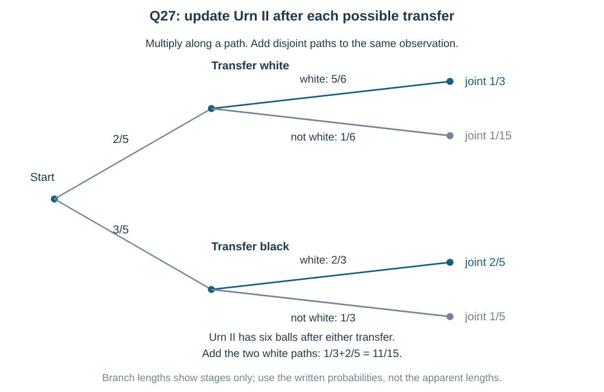

For Q27:

- White transfer has probability $2/5$. Urn II then has 5 white and 1 black, so $P(W\mid\text{white transfer})=5/6$.
- Black transfer has probability $3/5$. Urn II then has 4 white and 2 black, so $P(W\mid\text{black transfer})=4/6$.

Therefore

$$
P(W)=\frac25\frac56+\frac35\frac46.
$$

**Reusable route:** list possible first-step types, update the second-stage contents for each, multiply along a path, then add the paths giving the required final event.

A useful second view is the **expected white count**: Urn II starts with 4 whites and gains a white with chance $2/5$. Its expected white count becomes $4+2/5$. Since the total is always 6, the final white chance is $(4+2/5)/6$. This shortcut depends on the fixed total 6; averaging random ratios generally needs more care.

## Concept C11 — Binomial distribution: count successes in identical independent trials

A **success** means the outcome we choose to count. It need not be good: a defective bulb can be called a success for this calculation.

A binomial model $X\sim B(n,p)$ needs:

1. A fixed number $n$ of trials.
2. Two categories in each trial: success or failure.
3. The same success probability $p$ each time.
4. Independent trial outcomes.

Here $X$ counts successes and $q=1-p$ is the failure chance. For $r=0,1,\ldots,n$,

$$
\boxed{P(X=r)=\binom nr p^r q^{\,n-r}}.
$$

**Why each part appears:** one specified arrangement of $r$ successes and $n-r$ failures has chance $p^rq^{n-r}$. The $r$ success positions can be chosen in $\binom nr$ ways. These arrangements are different outcomes, so add their equal probabilities.

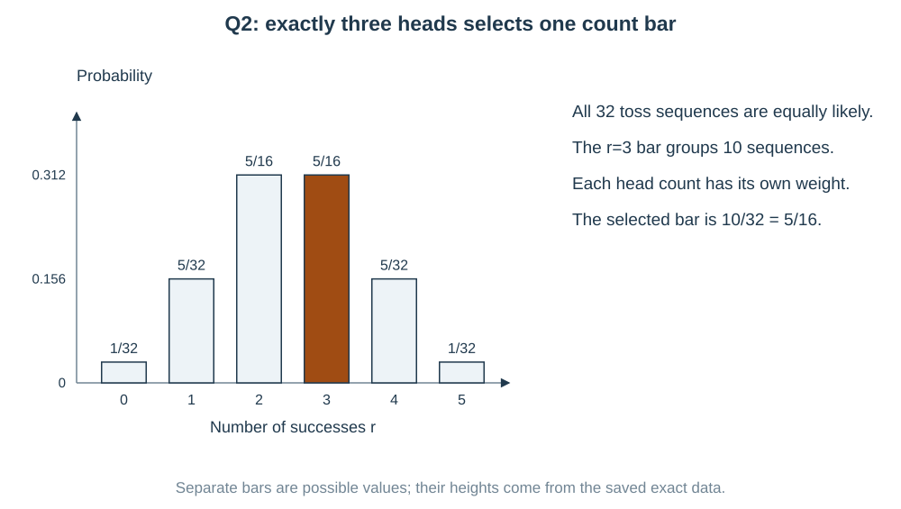

**Common wordings:**

$$
\boxed{P(X\le k)=\sum_{r=0}^{k}\binom nr p^rq^{n-r}},
$$

$$
\boxed{P(X\ge k)=1-\sum_{r=0}^{k-1}\binom nr p^rq^{n-r}},
$$

$$
\boxed{P(a\le X\le b)=\sum_{r=a}^{b}\binom nr p^rq^{n-r}},
$$

with integer bounds clipped to $0,\ldots,n$. “At most 2” includes 0, 1 and 2. “At least 2” excludes only 0 and 1.

For fair tosses, $p=q=1/2$, so

$$
\boxed{P(X=r)=\frac{\binom nr}{2^n}
=P(X=n-r)}.
$$

Swapping every H and T pairs a sequence with $r$ heads with one having $n-r$ heads. This explains the symmetry.

For $0<p<1$, adjacent probabilities satisfy

$$
\boxed{\frac{P(X=r+1)}{P(X=r)}
=\frac{n-r}{r+1}\frac pq}.
$$

This helps compare terms or build a table without repeating factorials. The most probable count is $\lfloor(n+1)p\rfloor$ when $(n+1)p$ is not an integer. If it is an integer $m$, both $m-1,m$ are modes. The ratio shows where the bars stop increasing. For $p=0$ or 1, all probability lies at 0 or $n$.

**Binomial expansion connection:** the probabilities add to $(p+q)^n=1$. For $n\ge1$, the even-success probability and odd-success probability are

$$
\boxed{P(X\text{ even})=\frac{1+(q-p)^n}{2}},
\qquad
\boxed{P(X\text{ odd})=\frac{1-(q-p)^n}{2}}.
$$

Add and subtract the expansions of $(q+p)^n$ and $(q-p)^n$: the odd powers cancel in the sum and the even powers cancel in the difference.

**Important limitation:** drawing from a finite bag **without replacement** changes the next success probability. That is not binomial in general. Use C15 instead.

## Concept C12 — Binomial mean and variance

The **mean** is the long-run average success count, not a count that must occur on one experiment. **Variance** is the probability-weighted average of squared distances from that mean. It measures spread. **Standard deviation** is its nonnegative square root, which returns to the usual count scale. For $X\sim B(n,p)$,

$$
\boxed{\mu=E(X)=np},\qquad
\boxed{v=\operatorname{Var}(X)=npq},\qquad
\boxed{\sigma=\sqrt{npq}}.
$$

Why the mean is $np$: each trial contributes either 1 success or 0, averaging $p$. Add the $n$ contributions. Each trial's variance is $p-p^2=pq$. Independent trials have variances that add, giving $npq$.

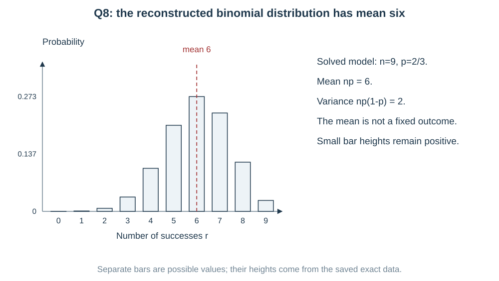

**Recognition pattern:** when mean and variance are given, their ratio cancels $np$:

$$
\boxed{q=\frac v\mu,\qquad
p=1-\frac v\mu,\qquad
n=\frac{\mu^2}{\mu-v}}.
$$

Use these last formulas when $\mu>0$ and $\mu-v>0$. Then check $n$ is a positive integer and $0<p\le1$. If $0<p<1$, then $0<v<\mu$; variance cannot exceed the mean in a binomial model.

If $\mu=v=0$, the nondegenerate reconstruction formulas do not apply: success count can be always zero for many trial counts. Do not cancel zero.

Also

$$
\boxed{E(X^2)=npq+(np)^2},\qquad
\boxed{E[X(X-1)]=n(n-1)p^2}.
$$

The second counts ordered pairs of distinct successful trials. Use it when $X(X-1)$ or a quadratic expectation is visible.

## Concept C13 — Random variable, probability distribution and variance

A **random variable** is a rule assigning a number to each outcome. For three coin tosses, the rule “number of heads” maps HHT to 2 and TTT to 0. Different sequences can give the same value.

A discrete probability distribution lists the possible values $x_i$ and their probabilities $p_i$:

$$
\boxed{p_i\ge0,\qquad\sum_i p_i=1}.
$$

If the probabilities contain an unknown constant, this total-1 rule usually determines it first.

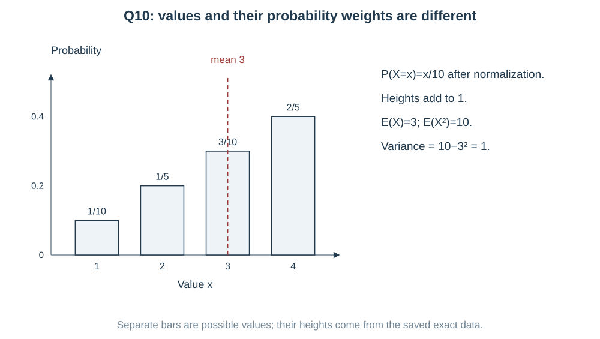

The **expectation** is the probability-weighted average:

$$
\boxed{\mu=E(X)=\sum_i x_i p_i}.
$$

Multiply each possible value by its chance, then add. Frequent values contribute more. The expectation can lie between possible values; it need not itself be a possible result.

For a function of the variable,

$$
\boxed{E[g(X)]=\sum_i g(x_i)p_i}.
$$

In particular, $E(X^2)=\sum_i x_i^2p_i$. This is generally different from $[E(X)]^2$.

**Variance** measures spread around the mean:

$$
\boxed{\operatorname{Var}(X)=E[(X-\mu)^2]
=\sum_i(x_i-\mu)^2p_i}.
$$

Distances are squared so positive and negative differences cannot cancel. Expanding the square gives the useful shortcut:

$$
\boxed{\operatorname{Var}(X)=E(X^2)-[E(X)]^2}.
$$

Standard deviation is $\sigma=\sqrt{\operatorname{Var}(X)}$. If $X$ is in rupees, variance is in squared rupees and SD is in rupees.

**Important for JEE Main — transformations:**

$$
\boxed{E(aX+b)=aE(X)+b},
$$

$$
\boxed{\operatorname{Var}(aX+b)=a^2\operatorname{Var}(X)},
\qquad
\boxed{\operatorname{SD}(aX+b)=|a|\operatorname{SD}(X)}.
$$

A common shift moves all values and their mean equally, leaving spread unchanged. Multiplication stretches every deviation by $a$, so its square stretches by $a^2$.

**Cauchy–Schwarz connection — important for JEE Main:**

$$
\left(\sum_i x_ip_i\right)^2
=\left(\sum_i (x_i\sqrt{p_i})\sqrt{p_i}\right)^2
\le\left(\sum_i x_i^2p_i\right)\left(\sum_i p_i\right).
$$

Therefore

$$
\boxed{[E(X)]^2\le E(X^2)}.
$$

Variance cannot be negative. Equality means all values with positive probability are the same. For two equally likely values $1,3$, $E(X)=2$, $E(X^2)=5$ and variance $=1$; the inequality is strict because there is real spread.

## Concept C14 — Expected counts: add contributions without requiring independence

If $X=X_1+\cdots+X_n$, then

$$
\boxed{E(X)=E(X_1)+\cdots+E(X_n)}.
$$

This is **linearity of expectation**. It works even when the variables are dependent.

An **indicator** is a simple count: $I=1$ if an event happens and $I=0$ otherwise. If the event has chance $p$,

$$
E(I)=1(p)+0(1-p)=p.
$$

To count white balls in two draws, write $X=I_1+I_2$. In a well-mixed bag with $W$ white out of $N$ balls, each draw position has marginal white chance $W/N$, even without replacement. Thus

$$
\boxed{E(X)=n\frac WN}
$$

for a uniformly chosen sample of $n$ balls without replacement. The draw colours are dependent, but their expected contributions still add.

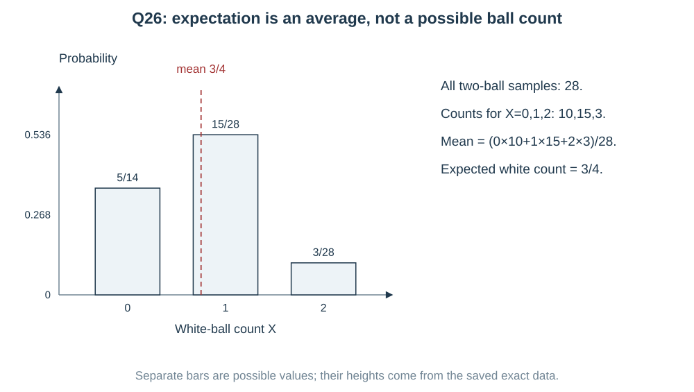

**Do not transfer this independence-free rule to variance.** Variances add directly for independent variables; dependent draws generally have an extra relationship to account for. For a count expectation alone, building the full distribution may be unnecessary.

For a game, define **gain** with signs. A loss of ₹3 is gain $-3$. Use

$$
E(\text{gain})=\sum(\text{signed gain})(\text{chance}).
$$

A positive expectation is a long-run average advantage in the stated model, not a promise of winning one round.

## Concept C15 — Sampling without replacement: choose the colour counts

Suppose a bag has $W$ white and $B$ black balls, all individually equally likely to be chosen. A sample of $n$ balls is chosen without replacement. Let $X$ be the number of whites.

To get $X=r$, choose $r$ of the whites **and** $n-r$ of the blacks:

$$
\boxed{P(X=r)=
\frac{\binom Wr\binom B{n-r}}{\binom{W+B}n}}.
$$

This is often called a **hypergeometric** distribution. The name is less important than the counting idea.

The allowed range is

$$
\max(0,n-B)\le r\le\min(n,W),
$$

with integer $r$. A requested count outside that range has probability zero.

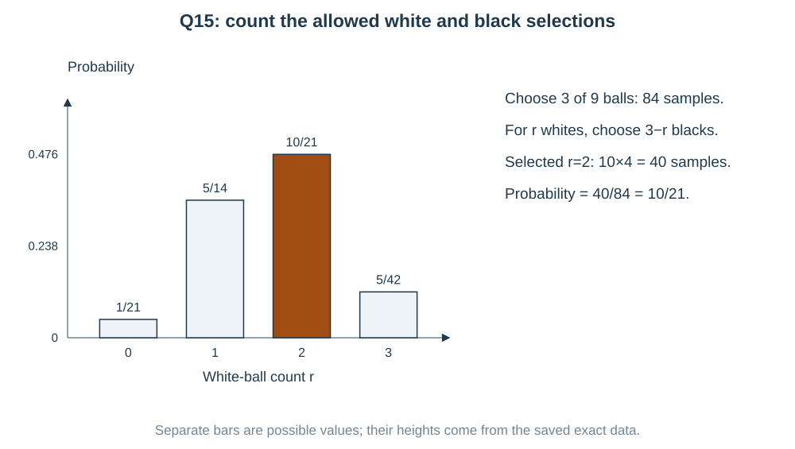

An ordered multiplication route also works, but include every allowed colour order. For exactly two whites in three draws, the orders WWB, WBW and BWW all count.

**Mean and useful variance connection:** with $N=W+B>1$ and $p=W/N$,

$$
\boxed{E(X)=np},\qquad
\boxed{\operatorname{Var}(X)=np(1-p)\frac{N-n}{N-1}}.
$$

The last factor is a finite-population correction. Taking the whole bag, $n=N$, makes $X=W$ certain, so variance must be zero. A binomial formula would miss that fact.

Why the correction appears: each sample-position indicator has variance $p(1-p)$, while for two different positions

$$
E(I_iI_j)=\frac WN\frac{W-1}{N-1},
\qquad
E(I_iI_j)-E(I_i)E(I_j)=-\frac{p(1-p)}{N-1}.
$$

Expanding the variance of $I_1+\cdots+I_n$ adds the $n$ individual terms and $n(n-1)$ such pair terms, giving the formula. You can use the probability table instead when that is easier.

## Concept C16 — Special counting patterns: maxima, sums and no fixed positions

**Maximum exactly $k$ in two fair dice:** both numbers must be at most $k$, but they must not both be at most $k-1$. Thus

$$
\boxed{P(\max=k)=\frac{k^2-(k-1)^2}{36}},
\qquad k=1,\ldots,6.
$$

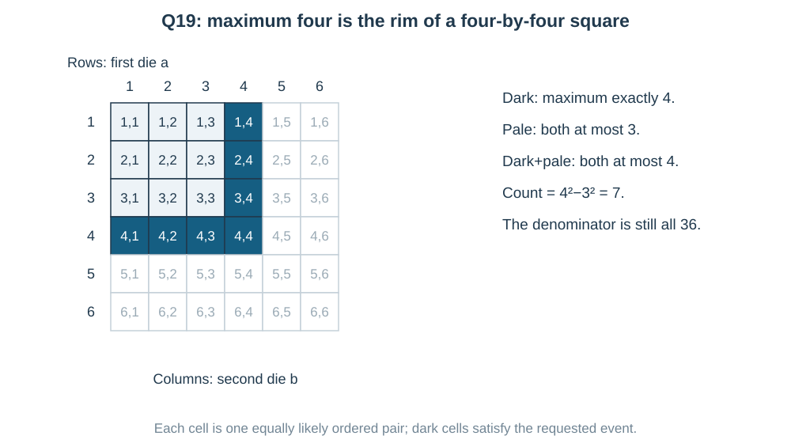

This is the “up to this value minus up to the preceding value” pattern. For $m$ independent uniform numbers in $\{1,\ldots,s\}$, it becomes $[k^m-(k-1)^m]/s^m$. It includes ties at the maximum.

**A sum condition:** never treat possible sums as equally likely. For three dice, fix the first die and count the allowed pairs on the other two. Add these six disjoint cases. Another method groups unordered number-types, then gives each type its number of different orders: 6 for three distinct values, 3 for one repeated pair, 1 when all three agree.

**No object in its correct place:** this is called a **derangement**. The restrictions are linked; choosing a wrong envelope for one letter changes the options for the next. For $n$ distinct letters and envelopes,

$$
\boxed{D_n=n!\left(1-\frac1{1!}+\frac1{2!}-\cdots+\frac{(-1)^n}{n!}\right)}.
$$

This is inclusion–exclusion: from all $n!$ arrangements subtract those fixing a selected letter, add those fixing two selected letters, and continue. The no-correct-envelope probability is $D_n/n!$.

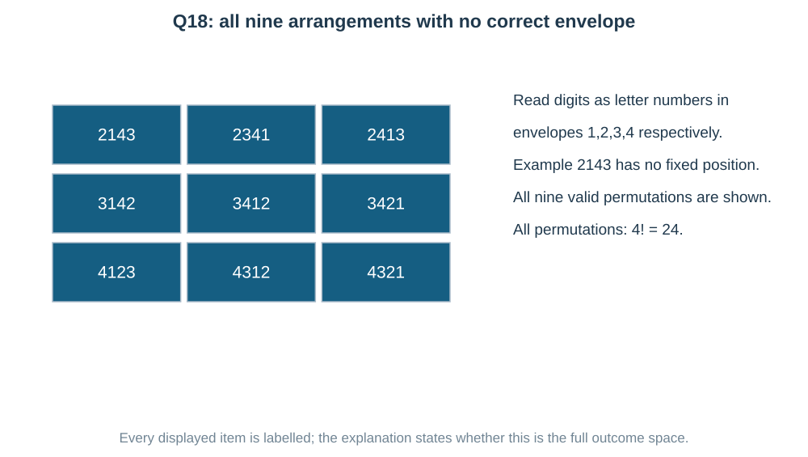

For the supplied four-letter problem, counting these nine actual arrangements is also a useful check. Do not approximate by $1/e$; that is not the exact small-$n$ answer.

## Last-minute formula recap

| Clue or need | Formula or route | Essential condition |
|---|---|---|
| Favourable/total | $P(A)=n(A)/n(S)$ | elementary outcomes equally likely |
| Not A | $P(A')=1-P(A)$ | complement in the actual sample space |
| A or B | $P(A)+P(B)-P(A\cap B)$ | “or” normally includes both |
| Exactly one | $P(A)+P(B)-2P(A\cap B)$ | remove both copies of the overlap |
| Neither | $1-P(A)-P(B)+P(A\cap B)$ | intersection of complements |
| Not both | $1-P(A\cap B)$ | union of complements |
| Given B | $P(A\mid B)=P(A\cap B)/P(B)$ | $P(B)>0$; B is the new denominator |
| A then B | $P(A)P(B\mid A)$ | update the second-step situation |
| Independent A,B | $P(A\cap B)=P(A)P(B)$ | no change in chance |
| Mutually exclusive A,B | $P(A\cap B)=0$ | positive such events are dependent |
| At least one | $1-P(\text{none})$ | product of misses needs independence |
| Total probability | $\sum_i P(H_i)P(E\mid H_i)$ | the $H_i$ form a partition |
| Bayes | $P(H_j)P(E\mid H_j)/P(E)$ | include every observation route |
| Exactly r successes | $\binom nr p^r(1-p)^{n-r}$ | fixed $n$, same $p$, independent trials |
| At most k | $\sum_{r=0}^{k}\binom nr p^rq^{n-r}$ | include $r=0$ |
| At least k | $1-\sum_{r=0}^{k-1}\binom nr p^rq^{n-r}$ | identify the excluded counts |
| Binomial symmetry | $P(X=r)=P(X=n-r)$ | $p=1/2$ |
| Adjacent binomial terms | $P_{r+1}/P_r=(n-r)p/((r+1)q)$ | $0<p<1$ |
| Binomial mode | $\lfloor(n+1)p\rfloor$ | $0<p<1$; two adjacent modes if $(n+1)p$ is an integer |
| Even/odd success counts | $[1\pm(q-p)^n]/2$ | $n\ge1$; plus for even |
| Binomial mean/variance | $\mu=np,\ v=npq$ | SD is $\sqrt{v}$ |
| Recover n,p from moments | $q=v/\mu,\ p=1-q,\ n=\mu/p$ | no zero cancellation; $n$ integer |
| Binomial second moments | $E(X^2)=npq+n^2p^2$; $E[X(X-1)]=n(n-1)p^2$ | count pairs of distinct trials |
| Probability table | $\sum p_i=1,\ E[g(X)]=\sum g(x_i)p_i$ | all probabilities nonnegative |
| Variance | $E(X^2)-[E(X)]^2$ | never negative |
| Shift and scale | $E(aX+b)=aE(X)+b$; $\operatorname{Var}(aX+b)=a^2\operatorname{Var}(X)$ | SD scales by $|a|$ |
| Expected sum | $E(\sum X_i)=\sum E(X_i)$ | independence not required |
| Without-replacement count | $\binom Wr\binom B{n-r}/\binom{W+B}n$ | choose unordered groups consistently |
| Sample count moments | $np$; $np(1-p)(N-n)/(N-1)$ | uniform sample without replacement; $N>1$ |
| Maximum exactly k | $P(\max\le k)-P(\max\le k-1)$ | include ties |
| No fixed positions | $D_n/n!$ | distinct objects, random permutation |

**Before calculating:** name the experiment; choose elementary outcomes; underline AND/OR/GIVEN; check replacement and independence; then choose count, complement, tree or probability table. A valid answer must lie in $[0,1]$. A requested numerator or multiple is a final separate step.

## Worked solutions to the 40 PDF questions

Read the question first. Notice the pattern, choose a route, then calculate. Alternative methods below are fully visible.

### Question 1 — Count equal-probability dice pairs, not equally weighted sums

**PDF page 119 | MCQ | Notes: C01,C02**

Two fair dice are thrown. The probability that the sum of the numbers is divisible by 3 is

- (a) $\dfrac16$
- (b) $\dfrac5{18}$
- (c) $\dfrac13$
- (d) $\dfrac12$

**First decide what has equal chance.** Each ordered dice pair has chance $1/36$. The possible sums do not have equal chances, so counting “four allowed sums” alone is not enough.

The divisible sums are $3,6,9,12$. Their numbers of ordered pairs are

$$
\begin{array}{c|rrrr}
\text{sum}&3&6&9&12\\ \hline
\text{pairs}&2&5&4&1
\end{array}
$$

Thus

$$
\boxed{P=\frac{2+5+4+1}{36}=\frac13;\quad\text{(c)}}.
$$

**Another possible approach — remainders:** each die has two numbers in each remainder class modulo 3: $\{3,6\}$, $\{1,4\}$, $\{2,5\}$. A divisible sum needs remainder pair $(0,0),(1,2)$ or $(2,1)$. There are $3(2\cdot2)=12$ favourable pairs. This is quick when divisibility, rather than a particular sum, is the main clue.

---

### Question 2 — Exactly three heads leaves two tails

**PDF page 119 | MCQ | Notes: C02,C11**

A fair coin is tossed 5 times. The probability of getting exactly 3 heads is

- (a) $\dfrac5{16}$
- (b) $\dfrac12$
- (c) $\dfrac38$
- (d) $\dfrac1{32}$

**“Exactly 3 heads” fixes the head count, but their positions can change.** One specified sequence such as HHHTT has chance $(1/2)^5=1/32$.

There are

$$
\binom53=\frac{5!}{3!2!}=10
$$

ways to choose the three head positions.

So

$$
\boxed{P=\binom53\left(\frac12\right)^3
\left(\frac12\right)^2=\frac{10}{32}=\frac5{16};
\quad\text{(a)}}.
$$

**Check:** the probability of exactly 2 heads is the same, because swapping H and T gives a one-to-one pairing. The answer $1/32$ counts only one specified sequence, not all ten.

---

### Question 3 — The second draw uses the changed pack

**PDF page 119 | MCQ | Notes: C06,C15**

Two cards are drawn one after another without replacement from a well-shuffled pack of 52 cards. The probability that both are aces is

- (a) $\dfrac1{169}$
- (b) $\dfrac1{26}$
- (c) $\dfrac1{221}$
- (d) $\dfrac2{221}$

**The words “without replacement” change the second probability.** First, 4 of 52 cards are aces. After an ace has been drawn, only 3 aces remain among 51 cards.

Use the multiplication rule:

$$
P(\text{both aces})=P(A_1)P(A_2\mid A_1)
=\frac4{52}\frac3{51}.
$$

$$
\boxed{P=\frac1{221};\quad\text{(c)}}.
$$

**Why $(4/52)^2$ is wrong here:** that would put the first ace back before the second draw.

**Another possible approach — unordered pairs:**

$$
P=\frac{\binom42}{\binom{52}2}
=\frac6{1326}=\frac1{221}.
$$

Both numerator and denominator now ignore draw order, so the counting is consistent.

---

### Question 4 — Neither event is the complement of their union

**PDF page 119 | MCQ | Notes: C03,C04**

If $P(A)=0.5,\ P(B)=0.4$ and $P(A\cap B)=0.2$, then $P(A'\cap B')$ equals

- (a) $0.2$
- (b) $0.5$
- (c) $0.3$
- (d) $0.7$

**Read $A'\cap B'$ as “neither A nor B.”** We want the part outside the whole union:

$$
A'\cap B'=(A\cup B)'.
$$

First find that union, removing the overlap counted twice:

$$
P(A\cup B)=0.5+0.4-0.2=0.7.
$$

Therefore

$$
\boxed{P(A'\cap B')=1-0.7=0.3;\quad\text{(c)}}.
$$

**Another view — fill the four regions:** A alone is $0.5-0.2=0.3$, both is $0.2$, and B alone is $0.4-0.2=0.2$. They use $0.7$, leaving $0.3$ for neither.

**Trap:** $1-P(A\cap B)=0.8$ would mean **not both**, which still allows A alone and B alone.

---

### Question 5 — Red is known; compare the two ways red could occur

**PDF page 119 | MCQ | Notes: C09**

Bag I has 3 red and 2 black balls; Bag II has 2 red and 3 black balls. A bag is chosen by tossing a fair coin and a ball drawn from it is red. The probability that it came from Bag I is

- (a) $\dfrac35$
- (b) $\dfrac25$
- (c) $\dfrac12$
- (d) $\dfrac3{10}$

**A red ball is already known.** The remaining possibilities are “Bag I and red” or “Bag II and red.” Compare these complete routes, not the initial bag probabilities alone.

$$
P(I\cap R)=\frac12\frac35=\frac3{10},
\qquad
P(II\cap R)=\frac12\frac25=\frac2{10}.
$$

All red outcomes have probability $3/10+2/10=1/2$. Thus

$$
\boxed{P(I\mid R)=
\frac{3/10}{3/10+2/10}=\frac35;\quad\text{(a)}}.
$$

**Why the answer is no longer $1/2$:** red is more likely from Bag I. Seeing red gives that bag a larger share of the remaining possibilities.

**Another possible approach — model counts:** represent the experiment by 10 equally weighted opportunities: 5 through each bag. The model gives 3 red outcomes from I and 2 from II. Among 5 reds, 3 came from I. This is the same Bayes calculation made visible through counts.

---

### Question 6 — Production share and defect rate must both contribute

**PDF page 119 | MCQ | Notes: C09**

Machines $M_1,M_2,M_3$ produce 50%, 30% and 20% of the items of a factory, with 1%, 2% and 3% of their output defective respectively. An item is selected at random and found defective. The probability that it was produced by $M_3$ is

- (a) $\dfrac3{17}$
- (b) $\dfrac2{17}$
- (c) $\dfrac6{25}$
- (d) $\dfrac6{17}$

**The item is known to be defective.** A machine can contribute many defects because it makes many items, because its defect rate is high, or both. We need production share multiplied by defect rate.

$$
\begin{aligned}
P(M_1\cap D)&=0.50(0.01)=0.005,\\
P(M_2\cap D)&=0.30(0.02)=0.006,\\
P(M_3\cap D)&=0.20(0.03)=0.006.
\end{aligned}
$$

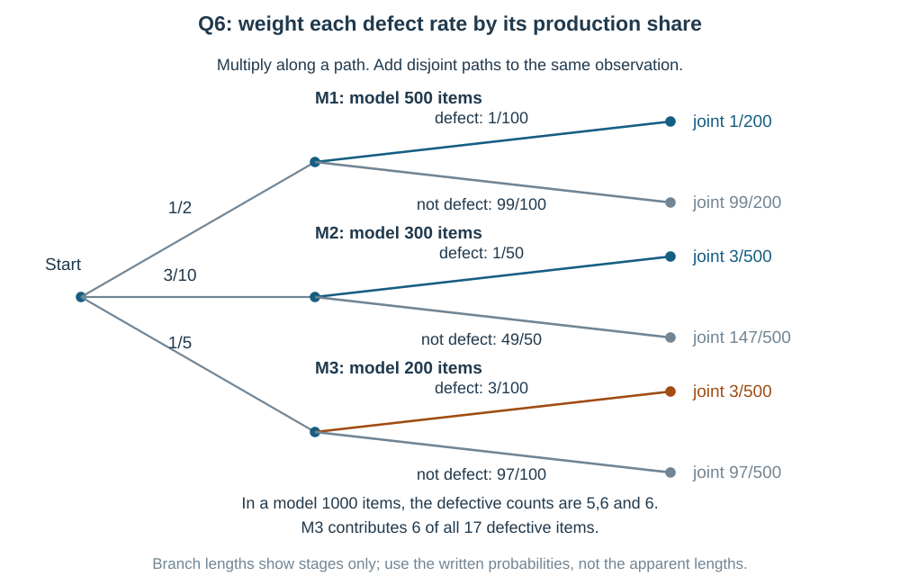

The three source cases cover all items, so

$$
P(D)=0.005+0.006+0.006=0.017.
$$

Hence

$$
\boxed{P(M_3\mid D)=\frac{0.006}{0.017}=\frac6{17};
\quad\text{(d)}}.
$$

**Another possible approach — model 1,000 items:** M1, M2, M3 make 500, 300, 200 items and contribute 5, 6, 6 defects. Six of the 17 defects came from M3.

**Check:** M2 and M3 contribute the same number of defects in this model, despite their different defect rates. Their posterior probabilities must be equal.

---

### Question 7 — At least once is easier through never

**PDF page 119 | MCQ | Notes: C08**

The probability that a certain event occurs in a single trial is $\dfrac13$. In 4 independent trials, the probability that it occurs at least once is

- (a) $\dfrac{16}{81}$
- (b) $\dfrac{65}{81}$
- (c) $\dfrac{32}{81}$
- (d) $\dfrac1{81}$

**Did you notice “at least once”?** Adding exact-one, exact-two, exact-three and exact-four cases works, but needs four terms. Its complement is just one case: no occurrence at all.

A single trial fails with chance $1-1/3=2/3$. Independence lets us multiply:

$$
P(\text{none in four})=\left(\frac23\right)^4=\frac{16}{81}.
$$

Therefore

$$
\boxed{P(\text{at least one})=1-\frac{16}{81}
=\frac{65}{81};\quad\text{(b)}}.
$$

**Another possible approach — binomial counts:** sum

$$
\frac{4(1)(2^3)+6(1^2)(2^2)+4(1^3)(2)+1}{3^4}
=\frac{32+24+8+1}{81}=\frac{65}{81}.
$$

It checks the result, while the complement is the shorter exam route.

---

### Question 8 — Divide variance by mean before finding n

**PDF page 120 | Numerical value | Notes: C12**

The mean and variance of a binomial distribution are $6$ and $2$ respectively. The number of trials $n$ is ____.

**The mean and variance contain the same factor $np$.** Write them before searching for $n$:

$$
np=6,\qquad npq=2.
$$

Dividing the second by the first removes $np$:

$$
q=\frac26=\frac13,\qquad p=1-q=\frac23.
$$

Now

$$
n=\frac6{2/3}=\boxed{9}.
$$

**Check:** $9(2/3)=6$ and $9(2/3)(1/3)=2$. The mean success count 6 is not automatically the number of trials.

**Another quick approach:** $n=\mu^2/(\mu-v)=36/(6-2)=9$. The division route above explains why that shortcut works and which zero cases would make it unsafe.

---

### Question 9 — At most two includes zero heads

**PDF page 120 | MCQ | Notes: C11**

A fair coin is tossed 10 times. The probability of getting at most 2 heads is

- (a) $\dfrac{11}{128}$
- (b) $\dfrac7{128}$
- (c) $\dfrac7{64}$
- (d) $\dfrac1{64}$

**“At most 2” includes 0, 1 and 2 heads.** These three cases are disjoint, so add their probabilities.

Each of the $2^{10}=1024$ fair-toss sequences has equal chance. The favourable sequence counts are

$$
\binom{10}0+\binom{10}1+\binom{10}2=1+10+45=56.
$$

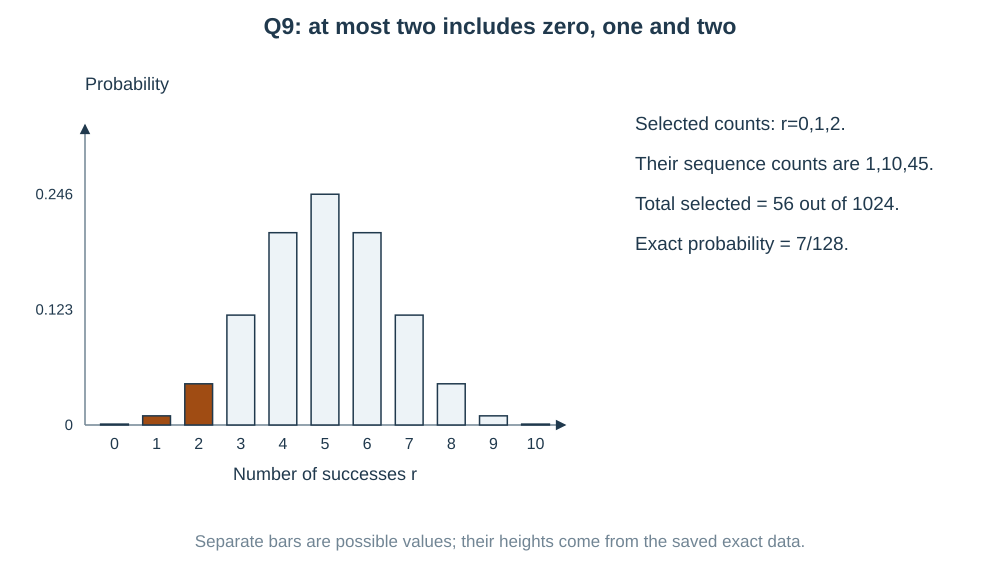

Thus

$$
\boxed{P=\frac{56}{1024}=\frac7{128};\quad\text{(b)}}.
$$

**Why not use the complement first?** It is valid, but its direct excluded sum would include head counts 3 through 10: eight terms instead of three. Choose the side with fewer cases.

**Check:** exactly 2 heads alone has probability $45/1024$; our answer is slightly larger because zero and one head also count.

---

### Question 10 — Normalize the probability weights before taking averages

**PDF page 120 | Numerical value | Notes: C13**

A random variable $X$ takes values $1,2,3,4$ with $P(X=x)=kx$. The variance of $X$ is ____.

**First make the probabilities add to 1.** The values are not equally likely: the chance of value $x$ is $kx$.

$$
k(1+2+3+4)=1\quad\Longrightarrow\quad k=\frac1{10}.
$$

Build the two weighted averages:

$$
E(X)=\frac{1^2+2^2+3^2+4^2}{10}
=\frac{30}{10}=3,
$$

$$
E(X^2)=\frac{1^3+2^3+3^3+4^3}{10}
=\frac{100}{10}=10.
$$

Therefore

$$
\boxed{\operatorname{Var}(X)=10-3^2=1}.
$$

**Notice the powers:** the extra factor $x$ comes from the probability $kx$. That is why the mean uses squares and the second moment uses cubes.

**Another possible approach — distances from the mean:**

$$
\operatorname{Var}(X)
=(-2)^2\frac1{10}+(-1)^2\frac2{10}
+0^2\frac3{10}+1^2\frac4{10}=1.
$$

This directly confirms what the variance is measuring.

---

### Question 11 — Given information makes a smaller sample space

**PDF page 120 | MCQ | Notes: C05**

Two fair dice are thrown. Given that at least one die shows 5, the probability that the sum is 7 is

- (a) $\dfrac2{11}$
- (b) $\dfrac16$
- (c) $\dfrac1{11}$
- (d) $\dfrac13$

**“Given at least one 5” changes the allowed outcome space.** Keep the fifth row or fifth column of the dice grid. Their common cell $(5,5)$ is counted only once:

$$
n(B)=6+6-1=11.
$$

Among these, sum 7 occurs only at $(2,5)$ and $(5,2)$. Thus

$$
\boxed{P(\text{sum 7}\mid B)=\frac2{11};\quad\text{(a)}}.
$$

**Why not $2/12$?** That repeats $(5,5)$ in the denominator. **Why not $2/36$?** That ignores the known information.

**Another possible approach — conditional formula:** $P(B)=11/36$ and $P(\text{sum 7 and }B)=2/36$. Their ratio $(2/36)/(11/36)$ gives $2/11$. Fixing a particular die to be 5 would be a different condition.

---

### Question 12 — Exactly one means A alone or B alone

**PDF page 120 | MCQ | Notes: C04,C07**

Events $A,B$ are independent with $P(A)=\dfrac13,\ P(B)=\dfrac14$. The probability that exactly one of them occurs is

- (a) $\dfrac5{12}$
- (b) $\dfrac12$
- (c) $\dfrac7{12}$
- (d) $\dfrac1{12}$

**Exactly one event means either A alone or B alone.** They cannot both be the chosen case on one outcome, so add the two disjoint pieces.

Independence also applies to complements:

$$
P(A\cap B')=\frac13\left(1-\frac14\right)=\frac14,
$$

$$
P(A'\cap B)=\left(1-\frac13\right)\frac14=\frac16.
$$

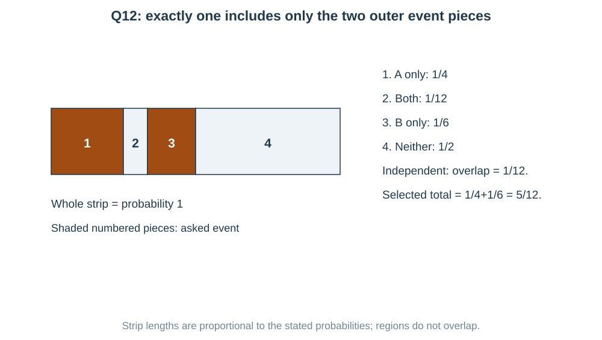

$$
\boxed{P(\text{exactly one})=\frac14+\frac16
=\frac5{12};\quad\text{(a)}}.
$$

**Another possible approach:** the overlap is $(1/3)(1/4)=1/12$. Adding $P(A)+P(B)$ counts it twice, while exactly one needs none of it:

$$
\frac13+\frac14-2\left(\frac1{12}\right)=\frac5{12}.
$$

The union would subtract the overlap only once; that would still allow both events.

---

### Question 13 — The overlap was counted twice

**PDF page 120 | MCQ | Notes: C04**

A number is selected at random from $1,2,\ldots,100$. The probability that it is divisible by 2 or 3 is

- (a) $\dfrac{33}{50}$
- (b) $\dfrac23$
- (c) $\dfrac{83}{100}$
- (d) $\dfrac{67}{100}$

**“Divisible by 2 or 3” includes numbers divisible by both.** Count the two groups, then subtract their duplicate overlap:

$$
n(A)=\left\lfloor\frac{100}{2}\right\rfloor=50,\quad
n(B)=\left\lfloor\frac{100}{3}\right\rfloor=33.
$$

A common multiple must be divisible by $\operatorname{lcm}(2,3)=6$:

$$
n(A\cap B)=\left\lfloor\frac{100}{6}\right\rfloor=16.
$$

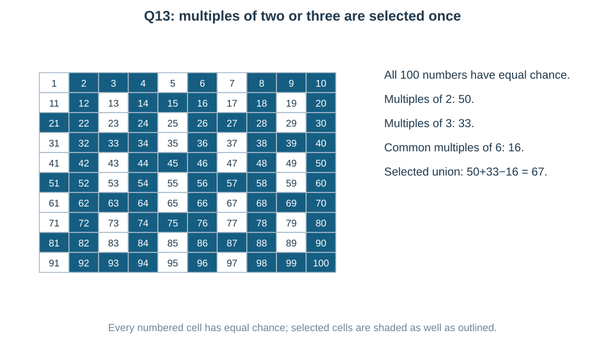

$$
\boxed{P=\frac{50+33-16}{100}=\frac{67}{100};
\quad\text{(d)}}.
$$

**Another counting view:** every full block of six consecutive integers contains four numbers divisible by 2 or 3. The first 96 numbers contribute $16(4)=64$; among $97,98,99,100$, three qualify. This also gives 67. The floor-count method is shorter here and extends easily to other limits.

---

### Question 14 — Four S letters together become one block

**PDF page 120 | Numerical value | Notes: C02**

The letters of the word MISSISSIPPI are arranged at random. If the probability that all four S's are together is $\dfrac4N$, then $N=$ ____.

**Four S letters together can be treated as one object.** First record the repeated letters:

$$
M:1,\qquad I:4,\qquad S:4,\qquad P:2.
$$

The total number of distinct words is

$$
T=\frac{11!}{4!4!2!}=34650.
$$

With SSSS as a block, we arrange that block, M, four I letters and two P letters: eight objects. The block has only one internal order:

$$
F=\frac{8!}{4!2!}=840.
$$

Hence

$$
P=\frac{840}{34650}=\frac4{165}.
$$

Matching the stated form $4/N$ gives

$$
\boxed{N=165}.
$$

**Another possible approach — choose S positions:** every four-position subset of the eleven positions allows the same number of arrangements of M, I and P. There are $\binom{11}4=330$ such subsets. A consecutive block can start in positions 1 through 8, so

$$
P=\frac8{330}=\frac4{165}.
$$

This is the faster route once we recognize that only the S positions matter.

---

### Question 15 — Choose the required colour counts without ordering

**PDF page 120 | MCQ | Notes: C15**

A box has 5 white and 4 black balls. Three balls are drawn at random without replacement. The probability of getting exactly 2 white balls is

- (a) $\dfrac{10}{21}$
- (b) $\dfrac5{21}$
- (c) $\dfrac{20}{63}$
- (d) $\dfrac5{14}$

**The sample is an unordered group of three balls.** To get exactly two white balls, choose two from the five whites and one from the four blacks:

$$
F=\binom52\binom41=10(4)=40.
$$

All three-ball samples number

$$
T=\binom93=84.
$$

$$
\boxed{P=\frac{40}{84}=\frac{10}{21};\quad\text{(a)}}.
$$

**Another possible approach — ordered draws:** one order WWB has probability

$$
\frac59\frac48\frac47=\frac{10}{63}.
$$

The orders WBW and BWW have the same probability. The three disjoint orders give $3(10/63)=10/21$.

**Why one ordered path is insufficient:** exactly two whites does not require the black ball to come last.

---

### Question 16 — Replacement keeps both colour probabilities unchanged

**PDF page 120 | MCQ | Notes: C06,C07**

An urn has 6 red and 4 blue balls. Two balls are drawn one by one with replacement. The probability that both are of the same colour is

- (a) $\dfrac{12}{25}$
- (b) $\dfrac7{15}$
- (c) $\dfrac{13}{25}$
- (d) $\dfrac25$

**Replacement keeps the urn contents unchanged before the second draw.** Same colour means RR or BB; these are disjoint events.

$$
P(R)=\frac6{10}=\frac35,\qquad P(B)=\frac25.
$$

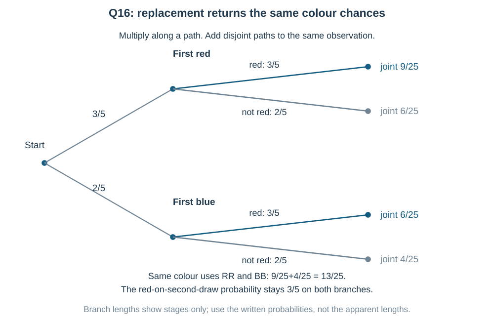

Therefore

$$
\boxed{P(\text{same})=
\left(\frac35\right)^2+\left(\frac25\right)^2
=\frac{13}{25};\quad\text{(c)}}.
$$

**Another possible approach — exclude different colours:**

$$
P(\text{different})=P(RB)+P(BR)
=2\left(\frac35\frac25\right)=\frac{12}{25}.
$$

Its complement is $13/25$. A denominator 9 on the second draw would describe a different experiment without replacement.

---

### Question 17 — Each new person must avoid the weekdays already used

**PDF page 121 | MCQ | Notes: C01,C06**

Three persons are chosen at random. The probability that they were born on three different days of the week is

- (a) $\dfrac{30}{49}$
- (b) $\dfrac{18}{49}$
- (c) $\dfrac67$
- (d) $\dfrac57$

**Use the usual model: the three weekdays are independent and each of the seven days is equally likely.** We need three different days.

The first person may have any weekday. The second must avoid that one day. The third must avoid the two days already used:

$$
P=1\cdot\frac67\cdot\frac57.
$$

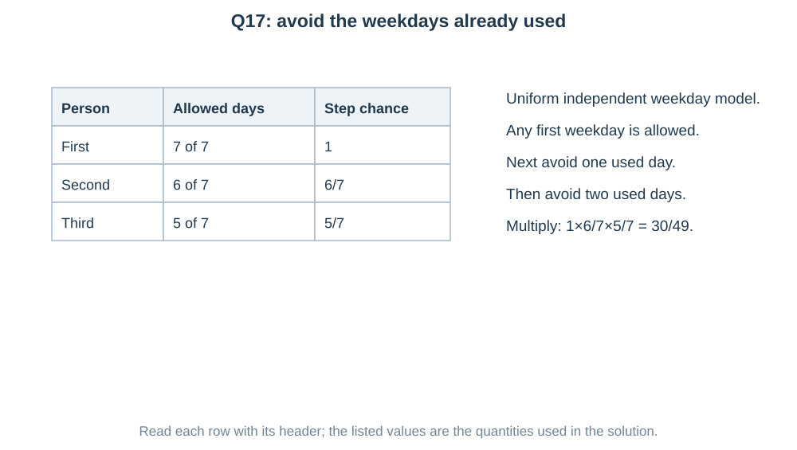

$$
\boxed{P=\frac{30}{49};\quad\text{(a)}}.
$$

**Another possible approach — count ordered triples:** all triples number $7^3$. The valid triples number $7\cdot6\cdot5$. Their ratio gives the same answer.

**Why $(6/7)^3$ is wrong:** the first person has no restriction, and the third person must avoid two used days, not just one. The restrictions change as we build the outcome.

---

### Question 18 — No correct envelope is a linked restriction

**PDF page 121 | MCQ | Notes: C16**

Four letters are put at random into four addressed envelopes, one in each. The probability that no letter is in its correct envelope is

- (a) $\dfrac1{24}$
- (b) $\dfrac13$
- (c) $\dfrac38$
- (d) $\dfrac58$

**The envelope restrictions are linked.** We cannot give each letter an independent wrong-envelope chance $3/4$: once an envelope is occupied, the later choices change.

There are $4!=24$ equally likely assignments. Let $E_i$ mean letter $i$ is correctly placed. Use inclusion–exclusion to remove all assignments with at least one fixed letter:

$$
\begin{aligned}
\text{no correct letter}
&=4!-\binom41 3!+\binom42 2!
-\binom43 1!+\binom44 0!\\
&=24-24+12-4+1=9.
\end{aligned}
$$

Thus

$$
\boxed{P=\frac9{24}=\frac38;\quad\text{(c)}}.
$$

**Another possible approach for this small case:** list the valid assignments in the picture. Read 2143 as letters 2,1,4,3 in envelopes 1,2,3,4. Every position has the wrong number. The nine displayed assignments are distinct; complete enumeration of the 24 permutations confirms there are no others. The formula scales better when the number of letters grows.

---

### Question 19 — Maximum exactly four is a difference of two squares

**PDF page 121 | MCQ | Notes: C16**

Two fair dice are thrown. The probability that the larger of the two numbers is 4 is

- (a) $\dfrac19$
- (b) $\dfrac14$
- (c) $\dfrac5{36}$
- (d) $\dfrac7{36}$

**Did you notice “larger is 4”?** Both dice must be at most 4, and at least one must actually be 4.

There are $4^2=16$ pairs with both at most 4. Of these, $3^2=9$ have both at most 3 and must be removed:

$$
F=4^2-3^2=7.
$$

$$
\boxed{P=\frac7{36};\quad\text{(d)}}.
$$

**Another possible approach:** first die 4 and second in $\{1,2,3,4\}$ gives four pairs. Second die 4 and first in $\{1,2,3\}$ gives three more. They are disjoint, so $4+3=7$.

The tie $(4,4)$ belongs: the maximum is still 4. Counting two complete rows/columns without correcting that tie would give 8 instead.

---

### Question 20 — A least integer needs a check below the threshold

**PDF page 121 | Numerical value | Notes: C08**

A fair coin is tossed $n$ times. The least value of $n$ for which the probability of getting at least one head is at least $0.99$ is ____.

**Use the single excluded case: every toss is a tail.**

$$
P(\text{at least one head})=1-\left(\frac12\right)^n.
$$

The required inequality is

$$
1-2^{-n}\ge0.99
\quad\Longleftrightarrow\quad
2^{-n}\le0.01
\quad\Longleftrightarrow\quad
2^n\ge100.
$$

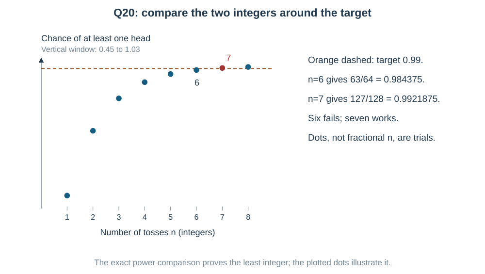

Now $2^6=64<100$ and $2^7=128\ge100$. Therefore

$$
\boxed{n_{\min}=7}.
$$

**Check the boundary:** at 6 tosses the probability is $63/64=0.984375$, below $0.99$; at 7 it is $127/128=0.9921875$, above it.

**Another possible approach:** logarithms give $n\ge\log_2 100\approx6.644$. Round **up**, then check the two neighbouring integers. Comparing powers directly is easier here.

---

### Question 21 — Recover each marginal from the correct conditional denominator

**PDF page 121 | MCQ | Notes: C05,C04**

If $P(A\mid B)=\dfrac12,\ P(B\mid A)=\dfrac13$ and $P(A\cap B)=\dfrac16$, then $P(A\cup B)$ equals

- (a) $\dfrac12$
- (b) $\dfrac56$
- (c) $\dfrac13$
- (d) $\dfrac23$

**A conditional probability has the event after the bar in its denominator.** Write both definitions to avoid swapping A and B:

$$
\frac{P(A\cap B)}{P(B)}=\frac12,
\qquad
\frac{P(A\cap B)}{P(A)}=\frac13.
$$

Since the overlap is $1/6$,

$$
P(B)=\frac{1/6}{1/2}=\frac13,\qquad
P(A)=\frac{1/6}{1/3}=\frac12.
$$

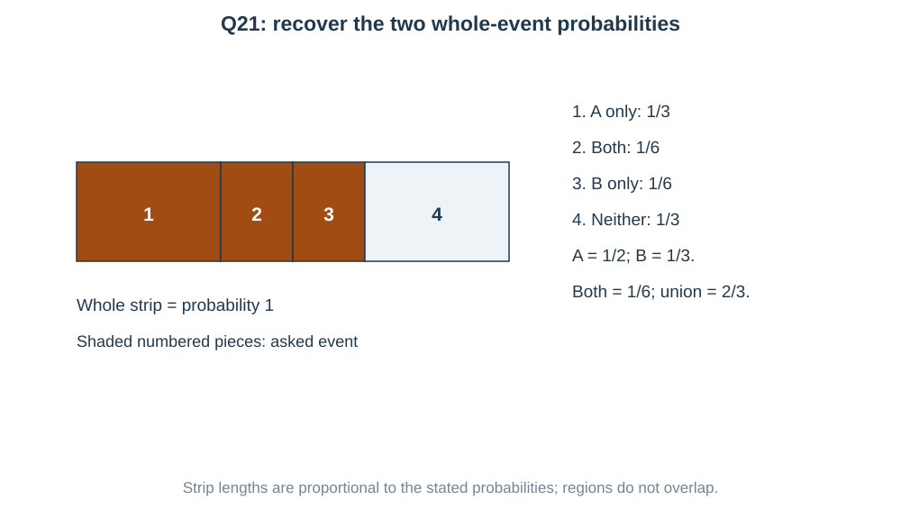

Then the addition rule gives

$$
\boxed{P(A\cup B)=\frac12+\frac13-\frac16
=\frac23;\quad\text{(d)}}.
$$

**Check by reconstruction:** $(1/6)/(1/3)=1/2=P(A\mid B)$, and $(1/6)/(1/2)=1/3=P(B\mid A)$. The four region probabilities are all nonnegative.

**Another view:** use a model space of six equally weighted outcomes. Let one belong to both, two to A alone, one to B alone and two to neither. Then half the B outcomes are also A, one third of the A outcomes are also B, and four of six are in the union.

---

### Question 22 — Cannot happen together is different from no influence

**PDF page 121 | MCQ | Notes: C07**

Statement I: Two mutually exclusive events with non-zero probabilities are always independent.

Statement II: If events $A$ and $B$ are mutually exclusive, then $P(A\cap B)=0$.

Choose the correct option.

- (a) Both Statement I and Statement II are true
- (b) Statement I is false, Statement II is true
- (c) Statement I is true, Statement II is false
- (d) Both Statement I and Statement II are false

**Mutually exclusive means the events cannot happen together.** So Statement II is the definition:

$$
P(A\cap B)=0.
$$

Independence would require

$$
P(A\cap B)=P(A)P(B).
$$

The two probabilities are given as nonzero, so their product is positive. It cannot equal the zero overlap.

Thus Statement I is false and Statement II is true:

$$
\boxed{\text{(b)}}.
$$

**Another explanation in words:** once A happens, B is impossible. B's chance changes from a positive value to zero, so the events cannot be independent.

The positive-probability condition matters. If one event has probability zero, zero overlap and independence can both hold.

---

### Question 23 — Fair binomial probabilities pair symmetrically

**PDF page 121 | MCQ | Notes: C11**

Assertion (A): For a binomial distribution with $n=5,\ p=\dfrac12$, $P(X=1)=P(X=4)$.

Reason (R): For $p=\dfrac12$, $P(X=r)=P(X=n-r)$ for every $r$.

- (a) Both A and R are true but R is not the correct explanation of A
- (b) A is true but R is false
- (c) A is false but R is true
- (d) Both A and R are true and R is the correct explanation of A

**For a fair binomial model, every length-$n$ success/failure sequence has the same chance $2^{-n}$.** Choosing the success positions gives

$$
P(X=r)=\binom nr2^{-n}.
$$

The identity

$$
\binom nr=\binom n{n-r}
$$

therefore proves the Reason for all allowed integer counts $0\le r\le n$.

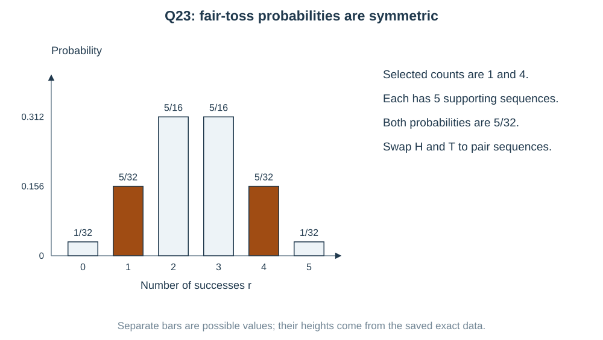

In the Assertion, $n=5$ and $4=5-1$. Hence

$$
P(X=1)=\frac{\binom51}{32}=\frac5{32}
=\frac{\binom54}{32}=P(X=4).
$$

Both statements are true, and R explains A:

$$
\boxed{\text{(d)}}.
$$

**Another possible approach — pair the outcomes:** swap every H and T. A sequence with one H becomes one with four H. This reversible pairing preserves chance because the coin is fair. It would not preserve probabilities for a biased coin.

---

### Question 24 — Match mean and variance after identifying n,p,q

**PDF page 121 | MCQ | Notes: C12**

Match List-I with List-II.

List-I: A. Mean of $B(10,\tfrac12)$; B. Variance of $B(10,\tfrac12)$; C. Mean of $B(8,\tfrac14)$; D. Variance of $B(8,\tfrac14)$.

List-II: I. $1.5$; II. $2$; III. $2.5$; IV. $5$.

- (a) A–III, B–IV, C–II, D–I
- (b) A–IV, B–III, C–I, D–II
- (c) A–IV, B–III, C–II, D–I
- (d) A–II, B–III, C–IV, D–I

**First identify the two distributions.** In $B(n,p)$ the first number is the trial count and the second is success probability. Variance also needs $q=1-p$.

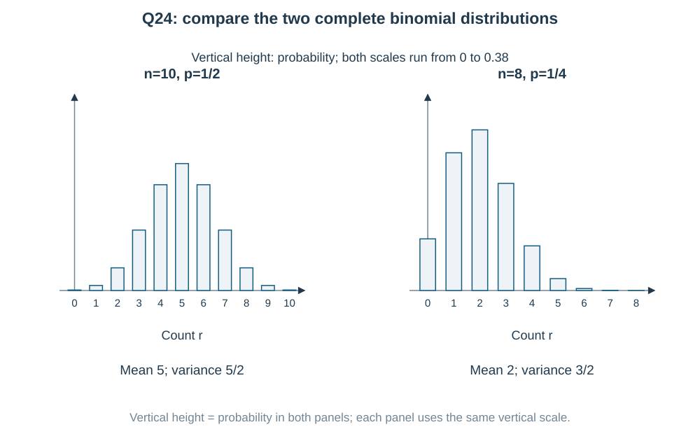

For $B(10,1/2)$,

$$
\mu=10\left(\frac12\right)=5,\qquad
v=10\left(\frac12\right)\left(\frac12\right)=2.5.
$$

For $B(8,1/4)$,

$$
\mu=8\left(\frac14\right)=2,\qquad
v=8\left(\frac14\right)\left(\frac34\right)=1.5.
$$

So

$$
\boxed{\text{A–IV, B–III, C–II, D–I; (c)}}.
$$

**Check:** each variance is its mean multiplied by $q$, so it must be smaller than its mean for these two nondegenerate models. Do not match the SD square root when the list asks variance.

---

### Question 25 — The known first head leaves two unknown tosses

**PDF page 122 | MCQ | Notes: C05,C08**

A fair coin is tossed three times. Given that the first toss is a head, the probability of getting at least two heads in all is

- (a) $\dfrac12$
- (b) $\dfrac34$
- (c) $\dfrac78$
- (d) $\dfrac14$

**The first head is already supplied by the condition.** To have at least two heads in all, the final two tosses need at least one head.

Their only failure case is TT:

$$
P(\text{desired}\mid\text{first H})
=1-P(\text{last two TT})
=1-\frac14.
$$

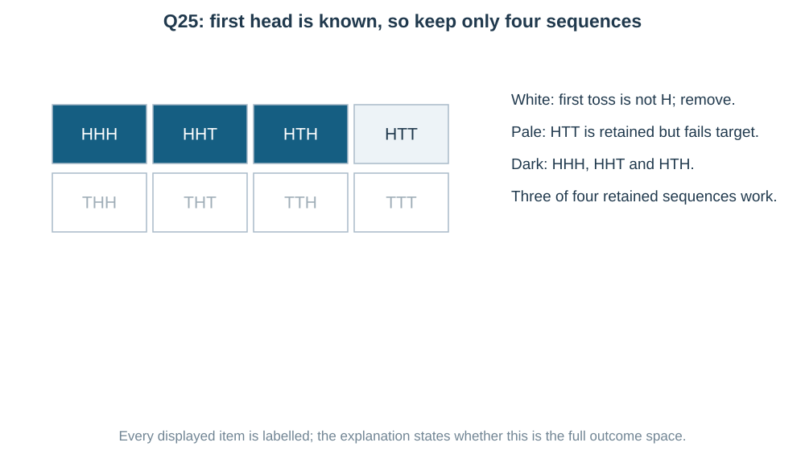

$$
\boxed{P=\frac34;\quad\text{(b)}}.
$$

**Another possible approach — list the remaining space:** HHH, HHT, HTH, HTT have equal conditional probability $1/4$. Three qualify.

**Why an unconditional three-toss calculation would be wrong:** it would also retain sequences starting with T, although the question tells us the first toss was H.

---

### Question 26 — Expected count can be built one draw at a time

**PDF page 122 | Numerical value | Notes: C14,C15**

A bag has 3 white and 5 black balls. Two balls are drawn at random. The expected number of white balls drawn is ____ (in decimal).

**We want an average number of white balls, not the probability of one particular count.** Let $I_1,I_2$ each be 1 for a white draw and 0 otherwise. Then $X=I_1+I_2$.

Each position in the random sample has white chance $3/8$. Linearity of expectation gives

$$
E(X)=E(I_1)+E(I_2)=\frac38+\frac38.
$$

$$
\boxed{E(X)=\frac34=0.75}.
$$

**Why this does not assume independent draws:** after a white first draw, the next white chance is $2/7$; after a black first draw it is $3/7$. Averaging those cases gives

$$
P(\text{second white})
=\frac38\frac27+\frac58\frac37
=\frac{21}{56}=\frac38.
$$

**Another possible approach — full distribution:**

$$
P(X=0)=\frac{10}{28},\quad
P(X=1)=\frac{15}{28},\quad
P(X=2)=\frac3{28}.
$$

Thus $E(X)=0(10/28)+1(15/28)+2(3/28)=21/28=0.75$. The indicator route avoids unnecessary distribution work when only the mean is asked.

---

### Question 27 — The transferred colour changes the second urn

**PDF page 122 | MCQ | Notes: C10**

Urn I has 2 white and 3 black balls; Urn II has 4 white and 1 black ball. A ball is drawn at random from Urn I and put into Urn II, then a ball is drawn from Urn II. The probability that it is white is

- (a) $\dfrac23$
- (b) $\dfrac{11}{15}$
- (c) $\dfrac45$
- (d) $\dfrac7{15}$

**Branch on the transferred colour before calculating the final draw.** Urn II receives one ball in either case, so its total becomes 6.

If white is transferred, chance $2/5$, Urn II has $5W,1B$ and its white chance is $5/6$. If black is transferred, chance $3/5$, it has $4W,2B$ and its white chance is $4/6$.

Add the two disjoint routes to the final white:

$$
\boxed{P(W)=\frac25\frac56+\frac35\frac46
=\frac13+\frac25=\frac{11}{15};\quad\text{(b)}}.
$$

**Why using $4/5$ would fail:** that is Urn II's white chance *before* a ball is added.

**Another possible approach — expected composition:** its expected number of whites after transfer is $4+2/5=22/5$. The total is always 6, so the final white chance is

$$
\frac{22/5}{6}=\frac{11}{15}.
$$

It lies between $4/6$ and $5/6$, the two possible conditional chances.

---

### Question 28 — A quadratic condition selects dice pairs

**PDF page 122 | MCQ | Notes: C01,C16**

Two dice are thrown and the numbers shown are taken as $b$ and $c$. The probability that $x^2+bx+c=0$ has real roots is

- (a) $\dfrac{19}{36}$
- (b) $\dfrac{17}{36}$
- (c) $\dfrac59$
- (d) $\dfrac12$

**Connect Probability to Quadratic Equations.** For $x^2+bx+c=0$, real roots require

$$
D=b^2-4c\ge0.
$$

Equality is allowed: a repeated real root still counts. The two dice give 36 equally likely ordered pairs $(b,c)$.

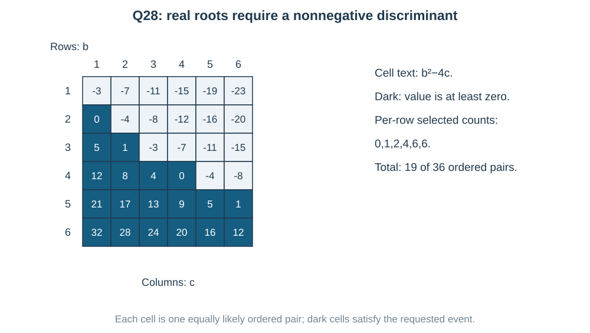

Count allowed $c\in\{1,\ldots,6\}$ for each $b$:

$$
\begin{array}{c|rrrrrr}
b&1&2&3&4&5&6\\ \hline
\text{number with }c\le b^2/4&0&1&2&4&6&6
\end{array}
$$

Thus

$$
\boxed{P=\frac{0+1+2+4+6+6}{36}
=\frac{19}{36};\quad\text{(a)}}.
$$

**Why not solve all the quadratics?** The question asks only whether roots are real, so the discriminant decides that without finding the roots.

**Another possible approach:** fix $c=1,\ldots,6$ instead. Allowed $b$ counts are $5,4,3,3,2,2$, again totaling 19. Either row or column counting is valid; choose the simpler inequality.

---

### Question 29 — At least one hit is the complement of all three misses

**PDF page 122 | Numerical value | Notes: C08**

Three persons $A,B,C$ fire at a target independently with probabilities of hitting $\dfrac12,\dfrac13,\dfrac14$ respectively. If $p$ is the probability that the target is hit at least once, then $4p=$ ____.

**The shooters have different hit probabilities.** A single binomial model with one common $p$ would not fit them. Independence still lets us multiply their individual miss probabilities.

$$
P(\text{all miss})
=\left(1-\frac12\right)
\left(1-\frac13\right)
\left(1-\frac14\right)
=\frac12\frac23\frac34=\frac14.
$$

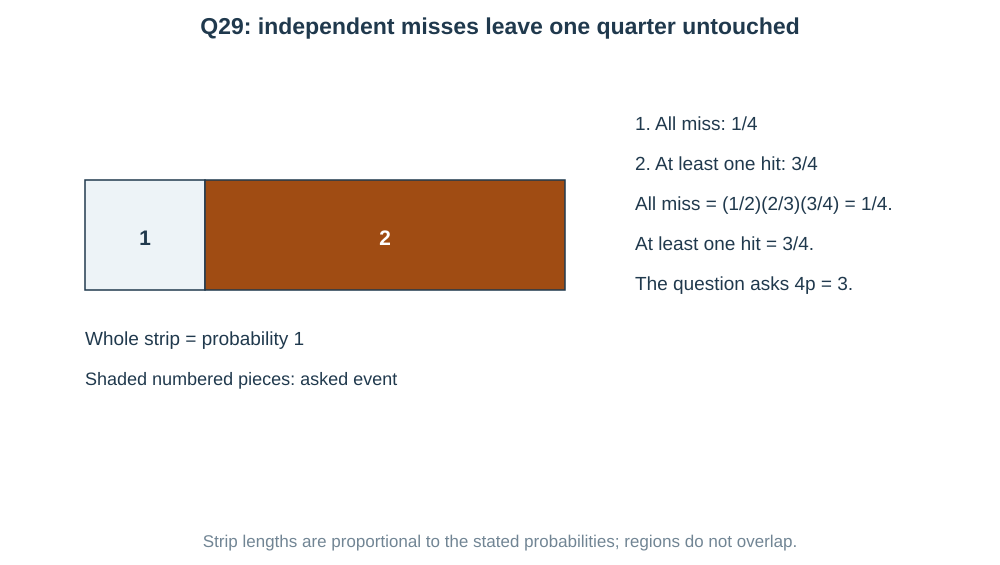

Hence $p=1-1/4=3/4$. The requested quantity is

$$
\boxed{4p=3}.
$$

**Another possible approach:** use disjoint “first hit” cases: A hits; A misses and B hits; A and B miss and C hits. Their probabilities add to

$$
\frac12+\frac12\frac13+\frac12\frac23\frac14
=\frac12+\frac16+\frac1{12}=\frac34.
$$

Later shooters may also hit in an earlier case; we are grouping by the first hit, so no overlap is counted twice.

---

### Question 30 — The known face card changes the denominator

**PDF page 122 | MCQ | Notes: C05**

A card drawn at random from a pack of 52 cards is found to be a face card. The probability that it is a king is

- (a) $\dfrac1{13}$
- (b) $\dfrac14$
- (c) $\dfrac4{13}$
- (d) $\dfrac13$

**The card is already known to be a face card.** The allowed space is the 12 cards J, Q, K across four suits. Aces are not face cards.

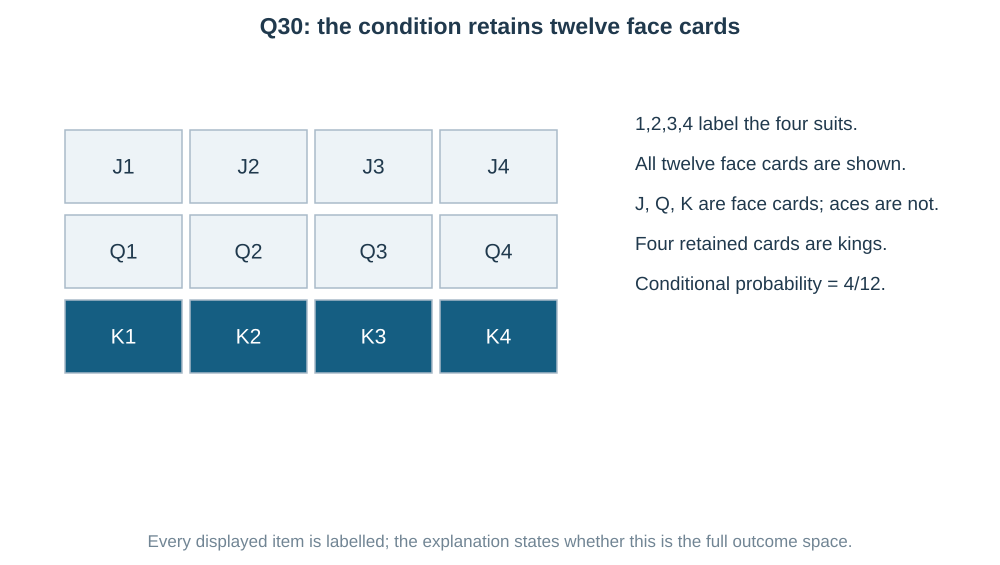

Four of the retained cards are kings:

$$
\boxed{P(\text{king}\mid\text{face})=\frac4{12}
=\frac13;\quad\text{(d)}}.
$$

**Another possible approach — conditional formula:** every king is a face card, so

$$
\frac{P(\text{king and face})}{P(\text{face})}
=\frac{4/52}{12/52}=\frac13.
$$

The option $1/13=4/52$ is the unconditional king chance; it ignores the information.

---

### Question 31 — Remove the no-six outcomes from all outcomes

**PDF page 122 | Numerical value | Notes: C08**

A fair die is thrown 4 times. If the probability of getting at least one six is $\dfrac{N}{1296}$, then $N=$ ____.

**“At least one six” excludes only the no-six sequences.** There are $6^4=1296$ equally likely ordered sequences. If no six occurs, each throw has five choices:

$$
\text{no-six sequences}=5^4=625.
$$

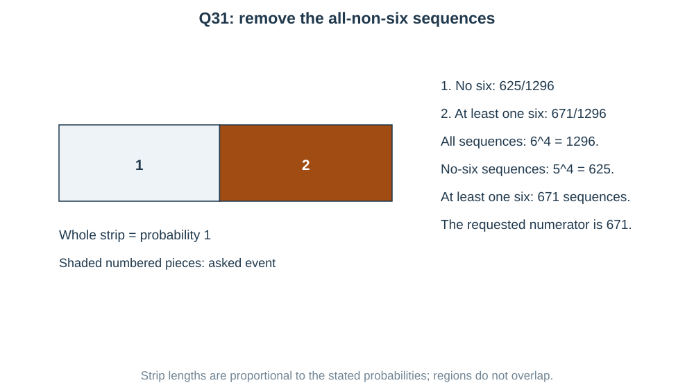

Therefore

$$
P(\text{at least one six})=\frac{1296-625}{1296}
=\frac{671}{1296}.
$$

Matching $N/1296$ gives

$$
\boxed{N=671}.
$$

**Another possible approach:** $1-(5/6)^4$ is the same complement written with probabilities rather than outcome counts. The numerator route directly produces the requested integer.

---

### Question 32 — Loss is a negative value of the gain variable

**PDF page 122 | Numerical value | Notes: C13**

A fair die is thrown. If an even number $n$ turns up, a player wins ₹$n$; if an odd number $n$ turns up, the player loses ₹$n$. The expected gain (in ₹) is ____.

**Define gain with a sign before averaging.** Odd faces cause a loss, so their gains are negative:

$$
\begin{array}{c|rrrrrr}
\text{face}&1&2&3&4&5&6\\ \hline
\text{gain}&-1&2&-3&4&-5&6
\end{array}
$$

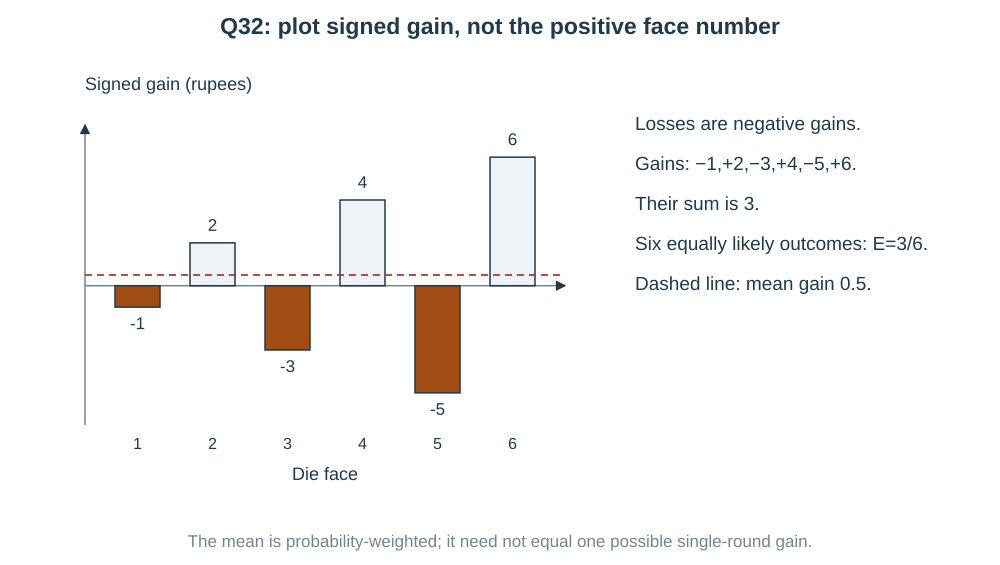

Each has probability $1/6$, so

$$
\boxed{E(G)=\frac{-1+2-3+4-5+6}{6}
=\frac36=0.5\text{ rupee}}.
$$

**Another possible approach — pair neighbouring faces:** the gains from $(1,2)$ add to 1; so do those from $(3,4)$ and $(5,6)$. The total is therefore 3.

**Check:** averaging the positive face values would give 3.5, but that would count losses as wins. Expected gain 0.5 does not mean a single round can pay exactly 0.5.

---

### Question 33 — Exactly two defects means choosing their positions

**PDF page 122 | MCQ | Notes: C11**

The probability of a bulb being defective is $0.2$. Out of 5 bulbs chosen at random, the probability that exactly 2 are defective is

- (a) $0.0512$
- (b) $0.4096$
- (c) $0.3277$
- (d) $0.2048$

**Use the usual model of independent bulb defects, each with the same probability $0.2$.** This assumption is necessary for a binomial calculation. A specified finite lot sampled without replacement would need its composition.

Exactly two defects means two defective positions and three nondefective positions:

$$
P=\binom52(0.2)^2(0.8)^3.
$$

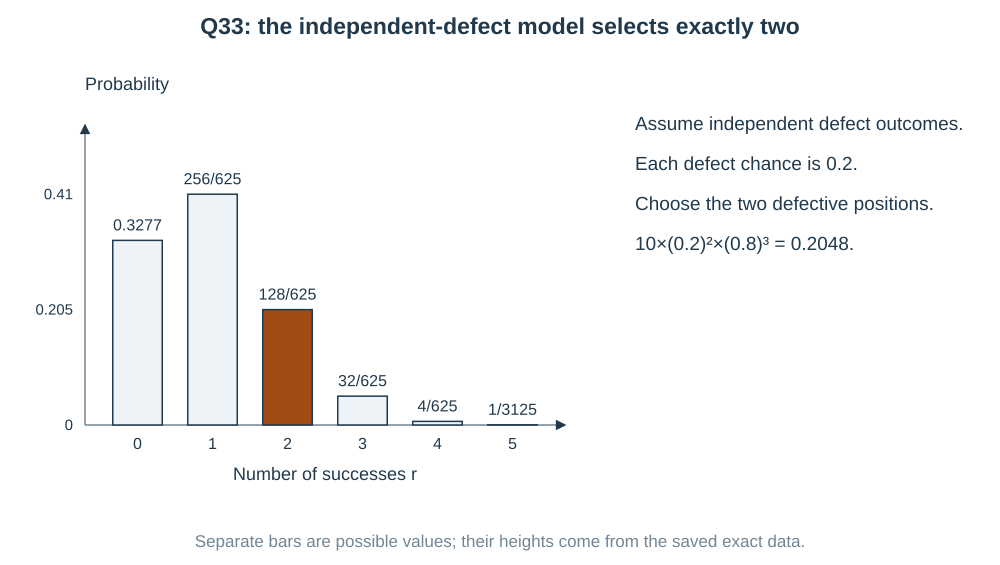

There are 10 ways to choose those positions. Hence

$$
\boxed{P=10(0.04)(0.512)=0.2048;\quad\text{(d)}}.
$$

**Check the role of 10:** one specified pattern, such as DDGGG, has probability $0.02048$. Exactly two defects allows ten such patterns. The other three bulbs must be good; omitting $(0.8)^3$ does not describe exactly two.

---

### Question 34 — Two-digit means ten through ninety-nine

**PDF page 123 | MCQ | Notes: C04**

A two-digit number is chosen at random. The probability that it is a multiple of 4 or 7 is

- (a) $\dfrac{16}{45}$
- (b) $\dfrac{11}{30}$
- (c) $\dfrac7{18}$
- (d) $\dfrac13$

**Start by fixing the sample space.** Two-digit positive integers run from 10 through 99, so there are $99-10+1=90$ of them.

Multiples of 4 run from 12 to 96:

$$
n(A)=24-2=22.
$$

Multiples of 7 run from 14 to 98:

$$
n(B)=14-1=13.
$$

Common multiples are multiples of $\operatorname{lcm}(4,7)=28$: $28,56,84$, giving 3.

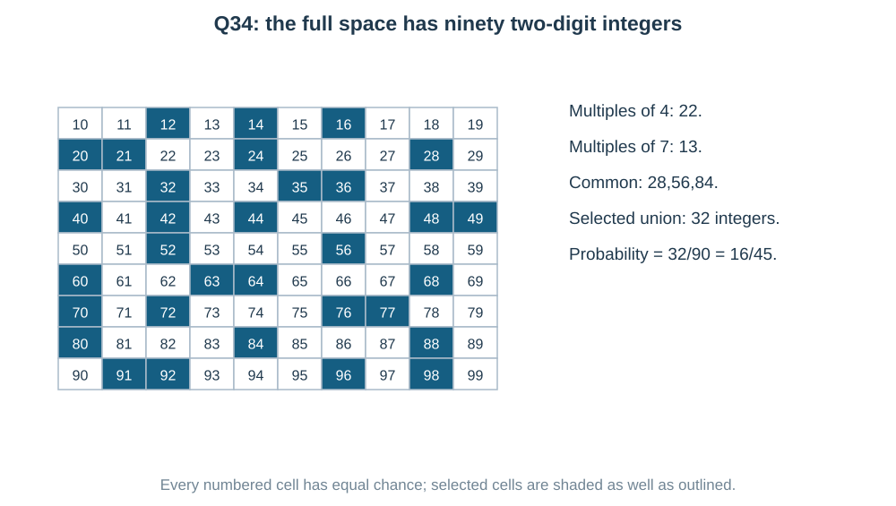

$$
\boxed{P=\frac{22+13-3}{90}
=\frac{32}{90}=\frac{16}{45};\quad\text{(a)}}.
$$

**Another counting route:** count valid integers from 1 to 99, then remove those below 10:

$$
(24+14-3)-(2+1)=35-3=32.
$$

The denominator remains 90. Including single-digit numbers in one part of the calculation would mismatch the experiment.

---

### Question 35 — A union of complements excludes only the common event

**PDF page 123 | MCQ | Notes: C03,C07**

Independent events $A,B$ have $P(A)=\dfrac12,\ P(B)=\dfrac13$. Then $P(A'\cup B')$ equals

- (a) $\dfrac23$
- (b) $\dfrac56$
- (c) $\dfrac16$
- (d) $\dfrac13$

**Notice the symbol is a union between the complements.** $A'\cup B'$ means “not both,” not “neither.”

De Morgan's law gives

$$
A'\cup B'=(A\cap B)'.
$$

By independence,

$$
P(A\cap B)=\frac12\frac13=\frac16.
$$

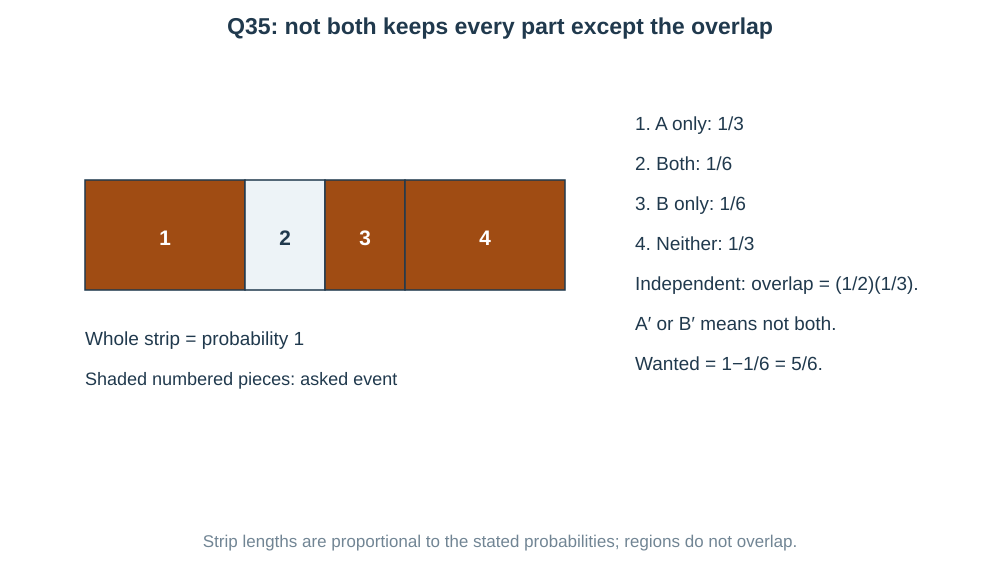

Thus

$$
\boxed{P(A'\cup B')=1-\frac16=\frac56;\quad\text{(b)}}.
$$

**Another possible approach — addition for the complements:** $P(A')=1/2$, $P(B')=2/3$, and their overlap is $(1/2)(2/3)=1/3$. Therefore

$$
P(A'\cup B')=\frac12+\frac23-\frac13=\frac56.
$$

Q4 asked $A'\cap B'$. The single changed symbol changes which parts of the picture count.

---

### Question 36 — At least one girl excludes only all-boy committees

**PDF page 123 | Numerical value | Notes: C02,C08**

A committee of 3 is chosen at random from 5 boys and 3 girls. If the probability that it has at least one girl is $\dfrac{N}{56}$, then $N=$ ____.

**A committee is an unordered group.** All possible committees number $\binom83=56$.

“At least one girl” excludes only the all-boy committees, of which there are $\binom53=10$. Thus

$$
P(\text{at least one girl})=1-\frac{10}{56}
=\frac{46}{56}.
$$

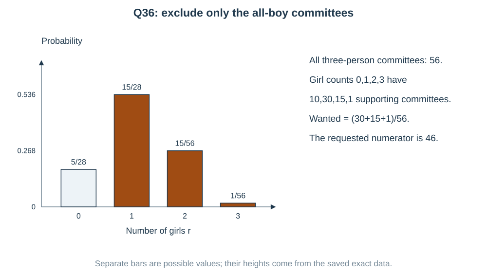

The question's requested numerator is

$$
\boxed{N=46}.
$$

**Another possible approach — count the valid girl counts:**

$$
\binom31\binom52+\binom32\binom51+\binom33\binom50
=30+15+1=46.
$$

That direct count works, while the single all-boy exclusion is shorter here.

---

### Question 37 — A positive test can come from two different groups

**PDF page 123 | MCQ | Notes: C09**

1% of a population has a disease. A test detects the disease in 90% of the infected people but also gives a false positive for 5% of healthy people. A person tested positive. The probability that the person actually has the disease is

- (a) $\dfrac9{10}$
- (b) $\dfrac15$
- (c) $\dfrac2{11}$
- (d) $\dfrac2{13}$

**The person is known to test positive.** A positive result can come from an infected person or from a healthy person with a false positive. Both routes belong in the new denominator.

Use a model population of 10,000 to make the percentages visible:

$$
\begin{array}{c|r|r}
\text{group}&\text{people}&\text{positive results}\\ \hline
\text{infected}&100&0.90(100)=90\\
\text{healthy}&9900&0.05(9900)=495
\end{array}
$$

Among the $90+495=585$ positives, 90 are infected:

$$
\boxed{P(\text{infected}\mid+)=\frac{90}{585}
=\frac2{13};\quad\text{(d)}}.
$$

**Why $90\%$ is not the answer:** it is the positive-test chance among infected people. We are asked the infected share among positive people. These are reversed conditions.

**Another possible approach — Bayes directly:**

$$
\frac{0.01(0.90)}
{0.01(0.90)+0.99(0.05)}
=\frac{0.009}{0.0585}=\frac2{13}.
$$

The large healthy starting group is why its smaller false-positive rate still contributes more positive results in this example.

---

### Question 38 — At least one ace keeps both one-ace and two-ace pairs

**PDF page 123 | Numerical value | Notes: C05,C15**

Two cards are drawn at random without replacement from a pack of 52 cards. Given that at least one of them is an ace, the probability that both are aces is $\dfrac1m$. The value of $m$ is ____.

**Keep every unordered pair having at least one ace.** Such a pair can have exactly one ace or two aces.

Exactly-one-ace pairs:

$$
\binom41\binom{48}1=4(48)=192.
$$

Two-ace pairs:

$$
\binom42=6.
$$

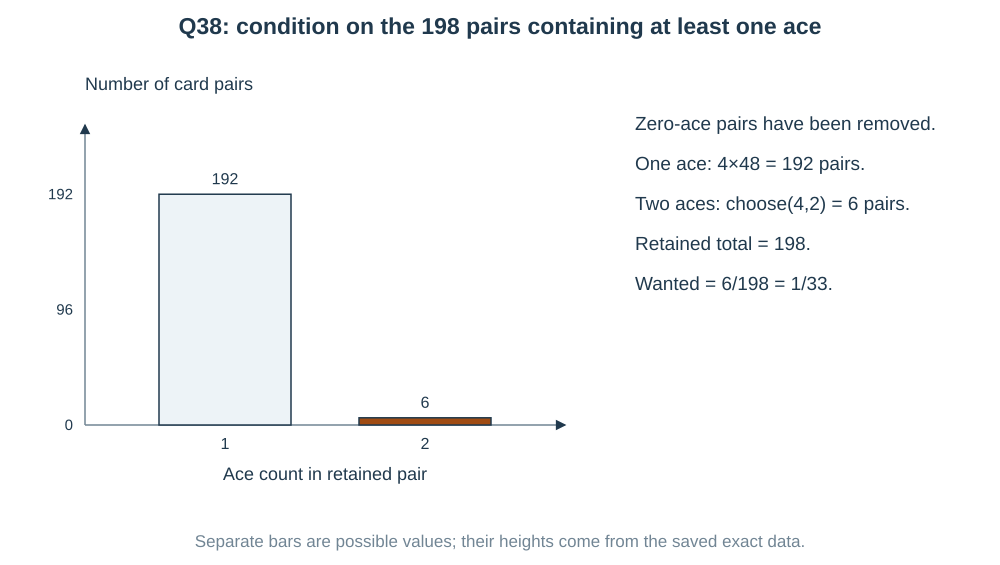

All $192+6=198$ retained pairs are equally likely. Therefore

$$
P(\text{both aces}\mid\text{at least one})
=\frac6{198}=\frac1{33}.
$$

$$
\boxed{m=33}.
$$

**Another possible approach — subtract no-ace pairs:** among $\binom{52}2=1326$ total pairs, $\binom{48}2=1128$ have no ace. The conditional denominator is $1326-1128=198$, giving the same ratio.

**Why $3/51$ answers a different question:** that would apply if a specified first card were known to be an ace. Here the information is only that the **pair** contains at least one ace.

---

### Question 39 — Six-count is binomial; keep variance separate from SD

**PDF page 123 | Numerical value | Notes: C12**

Let $X$ be the number of sixes in three throws of a fair die. If $\sigma^2$ is the variance of $X$, then $144\sigma^2=$ ____.

**$X$ counts sixes, not the sum of the die faces.** Each of the three independent throws is a success with probability $p=1/6$:

$$
X\sim B\left(3,\frac16\right).
$$

Thus

$$
\sigma^2=npq
=3\left(\frac16\right)\left(\frac56\right)=\frac5{12}.
$$

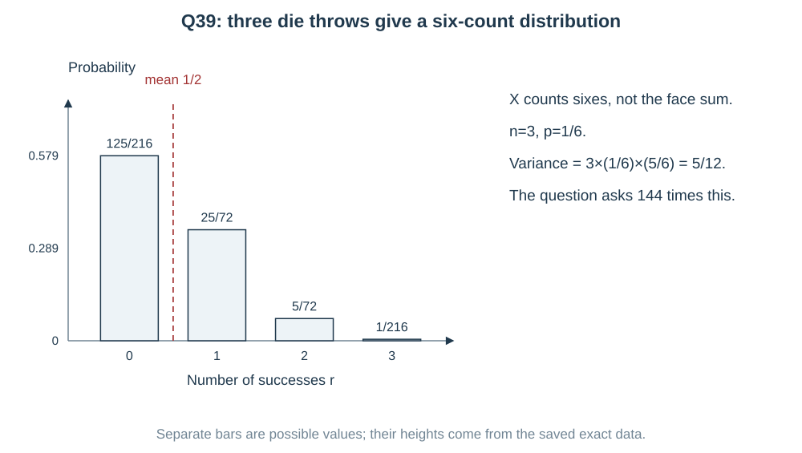

The question asks for the scaled variance:

$$
\boxed{144\sigma^2=144\left(\frac5{12}\right)=60}.
$$

**Another possible approach — moments from the distribution:** the counts $X=0,1,2,3$ have probabilities $(125,75,15,1)/216$. Hence

$$
E(X)=\frac{75+30+3}{216}=\frac12,
\qquad
E(X^2)=\frac{75+60+9}{216}=\frac23.
$$

So variance is $2/3-(1/2)^2=5/12$. The square root would be SD, which is not requested.

---

### Question 40 — Derive the sum count rather than treating sums as equally likely

**PDF page 123 | MCQ | Notes: C16**

Three fair dice are thrown. The probability that the sum of the numbers obtained is 10 is

- (a) $\dfrac19$
- (b) $\dfrac5{36}$
- (c) $\dfrac18$
- (d) $\dfrac{25}{216}$

**The event is a sum, but the equal-probability outcomes are ordered triples.** There are $6^3=216$ of them. We must derive how many give sum 10.

Fix the first die. The other two must give the remaining sum:

$$
\begin{array}{c|rrrrrr}
\text{first die}&1&2&3&4&5&6\\ \hline
\text{needed pair sum}&9&8&7&6&5&4\\
\text{ordered pair count}&4&5&6&5&4&3
\end{array}
$$

These six cases are disjoint, so their counts add:

$$
F=4+5+6+5+4+3=27.
$$

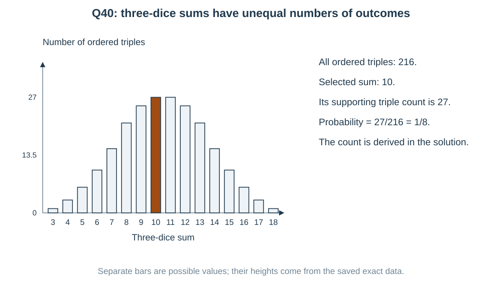

$$
\boxed{P=\frac{27}{216}=\frac18;\quad\text{(c)}}.
$$

**Another possible approach — unordered types and their orders:** the possible sorted triples are

$$
(1,3,6),(1,4,5),(2,2,6),(2,3,5),(2,4,4),(3,3,4).
$$

Their different-order counts are $6,6,3,6,3,3$, again totaling 27. We cannot give each sorted triple the same weight: triples with a repeated number have fewer orders.

## Answer check

Read the qualifications in the solutions before using the key.

| Question | Answer | Question | Answer |
|---|---|---|---|
| 1 | (c) | 21 | (d) |
| 2 | (a) | 22 | (b) |
| 3 | (c) | 23 | (d) |
| 4 | (c) | 24 | (c) |
| 5 | (a) | 25 | (b) |
| 6 | (d) | 26 | $0.75$ |
| 7 | (b) | 27 | (b) |
| 8 | $9$ | 28 | (a) |
| 9 | (b) | 29 | $3$ |
| 10 | $1$ | 30 | (d) |
| 11 | (a) | 31 | $671$ |
| 12 | (a) | 32 | $0.5$ |
| 13 | (d) | 33 | (d) |
| 14 | $165$ | 34 | (a) |
| 15 | (a) | 35 | (b) |
| 16 | (c) | 36 | $46$ |
| 17 | (a) | 37 | (d) |
| 18 | (c) | 38 | $33$ |
| 19 | (d) | 39 | $60$ |
| 20 | $7$ | 40 | (c) |

## After this chapter

Keep asking: what are the elementary outcomes, and what information has changed the allowed space? Check whether the bag changes, whether trials are independent, and whether the question wants exactly, at least, at most, neither or not both. A correct denominator and a clear event usually make the formula choice manageable. All alternatives are visible for the later booklet. The supplied questions are original JEE Main-style practice, not verified actual PYQs.
