# Chapter 24 — Statistics

**Kanna, Statistics describes a collection of values.** First ask where its centre is. Then ask how far the values are spread around that centre. Two groups can have the same mean and very different spread.

Your target remains **200 marks**: Physics 60, Maths 60, Chemistry 80. This chapter rewards clear meanings and careful arithmetic. Keep the total count, total sum and total sum of squares separate.

## Recent chapter weightage

| Year | Questions tagged Statistics in the checked archive | Full-year paper shifts | Tagged questions per shift |
|---|---:|---:|---:|
| 2024 | 15 | 20 | 0.75 |
| 2025 | 8 | 19 | 0.42 |
| 2026 | 15 | 19 | 0.79 |
| Total | 38 | 58 | **0.66** |

These are distinct question IDs recounted in ExamSIDE's Statistics category. PYQSide gives 14, 8 and 15, differing by one in 2024. We keep one named archive consistently; we do not silently replace or average the counts. The 2024 papers offered more optional numerical questions. Sources, locators and the recount are saved separately.

The mean is an archive-tag observation, not a guarantee for one shift. It is not a new paper-by-paper official classification or a measured formula-frequency ranking. Recent archive examples include combined groups, correction of readings, missing observations, grouped median and mean deviation.

**Important for JEE Main:** the current official unit includes mean, median and mode, plus mean deviation, variance and standard deviation for grouped and ungrouped data. Mode is taught here even though the supplied 25 questions do not directly ask for it. Coefficient of variation, coefficient of range and AP shortcuts are useful supporting tools, including those needed by the PDF.

## Concept C01 — Data, observations and frequency

An **observation** is one recorded value, such as one student's mark. The whole collection is the **data set**.

Raw data may repeat:

$$
2,4,4,4,5,5,7,9.
$$

We can write the same data using **frequency**, the number of times each value occurs:

$$
\begin{array}{c|rrrrr}
x_i&2&4&5&7&9\\ \hline
f_i&1&3&2&1&1
\end{array}
$$

The total number of observations is $N=\sum_i f_i=8$, not the number of different value labels.

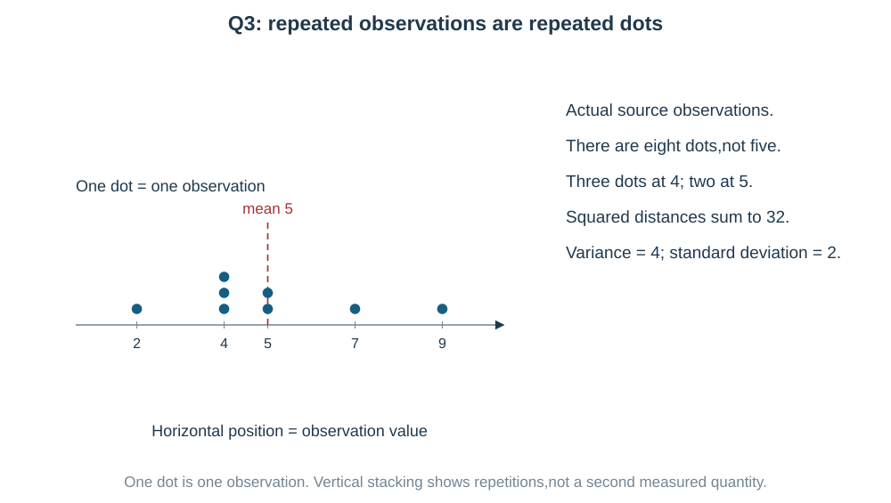

The notation $\sum_i$ means “add over all the listed values.” The subscript $i$ labels the row or observation.

**Grouped data:** instead of exact values, we may only know how many lie in intervals such as $0$–$10$, $10$–$20$. Use nonoverlapping class boundaries, ordinarily $[0,10),[10,20),\ldots$, with any last endpoint handled consistently.

The **class mark** is its midpoint:

$$
\boxed{x_i=\frac{\text{lower boundary}+\text{upper boundary}}2}.
$$

For mean and variance from grouped counts, we represent the class by that midpoint. These are exact calculations for the midpoint-representative data, and generally **estimates** for the unknown original values.

**This chapter uses descriptive variance:** divide by $N$. The $N-1$ divisor belongs to a different statistical estimation task and is not the convention in these JEE questions.

## Concept C02 — Mean: share the total equally

The **arithmetic mean** is the value each observation would have if the total were shared equally:

$$
\boxed{\bar x=\frac{x_1+\cdots+x_N}{N}
=\frac{\sum x_i}{N}}.
$$

For a frequency table,

$$
\boxed{\bar x=\frac{\sum f_i x_i}{\sum f_i}},\qquad N=\sum f_i.
$$

A value occurring three times must contribute three copies. Averaging only the different labels would describe a different collection.

The total can be recovered from the mean:

$$
\boxed{\sum x_i=N\bar x}.
$$

This is the key step in correction, replacement and combined-group questions.

**Example:** for $2,4,6,8,10$, total $=30$, count $=5$, so mean $=6$.

**Assumed-mean method:** choose a convenient reference $a$. Put $d_i=x_i-a$. Then

$$
\boxed{\bar x=a+\frac{\sum f_i d_i}{N}}.
$$

For equally spaced class marks with step $h\ne0$, use $u_i=(x_i-a)/h$:

$$
\boxed{\bar x=a+h\frac{\sum f_i u_i}{N}}.
$$

These methods subtract a convenient reference to make the arithmetic small; they do not change the data.

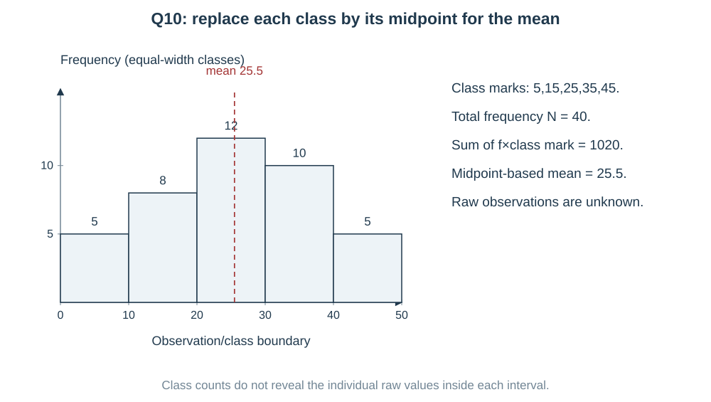

For its class marks, choosing $a=25,h=10$ gives $u=-2,-1,0,1,2$. Frequencies $5,8,12,10,5$ give $\sum fu=2$ and $N=40$, so $\bar x=25+10(2/40)=25.5$.

**Quick check:** a mean lies between the smallest and largest observed values. It is pulled towards values with larger total weight.

## Concept C03 — Median: the middle of the ordered collection

The **median** is a centre based on position. First put the observations in increasing order. Write $x_{(j)}$ for the value in position $j$.

$$
\boxed{\text{Median}=
\begin{cases}
x_{((N+1)/2)},&N\text{ odd},\\[2pt]
\dfrac{x_{(N/2)}+x_{(N/2+1)}}2,&N\text{ even}.
\end{cases}}
$$

For $3,5,6,8,13$, the third value is 6. For $1,2,4,8$, the conventional reported median is $(2+4)/2=3$.

**A frequency table needs positions, not just the middle row.** Add frequencies progressively to obtain the **cumulative frequency**: how many observations have been reached so far.

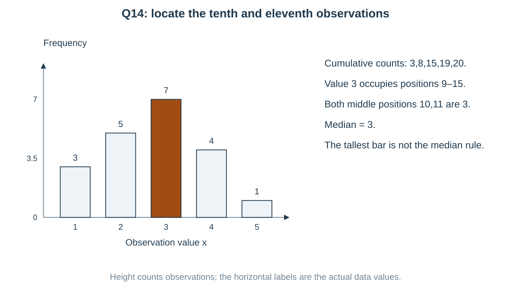

For Q14, cumulative frequencies are $3,8,15,19,20$. Both the 10th and 11th observations have value 3, so median $=3$. The tallest bar defines the mode, not generally the median; they happen to agree in this example.

**Grouped median:** find the class where the cumulative count reaches $N/2$. Let $L$ be its lower boundary, $h$ its width, $f$ its frequency and $C$ the cumulative frequency before it. The standard interpolation estimate is

$$
\boxed{\text{Median}\approx L+\frac{N/2-C}{f}\,h}.
$$

Why the fraction? We need $N/2-C$ more observations inside a class containing $f$ observations. Assuming the count spreads uniformly across its width, travel that fraction of $h$ from $L$.

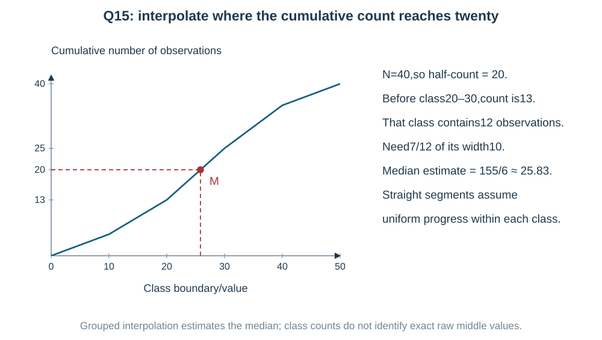

For the source distribution, $N=40,L=20,C=13,f=12,h=10$:

$$
\text{Median}\approx20+\frac{20-13}{12}(10)
=\frac{155}{6}\approx25.83.
$$

This estimates the raw-data median. Group totals alone cannot determine the exact individual middle values. Do not replace this grouped $N/2$ interpolation rule by the ungrouped odd-sample position $(N+1)/2$.

## Concept C04 — Mode: the most frequent value or class

The **mode** of discrete data is the value with the highest frequency. In $2,4,4,4,5,5,7,9$, the mode is 4 because it occurs three times.

Several values can tie for highest frequency. There need not be one unique mode. A collection with every value occurring once has no distinctive most-common value.

For equal-width grouped data, the **modal class** has the greatest frequency. A common interpolation estimate is

$$
\boxed{\text{Mode}\approx
L+\frac{f_1-f_0}{(f_1-f_0)+(f_1-f_2)}\,h}.
$$

Here $L,h$ describe the modal class; $f_1$ is its frequency; $f_0,f_2$ are the neighbouring frequencies before and after it. Use an identifiable peak and a nonzero denominator.

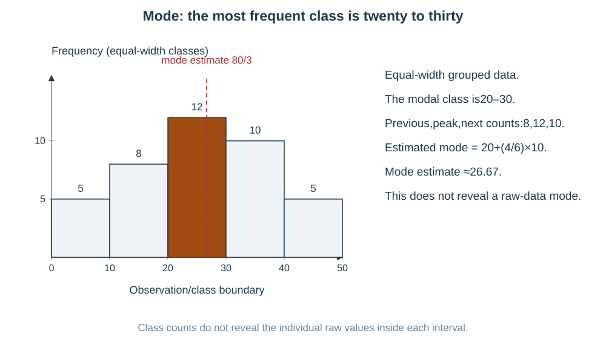

For frequencies $8,12,10$ around the class $20$–$30$,

$$
\text{Mode}\approx20+\frac{12-8}{(12-8)+(12-10)}(10)
=\frac{80}{3}\approx26.67.
$$

**What the formula means:** compare how much the peak rises above each neighbour. Those two differences divide the modal class's width. A larger rise from the left places the estimate farther inside the class.

This is a grouped-data estimate, not the exact most common unknown raw value. For unequal widths, the tallest frequency alone can mislead; compare frequency density, meaning frequency divided by class width, before using a suitable histogram-based estimate.

Mean, median and mode describe different things. Their values need not agree. An empirical relation sometimes used for moderately skewed data,

$$
\text{Mode}\approx3(\text{Median})-2(\text{Mean}),
$$

is only an approximation when that model is explicitly appropriate. It is **not** a universal identity and cannot replace actual frequency information.

## Concept C05 — Deviation, distance and the best centre

A **deviation** from a chosen centre $a$ is the signed difference $x_i-a$. It is negative to the left and positive to the right.

For the mean, these signed differences cancel:

$$
\boxed{\sum(x_i-\bar x)=\sum x_i-N\bar x=0}.
$$

So their ordinary average cannot measure spread: it is always zero. Use ordinary distances $|x_i-a|$ or squared distances $(x_i-a)^2$ instead.

**Squared distances choose the mean — important for JEE Main.** Write $x_i-a=(x_i-\bar x)+(\bar x-a)$ and expand:

$$
\boxed{\sum(x_i-a)^2
=\sum(x_i-\bar x)^2+N(a-\bar x)^2}.
$$

The mixed term disappears because $\sum(x_i-\bar x)=0$. The extra square is never negative and becomes zero exactly when $a=\bar x$. Thus the mean uniquely minimizes the sum of squared deviations.

**Ordinary distances choose a median.** For a smallest and largest observation,

$$
|x_{\min}-a|+|x_{\max}-a|\ge x_{\max}-x_{\min}.
$$

Equality holds whenever $a$ lies between that pair. Pair the next-smallest with the next-largest and continue. A median lies between every such pair, so it minimizes the total distance.

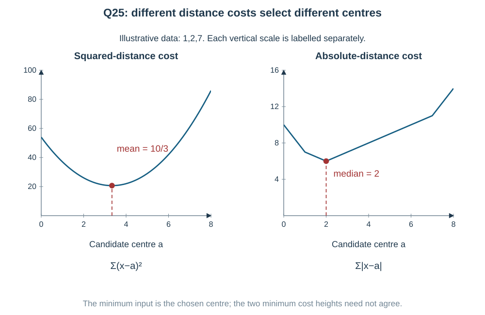

**Read the axes:** the horizontal input is the candidate centre $a$. The vertical value is the total distance cost. The two panels use different costs and explicitly labelled vertical scales. Their minimum inputs, not their heights, identify the centres.

For an odd count, the middle value gives the unique absolute-distance minimizer. For an even count, **every point between the two middle observations** minimizes the sum. The conventional reported median is their average, one point in that interval.

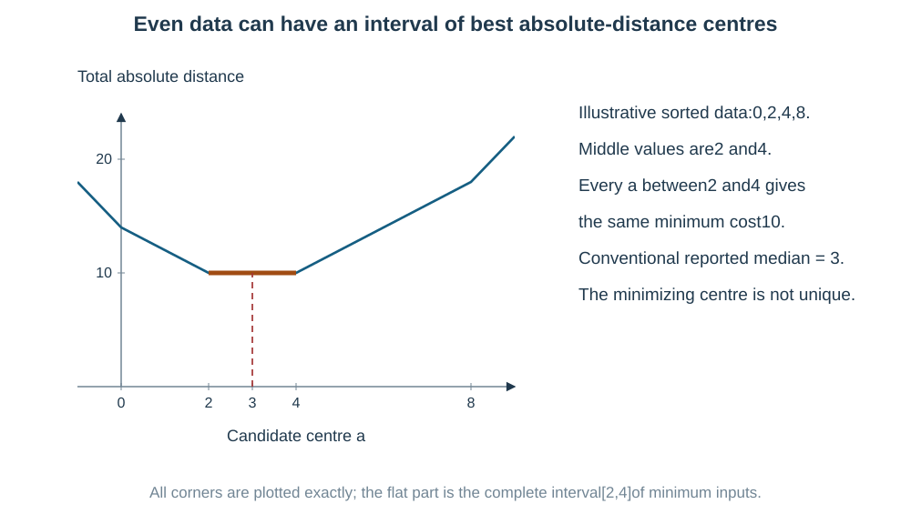

These minimum rules also hold with frequency weights by viewing each value as repeated $f_i$ times.

## Concept C06 — Mean deviation is the average ordinary distance

Choose the centre named in the question: mean, median or sometimes mode. Then

$$
\boxed{\operatorname{MD}(a)=\frac1N\sum|x_i-a|}.
$$

With frequencies,

$$
\boxed{\operatorname{MD}(a)=\frac{\sum f_i|x_i-a|}{N}}.
$$

“About the mean” means use $a=\bar x$. “About the median” means first find the median and use it as $a$.

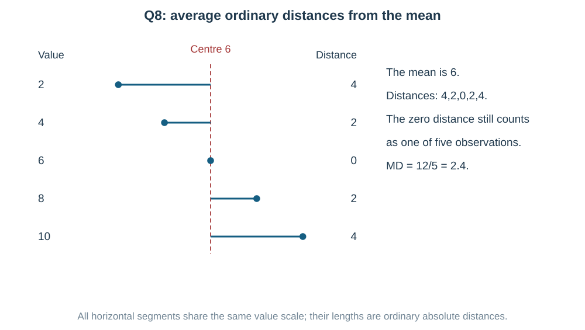

For $2,4,6,8,10$, the mean is 6. Distances are $4,2,0,2,4$:

$$
\operatorname{MD}(\bar x)=\frac{4+2+0+2+4}{5}=\frac{12}{5}.
$$

**Three different averages:** signed deviations cancel to zero; absolute deviations give MD; squared deviations give variance. Do not switch between these operations.

For grouped data, use class marks as $x_i$ and state the representative-data convention. MD has the same unit as the original observations.

If a coefficient of mean deviation is specifically requested, it is conventionally $\operatorname{MD}(\bar x)/\bar x$ or $\operatorname{MD}(M)/M$ about a positive mean or median $M$. The centre in the denominator must be nonzero. This dimensionless coefficient is different from the MD itself.

## Concept C07 — Variance and standard deviation measure spread

Variance is the average **squared** distance from the mean:

$$
\boxed{\sigma^2=\frac1N\sum(x_i-\bar x)^2}.
$$

For frequencies,

$$
\boxed{\sigma^2=\frac{\sum f_i(x_i-\bar x)^2}{N}}.
$$

Standard deviation, abbreviated **SD**, is its nonnegative square root:

$$
\boxed{\sigma=\sqrt{\sigma^2}}.
$$

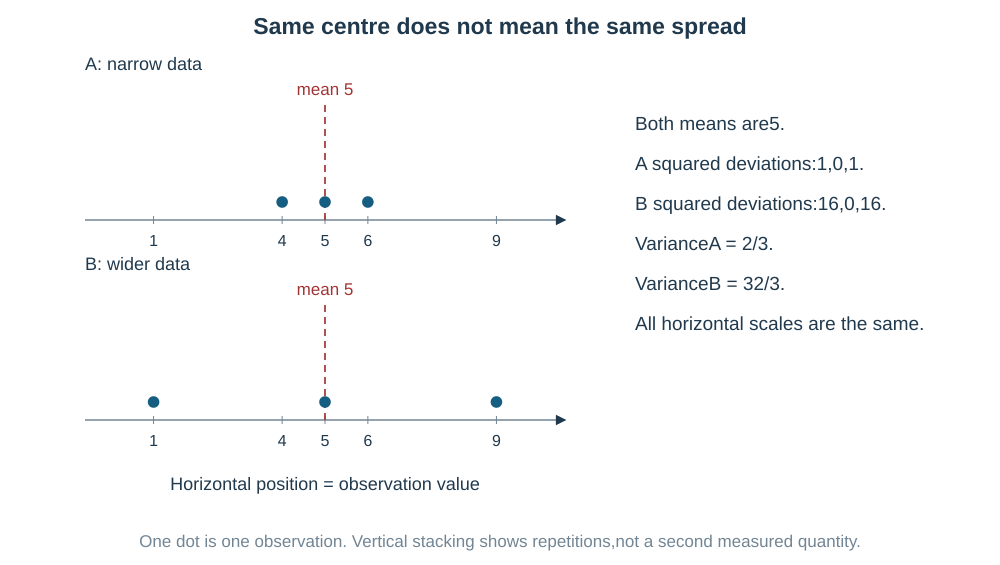

**Read the picture:** both collections balance at the same centre. The wider one has larger squared distances, so it has larger variance.

For $4,5,6$, mean $=5$, squared distances $=1,0,1$, variance $=2/3$. For $1,5,9$, mean is still 5, but variance is $(16+0+16)/3=32/3$.

Variance is always nonnegative. It is zero exactly when **every** observation equals the mean. A negative calculated variance signals an error or inconsistent data, not a negative spread.

**Units:** if observations are in centimetres, variance is in $\mathrm{cm}^2$ and SD in $\mathrm{cm}$. Taking the square root restores the original scale.

For data $2,4,4,4,5,5,7,9$, mean $=5$ and squared deviations sum to 32:

$$
\sigma^2=\frac{32}{8}=4,\qquad\sigma=2.
$$

The answer depends on whether the question asks variance or SD. Do not stop at 4 if SD is asked.

## Concept C08 — Shortcuts from the sum and sum of squares

Expand the squared deviations and use $\sum x_i=N\bar x$:

$$
\boxed{\sigma^2=\frac{\sum x_i^2}{N}-\bar x^2}.
$$

For frequencies, replace $\sum x_i^2$ by $\sum f_i x_i^2$:

$$
\boxed{\sigma^2=\frac{\sum f_i x_i^2}{N}
-\left(\frac{\sum f_i x_i}{N}\right)^2}.
$$

**Recognition clue:** when a question gives $\sum x_i$ and $\sum x_i^2$, do not try to find every observation. These two totals give the required mean and variance directly.

Rearranging gives

$$
\boxed{\sum x_i^2=N(\sigma^2+\bar x^2)},
\qquad
\boxed{\sum(x_i-\bar x)^2=N\sigma^2}.
$$

**Reference deviations:** suppose the question gives $d_i=x_i-a$, where $a$ is a convenient reference. The mean is

$$
\boxed{\bar x=a+\frac{\sum d_i}{N}}.
$$

Variance is unchanged by that shift:

$$
\boxed{\sigma^2=
\frac{\sum d_i^2}{N}-\left(\frac{\sum d_i}{N}\right)^2}.
$$

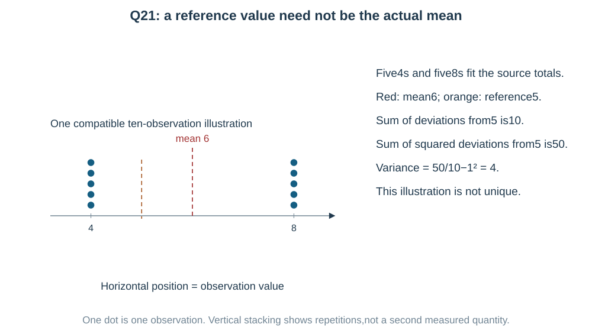

If $\sum(x_i-5)=10$ for 10 observations, then 5 is **not** their mean. Their average deviation from 5 is 1, giving mean 6. Subtract the square of that average deviation in the variance formula.

With frequencies and $u_i=(x_i-a)/h$,

$$
\boxed{\sigma^2=h^2\left[
\frac{\sum f_i u_i^2}{N}
-\left(\frac{\sum f_i u_i}{N}\right)^2
\right]}.
$$

Use this when class marks are large but their small integer steps are easy. Avoid premature decimal rounding in the difference of two squared quantities.

## Concept C09 — Shift and scale: move the centre,stretch the deviations

Replace every observation by $y_i=ax_i+b$. The mean follows the same transformation:

$$
\boxed{\bar y=a\bar x+b}.
$$

Now subtract the new mean:

$$
y_i-\bar y=a(x_i-\bar x).
$$

That one equation explains all the spread rules:

$$
\boxed{\sigma_y^2=a^2\sigma_x^2},\qquad
\boxed{\sigma_y=|a|\sigma_x}.
$$

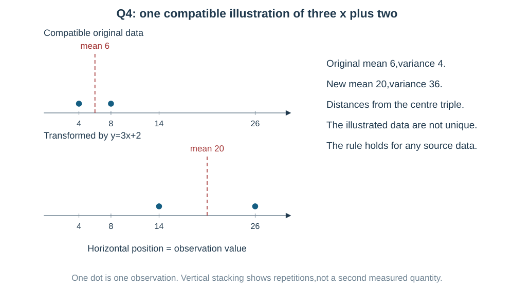

**Adding $b$** moves all points and their centre equally, so deviations do not change. **Multiplying by $a$** multiplies signed deviations by $a$, ordinary distances by $|a|$ and squared distances by $a^2$.

For a corresponding mean or median centre,

$$
\boxed{\operatorname{MD}_y=|a|\operatorname{MD}_x}.
$$

A transformed median is $aM+b$; negative $a$ reverses the order, but the middle position(s) still transform this way. For $a\ne0$, discrete modal values transform by the same rule because frequencies are preserved.

**Example:** mean 6 and variance 4, with $y=3x+2$, give mean 20 and variance 36. The $+2$ does not add 2 to the variance.

**Negative and zero scales:** if $a=-2$, SD doubles, not becomes negative. If $a=0$, every new observation is $b$, so variance and SD become zero.

**Standardizing:** if $\sigma>0$, the values

$$
z_i=\frac{x_i-\bar x}{\sigma}
$$

have mean 0 and variance 1. We first move the centre to zero, then divide every deviation by the original SD. This is a useful connection, not an instruction to change every problem into z-scores.

## Concept C10 — Combining groups: add totals,not just averages

Suppose group $j$ has $n_j$ observations, mean $\mu_j$ and variance $v_j$. Let $N=\sum_jn_j$.

Its total is $n_j\mu_j$. Therefore the combined mean is

$$
\boxed{\mu=\frac{\sum_j n_j\mu_j}{N}}.
$$

The unweighted average of the group means works only when the group sizes are equal.

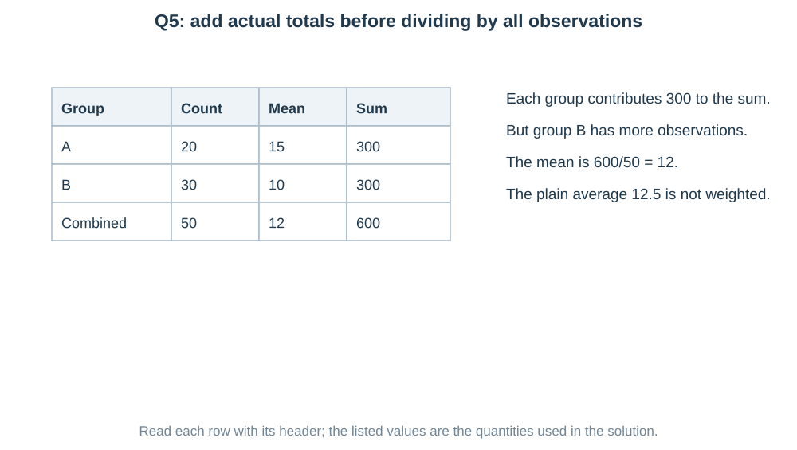

**Combined variance has two parts — important for JEE Main.**

1. Spread of observations around their own group means.
2. Spread because those group means are apart from the combined mean.

$$
\boxed{v=\frac{\sum_j n_j\left[v_j+(\mu_j-\mu)^2\right]}{N}}.
$$

Why the extra square appears: inside group $j$,

$$
x-\mu=(x-\mu_j)+(\mu_j-\mu).
$$

Squaring and adding eliminates the mixed term because deviations from that group's own mean add to zero. The remaining terms are its own squared spread plus $n_j(\mu_j-\mu)^2$.

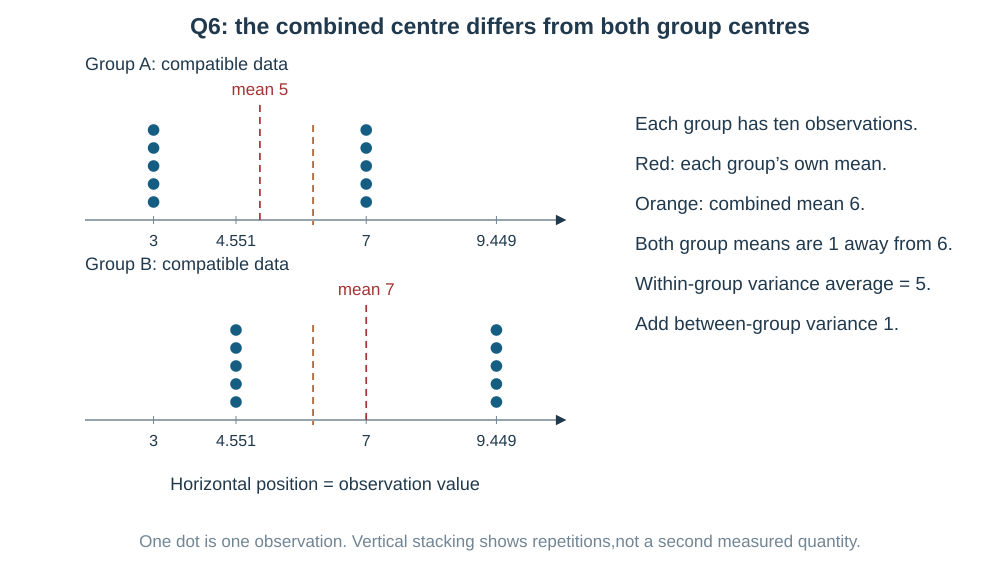

For two groups, an equivalent compact form is

$$
\boxed{v=\frac{n_1v_1+n_2v_2}{N}
+\frac{n_1n_2}{N^2}(\mu_1-\mu_2)^2}.
$$

This shows the extra contribution is always nonnegative. If both means agree, that extra term is zero.

**Another possible approach — combine second moments:**

$$
\boxed{v=\frac{\sum_j n_j(v_j+\mu_j^2)}N-\mu^2}.
$$

Use it when the moment totals are easy. Do not average standard deviations; SD is the square root after the combined variance is found.

## Concept C11 — Correcting or replacing observations

Use three totals:

$$
N=\text{count},\qquad S=\sum x_i,\qquad T=\sum x_i^2.
$$

If a recorded value $a$ is removed and the correct/new value $b$ is inserted, the count stays the same:

$$
\boxed{S_{\rm new}=S-a+b},\qquad
\boxed{T_{\rm new}=T-a^2+b^2}.
$$

Then

$$
\boxed{\bar x_{\rm new}=\frac{S_{\rm new}}N},\qquad
\boxed{\sigma_{\rm new}^2=\frac{T_{\rm new}}N-\bar x_{\rm new}^{\,2}}.
$$

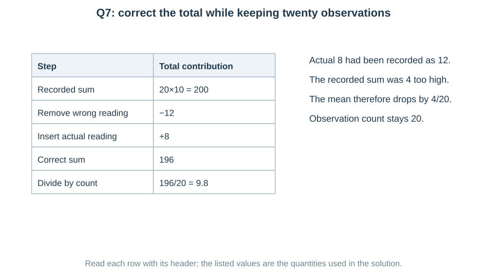

For multiple corrections, remove all wrong values and their squares, then add all correct ones and their squares.

**A useful clue:** if only the new mean is asked,

$$
\boxed{\bar x_{\rm new}=\bar x+\frac{b-a}{N}}.
$$

There is no need to calculate squares.

**Why variance needs both changes:** the sum of squares changes, but the mean also moves. Correcting only $T/N$ while retaining the old $\bar x^2$ would be wrong.

If an observation is added or deleted rather than replaced, update $N$ too. A problem with 20 observations does not become 19 just because one wrong reading is corrected.

## Concept C12 — Missing observations: target sums before solving values

Mean gives $\sum x_i=N\bar x$. Variance gives $\sum x_i^2=N(\sigma^2+\bar x^2)$. Subtract the known observations from these totals.

If only two unknowns $x,y$ remain, we often obtain

$$
x+y=s,\qquad x^2+y^2=t.
$$

**Did you notice the pattern?** Squaring the sum produces the product:

$$
(x+y)^2=x^2+y^2+2xy.
$$

Thus

$$
\boxed{xy=\frac{s^2-t}{2}}.
$$

If the target is $xy$, finding $x$ and $y$ separately creates unnecessary work. If the values are needed, they are roots of $z^2-sz+xy=0$.

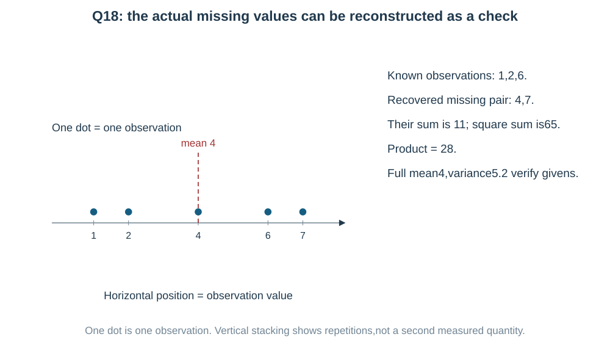

**Cauchy–Schwarz — important for JEE Main:**

$$
\boxed{\left(\sum x_i\right)^2\le N\sum x_i^2}.
$$

It follows by dotting $(x_1,\ldots,x_N)$ with $(1,\ldots,1)$. It says the squared total cannot be too large compared with the sum of squares. Equality requires all observations equal.

This inequality gives $\sigma^2\ge0$ and catches impossible mean/square-sum data. For two unknown real values, it gives $s^2\le2t$. Do not also require $t\le s^2$ for any two real observations. That extra condition would mean $xy\ge0$. Use it only if the problem gives such a restriction.

For example, $x=1,y=-1$ gives $s=0,t=2$. The values are real even though $t>s^2$.

**Useful bound for a largest possible observation:** with $N>1$,

$$
\boxed{|x_i-\bar x|\le\sqrt{N-1}\,\sigma}.
$$

Why: write $d_i=x_i-\bar x$. The other deviations sum to $-d_i$. Cauchy–Schwarz gives

$$
d_i^2\le(N-1)\sum_{j\ne i}d_j^2
=(N-1)(N\sigma^2-d_i^2),
$$

which rearranges to the bound. Equality is possible when the other $N-1$ observations are equal. Use this when a question asks an extremal observation from a known mean and variance; first check any extra positivity or integrality conditions.

## Concept C13 — Consecutive numbers and arithmetic progressions

For the first $n$ natural numbers, $1,2,\ldots,n$,

$$
\sum_{r=1}^n r=\frac{n(n+1)}2,\qquad
\sum_{r=1}^n r^2=\frac{n(n+1)(2n+1)}6.
$$

Divide by $n$ to get the mean and second moment, then subtract the squared mean:

$$
\boxed{\bar x=\frac{n+1}{2}},\qquad
\boxed{\sigma^2=\frac{n^2-1}{12}}.
$$

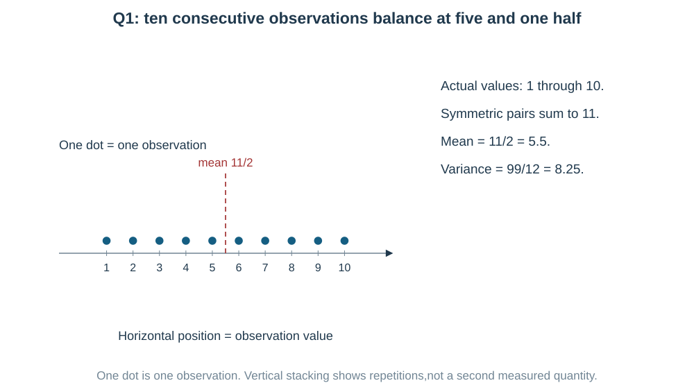

**Any arithmetic progression** $a,a+d,\ldots,a+(n-1)d$ is a shift and scale of $0,1,\ldots,n-1$. Therefore

$$
\boxed{\bar x=a+\frac{(n-1)d}{2}},
\qquad
\boxed{\sigma^2=\frac{d^2(n^2-1)}{12}}.
$$

The first term affects the centre but not the spread. A negative $d$ reverses the order; its square keeps the variance nonnegative. For $d=0$, all observations coincide and variance is zero.

For the first $n$ even numbers, the mean is $n+1$ and variance $(n^2-1)/3$. For the first $n$ odd numbers, mean is $n$ and variance is again $(n^2-1)/3$. Reconstruct them by scaling and shifting rather than memorizing disconnected formulas.

**Check the count:** $3,6,\ldots,30$ contains 10 observations, not 30.

## Concept C14 — Coefficient of variation: spread compared with the mean

An SD of 10 is large relative to a mean of 20, but smaller relative to a mean of 100. The **coefficient of variation**, or CV, compares spread with the positive mean:

$$
\boxed{\operatorname{CV}=\frac{\sigma}{\bar x}\times100\%}.
$$

For relative consistency, smaller CV means less spread **as a share of the mean**.

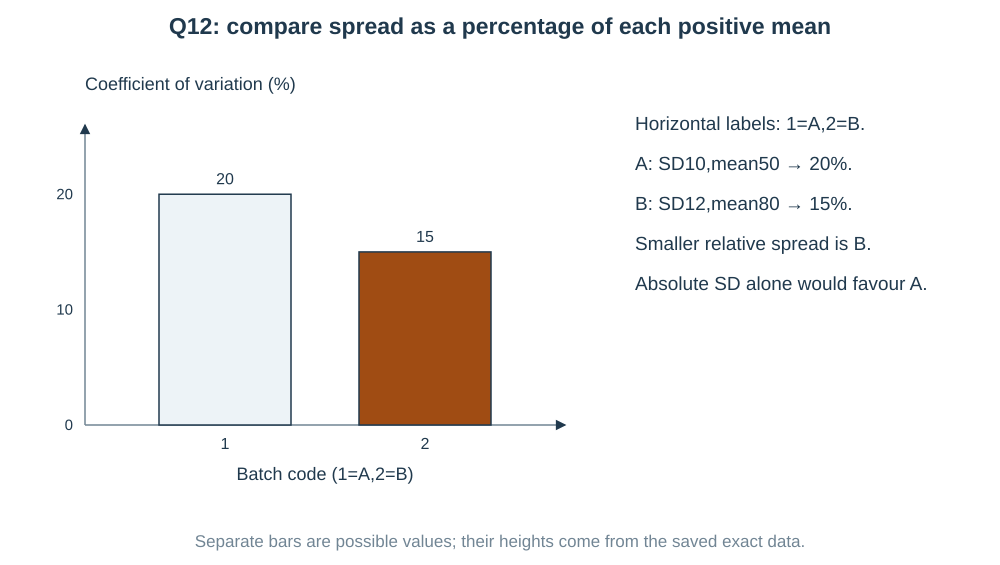

For Q12, A has $10/50=20\%$, B has $12/80=15\%$. B is more consistent in the relative sense, even though its absolute SD is larger.

For a positive scaling $y=ax$ with $a>0$,

$$
\operatorname{CV}_y=\frac{a\sigma}{a\bar x}\times100\%
=\operatorname{CV}_x.
$$

A shift $y=x+b$ generally changes CV, because SD stays the same while the mean changes.

**Conditions:** CV is undefined at mean zero. Its usual relative-consistency interpretation needs a meaningful positive mean and a meaningful zero for the measured quantity. Do not use a negative CV as “better consistency.” The source comparisons have positive means.

CV is dimensionless; its percentage value should not be confused with variance or SD.

## Concept C15 — Range and coefficient of range

Let $L$ be the largest observation and $S$ the smallest. The **range** measures the full end-to-end distance:

$$
\boxed{R=L-S}.
$$

It has the original measurement unit. The **coefficient of range** is

$$
\boxed{\frac{L-S}{L+S}},
\qquad L+S\ne0.
$$

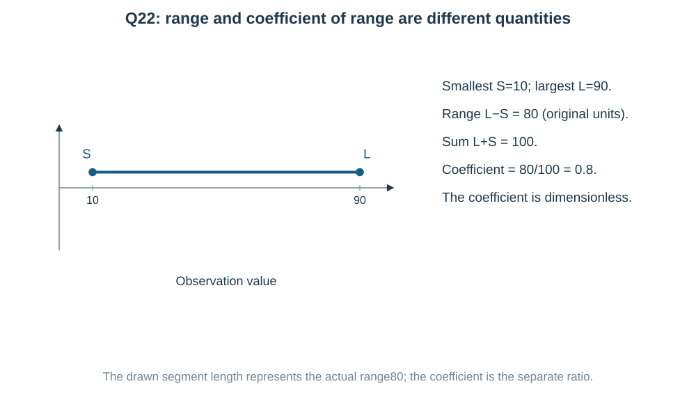

For the source values, range $=90-10=80$, while coefficient $=80/100=0.8$.

If $0\le S\le L$ and $L>0$, the coefficient lies in $[0,1]$. For arbitrary signed data that bound need not hold. Check the denominator before using it.

**Transformation connection:** range scales by $|a|$ under $y=ax+b$. A shift does not change range, but generally changes the coefficient because its denominator changes.

Range sees only the two extreme values. Variance and MD use every observation. So equal ranges do not force equal variances.

## Last-minute formula recap

| Need or clue | Result | Essential condition |
|---|---|---|
| Total count | $N=\sum f_i$ | count repetitions |
| Mean | $\bar x=\sum f_i x_i/N$ | use class marks for grouped representative data |
| Total from mean | $\sum x_i=N\bar x$ | observation count,not distinct labels |
| Assumed mean | $\bar x=a+\sum f_i(x_i-a)/N$ | choose a convenient reference |
| Step-deviation mean | $a+h\sum f_i u_i/N$ | $u_i=(x_i-a)/h,\ h\ne0$ |
| Raw median | middle ordered value(s) | sort first; average two middle values if even |
| Grouped median | $L+(N/2-C)h/f$ | interpolation estimate within median class |
| Discrete mode | highest-frequency value(s) | can be nonunique |
| Grouped mode | $L+(f_1-f_0)h/(2f_1-f_0-f_2)$ | equal-width classes,identifiable peak |
| Empirical mode relation | $\operatorname{Mode}\approx3M-2\bar x$ | approximation only when explicitly appropriate |
| Mean deviation | $\sum f_i|x_i-a|/N$ | use the named centre $a$ |
| Signed deviations | $\sum f_i(x_i-\bar x)=0$ | cancellation does not measure spread |
| Variance | $\sigma^2=\sum f_i(x_i-\bar x)^2/N$ | descriptive divisor $N$ |
| Moment shortcut | $\sigma^2=\sum f_i x_i^2/N-\bar x^2$ | no premature rounding |
| Standard deviation | $\sigma=\sqrt{\sigma^2}$ | nonnegative; original unit |
| Square-sum recovery | $\sum x_i^2=N(\sigma^2+\bar x^2)$ | square a supplied SD first |
| Deviations from a reference | $\bar x=a+\sum d_i/N$; $\sigma^2=\sum d_i^2/N-(\sum d_i/N)^2$ | reference need not be the mean |
| Step-deviation variance | $h^2[\sum f_i u_i^2/N-(\sum f_i u_i/N)^2]$ | $h\ne0$ |
| Shift and scale | $\bar y=a\bar x+b$; $\sigma_y^2=a^2\sigma_x^2$ | $y_i=ax_i+b$ for every observation |
| SD,MD and range scaling | multiply by $|a|$ | preserve the corresponding centre |
| Combined mean | $\mu=\sum n_j\mu_j/N$ | weight by group counts |
| Combined variance | $\sum n_j[v_j+(\mu_j-\mu)^2]/N$ | include between-centre spread |
| Two-group variance | $(n_1v_1+n_2v_2)/N+n_1n_2(\mu_1-\mu_2)^2/N^2$ | same descriptive variance convention |
| Correction/replacement | $S_{\rm new}=S-a+b$; $T_{\rm new}=T-a^2+b^2$ | count unchanged for replacement |
| Updated mean | $\bar x+(b-a)/N$ | only one value replaced |
| Two missing observations | $xy=[(x+y)^2-(x^2+y^2)]/2$ | target the product before solving roots |
| Cauchy–Schwarz | $(\sum x_i)^2\le N\sum x_i^2$ | equality when all values equal |
| Extremal observation bound | $|x_i-\bar x|\le\sqrt{N-1}\sigma$ | $N>1$; check extra data restrictions |
| First n natural numbers | $\bar x=(n+1)/2$; $\sigma^2=(n^2-1)/12$ | $1,\ldots,n$; positive integer $n$ |
| AP | $\bar x=a+(n-1)d/2$; $\sigma^2=d^2(n^2-1)/12$ | count the terms |
| CV | $100\sigma/\bar x$ percent | positive meaningful mean; undefined if zero |
| Range coefficient | $(L-S)/(L+S)$ | nonzero denominator |
| Best squared-distance centre | mean | extra cost $N(a-\bar x)^2$ |
| Best absolute-distance centre | any median | even case can give an interval of minimizers |

**Choose before calculating:** centre or spread? Ordinary distance or squared distance? Individual values or class representatives? Correction,scale,combined groups or missing values? Keep the total count unchanged unless observations are actually added or removed.

## Worked solutions to the 25 PDF questions

Read the question first. Notice the pattern, choose a route, then calculate. Alternative methods below are fully visible.

### Question 1 — Consecutive integers have a centre and a spread

**PDF page 126 | MCQ | Notes: C02,C07,C13**

The mean and variance of the first 10 natural numbers are respectively

- (a) $5.5$ and $8.25$
- (b) $5.5$ and $9.17$
- (c) $5$ and $8.25$
- (d) $5.5$ and $2.87$

**The observations are $1,2,\ldots,10$.** There are ten values. Symmetric pairs, such as $1+10$ and $2+9$, have sum 11, so their centre is

$$
\bar x=\frac{1+10}{2}=5.5.
$$

For the first $n$ natural numbers, variance is $(n^2-1)/12$:

$$
\sigma^2=\frac{10^2-1}{12}=\frac{99}{12}=8.25.
$$

$$
\boxed{\bar x=5.5,\quad\sigma^2=8.25;\quad\text{(a)}}.
$$

**Another possible approach — direct moments:** $\sum x_i=55$, $\sum x_i^2=385$. Therefore

$$
\sigma^2=\frac{385}{10}-\left(\frac{55}{10}\right)^2
=38.5-30.25=8.25.
$$

The value near 2.87 is SD, not variance. Dividing by 9 would use a different estimation convention; this descriptive question divides by 10.

---

### Question 2 — Doubling stretches each deviation by two

**PDF page 126 | Numerical value | Notes: C09,C13**

The variance of the numbers $2,4,6,\ldots,20$ is ____.

**Did you notice these are twice $1,2,\ldots,10$?** Multiplying every value by 2 doubles every distance from the mean. Its square therefore multiplies by $2^2=4$.

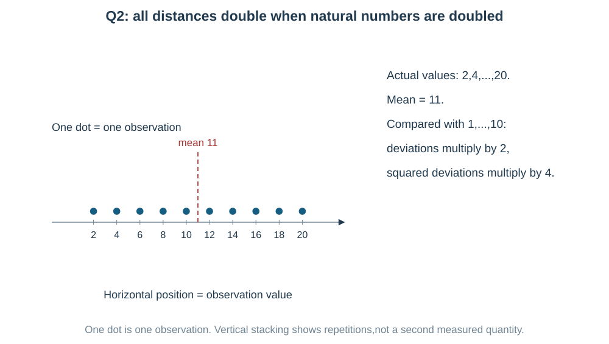

The original variance is $99/12=8.25$, so

$$
\boxed{\sigma_{\rm even}^2=4(8.25)=33}.
$$

**Another possible approach — direct totals:** the even values have mean 11 and sum of squares $4(385)=1540$. Thus

$$
\sigma^2=\frac{1540}{10}-11^2=154-121=33.
$$

The transformation route is quicker because we recognize the whole data set before doing arithmetic.

---

### Question 3 — Standard deviation is the square root of variance

**PDF page 126 | MCQ | Notes: C01,C07**

The standard deviation of the data $2,4,4,4,5,5,7,9$ is

- (a) $4$
- (b) $\sqrt5$
- (c) $2$
- (d) $2.5$

**Count repetitions as separate observations.** The eight values have total 40, so $\bar x=40/8=5$.

Now square each distance from 5:

$$
\begin{array}{c|rrrrrrrr}
x_i&2&4&4&4&5&5&7&9\\ \hline
(x_i-5)^2&9&1&1&1&0&0&4&16
\end{array}
$$

These squares sum to 32. Hence

$$
\sigma^2=\frac{32}{8}=4,
\qquad
\boxed{\sigma=\sqrt4=2;\quad\text{(c)}}.
$$

**Another possible approach:** use $\sum x_i^2=232$. Then variance $=232/8-5^2=29-25=4$, followed by the same square root.

**Check the question's noun:** 4 is the variance. The requested **standard deviation** is 2.

---

### Question 4 — A shift changes the centre; a stretch changes the spread

**PDF page 126 | MCQ | Notes: C09**

The mean and variance of a data set are 6 and 4. Each observation $x$ is replaced by $3x+2$. The mean and variance of the new data are

- (a) $20$ and $12$
- (b) $18$ and $36$
- (c) $20$ and $36$
- (d) $20$ and $38$

**Every observation changes by the same rule $y=3x+2$.** The mean follows that rule:

$$
\bar y=3(6)+2=20.
$$

For spread, subtract the new mean:

$$
y-\bar y=3x+2-20=3(x-6).
$$

So each deviation triples and each squared deviation becomes nine times as large:

$$
\sigma_y^2=9(4)=36.
$$

$$
\boxed{\text{new mean }20,\quad\text{new variance }36;
\quad\text{(c)}}.
$$

**Why applying $3v+2$ is wrong:** variance is built from squared deviations, not from the original value rule. The shift disappears when we subtract the mean.

**Check with a compatible example:** values $4,8$ have mean 6 and variance 4. Their images $14,26$ have mean 20 and variance 36. This illustrates the general rule; it is not a claim that the source data set has only two values.

---

### Question 5 — A larger group contributes more observations

**PDF page 126 | MCQ | Notes: C10**

Two groups of 20 and 30 observations have means 15 and 10 respectively. The mean of the combined group is

- (a) $12.5$
- (b) $12$
- (c) $13$
- (d) $11$

**The groups have different sizes.** A mean stands for a total shared across its group's observations. Recover both totals:

$$
S_A=20(15)=300,\qquad S_B=30(10)=300.
$$

The combined count is 50 and combined sum is 600:

$$
\boxed{\bar x=\frac{300+300}{20+30}=\frac{600}{50}=12;
\quad\text{(b)}}.
$$

**Why $(15+10)/2=12.5$ is not suitable:** it gives the two groups equal weight, even though one contains 30 observations and the other only 20.

**Another possible approach — start from mean 10:** if all 50 observations had mean 10, total would be 500. Group A adds $20(15-10)=100$ above that baseline. Therefore the mean is $10+100/50=12$.

The result is closer to 10, the mean of the larger group.

---

### Question 6 — Combining groups adds spread between their centres

**PDF page 126 | MCQ | Notes: C10**

Two sets each of 10 observations have means 5 and 7 and variances 4 and 6 respectively. The variance of the combined 20 observations is

- (a) $5$
- (b) $6.5$
- (c) $6$
- (d) $7$

**Averaging the two variances alone misses part of the spread.** The observations are also spread because the two group centres are different.

The equal-sized groups have combined mean

$$
\mu=\frac{5+7}{2}=6.
$$

Each group mean is 1 away from 6.

Use the within-group variance plus squared centre offset:

$$
v=\frac{10[4+(5-6)^2]+10[6+(7-6)^2]}{20}.
$$

$$
\boxed{v=\frac{10(5)+10(7)}{20}=6;\quad\text{(c)}}.
$$

**Name the two parts:** average within-group variance $=(4+6)/2=5$; extra between-centre variance $=1$. Together they give 6.

**Another possible approach — combine mean squares:** the groups' mean squares are $4+5^2=29$ and $6+7^2=55$. The combined mean square is $(29+55)/2=42$. Subtract the combined mean's square: $42-6^2=6$.

---

### Question 7 — Remove the wrong reading before inserting the correct one

**PDF page 126 | Numerical value | Notes: C11**

The mean of 20 observations is 10. It was later found that an observation 8 was misread as 12. The correct mean is ____.

**The recorded total contains 12 where it should contain 8.** Start from the total behind the given mean:

$$
S_{\rm recorded}=20(10)=200.
$$

Remove the wrong value and insert the correct one:

$$
S_{\rm correct}=200-12+8=196.
$$

The observation count is still 20:

$$
\boxed{\bar x_{\rm correct}=\frac{196}{20}=9.8}.
$$

**Another quick approach:** the total was 4 too high, so the mean was $4/20=0.2$ too high. Correct mean $=10-0.2=9.8$.

The direction is a useful check: replacing 12 by the smaller 8 must lower the mean.

---

### Question 8 — Mean deviation uses ordinary distances,not signed differences

**PDF page 126 | MCQ | Notes: C05,C06**

The mean deviation about the mean of the data $2,4,6,8,10$ is

- (a) $2.4$
- (b) $2$
- (c) $3$
- (d) $2.8$

**Mean deviation uses ordinary distances from the specified centre.** First find the mean:

$$
\bar x=\frac{2+4+6+8+10}{5}=6.
$$

The absolute deviations are

$$
|2-6|,|4-6|,|6-6|,|8-6|,|10-6|
=4,2,0,2,4.
$$

Thus

$$
\boxed{\operatorname{MD}(\bar x)=\frac{4+2+0+2+4}{5}
=2.4;\quad\text{(a)}}.
$$

**Why signed differences will not work:** $-4-2+0+2+4=0$. That cancellation hides the spread. Squaring the distances would measure variance instead.

**Symmetry check:** distances 4 and 2 each occur twice. Their total is $2(4+2)=12$. Keep the centre's zero-distance observation in the denominator 5.

---

### Question 9 — Find the named centre before measuring distances

**PDF page 126 | MCQ | Notes: C03,C06**

The mean deviation about the median for the observations $3,5,6,8,13$ is

- (a) $2.8$
- (b) $3$
- (c) $2.2$
- (d) $2.6$

**The phrase “about the median” chooses the centre.** The values are already ordered, and the middle third value is 6.

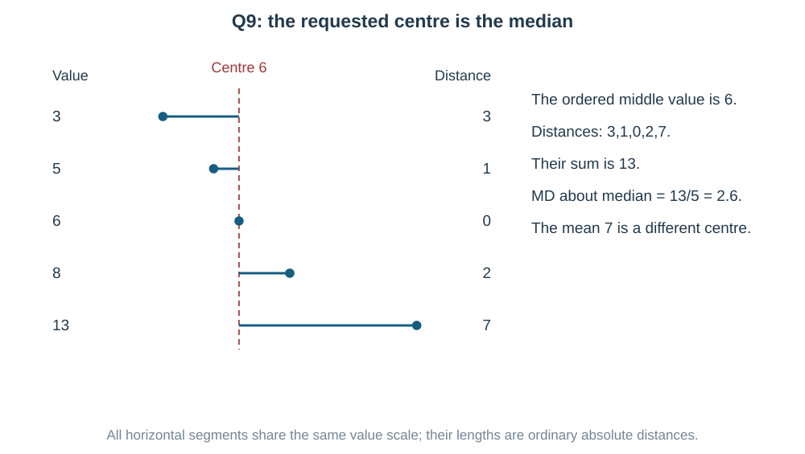

Measure the five ordinary distances from 6:

$$
\operatorname{MD}(M)
=\frac{|3-6|+|5-6|+|6-6|+|8-6|+|13-6|}{5}.
$$

$$
\boxed{\operatorname{MD}(M)=\frac{3+1+0+2+7}{5}
=2.6;\quad\text{(d)}}.
$$

**A tempting different route:** the mean is 7. Distances from 7 would sum to 14, giving $2.8$, option (a). That calculation is valid for MD **about the mean**, but answers a different question.

**Check the connection:** median minimizes total absolute distance, so its value 2.6 should not exceed the value 2.8 obtained about the mean.

---

### Question 10 — Class marks represent the values inside each interval

**PDF page 127 | MCQ | Notes: C01,C02**

For the frequency distribution: class 0–10: 5, 10–20: 8, 20–30: 12, 30–40: 10, 40–50: 5, the mean is

- (a) $25$
- (b) $26.5$
- (c) $25.5$
- (d) $24.5$

**The exact raw observations are not listed.** The grouped-data convention uses each class midpoint: $5,15,25,35,45$.

Their weighted sum and total frequency are

$$
\sum fx=5(5)+8(15)+12(25)+10(35)+5(45)=1020,
$$

$$
N=5+8+12+10+5=40.
$$

Thus

$$
\boxed{\bar x_{\rm grouped}=\frac{1020}{40}=25.5;
\quad\text{(c)}}.
$$

This is the standard midpoint-based mean, generally an estimate for the unknown individual values.

**Another possible approach — assumed mean 25:** the weighted deviations are

$$
5(-20)+8(-10)+12(0)+10(10)+5(20)=20.
$$

Therefore $\bar x=25+20/40=25.5$. This keeps the arithmetic smaller.

---

### Question 11 — Grouped variance uses the given class-mark convention

**PDF page 127 | Numerical value | Notes: C07,C08**

For the same distribution (class 0–10: 5, 10–20: 8, 20–30: 12, 30–40: 10, 40–50: 5, using class marks), the variance is ____.

**The question explicitly says “using class marks.”** Keep the same midpoint mean $\bar x=25.5$, and find the frequency-weighted square total.

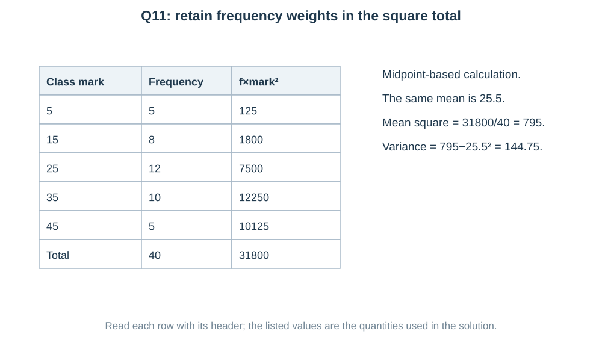

$$
\begin{aligned}
\sum fx^2
&=5(5^2)+8(15^2)+12(25^2)+10(35^2)+5(45^2)\\
&=125+1800+7500+12250+10125=31800.
\end{aligned}
$$

Hence

$$
\boxed{\sigma^2=\frac{31800}{40}-(25.5)^2
=795-650.25=144.75}.
$$

**Another possible approach — small deviations from 25:** here $\sum fd=20$ and

$$
\sum fd^2=5(400)+8(100)+12(0)+10(100)+5(400)=5800.
$$

Thus

$$
\sigma^2=\frac{5800}{40}-\left(\frac{20}{40}\right)^2
=145-0.25=144.75.
$$

The variance is exact for the specified midpoint-representative data. It need not equal the unknown raw-data variance.

---

### Question 12 — Relative consistency compares SD with the mean

**PDF page 127 | MCQ | Notes: C14**

Batch A has mean 50 and SD 10; Batch B has mean 80 and SD 12. Which statement is correct?

- (a) Batch A is more consistent because its SD is smaller
- (b) Batch B is more consistent because its coefficient of variation is smaller
- (c) Both are equally consistent
- (d) Batch A is more consistent because its mean is smaller

**The means differ, so compare spread relative to each mean.** Use the coefficient of variation:

$$
\operatorname{CV}_A=\frac{10}{50}(100\%)=20\%,
\qquad
\operatorname{CV}_B=\frac{12}{80}(100\%)=15\%.
$$

The smaller relative spread belongs to B:

$$
\boxed{\text{Batch B is more consistent because its CV is smaller; (b)}}.
$$

**Why comparing 10 and 12 alone is not enough:** that compares absolute spread. Here B's mean is larger, and its SD is a smaller fraction of that mean.

The comparison uses the standard relative-consistency convention and the given positive means. It does not say B's absolute SD is smaller.

---

### Question 13 — The sum of squares comes from the second moment

**PDF page 127 | Numerical value | Notes: C07,C08**

Five observations have mean $6$ and standard deviation $2$. Then the sum of the squares of the observations is ____.

**A sum of squares suggests the second-moment identity.** First notice the supplied 2 is SD, so the variance is $2^2=4$.

$$
\sigma^2=\frac{\sum x_i^2}{N}-\bar x^2
\quad\Longrightarrow\quad
\sum x_i^2=N(\sigma^2+\bar x^2).
$$

Substitute $N=5,\bar x=6$:

$$
\boxed{\sum x_i^2=5(4+36)=200}.
$$

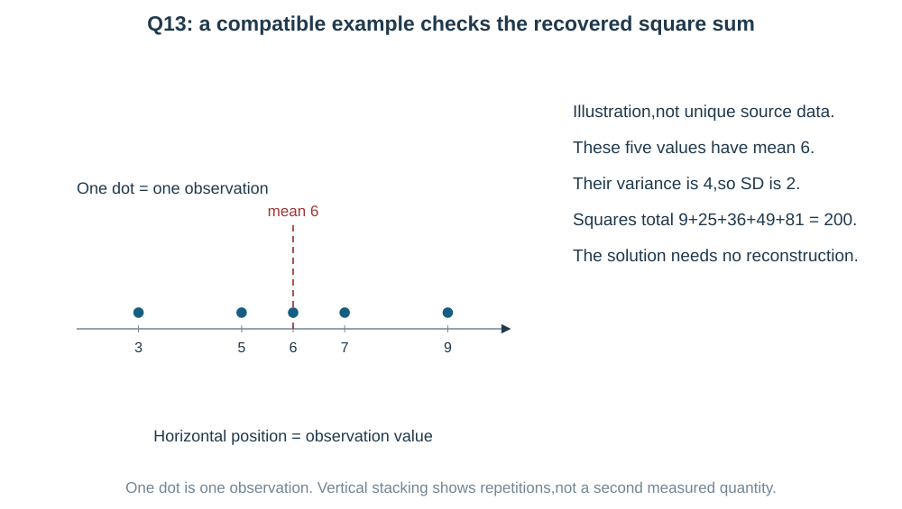

**Why finding all five observations is unnecessary:** many different data sets can share a mean and SD. Their square total is nevertheless fixed by this identity.

**Another possible approach — expand the given squared deviations:** $\sum(x_i-6)^2=5(4)=20$ and $\sum x_i=30$. Therefore

$$
\sum x_i^2-12(30)+5(36)=20,
$$

again giving $\sum x_i^2=200$. The displayed compatible example is a check, not an extra assumption.

---

### Question 14 — The median is found from positions in the ordered data

**PDF page 127 | MCQ | Notes: C03**

The median of the distribution: $x=1,2,3,4,5$ with frequencies $3,5,7,4,1$ respectively is

- (a) $2.5$
- (b) $3.5$
- (c) $2$
- (d) $3$

**Median depends on ordered positions, not which row is in the middle of the printed table.** First count observations:

$$
N=3+5+7+4+1=20.
$$

We need the 10th and 11th values.

$$
\begin{array}{c|rrrrr}
\text{value}&1&2&3&4&5\\ \hline
\text{frequency}&3&5&7&4&1\\
\text{cumulative frequency}&3&8&15&19&20
\end{array}
$$

Only 8 observations have value at most 2; the next 7 have value 3. Thus both middle positions are 3:

$$
\boxed{M=\frac{3+3}{2}=3;\quad\text{(d)}}.
$$

**Another possible approach:** expand the frequency list into 20 ordered observations and mark positions 10 and 11. Cumulative frequency avoids writing all 20.

The tallest bar also happens to be at 3, but tallest frequency is the **mode** rule and does not generally identify a median.

---

### Question 15 — Grouped median interpolates inside the median class

**PDF page 127 | Numerical value | Notes: C03**

For the grouped data class 0–10: 5, 10–20: 8, 20–30: 12, 30–40: 10, 40–50: 5, the median is ____ (correct to two decimal places).

**This is a grouped median estimate.** Half of the 40 observations is 20. The cumulative counts are $5,13,25,35,40$, so the halfway position falls inside class $20$–$30$.

Thirteen observations come before that class. We need $20-13=7$ more within a class containing 12. Travel $7/12$ of its width 10 from its lower boundary 20:

$$
M\approx20+\frac7{12}(10)=\frac{155}{6}.
$$

To two decimal places,

$$
\boxed{M\approx25.83}.
$$

**Another view — read the cumulative graph:** the count rises from 13 at value 20 to 25 at value 30. Linear interpolation at count 20 gives the same fraction $7/12$ along that segment.

The straight segment assumes uniform progress within the class. The interval counts alone do not tell us the exact raw 20th and 21st values. The source asks for this standard grouped estimate.

---

### Question 16 — Triple the observations,nine times the variance

**PDF page 127 | MCQ | Notes: C09,C13**

The variance of the numbers $3,6,9,\ldots,30$ is

- (a) $82.5$
- (b) $66$
- (c) $74.25$
- (d) $99$

**Count the terms before selecting the AP formula.** The values are three times $1,2,\ldots,10$, so there are 10 observations.

Scaling by 3 multiplies variance by $3^2=9$:

$$
\sigma^2=9\left(\frac{10^2-1}{12}\right).
$$

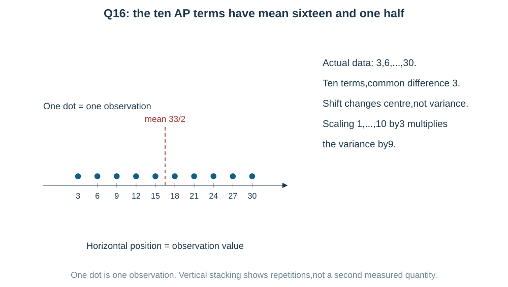

$$
\boxed{\sigma^2=\frac{9\cdot99}{12}=74.25;
\quad\text{(c)}}.
$$

**Another possible approach — direct moments:** mean $=16.5$, and

$$
\sum x_i^2=9(385)=3465.
$$

Thus variance $=3465/10-16.5^2=346.5-272.25=74.25$.

Using 30 as the observation count would confuse the final value with the number of terms.

---

### Question 17 — An unknown frequency changes both the total and its weight

**PDF page 127 | Numerical value | Notes: C01,C02**

The class marks $10,20,30,40$ of a distribution have frequencies $3,x,10,6$ and the mean of the distribution is $25$. Then $x=$ ____.

**Here $x$ is a frequency, not an observation value.** Increasing it adds more copies of value 20, changing both the weighted sum and the total count.

$$
N=3+x+10+6=19+x,
$$

$$
\sum fx=3(10)+x(20)+10(30)+6(40)=570+20x.
$$

Use the given mean:

$$
\frac{570+20x}{19+x}=25
\quad\Longrightarrow\quad
570+20x=475+25x.
$$

$$
\boxed{x=19}.
$$

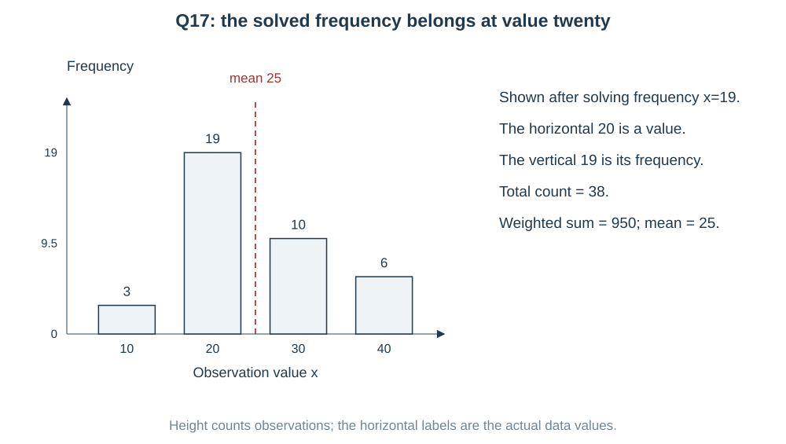

**Another possible approach — deviations from the known mean add to zero:**

$$
3(10-25)+x(20-25)+10(30-25)+6(40-25)=0.
$$

So $-45-5x+50+90=0$, again giving $x=19$. This route uses smaller numbers.

**Check:** $N=38$, sum $=950$, and $950/38=25$. The solved frequency is a valid nonnegative integer.

---

### Question 18 — Use sum and sum of squares to target the product

**PDF page 127 | Numerical value | Notes: C08,C12**

Five observations have mean $4$ and variance $5.2$. If three of them are $1,2,6$ and the other two are $x$ and $y$, then $xy=$ ____.

**The target is $xy$, so look for sums that can produce a product.** Mean gives the total:

$$
1+2+6+x+y=5(4)=20
\quad\Longrightarrow\quad x+y=11.
$$

Variance gives the square total:

$$
\sum x_i^2=5(5.2+4^2)=106.
$$

Subtract the known squares:

$$
x^2+y^2=106-(1+4+36)=65.
$$

**Did you notice the pattern?** $(x+y)^2=x^2+y^2+2xy$. The left side is known from the sum, and the first two right-side terms are known from the variance:

$$
11^2=65+2xy.
$$

$$
\boxed{xy=\frac{121-65}{2}=28}.
$$

**Another possible approach:** set $y=11-x$ in $x^2+y^2=65$:

$$
x^2+(11-x)^2=65
\quad\Longrightarrow\quad x^2-11x+28=0.
$$

The roots are 4 and 7, giving product 28. Finding both roots is useful if the values are asked; the squared-sum identity reaches the requested product sooner here.

**Check:** $1,2,4,6,7$ has mean 4 and variance $106/5-16=5.2$.

---

### Question 19 — Variance follows deviations from the moving mean

**PDF page 127 | MCQ | Notes: C09**

Statement I: The variance of a data set does not change if a constant is added to every observation.

Statement II: If every observation is multiplied by a constant $k$, the variance is multiplied by $k^2$.

Choose the correct option.

- (a) Both Statement I and Statement II are true
- (b) Statement I is true, Statement II is false
- (c) Statement I is false, Statement II is true
- (d) Both Statement I and Statement II are false

**Variance is measured from the current mean, so move the mean along with the data.**

If $y_i=x_i+c$, then $\bar y=\bar x+c$ and

$$
y_i-\bar y=(x_i+c)-(\bar x+c)=x_i-\bar x.
$$

Every deviation stays unchanged. Statement I is true.

If $y_i=kx_i$, then $\bar y=k\bar x$ and

$$
(y_i-\bar y)^2=[k(x_i-\bar x)]^2
=k^2(x_i-\bar x)^2.
$$

Averaging gives $\sigma_y^2=k^2\sigma_x^2$. Statement II is true:

$$
\boxed{\text{Both statements are true; (a)}}.
$$

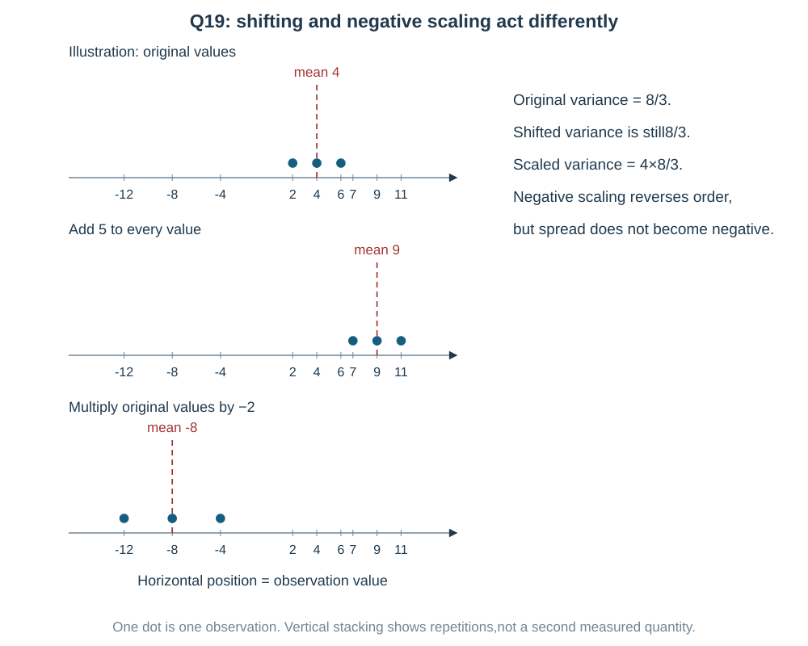

**Check the edge cases:** $k=-2$ multiplies variance by 4, while SD doubles. For $k=0$, all observations become zero and variance becomes zero. Both are consistent with Statement II.

---

### Question 20 — Doubling changes lengths and squared lengths differently

**PDF page 128 | MCQ | Notes: C09,C14**

Each observation of a data set is doubled. Match List-I with List-II.

List-I: A. Mean; B. Variance; C. Coefficient of variation; D. Standard deviation.

List-II: I. unchanged; II. doubled; III. becomes four times; IV. halved.

- (a) A–II, B–II, C–I, D–III
- (b) A–II, B–III, C–I, D–II
- (c) A–III, B–II, C–I, D–II
- (d) A–II, B–III, C–IV, D–I

**Doubling observations doubles their distances, but quadruples their squared distances.**

For $y_i=2x_i$,

$$
\bar y=2\bar x,\qquad
\sigma_y^2=4\sigma_x^2,\qquad
\sigma_y=2\sigma_x.
$$

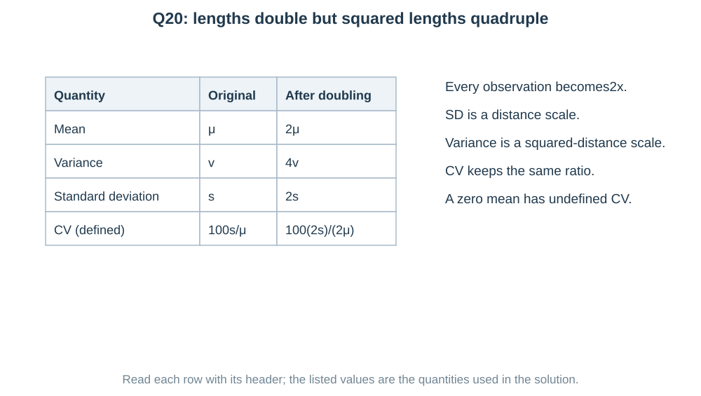

When CV is defined,

$$
\operatorname{CV}_y
=\frac{2\sigma_x}{2\bar x}(100\%)
=\operatorname{CV}_x.
$$

Therefore

$$
\boxed{\text{A–II, B–III, C–I, D–II; (b)}}.
$$

**Check the condition:** a zero mean gives an undefined CV, so no cancellation can create a defined value there. The source uses the usual setting where the coefficient exists.

There are still the same number of observations. Only the values double.

---

### Question 21 — The reference five is not the mean

**PDF page 128 | MCQ | Notes: C08**

For 10 observations, $\sum(x_i-5)=10$ and $\sum(x_i-5)^2=50$. The mean and standard deviation are respectively

- (a) $6$ and $2$
- (b) $6$ and $4$
- (c) $5$ and $\sqrt5$
- (d) $1$ and $2$

**The number 5 is a chosen reference.** It would be the mean only if $\sum(x_i-5)=0$, but the question gives 10.

Put $d_i=x_i-5$. The average reference deviation is

$$
\bar d=\frac{10}{10}=1.
$$

Thus

$$
\bar x=5+\bar d=6.
$$

Shifting all values by 5 does not change variance:

$$
\sigma_x^2=\sigma_d^2
=\frac{50}{10}-1^2=4.
$$

The standard deviation is $\sqrt4=2$:

$$
\boxed{\bar x=6,\quad\sigma=2;\quad\text{(a)}}.
$$

**Why option (c) is tempting:** taking 5 as the mean and $50/10$ as variance forgets to subtract the square of the nonzero average deviation.

**Another possible approach — recover raw totals:** $\sum x_i=50+10=60$. Expanding the square condition gives

$$
50=\sum x_i^2-10(60)+25(10),
$$

so $\sum x_i^2=400$. Variance is $400/10-6^2=4$, with SD 2.

---

### Question 22 — Range is a difference;its coefficient is a ratio

**PDF page 128 | MCQ | Notes: C15**

The maximum and minimum values of a data set are 90 and 10. The coefficient of range is

- (a) $0.5$
- (b) $80$
- (c) $0.8$
- (d) $0.2$

**The coefficient of range is a ratio, not the range itself.** Here the largest value is $L=90$ and the smallest is $S=10$:

$$
\boxed{\frac{L-S}{L+S}
=\frac{90-10}{90+10}
=\frac{80}{100}=0.8;\quad\text{(c)}}.
$$

**Check:** the ordinary range is $90-10=80$, option (b). It carries the original unit. The coefficient is dimensionless because the same unit cancels from numerator and denominator.

For these positive extrema the coefficient must lie between 0 and 1; 80 cannot be that coefficient.

---

### Question 23 — The number of observations must be a positive integer

**PDF page 128 | Numerical value | Notes: C13**

If the variance of the first $n$ natural numbers is $10$, then $n=$ ____.

**The entire collection is fixed by its count $n$: $1,2,\ldots,n$.** Use its variance formula:

$$
\frac{n^2-1}{12}=10.
$$

Therefore

$$
n^2-1=120,\qquad n^2=121.
$$

An observation count must be positive:

$$
\boxed{n=11}.
$$

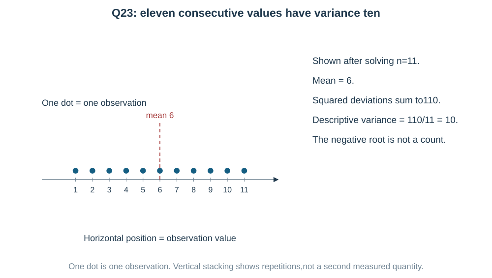

**Check directly:** mean of $1,\ldots,11$ is 6. Squared deviations are

$$
25,16,9,4,1,0,1,4,9,16,25,
$$

with total 110. Dividing by 11 gives variance 10.

The algebraic root $-11$ is rejected by the meaning of $n$, not by guessing a sign.

---

### Question 24 — Replacing one value updates the sum without changing the count

**PDF page 128 | MCQ | Notes: C11**

The mean of 10 observations is 12. If one observation 20 is replaced by 8, the new mean is

- (a) $10.2$
- (b) $10.8$
- (c) $11.2$
- (d) $10$

**Only one value is replaced, so the count stays 10.** The original sum is $10(12)=120$. Remove 20 and insert 8:

$$
S_{\rm new}=120-20+8=108.
$$

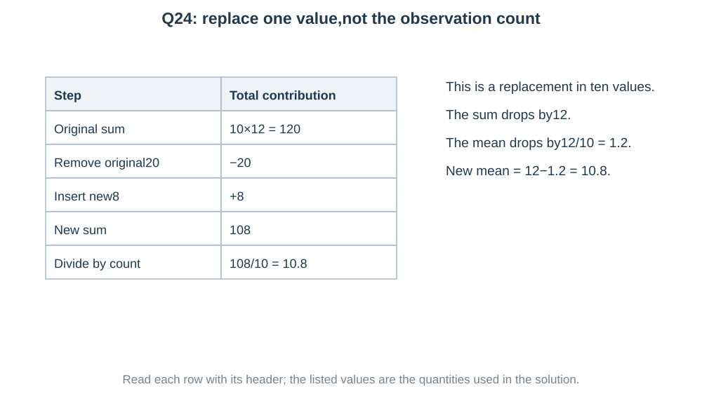

$$
\boxed{\bar x_{\rm new}=\frac{108}{10}=10.8;
\quad\text{(b)}}.
$$

**Another quick approach:** the value decreases by $20-8=12$, so the mean decreases by $12/10=1.2$. Thus $12-1.2=10.8$.

We do not need the other nine observations because their total contribution has not changed.

---

### Question 25 — Squared and absolute distances choose different centres

**PDF page 128 | MCQ | Notes: C05,C07,C09**

Which of the following statements is correct?

(i) The sum of squares of deviations of observations is least when taken about the mean.

(ii) The sum of absolute deviations of observations is least when taken about the median.

(iii) Standard deviation can be negative.

(iv) Variance is independent of the unit of measurement.

- (a) (i), (ii) and (iii) only
- (b) (ii) and (iv) only
- (c) (i) and (iv) only
- (d) (i) and (ii) only

**The four statements compare different meanings of spread.** The picture helps, but we need reasons that apply to every finite data set.

**(i) Squared deviations are least about the mean.** For any candidate centre $a$,

$$
\begin{aligned}
\sum(x_i-a)^2
&=\sum[(x_i-\bar x)+(\bar x-a)]^2\\
&=\sum(x_i-\bar x)^2
+2(\bar x-a)\underbrace{\sum(x_i-\bar x)}_{0}
+N(\bar x-a)^2\\
&=\sum(x_i-\bar x)^2+N(\bar x-a)^2.
\end{aligned}
$$

The last term is nonnegative and vanishes at $a=\bar x$. So (i) is true.

**(ii) Absolute deviations are least about a median.** Pair the smallest with the largest observation, then the next-smallest with the next-largest. For each pair $u\le v$,

$$
|u-a|+|v-a|\ge v-u,
$$

with equality when $u\le a\le v$. A median lies inside every such paired interval. For an odd count, choosing its middle value also gives zero distance for the unpaired observation. Therefore a median reaches the least total absolute distance. Statement (ii) is true.

For an even count, every point between the two middle values works; uniqueness is not claimed.

**(iii)** SD is the nonnegative square root of variance. It cannot be negative. False.

**(iv)** If values in metres are rewritten in centimetres, each value multiplies by 100 and variance multiplies by $100^2=10000$. It carries squared units, so it is not independent of measurement units. False.

Thus

$$
\boxed{\text{Only (i) and (ii) are correct; (d)}}.
$$

**Useful connection:** in the illustrative graph, the mean $10/3$ minimizes $\sum(x_i-a)^2$, while median 2 minimizes $\sum|x_i-a|$. Changing the distance rule can change the best centre; the two centre rules are not interchangeable.

## Answer check

Read the qualifications in the solutions before using the key.

| Question | Answer | Question | Answer |
|---|---|---|---|
| 1 | (a) | 14 | (d) |
| 2 | $33$ | 15 | $25.83$ |
| 3 | (c) | 16 | (c) |
| 4 | (c) | 17 | $19$ |
| 5 | (b) | 18 | $28$ |
| 6 | (c) | 19 | (a) |
| 7 | $9.8$ | 20 | (b) |
| 8 | (a) | 21 | (a) |
| 9 | (d) | 22 | (c) |
| 10 | (c) | 23 | $11$ |
| 11 | $144.75$ | 24 | (b) |
| 12 | (b) | 25 | (d) |
| 13 | $200$ |  |  |

## After this chapter

Keep meaning beside each symbol: mean is a shared total, median is an ordered middle, mode is most frequent, MD averages ordinary distances, variance averages squared distances, and SD returns to the original unit. Use total-sum and square-sum patterns before reconstructing missing observations. All alternative explanations remain visible for the later booklet. The supplied problems are JEE Main-style practice, not verified actual PYQs.
