# Chapter 25 — Trigonometric Functions and Equations

**Kanna, an angle tells us how far a ray has turned.** Sine and cosine tell us the vertical and horizontal coordinates of a point on a circle. Start with this picture; the identities will then connect to something you can see.

Your target remains **200 marks: Physics 60, Maths 60, Chemistry 80**. Here, accurate signs, domains and angle counting matter as much as remembering formulas.

## Recent chapter weightage

| Year | Distinct questions in the checked combined archive scope | Full-year shifts | Questions per shift |
|---|---:|---:|---:|
| 2024 | 15 | 20 | 0.75 |
| 2025 | 12 | 19 | 0.63 |
| 2026 | 18 | 19 | 0.95 |
| Total | 45 | 58 | **0.78** |

This combines ExamSIDE's **Trigonometric Ratio and Identities** and **Trigonometric Equations** categories. Their saved recent IDs have no overlap. PYQSide's broader Trigonometric Functions category gives 15,12,19; the one-question difference in 2026 is disclosed rather than silently averaged.

These are archive-tag counts, not a new official classification of every paper. The 2024 format offered more optional numerical questions. A mean does not guarantee a question in one shift. No measured formula-frequency ranking is claimed.

The current official unit names trigonometric functions and identities. We also solve all supplied equations and inequalities as applications. An archive's category badge does not replace the official wording. **Important for JEE Main:** circle signs, identities, attainable ranges, branch-safe equations and graphs. These tools also support Calculus and Inverse Trigonometry.

## Concept C01 — Degrees, radians and a full turn

A full turn is $360^\circ$. It is also $2\pi$ **radians**. A radian measures an angle using arc length:

$$
\boxed{\theta=\frac{\text{arc length}}{\text{radius}}},
\qquad
\boxed{180^\circ=\pi\text{ radians}}.
$$

For a circle of radius $r$, an angle $\theta$ in radians gives arc length $r\theta$ and sector area $\frac12r^2\theta$.

$$
\boxed{\theta_{\rm rad}=\theta_{\rm degree}\frac{\pi}{180}},
\qquad
\boxed{\theta_{\rm degree}=\theta_{\rm rad}\frac{180}{\pi}}.
$$

Thus $30^\circ=\pi/6$, $45^\circ=\pi/4$, $60^\circ=\pi/3$, $90^\circ=\pi/2$. One radian is about $57.3^\circ$, much larger than $1^\circ$.

**Read the notation:** $\sin30^\circ$ uses degrees; $\sin30$ ordinarily means 30 radians. In calculus formulas and the graphs here, angles use radians unless a degree mark is shown.

## Concept C02 — What sine, cosine and tangent actually measure

Draw a circle of radius 1. Start at $(1,0)$ and turn anticlockwise through $\theta$. The new point is

$$
\boxed{P=(\cos\theta,\sin\theta)}.
$$

Cosine is its **signed horizontal coordinate**; sine is its **signed vertical coordinate**. Signed means left/below can be negative. They are numbers, not new arrows.

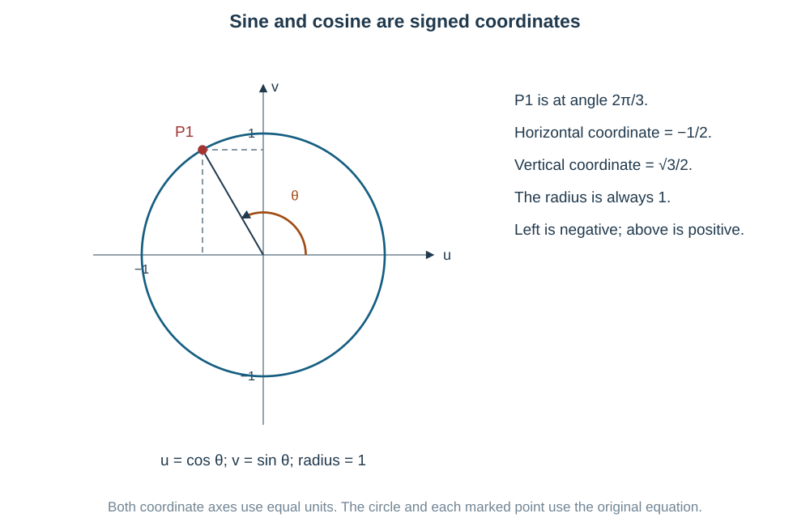

**Read the picture:** the horizontal projection falls left of the origin, so cosine is negative. The vertical coordinate is above the origin, so sine is positive. The radius stays 1.

For an acute angle in a right triangle, divide both legs by its hypotenuse:

$$
\sin\theta=\frac{\text{opposite leg}}{\text{hypotenuse}},
\quad
\cos\theta=\frac{\text{adjacent leg}}{\text{hypotenuse}},
\quad
\tan\theta=\frac{\text{opposite leg}}{\text{adjacent leg}}.
$$

The **adjacent** leg touches the angle; the **opposite** leg faces it. The hypotenuse faces the right angle and is the longest side.

On the circle,

$$
\boxed{\tan\theta=\frac{\sin\theta}{\cos\theta}},
\quad
\cot\theta=\frac{\cos\theta}{\sin\theta},
\quad
\sec\theta=\frac1{\cos\theta},
\quad
\csc\theta=\frac1{\sin\theta}.
$$

A zero denominator makes the expression undefined. Do not write $\tan(\pi/2)=\infty$ as an ordinary real value.

## Concept C03 — Waves, domains, ranges and periods

As the point moves, its height makes the sine wave and its horizontal coordinate makes the cosine wave.

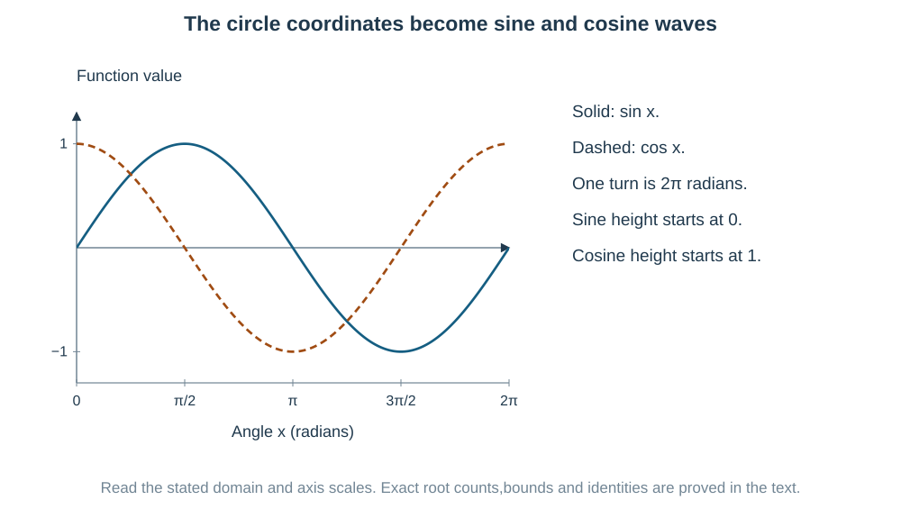

**Read the axes:** the horizontal coordinate is the angle, not the circle's horizontal coordinate. The vertical coordinate is a function value. At angle zero, sine starts at 0 and cosine at 1.

| Function | Real inputs excluded | Range | Fundamental period |
|---|---|---|---|
| $\sin x$ | none | $[-1,1]$ | $2\pi$ |
| $\cos x$ | none | $[-1,1]$ | $2\pi$ |
| $\tan x$ | $\pi/2+n\pi$ | $\mathbb R$ | $\pi$ |
| $\cot x$ | $n\pi$ | $\mathbb R$ | $\pi$ |
| $\sec x$ | $\pi/2+n\pi$ | $(-\infty,-1]\cup[1,\infty)$ | $2\pi$ |
| $\csc x$ | $n\pi$ | $(-\infty,-1]\cup[1,\infty)$ | $2\pi$ |

Here $n\in\mathbb Z$ means any integer, positive,zero or negative.

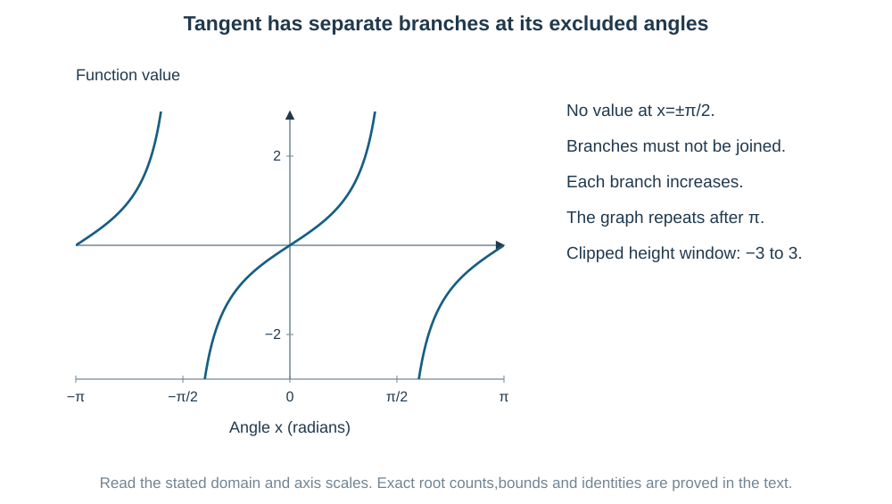

Never connect a graph through an undefined input. On each interval between its gaps, tangent increases.

Useful monotonic intervals:

$$
\sin x\text{ increases on }[-\pi/2,\pi/2],\qquad
\cos x\text{ decreases on }[0,\pi].
$$

Sine does not increase on all of $[0,\pi]$: after $\pi/2$ it comes down. Use reflection $\sin(\pi-x)=\sin x$ when comparing two angles on opposite sides of the peak.

## Concept C04 — Signs, symmetry and related angles

Divide a full turn into four quadrants:

| Quadrant | Angle in one turn | Sine | Cosine | Tangent |
|---|---|---|---|---|
| I | $(0,\pi/2)$ | $+$ | $+$ | $+$ |
| II | $(\pi/2,\pi)$ | $+$ | $-$ | $-$ |
| III | $(\pi,3\pi/2)$ | $-$ | $-$ | $+$ |
| IV | $(3\pi/2,2\pi)$ | $-$ | $+$ | $-$ |

Axis angles are checked separately. A coordinate can be zero there.

Reflection in the horizontal axis changes only height:

$$
\sin(-x)=-\sin x,\quad
\cos(-x)=\cos x,\quad
\tan(-x)=-\tan x.
$$

Half-turn and complementary-angle connections:

$$
\begin{aligned}
\sin(\pi-x)&=\sin x,&\cos(\pi-x)&=-\cos x,\\
\sin(\pi+x)&=-\sin x,&\cos(\pi+x)&=-\cos x,\\
\sin(\pi/2-x)&=\cos x,&\cos(\pi/2-x)&=\sin x.
\end{aligned}
$$

Adding $2n\pi$ leaves sine and cosine unchanged; adding $n\pi$ leaves tangent unchanged where defined. Use circle signs to reconstruct identities rather than guessing a sign.

## Concept C05 — Angle addition and subtraction

Rotating through $A$ and then $B$ is one rotation through $A+B$. Its coordinates give

$$
\boxed{\sin(A\pm B)=\sin A\cos B\pm\cos A\sin B},
$$

$$
\boxed{\cos(A\pm B)=\cos A\cos B\mp\sin A\sin B}.
$$

The minus sign in $\cos(A+B)$ matters. For $A=B=\pi/2$, it must give $\cos\pi=-1$.

Dividing sine by cosine gives

$$
\boxed{\tan(A\pm B)=\frac{\tan A\pm\tan B}{1\mp\tan A\tan B}},
$$

when the displayed tangents and denominator are defined. If the denominator is zero, examine the angle with sine/cosine rather than forcing a finite fraction.

**Recognition:** an expression such as $\cos A\cos B-\sin A\sin B$ is already one cosine of a sum. Do not expand it into more pieces.

**Useful special-angle route:** $15^\circ=45^\circ-30^\circ$ gives

$$
\sin15^\circ=\frac{\sqrt6-\sqrt2}{4},
\quad
\cos15^\circ=\frac{\sqrt6+\sqrt2}{4},
\quad
\tan15^\circ=2-\sqrt3.
$$

## Concept C06 — The circle identity and polynomial substitutions

The point lies on the unit circle, so Pythagoras gives

$$
\boxed{\sin^2x+\cos^2x=1}.
$$

Here $\sin^2x$ means $(\sin x)^2$, not $\sin(x^2)$.

Dividing by the appropriate nonzero square gives

$$
\boxed{1+\tan^2x=\sec^2x},
\qquad
\boxed{1+\cot^2x=\csc^2x}.
$$

When only even powers appear, try

$$
t=\sin^2x\in[0,1],\qquad \cos^2x=1-t.
$$

For example,

$$
\sin^2x+\cos^4x=t+(1-t)^2
=\left(t-\frac12\right)^2+\frac34.
$$

The square gives a lower bound; the interval $0\le t\le1$ also gives an upper bound. Never optimize the polynomial over all real $t$ when it represents a restricted trigonometric value.

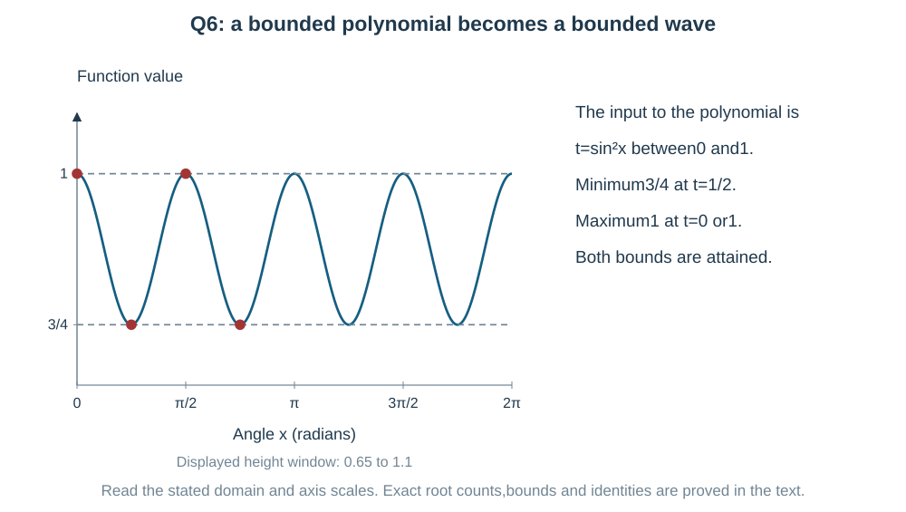

For $s=\sin x$, use $s\in[-1,1]$. This range decides whether an algebraic root corresponds to a real angle.

## Concept C07 — One shifted wave: amplitude and range

For real $a,b$, let $R=\sqrt{a^2+b^2}>0$. Choose $\phi$ so that $\cos\phi=a/R$, $\sin\phi=b/R$. Then

$$
\boxed{a\sin x+b\cos x=R\sin(x+\phi)}.
$$

The **amplitude** $R$ is the distance from the middle height to a peak:

$$
\boxed{-R\le a\sin x+b\cos x\le R}.
$$

Both bounds are attained when $x$ can vary over a full turn. Adding a constant $c$ shifts the middle:

$$
\boxed{\text{range of }a\sin x+b\cos x+c=[c-R,c+R]}.
$$

If $a=b=0$, the function is constant $c$. A restricted angle interval may prevent a peak from being reached; check its domain.

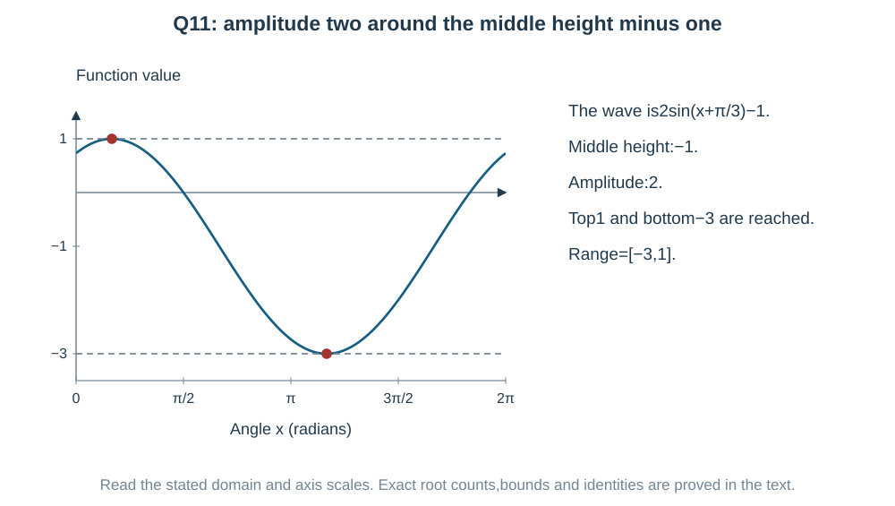

For $\sqrt3\cos x+\sin x$, use $2\cos(x-\pi/6)$. Expand your chosen shifted wave once to check the sign.

**Why adding separate maxima can fail:** sine and cosine cannot both be 1 at the same angle. Their coordinates obey a shared circle constraint.

## Concept C08 — Double, triple and half angles

Set $A=B=x$ in addition formulas:

$$
\boxed{\sin2x=2\sin x\cos x},
$$

$$
\boxed{\cos2x=\cos^2x-\sin^2x
=1-2\sin^2x=2\cos^2x-1},
$$

$$
\boxed{\tan2x=\frac{2\tan x}{1-\tan^2x}}.
$$

Choose the cosine form that leaves the fewest different functions.

Power reduction:

$$
\boxed{\sin^2x=\frac{1-\cos2x}{2}},
\qquad
\boxed{\cos^2x=\frac{1+\cos2x}{2}}.
$$

Triple angles:

$$
\sin3x=3\sin x-4\sin^3x,\quad
\cos3x=4\cos^3x-3\cos x,
$$

$$
\tan3x=\frac{3t-t^3}{1-3t^2},\qquad t=\tan x,
$$

with tangent-domain checks. Square-root half-angle forms need the actual quadrant sign:

$$
\sin\frac x2=\pm\sqrt{\frac{1-\cos x}{2}},
\quad
\cos\frac x2=\pm\sqrt{\frac{1+\cos x}{2}}.
$$

Where the fractions exist,

$$
\boxed{\tan\frac x2=\frac{\sin x}{1+\cos x}
=\frac{1-\cos x}{\sin x}}.
$$

If $t=\tan(x/2)$ is finite,

$$
\boxed{\sin x=\frac{2t}{1+t^2}},\quad
\boxed{\cos x=\frac{1-t^2}{1+t^2}},\quad
\tan x=\frac{2t}{1-t^2}.
$$

This substitution omits $x=(2n+1)\pi$, where $t$ is undefined. Check those angles separately in the original equation. The last tangent formula also needs $t\ne\pm1$.

## Concept C09 — Turn sums into products,and products into sums

These identities come from adding or subtracting the angle-addition formulas:

$$
\boxed{\sin A+\sin B
=2\sin\frac{A+B}{2}\cos\frac{A-B}{2}},
$$

$$
\sin A-\sin B=2\cos\frac{A+B}{2}\sin\frac{A-B}{2},
$$

$$
\cos A+\cos B=2\cos\frac{A+B}{2}\cos\frac{A-B}{2},
$$

$$
\boxed{\cos A-\cos B
=-2\sin\frac{A+B}{2}\sin\frac{A-B}{2}}.
$$

Product forms:

$$
2\sin A\sin B=\cos(A-B)-\cos(A+B),
$$

$$
2\cos A\cos B=\cos(A-B)+\cos(A+B),
$$

$$
2\sin A\cos B=\sin(A+B)+\sin(A-B).
$$

**Did you notice the clue?** Angles in an arithmetic pattern, such as $x,3x,5x$, have a middle angle. Pair the outside terms:

$$
\sin x+\sin5x=2\sin3x\cos2x.
$$

The whole sum becomes $\sin3x(1+2\cos2x)$. A product is useful for finding zeros because **either factor** can be zero.

For a numerical product, the opposite direction may be shorter. Pair $12^\circ,48^\circ$ because their sum is $60^\circ$ and difference is $36^\circ$.

## Concept C10 — Standard values and the 18° family

The $45^\circ$ triangle has legs $1,1$ and hypotenuse $\sqrt2$. The $30^\circ$–$60^\circ$ triangle has side ratio $1:\sqrt3:2$.

| Angle | $0$ | $\pi/6$ | $\pi/4$ | $\pi/3$ | $\pi/2$ |
|---|---|---|---|---|---|
| $\sin$ | $0$ | $1/2$ | $1/\sqrt2$ | $\sqrt3/2$ | $1$ |
| $\cos$ | $1$ | $\sqrt3/2$ | $1/\sqrt2$ | $1/2$ | $0$ |
| $\tan$ | $0$ | $1/\sqrt3$ | $1$ | $\sqrt3$ | undefined |

**Useful for exact-value JEE Main problems:**

$$
\sin18^\circ=\frac{\sqrt5-1}{4},\qquad
\cos36^\circ=\frac{\sqrt5+1}{4}.
$$

They are connected. Put $u=\sin18^\circ$. Since $\sin54^\circ=\cos36^\circ$,

$$
3u-4u^3=1-2u^2,
$$

$$
(u-1)(4u^2+2u-1)=0.
$$

The angle is acute and less than $30^\circ$, so $0<u<1/2$. This selects $u=(\sqrt5-1)/4$; $u=1$ is rejected. Then $\cos36^\circ=1-2u^2$ gives the second value.

Other useful values follow, rather than needing separate memory:

$$
\cos72^\circ=\sin18^\circ,\quad
\sin54^\circ=\cos36^\circ,\quad
\sin^236^\circ=\frac{5-\sqrt5}{8},\quad
\sin^272^\circ=\frac{5+\sqrt5}{8}.
$$

Use positive square roots for these acute angles. Values at $15^\circ,75^\circ$ follow from $45^\circ\mp30^\circ$.

## Concept C11 — Telescoping and doubling products

**Telescoping** means adjacent terms cancel, leaving only the ends. From product-to-sum,

$$
2\sin a\cos((2j-1)a)
=\sin(2ja)-\sin((2j-2)a).
$$

Adding from $j=1$ to $n$ gives

$$
\boxed{\sum_{j=1}^n\cos((2j-1)a)
=\frac{\sin(2na)}{2\sin a}},\qquad \sin a\ne0.
$$

More generally, for $\sin(d/2)\ne0$,

$$
\sum_{j=0}^{n-1}\sin(a+jd)
=\frac{\sin(nd/2)}{\sin(d/2)}
\sin\left(a+\frac{(n-1)d}{2}\right),
$$

$$
\sum_{j=0}^{n-1}\cos(a+jd)
=\frac{\sin(nd/2)}{\sin(d/2)}
\cos\left(a+\frac{(n-1)d}{2}\right).
$$

If $d=2k\pi$, the terms repeat identically; add $n$ copies instead of dividing by zero.

**Doubling-angle product:** repeated use of $\sin2a=2\sin a\cos a$ gives

$$
\boxed{\cos a\cos2a\cdots\cos(2^{m-1}a)
=\frac{\sin(2^ma)}{2^m\sin a}},\qquad\sin a\ne0.
$$

The clue is $a,2a,4a,8a$, not equally spaced angles. If $\sin a=0$, evaluate the original cosine factors directly.

## Concept C12 — Equations: all angle families,then the interval

An identity is true for every input where defined. An equation asks **which** inputs work.

For real $\alpha$ and integer $n$,

$$
\boxed{\sin x=\sin\alpha
\iff x=n\pi+(-1)^n\alpha},
$$

or equivalently $x=\alpha+2n\pi$ or $x=\pi-\alpha+2n\pi$.

$$
\boxed{\cos x=\cos\alpha
\iff x=2n\pi\pm\alpha},
$$

$$
\boxed{\tan x=\tan\alpha
\iff x=n\pi+\alpha},
$$

with both tangent expressions defined. In particular,

$$
\sin x=0\Rightarrow x=n\pi,\quad
\cos x=0\Rightarrow x=\pi/2+n\pi.
$$

If $\sin x=c$ or $\cos x=c$ with $|c|>1$, there is no real solution.

**Four steps:** keep the original domain; factor or reduce the equation; list all valid angle families; retain distinct angles inside the required interval.

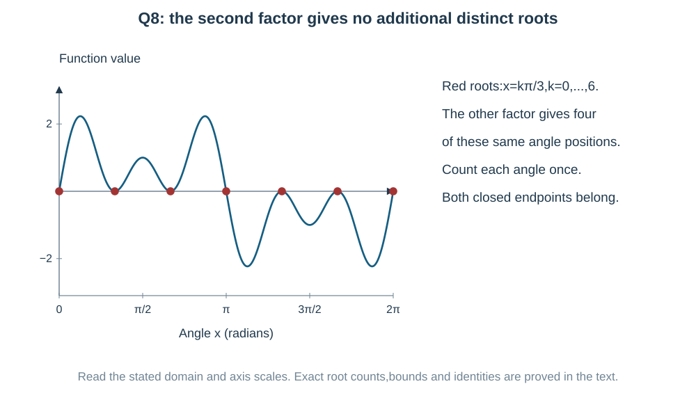

For $[0,2\pi]$, both endpoints are included and are different real numbers. A root that appears in two factor families is counted only once.

**Do not divide by a factor that might be zero.** In

$$
\cos x(2\sin x-1)=0,
$$

dividing by $\cos x$ loses the $\cos x=0$ solutions.

Clearing a denominator is allowed only after noting its nonzero condition. Squaring can add roots, so check the original equation.

## Concept C13 — Inequalities,modulus and parameter restrictions

For a polynomial in $\cos x$, first solve for $c=\cos x$ within $[-1,1]$. Then read the cosine graph.

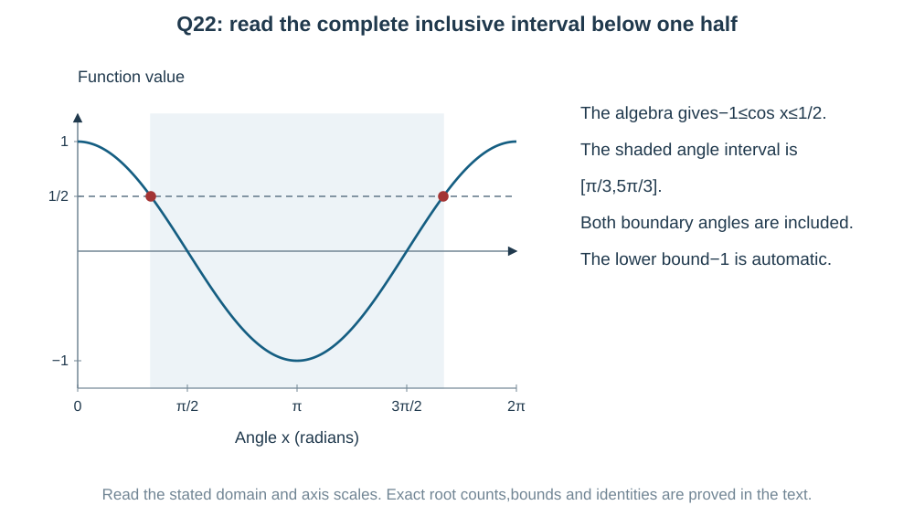

Here $(2c-1)(c+1)\le0$ gives $-1\le c\le1/2$. The graph gives $x\in[\pi/3,5\pi/3]$.

**Modulus is ordinary distance from zero:**

$$
|u|=\begin{cases}u,&u\ge0,\\-u,&u<0.\end{cases}
$$

Its graph reflects any negative part above the axis. Thus $|\cos x|\ge0$. An equation $|\cos x|=\sin x$ first requires $\sin x\ge0$. Squaring alone forgets this sign.

**Parameter clue:** if algebra gives $\sin x=(k-4)/2$, existence of a real angle means

$$
-1\le\frac{k-4}{2}\le1.
$$

Solve this range condition before counting integer $k$. Endpoints are valid when sine reaches $\pm1$.

## Concept C14 — Maxima,minima and equality conditions

**Cauchy–Schwarz — important for JEE Main:**

$$
\boxed{(a\sin x+b\cos x)^2
\le(a^2+b^2)(\sin^2x+\cos^2x)=a^2+b^2}.
$$

For the maximum $+\sqrt{a^2+b^2}$, the coordinates $(\sin x,\cos x)$ must point in the same direction as $(a,b)$. The opposite direction gives the minimum. This explains the amplitude,including **when equality occurs**.

**AM–GM — important for JEE Main:** for positive $u,v$,

$$
u+v\ge2\sqrt{uv},
$$

with equality exactly when $u=v$. For $t>0$ and $A,B>0$,

$$
\boxed{At+\frac Bt\ge2\sqrt{AB}},
\qquad t=\sqrt{\frac BA}\text{ at equality}.
$$

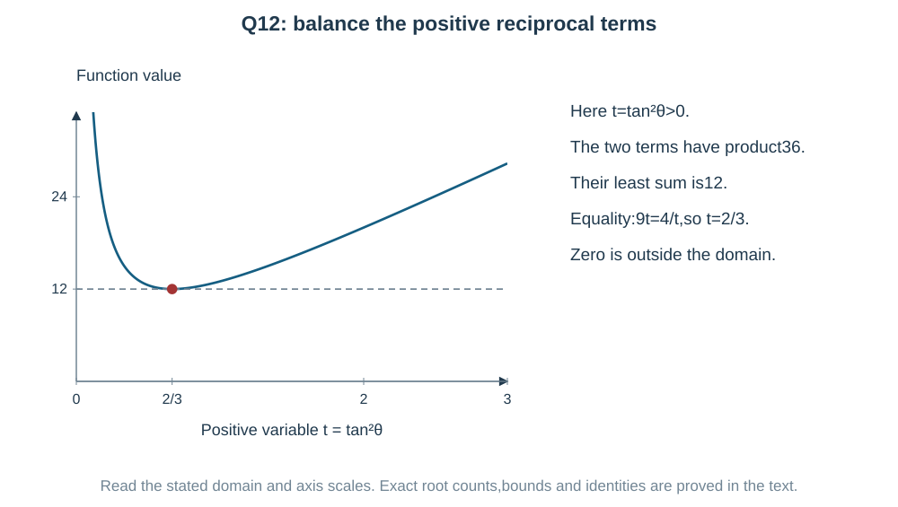

A bound is not automatically the answer: the equality value must be allowed. Here $t=\tan^2\theta$ can be any positive value,so $t=2/3$ is attainable.

Completing a square is often better for a quadratic. On a closed interval,check whether its vertex lies inside and compare the relevant endpoints for a maximum.

## Concept C15 — Symmetric sums: calculate only the target

Put $s=\sin x,c=\cos x$. We know $s^2+c^2=1$. Therefore

$$
(s+c)^2=1+2sc,\qquad
\boxed{sc=\frac{(s+c)^2-1}{2}}.
$$

Also,

$$
\boxed{s^3+c^3=(s+c)(1-sc)},\qquad
s^4+c^4=1-2s^2c^2.
$$

**Did you notice the pattern?** A given sum plus the circle identity already determines the product. That product then gives a cube or fourth-power sum. Finding the individual angle is unnecessary.

If $\tan A,\tan B$ are roots of $az^2+bz+c=0$, Viète gives their sum $-b/a$ and product $c/a$. Use

$$
\tan(A+B)=\frac{\tan A+\tan B}{1-\tan A\tan B}.
$$

Then use the actual angle interval to select the answer. Tangent equality alone determines an angle only up to multiples of $\pi$.

## Concept C16 — Transcendental roots: graph first,prove the count

Sometimes an equation mixes a wave and a line,like $\sin x=x/10$. There is no useful elementary formula for its nonzero roots.

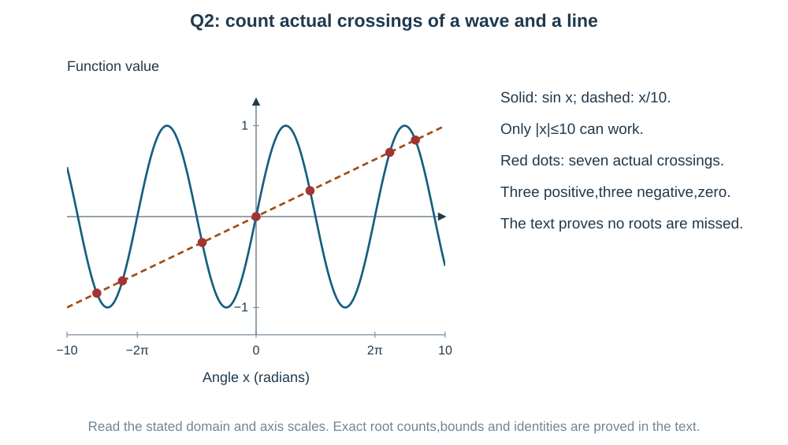

The graph suggests the crossings. The proof needs more:

1. $|\sin x|\le1$ gives $|x|\le10$,so nothing outside this window can work.
2. Odd symmetry pairs every positive root with one negative root.
3. Signs and the shape on each positive hump establish the number of positive crossings.
4. Count zero once.

For $g(x)=\sin x-x/10$, $g''(x)=-\sin x<0$ on a positive sine hump. The slope decreases there. This **strict concavity**,meaning the curve bends downward,prevents extra hidden crossings; Q2 develops the argument.

A sampled plot alone cannot prove the full root count. Conversely,searching for exact decimal roots is unnecessary when only the count is asked.

## Concept C17 — Periods: repeating and the smallest repeat

A positive period $T$ means $f(x+T)=f(x)$ for every allowed input,with the domain preserved. The **fundamental period** is the smallest positive one,if it exists.

For nonzero real $a$,

$$
T_{\sin(ax+b)}=T_{\cos(ax+b)}=\frac{2\pi}{|a|},
\qquad
T_{\tan(ax+b)}=\frac{\pi}{|a|}.
$$

The shift $b$ moves the wave horizontally; it does not change its period. Squaring or taking modulus can shorten it:

$$
T_{\sin^2x}=T_{\cos^2x}=T_{|\sin x|}=T_{|\cos x|}=\pi.
$$

A common period of two summands is a period of their sum. It need not always be fundamental: $\sin x-\sin x=0$ is constant and has every positive period.

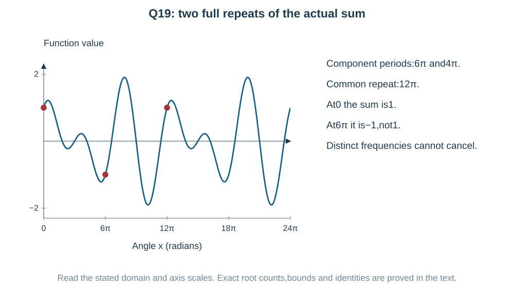

For $\sin(x/3)+\cos(x/2)$,the two nonzero distinct frequencies do not cancel. A period must preserve both frequencies. One rigorous reason is that sine and cosine at different nonzero frequencies are linearly independent: their coefficients in an identity cannot cancel each other. This can be checked by differentiating twice to separate the two frequencies. Thus

$$
T/3=2m\pi,\quad T/2=2n\pi,
$$

so the smallest positive common value is $T=12\pi$. For sums,check frequency cancellation before using an LCM shortcut.

## Last-minute formula recap

| Visible clue | Recall and condition |
|---|---|
| Circle coordinates | $(\cos x,\sin x)$; $\sin^2x+\cos^2x=1$ |
| Quotients | $\tan=\sin/\cos$, $\sec=1/\cos$; keep nonzero denominators |
| Angle sum | $\sin(A+B)=\sin A\cos B+\cos A\sin B$; $\cos(A+B)=\cos A\cos B-\sin A\sin B$ |
| Tangent sum | $(u+v)/(1-uv)$; restore the angle branch |
| Double angle | $\sin2x=2sc$, $\cos2x=1-2s^2=2c^2-1$ |
| Power reduction | $\sin^2x=(1-\cos2x)/2$, $\cos^2x=(1+\cos2x)/2$ |
| Triple angle | $\sin3x=3s-4s^3$, $\cos3x=4c^3-3c$ |
| Half-angle parameter | $\sin x=2t/(1+t^2)$, $\cos x=(1-t^2)/(1+t^2)$; check omitted odd multiples of $\pi$ |
| Symmetric angles | $\sin A+\sin B=2\sin((A+B)/2)\cos((A-B)/2)$ |
| Numerical sine product | $2\sin A\sin B=\cos(A-B)-\cos(A+B)$ |
| Doubling cosine product | $\prod_{j=0}^{m-1}\cos(2^ja)=\sin(2^ma)/(2^m\sin a)$ when $\sin a\ne0$ |
| One wave | $a\sin x+b\cos x+c$ has full-turn range $[c-R,c+R]$, $R=\sqrt{a^2+b^2}$ |
| Positive reciprocal pair | $At+B/t\ge2\sqrt{AB}$ for $t,A,B>0$; verify equality is allowed |
| Polynomial in sine/cosine | solve algebra,then enforce $[-1,1]$ |
| Modulus equation | keep sign before squaring; reflect negative graph parts |
| General sine equation | $x=\alpha+2n\pi$ or $\pi-\alpha+2n\pi$ |
| General cosine/tangent | cosine $2n\pi\pm\alpha$; tangent $n\pi+\alpha$ where defined |
| Root counting | keep domain,endpoints,all zero factors; remove repeated roots |
| Period | find a common repeat,then check if it is the smallest; cancellation matters |

Keep important equalities with their conditions. A short formula that loses a valid root or admits an undefined angle is not a safe shortcut.

## Worked solutions to the 30 PDF questions

Read the question first. Notice the pattern, choose a route, then calculate. Alternative methods below are fully visible.

### Question 1 — Pair the angles before multiplying

**PDF page 130 | MCQ | Notes: C05,C09,C10**

The value of $\sin12^\circ\sin48^\circ\sin54^\circ$ is

- (a) $\frac1{16}$
- (b) $\frac{\sqrt3}{8}$
- (c) $\frac18$
- (d) $\frac14$

**Did you notice two useful pairs?** $12^\circ+48^\circ=60^\circ$ and $48^\circ-12^\circ=36^\circ$. Also $\sin54^\circ=\cos36^\circ$. These connections are more useful than finding three separate decimal sine values.

Let $c=\cos36^\circ$. Product-to-sum gives

$$
2\sin12^\circ\sin48^\circ
=\cos36^\circ-\cos60^\circ=c-\frac12.
$$

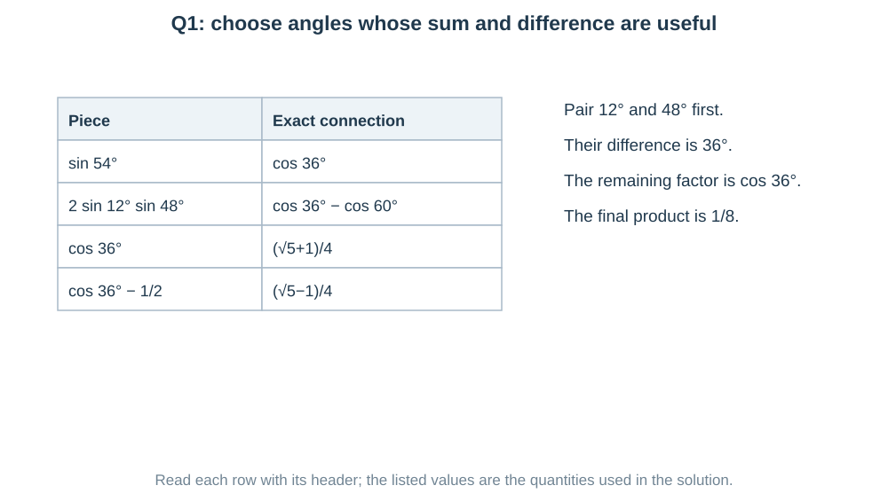

Thus the required product is $\frac12c(c-\frac12)$. From the notes,

$$
c=\frac{\sqrt5+1}{4},\qquad
c-\frac12=\frac{\sqrt5-1}{4}.
$$

Therefore

$$
\boxed{\frac12\frac{(\sqrt5+1)(\sqrt5-1)}{16}
=\frac12\frac4{16}=\frac18;\quad\text{(c)}}.
$$

**Check:** all three original angles are acute,so the product is positive. The product-to-sum step contributes a factor $1/2$; do not lose it.

---

### Question 2 — Count crossings rather than search for exact roots

**PDF page 130 | Numerical value | Notes: C03,C16**

The number of real solutions of the equation $\sin x=\frac{x}{10}$ is ____.

**This asks for a count,not exact root values.** Visualize intersections of $y=\sin x$ and $y=x/10$. Since $|\sin x|\le1$, every root must satisfy $|x|\le10$.

Put $g(x)=\sin x-x/10$. It is odd: $g(-x)=-g(x)$. Thus positive roots have negative partners,and zero is a root.

For $x>0$,the line is positive,so only positive sine humps can contain roots:

1. **On $(0,\pi)$:** $g(0)=0$, $g'(0)=9/10>0$, and $g(\pi)=-\pi/10<0$. Also $g''=-\sin x<0$,so the slope decreases strictly. The curve first rises,then falls,and crosses zero exactly once after its maximum.
2. **On $(\pi,2\pi)$:** sine is nonpositive while the line is positive,so there is no root.
3. **On $(2\pi,3\pi)$:** both endpoints have $g<0$,but

$$
g(5\pi/2)=1-\frac\pi4>0.
$$

On this hump the slope again decreases strictly,from $9/10$ to $-11/10$. There is one maximum,one crossing before it and one after it: exactly two roots.

4. **On $(3\pi,10]$:** sine is negative because $3\pi<10<4\pi$,so there is no root.

There are $1+2=3$ positive roots. Hence

$$
\boxed{3+3+1=7}.
$$

**Why the picture alone is insufficient:** a coarse plot can hide crossings. The domain bound,signs and decreasing slope establish that none are missed. Numerically finding all six nonzero roots would be longer and would not by itself prove completeness.

---

### Question 3 — Change a tangent into sine divided by cosine

**PDF page 130 | MCQ | Notes: C02,C09**

The value of $\tan20^\circ+4\sin20^\circ$ is

- (a) $\sqrt3$
- (b) $\frac{\sqrt3}{2}$
- (c) $2\sqrt3$
- (d) $1$

**Tangent is a quotient.** Start with a common denominator:

$$
\tan20^\circ+4\sin20^\circ
=\frac{\sin20^\circ+4\sin20^\circ\cos20^\circ}{\cos20^\circ}.
$$

The product suggests a double angle:

$$
4\sin20^\circ\cos20^\circ=2\sin40^\circ.
$$

Now group the numerator as $(\sin20^\circ+\sin40^\circ)+\sin40^\circ$:

$$
\sin20^\circ+\sin40^\circ
=2\sin30^\circ\cos10^\circ
=\cos10^\circ=\sin80^\circ.
$$

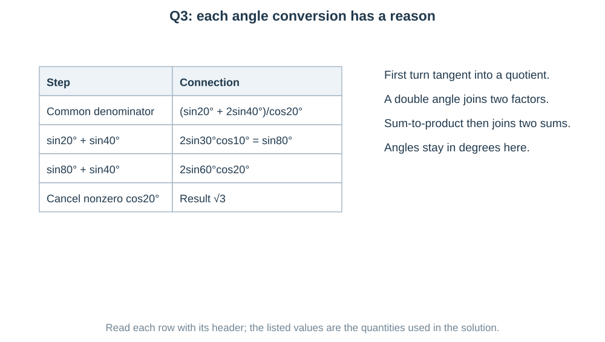

One more sum-to-product step gives

$$
\sin80^\circ+\sin40^\circ
=2\sin60^\circ\cos20^\circ
=\sqrt3\cos20^\circ.
$$

Since $\cos20^\circ\ne0$,

$$
\boxed{\frac{\sqrt3\cos20^\circ}{\cos20^\circ}
=\sqrt3;\quad\text{(a)}}.
$$

**Pattern to keep:** converting tangent to a quotient reveals a product; converting that product to a double angle reveals a pair of sine sums. This route avoids complicated exact individual values at $20^\circ$.

---

### Question 4 — A quadratic in sine gives several angle positions

**PDF page 130 | MCQ | Notes: C06,C12**

The sum of all solutions of $2\cos^2x+3\sin x=3$ in $[0,2\pi]$ is

- (a) $\pi$
- (b) $2\pi$
- (c) $\frac{5\pi}{2}$
- (d) $\frac{3\pi}{2}$

**There are two functions,but the circle identity can leave only one.** Put $s=\sin x$ and use $\cos^2x=1-s^2$:

$$
2(1-s^2)+3s=3
\quad\Longrightarrow\quad
2s^2-3s+1=(2s-1)(s-1)=0.
$$

Thus $\sin x=1/2$ or $\sin x=1$.

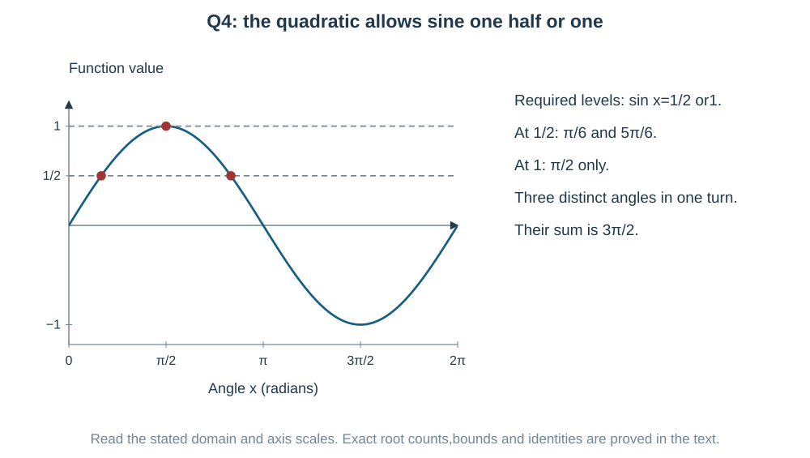

In $[0,2\pi]$,

$$
\sin x=\frac12\Rightarrow x=\frac\pi6,\frac{5\pi}6,
\qquad
\sin x=1\Rightarrow x=\frac\pi2.
$$

Neither endpoint is a solution. Add the three distinct angles:

$$
\boxed{\frac\pi6+\frac\pi2+\frac{5\pi}6
=\frac{3\pi}{2};\quad\text{(d)}}.
$$

**Check:** substituting either sine value into the reduced equation works. One algebraic sine root can give two angles; count angles,not just polynomial roots.

---

### Question 5 — A cube sum is already hidden in the given sum

**PDF page 130 | Numerical value | Notes: C06,C15**

If $\sin\theta+\cos\theta=\frac12$, then $16(\sin^3\theta+\cos^3\theta)$ equals ____.

**The target is a cube sum.** It suggests

$$
s^3+c^3=(s+c)^3-3sc(s+c),
\qquad s=\sin\theta,\ c=\cos\theta.
$$

We already know $s+c=1/2$ and $s^2+c^2=1$. Square the given sum to find the missing product:

$$
\frac14=(s+c)^2=1+2sc
\quad\Longrightarrow\quad sc=-\frac38.
$$

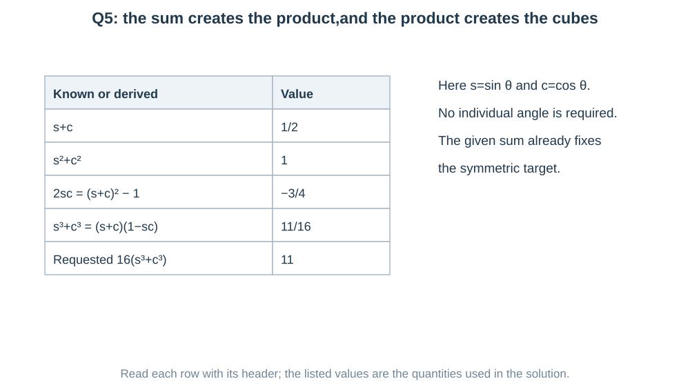

Now

$$
s^3+c^3=(s+c)(s^2-sc+c^2)
=\frac12\left(1+\frac38\right)=\frac{11}{16}.
$$

$$
\boxed{16(s^3+c^3)=11}.
$$

**Another possible approach:** use $(1/2)^3-3(-3/8)(1/2)=1/8+9/16=11/16$ directly.

Solving for $\theta$ creates unnecessary branches. The symmetric target needs only the sum and product.

---

### Question 6 — The variable sin squared lives only between zero and one

**PDF page 130 | MCQ | Notes: C06,C14**

Consider the function $f(x)=\sin^2x+\cos^4x$.

Statement I: The minimum value of $f(x)$ is $\frac34$.

Statement II: The maximum value of $f(x)$ is $1$.

Choose the correct option.

- (a) Statement I is true and Statement II is false
- (b) Both Statement I and Statement II are true
- (c) Statement I is false and Statement II is true
- (d) Both Statement I and Statement II are false

**Only even powers occur.** Use $t=\sin^2x$,so $0\le t\le1$ and $\cos^4x=(1-t)^2$:

$$
f=t+(1-t)^2=t^2-t+1
=\left(t-\frac12\right)^2+\frac34.
$$

The square is nonnegative. Its minimum zero occurs at $t=1/2$,which is possible at $x=\pi/4$. Thus the minimum is $3/4$.

For $t\in[0,1]$, $|t-1/2|\le1/2$. Therefore

$$
f\le\frac14+\frac34=1.
$$

This maximum occurs at $t=0$ or 1,for example $x=0$ or $\pi/2$.

$$
\boxed{\text{Both statements are true; (b)}}.
$$

**Another view:** the quadratic in $t$ opens upward. Its vertex is inside the allowed interval; its two endpoints give the maximum. Optimizing over unrestricted real $t$ would incorrectly suggest there is no finite maximum.

---

### Question 7 — Combine sine and cosine into one shifted wave

**PDF page 130 | MCQ | Notes: C07,C12**

The general solution of $\sqrt3\cos\theta+\sin\theta=\sqrt2$ is ($n\in\mathbb Z$)

- (a) $\theta=2n\pi\pm\frac\pi4-\frac\pi6$
- (b) $\theta=2n\pi\pm\frac\pi4+\frac\pi6$
- (c) $\theta=n\pi+(-1)^n\frac\pi4+\frac\pi6$
- (d) $\theta=2n\pi\pm\frac\pi3+\frac\pi4$

**The coefficient ratio matches $30^\circ$.** From cosine subtraction,

$$
2\cos(\theta-\pi/6)
=2\left(\frac{\sqrt3}{2}\cos\theta+\frac12\sin\theta\right)
=\sqrt3\cos\theta+\sin\theta.
$$

Thus

$$
\cos(\theta-\pi/6)=\frac{\sqrt2}{2}=\cos\frac\pi4.
$$

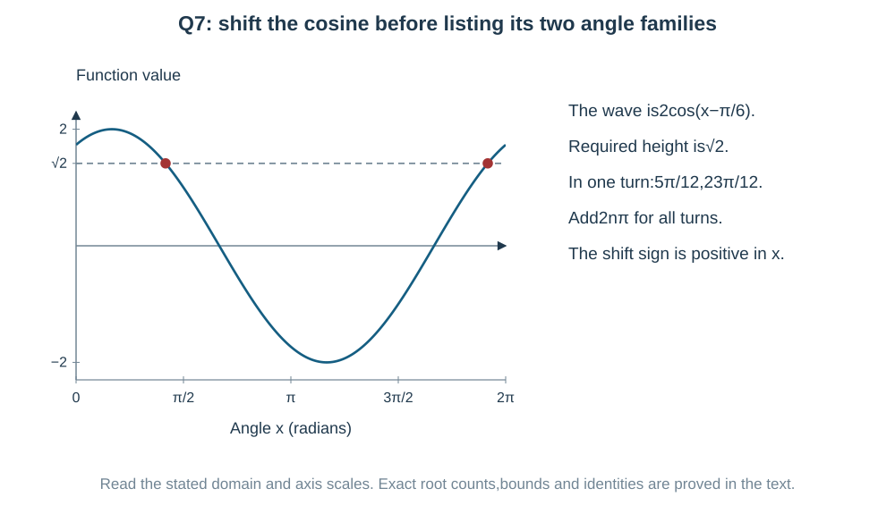

Cosine has two families:

$$
\theta-\frac\pi6=2n\pi\pm\frac\pi4.
$$

$$
\boxed{\theta=2n\pi\pm\frac\pi4+\frac\pi6,\quad n\in\mathbb Z;\quad\text{(b)}}.
$$

**Check the shift:** $\theta=5\pi/12$ makes $\theta-\pi/6=\pi/4$. A minus sign in the final shift would not undo the subtraction.

The mixed $n\pi+(-1)^n\alpha$ family belongs to a sine equation; use the family for the function actually obtained.

---

### Question 8 — Factor without deleting the zero factor

**PDF page 130 | Numerical value | Notes: C09,C12**

The number of solutions of $\sin x+\sin3x+\sin5x=0$ in $[0,2\pi]$ is ____.

**The angles $x,3x,5x$ have middle angle $3x$.** Pair the outside terms:

$$
\sin x+\sin5x=2\sin3x\cos2x.
$$

Therefore

$$
\sin3x(1+2\cos2x)=0.
$$

First factor:

$$
\sin3x=0\Rightarrow x=\frac{k\pi}{3},
\qquad k=0,1,\ldots,6.
$$

These are seven angles,including both endpoints. Second factor:

$$
\cos2x=-\frac12
\Rightarrow x=\frac\pi3,\frac{2\pi}3,\frac{4\pi}3,\frac{5\pi}3.
$$

All four are already in the seven-angle list. Hence

$$
\boxed{7}.
$$

**Why dividing by $\sin3x$ is unsafe:** it would remove the entire first family. **Why adding $7+4$ is wrong:** an angle solving both factors is still one solution. This is a union of root sets,not a sum of their sizes.

---

### Question 9 — Special angles can be reconstructed

**PDF page 131 | MCQ | Notes: C05,C10**

Match List-I with List-II.

List-I: A. $\sin18^\circ$; B. $\cos36^\circ$; C. $\sin15^\circ$; D. $\tan15^\circ$.

List-II: I. $\frac{\sqrt5-1}{4}$; II. $\frac{\sqrt5+1}{4}$; III. $\frac{\sqrt6-\sqrt2}{4}$; IV. $2-\sqrt3$.

- (a) A-II, B-I, C-III, D-IV
- (b) A-I, B-II, C-IV, D-III
- (c) A-I, B-III, C-II, D-IV
- (d) A-I, B-II, C-III, D-IV

**Recognize the two angle families.** $18^\circ,36^\circ$ belong to the connected values derived in C10. $15^\circ$ is $45^\circ-30^\circ$.

$$
\sin18^\circ=\frac{\sqrt5-1}{4}\quad\text{(I)},\qquad
\cos36^\circ=\frac{\sqrt5+1}{4}\quad\text{(II)}.
$$

For the other two,

$$
\sin15^\circ
=\frac1{\sqrt2}\frac{\sqrt3}{2}
-\frac1{\sqrt2}\frac12
=\frac{\sqrt6-\sqrt2}{4}\quad\text{(III)},
$$

$$
\tan15^\circ
=\frac{1-1/\sqrt3}{1+1/\sqrt3}
=2-\sqrt3\quad\text{(IV)}.
$$

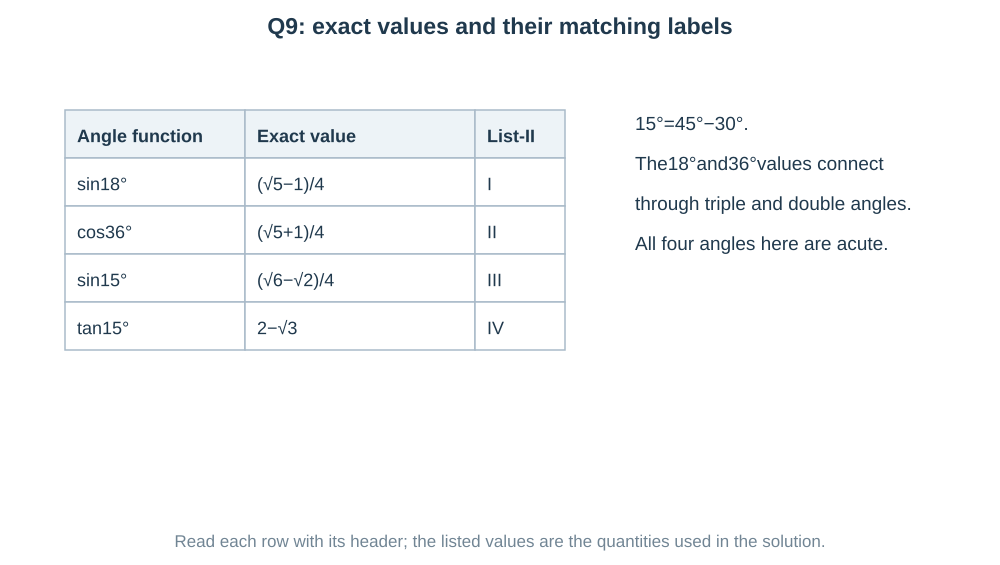

$$
\boxed{\text{A–I, B–II, C–III, D–IV; (d)}}.
$$

**Check:** $\sin18^\circ<1/2$ but $\cos36^\circ>1/2$,so the first two radicals cannot be exchanged.

---

### Question 10 — Double angles turn squares into a useful cancellation

**PDF page 131 | Numerical value | Notes: C08,C09**

The value of $4(\sin^210^\circ+\sin^250^\circ+\sin^270^\circ)$ is ____.

**Squares of sines suggest double angles.** Let the inner sum be $S$. Then

$$
S=\frac32-\frac12\left(\cos20^\circ+\cos100^\circ+\cos140^\circ\right).
$$

The difficult-looking angles are reflections:

$$
\cos100^\circ=-\cos80^\circ,\qquad
\cos140^\circ=-\cos40^\circ.
$$

Also,

$$
\cos40^\circ+\cos80^\circ
=2\cos60^\circ\cos20^\circ=\cos20^\circ.
$$

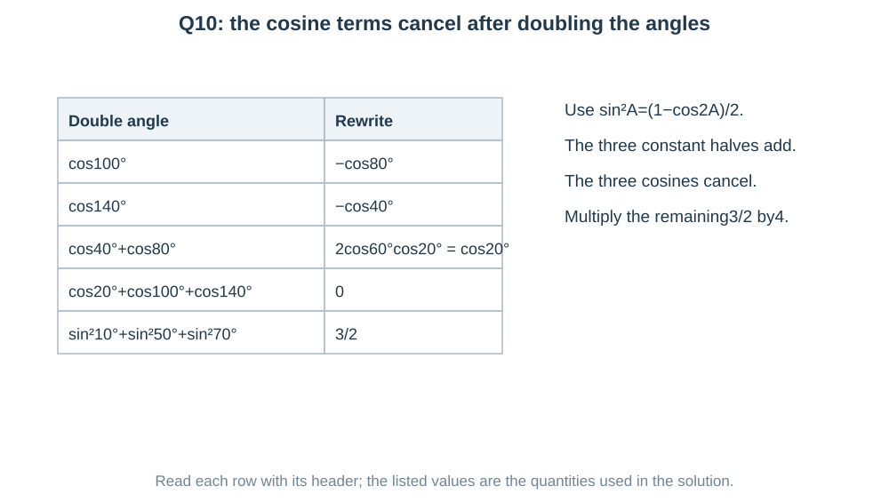

So the bracket is zero and $S=3/2$:

$$
\boxed{4S=4\left(\frac32\right)=6}.
$$

**Route choice:** separate decimal evaluations work approximately,but hide an exact cancellation. Power reduction exposes that cancellation in a few steps.

---

### Question 11 — Read amplitude and vertical shift separately

**PDF page 131 | MCQ | Notes: C07**

The range of $f(x)=\sin x+\sqrt3\cos x-1$ is

- (a) $[-3,1]$
- (b) $[-2,2]$
- (c) $[-1,3]$
- (d) $[-3,3]$

**Combine the linked sine and cosine before finding a range.**

$$
\sin x+\sqrt3\cos x
=2\sin(x+\pi/3).
$$

Hence

$$
f(x)=2\sin(x+\pi/3)-1.
$$

Since sine takes every value in $[-1,1]$,

$$
-3\le f(x)\le1.
$$

Both endpoints occur: the maximum at $x=\pi/6$ and minimum at $x=7\pi/6$.

$$
\boxed{[-3,1];\quad\text{(a)}}.
$$

**Another possible approach:** Cauchy–Schwarz gives $|\sin x+\sqrt3\cos x|\le\sqrt{1+3}=2$,with attainable equality.

Adding the separate upper bounds $1+\sqrt3$ is too loose: sine and cosine cannot reach their individual maxima together.

---

### Question 12 — Reciprocal positive terms suggest AM–GM

**PDF page 131 | MCQ | Notes: C14**

The minimum value of $9\tan^2\theta+4\cot^2\theta$ is

- (a) $6$
- (b) $13$
- (c) $12$
- (d) $24$

**The reciprocal pair has a fixed product.** The original expression needs both sine and cosine nonzero. Thus $t=\tan^2\theta>0$ and $\cot^2\theta=1/t$.

$$
9\tan^2\theta+4\cot^2\theta=9t+\frac4t.
$$

AM–GM gives

$$
9t+\frac4t\ge2\sqrt{9t\cdot4/t}=12.
$$

Equality requires $9t=4/t$,so $t^2=4/9$ and the positive solution is $t=2/3$. This is an allowed squared tangent.

$$
\boxed{12;\quad\text{(c)}}.
$$

**Another possible approach:**

$$
9t+\frac4t-12
=\left(3\sqrt t-\frac2{\sqrt t}\right)^2\ge0.
$$

The same equality condition follows. A lower bound becomes the actual minimum only after checking it can be reached.

---

### Question 13 — Check the largest possible value before solving

**PDF page 131 | MCQ | Notes: C07,C14**

Assertion (A): The equation $\sin x+\cos x=\sqrt3$ has no real solution.

Reason (R): The maximum value of $\sin x+\cos x$ is $\sqrt2$.

Choose the correct option.

- (a) Both A and R are true but R is not the correct explanation of A
- (b) A is true but R is false
- (c) A is false but R is true
- (d) Both A and R are true and R is the correct explanation of A

**Before trying to solve,ask whether the required height can be reached.**

$$
\sin x+\cos x=\sqrt2\sin(x+\pi/4)\le\sqrt2.
$$

The maximum $\sqrt2$ is attained at $x=\pi/4$. But $\sqrt3>\sqrt2$.

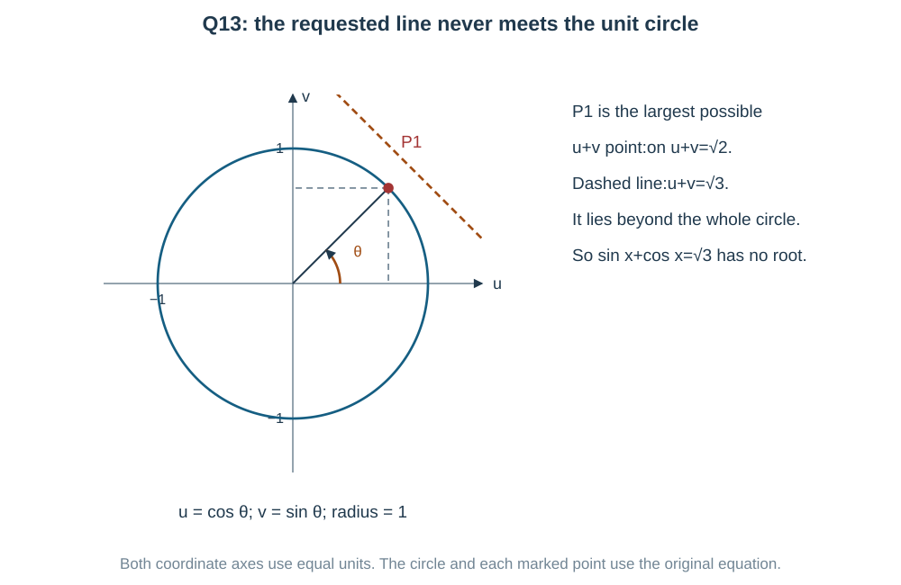

Thus $\sin x+\cos x=\sqrt3$ has no real solution. Both A and R are true,and R gives the reason:

$$
\boxed{\text{(d)}}.
$$

**Another possible approach — Cauchy–Schwarz:** $(\sin x+\cos x)^2\le(1+1)(\sin^2x+\cos^2x)=2$. A supposed value $\sqrt3$ would have square 3,which is impossible.

Squaring the original equation and solving for an angle is unnecessary once the attainable range rules it out.

---

### Question 14 — A sign condition chooses the quadrant

**PDF page 131 | MCQ | Notes: C04,C12**

The common solution (for $n\in\mathbb Z$) of $\tan\theta=-1$ and $\cos\theta=\frac1{\sqrt2}$ is

- (a) $\theta=2n\pi+\frac{3\pi}{4}$
- (b) $\theta=2n\pi+\frac{7\pi}{4}$
- (c) $\theta=n\pi-\frac\pi4$
- (d) $\theta=2n\pi+\frac\pi4$

**Tangent alone gives two quadrants;the cosine sign chooses one.** Since $\cos\theta>0$ and $\tan\theta=\sin\theta/\cos\theta<0$,sine must be negative. We need quadrant IV.

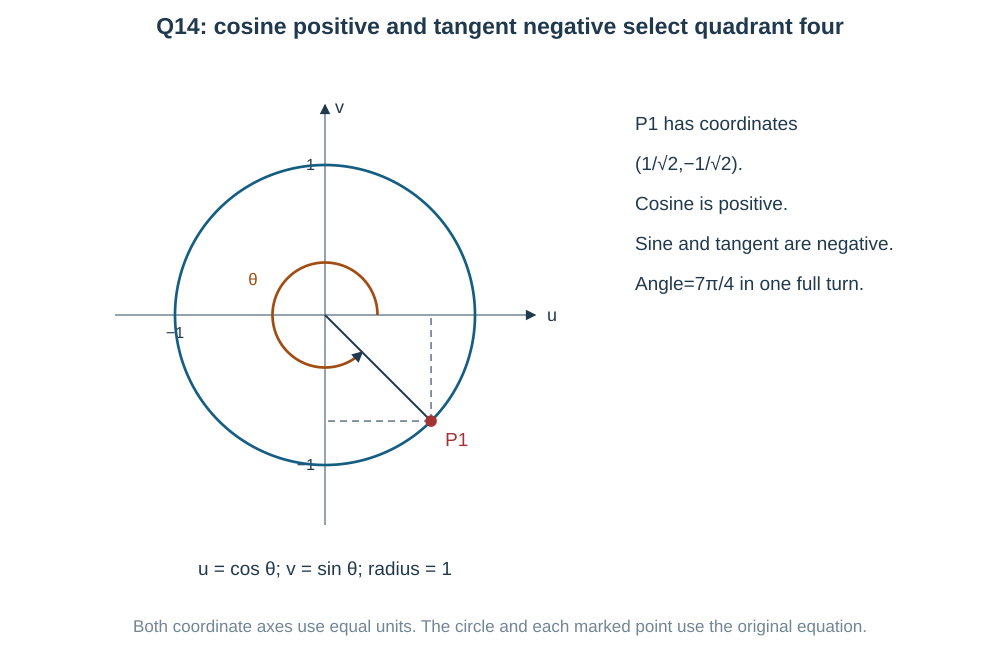

The reference angle is $\pi/4$,because $|\tan\theta|=1$. In one turn,

$$
\theta=2\pi-\pi/4=\frac{7\pi}{4}.
$$

$$
\boxed{\theta=2n\pi+\frac{7\pi}{4},\quad n\in\mathbb Z;\quad\text{(b)}}.
$$

**Another possible approach:** $\cos\theta=1/\sqrt2$ gives $\theta=2n\pi\pm\pi/4$. Test the tangent sign: retain $-\pi/4$,equivalent to $7\pi/4$ modulo $2\pi$.

The family $n\pi-\pi/4$ also contains quadrant-II angles with negative cosine,so it is too large.

---

### Question 15 — An algebraic root must still be a valid sine

**PDF page 131 | Numerical value | Notes: C06,C13**

The number of integer values of $k$ for which the equation $k\sin x+\cos2x=2k-7$ has a solution is ____.

**A real angle needs a sine in $[-1,1]$.** Put $s=\sin x$ and $\cos2x=1-2s^2$:

$$
ks+1-2s^2=2k-7
\quad\Longrightarrow\quad
2s^2-ks+2k-8=0.
$$

The polynomial has a useful factor:

$$
(s-2)(2s-k+4)=0.
$$

The root $s=2$ is impossible for real sine. The other root is $s=(k-4)/2$.

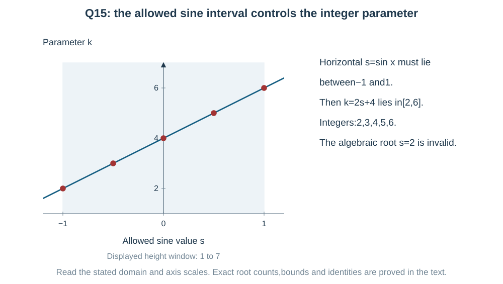

Therefore existence is exactly

$$
-1\le\frac{k-4}{2}\le1
\iff 2\le k\le6.
$$

$$
\boxed{k=2,3,4,5,6:\quad5\text{ integers}}.
$$

**Check sufficiency:** every value in $[-1,1]$ is reached by sine. Hence every listed $k$ really gives an angle,not just an algebraic candidate. In particular the endpoints $k=2,6$ are allowed.

---

### Question 16 — Multiply to make a telescoping sine chain

**PDF page 131 | MCQ | Notes: C09,C11**

The value of $\cos\frac\pi7+\cos\frac{3\pi}7+\cos\frac{5\pi}7$ is

- (a) $0$
- (b) $\frac14$
- (c) $\frac12$
- (d) $-\frac12$

**The odd multiples $a,3a,5a$ suggest a telescoping sum.** Here $a=\pi/7$. Multiply the requested sum $S$ by $2\sin a$,which is nonzero:

$$
\begin{aligned}
2\sin a\,S
&=\sin2a+(\sin4a-\sin2a)+(\sin6a-\sin4a)\\
&=\sin6a.
\end{aligned}
$$

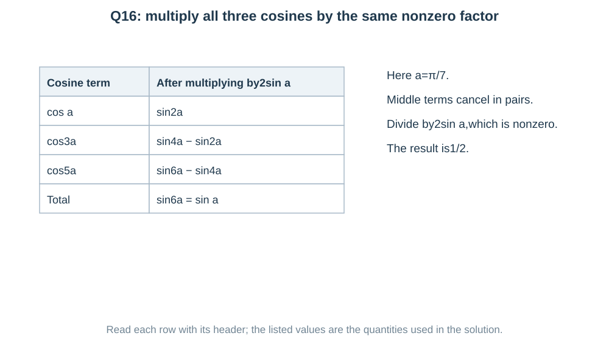

Since $6a=\pi-a$, $\sin6a=\sin a$. Therefore

$$
\boxed{S=\frac{\sin a}{2\sin a}=\frac12;\quad\text{(c)}}.
$$

**Another view:** use the odd-multiple cosine-sum formula from C11 with $n=3$. The displayed cancellation explains why that compact formula works.

---

### Question 17 — Use the triangle to get tan beta first

**PDF page 131 | MCQ | Notes: C02,C05**

Let $\alpha,\beta$ be acute angles with $\tan\alpha=\frac17$ and $\sin\beta=\frac1{\sqrt{10}}$. Then $\alpha+2\beta$ equals

- (a) $\frac\pi4$
- (b) $\frac\pi3$
- (c) $\frac\pi6$
- (d) $\frac\pi2$

**First make both givens tangent ratios.** For acute $\beta$,choose opposite leg 1 and hypotenuse $\sqrt{10}$. Pythagoras gives adjacent leg $\sqrt{10-1}=3$,so $\tan\beta=1/3$.

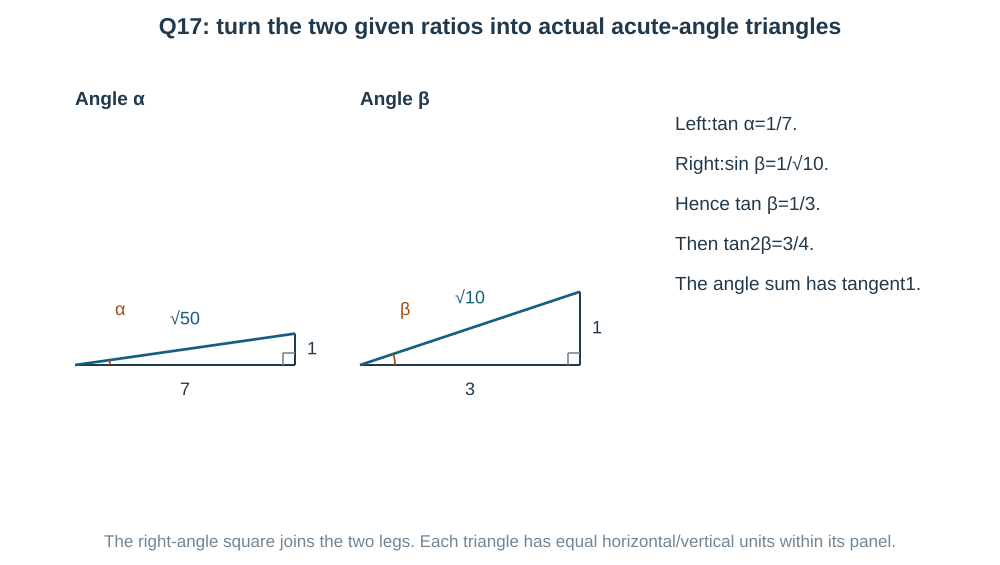

Then

$$
\tan2\beta=\frac{2/3}{1-1/9}=\frac34,
$$

$$
\tan(\alpha+2\beta)
=\frac{1/7+3/4}{1-(1/7)(3/4)}
=\frac{25/28}{25/28}=1.
$$

**Now select the angle,not just its tangent.** Since $\tan\alpha=1/7<1$ and $\tan\beta=1/3<1$,

$$
0<\alpha<\pi/4,\quad0<2\beta<\pi/2,
\quad0<\alpha+2\beta<3\pi/4.
$$

The only angle in this interval with tangent 1 is $\pi/4$:

$$
\boxed{\alpha+2\beta=\frac\pi4;\quad\text{(a)}}.
$$

Without the angle interval,the tangent calculation alone would allow adding multiples of $\pi$.

---

### Question 18 — Reuse the given relation instead of solving the angle

**PDF page 132 | MCQ | Notes: C06,C15**

If $\sin\theta+\sin^2\theta=1$, then $\cos^2\theta+\cos^4\theta$ equals

- (a) $0$
- (b) $2$
- (c) $1$
- (d) $\sqrt5-1$

**The target resembles the given relation.** Write $s=\sin\theta$. The given equation says $s+s^2=1$,so

$$
\cos^2\theta=1-\sin^2\theta=1-s^2=s.
$$

Therefore $\cos^4\theta=s^2$.

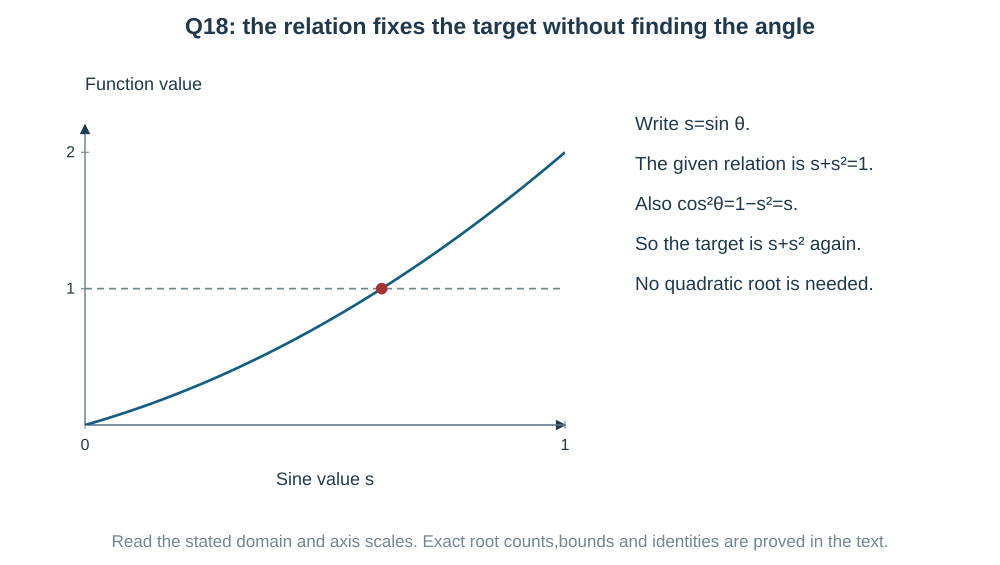

The target is now exactly the given sum:

$$
\boxed{\cos^2\theta+\cos^4\theta=s+s^2=1;\quad\text{(c)}}.
$$

**Another possible approach:** solve $s^2+s-1=0$. Only $s=(\sqrt5-1)/2$ lies in $[-1,1]$; substitute it to get 1. That route works,but calculating a radical is unnecessary because the whole target already matches the condition.

---

### Question 19 — A common period is only the first step

**PDF page 132 | MCQ | Notes: C03,C17**

The fundamental period of $f(x)=\sin\frac x3+\cos\frac x2$ is

- (a) $12\pi$
- (b) $6\pi$
- (c) $4\pi$
- (d) $24\pi$

**First find a common repeat.** $\sin(x/3)$ has period $6\pi$ and $\cos(x/2)$ has period $4\pi$. The smallest common positive repeat is $12\pi$.

Indeed,

$$
f(x+12\pi)=\sin(x/3+4\pi)+\cos(x/2+6\pi)=f(x).
$$

**Why is it fundamental?** In a sum,smaller repeats can occur if frequencies cancel. Here the frequencies $1/3$ and $1/2$ are distinct and both coefficients are nonzero. They cannot cancel in an identity.

For a precise check,write $f(x+T)-f(x)=U(x)+V(x)=0$,where $U$ contains only frequency $1/3$ and $V$ only frequency $1/2$. Differentiate twice:

$$
-\frac19U-\frac14V=0.
$$

Together with $U+V=0$,this gives $U=V=0$. Each frequency must repeat separately:

$$
T=6m\pi=4n\pi.
$$

The smallest positive such $T$ is

$$
\boxed{12\pi;\quad\text{(a)}}.
$$

**Quick rejection:** $f(0)=1$,but $f(6\pi)=-1$,so $6\pi$ fails. The derivative argument excludes all smaller noncommon periods,not just the printed alternatives.

---

### Question 20 — Degrees and radians are different angle sizes

**PDF page 132 | MCQ | Notes: C01,C03**

Consider the statements:

(a) $\cos1^\circ>\cos1$ (angle $1$ in radians)

(b) $\tan1>\tan1^\circ$

(c) $\sin2<\sin1$

(d) $\cos3<\cos2$

Which of the statements are correct?

- (a) (a), (b) and (c) only
- (b) (b), (c) and (d) only
- (c) (a), (c) and (d) only
- (d) (a), (b) and (d) only

**Convert the tiny degree angle before comparing.** $1^\circ=\pi/180<1<\pi/2$.

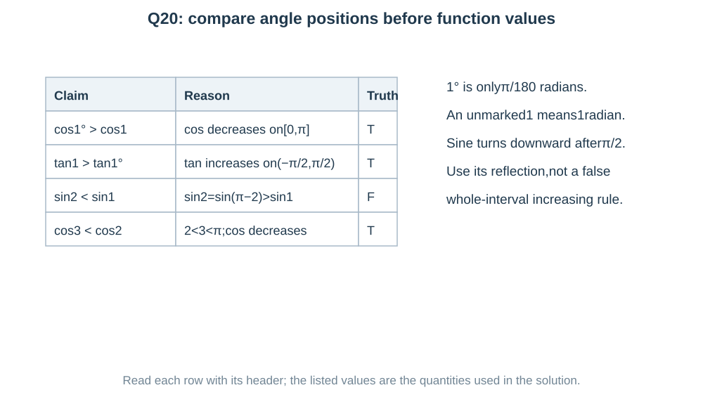

**(a)** Cosine decreases on $[0,\pi]$. Since $\pi/180<1$, $\cos1^\circ>\cos1$. True.

**(b)** Tangent increases on $(-\pi/2,\pi/2)$. Thus $\tan1>\tan1^\circ$. True.

**(c)** Do not say sine increases from 1 to 2: that interval crosses its peak. Reflect the angle:

$$
\sin2=\sin(\pi-2).
$$

Because $1<\pi-2<\pi/2$,both compared angles are now in sine's increasing interval. Hence $\sin2>\sin1$. The printed claim is false.

**(d)** $0<2<3<\pi$,where cosine decreases. Thus $\cos3<\cos2$. True.

$$
\boxed{\text{(a), (b), (d) only; (d)}}.
$$

**Another check:** numerical values can confirm these comparisons,but monotonic intervals explain them and avoid mixing degrees with radians.

---

### Question 21 — Modulus forces a sign condition before squaring

**PDF page 132 | Numerical value | Notes: C03,C13**

The number of solutions of $|\cos x|=\sin x$ in $[0,4\pi]$ is ____.

**Modulus cannot be negative.** The original equation first requires $\sin x\ge0$. Keep that condition before squaring:

$$
\cos^2x=\sin^2x
\quad\Longrightarrow\quad
\sin^2x=\frac12.
$$

The retained sign gives $\sin x=1/\sqrt2$.

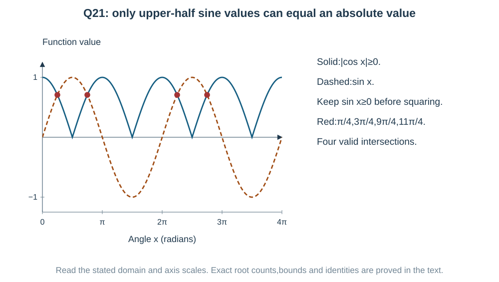

Within $[0,4\pi]$,

$$
x=\frac\pi4,\frac{3\pi}4,\frac{9\pi}4,\frac{11\pi}4.
$$

$$
\boxed{4}.
$$

**Graph view:** $|\cos x|$ reflects every negative cosine piece above the axis. It cannot meet the negative half of the sine wave. Squaring without this observation would add four false candidates.

---

### Question 22 — Solve the polynomial and then read the cosine graph

**PDF page 132 | MCQ | Notes: C13**

The solution set of $2\cos^2x+\cos x-1\le0$ in $[0,2\pi]$ is

- (a) $[0,\frac\pi3]\cup[\frac{5\pi}3,2\pi]$
- (b) $[\frac\pi3,\frac{5\pi}3]$
- (c) $[\frac\pi6,\frac{7\pi}6]$
- (d) $[\frac{2\pi}3,\frac{4\pi}3]$

**Solve for the cosine value first.** Put $c=\cos x\in[-1,1]$. Then

$$
2c^2+c-1=(2c-1)(c+1)\le0.
$$

The upward-opening quadratic is nonpositive between its roots:

$$
-1\le c\le\frac12.
$$

In one turn,cosine first reaches $1/2$ at $\pi/3$,stays at or below it,and returns to $1/2$ at $5\pi/3$. Therefore

$$
\boxed{x\in\left[\frac\pi3,\frac{5\pi}3\right];\quad\text{(b)}}.
$$

**Another view — circle:** retain the unit-circle points whose horizontal coordinate is at most $1/2$. Their angle positions form the same long arc.

The endpoints belong because the original inequality includes equality.

---

### Question 23 — A half-angle parameter gives both coordinates

**PDF page 132 | MCQ | Notes: C08**

If $\tan\frac\theta2=\frac12$, then $\sin\theta+\cos\theta$ equals

- (a) $\frac15$
- (b) $\frac75$
- (c) $\frac65$
- (d) $\frac85$

**The given is exactly the half-angle parameter.** Set $t=\tan(\theta/2)=1/2$:

$$
\sin\theta=\frac{2t}{1+t^2}
=\frac1{5/4}=\frac45,
$$

$$
\cos\theta=\frac{1-t^2}{1+t^2}
=\frac{3/4}{5/4}=\frac35.
$$

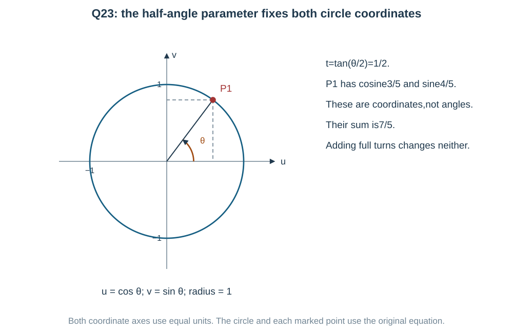

$$
\boxed{\sin\theta+\cos\theta=\frac45+\frac35=\frac75;\quad\text{(b)}}.
$$

**Another possible approach:** let $u=\theta/2$ and use a triangle with $\tan u=1/2$,then apply double angles. Any other allowed $u$ differs by an integer multiple of $\pi$,so $\theta$ differs by a full turn. The resulting sine and cosine are unchanged.

---

### Question 24 — One denominator reveals a double angle

**PDF page 132 | Numerical value | Notes: C08,C09**

The value of $\frac1{\sin10^\circ}-\frac{\sqrt3}{\cos10^\circ}$ is ____.

**Two fractions suggest a common denominator;the angle stays the same.**

$$
\frac1{\sin10^\circ}-\frac{\sqrt3}{\cos10^\circ}
=\frac{\cos10^\circ-\sqrt3\sin10^\circ}
{\sin10^\circ\cos10^\circ}.
$$

The numerator has the coefficients of a cosine sum:

$$
\cos10^\circ-\sqrt3\sin10^\circ
=2\cos(10^\circ+60^\circ)=2\sin20^\circ.
$$

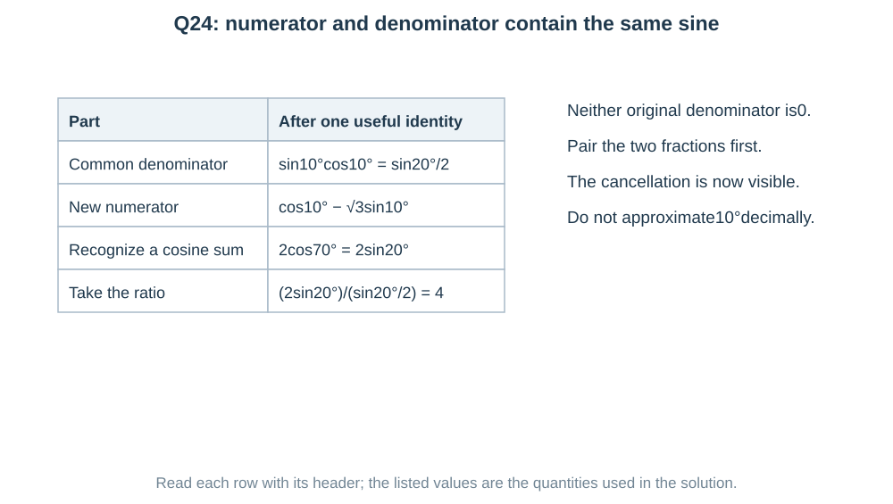

The denominator is $\frac12\sin20^\circ$. Hence

$$
\boxed{\frac{2\sin20^\circ}{\frac12\sin20^\circ}=4}.
$$

**Check:** sine and cosine of $10^\circ$,and sine of $20^\circ$,are all nonzero. The cancellation is valid. Separate decimal substitutions would work approximately,but would hide the exact common factor.

---

### Question 25 — Keep the original domain when clearing a denominator

**PDF page 132 | MCQ | Notes: C02,C12**

The number of solutions of $\tan x+\sec x=2\cos x$ in $[0,2\pi]$ is

- (a) $0$
- (b) $1$
- (c) $3$
- (d) $2$

**Write the original domain first: $\cos x\ne0$.** Multiplying the equation by cosine is then safe:

$$
\sin x+1=2\cos^2x=2(1-\sin^2x).
$$

With $s=\sin x$,

$$
2s^2+s-1=(2s-1)(s+1)=0.
$$

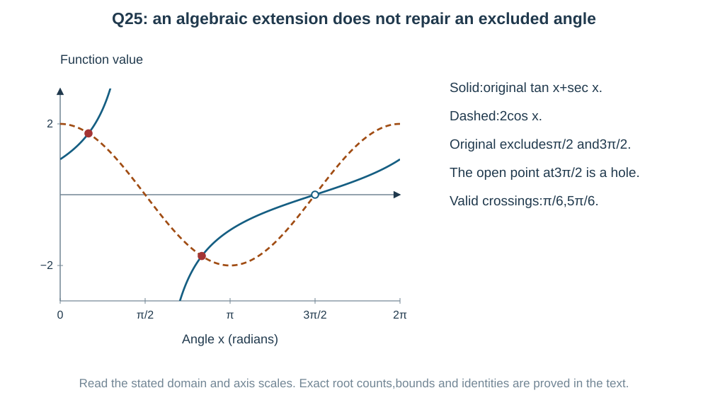

The candidates are $s=1/2$ and $s=-1$.

- $\sin x=1/2$ gives $x=\pi/6,5\pi/6$. Both have nonzero cosine and satisfy the original equation.
- $\sin x=-1$ gives $x=3\pi/2$,where tangent and secant are undefined. Reject it.

$$
\boxed{2;\quad\text{(d)}}.
$$

**Why the apparent third intersection is unsafe:** the simplified quotient $(1+\sin x)/\cos x$ has a removable extension at $3\pi/2$,but the original expression still has no value there. Extending a graph does not create an original solution.

---

### Question 26 — The two angle solutions become two circle points

**PDF page 132 | MCQ | Notes: C08,C12**

If $\alpha\ne\beta$ are two solutions of $\cos\theta+2\sin\theta=1$ in $[0,2\pi)$, then $\tan\frac{\alpha+\beta}{2}$ equals

- (a) $2$
- (b) $\frac12$
- (c) $-2$
- (d) $1$

**Two circle intersections are expected.** The equation is $u+2v=1$ on $u^2+v^2=1$,with $u=\cos\theta,v=\sin\theta$.

For a direct algebraic route,set $t=\tan(\theta/2)$. First check the omitted angle $\theta=\pi$: its left side is $-1$,so it is not a solution.

For all remaining candidates,

$$
\frac{1-t^2+4t}{1+t^2}=1
\quad\Longrightarrow\quad
2t(t-2)=0.
$$

Thus $t=0$ or 2. In $[0,2\pi)$,the two angles are $0$ and $\beta=2\tan^{-1}2\in(0,\pi)$.

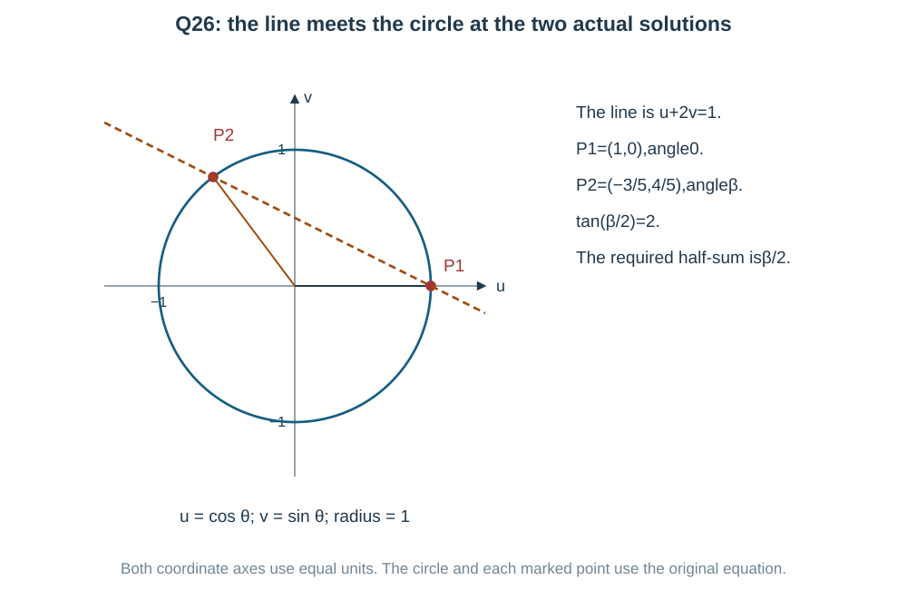

Their order does not affect their sum:

$$
\boxed{\tan\frac{\alpha+\beta}{2}
=\tan\frac{\beta}{2}=2;\quad\text{(a)}}.
$$

**Another possible approach:** one solution is 0. Squaring $\cos\theta=1-2\sin\theta$ gives $s(5s-4)=0$. Checking the original yields the other point $(\cos\beta,\sin\beta)=(-3/5,4/5)$. Then $\tan(\beta/2)=\sin\beta/(1+\cos\beta)=2$.

Squaring also produces $\theta=\pi$ from $s=0$; the original equation rejects it.

---

### Question 27 — Factor the double-angle equation without dividing by cosine

**PDF page 133 | Numerical value | Notes: C08,C12**

If $S$ is the sum of all solutions of $\sin2x=\cos x$ in $[0,2\pi]$, then $\frac S\pi$ equals ____.

**Double angle creates a factor;do not divide that factor away.**

$$
2\sin x\cos x=\cos x
\quad\Longrightarrow\quad
\cos x(2\sin x-1)=0.
$$

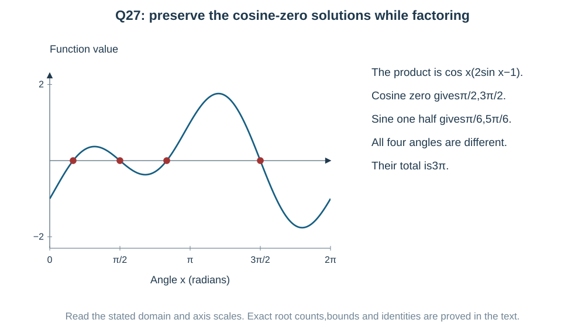

In $[0,2\pi]$,

$$
\cos x=0\Rightarrow x=\frac\pi2,\frac{3\pi}2,
$$

$$
\sin x=\frac12\Rightarrow x=\frac\pi6,\frac{5\pi}6.
$$

All four are different,so

$$
S=\frac\pi2+\frac{3\pi}2+\frac\pi6+\frac{5\pi}6=3\pi.
$$

$$
\boxed{S/\pi=3}.
$$

**Pairing check:** the cosine-zero pair sums to $2\pi$ and the sine-one-half pair to $\pi$. Dividing by cosine at the start would lose the entire $2\pi$ contribution.

---

### Question 28 — Expand the phase shift before finding the amplitude

**PDF page 133 | MCQ | Notes: C05,C07**

The maximum value of $3\cos x+5\sin(x-\frac\pi6)$ is

- (a) $7$
- (b) $\sqrt{21}$
- (c) $\sqrt{19}$
- (d) $8$

**The sine term is shifted;first uncover its cosine contribution.**

$$
5\sin(x-\pi/6)
=\frac{5\sqrt3}{2}\sin x-\frac52\cos x.
$$

Adding $3\cos x$ leaves

$$
\frac12\cos x+\frac{5\sqrt3}{2}\sin x.
$$

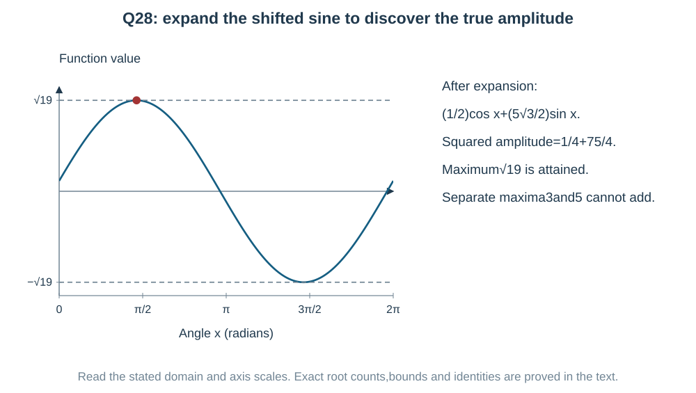

Its amplitude is

$$
R=\sqrt{\left(\frac12\right)^2+
\left(\frac{5\sqrt3}{2}\right)^2}
=\sqrt{\frac14+\frac{75}{4}}=\sqrt{19}.
$$

It is attained when $\cos x=1/(2\sqrt{19})$ and $\sin x=5\sqrt3/(2\sqrt{19})$; their squares sum to 1.

$$
\boxed{\sqrt{19};\quad\text{(c)}}.
$$

**Another possible approach:** apply Cauchy–Schwarz to the two final coefficients,with the same equality coordinates.

Using $\sqrt{3^2+5^2}$ would ignore that the shifted sine already contains a cosine part. Adding 3 and 5 also assumes incompatible peak angles.

---

### Question 29 — A doubling-angle product collapses to one sine

**PDF page 133 | MCQ | Notes: C08,C11**

The value of $\cos\frac\pi{15}\cos\frac{2\pi}{15}\cos\frac{4\pi}{15}\cos\frac{8\pi}{15}$ is

- (a) $\frac1{16}$
- (b) $-\frac18$
- (c) $\frac18$
- (d) $-\frac1{16}$

**The angles double: $a,2a,4a,8a$.** This suggests repeated $\sin2a=2\sin a\cos a$.

Let $a=\pi/15$ and let the product be $P_0$. Then

$$
\sin16a
=16\sin a\cos a\cos2a\cos4a\cos8a
=16\sin a\,P_0.
$$

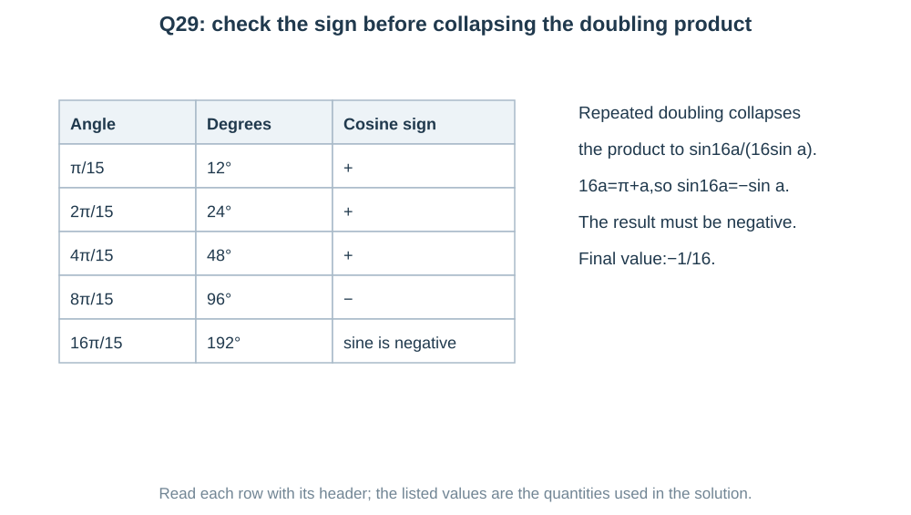

Since $\sin a\ne0$,

$$
P_0=\frac{\sin16a}{16\sin a}.
$$

But $16a=\pi+a$,so $\sin16a=-\sin a$:

$$
\boxed{P_0=-\frac1{16};\quad\text{(d)}}.
$$

**Sign check:** the first three cosines are positive; $\cos(8\pi/15)=\cos96^\circ$ is negative. A positive option cannot be correct.

---

### Question 30 — The quadratic already gives the tangent sum and product

**PDF page 133 | Numerical value | Notes: C05,C15**

If $\tan A$ and $\tan B$ are the roots of $6x^2-5x+1=0$ with $A,B$ acute, then $A+B$ (in degrees) is ____.

**The target uses a tangent sum,so use the roots' sum and product directly.** Viète gives

$$
\tan A+\tan B=\frac56,\qquad
\tan A\tan B=\frac16.
$$

Therefore

$$
\tan(A+B)=\frac{5/6}{1-1/6}=1.
$$

Both angles are acute,so $0^\circ<A+B<180^\circ$. In this interval,the only angle with tangent 1 is $45^\circ$:

$$
\boxed{A+B=45^\circ}.
$$

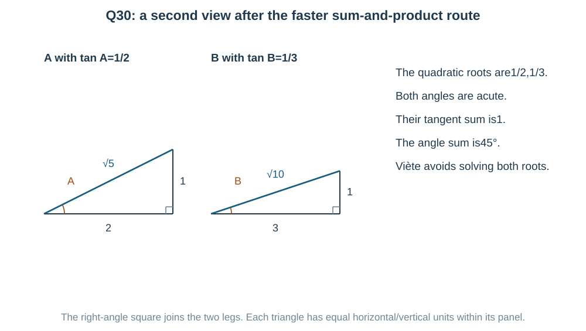

**Another possible approach:** factor $(3x-1)(2x-1)=0$. The roots are $1/3,1/2$. Assign them to the two triangles and use the same tangent-addition formula.

Both routes are valid. Viète is shorter because the target needs only the sum and product,not the separate roots.

## Answer check

Read the qualifications in the solutions before using the key.

| Question | Answer | Question | Answer |
|---|---|---|---|
| 1 | (c) | 16 | (c) |
| 2 | $7$ | 17 | (a) |
| 3 | (a) | 18 | (c) |
| 4 | (d) | 19 | (a) |
| 5 | $11$ | 20 | (d) |
| 6 | (b) | 21 | $4$ |
| 7 | (b) | 22 | (b) |
| 8 | $7$ | 23 | (b) |
| 9 | (d) | 24 | $4$ |
| 10 | $6$ | 25 | (d) |
| 11 | (a) | 26 | (a) |
| 12 | (c) | 27 | $3$ |
| 13 | (d) | 28 | (c) |
| 14 | (b) | 29 | (d) |
| 15 | $5$ | 30 | $45$ |

## After this chapter

See a circle coordinate before a sign,a repeating wave before a root family,and a domain before cancelling a denominator. Use identities to expose the requested pattern; use exact reasoning to support a graphical answer. Every alternative remains visible for the later booklet. These supplied questions are JEE Main-style practice,not verified actual PYQs.
