# Chapter 26 — Inverse Trigonometric Functions

**Kanna, ordinary sine takes an angle and gives a number. Inverse sine takes a number and returns one chosen angle.** “One chosen angle” is the main idea in this chapter.

Your preparation target remains **200 marks: Physics 60, Maths 60, Chemistry 80**. Train yourself to check three things: the input is allowed,the returned angle is in its principal range,and any transformed equation still satisfies the original.

## Recent chapter weightage

| Year | Distinct Inverse Trigonometry questions in the checked archive | Full-year shifts | Questions per shift |
|---|---:|---:|---:|
| 2024 | 8 | 20 | 0.40 |
| 2025 | 11 | 19 | 0.58 |
| 2026 | 10 | 19 | 0.53 |
| Total | 29 | 58 | **0.50** |

These are saved and recounted ExamSIDE category IDs. PYQSide classifies 11,14,14 questions in the same years. The classification/coverage difference is real; we consistently use the chosen archive rather than mixing its years with another archive.

The current official Trigonometry unit explicitly includes inverse functions and their properties. **Important for JEE Main:** domain intersections,principal values,angle-sum branch checks,triangle identities,and equations. The 2024 format offered more optional numerical questions. These archive means are not predictions,and this is not an exhaustive seven-year formula-frequency audit.

## Concept C01 — Why an inverse needs a chosen branch

$\sin(\pi/6)=\sin(5\pi/6)=1/2$. If we ask “Which angle has sine $1/2$?”,there are many answers. A function must return **one output for each input**.

We therefore restrict ordinary sine to $[-\pi/2,\pi/2]$,where it increases without repeating. The inverse of this restricted function is **inverse sine**,also written $\arcsin$:

$$
\boxed{y=\sin^{-1}u
\iff \sin y=u,\quad -\pi/2\le y\le\pi/2}.
$$

The chosen output interval is its **principal range**. “Principal” means the standard chosen branch.

**Very important notation:**

$$
\sin^{-1}u=\arcsin u
\quad\text{but}\quad
\frac1{\sin u}=\csc u.
$$

The superscript $-1$ here means inverse function,not reciprocal. Inverse sine returns an angle; reciprocal sine returns a number obtained by division.

**Undoing works in two different ways:**

$$
\boxed{\sin(\sin^{-1}u)=u\quad(-1\le u\le1)},
$$

but

$$
\boxed{\sin^{-1}(\sin x)=x
\text{ only when }-\pi/2\le x\le\pi/2}.
$$

Outside that interval,find the equivalent principal angle. Do not cancel the symbols as if both formulas held for every real input.

## Concept C02 — Inverse sine and inverse cosine

$$
\boxed{\arcsin:[-1,1]\longrightarrow[-\pi/2,\pi/2]},
$$

$$
\boxed{\arccos:[-1,1]\longrightarrow[0,\pi]}.
$$

Both accept numbers only between $-1$ and 1. Their output intervals differ.

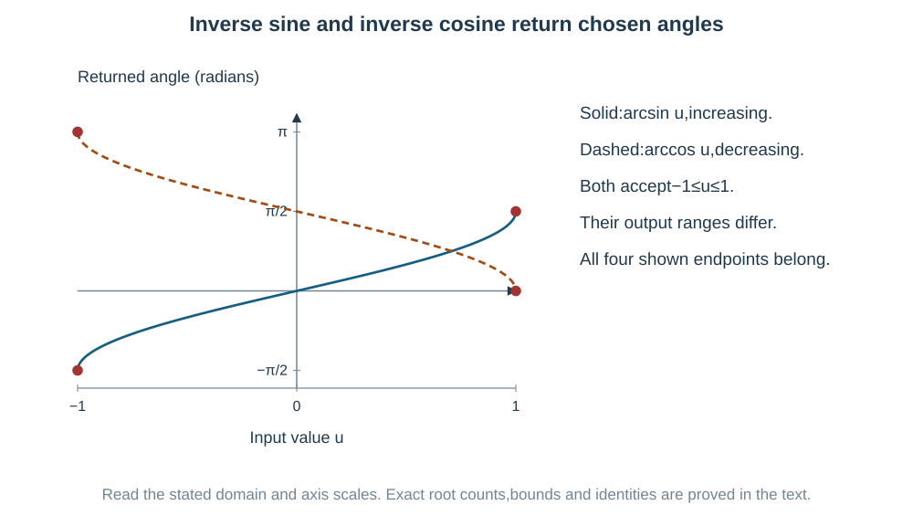

**Read the axes:** the horizontal input is a sine/cosine value. The vertical output is an angle in radians. Arcsine increases; arccosine decreases.

| Input $u$ | $-1$ | $-1/2$ | $0$ | $1/2$ | $1$ |
|---|---|---|---|---|---|
| $\arcsin u$ | $-\pi/2$ | $-\pi/6$ | $0$ | $\pi/6$ | $\pi/2$ |
| $\arccos u$ | $\pi$ | $2\pi/3$ | $\pi/2$ | $\pi/3$ | $0$ |

For $u\in[-1,1]$,

$$
\boxed{\arcsin u+\arccos u=\pi/2},
$$

$$
\arcsin(-u)=-\arcsin u,\qquad
\arccos(-u)=\pi-\arccos u.
$$

**Why complementary?** If $A=\arcsin u$,then $\cos(\pi/2-A)=u$,and $\pi/2-A$ is in $[0,\pi]$. It is exactly the arccosine output.

## Concept C03 — The other four principal inverse functions

We use the usual JEE/NCERT branch conventions:

| Function | Domain | Principal range |
|---|---|---|
| $\arctan u$ | $\mathbb R$ | $(-\pi/2,\pi/2)$ |
| $\operatorname{arccot}u$ | $\mathbb R$ | $(0,\pi)$ |
| $\operatorname{arcsec}u$ | $(-\infty,-1]\cup[1,\infty)$ | $[0,\pi]\setminus\{\pi/2\}$ |
| $\operatorname{arccsc}u$ | $(-\infty,-1]\cup[1,\infty)$ | $[-\pi/2,\pi/2]\setminus\{0\}$ |

Parentheses mean endpoints are excluded; square brackets mean included.

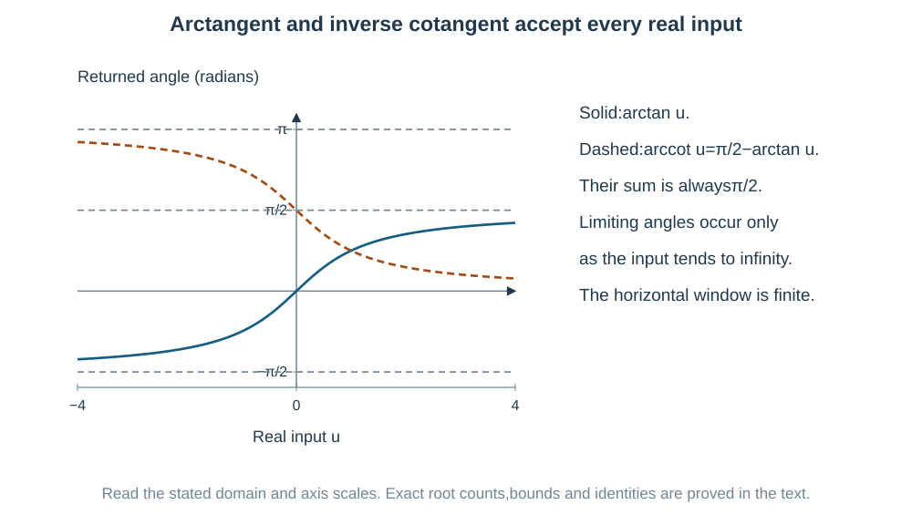

For every real $u$,

$$
\boxed{\arctan u+\operatorname{arccot}u=\pi/2},
$$

$$
\arctan(-u)=-\arctan u,\qquad
\operatorname{arccot}(-u)=\pi-\operatorname{arccot}u.
$$

Arctangent is increasing; inverse cotangent is decreasing.

For $|u|\ge1$,

$$
\boxed{\operatorname{arcsec}u=\arccos(1/u)},\qquad
\boxed{\operatorname{arccsc}u=\arcsin(1/u)}.
$$

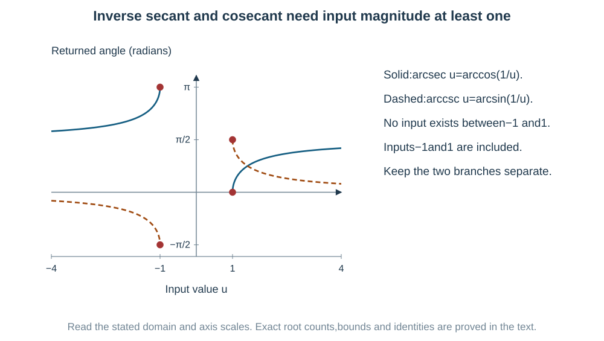

For inverse cotangent,

$$
\operatorname{arccot}u=
\begin{cases}
\arctan(1/u),&u>0,\\
\pi/2,&u=0,\\
\pi+\arctan(1/u),&u<0.
\end{cases}
$$

So the shortcut “inverse cotangent equals inverse tangent of the reciprocal” needs a sign check.

Also,

$$
\arctan u+\arctan(1/u)=
\begin{cases}\pi/2,&u>0,\\-\pi/2,&u<0.\end{cases}
$$

There is no reciprocal expression at $u=0$.

## Concept C04 — Folding an angle into its principal range

To evaluate $\arcsin(\sin x)$,find an angle with the **same sine** inside $[-\pi/2,\pi/2]$.

For integer $n$ and $x\in[n\pi-\pi/2,n\pi+\pi/2]$,

$$
\boxed{\arcsin(\sin x)=(-1)^n(x-n\pi)}.
$$

Do not memorize this before understanding the fold. Examples:

$$
\arcsin(\sin(3\pi/4))=\pi/4,\qquad
\arcsin(\sin\pi)=0.
$$

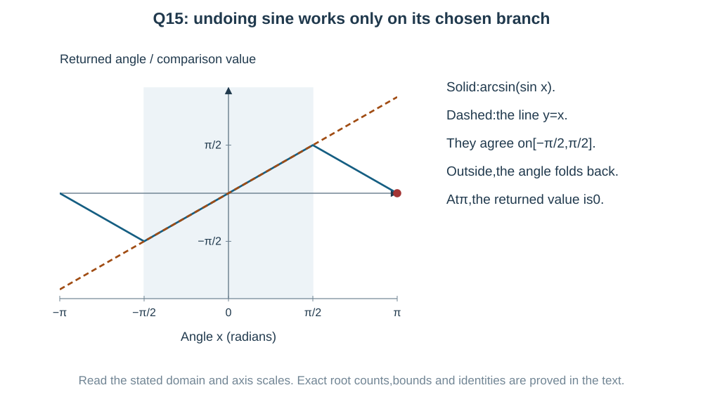

For cosine,first reduce the input to $t\in[0,2\pi)$ by full turns:

$$
\arccos(\cos x)=
\begin{cases}
t,&0\le t\le\pi,\\
2\pi-t,&\pi<t<2\pi.
\end{cases}
$$

For tangent,choose the unique integer $n$ with

$$
-\pi/2<x-n\pi<\pi/2.
$$

Then $\arctan(\tan x)=x-n\pi$. At tangent's excluded endpoints,the original inner function is undefined.

**Fast habit:** write the principal range beside the expression,locate the input on the circle,and reflect/subtract turns until the answer lies in that range.

## Concept C05 — Replace inverse symbols by ordinary angle names

If $A=\arcsin u$,then $\sin A=u$ and $\cos A\ge0$. Thus

$$
\boxed{\cos(\arcsin u)=\sqrt{1-u^2}}.
$$

For $|u|<1$,

$$
\tan(\arcsin u)=\frac{u}{\sqrt{1-u^2}}.
$$

If $B=\arccos u$,then $\sin B\ge0$,so

$$
\boxed{\sin(\arccos u)=\sqrt{1-u^2}}.
$$

Its tangent is $\sqrt{1-u^2}/u$ when $u\ne0$; it can be negative if $B$ is obtuse.

If $C=\arctan u$,then $\cos C>0$:

$$
\boxed{\cos C=\frac1{\sqrt{1+u^2}}},
\qquad
\boxed{\sin C=\frac{u}{\sqrt{1+u^2}}}.
$$

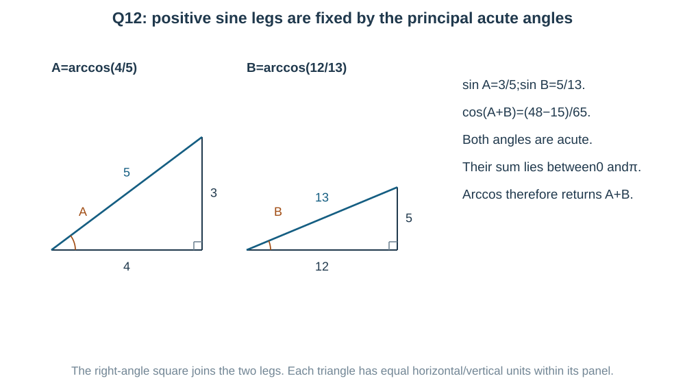

**Why the square-root sign matters:** $\sqrt{1-u^2}$ is nonnegative. The principal range tells us whether the needed sine/cosine is nonnegative. A freely chosen nonprincipal angle may require the opposite sign.

For an acute ratio such as $\cos A=4/5$,draw adjacent leg 4,hypotenuse 5,then opposite leg $\sqrt{25-16}=3$. This gives an actual triangle before substitution.

## Concept C06 — Arctangent sums: tangent is not the whole angle

Let $A=\arctan u$, $B=\arctan v$,and $S=A+B$. Each angle lies in $(-\pi/2,\pi/2)$,so $S\in(-\pi,\pi)$.

When $uv\ne1$,

$$
\tan S=\frac{u+v}{1-uv}.
$$

But taking $\arctan$ of that fraction always returns a principal angle. We may need to restore $\pi$:

$$
\boxed{
\arctan u+\arctan v=
\begin{cases}
\arctan\frac{u+v}{1-uv},&uv<1,\\
\pi+\arctan\frac{u+v}{1-uv},&uv>1,\ u,v>0,\\
-\pi+\arctan\frac{u+v}{1-uv},&uv>1,\ u,v<0.
\end{cases}}
$$

If $uv=1$,both have the same nonzero sign; the sum is $\pi/2$ for positive inputs and $-\pi/2$ for negative inputs.

**Why the cases occur:**

$$
\cos S=\frac{1-uv}{\sqrt{(1+u^2)(1+v^2)}}.
$$

For $uv<1$,cosine is positive,placing $S$ in the principal arctangent interval. For positive $u,v$ with $uv>1$,the sum is in quadrant II.

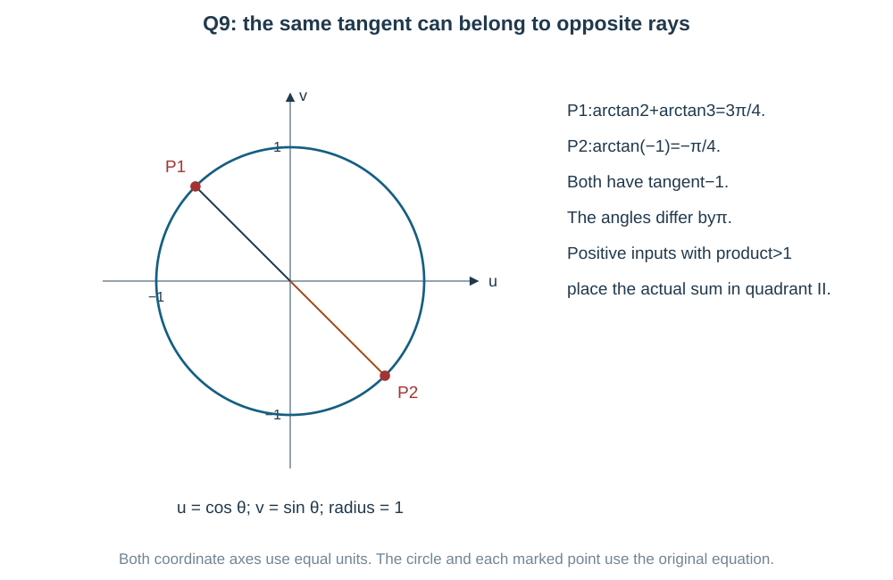

For example,$\arctan2+\arctan3=3\pi/4$,whereas $\arctan(-1)=-\pi/4$. Same tangent,different angles.

For a difference,write $\arctan u-\arctan v=\arctan u+\arctan(-v)$ and use the same sign/range logic. The raw tangent fraction is $(u-v)/(1+uv)$ when its denominator is nonzero.

## Concept C07 — Equations: apply a function without forgetting its information loss

If two angles are equal,their sines,cosines and tangents are equal where defined. The reverse implication can fail because those functions repeat.

**A safe order for inverse-function equations:**

1. Intersect all original domains.
2. Give inverse expressions angle names and record their principal ranges.
3. Apply an identity or ordinary trig function to obtain algebraic candidates.
4. Check every candidate in the original equation,or prove the branch condition that makes the transformation reversible.

For $A=\arcsin u$, $B=\arcsin v$,

$$
\sin(A\pm B)
=u\sqrt{1-v^2}\pm v\sqrt{1-u^2}.
$$

Do not automatically put $\arcsin$ around the right side and claim it equals $A\pm B$. The sum may be outside $[-\pi/2,\pi/2]$.

For $A=\arccos u$, $B=\arccos v$,

$$
\cos(A+B)=uv-\sqrt{1-u^2}\sqrt{1-v^2}.
$$

Again,$\arccos(\cos(A+B))=A+B$ requires $A+B\in[0,\pi]$.

**For acute angles:** a sum is in $(0,\pi)$ and a difference in $(-\pi/2,\pi/2)$. These simple interval facts make many source problems safe.

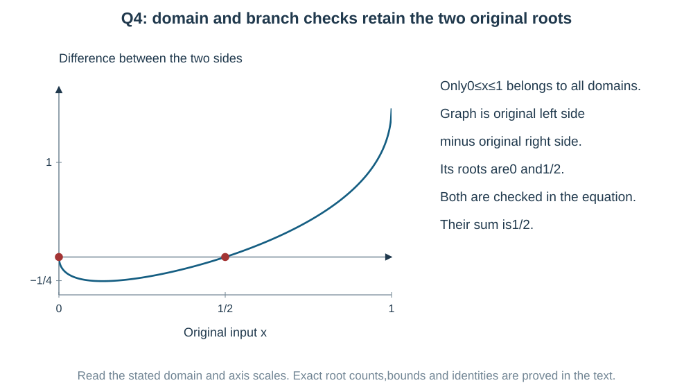

**Recognition:** a domain may be so restrictive that no heavy trigonometry remains. Q11 has only two possible inputs before the angle equation is even solved.

## Concept C08 — Range and an attained sum bound

First find the **common domain**,not the domain of just one summand.

For

$$
f(x)=\arcsin x+\arccos x+\arctan x,
$$

the common domain is $[-1,1]$. The complementary pair is constant:

$$
f(x)=\frac\pi2+\arctan x.
$$

Arctangent increases from $-\pi/4$ to $\pi/4$ on this closed interval,so

$$
\boxed{\operatorname{range}(f)=[\pi/4,3\pi/4]}.
$$

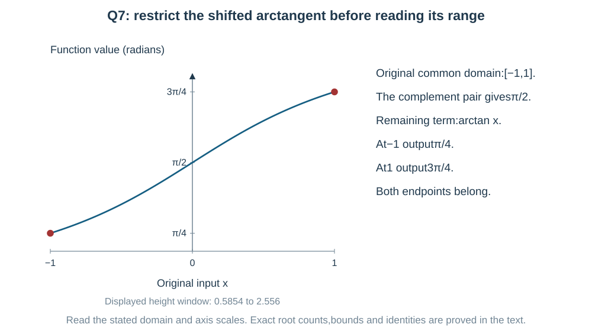

**A maximum-sum pattern — important for JEE Main:** if each $a_i\le M_i$ and $\sum a_i=\sum M_i$,every individual term must reach its own upper bound. Otherwise a shortfall cannot be repaired by another term exceeding its bound.

Thus

$$
\arcsin x+\arcsin y+\arcsin z=3\pi/2
$$

forces all three inverse sines to be $\pi/2$,so $x=y=z=1$.

## Concept C09 — Domains: work from the outside inward

For real-valued expressions,

$$
\arcsin g(x),\arccos g(x):\quad -1\le g(x)\le1,
$$

$$
\operatorname{arcsec}g(x),\operatorname{arccsc}g(x):
\quad |g(x)|\ge1.
$$

Arctangent and inverse cotangent accept every real **defined** input. A denominator or square root inside still has its own restriction:

$$
\frac{a(x)}{b(x)}:\ b(x)\ne0,\qquad
\sqrt{h(x)}:\ h(x)\ge0.
$$

For a sum,all conditions hold together: use their intersection.

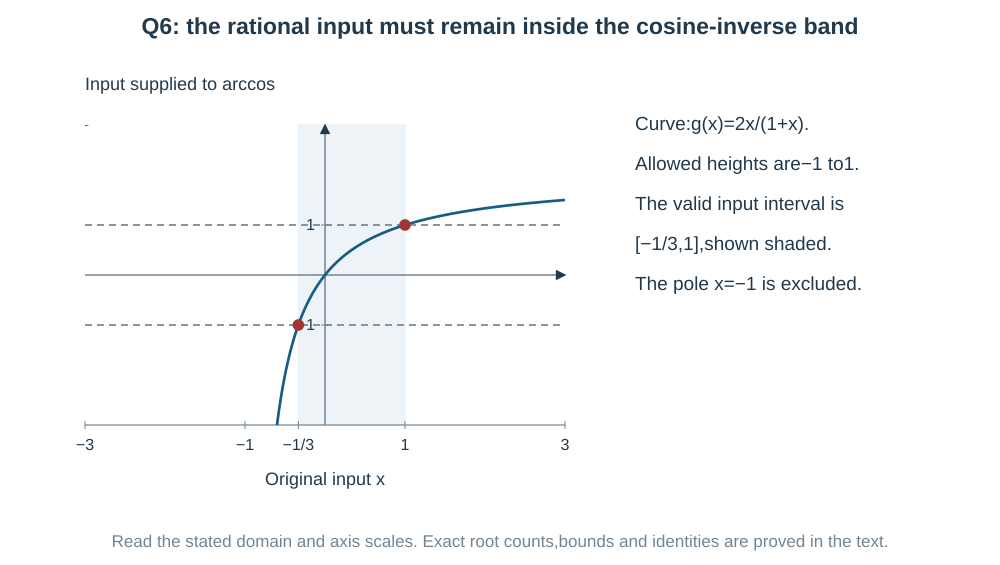

For $\arccos(2x/(1+x))$,do not multiply an inequality by $1+x$ without knowing its sign. Move everything to one side and use a sign chart with its zero and pole.

For a quadratic input,combine two polynomial inequalities. In Q14,

$$
-1\le x^2-5x+5\le1
$$

leads to two disjoint intervals,not one:

$$
\boxed{[1,2]\cup[3,4]}.
$$

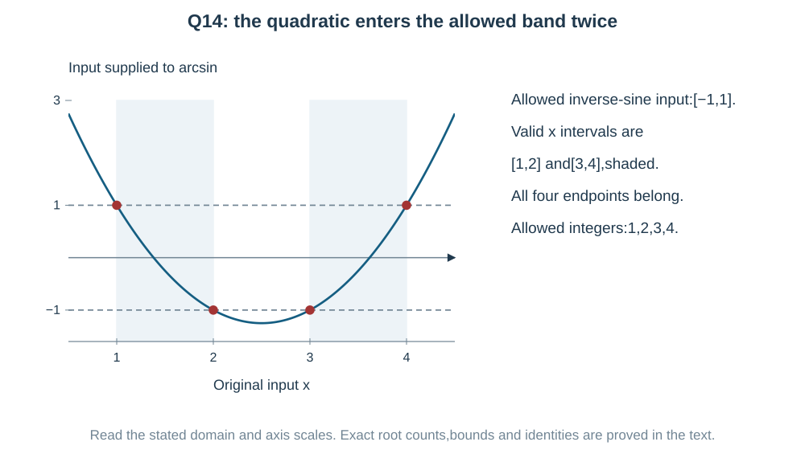

## Concept C10 — Inverse-angle telescoping

For positive integer $n$,

$$
\tan\left(\arctan(n+1)-\arctan n\right)
=\frac1{1+n(n+1)}.
$$

The difference is positive and less than $\pi/2$,so

$$
\boxed{\operatorname{arccot}(1+n(n+1))
=\arctan(n+1)-\arctan n}.
$$

**Did you notice the pattern $n(n+1)+1$?** It is the denominator produced by subtracting the tangents $n+1$ and $n$.

Adding adjacent differences cancels all middle angles:

$$
\sum_{n=1}^{N}\operatorname{arccot}(1+n(n+1))
=\arctan(N+1)-\arctan1.
$$

The sum lies in $(0,\pi/4)$; its tangent is $N/(N+2)$. Therefore

$$
\boxed{N\cot\left(\sum_{n=1}^{N}\operatorname{arccot}(1+n(n+1))\right)=N+2}.
$$

This shortcut uses the stated positive-integer pattern. A changed sign or different quadratic denominator needs a fresh branch check.

## Concept C11 — Half angles and radical patterns

Let $\theta=\arcsin u$ with $0<u\le1$. It is acute or right,and

$$
\boxed{\tan(\theta/2)
=\frac{\sin\theta}{1+\cos\theta}
=\frac{u}{1+\sqrt{1-u^2}}}.
$$

This form avoids subtracting nearly equal positive numbers. The rationalized form $(1-\sqrt{1-u^2})/u$ gives the same result. At $u=0$,use the first form to get zero.

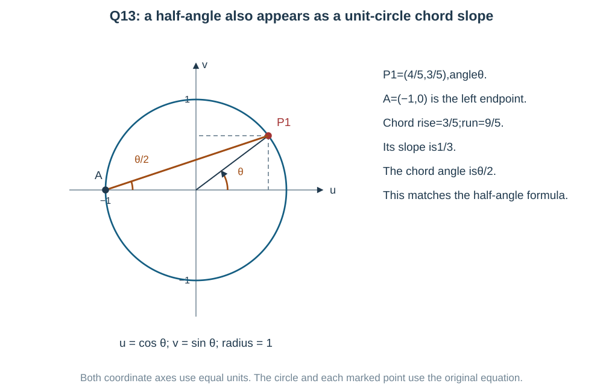

For a different useful pattern,let $\theta=\arctan x$. Then $\cos\theta>0$ and $\sqrt{1+x^2}=\sec\theta$. For $x\ne0$,

$$
\frac{\sqrt{1+x^2}-1}{x}
=\frac{x}{\sqrt{1+x^2}+1}
=\tan(\theta/2).
$$

Since $\theta/2\in(-\pi/4,\pi/4)$,

$$
\boxed{\arctan\frac{\sqrt{1+x^2}-1}{x}
=\frac12\arctan x\quad(x\ne0)}.
$$

The right side exists at zero,but the original left fraction does not. A removable extension must be labelled separately.

**Double-angle caution:** $\arctan(2x/(1-x^2))=2\arctan x$ holds for $|x|<1$. For $|x|>1$,the doubled angle leaves arctangent's principal range,and a $\pi$ correction is needed. At $x=\pm1$,the displayed fraction is undefined.

## Concept C12 — An angle difference can fix a quadratic expression

Let $A=\arccos x$, $B=\arccos z$,and $A-B=\delta$. Then

$$
x=z\cos\delta-\sin B\sin\delta.
$$

Hence

$$
(x-z\cos\delta)^2=(1-z^2)\sin^2\delta,
$$

which rearranges to

$$
\boxed{x^2+z^2-2xz\cos\delta=\sin^2\delta}.
$$

**Recognition:** an inverse-cosine difference plus a quadratic target suggests this identity. It can remove both angles without finding either separately.

For Q19,$z=y/2$ and $\delta=\pi/3$. Multiplying the identity by 4 gives $4x^2-2xy+y^2=3$.

The quadratic relation is a consequence of the original angle equation. It may include extra points if used as a reverse description: principal angle restrictions and signs still matter.

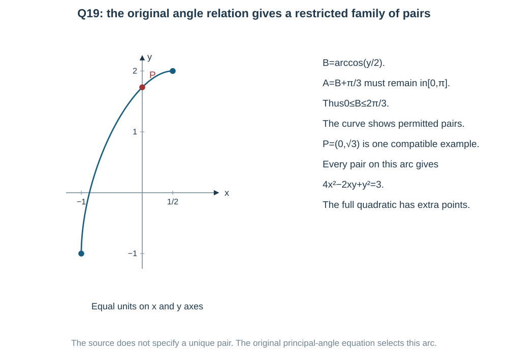

## Concept C13 — Useful connection to Calculus

These derivative formulas belong to the Calculus chapters,but the principal branches explain their signs:

$$
\frac{d}{dx}\arcsin x=\frac1{\sqrt{1-x^2}},\qquad
\frac{d}{dx}\arccos x=-\frac1{\sqrt{1-x^2}}
\quad(|x|<1),
$$

$$
\frac{d}{dx}\arctan x=\frac1{1+x^2},\qquad
\frac{d}{dx}\operatorname{arccot}x=-\frac1{1+x^2},
$$

$$
\frac{d}{dx}\operatorname{arcsec}x
=\frac1{|x|\sqrt{x^2-1}},\qquad
\frac{d}{dx}\operatorname{arccsc}x
=-\frac1{|x|\sqrt{x^2-1}}
\quad(|x|>1).
$$

For a composite input $u(x)$,multiply by $u'(x)$ and check the strict derivative-domain conditions. An included endpoint in a function's domain need not have a finite derivative.

The absolute value in inverse-secant/cosecant derivatives is important on negative inputs. Do not replace it by $x$.

## Last-minute formula recap

| Cue | Safe recall |
|---|---|
| Inverse notation | $\sin^{-1}u$ returns a principal angle; it is not $1/\sin u$ |
| Principal ranges | arcsin $[-\pi/2,\pi/2]$; arccos $[0,\pi]$; arctan $(-\pi/2,\pi/2)$; arccot $(0,\pi)$ |
| Reciprocal inverses | arcsec $u=\arccos(1/u)$; arccsc $u=\arcsin(1/u)$ for $|u|\ge1$ |
| Complement pair | $\arcsin u+\arccos u=\pi/2$ for $|u|\le1$ |
| Tangent/cotangent pair | $\arctan u+\operatorname{arccot}u=\pi/2$ for all real $u$ |
| Reflection | arcsin and arctan are odd; $\arccos(-u)=\pi-\arccos u$ |
| Angle folding | inverse trig of ordinary trig recovers only the principal representative |
| Triangle extraction | $\cos(\arcsin u)=\sin(\arccos u)=\sqrt{1-u^2}$ |
| Arctangent triangle | cosine $1/\sqrt{1+u^2}$; sine $u/\sqrt{1+u^2}$ |
| Arctangent sum | tangent $(u+v)/(1-uv)$; choose the angle branch before inverse tangent |
| Positive sum with $uv>1$ | add $\pi$ to the principal inverse tangent of the fraction |
| Domain | outer inverse range condition plus every inner denominator/radical restriction |
| Maximum inverse-sine sum | reaching $N\pi/2$ forces all $N$ inputs to 1 |
| Adjacent quadratic denominator | $\operatorname{arccot}(n^2+n+1)=\arctan(n+1)-\arctan n$ for $n>0$ |
| Half-angle radical | $\arctan((\sqrt{1+x^2}-1)/x)=\frac12\arctan x$ for $x\ne0$ |
| Angle-difference quadratic | $x^2+z^2-2xz\cos\delta=\sin^2\delta$ when $\arccos x-\arccos z=\delta$ |
| Equation check | domain → angle range → transform → candidates → original/branch check |

Do not replace an angle by another merely because their tangents agree. The correct branch is part of the answer.

## Worked solutions to the 20 PDF questions

Read the question first. Notice the pattern, choose a route, then calculate. Alternative methods below are fully visible.

### Question 1 — Recover the allowed angle,not the original input

**PDF page 135 | MCQ | Notes: C01,C02,C04**

The value of $\sin^{-1}(\sin10)+\cos^{-1}(\cos10)$ (principal values,$10$ in radians) is

- (a) $20-7\pi$
- (b) $\pi$
- (c) $7\pi-20$
- (d) $3\pi-10$

**Do not cancel the inverse symbols.** The number 10 is an angle in radians,well outside the inverse-sine principal range. We must find two equivalent principal angles.

Since $3\pi<10<7\pi/2$,

$$
-\pi/2<3\pi-10<0,\qquad
\sin(3\pi-10)=\sin10.
$$

Thus $\arcsin(\sin10)=3\pi-10$. For cosine,

$$
0<4\pi-10<\pi,\qquad
\cos(4\pi-10)=\cos10,
$$

so $\arccos(\cos10)=4\pi-10$.

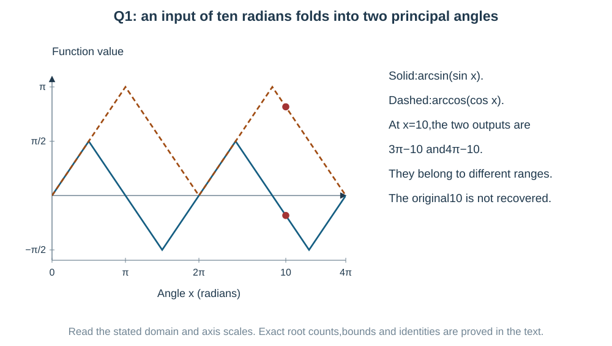

Add:

$$
\boxed{(3\pi-10)+(4\pi-10)=7\pi-20;\quad\text{(c)}}.
$$

**Check the ranges:** the first output is about $-0.575$,inside $[-\pi/2,\pi/2]$; the second about $2.566$,inside $[0,\pi]$. Each must pass its own range check.

---

### Question 2 — The output angle still obeys ordinary identities

**PDF page 135 | Numerical value | Notes: C03,C05**

The value of $\sec^2(\tan^{-1}2)+\operatorname{cosec}^2(\cot^{-1}3)$ is ____.

**The inverse expressions are ordinary angle names.** Put $A=\arctan2$,so $\tan A=2$. Then

$$
\sec^2A=1+\tan^2A=1+4=5.
$$

Put $B=\operatorname{arccot}3$,so $\cot B=3$. Then

$$
\csc^2B=1+\cot^2B=1+9=10.
$$

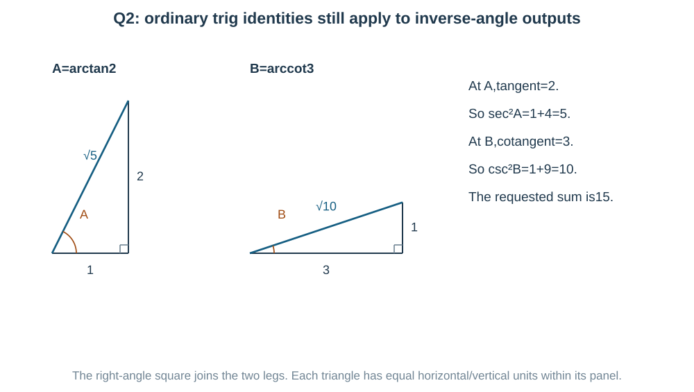

$$
\boxed{5+10=15}.
$$

**Another possible approach:** for $A$,legs 1 and 2 give hypotenuse $\sqrt5$,so $\sec A=\sqrt5$. For $B$,adjacent leg 3 and opposite leg 1 give hypotenuse $\sqrt{10}$,so $\csc B=\sqrt{10}$.

There is no need to calculate either angle in degrees or decimals. The given ratios already determine the requested squares.

---

### Question 3 — A tangent sum needs its angle interval

**PDF page 135 | MCQ | Notes: C06**

$\tan^{-1}\frac14+\tan^{-1}\frac29$ is equal to

- (a) $\tan^{-1}\frac12$
- (b) $\tan^{-1}\frac23$
- (c) $\tan^{-1}\frac{17}{36}$
- (d) $\tan^{-1}\frac13$

**An inverse-tangent sum suggests tangent addition,but the branch must be checked.** Let $A=\arctan(1/4)$ and $B=\arctan(2/9)$. Both are positive acute angles.

Their tangent product is $1/18<1$,so $\cos(A+B)>0$. Their positive sum must therefore lie in $(0,\pi/2)$.

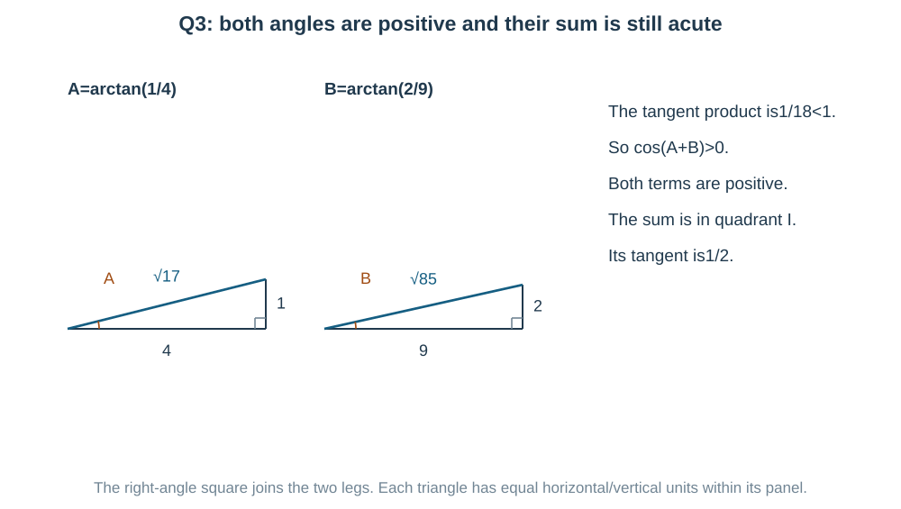

Now

$$
\tan(A+B)
=\frac{1/4+2/9}{1-(1/4)(2/9)}
=\frac{17/36}{34/36}=\frac12.
$$

Because $A+B$ is already in arctangent's principal range,

$$
\boxed{A+B=\arctan\frac12;\quad\text{(a)}}.
$$

The $17/36$ in an option is only the numerator before division. It is not the tangent of the sum.

---

### Question 4 — The common domain and branch come before squaring

**PDF page 135 | MCQ | Notes: C02,C07**

The sum of all real solutions of $\sin^{-1}x+\sin^{-1}(1-x)=\cos^{-1}x$ is

- (a) $1$
- (b) $\frac32$
- (c) $0$
- (d) $\frac12$

**Start with the common domain.** The inverse sines require $x\in[-1,1]$ and $1-x\in[-1,1]$. Together with inverse cosine,this gives $x\in[0,1]$.

Using $\arccos x=\pi/2-\arcsin x$,

$$
\arcsin(1-x)=\frac\pi2-2\arcsin x.
$$

Take sine of both sides. This gives a necessary algebraic condition:

$$
1-x=\cos(2\arcsin x)=1-2x^2,
$$

$$
x(2x-1)=0.
$$

The only candidates are $x=0$ and $x=1/2$. **Check the original,not just the transformed equation:**

- At $x=0$: $0+\pi/2=\pi/2$.
- At $x=1/2$: $\pi/6+\pi/6=\pi/3=\arccos(1/2)$.

Both work,so

$$
\boxed{0+\frac12=\frac12;\quad\text{(d)}}.
$$

**Why the final check matters:** taking sine can turn different angles into the same number. It gives candidates; it does not automatically preserve the original angle equality.

---

### Question 5 — A sum at the upper bound forces every term to its bound

**PDF page 135 | Numerical value | Notes: C02,C08**

If $\sin^{-1}x+\sin^{-1}y+\sin^{-1}z=\frac{3\pi}{2}$,then $x+2y+3z$ equals ____.

**Did you notice the given sum is the largest possible total?** Each principal inverse sine is at most $\pi/2$.

Three such angles can add to $3\pi/2$ only if all three reach $\pi/2$. If one were smaller,the others could not exceed their own caps to make up the difference.

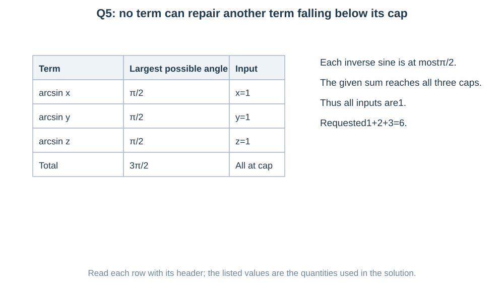

Therefore

$$
\arcsin x=\arcsin y=\arcsin z=\pi/2
\quad\Longrightarrow\quad x=y=z=1.
$$

$$
\boxed{x+2y+3z=1+2+3=6}.
$$

**A compact algebraic view:** the three nonnegative deficits $\pi/2-\arcsin x$, $\pi/2-\arcsin y$, $\pi/2-\arcsin z$ sum to zero. Each deficit must be zero.

---

### Question 6 — An inverse cosine input must stay between minus one and one

**PDF page 135 | MCQ | Notes: C09**

The domain of $f(x)=\cos^{-1}\left(\frac{2x}{1+x}\right)$ is

- (a) $[-1,1]$
- (b) $[-\frac13,1]$
- (c) $(-1,\frac13]$
- (d) $[-\frac13,\infty)$

**Inverse cosine accepts only inputs in $[-1,1]$.** Also $x\ne-1$ because the original denominator cannot vanish:

$$
-1\le\frac{2x}{1+x}\le1.
$$

Do not multiply immediately by $1+x$: its sign is unknown. Split into two rational inequalities.

$$
\frac{2x}{1+x}\le1
\iff\frac{x-1}{x+1}\le0
\iff -1<x\le1.
$$

The fraction is negative between its pole $-1$ and zero 1.

$$
\frac{2x}{1+x}\ge-1
\iff\frac{3x+1}{x+1}\ge0
\iff x<-1\ \text{or}\ x\ge-\frac13.
$$

Intersect both results:

$$
\boxed{\left[-\frac13,1\right];\quad\text{(b)}}.
$$

**Endpoint check:** the inner fraction equals $-1$ at $x=-1/3$ and 1 at $x=1$. Both are allowed arccosine inputs. The pole $x=-1$ is not included.

---

### Question 7 — A complementary pair leaves one changing term

**PDF page 135 | MCQ | Notes: C02,C03,C08**

The range of $f(x)=\sin^{-1}x+\cos^{-1}x+\tan^{-1}x$ is

- (a) $[-\frac\pi4,\frac\pi4]$
- (b) $[\frac\pi4,\frac{3\pi}4]$
- (c) $[0,\pi]$
- (d) $(\frac\pi4,\frac{3\pi}4)$

**The first two terms are complementary.** Their common domain is $[-1,1]$:

$$
\arcsin x+\arccos x=\pi/2.
$$

Thus

$$
f(x)=\frac\pi2+\arctan x,\qquad -1\le x\le1.
$$

Arctangent is increasing,so its smallest and largest values occur at the domain endpoints:

$$
f(-1)=\frac\pi2-\frac\pi4=\frac\pi4,
\qquad
f(1)=\frac\pi2+\frac\pi4=\frac{3\pi}4.
$$

It takes every intermediate value. Therefore

$$
\boxed{\left[\frac\pi4,\frac{3\pi}4\right];\quad\text{(b)}}.
$$

Using arctangent's unrestricted range would forget that the other two terms restrict $x$. Round brackets would wrongly exclude two actual attained values.

---

### Question 8 — Adjacent arctangent differences make a telescoping angle sum

**PDF page 135 | Numerical value | Notes: C06,C10**

The value of $19\cot\left(\sum_{n=1}^{19}\cot^{-1}(1+n(n+1))\right)$ is ____.

**The denominator $1+n(n+1)$ is the tangent-difference pattern.** All inputs are positive,so each inverse cotangent is an acute angle:

$$
\operatorname{arccot}(1+n(n+1))
=\arctan(n+1)-\arctan n.
$$

Let the stated angle sum be $S$. Then

$$
\begin{aligned}
S&=(\arctan2-\arctan1)+(\arctan3-\arctan2)\\
&\quad+\cdots+(\arctan20-\arctan19)\\
&=\arctan20-\arctan1.
\end{aligned}
$$

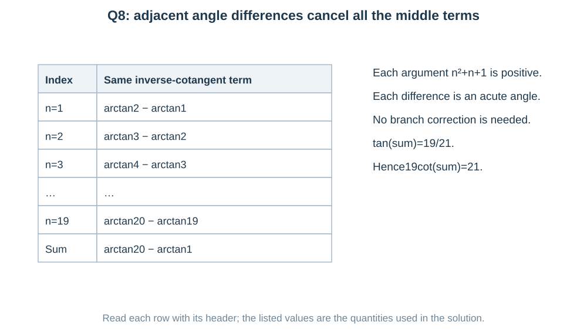

Now $0<S<\pi/4$,and

$$
\tan S=\frac{20-1}{1+20\cdot1}=\frac{19}{21}.
$$

Hence

$$
\boxed{19\cot S=19\frac{21}{19}=21}.
$$

**Why summing nineteen decimal angles is a poor fit:** the exact cancellation removes seventeen middle inverse values before any arithmetic. The branch check confirms that the inverse-cotangent replacement is valid.

---

### Question 9 — Equal tangents can represent angles pi apart

**PDF page 136 | MCQ | Notes: C06**

Statement I: $\tan^{-1}2+\tan^{-1}3=\tan^{-1}(-1)$.

Statement II: For $x,y>0$ with $xy>1$, $\tan^{-1}x+\tan^{-1}y=\pi+\tan^{-1}\frac{x+y}{1-xy}$.

Choose the correct option.

- (a) Both Statement I and Statement II are true
- (b) Statement I is true and Statement II is false
- (c) Both Statement I and Statement II are false
- (d) Statement I is false and Statement II is true

**The same tangent does not guarantee the same angle.** Let $S=\arctan2+\arctan3$. Both terms are positive acute angles,and their product $2\cdot3>1$ places the sum in quadrant II.

$$
\tan S=\frac{2+3}{1-6}=-1.
$$

Thus $S=3\pi/4$. But $\arctan(-1)=-\pi/4$.

Statement I is false. In general,for positive $x,y$ with $xy>1$,the sum is in $(\pi/2,\pi)$. The fraction $(x+y)/(1-xy)$ is negative,so its principal arctangent lies in $(-\pi/2,0)$. Adding $\pi$ returns the required quadrant:

$$
\arctan x+\arctan y
=\pi+\arctan\frac{x+y}{1-xy}.
$$

Statement II is true:

$$
\boxed{\text{I false,II true; (d)}}.
$$

This is why a memorized addition fraction without its branch condition can give a wrong answer.

---

### Question 10 — Use the principal ranges to match negative inputs

**PDF page 136 | MCQ | Notes: C02,C03**

Match List-I with List-II (principal values).

List-I: A. $\sin^{-1}(-\frac12)$; B. $\cos^{-1}(-\frac12)$; C. $\tan^{-1}(-1)$; D. $\sec^{-1}2$.

List-II: I. $\frac\pi3$; II. $-\frac\pi6$; III. $\frac{2\pi}3$; IV. $-\frac\pi4$.

- (a) A-II, B-III, C-IV, D-I
- (b) A-II, B-I, C-IV, D-III
- (c) A-IV, B-III, C-II, D-I
- (d) A-II, B-III, C-I, D-IV

**Use each function's own principal range.**

$$
\arcsin(-1/2)=-\pi/6\quad\text{(II)},
$$

because inverse sine can return a negative angle. For inverse cosine,the output must instead lie in $[0,\pi]$:

$$
\arccos(-1/2)=2\pi/3\quad\text{(III)}.
$$

Also,

$$
\arctan(-1)=-\pi/4\quad\text{(IV)},\qquad
\operatorname{arcsec}2=\arccos(1/2)=\pi/3\quad\text{(I)}.
$$

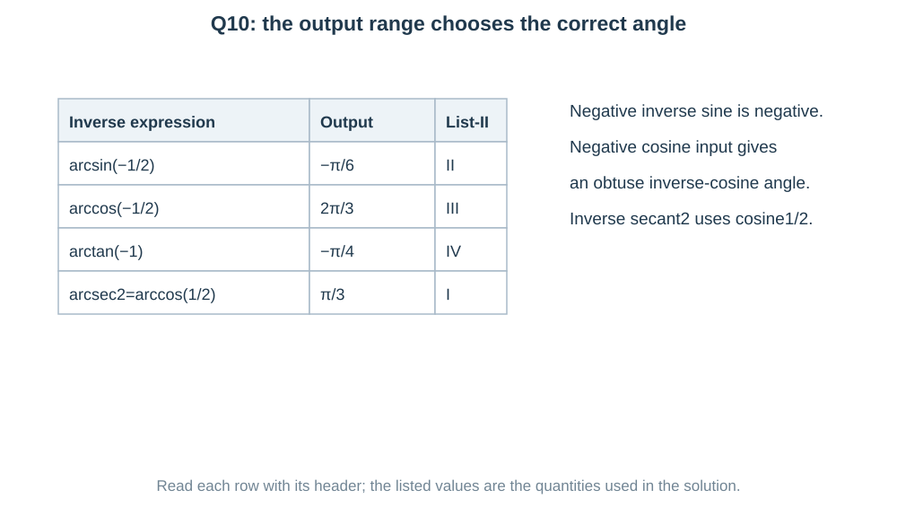

$$
\boxed{\text{A–II, B–III, C–IV, D–I; (a)}}.
$$

**Check:** $-\pi/3$ has positive cosine,but it is not in arccosine's principal range. Trig equality alone does not select the principal output.

---

### Question 11 — Sometimes the domain already gives every candidate

**PDF page 136 | Numerical value | Notes: C07,C09**

The number of real solutions of $\tan^{-1}\sqrt{x(x+1)}+\sin^{-1}\sqrt{x^2+x+1}=\frac\pi2$ is ____.

**Check the domain before trying angle-addition formulas.** Put $u=x(x+1)$. The first square root needs

$$
u\ge0.
$$

The second term is $\arcsin\sqrt{u+1}$. Its nonnegative input must be at most 1:

$$
0\le u+1\le1\quad\Longrightarrow\quad -1\le u\le0.
$$

Together these force $u=0$.

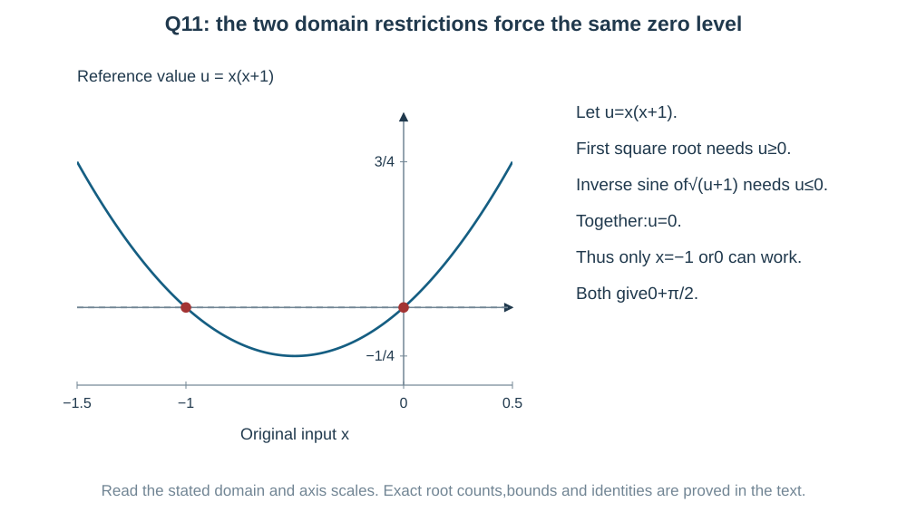

Therefore

$$
x(x+1)=0\Rightarrow x=-1\ \text{or}\ 0.
$$

At either input,the original expression is

$$
\arctan0+\arcsin1=0+\pi/2=\pi/2.
$$

$$
\boxed{2}.
$$

**Route choice:** the domain has already produced every possible candidate. Applying tangent to the whole equation first would create more algebra without adding useful information.

---

### Question 12 — Triangles supply sine values,then cosine addition supplies the sum

**PDF page 136 | MCQ | Notes: C05,C07**

$\cos^{-1}\frac45+\cos^{-1}\frac{12}{13}$ is equal to

- (a) $\cos^{-1}\frac{63}{65}$
- (b) $\cos^{-1}\frac{16}{65}$
- (c) $\cos^{-1}\frac{33}{65}$
- (d) $\cos^{-1}\frac{56}{65}$

**Name the two angles,then draw their triangles.** Let $A=\arccos(4/5)$ and $B=\arccos(12/13)$. Both are acute.

Pythagoras gives

$$
\sin A=3/5,\qquad \sin B=5/13.
$$

Thus

$$
\cos(A+B)
=\frac45\frac{12}{13}-\frac35\frac5{13}
=\frac{48-15}{65}=\frac{33}{65}.
$$

Because $A,B\in(0,\pi/2)$,their sum lies in $(0,\pi)$,inside arccosine's principal range. Hence

$$
\boxed{A+B=\arccos\frac{33}{65};\quad\text{(c)}}.
$$

**Check the sign:** cosine of a sum uses subtraction. The value $63/65$ comes from incorrectly adding the two products; that would correspond to a cosine difference.

---

### Question 13 — A half-angle asks for a stable triangle ratio

**PDF page 136 | MCQ | Notes: C05,C11**

The value of $\tan\left(\frac12\sin^{-1}\frac35\right)$ is

- (a) $\frac12$
- (b) $\frac34$
- (c) $\frac14$
- (d) $\frac13$

**The outer tangent contains half an angle.** Let $\theta=\arcsin(3/5)$. Its principal value is acute,so $\cos\theta=4/5$.

Use the half-angle form with a sum in its denominator:

$$
\tan\frac\theta2
=\frac{\sin\theta}{1+\cos\theta}
=\frac{3/5}{1+4/5}
=\frac{3/5}{9/5}.
$$

$$
\boxed{\frac13;\quad\text{(d)}}.
$$

**Another possible approach:** $(1-\cos\theta)/\sin\theta=(1/5)/(3/5)=1/3$.

**Geometric view:** the chord from $(-1,0)$ to $(\cos\theta,\sin\theta)$ has horizontal run $1+\cos\theta$ and vertical rise $\sin\theta$. Its direction angle is $\theta/2$,so the same ratio appears in the picture.

---

### Question 14 — Keep both sides of the inverse-sine input inequality

**PDF page 136 | Numerical value | Notes: C09**

The number of integers in the domain of $f(x)=\sin^{-1}(x^2-5x+5)$ is ____.

**An inverse sine requires both an upper and a lower input bound.**

$$
-1\le x^2-5x+5\le1.
$$

First the upper bound:

$$
x^2-5x+4=(x-1)(x-4)\le0
\Rightarrow x\in[1,4].
$$

Then the lower bound:

$$
x^2-5x+6=(x-2)(x-3)\ge0
\Rightarrow x\le2\ \text{or}\ x\ge3.
$$

Intersect:

$$
\operatorname{domain}(f)=[1,2]\cup[3,4].
$$

The allowed integers are $1,2,3,4$:

$$
\boxed{4}.
$$

**Another view:** the graph enters the band $[-1,1]$,drops below it near its vertex,and enters it again. That explains the gap $(2,3)$,which would be missed by imposing only the upper bound.

---

### Question 15 — An inverse is only an undoing on its chosen branch

**PDF page 136 | MCQ | Notes: C01,C04**

Assertion (A): $\sin^{-1}(\sin x)=x$ for every real $x$.

Reason (R): The range of $\sin^{-1}$ is $[-\frac\pi2,\frac\pi2]$.

Choose the correct option.

- (a) Both A and R are true and R is the correct explanation of A
- (b) A is false but R is true
- (c) Both A and R are true but R is not the correct explanation of A
- (d) A is true but R is false

**The phrase “for every real $x$” needs a universal identity.** Inverse sine returns only values in $[-\pi/2,\pi/2]$,so it cannot return every real input angle unchanged.

Choose the clear counterexample $x=\pi$:

$$
\arcsin(\sin\pi)=\arcsin0=0\ne\pi.
$$

Assertion A is false. Reason R correctly states the principal range:

$$
\boxed{\text{A false,R true; (b)}}.
$$

**Correct replacement:** $\arcsin(\sin x)=x$ holds precisely for $x\in[-\pi/2,\pi/2]$. A true reason does not make a false universal assertion true.

---

### Question 16 — Rationalize the square-root expression and halve the angle

**PDF page 136 | MCQ | Notes: C03,C11**

For $x\ne0$, $\tan^{-1}\left(\frac{\sqrt{1+x^2}-1}{x}\right)$ equals

- (a) $2\tan^{-1}x$
- (b) $\tan^{-1}x$
- (c) $\frac12\tan^{-1}x$
- (d) $\frac14\tan^{-1}x$

**The pattern $\sqrt{1+x^2}$ suggests a tangent triangle.** Put $\theta=\arctan x$. Then $-\pi/2<\theta<\pi/2$,so $\cos\theta>0$.

Therefore $x=\tan\theta$ and

$$
\sqrt{1+x^2}=\sqrt{1+\tan^2\theta}
=|\sec\theta|=\sec\theta.
$$

For the stated $x\ne0$,

$$
\frac{\sqrt{1+x^2}-1}{x}
=\frac{\sec\theta-1}{\tan\theta}
=\frac{1-\cos\theta}{\sin\theta}
=\tan\frac\theta2.
$$

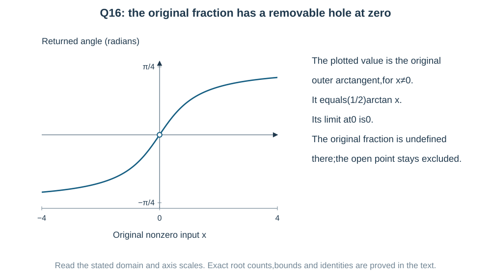

Since $\theta/2\in(-\pi/4,\pi/4)$,the outer inverse tangent recovers it:

$$
\boxed{\frac\theta2=\frac12\arctan x;\quad\text{(c)}}.
$$

**Another useful first step:** rationalize the fraction:

$$
\frac{\sqrt{1+x^2}-1}{x}
=\frac{x}{\sqrt{1+x^2}+1}.
$$

This exposes the half-angle form with a stable sum denominator. It has a removable extension at zero,but the original question explicitly excludes zero.

---

### Question 17 — A sine difference needs an angle-order check

**PDF page 137 | MCQ | Notes: C05,C07**

$\sin^{-1}\frac35-\sin^{-1}\frac8{17}$ is equal to

- (a) $\sin^{-1}\frac{13}{85}$
- (b) $\sin^{-1}\frac{77}{85}$
- (c) $\sin^{-1}\frac{45}{85}$
- (d) $\sin^{-1}\frac{35}{85}$

**The target is a difference of two inverse sines.** Name them $A=\arcsin(3/5)$ and $B=\arcsin(8/17)$. Both are acute.

The triangles give $\cos A=4/5$ and $\cos B=15/17$.

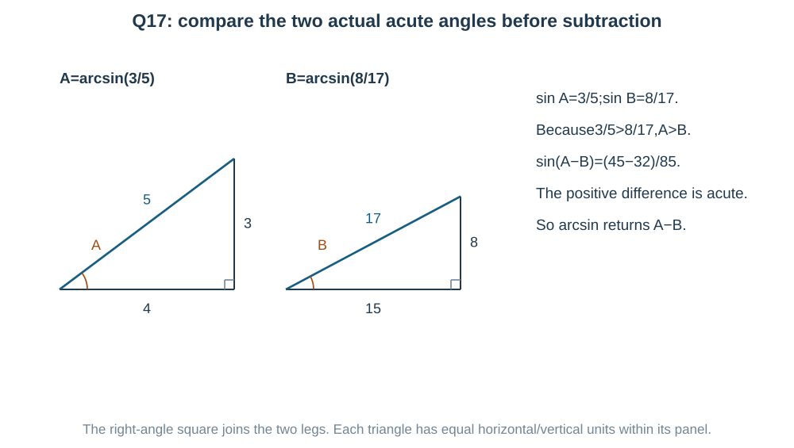

Hence

$$
\sin(A-B)
=\frac35\frac{15}{17}-\frac45\frac8{17}
=\frac{45-32}{85}=\frac{13}{85}.
$$

**Check which angle inverse sine will return:** $3/5>8/17$,and arcsine increases,so $A>B$. Also both are acute,so $0<A-B<\pi/2$. Thus

$$
\boxed{A-B=\arcsin\frac{13}{85};\quad\text{(a)}}.
$$

The value $77/85$ uses a plus sign and would describe $\sin(A+B)$,not the requested difference.

---

### Question 18 — A tangent equation gives candidates;the original sum chooses branches

**PDF page 137 | MCQ | Notes: C06,C07,C09**

The solutions of $\tan^{-1}\frac{x-1}{x-2}+\tan^{-1}\frac{x+1}{x+2}=\frac\pi4$ are

- (a) $x=\pm\frac12$
- (b) $x=\pm\sqrt2$
- (c) $x=\pm\frac1{\sqrt2}$
- (d) $x=\pm1$

**Keep the original exclusions $x\ne2,-2$.** Put

$$
u=\frac{x-1}{x-2},\qquad v=\frac{x+1}{x+2}.
$$

If the angle sum is $\pi/4$,its tangent is 1:

$$
\frac{u+v}{1-uv}
=\frac{(2x^2-4)/(x^2-4)}{-3/(x^2-4)}
=\frac{4-2x^2}{3}=1.
$$

Therefore $x^2=1/2$,giving candidates $x=\pm1/\sqrt2$.

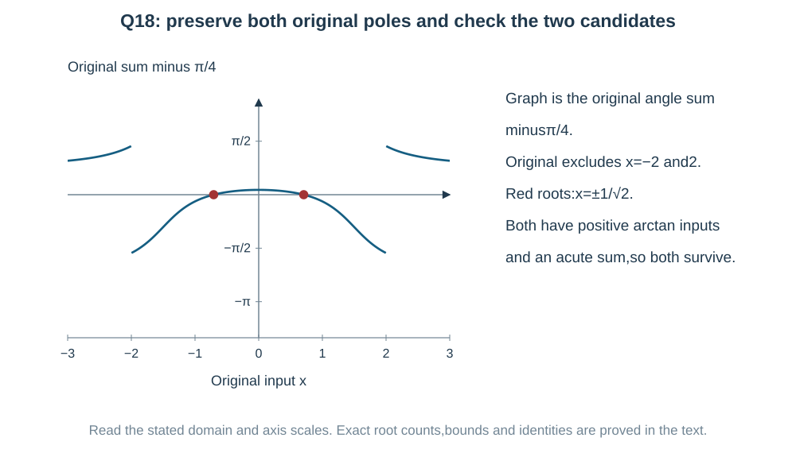

**Now verify the angle branch.** For either candidate,$|x|<1$. Both fractions $u,v$ are positive. Also

$$
uv=\frac{x^2-1}{x^2-4}
=\frac{-1/2}{-7/2}=\frac17<1.
$$

Their positive inverse-tangent sum is acute,so tangent 1 means exactly $\pi/4$,not an angle shifted by $\pi$. Both candidates survive:

$$
\boxed{x=\pm\frac1{\sqrt2};\quad\text{(c)}}.
$$

Taking tangent was a useful way to find candidates. The sign/product check is what proves they solve the original inverse equation.

---

### Question 19 — Use the angle difference to create a quadratic identity

**PDF page 137 | Numerical value | Notes: C07,C12**

If $\cos^{-1}x-\cos^{-1}\frac y2=\frac\pi3$,then $4x^2-2xy+y^2$ equals ____.

**The target is quadratic;the given fixes an angle difference.** Let

$$
A=\arccos x,\qquad B=\arccos(y/2).
$$

Then $A=B+\pi/3$. Put $z=y/2=\cos B$. Cosine addition gives

$$
x=\cos(B+\pi/3)=\frac z2-\frac{\sqrt3}{2}\sin B,
$$

$$
2x-z=-\sqrt3\sin B.
$$

**Why square here?** It removes the remaining sine through $\sin^2B=1-z^2$,creating exactly a quadratic target:

$$
(2x-z)^2=3(1-z^2),
$$

$$
4x^2-4xz+z^2=3-3z^2,
$$

$$
4x^2-4xz+4z^2=3.
$$

Substitute $z=y/2$:

$$
\boxed{4x^2-2xy+y^2=3}.
$$

**Check with a compatible pair:** choose $B=\pi/6$,so $A=\pi/2$, $x=0$ and $y=\sqrt3$. The target is 3. This is one example,not a uniquely determined pair.

We used a consequence of the true given relation. Claiming that every point of the final quadratic also satisfies the original inverse-angle equation would need extra branch restrictions; the diagram shows only the permitted arc.

---

### Question 20 — The sum is an angle,not merely a tangent value

**PDF page 137 | MCQ | Notes: C06**

The value of $\tan^{-1}1+\tan^{-1}2+\tan^{-1}3$ is

- (a) $\pi$
- (b) $\frac\pi2$
- (c) $\frac{3\pi}4$
- (d) $2\pi$

**Group two angles first and restore their correct branch.** Both inputs 1 and 2 are positive,and their product exceeds 1:

$$
\arctan1+\arctan2
=\pi+\arctan\frac{1+2}{1-2}
=\pi+\arctan(-3)
=\pi-\arctan3.
$$

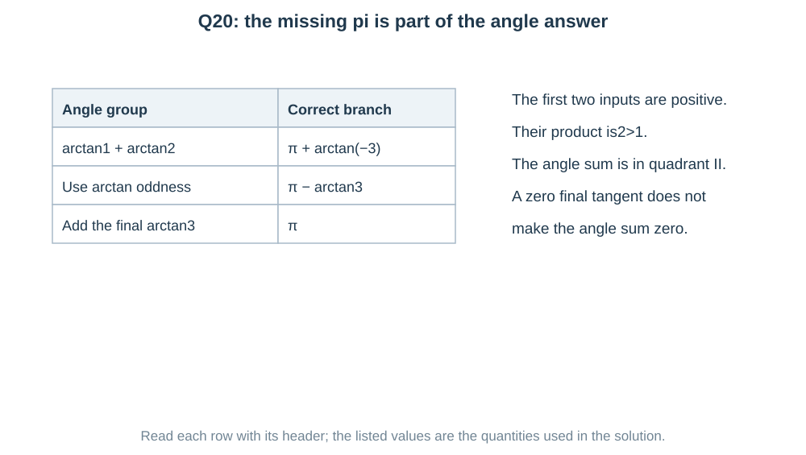

Adding the final term gives

$$
\boxed{\arctan1+\arctan2+\arctan3=\pi;\quad\text{(a)}}.
$$

**Another possible approach:** Q9 gives $\arctan2+\arctan3=3\pi/4$. Add $\arctan1=\pi/4$ to get $\pi$.

A tangent-only calculation may end with zero. That means an integer multiple of $\pi$,not necessarily angle zero. The three original angles are positive,so the answer cannot be zero.

## Answer check

Read the qualifications in the solutions before using the key.

| Question | Answer | Question | Answer |
|---|---|---|---|
| 1 | (c) | 11 | $2$ |
| 2 | $15$ | 12 | (c) |
| 3 | (a) | 13 | (d) |
| 4 | (d) | 14 | $4$ |
| 5 | $6$ | 15 | (b) |
| 6 | (b) | 16 | (c) |
| 7 | (b) | 17 | (a) |
| 8 | $21$ | 18 | (c) |
| 9 | (d) | 19 | $3$ |
| 10 | (a) | 20 | (a) |

## After this chapter

An inverse expression returns an angle in a specified interval. Keep the domain beside its input and the principal range beside its output. Triangle identities do the arithmetic; branch checks make the answer valid. Every alternative remains visible for the later booklet. The supplied questions are practice,not verified actual PYQs.
