# Chapter 27 — Mathematical Reasoning

**Kanna,this chapter studies how statements combine and what follows from them.** Its symbols return truth values: **T** means true and **F** means false.

## Exam status and recent chapter weightage

**Preparation priority: lower,older-syllabus/supporting material.** Mathematical Reasoning is absent from the current official JEE Main Paper 1 Mathematics syllabus. Complete the requested PDF practice,but give current-syllabus chapters priority in your final revision for the **200-mark target: Physics 60,Maths 60,Chemistry 80**.

| Year | Questions in the checked Mathematical Reasoning archive category | Full-year shifts | Tagged questions per shift |
|---|---:|---:|---:|
| 2024 | 0 | 20 | 0 |
| 2025 | 0 | 19 | 0 |
| 2026 | 0 | 19 | 0 |
| Total | 0 | 58 | **0** |

ExamSIDE labels this category out of syllabus and records these zeros. The current PYQSide weightage table omits it. The official syllabus absence was checked separately; archive zero alone is not an independent audit of every paper.

All 15 supplied questions are solved here. Logic remains useful when reading conditions,negating an inequality,checking a counterexample or proving a statement in another chapter. No artificial “very important for the current exam” label is attached to an excluded unit.

## Concept C01 — Statement,truth value and an open sentence

A **statement** is a sentence with a definite truth value. It can be true **or false**.

- “9 is a perfect square” is a true statement.
- “10 is a perfect square” is a false statement,but still a statement.
- “Close the door” is a command,not a statement.
- “Is 7 prime?” is a question,not a statement.

An **open sentence** contains an unspecified variable. For example,$x+3=5$ depends on $x$. Assigning $x=2$ makes it true; assigning $x=4$ makes it false. Until a value or quantifier is supplied,it has no fixed truth value.

Subjective praise such as “Mumbai is beautiful” has no agreed mathematical truth test in this context.

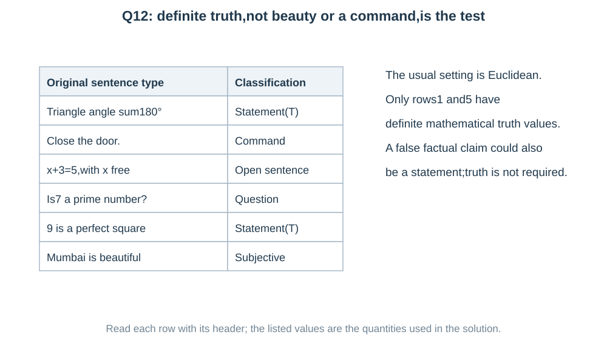

We use ordinary Euclidean geometry for the source's triangle-angle statement.

## Concept C02 — AND,OR and NOT

Let $p,q$ stand for statements.

| Symbol | Read it as | When it is true |
|---|---|---|
| $\neg p$ or $\sim p$ | not $p$ | when $p$ is false |
| $p\wedge q$ | $p$ and $q$ | when both are true |
| $p\vee q$ | $p$ or $q$ | when at least one is true |

The usual mathematical OR is **inclusive**: it allows both statements to be true.

$$
\begin{array}{cc|ccc}
p&q&\neg p&p\wedge q&p\vee q\\ \hline
T&T&F&T&T\\
T&F&F&F&T\\
F&T&T&F&T\\
F&F&T&F&F
\end{array}
$$

These are operations on truth values. They are not addition or multiplication of numerical marks.

**Negate the whole statement:** the negation of $x>2$ is $x\le2$,including equality. It is not merely $x<2$.

## Concept C03 — Brackets and De Morgan's laws

A bracket groups a whole statement. Negating it means reversing the truth of that whole group.

$$
\boxed{\neg(p\wedge q)\equiv\neg p\vee\neg q},
$$

$$
\boxed{\neg(p\vee q)\equiv\neg p\wedge\neg q}.
$$

**Meaning:** “not both” means at least one fails. “Not either” means both fail. These are different conditions.

Example: the failure of “passed Maths **and** Physics” means failed Maths **or** failed Physics,possibly both.

Also,

$$
\neg(\neg p)\equiv p.
$$

The symbol $\equiv$ means **logically equivalent**: the two columns agree for every assignment,not just one example.

If a mixed expression is unclear,insert brackets before evaluating. NOT attaches to its next expression; AND is ordinarily grouped before OR; the implication's full antecedent and consequent must be identified. Preserve any printed brackets.

## Concept C04 — Implication: the one row that breaks the rule

$p\to q$ means “if $p$,then $q$.” The first part $p$ is the **condition** or antecedent; $q$ is the claimed result or consequent.

It fails exactly when the condition is true but the claimed result is false:

$$
\begin{array}{cc|c}
p&q&p\to q\\ \hline
T&T&T\\
T&F&F\\
F&T&T\\
F&F&T
\end{array}
$$

**Why the false-condition rows are true in this truth table:** they do not break the stated rule. The rule only demands $q$ when $p$ holds. This formal connector does not claim that $p$ causes $q$.

The equivalent form and its negation are

$$
\boxed{p\to q\equiv\neg p\vee q},
\qquad
\boxed{\neg(p\to q)\equiv p\wedge\neg q}.
$$

**Words to symbols:**

| Wording | Formula |
|---|---|
| $p$ is sufficient for $q$ | $p\to q$ |
| $q$ is necessary for $p$ | $p\to q$ |
| $p$ only if $q$ | $p\to q$ |
| $p$ if $q$ | $q\to p$ |

Necessary means the result must be present whenever the condition holds. It does not mean the result alone proves the condition.

## Concept C05 — Converse,inverse and contrapositive

For the original rule $a\to b$:

| Name | Formula | Change |
|---|---|---|
| Converse | $b\to a$ | reverse the order |
| Inverse | $\neg a\to\neg b$ | negate both,keep order |
| Contrapositive | $\neg b\to\neg a$ | reverse and negate both |

$$
\boxed{a\to b\equiv\neg b\to\neg a}.
$$

The converse and inverse are equivalent to each other,but not generally to the original rule.

Example: every multiple of 6 is a multiple of 3. Therefore a number that is **not** a multiple of 3 cannot be a multiple of 6.

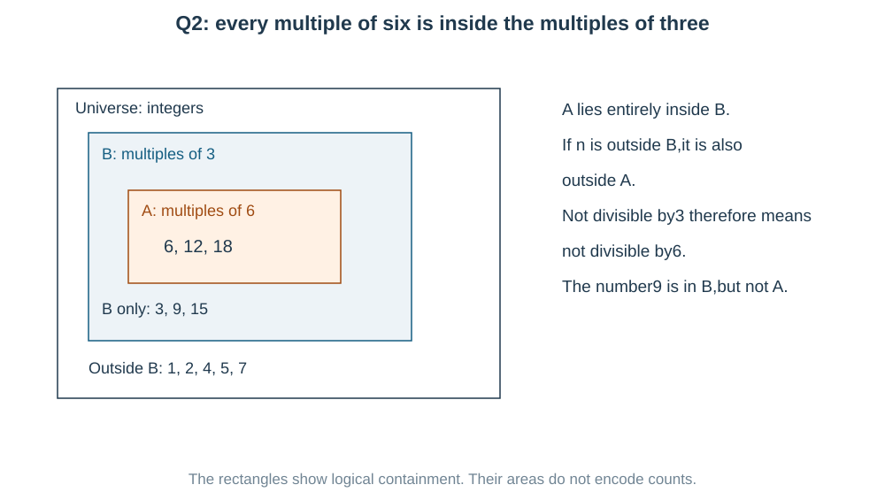

But being a multiple of 3 does not force being a multiple of 6: 9 is a counterexample.

**Read the actual letters.** If the source rule is $q\to p$,use $a=q,b=p$. Its inverse is $\neg q\to\neg p$,not a memorized expression in the opposite order.

## Concept C06 — Biconditional,tautology and contradiction

$p\leftrightarrow q$ means “$p$ if and only if $q$.” Both directions must hold:

$$
\boxed{p\leftrightarrow q\equiv(p\to q)\wedge(q\to p)}.
$$

It is true exactly when $p,q$ have the **same truth value**: TT or FF. Its negation is true exactly when they differ:

$$
\boxed{\neg(p\leftrightarrow q)
\equiv(p\wedge\neg q)\vee(\neg p\wedge q)}.
$$

This is exclusive OR: exactly one true,unlike inclusive OR.

A compound statement is a **tautology** if every truth-table row is T. It is a **contradiction** if every row is F. A mixed column is called **contingent**,meaning true in some rows and false in others.

Examples:

$$
p\vee\neg p\text{ is a tautology},\qquad
p\wedge\neg p\text{ is a contradiction}.
$$

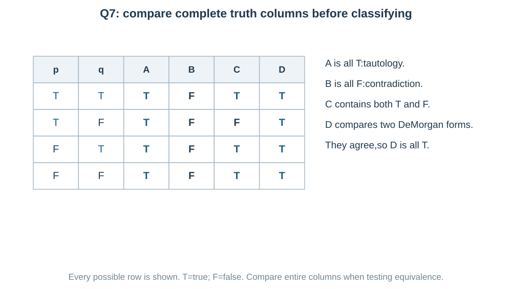

One true example cannot prove a tautology. **One false row can disprove it.** To prove equivalence,all rows must agree.

## Concept C07 — Logical algebra: expose a reusable pattern

Let $T$ denote always true and $F$ always false.

$$
p\wedge T\equiv p,\quad p\vee F\equiv p,\quad
p\vee T\equiv T,\quad p\wedge F\equiv F.
$$

Repeated pieces can be collected:

$$
p\vee p\equiv p,\qquad p\wedge p\equiv p.
$$

AND and OR are commutative and associative: their own order/grouping can change without changing the result. Distribution holds in both directions:

$$
\boxed{p\wedge(q\vee r)
\equiv(p\wedge q)\vee(p\wedge r)},
$$

$$
\boxed{p\vee(q\wedge r)
\equiv(p\vee q)\wedge(p\vee r)}.
$$

Absorption:

$$
p\vee(p\wedge q)\equiv p,\qquad
p\wedge(p\vee q)\equiv p.
$$

**Pattern skill:** if both terms contain $\neg p$,factor that shared condition:

$$
(\neg p\wedge\neg q)\vee(\neg p\wedge q)
\equiv\neg p\wedge(\neg q\vee q)
\equiv\neg p.
$$

The final bracket is always true. Logical factoring resembles algebraic factoring,but the operations are truth-value operations.

## Concept C08 — Quantifiers: every,some,and their order

$\forall x$ means **for every** allowed $x$. $\exists x$ means **there exists at least one** allowed $x$.

$$
\boxed{\neg(\forall x\,P(x))\equiv\exists x\,\neg P(x)},
$$

$$
\boxed{\neg(\exists x\,P(x))\equiv\forall x\,\neg P(x)}.
$$

**Meaning:** to disprove “every student passed,”one failed student is enough. To disprove “someone passed,”everyone must have failed.

Keep the same variable domains and the same outer-to-inner order when negating:

$$
\boxed{\neg(\forall x\exists y\,P(x,y))
\equiv\exists x\forall y\,\neg P(x,y)}.
$$

Do not turn it into $\forall y\exists x$ by changing the order.

In $\forall x\exists y$,the chosen $y$ may depend on $x$. For every real $x$,choosing $y=1-x$ makes $x+y=1>0$.

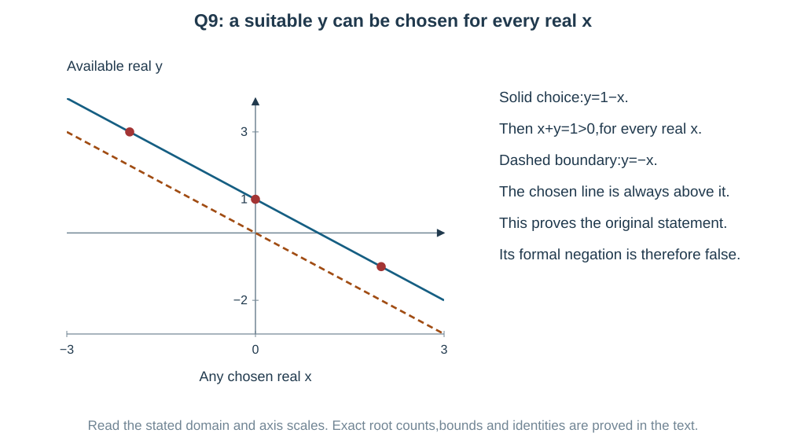

Negating an inequality:

$$
\neg(u>0):u\le0,\quad
\neg(u\ge0):u<0,\quad
\neg(u=0):u\ne0.
$$

The formal negation of a true statement is false. A question asking its form does not require finding a witness that makes that negation true.

## Concept C09 — Dual is a connector swap,not a negation

For an expression built with AND,OR,NOT and truth constants,form its **dual** by replacing simultaneously

$$
\boxed{\wedge\leftrightarrow\vee,\qquad T\leftrightarrow F}.
$$

Keep every letter and existing negation unchanged. If the source calls the constants $t$ and $c$,swap $t\leftrightarrow c$.

Example:

$$
(p\wedge\neg q)\vee T
\quad\longmapsto\quad
(p\vee\neg q)\wedge F.
$$

Do **not** change $p$ to $\neg p$ or $\neg q$ to $q$. That would be a different operation.

A dual need not be equivalent to the original. This example changes an always-true expression into an always-false one. Dualizing twice returns the original expression.

## Concept C10 — Count truth assignments without writing every row

Each of $n$ independent statement letters has two possible truth values,so there are

$$
\boxed{2^n\text{ assignments}}.
$$

This is a count,not a probability claim. No random experiment is assumed.

An implication is false only when its antecedent is T and consequent F. For $(p\vee q)\to r$,there are three ways to make $p\vee q$ true: TT,TF,FT. Fix $r=F$,giving three false rows.

For a pair $(p,q)$,the conjunction $p\wedge q$ is false in three of its four rows. Thus

$$
(p\wedge q)\vee(r\wedge s)
$$

is false in $3\cdot3=9$ of the 16 assignments. It is true in $16-9=7$.

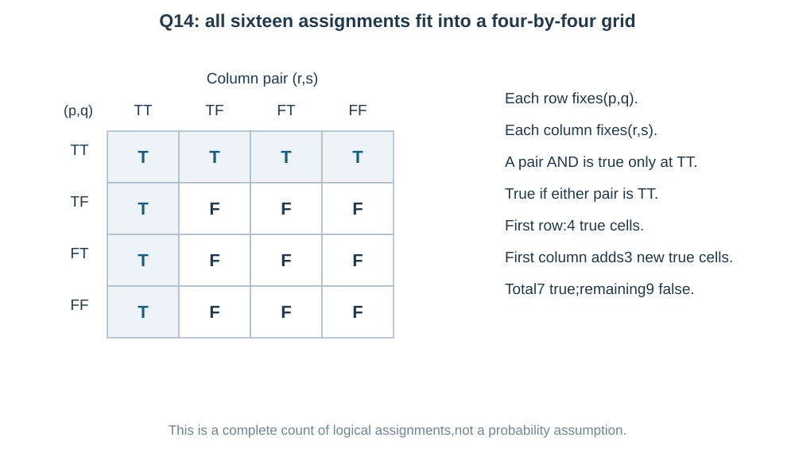

**Another view:** the first conjunction is true in four assignments,the second in four,and both in one. Inclusion-exclusion gives $4+4-1=7$.

## Concept C11 — Safe inference and counterexamples

From $p\to q$ and $p$,we may conclude $q$. This is **modus ponens**: the stated condition actually holds.

From $p\to q$ and $\neg q$,we may conclude $\neg p$. This is **modus tollens**: a failed necessary result rules out the condition.

Two tempting but invalid moves:

- From $q$,do not conclude $p$: a multiple of 3 may be 9,not a multiple of 6.
- From $\neg p$,do not conclude $\neg q$: a number not divisible by 6 can still be divisible by 3.

For a proposed tautology,try to make its implication fail: make its antecedent true and consequent false. For a claimed equivalence,look for one row where its two columns differ. If no short structural proof appears,a complete truth table is a reliable method.

## Last-minute formula recap

This recap supports the supplied older-syllabus chapter; current-syllabus revision takes priority.

| Meaning | Rule |
|---|---|
| NOT AND | $\neg(p\wedge q)\equiv\neg p\vee\neg q$ |
| NOT OR | $\neg(p\vee q)\equiv\neg p\wedge\neg q$ |
| Implication | $p\to q\equiv\neg p\vee q$; false only at TF |
| Negated implication | $\neg(p\to q)\equiv p\wedge\neg q$ |
| Contrapositive | $\neg q\to\neg p$; equivalent to $p\to q$ |
| Converse/inverse | $q\to p$ / $\neg p\to\neg q$; equivalent to each other |
| Biconditional | same truth values; $(p\to q)\wedge(q\to p)$ |
| Negated biconditional | different truth values; $(p\wedge\neg q)\vee(\neg p\wedge q)$ |
| Tautology / contradiction | all T / all F across the complete table |
| Negate quantifiers | $\forall\leftrightarrow\exists$,negate predicate,keep domains and nesting order |
| Dual | swap AND/OR and true/false constants; keep letters and NOT unchanged |
| Assignment count | $2^n$ for $n$ statement letters |
| Count a union | add both counts,subtract their overlap |
| Reject a universal claim | one valid counterexample is enough |

Read the brackets and actual letter order before applying a rule.

## Worked solutions to the 15 PDF questions

Read the question first. Notice the pattern, choose a route, then calculate. Alternative methods below are fully visible.

### Question 1 — Negate the whole implication before opening its bracket

**PDF page 139 | MCQ | Notes: C03,C04,C07**

The negation of the compound statement $p\to(q\vee r)$ is logically equivalent to

- (a) $\sim p\wedge q\wedge r$
- (b) $p\wedge(q\vee r)$
- (c) $p\wedge\sim q\wedge\sim r$
- (d) $\sim p\vee(\sim q\wedge\sim r)$

**First identify the whole claimed result.** It is the bracket $q\vee r$. An implication fails when its condition holds but its entire claimed result fails:

$$
\neg\bigl(p\to(q\vee r)\bigr)
\equiv p\wedge\neg(q\vee r).
$$

Now De Morgan's law opens the bracket:

$$
\neg(q\vee r)\equiv\neg q\wedge\neg r.
$$

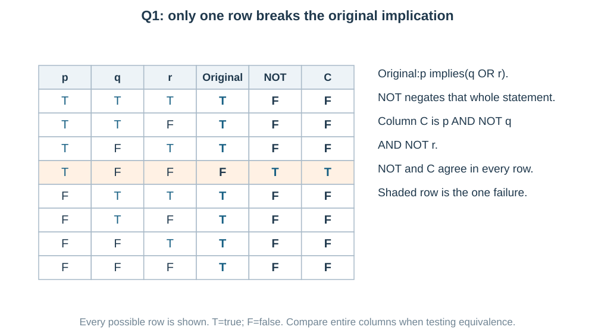

Therefore

$$
\boxed{p\wedge\neg q\wedge\neg r;\quad\text{(c)}}.
$$

**Check by meaning:** $p$ must be true,while neither $q$ nor $r$ is true. That is exactly the one way the original rule can fail.

Changing only $p$ to $\neg p$ would not negate the whole implication.

---

### Question 2 — Read the contrapositive as the same rule viewed backwards

**PDF page 139 | MCQ | Notes: C05**

The contrapositive of the statement 'If a number is divisible by $6$,then it is divisible by $3$' is

- (a) If a number is not divisible by 3,then it is not divisible by 6
- (b) If a number is divisible by 3,then it is divisible by 6
- (c) If a number is not divisible by 6,then it is not divisible by 3
- (d) A number is divisible by 6 and not divisible by 3

**Name the condition and result before changing the wording.** Let $p$ mean “divisible by 6” and $q$ mean “divisible by 3.” The original rule is $p\to q$.

The contrapositive reverses the parts and negates both:

$$
p\to q\quad\longmapsto\quad\neg q\to\neg p.
$$

Thus

$$
\boxed{\text{If a number is not divisible by 3,then it is not divisible by 6; (a)}}.
$$

**Why this is the same rule:** a multiple of 6 is $6k=3(2k)$,so it cannot fail to be a multiple of 3.

**Do not choose the converse:** 9 is divisible by 3 but not by 6. Reversing without negating would create a different,false rule.

---

### Question 3 — A tautology must survive every truth row

**PDF page 139 | MCQ | Notes: C02,C04,C06**

Which of the following statements is a tautology?

- (a) $p\to(p\wedge q)$
- (b) $(p\vee q)\to p$
- (c) $(p\to q)\to(q\to p)$
- (d) $(p\wedge q)\to p$

**Try to break an implication by making its condition true and its result false.**

For option (d),the condition is $p\wedge q$. If it is true,$p$ is already true. If it is false,the implication is true by its truth-table rule. Thus (d) never fails.

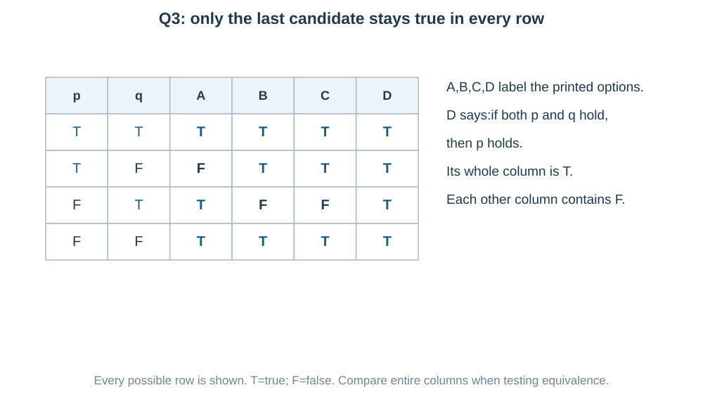

The other options have counterexamples:

- (a) $p=T,q=F$: $p$ is true but $p\wedge q$ is false.
- (b) $p=F,q=T$: $p\vee q$ is true but $p$ is false.
- (c) $p=F,q=T$: $p\to q$ is true but $q\to p$ is false.

Therefore

$$
\boxed{(p\wedge q)\to p;\quad\text{(d)}}.
$$

**Another possible approach:** write all four rows for every option,as in the figure. Structural reasoning is shorter here,but the complete table is a reliable check.

---

### Question 4 — Negating same truth values means different truth values

**PDF page 139 | MCQ | Notes: C03,C06**

The statement $\sim(p\leftrightarrow q)$ is equivalent to

- (a) $(p\wedge q)\vee(\sim p\wedge\sim q)$
- (b) $(p\wedge\sim q)\vee(\sim p\wedge q)$
- (c) $\sim p\vee\sim q$
- (d) $(p\wedge\sim q)\wedge(\sim p\wedge q)$

**A biconditional means same truth values.** It is true at TT and FF. Negating it keeps precisely TF and FT.

- TF means $p\wedge\neg q$.
- FT means $\neg p\wedge q$.

Either row is allowed,so join them with OR:

$$
\neg(p\leftrightarrow q)
\equiv(p\wedge\neg q)\vee(\neg p\wedge q).
$$

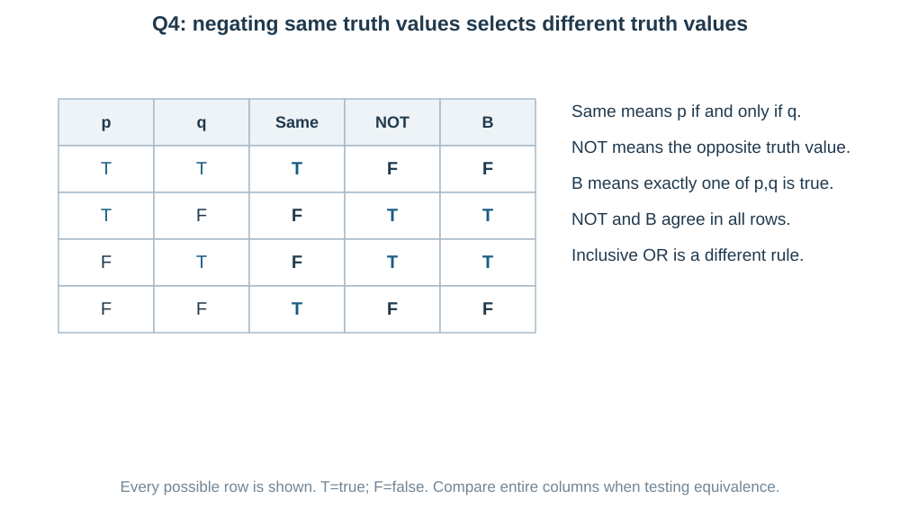

$$
\boxed{\text{(b)}}.
$$

**Check the other join:** joining these two cases with AND would demand $p$ and $\neg p$ together. The cases are alternatives,not simultaneous requirements.

---

### Question 5 — Count the one failure pattern of an implication

**PDF page 139 | Numerical value | Notes: C04,C10**

The truth table of the statement $(p\vee q)\to r$ has ____ rows in which the statement is false.

**Count only the failure pattern.** An implication is false exactly when its condition is true and result false.

Here the condition is $p\vee q$,which is true for three pairs:

$$
(p,q)=(T,T),(T,F),(F,T).
$$

For each pair,fix $r=F$. Thus the failing rows are

$$
(p,q,r)=(T,T,F),(T,F,F),(F,T,F).
$$

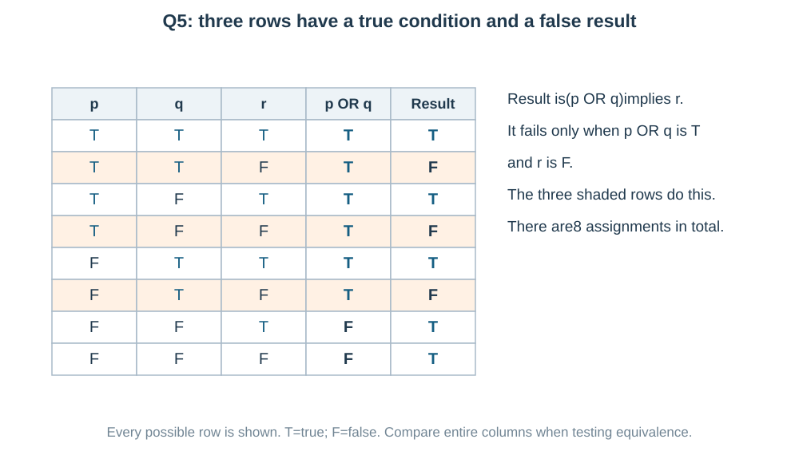

$$
\boxed{3}.
$$

**Another possible approach:** form all $2^3=8$ rows and count F entries in the final column. The failure-pattern route is shorter because it avoids evaluating the five true rows.

---

### Question 6 — An inverse is not a negation

**PDF page 139 | MCQ | Notes: C04,C05,C07**

Statement I: The negation of $p\to q$ is $\sim p\to\sim q$.

Statement II: The negation of $p\to q$ is $p\wedge\sim q$.

Choose the correct option.

- (a) Both Statement I and Statement II are true
- (b) Statement I is false and Statement II is true
- (c) Statement I is true and Statement II is false
- (d) Both Statement I and Statement II are false

**The inverse and the negation are different operations.** Negating an implication means describing its one failure:

$$
\neg(p\to q)\equiv p\wedge\neg q.
$$

So Statement II is true.

Statement I gives $\neg p\to\neg q$,which is the **inverse**. To see why it is not the negation,choose $p=F,q=F$:

$$
p\to q=F\to F=T,
$$

$$
\neg p\to\neg q=T\to T=T.
$$

A statement and its true negation must have opposite truth values,not both T.

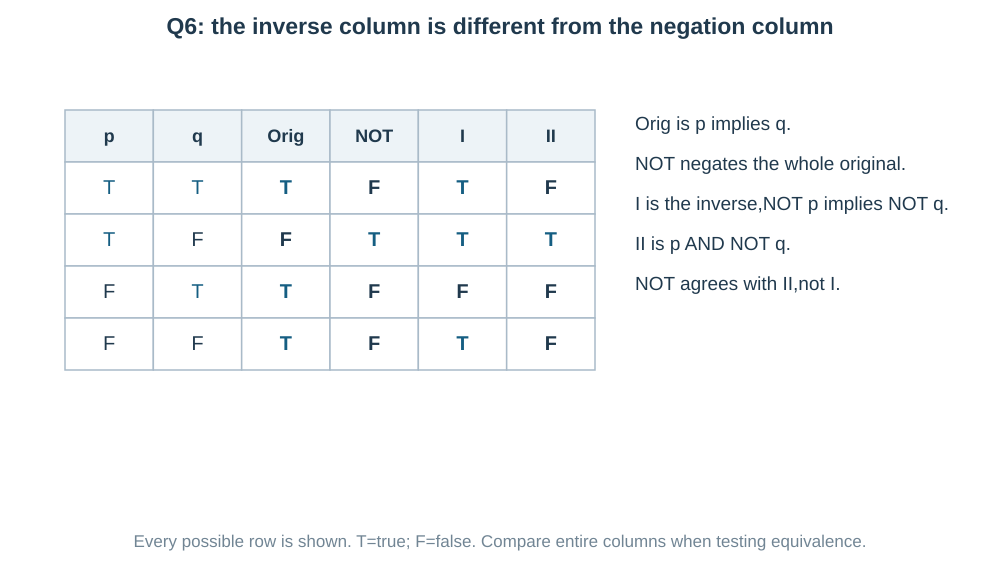

$$
\boxed{\text{I false,II true; (b)}}.
$$

The counterexample rejects Statement I; the displayed identity proves Statement II for all rows.

---

### Question 7 — Classify a full truth column,not one row

**PDF page 139 | MCQ | Notes: C06,C07**

Match List-I with List-II.

List-I: A. $p\vee\sim p$; B. $p\wedge\sim p$; C. $p\to q$; D. $\sim(p\wedge q)\leftrightarrow(\sim p\vee\sim q)$.

List-II: I. Tautology; II. Contradiction; III. Neither tautology nor contradiction.

- (a) A-I, B-II, C-I, D-III
- (b) A-II, B-I, C-III, D-I
- (c) A-III, B-II, C-I, D-I
- (d) A-I, B-II, C-III, D-I

**Classification depends on the entire column.**

- A: $p\vee\neg p$ always includes a true part,so it is a tautology (I).
- B: $p\wedge\neg p$ demands a statement and its negation together,so it is always false,a contradiction (II).
- C: $p\to q$ fails at TF but is true in the other rows. It is neither (III).
- D: De Morgan's law says $\neg(p\wedge q)$ and $\neg p\vee\neg q$ always agree. Their biconditional is therefore a tautology (I).

$$
\boxed{\text{A–I, B–II, C–III, D–I; (d)}}.
$$

**Useful distinction:** $p\leftrightarrow q$ itself is not automatically a tautology. Here D is always true because its two specific sides are equivalent.

---

### Question 8 — A single bad row rejects a claimed tautology

**PDF page 139 | Numerical value | Notes: C04,C06,C11**

How many of the following are tautologies?

(i) $p\vee\sim p$

(ii) $(p\wedge q)\to(p\vee q)$

(iii) $p\to(p\wedge q)$

(iv) $(p\to q)\vee(q\to p)$

(v) $\sim(p\to q)\to p$

**Check what would make each expression fail.**

**(i)** $p\vee\neg p$ is always true.

**(ii)** If $p\wedge q$ is true,then $p\vee q$ is true. Otherwise the implication has a false condition and is true. So it is a tautology.

**(iii)** At $p=T,q=F$,the condition $p$ is true but $p\wedge q$ false. This one is not a tautology.

**(iv)** For its OR to be false,both implications would need to be false. But $p\to q$ fails only at TF,and $q\to p$ fails only at FT. They cannot both fail in the same row. Thus the OR is always true.

**(v)** Its condition $\neg(p\to q)$ means $p\wedge\neg q$,which already includes $p$. Whenever the condition holds,the claimed result $p$ holds. Thus it is a tautology.

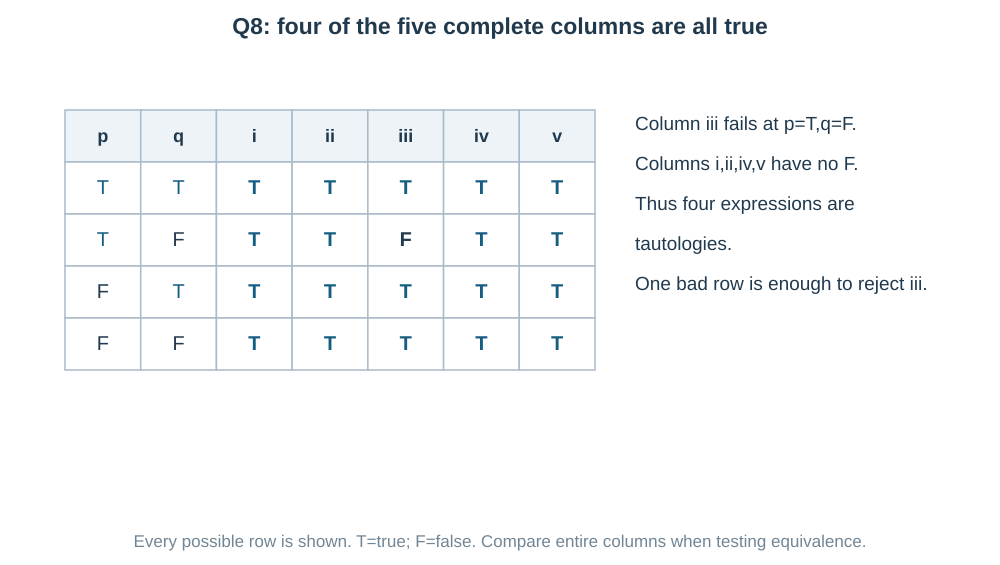

$$
\boxed{4}.
$$

The table verifies every row;the explanations show repeatable reasons for the four successes and the one failure.

---

### Question 9 — Negation changes both quantifiers and the inequality

**PDF page 140 | MCQ | Notes: C08**

The negation of the statement 'For every real number $x$,there exists a real number $y$ such that $x+y>0$' is

- (a) There exists a real number $x$ such that for every real number $y$, $x+y\le0$
- (b) For every real $x$ there exists a real $y$ with $x+y\le0$
- (c) There exists a real $x$ such that for some real $y$, $x+y\le0$
- (d) For every real $y$ there exists a real $x$ such that $x+y\le0$

**Keep the quantifiers in their original outer-to-inner order.** Write the statement as

$$
\forall x\in\mathbb R\ \exists y\in\mathbb R:\ x+y>0.
$$

To make “for every $x$” fail,there must be **one $x$** for which the rest fails. For that $x$,“there exists a suitable $y$” must fail,meaning **every $y$** fails the inequality:

$$
\neg(\forall x\exists y\,P)
\equiv\exists x\forall y\,\neg P.
$$

Here $\neg(x+y>0)$ is $x+y\le0$. Hence

$$
\boxed{\exists x\in\mathbb R\ \forall y\in\mathbb R:
x+y\le0;\quad\text{(a)}}.
$$

**Do not confuse form with truth:** the original statement is true: for any real $x$,choose $y=1-x$,giving $x+y=1>0$. Its negation is therefore false,but option (a) is still its correct negation.

Option (d) changes the nesting order to “for every $y$,there exists $x$.” That is a different statement;in fact it is true by choosing $x=-y$.

---

### Question 10 — Factor a repeated logical piece

**PDF page 140 | MCQ | Notes: C07**

The statement $\sim(p\vee q)\vee(\sim p\wedge q)$ is logically equivalent to

- (a) $p$
- (b) $\sim q$
- (c) $\sim p$
- (d) $q$

**Did you notice $\neg p$ can become a common factor?** First use De Morgan's law on the first bracket:

$$
\neg(p\vee q)\vee(\neg p\wedge q)
\equiv(\neg p\wedge\neg q)\vee(\neg p\wedge q).
$$

Factor the shared condition $\neg p$:

$$
\equiv\neg p\wedge(\neg q\vee q)
\equiv\neg p\wedge T
\equiv\neg p.
$$

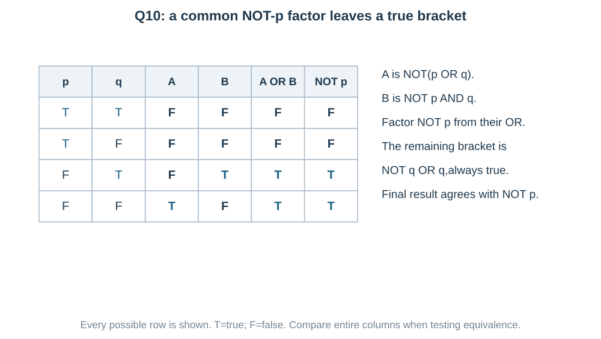

$$
\boxed{\neg p;\quad\text{(c)}}.
$$

**Another possible approach:** compare all four truth rows with the options. Factoring is shorter here because the bracket becomes the familiar always-true pattern $q\vee\neg q$.

---

### Question 11 — Use the letters actually printed in the implication

**PDF page 140 | MCQ | Notes: C05**

The inverse of the statement $q\to p$ is

- (a) $\sim p\to\sim q$
- (b) $p\to q$
- (c) $q\to\sim p$
- (d) $\sim q\to\sim p$

**The printed original is $q\to p$.** Do not replace it by $p\to q$ before applying the rule.

For $a\to b$,the inverse is $\neg a\to\neg b$. Here $a=q$ and $b=p$,so

$$
\boxed{\neg q\to\neg p;\quad\text{(d)}}.
$$

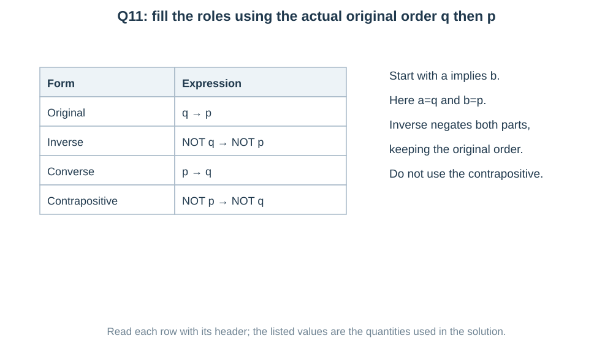

**Compare the nearby options:** $\neg p\to\neg q$ is the contrapositive of this original; $p\to q$ is its converse. Neither is the requested inverse.

**A wording detail:** options (b) and (d) are logically equivalent,because converse and inverse always have the same truth values. A truth table therefore cannot distinguish them. The source asks for the **named inverse form**: negate both parts and keep their order,which directly gives (d). If it asked for any logically equivalent expression,that would be a different question.

The labels describe changes in roles,not a fixed spelling in $p,q$.

---

### Question 12 — A statement needs a definite truth value

**PDF page 140 | Numerical value | Notes: C01**

Among the sentences: (i) The sum of the interior angles of a triangle is $180^\circ$. (ii) Close the door. (iii) $x+3=5$. (iv) Is $7$ a prime number? (v) $9$ is a perfect square. (vi) Mumbai is a beautiful city.

The number of sentences that are mathematically acceptable statements is ____.

**A statement needs a definite truth value;it need not always be true.** Evaluate the type of each sentence:

1. The triangle-angle sum is a definite true statement in the usual Euclidean setting.
2. “Close the door” is a command.
3. $x+3=5$ has a free,unspecified $x$,so it is an open sentence.
4. “Is 7 a prime number?” asks a question;it does not assert an answer.
5. “9 is a perfect square” is a definite true statement.
6. “Mumbai is a beautiful city” is subjective here,without a fixed mathematical truth test.

Only (i) and (v) qualify:

$$
\boxed{2}.
$$

**Useful connection:** assigning $x=2$ or quantifying the variable would turn the open sentence into a statement. A definite false claim such as “10 is a perfect square” would also count as a statement.

---

### Question 13 — Evaluate the inner pieces before the final connector

**PDF page 140 | MCQ | Notes: C02,C04**

Given that $p,q,r$ have truth values T,F,T respectively,the statement which is TRUE among the following is

- (a) $(p\wedge q)\vee\sim r$
- (b) $(q\to r)\wedge(p\vee q)$
- (c) $(p\to q)\wedge r$
- (d) $(q\to p)\wedge(r\to q)$

**Substitute the fixed truth values into the smallest brackets first.** Here $p=T,q=F,r=T$,so $\neg r=F$.

$$
\begin{aligned}
\text{(a)}\quad &(T\wedge F)\vee F=F,\\
\text{(b)}\quad &(F\to T)\wedge(T\vee F)=T\wedge T=T,\\
\text{(c)}\quad &(T\to F)\wedge T=F,\\
\text{(d)}\quad &(F\to T)\wedge(T\to F)=T\wedge F=F.
\end{aligned}
$$

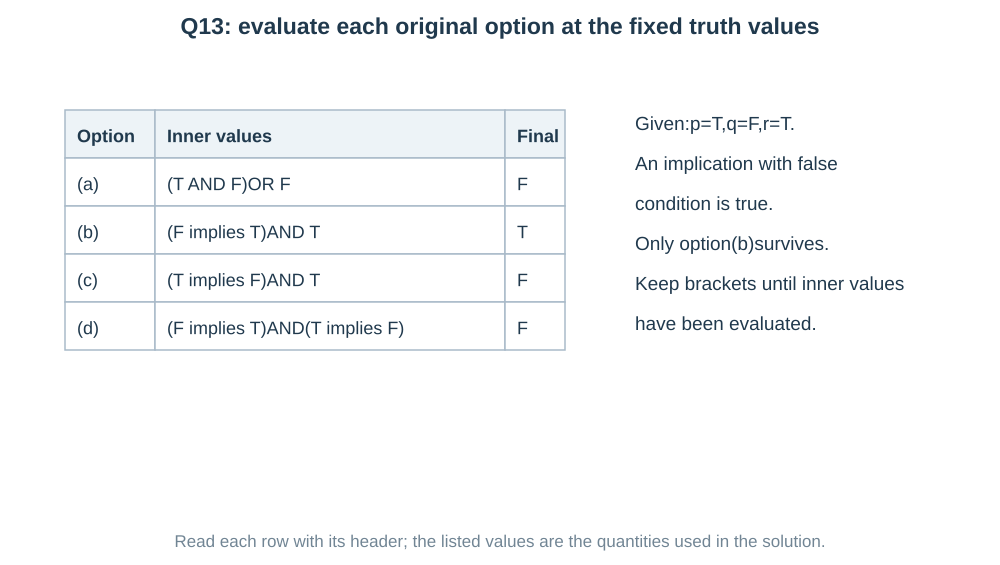

$$
\boxed{\text{(b)}}.
$$

**The likely trap:** $F\to T$ is true,not false. A false condition does not break an implication. Only $T\to F$ does.

A full eight-row table is valid but unnecessary: the question fixes one assignment.

---

### Question 14 — Two true blocks form a union of assignments

**PDF page 140 | Numerical value | Notes: C02,C10**

For the compound statement $(p\wedge q)\vee(r\wedge s)$,the number of truth-value assignments to $p,q,r,s$ for which it is true is ____.

**Treat the two conjunctions as blocks.** There are $2^4=16$ assignments in total. The final OR is false only if both blocks are false.

For $(p,q)$,the conjunction $p\wedge q$ is false in TF,FT,FF: three choices. Independently,the pair $(r,s)$ has three choices making its conjunction false.

Thus false assignments $=3\cdot3=9$:

$$
\boxed{\text{true assignments}=16-9=7}.
$$

**Another possible approach — inclusion-exclusion:** fixing $p=q=T$ leaves four choices for $(r,s)$. Fixing $r=s=T$ leaves four choices for $(p,q)$. The all-true assignment was counted twice,so subtract one:

$$
4+4-1=7.
$$

**Read the grid:** rows select $(p,q)$ and columns select $(r,s)$. The first row or first column makes at least one conjunction true. The overlap is one cell,not two assignments.

---

### Question 15 — Dual swaps connectors and constants,not the letters

**PDF page 140 | MCQ | Notes: C09**

The dual of the statement $(p\wedge\sim q)\vee t$ (where $t$ is a tautology and $c$ a contradiction) is

- (a) $(\sim p\vee q)\wedge c$
- (b) $(p\vee\sim q)\wedge t$
- (c) $(p\vee\sim q)\wedge c$
- (d) $(p\wedge\sim q)\vee c$

**The word is “dual,”so use connector swaps,not a negation rule.** Replace AND by OR,OR by AND,and the always-true constant $t$ by the always-false constant $c$.

Keep $p$ and the existing $\neg q$ unchanged:

$$
(p\wedge\neg q)\vee t
\quad\longmapsto\quad
(p\vee\neg q)\wedge c.
$$

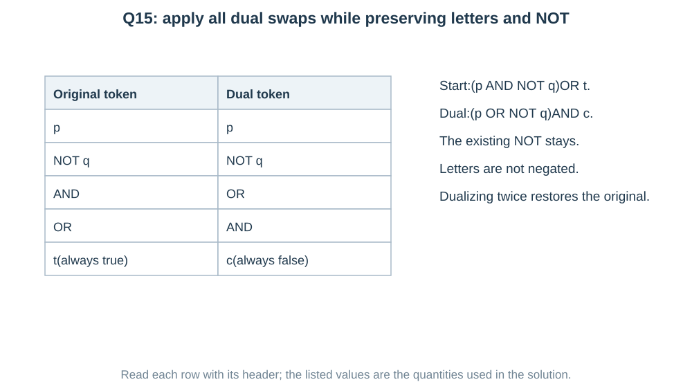

$$
\boxed{(p\vee\neg q)\wedge c;\quad\text{(c)}}.
$$

**Check:** the original is always true because it ORs with $t$. Its dual is always false because it ANDs with $c$. Duality does not mean equivalence to the original.

De Morgan's laws would apply to an actual NOT outside a bracket. There is no new outside NOT in this question.

**Why an all-false truth column is not enough here:** option (a) also becomes false because it ANDs with $c$. But it additionally changes the letters' negations,so it is not the form produced by the requested dual operation. Use the exact connector-swap rule;do not choose solely by the final truth value.

## Answer check

Read the qualifications in the solutions before using the key.

| Question | Answer | Question | Answer |
|---|---|---|---|
| 1 | (c) | 9 | (a) |
| 2 | (a) | 10 | (c) |
| 3 | (d) | 11 | (d) |
| 4 | (b) | 12 | $2$ |
| 5 | $3$ | 13 | (b) |
| 6 | (b) | 14 | $7$ |
| 7 | (d) | 15 | (c) |
| 8 | $4$ |  |  |

## End of the supplied Maths chapters

All15 source questions in this supporting chapter are solved. For current JEE Main preparation,prioritize the current official syllabus;this older-syllabus chapter is retained because it belongs to your supplied PDF. Use its logic skills when checking conditions and proofs elsewhere. Alternative explanations are fully visible. The supplied questions are practice,not verified actual PYQs. The final printed booklet is a separate production stage.
